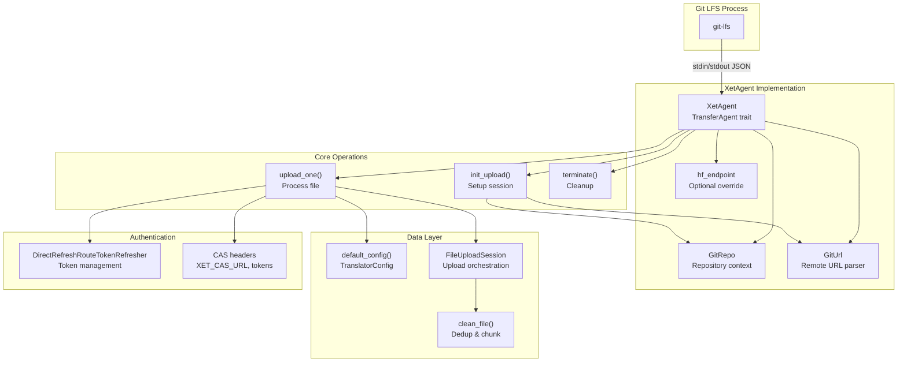
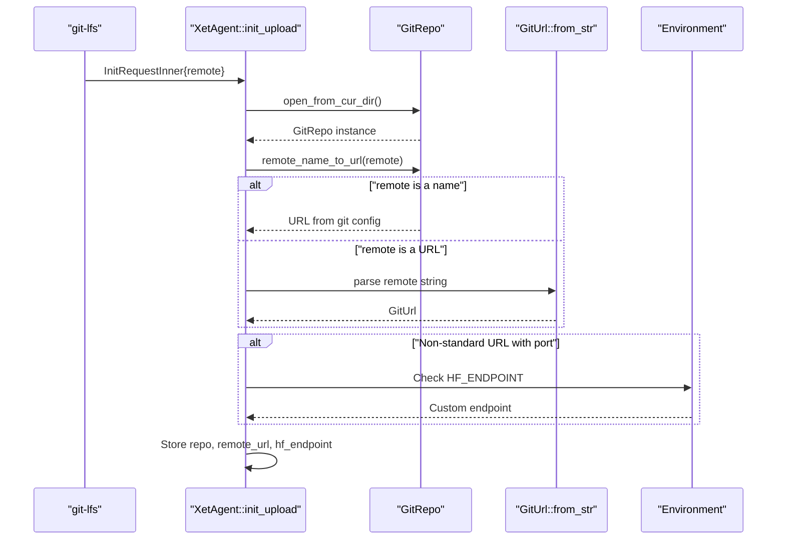
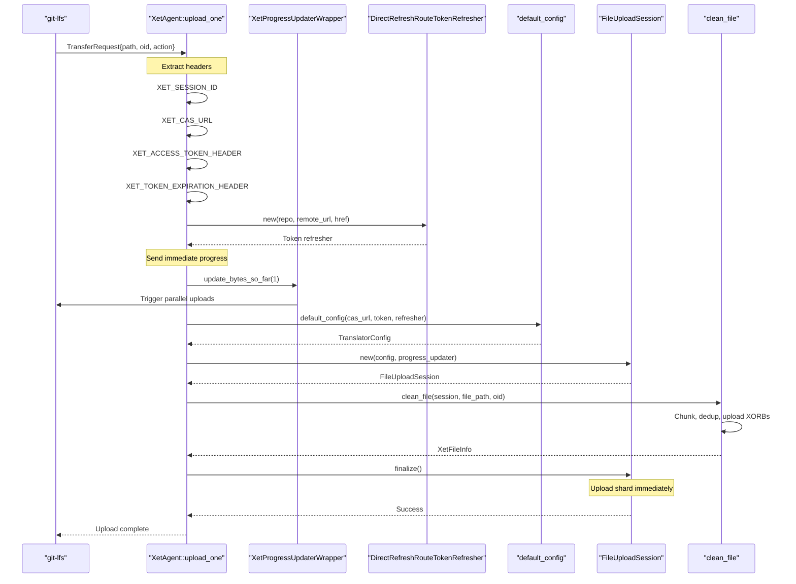
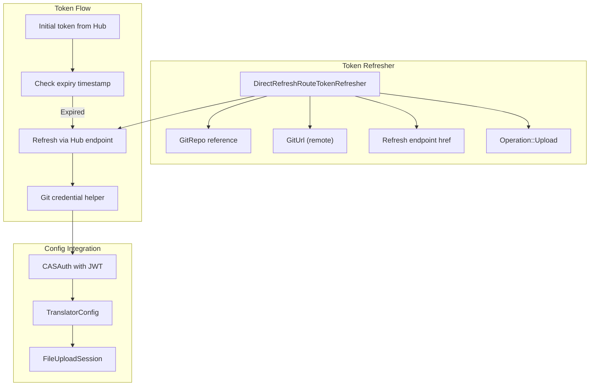
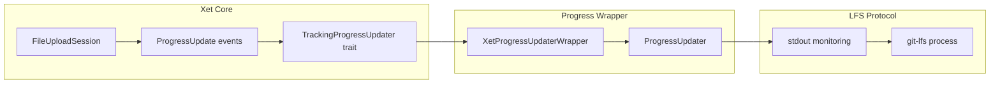

<!-- source: DeepWiki mcp.deepwiki.com · repo huggingface/xet-core · page 4.2 Git LFS Integration · fetched 2026-10-26 -->

# Git LFS Integration

<details>
<summary>Relevant source files</summary>

The following files were used as context for generating this wiki page:

- [data/src/bin/xtool.rs](data/src/bin/xtool.rs)
- [data/src/migration_tool/migrate.rs](data/src/migration_tool/migrate.rs)
- [data/src/remote_client_interface.rs](data/src/remote_client_interface.rs)
- [git_xet/src/app/xet_agent.rs](git_xet/src/app/xet_agent.rs)

</details>


This document covers the `git-xet` custom transfer agent that integrates xet-core's deduplication and content-addressable storage with Git Large File Storage (LFS) workflows. The agent implements the Git LFS custom transfer protocol to enable efficient file handling within Git repositories.

For command-line tools, see page 4.1. For details about the underlying file upload system, see page 5.1.
</thinking>

## Overview

Git LFS allows custom transfer agents to handle file upload and download operations using alternative protocols. The `git-xet` binary implements a custom transfer agent that:

- Uploads files through the xet-core deduplication pipeline
- Integrates with Hugging Face Hub authentication
- Provides progress tracking compatible with Git LFS expectations
- Manages token refresh for long-running operations

The agent communicates with Git LFS through stdin/stdout using the standardized JSON-based protocol, processing files sequentially as requested by Git LFS.

**Sources:** [git_xet/src/app/xet_agent.rs:1-177]()

## XetAgent Architecture

The `XetAgent` struct implements the `TransferAgent` trait to handle Git LFS custom transfer operations:

XetAgent Component Architecture


**Sources:** [git_xet/src/app/xet_agent.rs:26-31](), [git_xet/src/app/xet_agent.rs:33-165]()

### Key Components

| Component | Type | Purpose |
|-----------|------|---------|
| `repo` | `OnceLock<GitRepo>` | Git repository context, initialized once |
| `remote_url` | `Option<GitUrl>` | Parsed remote URL for authentication |
| `hf_endpoint` | `Option<String>` | Optional HF Hub endpoint override |

**Sources:** [git_xet/src/app/xet_agent.rs:26-31]()

## Upload Initialization

The `init_upload` method prepares the agent for file uploads by resolving the Git repository context and remote URL:

Upload Initialization Flow


**Sources:** [git_xet/src/app/xet_agent.rs:34-61]()

### Configuration Detection

The initialization process handles different remote URL formats:

| Remote Format | Detection | HF Endpoint |
|--------------|-----------|-------------|
| Named remote (`origin`) | `remote_name_to_url()` | From URL |
| HTTP/HTTPS URL | Direct parsing | From URL |
| Custom scheme/port | Manual parsing | `HF_ENDPOINT` env required |

**Sources:** [git_xet/src/app/xet_agent.rs:36-54]()

## File Upload Process

The `upload_one` method processes individual file uploads through the xet-core pipeline:

Single File Upload Flow


**Sources:** [git_xet/src/app/xet_agent.rs:70-152]()

### Upload Configuration

File uploads require several headers from the Hub:

| Header | Constant | Purpose |
|--------|----------|---------|
| Session ID | `XET_SESSION_ID` | Upload session identifier |
| CAS URL | `XET_CAS_URL` | Content-addressable storage endpoint |
| Access Token | `XET_ACCESS_TOKEN_HEADER` | JWT for CAS authentication |
| Token Expiration | `XET_TOKEN_EXPIRATION_HEADER` | Token expiry timestamp |

**Sources:** [git_xet/src/app/xet_agent.rs:80](), [git_xet/src/app/xet_agent.rs:106-124](), [git_xet/src/constants.rs]()

## Authentication and Token Management

The agent uses `DirectRefreshRouteTokenRefresher` to maintain valid JWT tokens throughout the upload process:

Token Refresh Architecture


**Sources:** [git_xet/src/app/xet_agent.rs:82-89](), [git_xet/src/token_refresher.rs]()

### Token Lifecycle

The token refresher ensures continuous authentication:

1. **Initial Token**: Extracted from `XET_ACCESS_TOKEN_HEADER` in transfer request
2. **Expiry Tracking**: Monitored via `XET_TOKEN_EXPIRATION_HEADER` timestamp
3. **Automatic Refresh**: Triggered before expiry through Hub's refresh endpoint
4. **Credential Fallback**: Uses Git credential helper if interactive auth needed

**Sources:** [git_xet/src/app/xet_agent.rs:112-124](), [git_xet/src/app/xet_agent.rs:82-89]()

## Progress Tracking

The agent implements progress tracking compatible with Git LFS protocol requirements through `XetProgressUpdaterWrapper`:

Progress Update Integration


**Sources:** [git_xet/src/app/xet_agent.rs:167-176](), [git_xet/src/app/xet_agent.rs:102-104]()

### Initial Progress Signal

Git LFS has special handling for the first worker in a batch:

```
// From git-lfs protocol:
// First worker is the only one allowed to start immediately.
// The rest wait until successful response from 1st worker to
// make sure only 1 login prompt is presented if necessary.
```

The agent sends an immediate progress update (1 byte) to trigger simultaneous uploads since xet-core doesn't require interactive authentication:

```rust
progress_updater.update_bytes_so_far(1)?;
```

**Sources:** [git_xet/src/app/xet_agent.rs:90-100]()

### Progress Update Flow

The `XetProgressUpdaterWrapper` implements `TrackingProgressUpdater` to translate xet-core progress events to LFS format:

| Xet Event | Field | LFS Update |
|-----------|-------|------------|
| `ProgressUpdate` | `total_bytes_completed` | `bytes_so_far` |

**Sources:** [git_xet/src/app/xet_agent.rs:172-175]()

## Platform Support and Limitations

The WebAssembly interface supports multiple JavaScript runtime environments with varying capabilities:

| Environment | Thin Module | Full Module | Threading | File System |
|-------------|-------------|-------------|-----------|------------|
| Browser | ✅ | ✅ | Limited | None |
| Web Worker | ✅ | ✅ | Yes | None |
| Node.js | ✅ | ✅ | Yes | Limited |
| Service Worker | ✅ | ⚠️ | No | None |

The full module requires environments that support:
- WebAssembly threads (`wasm_thread`)
- Async/await with Tokio runtime (`tokio_with_wasm`)
- Web APIs for file handling (`web-sys` features)

**Sources:** [hf_xet_wasm/Cargo.toml:38](), [hf_xet_wasm/Cargo.toml:41](), [.github/workflows/ci.yml:88-91]()

---

