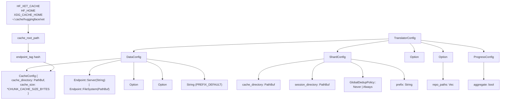
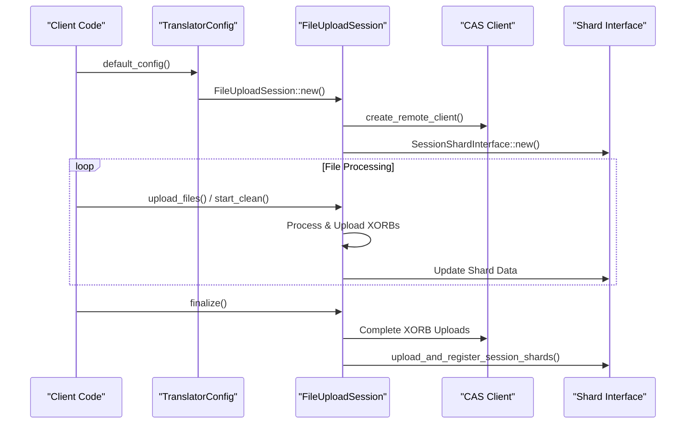

<!-- source: DeepWiki mcp.deepwiki.com · repo huggingface/xet-core · page 5 File Processing Workflows · fetched 2026-10-26 -->

# File Processing Workflows

Relevant source files

The following files were used as context for generating this wiki page:

- [cas_client/src/adaptive_concurrency/controller.rs](cas_client/src/adaptive_concurrency/controller.rs)
- [data/src/bin/example.rs](data/src/bin/example.rs)
- [data/src/data_client.rs](data/src/data_client.rs)
- [data/src/file_download_session.rs](data/src/file_download_session.rs)
- [data/src/file_upload_session.rs](data/src/file_upload_session.rs)
- [data/src/lib.rs](data/src/lib.rs)
- [data/src/test_utils.rs](data/src/test_utils.rs)
- [data/tests/test_clean_smudge.rs](data/tests/test_clean_smudge.rs)
- [data/tests/test_session_resume.rs](data/tests/test_session_resume.rs)
- [file_reconstruction/Cargo.toml](file_reconstruction/Cargo.toml)
- [file_reconstruction/src/data_writer/data_writer.rs](file_reconstruction/src/data_writer/data_writer.rs)
- [file_reconstruction/src/data_writer/sequential_writer.rs](file_reconstruction/src/data_writer/sequential_writer.rs)
- [file_reconstruction/src/error.rs](file_reconstruction/src/error.rs)
- [file_reconstruction/src/file_reconstructor.rs](file_reconstruction/src/file_reconstructor.rs)
- [xet_config/src/groups/reconstruction.rs](xet_config/src/groups/reconstruction.rs)

This page provides an overview of how files move through xet-core during upload and download operations. Files are transformed between their original format and a content-addressable storage (CAS) representation consisting of deduplicated chunks, compressed XORBs, and metadata shards.

The system provides two primary workflows:
- **Upload Workflow (5.1)**: Chunks files using content-defined chunking, deduplicates against existing data, aggregates chunks into XORBs, and uploads metadata shards
- **Download Workflow (5.2)**: Queries metadata shards for file reconstruction information, fetches required XORBs, and reassembles chunks in correct order
- **File Reconstruction (5.3)**: Manages buffering, prefetching, and sequential writing during downloads

For underlying component details, see [Data Client and Sessions](#3.2), [CAS Client System](#3.3), [CAS Object Format](#3.4), and [Shard Management System](#3.5).

## Overview

File processing in xet-core follows distinct stages for uploads and downloads, coordinated through session objects that manage state, concurrency, and progress tracking.

### Processing Stages Comparison

| Stage | Upload Workflow | Download Workflow |
|-------|----------------|-------------------|
| **Entry Point** | `data_client::upload_async()` `data_client::upload_bytes_async()` | `data_client::download_async()` |
| **Session Creation** | `FileUploadSession::new()` Creates `SessionShardInterface` | `FileDownloadSession::new()` Creates CAS client |
| **Processing Unit** | `SingleFileCleaner` per file Reads file in blocks | `FileReconstructor` per file Queries reconstruction terms |
| **Core Operation** | `Chunker::next_block_bytes()` `DataAggregator::add_chunk()` Deduplication queries | `ReconstructionTermManager::next_file_terms()` `SequentialWriter::set_next_term_data_source()` |
| **Batching** | Aggregate chunks into XORBs (`MAX_XORB_BYTES`, `MAX_XORB_CHUNKS`) | Prefetch multiple terms Buffer management with permits |
| **Network I/O** | `RemoteClient::upload_xorb()` `RemoteClient::upload_shard()` | `RemoteClient::download_xorb_chunks()` Cache lookups first |
| **Finalization** | `FileUploadSession::finalize()` Uploads remaining XORBs and shards | `SequentialWriter::finish()` Flushes write buffers |
| **Output** | `Vec<XetFileInfo>` (file hash, size, reconstruction info) | `Vec<String>` (output file paths) |

### Concurrency Control

Both workflows manage concurrency at multiple levels:

| Concurrency Limit | Purpose | Configuration |
|-------------------|---------|---------------|
| File ingestion semaphore | Limits concurrent file processing during upload | `XetConfig.data.max_concurrent_file_ingestion` |
| File download semaphore | Limits concurrent file downloads | `XetConfig.data.max_concurrent_file_download` |
| XORB upload semaphore | Limits concurrent XORB uploads | `AdaptiveConcurrencyController` (upload) |
| XORB download semaphore | Limits concurrent XORB fetches | `AdaptiveConcurrencyController` (download) |
| Reconstruction buffer | Limits memory used for prefetched data | `AdjustableSemaphore` with dynamic scaling |

Sources: [data/src/data_client.rs:95-127](), [data/src/data_client.rs:140-197](), [data/src/data_client.rs:199-257](), [data/src/file_upload_session.rs:68-141](), [data/src/file_download_session.rs:33-54]()

## Configuration and Session Management

File processing workflows are configured through the `TranslatorConfig` system which coordinates CAS client settings, shard management, and caching. The `default_config()` function in `data_client` creates configurations with environment-based cache paths:

### Configuration Structure

### Data Client Entry Points

The `data_client` module provides the main entry points for file processing workflows:

| Function | Purpose | Input | Output |
|----------|---------|--------|---------|
| `upload_async()` | Upload files from filesystem paths | `Vec<String>` file paths | `Vec<XetFileInfo>` |
| `upload_bytes_async()` | Upload in-memory byte arrays | `Vec<Vec<u8>>` file contents | `Vec<XetFileInfo>` |
| `download_async()` | Download files to filesystem paths | `Vec<(XetFileInfo, String)>` pairs | `Vec<String>` output paths |
| `clean_file()` | Convert single file to XetFileInfo | File path + session | `(XetFileInfo, DeduplicationMetrics)` |
| `clean_bytes()` | Convert byte array to XetFileInfo | Bytes + session | `(XetFileInfo, DeduplicationMetrics)` |

Sources: [data/src/configurations.rs:77-83](), [data/src/data_client.rs:41-86](), [data/src/configurations.rs:18-74](), [data/src/data_client.rs:121-144](), [data/src/data_client.rs:156-189](), [data/src/data_client.rs:191-228]()

### Session Lifecycle

Sources: [data/src/file_upload_session.rs:96-187](), [data/src/file_upload_session.rs:477-533]()

---

