<!-- source: DeepWiki mcp.deepwiki.com · repo huggingface/xet-core · page 5.1 Upload Workflow · fetched 2026-10-26 -->

# Upload Workflow

<details>
<summary>Relevant source files</summary>

The following files were used as context for generating this wiki page:

- [cas_client/src/interface.rs](cas_client/src/interface.rs)
- [cas_client/src/lib.rs](cas_client/src/lib.rs)
- [data/src/bin/example.rs](data/src/bin/example.rs)
- [data/src/data_client.rs](data/src/data_client.rs)
- [data/src/file_upload_session.rs](data/src/file_upload_session.rs)
- [data/src/lib.rs](data/src/lib.rs)
- [data/src/shard_interface.rs](data/src/shard_interface.rs)
- [data/tests/test_clean_smudge.rs](data/tests/test_clean_smudge.rs)
- [hf_xet/Cargo.lock](hf_xet/Cargo.lock)
- [hf_xet/Cargo.toml](hf_xet/Cargo.toml)
- [hf_xet/src/lib.rs](hf_xet/src/lib.rs)
- [hf_xet_wasm/src/wasm_file_upload_session.rs](hf_xet_wasm/src/wasm_file_upload_session.rs)

</details>


## Purpose and Scope

This document provides a detailed walkthrough of the file upload process in xet-core, from the initial API call through content-defined chunking, XORB creation, and final shard upload. It covers the complete pipeline that transforms files into deduplicated, content-addressable storage objects.

For information about downloading and reconstructing files, see [Download Workflow](#5.2). For details on the file reconstruction algorithms, see [File Reconstruction](#5.3). For architectural context on content-addressable storage, see [Content-Addressable Storage Design](#2.1).

---

## Upload Process Overview

The upload workflow consists of several stages that transform user files into deduplicated content-addressable storage objects:

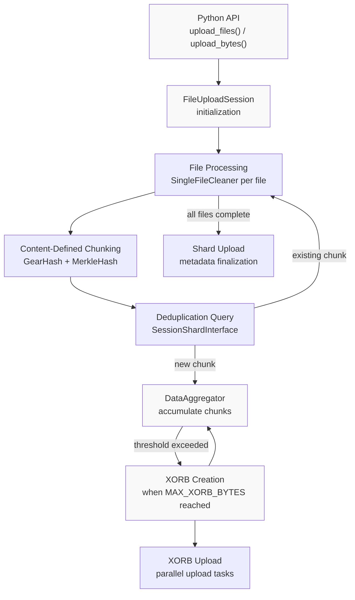

**Sources:** [data/src/data_client.rs:130-197](), [data/src/file_upload_session.rs:1-537](), High-level Diagram 2

---

## Entry Points

### Python API Functions

The system exposes two primary upload functions through the Python API:

| Function | Purpose | Input | Output |
|----------|---------|-------|--------|
| `upload_files()` | Upload files from disk | List of file paths, optional SHA256s | List of `PyXetUploadInfo` (hash + size) |
| `upload_bytes()` | Upload in-memory data | List of byte arrays | List of `PyXetUploadInfo` (hash + size) |

Both functions accept optional parameters:
- `endpoint`: CAS server URL (defaults to configured endpoint)
- `token_info`: Authentication token and expiration
- `token_refresher`: Callback for refreshing expired tokens
- `progress_updater`: Callback for progress updates
- `request_headers`: Custom HTTP headers

**Sources:** [hf_xet/src/lib.rs:130-189]()

### Rust Implementation Entry

The Python functions delegate to async Rust implementations:

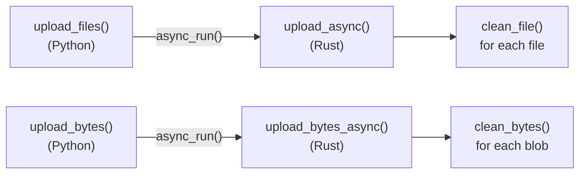

The `async_run()` bridge releases the Python GIL, spawns an OS thread (not tokio thread to avoid TLS corruption), and executes the async Rust code.

**Sources:** [hf_xet/src/lib.rs:130-189](), [data/src/data_client.rs:95-127](), [data/src/data_client.rs:140-197]()

---

## Session Initialization

### FileUploadSession Creation

The `FileUploadSession` orchestrates the entire upload process:

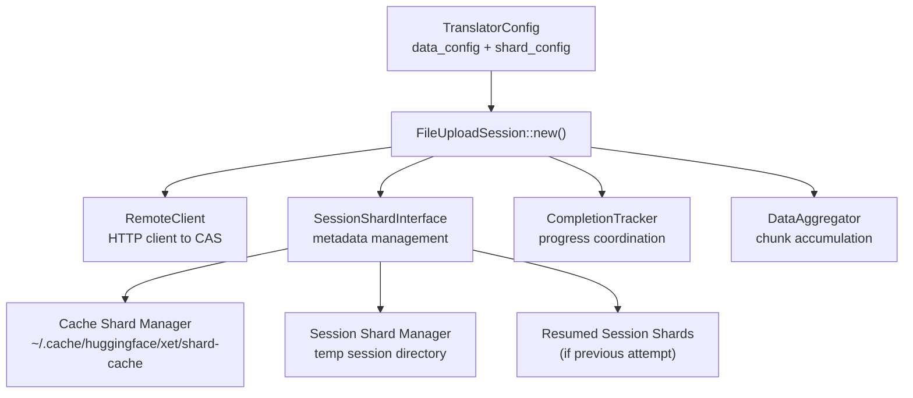

**Key session components:**

| Component | Type | Purpose |
|-----------|------|---------|
| `client` | `Arc<dyn Client>` | Remote CAS client for uploads |
| `shard_interface` | `SessionShardInterface` | Manages MDB shards and dedup queries |
| `completion_tracker` | `Arc<CompletionTracker>` | Tracks file/XORB dependencies and progress |
| `current_session_data` | `Mutex<DataAggregator>` | Accumulates chunks across files |
| `xorb_upload_tasks` | `Mutex<JoinSet>` | Manages parallel XORB upload tasks |
| `deduplication_metrics` | `Mutex<DeduplicationMetrics>` | Tracks dedup statistics |

**Sources:** [data/src/file_upload_session.rs:40-141](), [data/src/shard_interface.rs:26-133]()

### Configuration and Staging Setup

The session sets up several directories:

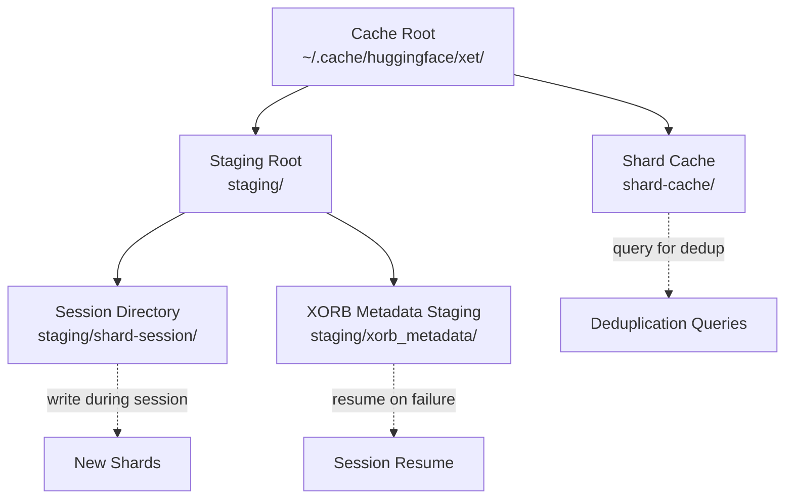

The cache root is computed with an endpoint-specific tag to keep different endpoints isolated.

**Sources:** [data/src/data_client.rs:27-93](), [data/src/shard_interface.rs:53-133]()

---

## File Processing Pipeline

### SingleFileCleaner

Each file is processed by a dedicated `SingleFileCleaner` instance, allowing parallel file processing:

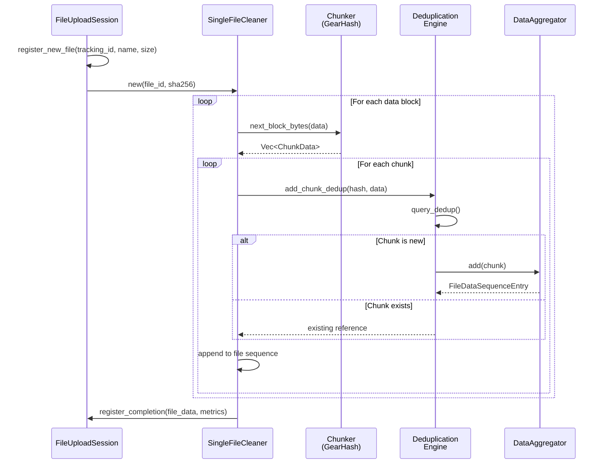

**Key responsibilities:**
1. Read file data in blocks (configurable `ingestion_block_size`)
2. Feed blocks to the chunker for content-defined chunking
3. For each chunk, query deduplication and accumulate data
4. Track file reconstruction information (sequence of chunk references)
5. Report metrics (new bytes, deduped bytes, etc.)

**Sources:** [data/src/file_upload_session.rs:143-245](), [data/src/data_client.rs:274-310]()

### Reading and Chunking

File data is read in blocks to balance memory usage and I/O efficiency:

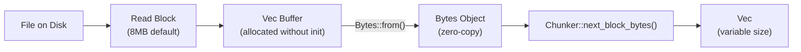

**Optimization note:** The code allocates the buffer with `Vec::with_capacity()` + `unsafe { buffer.set_len() }` to avoid initialization overhead, since `read_exact()` will fill the entire buffer.

**Sources:** [data/src/file_upload_session.rs:184-216]()

### Content-Defined Chunking

The `Chunker` uses GearHash for content-defined chunking (CDC):

| Parameter | Default Value | Purpose |
|-----------|---------------|---------|
| `TARGET_CHUNK_SIZE` | 256 KB | Average chunk size target |
| `MIN_CHUNK_SIZE` | 128 KB | Minimum chunk size |
| `MAX_CHUNK_SIZE` | 1 MB | Maximum chunk size |

Each chunk is identified by its `MerkleHash`, computed from the chunk content. This enables content-based deduplication across files.

**Sources:** [deduplication module](), see [Deduplication Architecture](#2.3) for details

---

## Deduplication Process

### Deduplication Query Flow

Before adding a chunk to the `DataAggregator`, the system queries whether the chunk already exists:

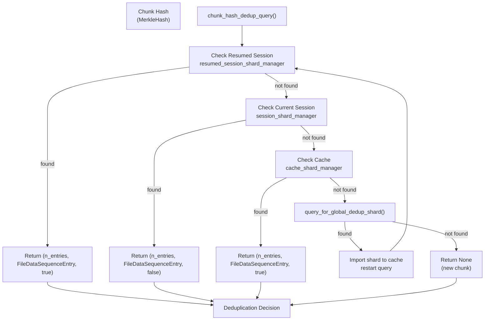

The third boolean in the return tuple indicates whether the chunk is "external" (already uploaded) or "internal" (only in this session).

**Sources:** [data/src/shard_interface.rs:154-180](), [data/src/shard_interface.rs:135-151]()

### Deduplication Metrics

The system tracks detailed deduplication statistics:

| Metric | Description |
|--------|-------------|
| `new_bytes` | Bytes in newly created chunks |
| `deduped_bytes` | Bytes saved through deduplication |
| `defrag_prevented_dedup_bytes` | Bytes that could have been deduped but weren't (to avoid fragmentation) |
| `new_chunks` | Count of new chunks created |
| `deduped_chunks` | Count of chunks deduplicated |
| `defrag_prevented_dedup_chunks` | Count of chunks not deduped to avoid fragmentation |

**Sources:** [data/src/file_upload_session.rs:56-58](), [data/src/data_client.rs:188-194]()

---

## DataAggregator and XORB Creation

### Accumulating Chunks Across Files

The `DataAggregator` accumulates chunks from multiple files to maximize deduplication and create efficient XORBs:

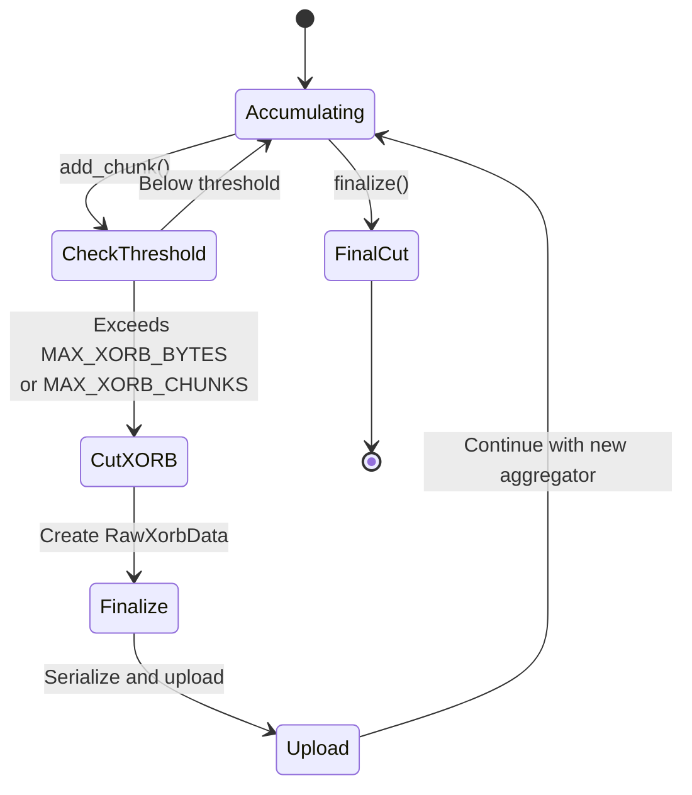

**XORB cutting thresholds:**

| Threshold | Default Value | Purpose |
|-----------|---------------|---------|
| `MAX_XORB_BYTES` | 64 MB | Maximum uncompressed data per XORB |
| `MAX_XORB_CHUNKS` | 8192 | Maximum chunk count per XORB |

**Sources:** [deduplication/constants](), [data/src/file_upload_session.rs:368-410]()

### XORB Creation Logic

When the aggregator exceeds thresholds, the system cuts a XORB:

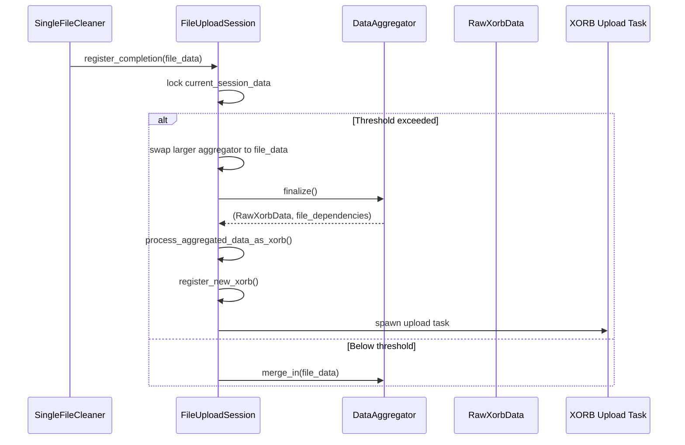

The system always cuts the **larger** of the two aggregators to minimize the number of XORBs created.

**Sources:** [data/src/file_upload_session.rs:368-442]()

---

## XORB Upload Process

### Parallel Upload Tasks

XORBs are uploaded in parallel using a `JoinSet` of async tasks:

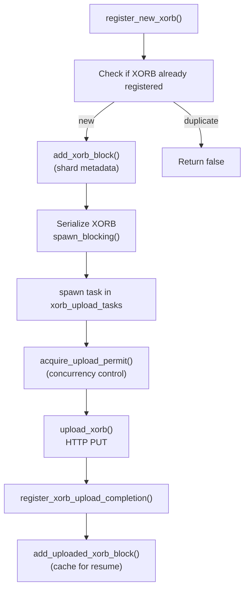

**Key aspects:**

1. **Deduplication check:** The `completion_tracker.register_new_xorb()` returns false if the same XORB hash was already registered, preventing duplicate uploads.

2. **Serialization:** XORB serialization (compression) runs on `spawn_blocking()` to avoid blocking the async runtime.

3. **Concurrency control:** The `AdaptiveConcurrencyController` dynamically adjusts upload parallelism based on network conditions.

4. **Progress tracking:** A progress callback reports upload progress, converting compressed bytes to raw bytes for accurate progress display.

**Sources:** [data/src/file_upload_session.rs:274-365]()

### XORB Serialization

XORBs are serialized without footers (the server reconstructs them from chunk data):

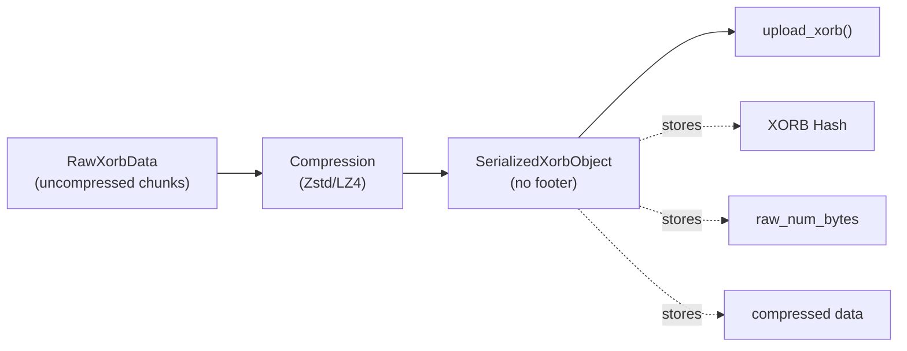

The compression scheme is configurable (`CompressionScheme::Zstd` or `CompressionScheme::Lz4`).

**Sources:** [data/src/file_upload_session.rs:324-326](), [xorb_object module]()

### Upload Progress Reporting

Progress is reported in terms of **raw bytes** (uncompressed), not transfer bytes:

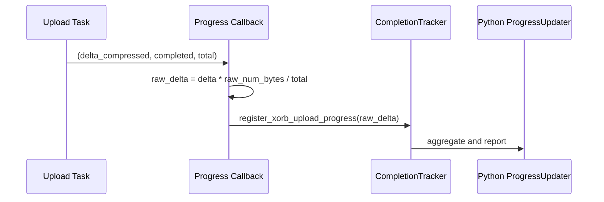

This ensures progress is meaningful to users who see progress in terms of file content, not compressed transfer size.

**Sources:** [data/src/file_upload_session.rs:334-341]()

---

## Shard Management

### SessionShardInterface

The `SessionShardInterface` manages MDB shards during the upload session:

| Component | Type | Purpose |
|-----------|------|---------|
| `session_shard_manager` | `Arc<ShardFileManager>` | Manages session-specific shards (temp directory) |
| `cache_shard_manager` | `Arc<ShardFileManager>` | Manages cached shards (~/.cache) |
| `resumed_session_shard_manager` | `Option<Arc<ShardFileManager>>` | Holds shards from resumed session |
| `xorb_metadata_staging` | `Mutex<MDBInMemoryShard>` | Accumulates XORB metadata for periodic flushing |

**Sources:** [data/src/shard_interface.rs:26-50]()

### Shard Content Types

Shards store two types of metadata:

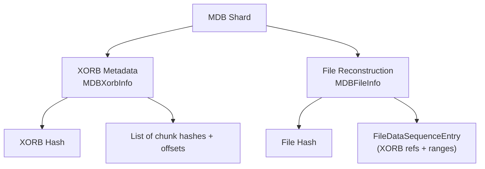

- **XORB metadata:** Added via `add_xorb_block()` when a XORB is created
- **File reconstruction:** Added via `add_file_reconstruction_info()` when a file completes

**Sources:** [data/src/shard_interface.rs:183-222]()

### XORB Metadata Staging

To enable session resume, XORB metadata is periodically flushed to disk:

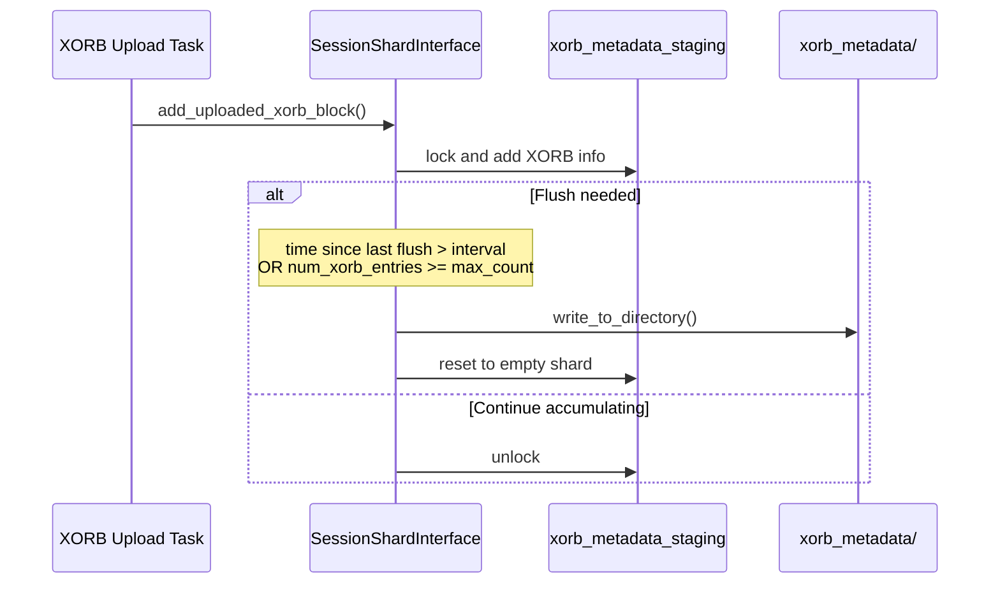

**Flush triggers:**

| Parameter | Default | Description |
|-----------|---------|-------------|
| `session_xorb_metadata_flush_interval` | 30 seconds | Time between flushes |
| `session_xorb_metadata_flush_max_count` | 1000 | Max XORB entries before flush |

**Sources:** [data/src/shard_interface.rs:189-215]()

---

## Finalization

### Finalization Sequence

The `finalize()` method completes the upload session:

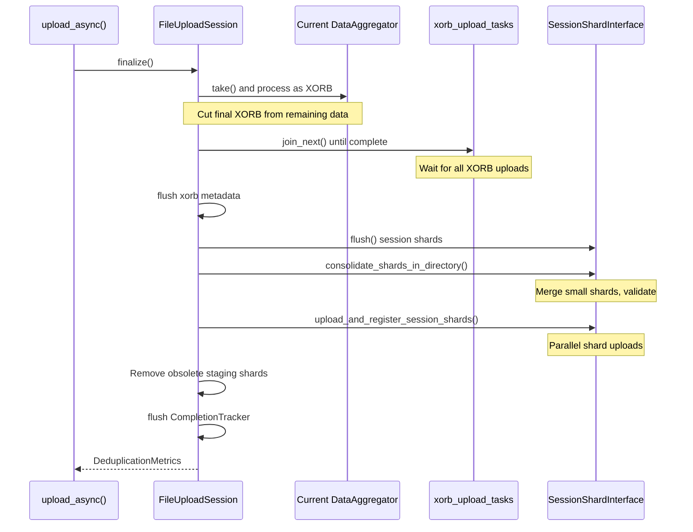

**Sources:** [data/src/file_upload_session.rs:450-537]()

### Shard Consolidation and Upload

Session shards are consolidated before upload:

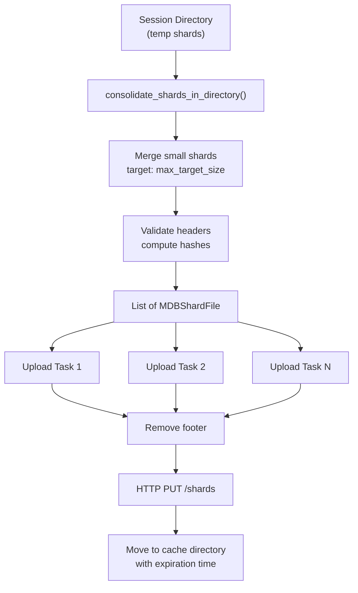

**Key steps:**

1. **Consolidation:** Small shards are merged to reduce the number of uploads
2. **Footer removal:** Shards are uploaded without the footer (lookup tables) - the server reconstructs them
3. **Parallel upload:** Each shard uploads in parallel with concurrency control
4. **Cache registration:** Successfully uploaded shards are moved to the cache directory for future dedup queries

**Sources:** [data/src/shard_interface.rs:232-312](), [data/src/shard_interface.rs:314-332]()

### Cleanup and Metrics

After successful upload:

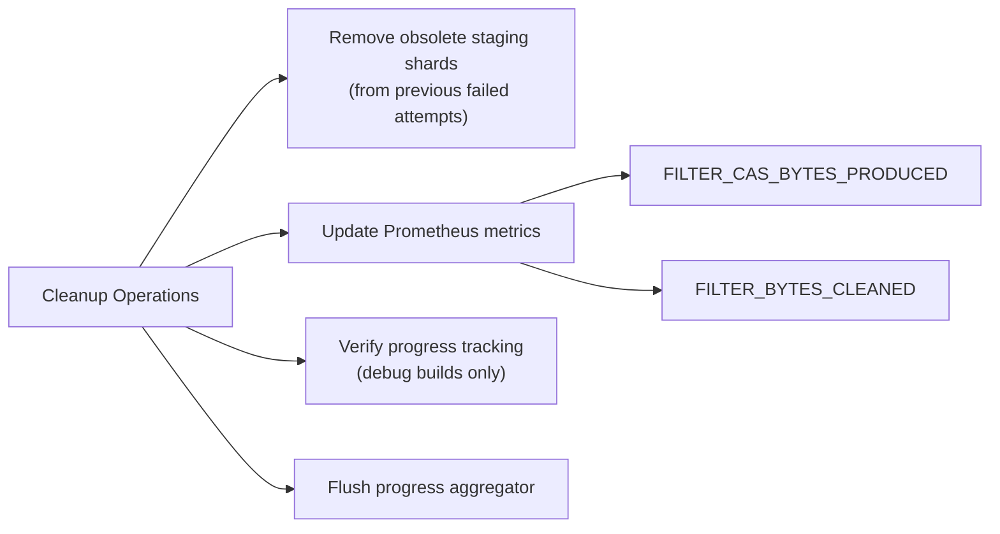

**Sources:** [data/src/file_upload_session.rs:478-502](), [data/src/shard_interface.rs:303-309]()

---

## Progress Tracking

### CompletionTracker Architecture

The `CompletionTracker` coordinates progress between files and XORBs:

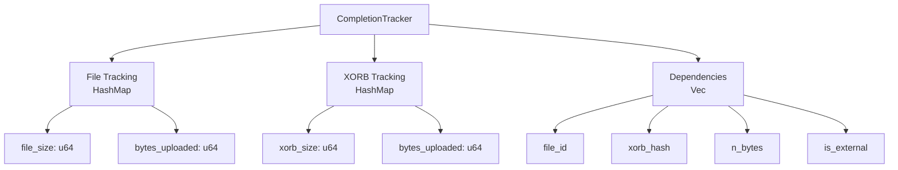

**Dependency tracking:** Each file's progress depends on the XORBs it references. The tracker maintains a list of `FileXorbDependency` records that specify which XORBs contribute to each file, and how many bytes from each XORB.

**Sources:** [progress_tracking module]()

### Progress Aggregation

Progress updates are aggregated before reporting to Python:

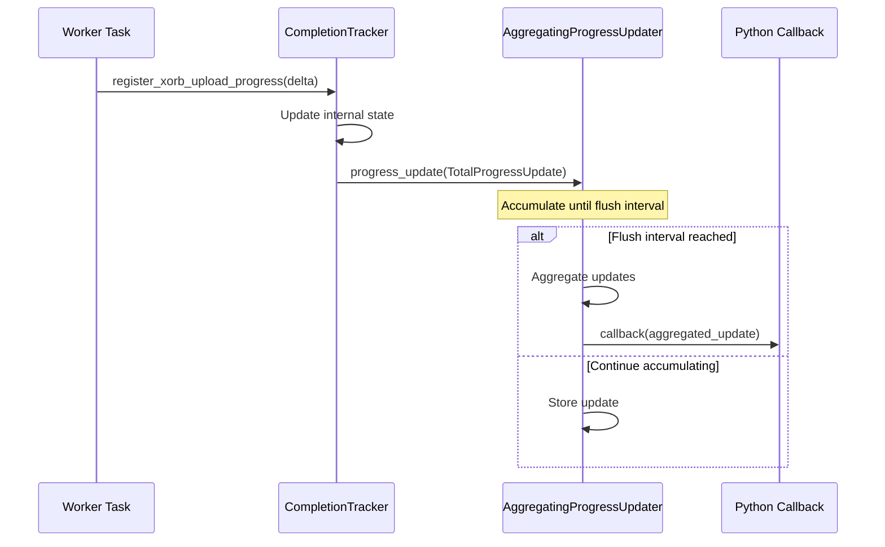

**Configuration:**

| Parameter | Default | Description |
|-----------|---------|-------------|
| `progress_update_interval` | 0.5 seconds | Time between progress flushes |
| `progress_update_speed_sampling_window` | 10 seconds | Window for speed calculation |

**Sources:** [data/src/file_upload_session.rs:94-111]()

---

## Concurrency and Memory Management

### Concurrency Limits

The system uses semaphores to control parallelism:

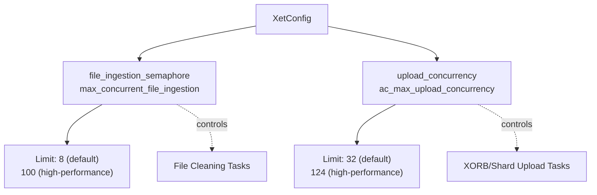

**Sources:** [xet_config module](), see [Configuration and Runtime](#3.7) for details

### Memory Management

Several mechanisms prevent unbounded memory growth:

```mermaid
graph TB
    Memory["Memory Management"]
    
    Memory --> BlockSize["Ingestion Block Size<br/>8MB default"]
    Memory --> XorbThreshold["XORB Cutting Thresholds<br/>64MB / 8192 chunks"]
    Memory --> UploadPermits["Upload Permits<br/>(acquired before spawn)"]
    Memory --> BufferReuse["Zero-Copy Buffers<br/>Bytes::from()"]
    
    BlockSize -.->|"limits"| FileRead["File Read Buffer"]
    XorbThreshold -.->|"prevents"| AggGrowth["DataAggregator Growth"]
    UploadPermits -.->|"prevents"| TaskSpam["Task Spawning Spam"]
    BufferReuse -.->|"avoids"| Copies["Memory Copies"]
```

**Key technique:** Upload permits are acquired **before** spawning upload tasks, forcing backpressure when the upload pipeline is saturated. Without this, an unlimited number of tasks could be spawned, each holding serialized XORB data in memory.

**Sources:** [data/src/file_upload_session.rs:165-166](), [data/src/file_upload_session.rs:329-330](), [data/src/shard_interface.rs:256-262]()

### Upload Permit Acquisition

```mermaid
sequenceDiagram
    participant Session as FileUploadSession
    participant Client as RemoteClient
    participant ACC as AdaptiveConcurrencyController
    participant Task as Upload Task
    
    Session->>Client: acquire_upload_permit()
    Client->>ACC: acquire_permit()
    
    Note over ACC: Blocks if at concurrency limit<br/>Adjusts limit based on network conditions
    
    ACC-->>Client: ConnectionPermit
    Client-->>Session: ConnectionPermit
    
    Session->>Task: spawn with permit
    Note over Task: Upload completes
    Task->>Task: drop(permit)
    Note over ACC: Permit released, next upload can proceed
```

**Sources:** [data/src/file_upload_session.rs:329](), [data/src/shard_interface.rs:262](), [cas_client/src/adaptive_concurrency]()

---

## Key Data Structures

### FileDataSequenceEntry

Describes a portion of a file's reconstruction:

| Field | Type | Description |
|-------|------|-------------|
| `xorb_hash` | `MerkleHash` | XORB containing the chunks |
| `xorb_start` | `u32` | Starting chunk index in XORB |
| `xorb_end` | `u32` | Ending chunk index in XORB |
| `file_start` | `u64` | Starting byte offset in file |
| `file_end` | `u64` | Ending byte offset in file |

**Sources:** [mdb_shard/file_structs module]()

### RawXorbData

Represents an uncompressed XORB before serialization:

| Field | Type | Description |
|-------|------|-------------|
| `data` | `Vec<(MerkleHash, Bytes)>` | Chunks with their hashes |
| `xorb_info` | `Arc<MDBXorbInfo>` | Metadata (chunk offsets, etc.) |

**Methods:**
- `hash()`: Computes the XORB's MerkleHash
- `num_bytes()`: Total uncompressed size
- `num_chunks()`: Chunk count

**Sources:** [deduplication module]()

### DeduplicationMetrics

Tracks deduplication statistics:

```mermaid
graph LR
    Metrics["DeduplicationMetrics"]
    
    Metrics --> NewBytes["new_bytes: u64"]
    Metrics --> DedupBytes["deduped_bytes: u64"]
    Metrics --> DefragBytes["defrag_prevented_dedup_bytes: u64"]
    Metrics --> NewChunks["new_chunks: u64"]
    Metrics --> DedupChunks["deduped_chunks: u64"]
    Metrics --> DefragChunks["defrag_prevented_dedup_chunks: u64"]
    Metrics --> XorbUploaded["xorb_bytes_uploaded: u64"]
    Metrics --> ShardUploaded["shard_bytes_uploaded: u64"]
    Metrics --> Total["total_bytes_uploaded: u64"]
```

**Sources:** [data/src/file_upload_session.rs:56-58](), [deduplication module]()

---

## Error Handling

### Error Propagation

Errors bubble up through the async pipeline:

```mermaid
graph BT
    Task["Upload Task<br/>Result<()>"]
    JoinSet["xorb_upload_tasks<br/>JoinSet<Result<()>>"]
    Finalize["finalize()<br/>Result<Metrics>"]
    UploadAsync["upload_async()<br/>Result<Vec<XetFileInfo>>"]
    Python["Python upload_files()<br/>PyResult"]
    
    Task -->|"??"| JoinSet
    JoinSet -->|"??"| Finalize
    Finalize -->|"?"| UploadAsync
    UploadAsync -->|"map_err"| Python
```

**Error conversion:** The `convert_data_processing_error()` function converts Rust errors to Python exceptions, with debug information in debug builds.

**Sources:** [hf_xet/src/lib.rs:75-81](), [data/src/file_upload_session.rs:460-464]()

### Cleanup on Error

If an error occurs during upload:
- Session directory is automatically cleaned up (via `TempDir`)
- In-progress XORB uploads are cancelled (tasks are dropped)
- Staging shards remain for potential session resume
- No partial data is committed to the cache

**Sources:** [data/src/shard_interface.rs:49](), [data/src/file_upload_session.rs:83-141]()

---

## Example Upload Scenarios

### Scenario 1: Single Small File

```
File: 100 KB
Chunks: 1 chunk (< MIN_CHUNK_SIZE, treated as single chunk)
XORBs: 0 (stays in DataAggregator until finalize)
Result: 1 XORB created at finalize, 1 shard uploaded
```

### Scenario 2: Multiple Small Files with Deduplication

```
Files: 10 files × 5 MB each = 50 MB
Common data: 30 MB shared across files
Chunks: ~200 chunks total, ~120 unique chunks
XORBs: 0 during processing (50 MB < 64 MB threshold)
Result: 1 XORB at finalize containing 120 unique chunks, 10 file reconstructions in 1 shard
```

### Scenario 3: Large File

```
File: 200 MB
Chunks: ~800 chunks
XORBs: 3 XORBs cut during processing (at 64 MB each), 1 final XORB at finalize
Result: 4 XORBs uploaded, 1 shard with file reconstruction info
```

### Scenario 4: Many Files with Common Large Prefix

```
Files: 100 files, each with 50 MB unique + 50 MB shared = 10 GB total, 5 GB unique
Processing:
  1. First file creates chunks for unique + shared data
  2. Second file dedups shared portion, adds unique chunks
  3. Continue for remaining files
  4. Multiple XORBs cut as thresholds reached
Result: ~80 XORBs (5 GB unique / 64 MB), 1 consolidated shard with 100 file reconstructions
```

**Sources:** [data/tests/test_clean_smudge.rs](), which tests various scenarios

---

