<!-- source: DeepWiki mcp.deepwiki.com · repo huggingface/xet-core · page 5.2 Download Workflow · fetched 2026-10-26 -->

# Download Workflow

<details>
<summary>Relevant source files</summary>

The following files were used as context for generating this wiki page:

- [cas_client/src/adaptive_concurrency/controller.rs](cas_client/src/adaptive_concurrency/controller.rs)
- [chunk_cache/Cargo.toml](chunk_cache/Cargo.toml)
- [chunk_cache/src/disk.rs](chunk_cache/src/disk.rs)
- [chunk_cache/src/disk/cache_item.rs](chunk_cache/src/disk/cache_item.rs)
- [chunk_cache/src/disk/test_utils.rs](chunk_cache/src/disk/test_utils.rs)
- [chunk_cache/src/lib.rs](chunk_cache/src/lib.rs)
- [data/src/configurations.rs](data/src/configurations.rs)
- [data/src/file_download_session.rs](data/src/file_download_session.rs)
- [data/src/test_utils.rs](data/src/test_utils.rs)
- [data/tests/test_session_resume.rs](data/tests/test_session_resume.rs)
- [file_reconstruction/Cargo.toml](file_reconstruction/Cargo.toml)
- [file_reconstruction/src/data_writer/data_writer.rs](file_reconstruction/src/data_writer/data_writer.rs)
- [file_reconstruction/src/data_writer/sequential_writer.rs](file_reconstruction/src/data_writer/sequential_writer.rs)
- [file_reconstruction/src/error.rs](file_reconstruction/src/error.rs)
- [file_reconstruction/src/file_reconstructor.rs](file_reconstruction/src/file_reconstructor.rs)
- [hf_xet/Cargo.lock](hf_xet/Cargo.lock)
- [hf_xet/Cargo.toml](hf_xet/Cargo.toml)
- [hf_xet/src/lib.rs](hf_xet/src/lib.rs)
- [xet_config/src/groups/reconstruction.rs](xet_config/src/groups/reconstruction.rs)

</details>


## Purpose and Scope

This document describes the step-by-step process for downloading and reconstructing files from the content-addressable storage system. It covers the complete workflow from the initial download request through metadata retrieval, chunk fetching, caching, and file reconstruction.

For information about the upload process, see [Upload Workflow](#5.1). For details about the CAS client's HTTP operations and retry logic, see [HTTP Client and Retry Logic](#3.3.1). For shard format details, see [Shard Binary Format](#3.5.3).

---

## Overview of the Download Process

The download workflow follows a query-then-fetch pattern. The system first retrieves file reconstruction metadata (which XORBs and chunks are needed), then fetches the required data from CAS or local cache, decompresses it, and assembles the chunks into the final file. The process is highly optimized with local caching and concurrent fetching to minimize redundant network operations.

**Sources:** [data/src/data_client.rs:202-240](), [data/src/file_downloader.rs:1-60]()

---

## High-Level Download Sequence

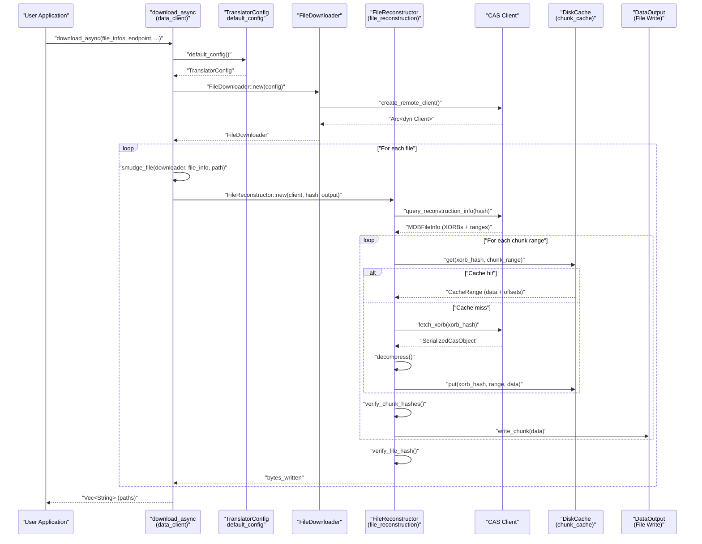

**Sources:** [data/src/data_client.rs:202-240](), [data/src/file_downloader.rs:33-58]()

---

## Entry Point and Session Setup

### Main Entry Function

The primary entry point for downloads is `data_client::download_async`, which coordinates the download of multiple files concurrently.

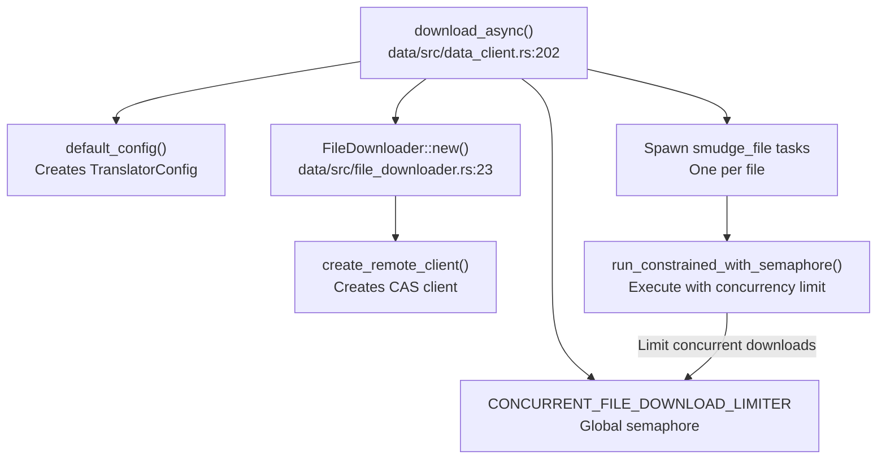

**Sources:** [data/src/data_client.rs:202-240](), [data/src/data_client.rs:30-96]()

### Key Parameters

| Parameter | Type | Description |
|-----------|------|-------------|
| `file_infos` | `Vec<(XetFileInfo, String)>` | File metadata (hash, size) and destination paths |
| `endpoint` | `Option<String>` | CAS server endpoint (defaults from config) |
| `token_info` | `Option<(String, u64)>` | Authentication token and expiration |
| `token_refresher` | `Option<Arc<dyn TokenRefresher>>` | Callback for token refresh |
| `progress_updaters` | `Option<Vec<Arc<dyn TrackingProgressUpdater>>>` | Progress callbacks per file |
| `user_agent` | `String` | User agent for HTTP requests |

**Sources:** [data/src/data_client.rs:202-210](), [hf_xet/src/lib.rs:127-168]()

### Configuration Resolution

The `default_config` function sets up the download environment:

1. **Endpoint Resolution**: Supports `local://` prefix for filesystem-based testing, otherwise uses HTTP endpoint
2. **Cache Path Calculation**: Creates cache directory based on `HF_XET_CACHE` or `HF_HOME` environment variables
3. **Endpoint Fingerprinting**: Generates a unique cache subdirectory per endpoint to avoid conflicts
4. **Staging Directories**: Creates `shard-cache` and `shard-session` subdirectories

**Sources:** [data/src/data_client.rs:30-96]()

---

## Query Phase: Retrieving Reconstruction Metadata

### Metadata Query Process

Before fetching any data, the system must determine which XORBs and chunk ranges are needed to reconstruct each file. This information comes from the MDB shard system.

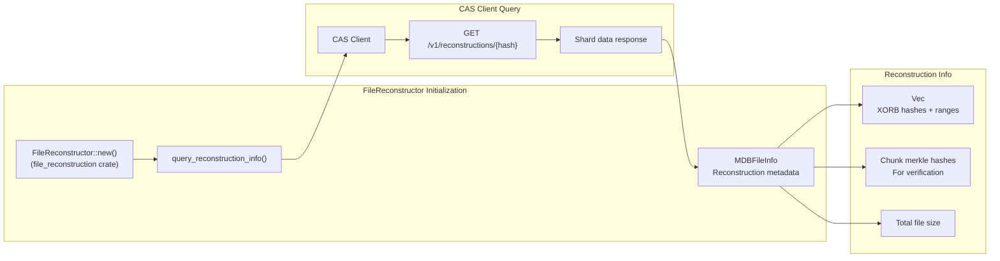

**Sources:** [data/src/file_downloader.rs:33-58]()

### MDBFileInfo Structure

The `MDBFileInfo` structure returned from the query contains all information needed to reconstruct the file:

| Field | Type | Description |
|-------|------|-------------|
| `cas_blocks` | `Vec<CASBlockInfo>` | List of XORBs and their chunk ranges |
| `chunk_merkle_hashes` | `Vec<MerkleHash>` | Expected hash for each chunk (for verification) |
| `file_size` | `u64` | Total size of reconstructed file |
| `chunk_boundaries` | `Vec<u32>` | Byte offsets for each chunk boundary |

Each `CASBlockInfo` contains:
- `xorb_hash`: The XORB (CAS block) hash
- `chunk_range`: Start and end chunk indices within that XORB
- `byte_range`: Start and end byte offsets within the file

**Sources:** Referenced from [mdb_shard crate]()

---

## Data Retrieval Phase

### Chunk Cache Lookup Strategy

The download process always checks the local chunk cache before fetching from CAS. This provides significant performance improvements for repeated downloads or overlapping file content.

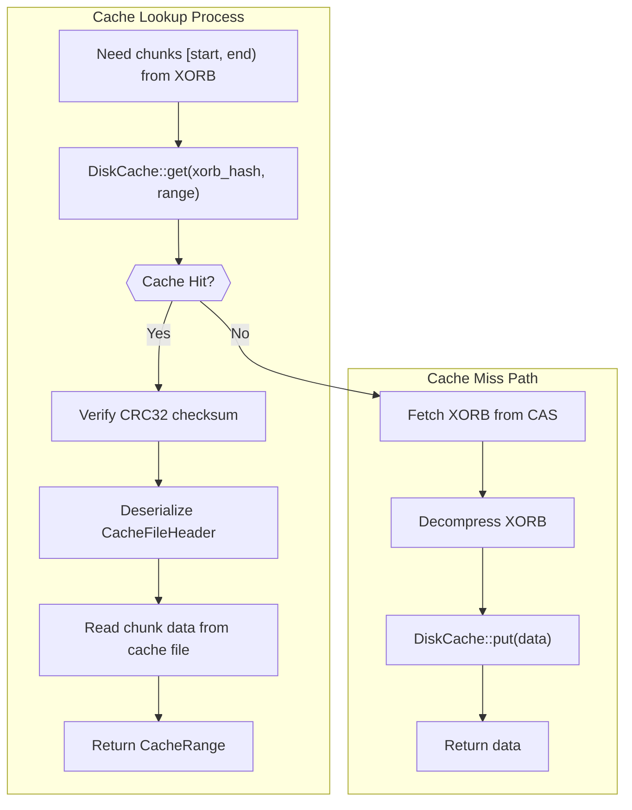

**Sources:** [chunk_cache/src/disk.rs:313-361](), [chunk_cache/src/lib.rs:36-72]()

### Cache File Structure

The disk cache stores chunks in files organized by XORB hash. Each cache file contains:

1. **CacheFileHeader**: Serialized array of chunk byte offsets
2. **Chunk Data**: Raw bytes for all chunks in the range

The cache layout on disk:
```
cache_root/
├── [prefix_dir (2 chars)]/
│   ├── [xorb_hash_base64]/
│   │   ├── [range_start-range_end_len_checksum (base64)]
│   │   └── [range_start-range_end_len_checksum (base64)]
```

**Sources:** [chunk_cache/src/disk.rs:186-311](), [chunk_cache/src/disk/cache_file_header.rs]()

### Cache Verification

When retrieving from cache, the system performs verification:

1. **File Existence Check**: Verify the cache file exists
2. **CRC32 Verification**: Compute and compare checksum (on first access)
3. **Header Deserialization**: Parse the chunk offset table
4. **Verification Cell**: Mark as verified to skip future checks

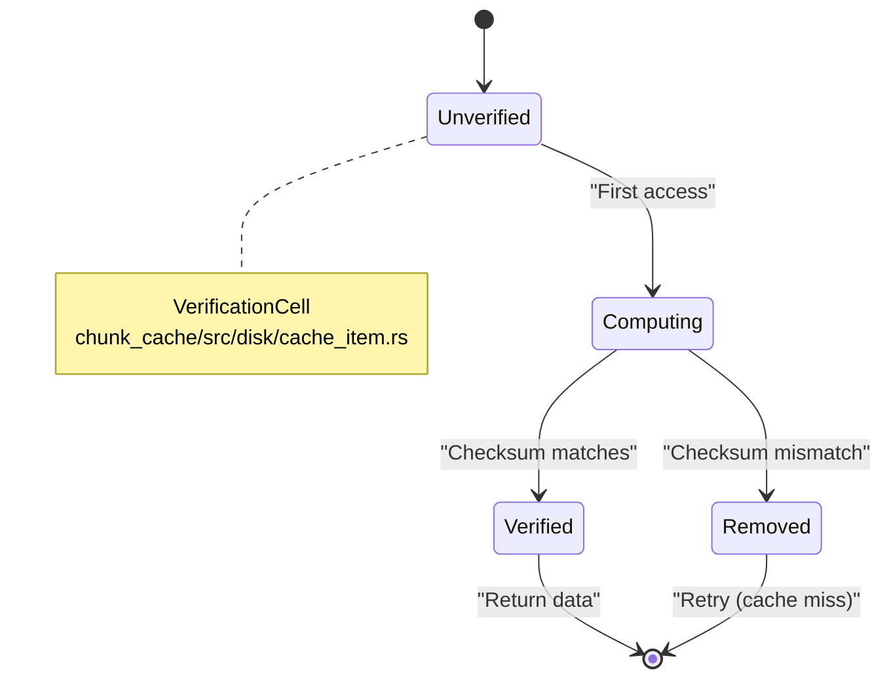

**Sources:** [chunk_cache/src/disk.rs:336-346](), [chunk_cache/src/disk/cache_item.rs:16-87]()

### XORB Fetching from CAS

When data is not in cache, the system fetches the entire XORB from CAS:

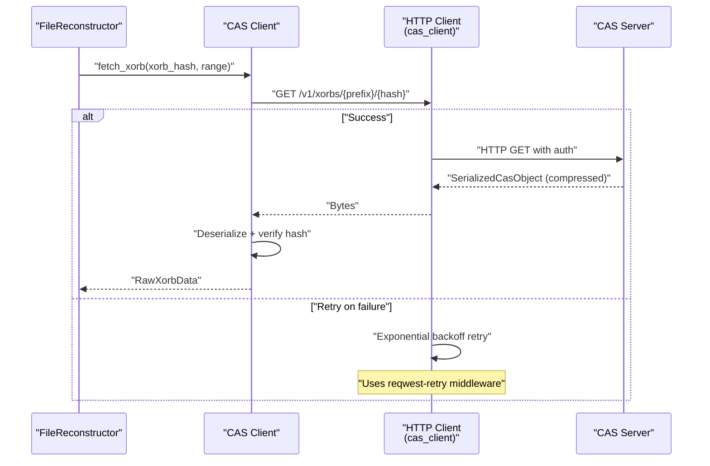

**Sources:** [cas_client crate]()

### Decompression and Caching

After fetching an XORB, the data is decompressed and stored in the cache:

1. **Deserialize XORB**: Parse the `SerializedCasObject` format
2. **Decompress**: Apply LZ4 or ByteGrouping decompression based on header
3. **Extract Chunks**: Split decompressed data into individual chunks using offset table
4. **Cache Storage**: Store chunks in cache with proper range metadata
5. **Eviction**: If cache is full, randomly evict entries until capacity is met

**Cache Capacity Management:**

| Configuration | Default | Environment Variable |
|--------------|---------|---------------------|
| Cache Size | 10 GB (0 for `hf_xet`) | `HF_XET_CHUNK_CACHE_SIZE_BYTES` |
| Eviction Policy | Random selection | N/A |

**Sources:** [chunk_cache/src/disk.rs:364-453](), [xet_config/src/groups/chunk_cache.rs:1-12]()

---

## File Reconstruction Phase

### Chunk Assembly and Verification

Once all required chunks are available (from cache or fetched), the `FileReconstructor` assembles them into the output file:

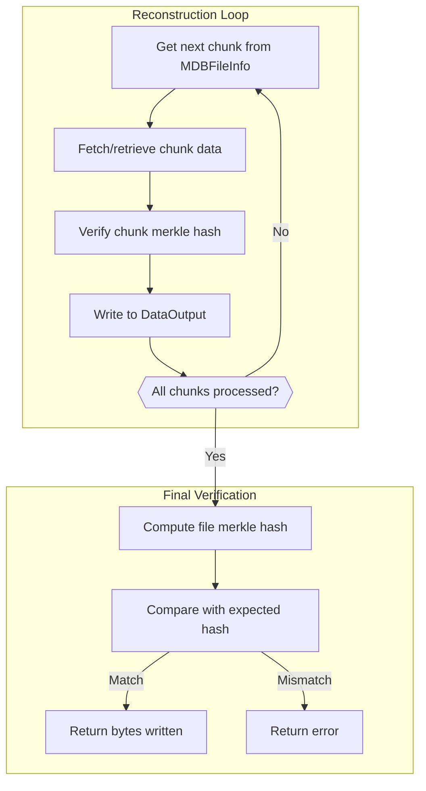

**Sources:** [file_reconstruction crate]()

### Output Mechanisms

The `DataOutput` enum supports multiple output targets:

| Output Type | Use Case | Code Reference |
|------------|----------|----------------|
| `File` | Write to filesystem | `DataOutput::write_in_file(path)` |
| `Memory` | In-memory buffer | `DataOutput::Memory(Vec<u8>)` |
| `Custom` | Custom writer trait | `DataOutput::Custom(Box<dyn Write>)` |

**Sources:** [data/src/data_client.rs:297]()

### Hash Verification

The system performs two levels of hash verification:

1. **Chunk-Level Verification**: Each chunk's merkle hash is verified against `MDBFileInfo.chunk_merkle_hashes`
2. **File-Level Verification**: Final file hash is computed and verified against the requested `file_id`

This ensures data integrity at both the chunk and file level.

**Sources:** [file_reconstruction crate]()

---

## Progress Tracking During Download

### Progress Update Flow

Download progress is reported through the `TrackingProgressUpdater` interface:

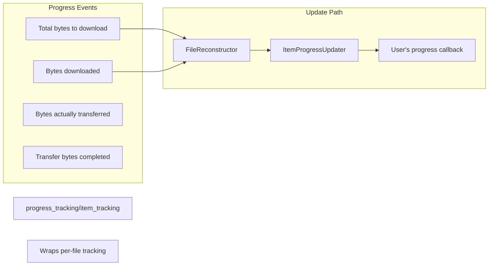

**Sources:** [data/src/data_client.rs:295](), [data/src/file_downloader.rs:42-43]()

### Progress Tracking Hierarchy

The progress system distinguishes between:

- **Total Bytes**: Size of the reconstructed file
- **Transfer Bytes**: Actual bytes downloaded from CAS (may be less due to caching)

This allows users to see both file progress and network transfer progress separately.

**Sources:** [progress_tracking crate]()

---

## Concurrency and Resource Management

### Download Concurrency Control

Downloads are throttled to prevent resource exhaustion:

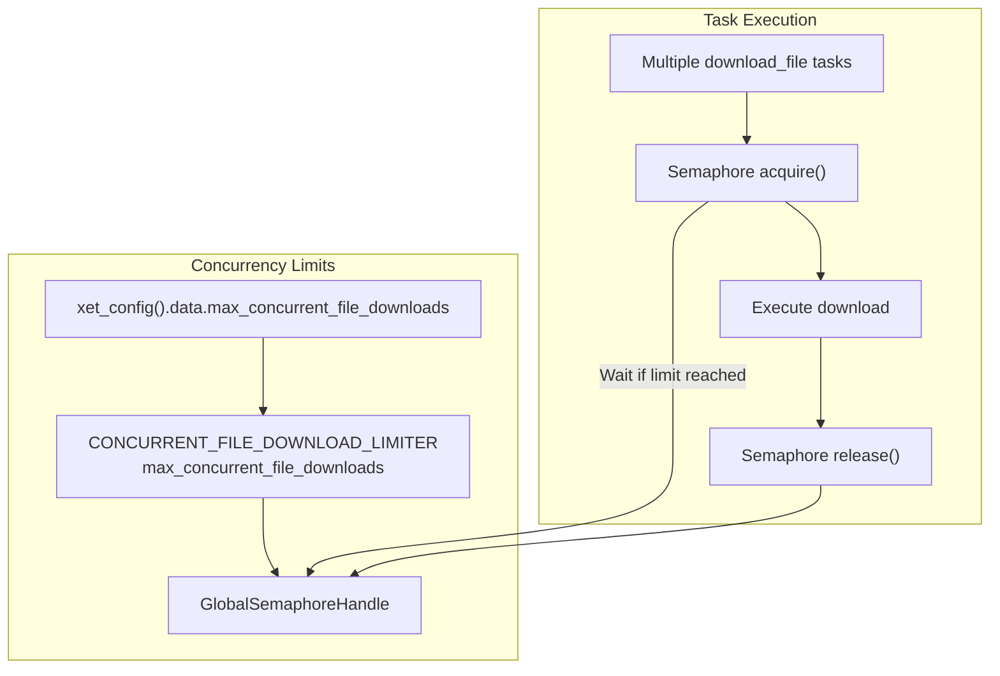

**Sources:** [data/src/data_client.rs:26-28](), [data/src/data_client.rs:235]()

### Semaphore Configuration

| Setting | Default | Environment Variable |
|---------|---------|---------------------|
| Max Concurrent Downloads | From config | Part of `XetConfig` |
| Acquisition | Async | Tokio runtime |

The semaphore ensures that the system respects system resource limits and doesn't overwhelm the network or disk I/O.

**Sources:** [xet_runtime crate]()

---

## Error Handling and Retry Logic

### Download Error Categories

The download process handles several error types:

| Error Type | Handling Strategy | Code Location |
|-----------|------------------|---------------|
| Network Errors | Exponential backoff retry | `cas_client::http_client` |
| Cache Corruption | Remove and retry | `chunk_cache::disk` |
| Hash Mismatch | Return error | `file_reconstruction` |
| File Write Errors | Propagate to caller | `data_client` |

**Sources:** [data/src/data_client.rs:202-240]()

### Retry Mechanisms

Network requests use the `reqwest-retry` middleware with exponential backoff:

1. **Initial Request**: Attempt fetch
2. **Transient Failure**: Wait with exponential backoff
3. **Retry**: Attempt again (up to configured max retries)
4. **Fatal Error**: Return error to caller

**Sources:** [cas_client HTTP client implementation]()

### Cache Error Recovery

When cache data is corrupted:

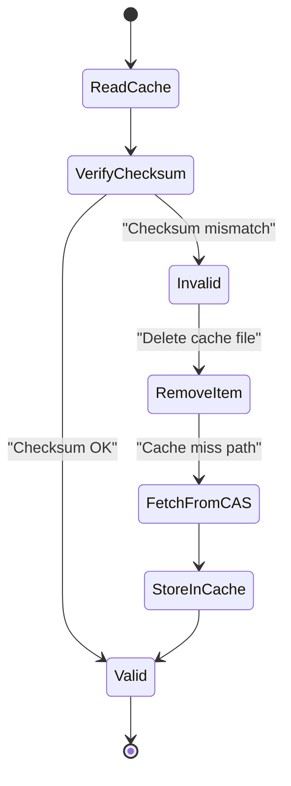

The system automatically recovers from cache corruption by removing invalid entries and re-fetching from CAS.

**Sources:** [chunk_cache/src/disk.rs:325-345]()

---

## Complete Download Code Flow

The following diagram shows the complete code path for a single file download:

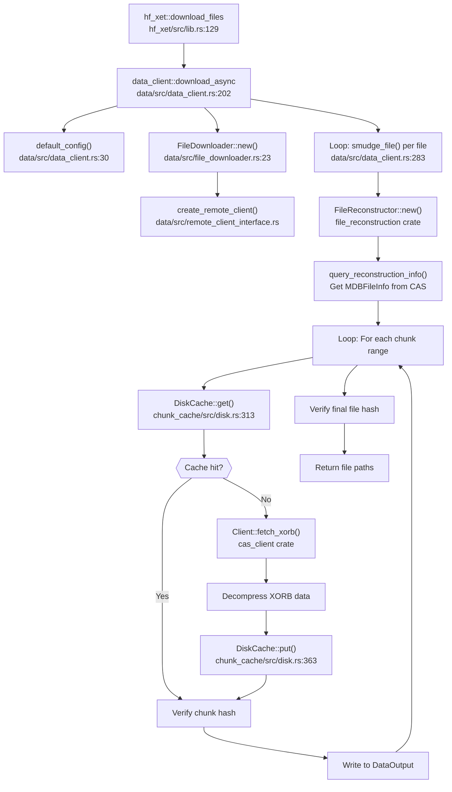

**Sources:** [hf_xet/src/lib.rs:127-168](), [data/src/data_client.rs:202-304](), [data/src/file_downloader.rs:23-58]()

---

## Summary

The download workflow efficiently reconstructs files from content-addressable storage through a multi-phase process:

1. **Configuration**: Set up CAS client, cache paths, and authentication
2. **Query**: Retrieve file reconstruction metadata (XORBs and chunk ranges)
3. **Retrieval**: Check local cache first, fetch from CAS on cache miss
4. **Decompression**: Decompress XORBs and cache the results
5. **Assembly**: Combine chunks in order with hash verification
6. **Output**: Write to destination file or memory buffer

The system optimizes performance through aggressive caching, concurrent downloads with semaphore-based throttling, and sophisticated retry logic for network failures. Hash verification at both chunk and file levels ensures data integrity throughout the process.

**Sources:** [data/src/data_client.rs:202-304](), [data/src/file_downloader.rs:1-60](), [chunk_cache/src/disk.rs:1-530]()

---

