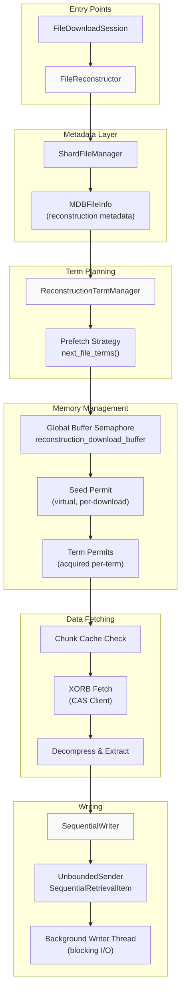
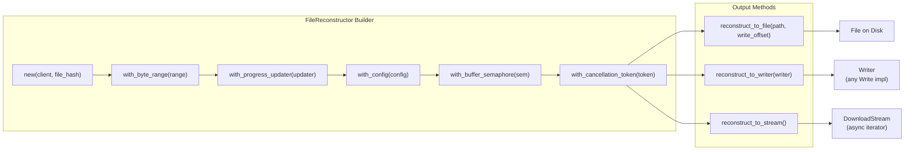
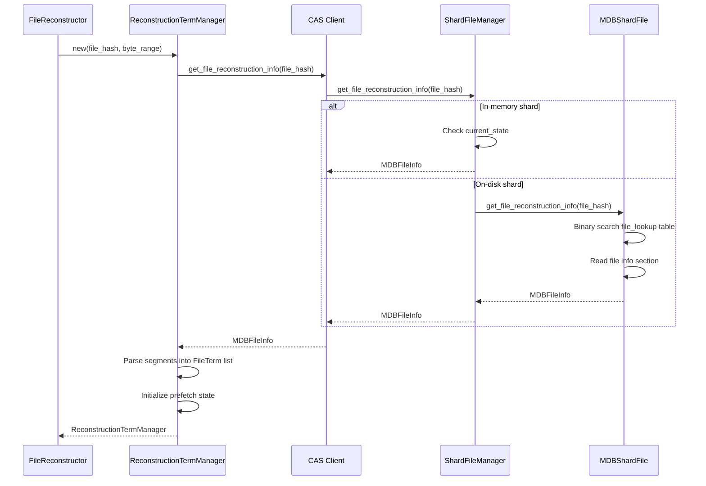
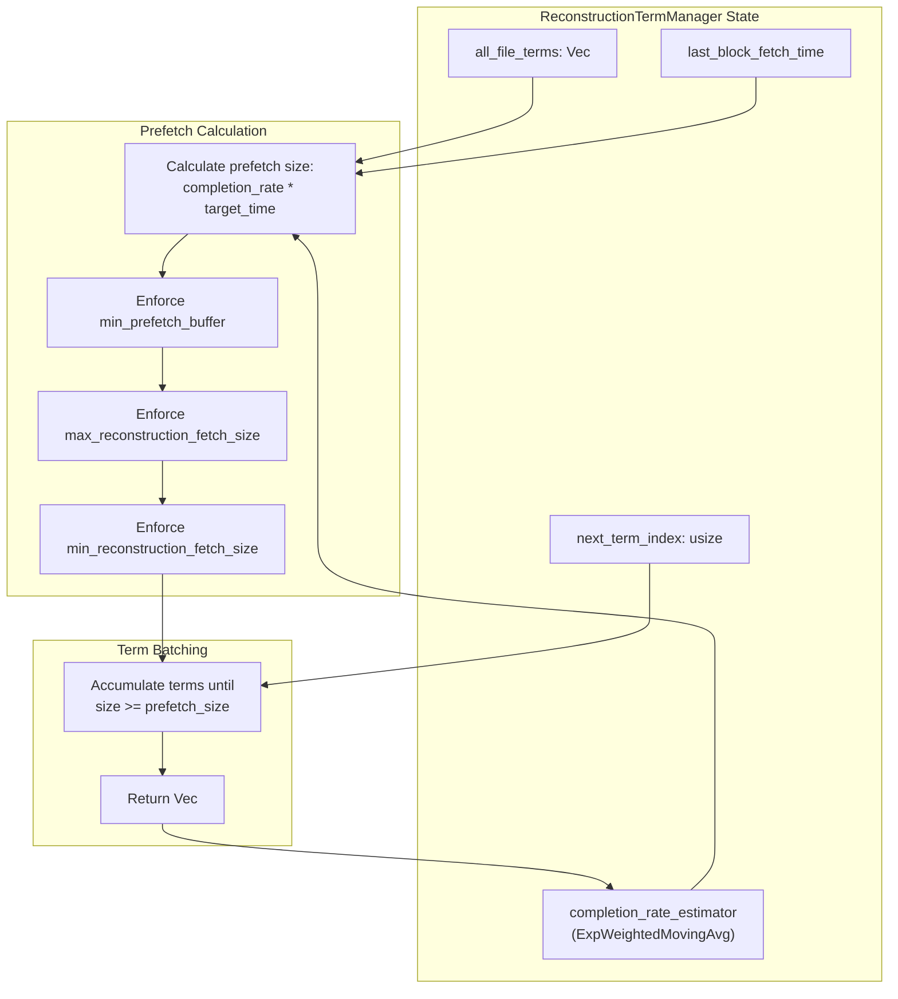
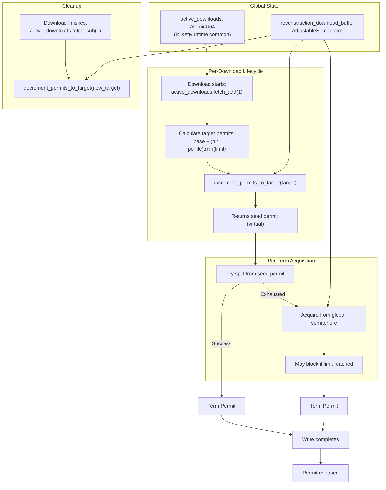
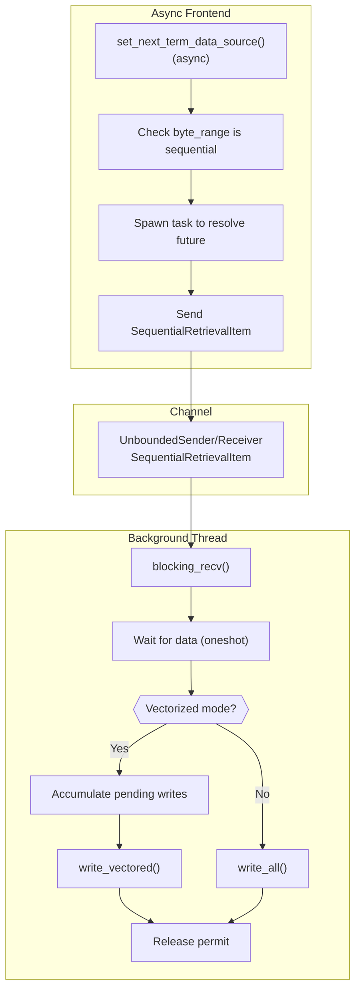
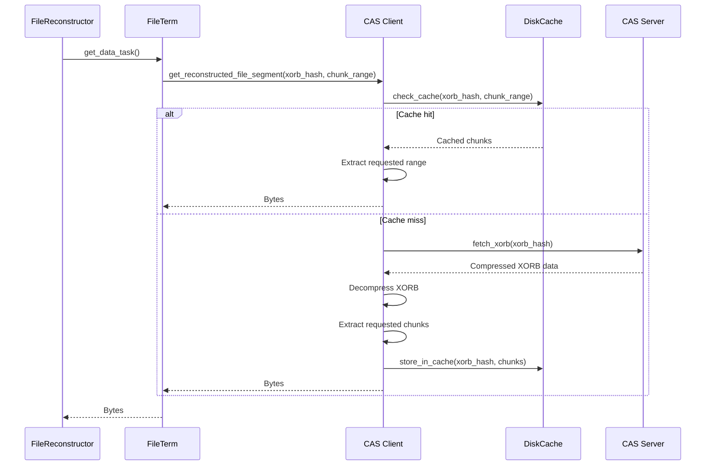
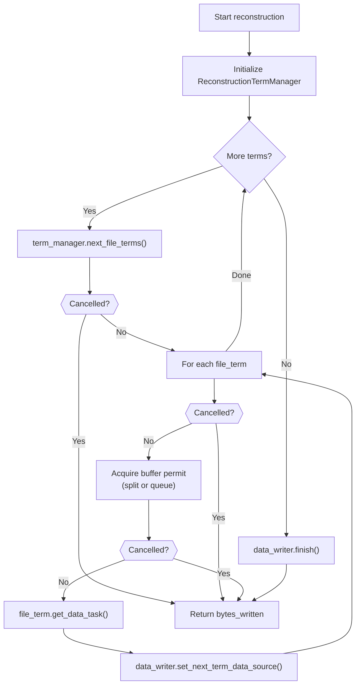
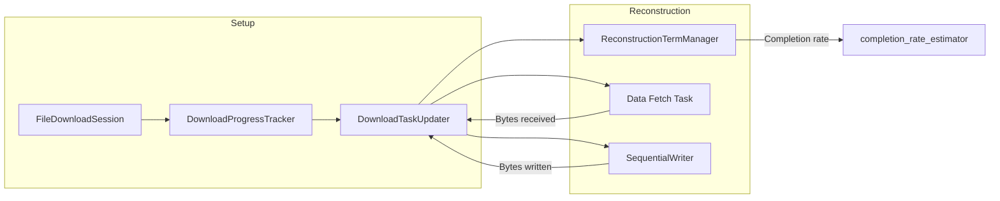
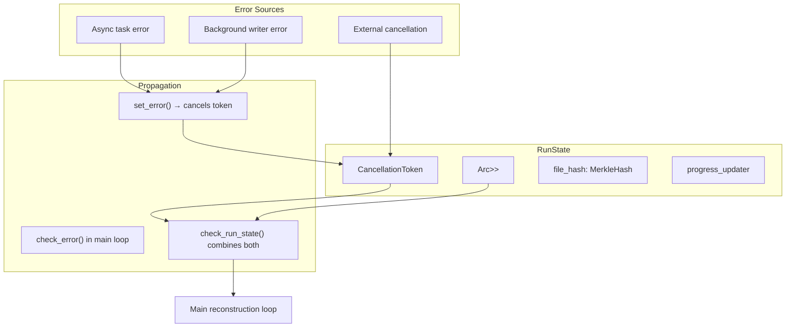

<!-- source: DeepWiki mcp.deepwiki.com · repo huggingface/xet-core · page 5.3 File Reconstruction · fetched 2026-10-26 -->

# File Reconstruction

<details>
<summary>Relevant source files</summary>

The following files were used as context for generating this wiki page:

- [cas_client/src/adaptive_concurrency/controller.rs](cas_client/src/adaptive_concurrency/controller.rs)
- [data/src/file_download_session.rs](data/src/file_download_session.rs)
- [data/src/test_utils.rs](data/src/test_utils.rs)
- [data/tests/test_session_resume.rs](data/tests/test_session_resume.rs)
- [file_reconstruction/Cargo.toml](file_reconstruction/Cargo.toml)
- [file_reconstruction/src/data_writer/data_writer.rs](file_reconstruction/src/data_writer/data_writer.rs)
- [file_reconstruction/src/data_writer/sequential_writer.rs](file_reconstruction/src/data_writer/sequential_writer.rs)
- [file_reconstruction/src/error.rs](file_reconstruction/src/error.rs)
- [file_reconstruction/src/file_reconstructor.rs](file_reconstruction/src/file_reconstructor.rs)
- [mdb_shard/src/session_directory.rs](mdb_shard/src/session_directory.rs)
- [mdb_shard/src/shard_benchmark.rs](mdb_shard/src/shard_benchmark.rs)
- [mdb_shard/src/shard_file_handle.rs](mdb_shard/src/shard_file_handle.rs)
- [mdb_shard/src/shard_file_manager.rs](mdb_shard/src/shard_file_manager.rs)
- [mdb_shard/src/utils.rs](mdb_shard/src/utils.rs)
- [xet_config/src/groups/reconstruction.rs](xet_config/src/groups/reconstruction.rs)

</details>


## Purpose and Scope

File reconstruction is the process of downloading and reassembling files from their content-addressed representation in the CAS storage system. This page documents the `file_reconstruction` crate, which provides the core download infrastructure including:

- Querying shard metadata to determine which XORBs contain the required data
- Adaptive prefetching of reconstruction terms to optimize network utilization
- Memory-bounded buffering to prevent unbounded resource consumption
- Sequential writing from out-of-order data fetches
- Support for byte range downloads and streaming

For information about the upload process and how files are converted to XORBs and shards, see [Upload Workflow](#5.1). For the higher-level download session management API, see [Download Workflow](#5.2).

**Sources:** [file_reconstruction/Cargo.toml:1-27](), [file_reconstruction/src/file_reconstructor.rs:1-50]()

---

## Architecture Overview

The file reconstruction system follows a pipeline architecture where metadata queries feed into term planning, which drives parallel data fetching, and all results flow through a sequential writer that ensures in-order output.

**File Reconstruction Pipeline**



**Sources:** [file_reconstruction/src/file_reconstructor.rs:42-183](), [file_reconstruction/src/data_writer/sequential_writer.rs:1-50](), [data/src/file_download_session.rs:22-70]()

---

## FileReconstructor

`FileReconstructor` is the main entry point for file reconstruction. It uses a builder pattern to configure the reconstruction process and provides three output modes: file, writer, and stream.

**FileReconstructor Core Structure**



### Key Methods

| Method | Purpose | Notes |
|--------|---------|-------|
| `new(client, file_hash)` | Creates a new reconstructor for the given file | Returns `FileReconstructor` |
| `with_byte_range(range)` | Reconstructs only a byte range | Useful for partial downloads |
| `with_progress_updater(updater)` | Attaches progress tracking | Uses `DownloadTaskUpdater` |
| `with_config(config)` | Overrides default reconstruction config | See [ReconstructionConfig](#reconstruction-configuration) |
| `reconstruct_to_file(path, offset)` | Writes to file at specified offset | Creates parent directories if needed |
| `reconstruct_to_writer(writer)` | Writes to any `Write` implementation | Writer receives data starting at position 0 |
| `reconstruct_to_stream()` | Returns async stream of data chunks | Lazy evaluation; starts on first `next()` |

**Sources:** [file_reconstruction/src/file_reconstructor.rs:26-157]()

### Byte Range Handling

When a byte range is specified, the reconstructor:
1. Queries only the reconstruction terms needed for that range
2. Adjusts all byte positions to be relative to the range start (0-based for the writer)
3. Still reports progress relative to the original file positions

```rust
// Example from the code showing byte range adjustment
let relative_byte_range = FileRange::new(
    file_term.byte_range.start - range_start_offset,
    file_term.byte_range.end - range_start_offset,
);
```

**Sources:** [file_reconstruction/src/file_reconstructor.rs:318-322]()

---

## Metadata Retrieval and Term Planning

Before reconstruction begins, the system must query the shard metadata to determine which XORBs and chunk ranges are needed to reconstruct the file.

**Metadata Retrieval Flow**



### MDBFileInfo Structure

The `MDBFileInfo` structure contains the file's reconstruction blueprint. It consists of a list of segments, where each segment describes a contiguous range of chunks within a single XORB.

| Field | Type | Description |
|-------|------|-------------|
| `metadata.file_hash` | `MerkleHash` | The hash identifying this file |
| `metadata.num_file_segments` | `usize` | Number of segments in the file |
| `segments` | `Vec<FileDataSequenceEntry>` | List of XORB references and chunk ranges |

Each `FileDataSequenceEntry` contains:
- `xorb_hash`: Hash of the XORB containing these chunks
- `chunk_index_start`, `chunk_index_end`: Range of chunks within the XORB
- `file_size_bytes`: Number of bytes these chunks contribute to the file

**Sources:** [mdb_shard/src/shard_file_manager.rs:369-402](), [file_reconstruction/src/file_reconstructor.rs:205-210]()

---

## ReconstructionTermManager

The `ReconstructionTermManager` is responsible for converting the flat list of segments from `MDBFileInfo` into batches of `FileTerm` objects that can be fetched in parallel. It implements adaptive prefetching to maintain optimal network utilization.

**Prefetching Strategy**



### Adaptive Prefetch Algorithm

The prefetch size adapts based on observed completion rate:

1. **Estimate completion rate**: Track bytes completed per second using exponentially weighted moving average
2. **Calculate target prefetch**: `completion_rate * target_block_completion_time`
3. **Apply constraints**:
   - Minimum: `max(min_prefetch_buffer, min_reconstruction_fetch_size)`
   - Maximum: `max_reconstruction_fetch_size`
4. **Accumulate terms**: Return terms until cumulative size ≥ prefetch size

The completion rate estimator uses a configurable half-life (default: 4 observations) to adapt quickly to changing network conditions while remaining stable.

**Sources:** [file_reconstruction/src/reconstruction_terms.rs:1-300]() (file not provided but referenced), [xet_config/src/groups/reconstruction.rs:49-63]()

---

## Memory Management

File reconstruction uses a sophisticated memory management system to prevent unbounded memory growth during concurrent downloads while maintaining high throughput.

**Buffer Semaphore Architecture**



### Dynamic Buffer Scaling

The total buffer size scales dynamically with the number of active downloads:

```
target_permits = base_size + (active_downloads * perfile_size)
final_permits = min(target_permits, limit)
```

Default values (configurable via `ReconstructionConfig`):
- `base_size`: 2 GB
- `perfile_size`: 512 MB
- `limit`: 8 GB

When a download starts, it increments the global target and receives a "seed permit" — a virtual permit that allows immediate acquisition without queuing. This seed permit is split for each term until exhausted, at which point the download acquires from the shared FIFO queue.

**Sources:** [file_reconstruction/src/file_reconstructor.rs:212-244](), [xet_config/src/groups/reconstruction.rs:23-47]()

---

## Sequential Writing

The `SequentialWriter` solves a critical problem: reconstruction terms may complete out of order due to caching, network variability, and parallel fetching, but the output must be written sequentially.

**SequentialWriter Architecture**



### Key Design Elements

**Sequential Enforcement**: Each call to `set_next_term_data_source()` must provide a byte range starting exactly where the previous range ended. This is validated at the async boundary before spawning any tasks.

```rust
// From sequential_writer.rs
if byte_range.start != state.next_position {
    return Err(FileReconstructionError::InternalWriterError(format!(
        "Byte range not sequential: expected start at {}, got {}",
        state.next_position, byte_range.start
    )));
}
```

**Out-of-Order Completion**: The data futures can resolve in any order. Each future is spawned as an independent task that resolves the `DataFuture` and sends the result through a oneshot channel to the writer thread.

**Vectorized I/O**: When `use_vectored_write` is enabled, the writer thread accumulates multiple pending writes and submits them via `write_vectored()` for improved performance. The implementation handles partial writes by slicing `Bytes` objects without copying.

**Sources:** [file_reconstruction/src/data_writer/sequential_writer.rs:54-453]()

### SequentialRetrievalItem Queue

The writer thread processes items from an unbounded channel:

```rust
pub(crate) enum SequentialRetrievalItem {
    Data {
        receiver: oneshot::Receiver<Bytes>,
        permit: Option<AdjustableSemaphorePermit>,
    },
    Finish,
}
```

- `Data`: Contains a oneshot receiver for the actual bytes and an optional semaphore permit to release after writing
- `Finish`: Signals no more data will arrive; writer flushes and exits

The writer thread blocks on the channel but uses `try_recv()` to opportunistically gather more pending items for batching in vectorized mode.

**Sources:** [file_reconstruction/src/data_writer/sequential_writer.rs:33-39]()

---

## Data Fetching Pipeline

Once a term is ready to fetch (buffer permit acquired), it goes through a multi-stage pipeline to retrieve and decompress the data.

**Data Fetching Stages**



### Chunk Cache Integration

The `DiskCache` stores decompressed chunks on local disk to avoid re-fetching and re-decompressing frequently accessed XORBs. The cache lookup key is `(xorb_hash, chunk_range)`.

Cache behavior:
- **Hit**: Chunks are read directly from disk cache
- **Miss**: XORB is fetched from CAS server, decompressed, chunks extracted, and stored in cache
- **Eviction**: LRU policy with configurable size limit

**Sources:** [cas_client/src/lib.rs:1-100]() (inferred from context), [file_reconstruction/src/file_reconstructor.rs:308-310]()

---

## Reconstruction Configuration

The reconstruction system is controlled by `ReconstructionConfig`, which is part of the global `XetConfig` system.

### Configuration Parameters

| Parameter | Default | Environment Variable | Description |
|-----------|---------|---------------------|-------------|
| `min_reconstruction_fetch_size` | 256 MB | `HF_XET_RECONSTRUCTION_MIN_RECONSTRUCTION_FETCH_SIZE` | Minimum size per fetch batch |
| `max_reconstruction_fetch_size` | 8 GB | `HF_XET_RECONSTRUCTION_MAX_RECONSTRUCTION_FETCH_SIZE` | Maximum size per fetch batch |
| `download_buffer_size` | 2 GB | `HF_XET_RECONSTRUCTION_DOWNLOAD_BUFFER_SIZE` | Base buffer allocation |
| `download_buffer_perfile_size` | 512 MB | `HF_XET_RECONSTRUCTION_DOWNLOAD_BUFFER_PERFILE_SIZE` | Additional buffer per download |
| `download_buffer_limit` | 8 GB | `HF_XET_RECONSTRUCTION_DOWNLOAD_BUFFER_LIMIT` | Maximum total buffer |
| `completion_rate_estimator_half_life` | 4.0 | `HF_XET_RECONSTRUCTION_COMPLETION_RATE_ESTIMATOR_HALF_LIFE` | Half-life for completion rate tracking |
| `target_block_completion_time` | 15 min | `HF_XET_RECONSTRUCTION_TARGET_BLOCK_COMPLETION_TIME` | Target time for prefetch blocks |
| `min_prefetch_buffer` | 1 GB | `HF_XET_RECONSTRUCTION_MIN_PREFETCH_BUFFER` | Minimum prefetch buffer size |
| `use_vectored_write` | true | `HF_XET_RECONSTRUCTION_USE_VECTORED_WRITE` | Enable vectorized I/O |

**Sources:** [xet_config/src/groups/reconstruction.rs:5-82]()

---

## Main Reconstruction Loop

The core reconstruction logic in `FileReconstructor::run_impl()` orchestrates all components:

**Reconstruction Loop Flow**



The loop is structured to check cancellation at multiple points:
1. Before fetching the next block of terms
2. Before processing each term in the block
3. Before (or during) buffer permit acquisition

This ensures the reconstruction can be cancelled promptly without waiting for long network operations.

**Sources:** [file_reconstruction/src/file_reconstructor.rs:184-354]()

---

## Progress Tracking

Progress is tracked through `DownloadTaskUpdater`, which reports:
- **Total bytes**: Total size of the file or byte range being reconstructed
- **Bytes completed**: Bytes for which data has been received (not necessarily written yet)
- **Bytes written**: Bytes that have been flushed to the output

The updater is passed to both the term manager (for prefetch planning) and to data fetch tasks (for reporting fetch progress).

**Progress Flow**



**Sources:** [file_reconstruction/src/file_reconstructor.rs:62-67](), [data/src/file_download_session.rs:183-219]()

---

## Error Handling and Cancellation

The reconstruction system uses a `RunState` to coordinate error handling and cancellation across async tasks and background threads.

**RunState Pattern**



When any component encounters an error:
1. It calls `run_state.set_error(err)`, which stores the error and cancels the token
2. The cancellation immediately wakes all tasks waiting on the token via `tokio::select!`
3. The main loop's next `check_run_state()` call returns the stored error

This ensures errors are propagated quickly without requiring periodic polling.

**Sources:** [file_reconstruction/src/run_state.rs:1-100]() (inferred), [file_reconstruction/src/file_reconstructor.rs:165-182]()

---

## Example Usage

### Basic File Download

```rust
// Create a reconstructor
let reconstructor = FileReconstructor::new(&client, file_hash);

// Reconstruct to a file
let bytes_written = reconstructor
    .reconstruct_to_file(&output_path, None)
    .await?;
```

**Sources:** [file_reconstruction/src/file_reconstructor.rs:96-129]()

### Byte Range Download

```rust
// Download bytes 1000-2000 to a file at offset 0
let reconstructor = FileReconstructor::new(&client, file_hash)
    .with_byte_range(FileRange::new(1000, 2000));

let bytes_written = reconstructor
    .reconstruct_to_file(&output_path, Some(0))
    .await?;
```

**Sources:** [file_reconstruction/src/file_reconstructor.rs:55-60]()

### Streaming Download

```rust
// Create a stream
let mut stream = FileReconstructor::new(&client, file_hash)
    .reconstruct_to_stream();

// Start the reconstruction (optional - happens automatically on first next())
stream.start().await;

// Read chunks as they arrive
while let Some(chunk) = stream.next().await? {
    process_chunk(&chunk);
}
```

**Sources:** [file_reconstruction/src/file_reconstructor.rs:147-157]()

### Parallel Partitioned Download

Multiple reconstructors can write to different byte ranges of the same file concurrently:

```rust
let file_size = xfi.file_size();
let n_parts = 4;
let mut tasks = Vec::new();

for idx in 0..n_parts {
    let start = (idx * file_size) / n_parts;
    let end = ((idx + 1) * file_size) / n_parts;
    
    let client = client.clone();
    tasks.push(tokio::spawn(async move {
        let mut writer = std::fs::OpenOptions::new()
            .write(true)
            .open(&output_path)?;
        writer.seek(SeekFrom::Start(start))?;
        
        FileReconstructor::new(&client, file_hash)
            .with_byte_range(FileRange::new(start, end))
            .reconstruct_to_writer(writer)
            .await
    }));
}

for task in tasks {
    task.await??;
}
```

**Sources:** [data/src/test_utils.rs:253-294](), [data/src/file_download_session.rs:336-381]()

---

