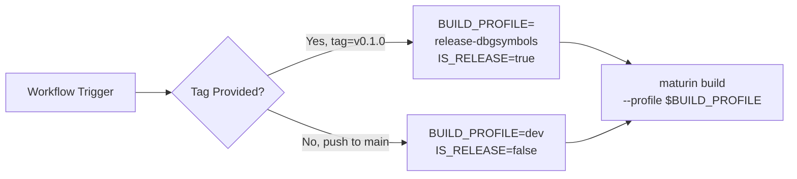
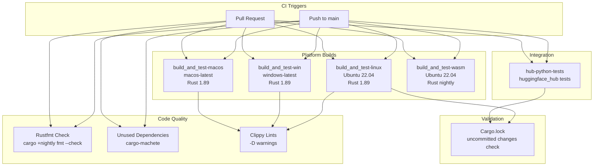
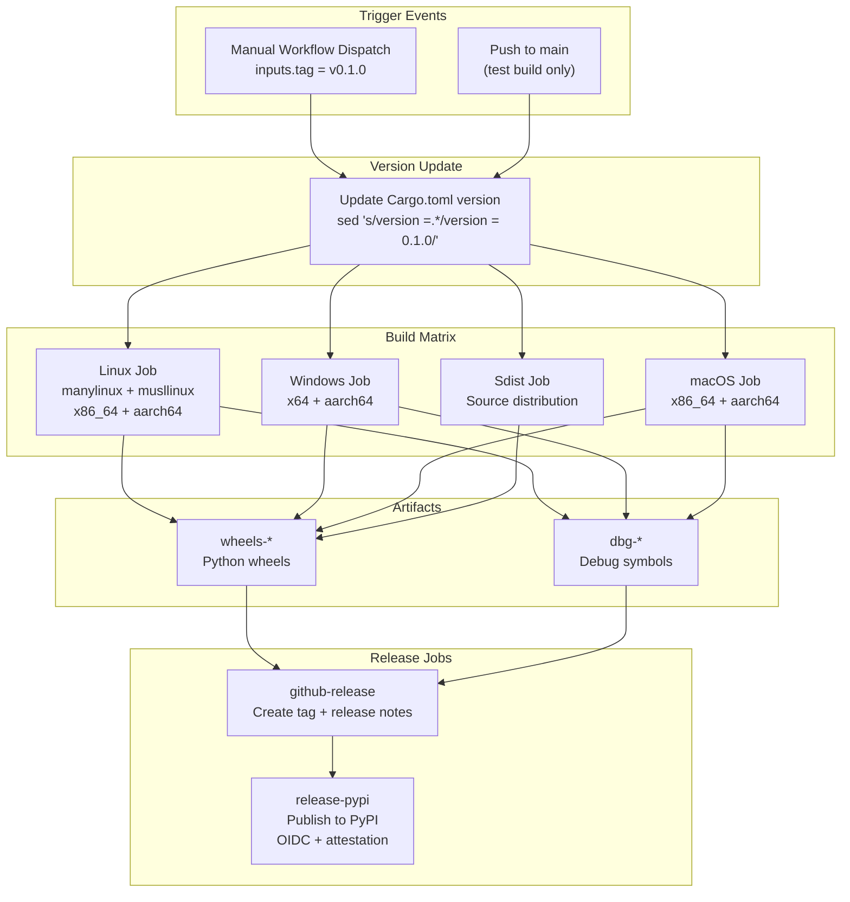
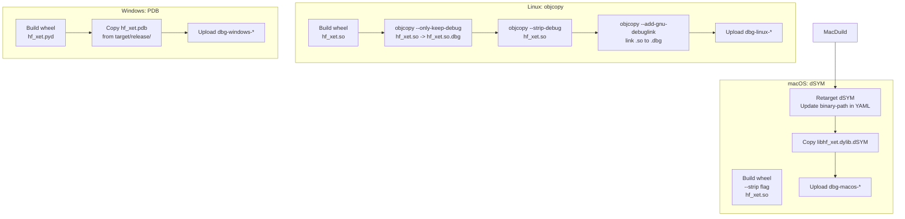
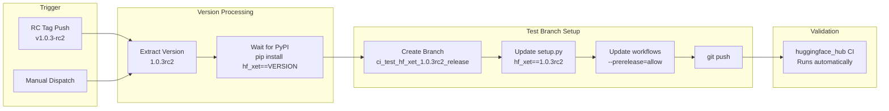

<!-- source: DeepWiki mcp.deepwiki.com · repo huggingface/xet-core · page 6 Development and Build · fetched 2026-10-26 -->

# Development and Build

<details>
<summary>Relevant source files</summary>

The following files were used as context for generating this wiki page:

- [.github/actions/cache-rust-build/action.yml](.github/actions/cache-rust-build/action.yml)
- [.github/workflows/ci.yml](.github/workflows/ci.yml)
- [.github/workflows/git-xet-release.yml](.github/workflows/git-xet-release.yml)
- [.github/workflows/hf-xet-tests.yml](.github/workflows/hf-xet-tests.yml)
- [.github/workflows/pre-release-testing.yml](.github/workflows/pre-release-testing.yml)
- [.github/workflows/release.yml](.github/workflows/release.yml)
- [Cargo.lock](Cargo.lock)
- [Cargo.toml](Cargo.toml)
- [cas_client/Cargo.toml](cas_client/Cargo.toml)
- [data/Cargo.toml](data/Cargo.toml)
- [git_xet/entitlements.xml](git_xet/entitlements.xml)

</details>


This document covers the development workflow, build system, continuous integration, and release process for xet-core. It provides practical information for developers building, testing, and releasing the project across multiple platforms.

For information about the workspace organization and module dependencies, see [Workspace Structure and Dependencies](#6.1). For details on the CI/CD pipelines and release workflows, see [CI/CD and Release Process](#6.2).

## Purpose and Scope

This page documents:

- Cargo workspace structure and member crates
- Build profiles and optimization settings
- Local development workflows (building, testing, linting)
- Continuous integration infrastructure
- Multi-platform release process for Python wheels and CLI binaries
- Debug symbol extraction and packaging
- Platform-specific build considerations

For runtime configuration, see [Configuration and Runtime](#3.7). For Python API details, see [Python API (hf_xet)](#3.1).

## Workspace Organization

The xet-core repository is organized as a Cargo workspace containing 18 member crates and 4 excluded crates that require separate build processes:

```mermaid
graph TB
    subgraph "Workspace Root"
        Workspace["Cargo.toml<br/>Workspace manifest"]
    end
    
    subgraph "Storage & CAS"
        CASClient["cas_client<br/>HTTP client, storage abstraction"]
        XORBObj["xorb_object<br/>XORB serialization"]
        CASTypes["cas_types<br/>Common CAS types"]
        ChunkCache["chunk_cache<br/>Disk caching"]
        MDBShard["mdb_shard<br/>Metadata shards"]
    end
    
    subgraph "Data Operations"
        Data["data<br/>High-level API, xtool CLI"]
        Dedup["deduplication<br/>CDC chunking"]
        FileRecon["file_reconstruction<br/>Download/reconstruct"]
        FileUtils["file_utils<br/>File system utils"]
    end
    
    subgraph "Infrastructure"
        XetConfig["xet_config<br/>Configuration"]
        XetRuntime["xet_runtime<br/>Async runtime"]
        XetLog["xet_logging<br/>Logging setup"]
        XetSession["xet_session<br/>Session management"]
        Progress["progress_tracking"]
        ErrorPrint["error_printer"]
        Utils["utils"]
    end
    
    subgraph "Git & Hub"
        GitXet["git_xet<br/>Git LFS, git-xet CLI"]
        HubClient["hub_client<br/>HF Hub API"]
    end
    
    subgraph "Core Primitives"
        MerkleHash["merklehash<br/>Hash implementation"]
    end
    
    subgraph "Excluded from Workspace"
        HfXet["hf_xet<br/>Python bindings"]
        HfXetWasm["hf_xet_wasm<br/>WASM bindings"]
        HfXetThinWasm["hf_xet_thin_wasm<br/>Minimal WASM"]
        ChunkBench["chunk_cache_bench<br/>Benchmarks"]
    end
    
    Workspace --> CASClient
    Workspace --> XORBObj
    Workspace --> CASTypes
    Workspace --> ChunkCache
    Workspace --> MDBShard
    Workspace --> Data
    Workspace --> Dedup
    Workspace --> FileRecon
    Workspace --> FileUtils
    Workspace --> XetConfig
    Workspace --> XetRuntime
    Workspace --> XetLog
    Workspace --> XetSession
    Workspace --> Progress
    Workspace --> ErrorPrint
    Workspace --> Utils
    Workspace --> GitXet
    Workspace --> HubClient
    Workspace --> MerkleHash
    
    Workspace -.exclude.-> HfXet
    Workspace -.exclude.-> HfXetWasm
    Workspace -.exclude.-> HfXetThinWasm
    Workspace -.exclude.-> ChunkBench
```



**Sources:** [Cargo.toml:1-27]()

### Member Crates

The workspace includes 18 crates that are built together:

| Crate | Path | Primary Artifacts | Purpose |
|-------|------|-------------------|---------|
| `cas_client` | `cas_client/` | Library | HTTP client for CAS server, RemoteClient, LocalClient, MemoryClient |
| `xorb_object` | `xorb_object/` | Library | XORB format serialization, compression, async I/O |
| `cas_types` | `cas_types/` | Library | Shared types for CAS operations |
| `chunk_cache` | `chunk_cache/` | Library | DiskCache implementation, LRU eviction |
| `xet_config` | `xet_config/` | Library | XetConfig, high-performance mode settings |
| `data` | `data/` | Library + `xtool` binary | FileUploadSession, FileDownloadSession, data_client module |
| `deduplication` | `deduplication/` | Library | GearHash chunking, MerkleHash addressing, DataAggregator |
| `error_printer` | `error_printer/` | Library | Error formatting utilities |
| `file_reconstruction` | `file_reconstruction/` | Library | FileReconstructor, SequentialWriter, buffer management |
| `file_utils` | `file_utils/` | Library | Platform-specific file operations |
| `git_xet` | `git_xet/` | `git-xet` binary | Git LFS custom transfer agent, XetAgent |
| `hub_client` | `hub_client/` | Library | Hugging Face Hub authentication, API client |
| `mdb_shard` | `mdb_shard/` | Library | MDB shard format, SessionShardInterface, ShardFileManager |
| `merklehash` | `merklehash/` | Library | MerkleHash primitive, Blake3-based |
| `progress_tracking` | `progress_tracking/` | Library | Progress callback infrastructure |
| `utils` | `utils/` | Library | General-purpose utilities |
| `xet_logging` | `xet_logging/` | Library | Tracing subscriber configuration |
| `xet_runtime` | `xet_runtime/` | Library | XetRuntime, tokio thread pool management |
| `xet_session` | `xet_session/` | Library | Session management primitives |

**Sources:** [Cargo.toml:4-24](), [cas_client/Cargo.toml:1-107](), [data/Cargo.toml:1-80]()

### Excluded Crates

Four crates are excluded from the workspace and must be built separately with different toolchains or build systems:

- **`hf_xet`** (`hf_xet/`): Python bindings using PyO3, built with maturin
- **`hf_xet_wasm`** (`hf_xet_wasm/`): WebAssembly bindings with full feature set
- **`hf_xet_thin_wasm`** (`hf_xet_thin_wasm/`): Minimal WASM bindings for size-constrained environments
- **`chunk_cache_bench`** (`chunk_cache_bench/`): Benchmarking utilities

These are excluded because they require Python/WASM targets that conflict with the main workspace's native targets.

**Sources:** [Cargo.toml:26]()

## Build Profiles and Optimization

### Release Profile

```toml
[profile.release]
opt-level = 3
lto = true
debug = 1
```

The release profile enables:
- **`opt-level = 3`**: Maximum optimization (aggressive inlining, vectorization)
- **`lto = true`**: Link-Time Optimization for whole-program optimization across crates
- **`debug = 1`**: Minimal debug info (line numbers only) for stack traces without bloating binaries

This profile is used for production builds and significantly reduces binary size through LTO while retaining basic debuggability.

**Sources:** [Cargo.toml:28-32]()

### Opt-Test Profile

```toml
[profile.opt-test]
inherits = "dev"
opt-level = 3
debug = 1
```

This custom profile is used for performance testing. It inherits from `dev` but adds `opt-level = 3` to make tests run at near-production speed while keeping faster compile times than full `release` mode (no LTO).

**Sources:** [Cargo.toml:33-36]()

### Dynamic Profile Selection

The release workflow dynamically selects build profiles based on release status:



If a version tag is provided (e.g., `v0.1.0`), the workflow uses `release-dbgsymbols` profile with `IS_RELEASE=true` to enable debug symbol extraction. Otherwise, it uses `dev` profile for faster iteration.

**Sources:** [.github/workflows/release.yml:57-59](), [.github/workflows/release.yml:302-304]()

## Dependency Management

### Workspace Dependencies

The workspace defines shared dependency versions to ensure consistency. Key dependencies:

| Category | Dependencies | Purpose |
|----------|--------------|---------|
| **Async Runtime** | `tokio` 1.49, `futures` 0.3, `async-trait` 0.1 | Async execution infrastructure |
| **HTTP Client** | `reqwest` 0.13.1, `reqwest-middleware` 0.5, `reqwest-retry` 0.9 | HTTP communication with retry logic |
| **Serialization** | `serde` 1, `serde_json` 1, `bincode` 1.3 | Data serialization |
| **Hashing** | `blake3` 1.8, `sha2` 0.10 | Fast cryptographic hashing |
| **Compression** | `lz4_flex` 0.12 | Fast compression for XORBs |
| **Chunking** | `gearhash` 0.1 | Content-defined chunking (CDC) |
| **Storage** | `heed` 0.22 | LMDB key-value store for shards |
| **CLI** | `clap` 4, `colored` 3 | Command-line interface |
| **Logging** | `tracing` 0.1, `tracing-subscriber` 0.3 | Structured logging |
| **Testing** | `mockall` 0.14, `tempfile` 3.25, `tracing-test` 0.2 | Test utilities |

**Sources:** [Cargo.toml:38-142]()

### TLS Backend Features

The `cas_client` crate provides three mutually exclusive TLS features:

```toml
[features]
default = ["rustls-tls"]
rustls-tls = ["reqwest/rustls"]
native-tls = ["reqwest/native-tls"]
native-tls-vendored = ["reqwest/native-tls-vendored"]
```

| Feature | TLS Implementation | Certificate Verification | Use Case |
|---------|-------------------|-------------------------|----------|
| `rustls-tls` (default) | Pure Rust (rustls) | Platform-native cert store with webpki fallback | Most environments, WASM-compatible |
| `native-tls` | Platform-native (OpenSSL/SChannel/Security.framework) | System cert store | Legacy compatibility |
| `native-tls-vendored` | Statically compiled OpenSSL | Bundled certs | manylinux builds, containers without system OpenSSL |

**Sources:** [cas_client/Cargo.toml:45-64]()

## Local Development Workflow

### Building the Workspace

Build all member crates:
```bash
cargo build
```

Build in release mode:
```bash
cargo build --release
```

Build specific crate:
```bash
cargo build -p data
cargo build -p cas_client
```

Build the `xtool` CLI:
```bash
cargo build --release --bin xtool
./target/release/xtool --help
```

Build the `git-xet` CLI:
```bash
cargo build --release --bin git-xet
./target/release/git-xet --help
```

**Sources:** [data/Cargo.toml:10-15]()

### Building Python Bindings

The `hf_xet` crate requires separate build commands:

```bash
cd hf_xet

# Development build (installs in current Python environment)
maturin develop

# Or use cargo directly
cargo build

# Release wheel
maturin build --release
```

**Sources:** [.github/workflows/hf-xet-tests.yml:32-36]()

### Testing

Run all workspace tests:
```bash
cargo test --verbose --no-fail-fast
```

Run tests with strict mode (enables additional assertions):
```bash
cargo test --verbose --no-fail-fast --features "strict git-xet-for-integration-test"
```

Test Python bindings:
```bash
cd hf_xet
cargo test --verbose --no-fail-fast
```

Run integration tests with huggingface_hub:
```bash
# Build hf_xet wheel
cd hf_xet
maturin develop

# Run huggingface_hub xet tests
pytest huggingface_hub/tests/test_xet_*.py
```

**Sources:** [.github/workflows/ci.yml:52-57](), [.github/workflows/hf-xet-tests.yml:41-44]()

### Linting and Formatting

Format all code (requires nightly):
```bash
rustup toolchain install nightly
cargo +nightly fmt --manifest-path ./Cargo.toml --all
cargo +nightly fmt --manifest-path ./hf_xet/Cargo.toml --all
```

Run Clippy (treats warnings as errors):
```bash
cargo clippy -r --verbose -- -D warnings
cargo clippy -r --verbose --manifest-path hf_xet/Cargo.toml -- -D warnings
```

Detect unused dependencies:
```bash
cargo install cargo-machete
cargo machete
```

**Sources:** [.github/workflows/ci.yml:14-46]()

### Building WASM

WASM builds require the nightly toolchain and specific tools:

```bash
# Install nightly toolchain with WASM target
rustup toolchain install nightly
rustup target add --toolchain nightly wasm32-unknown-unknown
rustup component add --toolchain nightly rust-src

# Install WASM tools (specific versions required)
cargo install --version 0.2.100 wasm-bindgen-cli
cargo install --version 0.13.1 wasm-pack

# Build thin WASM (minimal size)
cd hf_xet_thin_wasm
./build_wasm.sh

# Build full WASM
cd hf_xet_wasm
./build_wasm.sh
```

**Sources:** [.github/workflows/ci.yml:98-121]()

## Continuous Integration

The CI pipeline runs on every push to main and on all pull requests:



**Sources:** [.github/workflows/ci.yml:1-121](), [.github/workflows/hf-xet-tests.yml:1-49]()

### Build Caching

CI uses a custom caching action to speed up builds:

```yaml
- uses: ./.github/actions/cache-rust-build
```

**Cached directories:**
- `~/.cargo/registry` - Downloaded crate sources
- `~/.cargo/git` - Git dependencies  
- `target/` - Main workspace build artifacts
- `hf_xet/target/` - Python bindings artifacts
- `hf_xet_wasm/target/` - WASM artifacts
- `hf_xet_thin_wasm/target/` - Thin WASM artifacts

**Cache key:** `${{ runner.os }}-${{ runner.arch }}-cargo-${{ hashFiles('**/Cargo.lock') }}`

The cache is invalidated when `Cargo.lock` changes, ensuring dependencies are rebuilt when needed.

**Sources:** [.github/actions/cache-rust-build/action.yml:1-16]()

### Platform-Specific Setup

#### Linux

Requires Git LFS and libatomic:

```bash
# Install Git LFS
curl -s https://packagecloud.io/install/repositories/github/git-lfs/script.deb.sh | sudo bash
sudo apt-get install git-lfs
git lfs install

# For manylinux builds
apt-get update && apt-get install libatomic-ops-dev -y

# For CentOS-based manylinux
yum install devtoolset-10-libatomic-devel perl-IPC-Cmd -y
```

**Sources:** [.github/workflows/ci.yml:47-51](), [.github/workflows/release.yml:68-77]()

#### macOS

Requires Git LFS via Homebrew:

```bash
brew install git-lfs
git lfs install
```

**Sources:** [.github/workflows/ci.yml:87-90]()

#### Windows

No special setup required - uses default Windows toolchain.

**Sources:** [.github/workflows/ci.yml:62-77]()

### Cargo.lock Validation

CI checks that `Cargo.lock` has no uncommitted changes after building:

```bash
test -z "$(git status --porcelain Cargo.lock)" || \
  (echo "Cargo.lock has uncommitted changes!" && exit 1)
```

This ensures that `Cargo.lock` is always up-to-date with `Cargo.toml` changes. If this fails locally, run `cargo build` and commit the updated `Cargo.lock`.

**Sources:** [.github/workflows/ci.yml:58-61](), [.github/workflows/hf-xet-tests.yml:45-48]()

## Release Process

Releases are triggered by manual workflow dispatch with a version tag or by pushing to main (test mode):



**Sources:** [.github/workflows/release.yml:6-426]()

### Version Management

The workflow extracts the semantic version from the tag and updates `hf_xet/Cargo.toml`:

```bash
TAG=${{ github.event.inputs.tag }}  # e.g., "v0.1.0"
VERSION=${TAG#v}                     # Strip 'v' prefix -> "0.1.0"
if [ -n "$VERSION" ]; then
  sed -i '/^version /s/=.*$/= "'"$VERSION"'"/' hf_xet/Cargo.toml
fi
```

This ensures the built wheels have the correct version number embedded.

**Sources:** [.github/workflows/release.yml:49-56](), [.github/workflows/release.yml:145-152](), [.github/workflows/release.yml:231-239](), [.github/workflows/release.yml:294-301]()

### Platform Build Matrix

The release builds wheels for 10+ platform/architecture combinations across 3 Python versions:

| Job | Platforms | Architectures | Python Versions | Manylinux |
|-----|-----------|---------------|-----------------|-----------|
| `linux` | Ubuntu 22.04 | x86_64, aarch64 | 3.13t, 3.14, 3.14t | manylinux_2_28 |
| `musllinux` | Ubuntu 22.04 | x86_64, aarch64 | 3.13t, 3.14, 3.14t | musllinux_1_2 |
| `windows` | Windows Latest, Windows 11 ARM | x64, aarch64 | 3.13t, 3.14, 3.14t | N/A |
| `macos` | macOS 15 Intel, macOS 14 | x86_64, aarch64 | 3.13t, 3.14, 3.14t | N/A |

**Total:** 4 Linux + 4 musllinux + 2 Windows + 2 macOS = 12 platforms × 3 Python versions = 36 wheels + 1 sdist

**Sources:** [.github/workflows/release.yml:24-38](), [.github/workflows/release.yml:123-134](), [.github/workflows/release.yml:213-224](), [.github/workflows/release.yml:273-283]()

### Maturin Build Configuration

All platform jobs use PyO3/maturin-action with sccache for caching:

```yaml
- name: Build wheels
  uses: PyO3/maturin-action@v1
  with:
    target: ${{ matrix.platform.target }}
    args: --profile ${{ env.BUILD_PROFILE }} -i ${{ matrix.python-version }} --out dist
    sccache: 'true'
    manylinux: ${{ matrix.platform.manylinux }}  # Linux only
    working-directory: hf_xet
```

For macOS, the `--strip` flag is added to separate debug symbols during build:

```yaml
args: --profile ${{ env.BUILD_PROFILE }} -i ${{ matrix.python-version }} --strip --out dist
```

**Sources:** [.github/workflows/release.yml:60-77](), [.github/workflows/release.yml:156-165](), [.github/workflows/release.yml:241-246](), [.github/workflows/release.yml:305-311]()

## Debug Symbol Handling

Debug symbols are stripped and packaged separately for each platform to reduce wheel size while enabling post-mortem debugging:



**Sources:** [.github/workflows/release.yml:78-115](), [.github/workflows/release.yml:166-203](), [.github/workflows/release.yml:248-262](), [.github/workflows/release.yml:312-334]()

### Linux: objcopy Workflow

For Linux builds, `objcopy` is used to separate debug symbols:

```bash
# Extract debug symbols into separate file
objcopy --only-keep-debug hf_xet.so hf_xet.so.dbg

# Strip debug symbols from main binary
objcopy --strip-debug hf_xet.so

# Add debug link (allows debuggers to find symbols)
objcopy --add-gnu-debuglink=hf_xet.so.dbg hf_xet.so
```

For ARM64 builds, cross-compilation binutils are used:
```bash
sudo apt-get install -y binutils-aarch64-linux-gnu
alias objcopy=aarch64-linux-gnu-objcopy
```

The process:
1. Build wheel normally
2. Unpack wheel with `wheel unpack`
3. Extract symbols from `.so` file
4. Strip symbols from `.so` file
5. Add debug link to `.so` file
6. Repack wheel with `wheel pack`

**Sources:** [.github/workflows/release.yml:78-104](), [.github/workflows/release.yml:166-192]()

### Windows: PDB Files

Windows debug symbols are in PDB format and generated separately by the compiler:

```bash
# Find latest wheel
LATEST_WHEEL=$(ls -tr1 *.whl | tail -n 1)
WHEEL_NAME=$(basename $LATEST_WHEEL .whl)
SYMBOL_FILE=${WHEEL_NAME}.pdb

# Copy PDB from build directory
cp hf_xet/target/${{ matrix.platform.rust_target }}/release/hf_xet.pdb \
   hf_xet/dbg/${SYMBOL_FILE}
```

No stripping is needed - the PDB is already separate from the DLL.

**Sources:** [.github/workflows/release.yml:248-262]()

### macOS: dSYM Bundles

macOS uses dSYM bundles containing DWARF debug info. The `--strip` flag to maturin automatically creates these:

```bash
# dSYM is created in target/release-dbgsymbols/
# Retarget to match wheel's library name
sed -i '' "s/binary-path:.*/binary-path: '.\/${LIB_NAME}'/" \
  libhf_xet.dylib.dSYM/Contents/Resources/Relocations/${{ matrix.platform.target }}/libhf_xet.dylib.yml

# Copy dSYM bundle
cp -r libhf_xet.dylib.dSYM ../../../dbg/${SYMBOL_FILE}
```

The retargeting step updates the dSYM's internal path to point to the library name in the wheel (e.g., `hf_xet.cpython-314-darwin.so`).

**Sources:** [.github/workflows/release.yml:312-334]()

### Debug Symbol Packaging

All debug symbols are uploaded as separate artifacts:

- `dbg-linux-${{ python-version }}-${{ target }}`
- `dbg-musllinux-${{ python-version }}-${{ target }}`
- `dbg-windows-${{ python-version }}-${{ target }}`
- `dbg-macos-${{ python-version }}-${{ target }}`

In the GitHub release, they're combined into a single `dbg-symbols.zip`:

```bash
mkdir dbg-symbols
cp -r dbg-*/* dbg-symbols/
zip -r dbg-symbols.zip dbg-symbols
```

**Sources:** [.github/workflows/release.yml:110-115](), [.github/workflows/release.yml:198-203](), [.github/workflows/release.yml:258-262](), [.github/workflows/release.yml:329-334](), [.github/workflows/release.yml:419-424]()

## Source Distribution (sdist)

The source distribution requires special patching due to maturin's behavior:

```bash
# Build sdist
maturin sdist --out dist

# Extract and patch
tar -xvzf ${DISTFILE}

# Fix python-source path (maturin overwrites this)
sed -i '/^python\-source =/ s/= .*/= "hf_xet\/python"/' \
  ${DISTNAME}/pyproject.toml

# Repack
tar -cvzf ${DISTFILE} ${DISTNAME}
```

This is necessary because maturin's sdist command overwrites the `python-source` setting in `pyproject.toml` during build, which breaks installation from source.

**Sources:** [.github/workflows/release.yml:341-374]()

## PyPI Publishing

PyPI publishing uses OIDC (OpenID Connect) for secure authentication without long-lived tokens:

```yaml
release-pypi:
  name: Release PyPi
  runs-on: ubuntu-latest
  if: ${{ github.event_name == 'workflow_dispatch' }}
  needs: [github-release]
  permissions:
    id-token: write       # Sign release artifacts
    contents: write       # Upload release artifacts
    attestations: write   # Generate artifact attestation
  environment: release
```

**Process:**

1. Download all wheel artifacts
2. Generate artifact attestation for supply chain security
3. Publish to PyPI using maturin

```yaml
- name: Generate artifact attestation
  uses: actions/attest-build-provenance@v3
  with:
    subject-path: 'wheels-*/*'

- name: Publish to PyPI
  uses: PyO3/maturin-action@v1
  with:
    command: upload
    args: --non-interactive --skip-existing wheels-*/*
```

The attestation provides cryptographic proof of build provenance, linking the published package to the GitHub Actions workflow that built it.

**Sources:** [.github/workflows/release.yml:376-400]()

## GitHub Release Creation

GitHub releases are created for tagged releases:

```bash
# Download all artifacts (wheels and debug symbols)
actions/download-artifact@v7

# Create release with notes
gh release create "$RELEASE_TAG" wheels-*/* dbg-symbols.zip \
  --generate-notes \
  --prerelease \
  --target ${{github.sha}}
```

The release includes:
- All platform wheels (36 `.whl` files)
- Source distribution (`.tar.gz`)
- Combined debug symbols (`dbg-symbols.zip`)
- Auto-generated release notes

**Sources:** [.github/workflows/release.yml:401-426]()

## Git-Xet CLI Release

The `git-xet` binary has a separate release workflow that builds native executables for all platforms:

```mermaid
graph TB
    subgraph "Build Jobs"
        LinuxCLI["linux<br/>x86_64 + aarch64<br/>cargo build --release"]
        MacOSCLI["macos<br/>x86_64 + aarch64<br/>cargo build --release<br/>--features git2-vendored-openssl"]
        WindowsCLI["windows<br/>x64 + aarch64<br/>cargo build --release"]
    end
    
    subgraph "Code Signing"
        MacSign["macOS<br/>lando/code-sign-action<br/>Notarization"]
        WinSign["Windows<br/>Azure Key Vault<br/>EXE + MSI"]
    end
    
    subgraph "Windows Installer"
        WiX["WiX Toolset<br/>Package.wxs -> MSI"]
    end
    
    subgraph "Release"
        Artifacts["Upload artifacts<br/>git-xet-*"]
        Release["GitHub Release<br/>git-xet-$TAG"]
    end
    
    LinuxCLI --> Artifacts
    MacOSCLI --> MacSign
    WindowsCLI --> WinSign
    
    MacSign --> Artifacts
    WinSign --> WiX
    WiX --> Artifacts
    
    Artifacts --> Release
```

**Sources:** [.github/workflows/git-xet-release.yml:1-152]()

### macOS Code Signing and Notarization

macOS binaries must be signed and notarized to avoid Gatekeeper warnings:

```yaml
- name: Codesign and Notarization
  uses: lando/code-sign-action@v3
  with:
    file: dist/git-xet
    certificate-data: ${{ secrets.CLI_MACOS_CERTIFICATE }}
    certificate-id: ${{ secrets.CLI_MACOS_TEAM_ID }}
    apple-notary-user: ${{ secrets.CLI_MACOS_NOTARY_USER }}
    apple-notary-password: ${{ secrets.CLI_MACOS_NOTARY_PWD }}
    apple-product-id: co.huggingface.gitxet
    options: --options runtime --entitlements dist/entitlements.xml
```

The entitlements file (`git_xet/entitlements.xml`) allows JIT compilation and dynamic library loading:

```xml
<key>com.apple.security.cs.allow-unsigned-executable-memory</key>
<true/>
<key>com.apple.security.cs.disable-library-validation</key>
<true/>
```

**Sources:** [.github/workflows/git-xet-release.yml:62-72](), [git_xet/entitlements.xml:1-10]()

### Windows Code Signing and MSI

Windows binaries are signed using Azure Key Vault:

```yaml
- name: Codesign the executable file
  uses: ./.github/actions/windows-codesign
  with:
    file: ${{ github.workspace }}\dist\git-xet.exe
    azure_tenant_id: ${{ secrets.AZURE_TENANT_ID }}
    azure_client_id: ${{ secrets.AZURE_CLIENT_ID }}
    azure_client_secret: ${{ secrets.AZURE_CLIENT_SECRET }}
```

An MSI installer is created with WiX Toolset:

```bash
dotnet tool install --global wix
wix build Package.wxs -o bin\git-xet-windows-installer -arch ${{ matrix.platform.wix_arch }}
```

Both the EXE and MSI are code-signed.

**Sources:** [.github/workflows/git-xet-release.yml:95-131]()

## Prerelease Testing

Release candidates (e.g., `v1.0.3-rc2`) trigger automatic testing in huggingface_hub:



**Workflow:**

1. Tag format: `v1.0.3-rc2` → PyPI version: `1.0.3rc2`
2. Wait for package availability: `pip install hf_xet==1.0.3rc2` (retries every 15s)
3. Create test branch: `ci_test_hf_xet_1.0.3rc2_release`
4. Update `setup.py`: Replace `hf_xet>=/<=...` with `hf_xet==1.0.3rc2`
5. Update CI: Add `--prerelease=allow` to all `uv pip install` commands
6. Push and monitor CI results

**Sources:** [.github/workflows/pre-release-testing.yml:1-87]()

## Troubleshooting

### Cargo.lock Out of Sync

**Symptom:** CI fails with "Cargo.lock has uncommitted changes!"

**Cause:** `Cargo.toml` dependencies were modified but `Cargo.lock` wasn't updated.

**Fix:**
```bash
cargo build  # or cargo update
git add Cargo.lock
git commit -m "Update Cargo.lock"
```

**Sources:** [.github/workflows/ci.yml:58-61]()

### ARM64 Cross-Compilation Failures

**Symptom:** `objcopy: command not found` or "unknown file format" on Linux ARM64 builds

**Cause:** Missing cross-compilation binutils for ARM64

**Fix:**
```bash
sudo apt-get update
sudo apt-get install -y binutils-aarch64-linux-gnu
```

Use `aarch64-linux-gnu-objcopy` instead of `objcopy` for ARM64 binaries.

**Sources:** [.github/workflows/release.yml:82-87]()

### WASM Build Failures

**Symptom:** `error: toolchain 'nightly' does not support target 'wasm32-unknown-unknown'`

**Cause:** Missing WASM target or incompatible toolchain

**Fix:**
```bash
rustup toolchain install nightly
rustup target add --toolchain nightly wasm32-unknown-unknown
rustup component add --toolchain nightly rust-src
```

Ensure `wasm-bindgen-cli` version matches `wasm-bindgen` dependency in `Cargo.toml`.

**Sources:** [.github/workflows/ci.yml:104-113]()

### maturin Version Mismatch

**Symptom:** "maturin failed to build" or "incompatible pyproject.toml"

**Cause:** Local maturin version differs from CI

**Fix:**
```bash
pip install maturin==1.7.0  # Match CI version
```

**Sources:** [.github/workflows/release.yml:1]()

### Python Free-Threaded Build Issues

**Symptom:** Wheel built for wrong Python version (e.g., `cp313t` vs `cp314t`)

**Cause:** Python version mismatch in matrix

**Fix:** Verify matrix in `.github/workflows/release.yml`:
```yaml
python-version:
  - 3.14
  - 3.13t    # Free-threaded
  - 3.14t    # Free-threaded
```

**Sources:** [.github/workflows/release.yml:35-38]()

---

