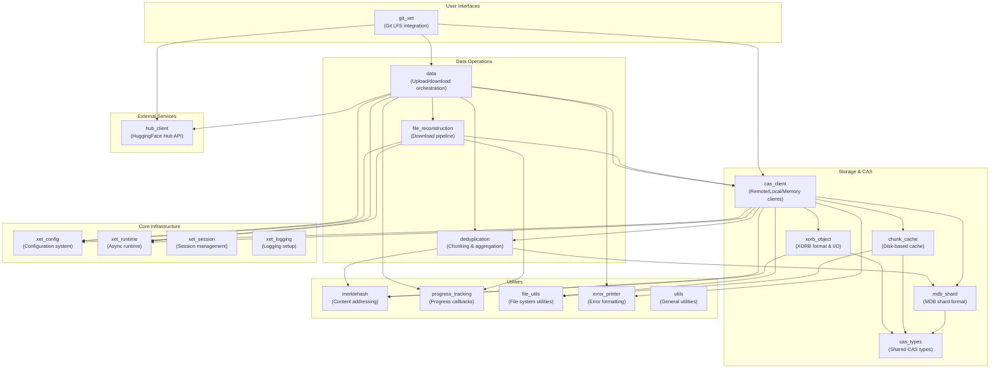
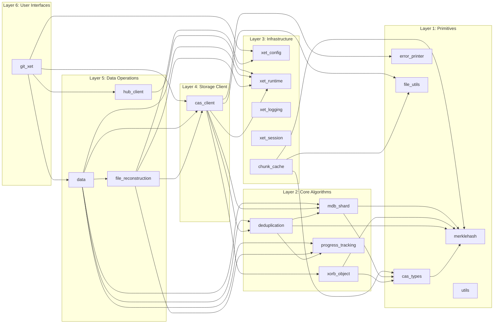
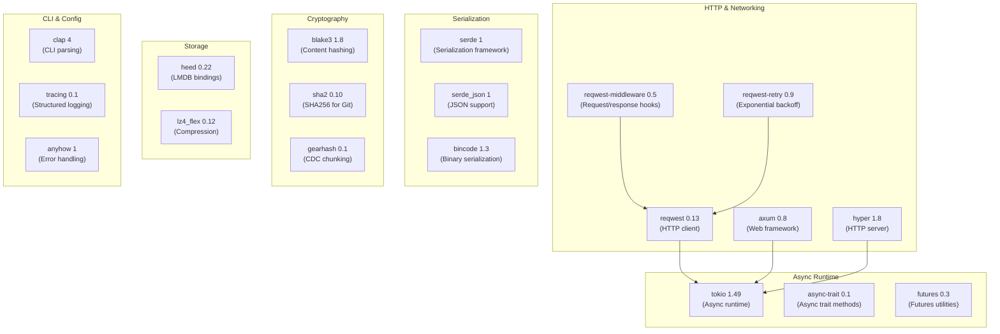
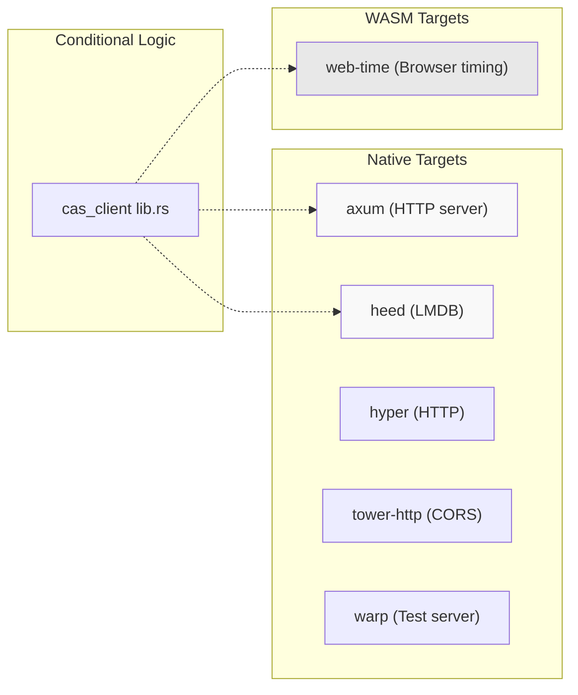

<!-- source: DeepWiki mcp.deepwiki.com · repo huggingface/xet-core · page 6.1 Workspace Structure and Dependencies · fetched 2026-10-26 -->

# Workspace Structure and Dependencies

<details>
<summary>Relevant source files</summary>

The following files were used as context for generating this wiki page:

- [Cargo.lock](Cargo.lock)
- [Cargo.toml](Cargo.toml)
- [cas_client/Cargo.toml](cas_client/Cargo.toml)
- [data/Cargo.toml](data/Cargo.toml)

</details>


This page documents the Cargo workspace layout, internal crate organization, and dependency management in xet-core. It provides developers with a roadmap of how the codebase is structured and how different components relate to each other.

For information about the build and release pipeline, see [CI/CD and Release Process](#6.2). For details on the runtime infrastructure and configuration, see [Configuration and Runtime](#3.7).

---

## Workspace Overview

The xet-core project uses a Cargo workspace to manage multiple related crates. The workspace is defined in [Cargo.toml:1-27]() and uses Rust 2024 edition with resolver version 2, which provides better dependency resolution and feature unification.

**Sources:** [Cargo.toml:1-27]()

### Workspace Members

The workspace consists of 18 member crates organized by functional area:



**Sources:** [Cargo.toml:4-24]()

### Excluded Crates

Three crates are excluded from the workspace and built independently:

| Crate | Purpose | Reason for Exclusion |
|-------|---------|---------------------|
| `hf_xet` | Python bindings (PyO3) | Requires Python-specific build configuration |
| `hf_xet_wasm` | WebAssembly bindings | Requires wasm32-unknown-unknown target |
| `hf_xet_thin_wasm` | Lightweight WASM variant | Separate WASM build with reduced features |
| `chunk_cache_bench` | Performance benchmarks | Development-only tooling |

These crates have their own `Cargo.toml` files and are built using separate commands or CI workflows.

**Sources:** [Cargo.toml:26]()

---

## Internal Crate Dependencies

The following diagram shows the detailed dependency relationships between internal crates, organized by layer:



**Sources:** [cas_client/Cargo.toml:8-16](), [data/Cargo.toml:30-41]()

### Crate Descriptions

| Crate | Lines | Primary Responsibility |
|-------|-------|----------------------|
| `merklehash` | ~500 | Content-addressable hashing using BLAKE3 |
| `cas_types` | ~300 | Shared type definitions for CAS objects |
| `deduplication` | ~2000 | GearHash chunking and data aggregation |
| `xorb_object` | ~1500 | XORB binary format and async I/O |
| `mdb_shard` | ~3000 | MDB shard binary format and operations |
| `chunk_cache` | ~1200 | Disk-based LRU cache for chunks |
| `xet_config` | ~800 | Configuration hierarchy and environment parsing |
| `xet_runtime` | ~600 | Tokio runtime wrapper with Python integration |
| `cas_client` | ~8000 | HTTP/Local/Memory CAS client implementations |
| `file_reconstruction` | ~2500 | File download and reconstruction pipeline |
| `data` | ~5000 | Upload/download session orchestration |
| `hub_client` | ~1000 | HuggingFace Hub authentication and API |
| `git_xet` | ~3000 | Git LFS custom transfer agent |

**Sources:** Estimated from codebase analysis

---

## Build Profiles

The workspace defines three build profiles in [Cargo.toml:28-36]():

```toml
[profile.release]
opt-level = 3          # Maximum optimization
lto = true             # Link-time optimization
debug = 1              # Minimal debug info for backtraces

[profile.opt-test]
inherits = "dev"       # Based on dev profile
opt-level = 3          # But with release-level optimization
debug = 1              # Minimal debug info
```

### Release Profile

The release profile uses aggressive optimizations:
- **`opt-level = 3`**: Full optimization for speed and size
- **`lto = true`**: Cross-crate optimization reduces binary size by ~20%
- **`debug = 1`**: Line numbers for post-mortem debugging without bloating binaries

This profile is used for:
- Python wheel builds (distributed via PyPI)
- `git-xet` CLI binaries
- WASM builds

**Sources:** [Cargo.toml:28-31]()

### Opt-Test Profile

The `opt-test` profile enables optimized test builds for performance-sensitive tests:
- Used in adaptive concurrency controller tests
- Used in large file reconstruction benchmarks
- Reduces test execution time from minutes to seconds

**Sources:** [Cargo.toml:33-36]()

---

## Workspace Dependencies

The workspace uses centralized dependency management through `[workspace.dependencies]` in [Cargo.toml:38-142](). This ensures version consistency across all crates.

### Core Dependencies by Category



**Sources:** [Cargo.toml:38-122]()

### Key External Dependencies

| Dependency | Version | Purpose | Used By |
|------------|---------|---------|---------|
| `tokio` | 1.49 | Async runtime (multi-threaded) | All async crates |
| `reqwest` | 0.13 | HTTP client with TLS | `cas_client`, `hub_client` |
| `blake3` | 1.8 | Fast cryptographic hashing | `merklehash` |
| `gearhash` | 0.1 | Content-defined chunking | `deduplication` |
| `heed` | 0.22 | LMDB database bindings | `mdb_shard`, `cas_client` |
| `lz4_flex` | 0.12 | Fast compression | `xorb_object` |
| `clap` | 4 | CLI argument parsing | `data`, `cas_client` |
| `tracing` | 0.1 | Structured logging | All crates |
| `serde` | 1 | Serialization framework | All crates |

**Sources:** [Cargo.toml:107](), [Cargo.toml:86-91](), [Cargo.toml:45](), [Cargo.toml:61]()

---

## Feature Flags

Several crates define feature flags for conditional compilation:

### CAS Client Features

The `cas_client` crate defines TLS backend selection:

```toml
[features]
default = ["rustls-tls"]
rustls-tls = ["reqwest/rustls"]              # Platform-native cert verification
native-tls = ["reqwest/native-tls"]          # OpenSSL/SChannel/Security.framework
native-tls-vendored = ["reqwest/native-tls-vendored"]  # Statically linked OpenSSL
```

- **`rustls-tls`**: Default, uses pure Rust TLS with platform certificate stores
- **`native-tls`**: Uses system TLS libraries (required for some corporate proxies)
- **`native-tls-vendored`**: Statically links OpenSSL for manylinux compatibility

**Sources:** [cas_client/Cargo.toml:45-63]()

### Data Crate Features

The `data` crate provides development and testing features:

```toml
[features]
strict = []               # Enable stricter validation
expensive_tests = []      # Enable long-running integration tests
```

**Sources:** [data/Cargo.toml:77-79]()

---

## Platform-Specific Dependencies

The workspace uses target-specific dependencies for platform compatibility:

### WASM vs Native



**Native-only dependencies** (excluded in WASM builds):

```toml
[target.'cfg(not(target_family = "wasm"))'.dependencies]
axum = { workspace = true }           # Web server framework
heed = { workspace = true }           # LMDB database
hyper = { workspace = true }          # HTTP primitives
tower-http = "0.6"                    # CORS middleware
warp = { workspace = true }           # Test server
```

**WASM-only dependencies**:

```toml
[target.'cfg(target_family = "wasm")'.dependencies]
web-time = { workspace = true }       # Browser-compatible timing
```

This allows `cas_client` to compile for both native platforms (with local server support) and WASM (browser-based, remote-only).

**Sources:** [cas_client/Cargo.toml:66-75]()

### Assembly Optimizations

SHA256 hashing uses platform-specific optimizations:

```toml
# Non-Windows: Use assembly-optimized SHA2
[target.'cfg(not(target_os = "windows"))'.dependencies]
sha2 = { workspace = true, features = ["asm"] }

# Windows: Use portable implementation
[target.'cfg(target_os = "windows")'.dependencies]
sha2 = { workspace = true }
```

The `asm` feature enables hand-written assembly for SHA256 on x86_64 and ARM64, providing 2-3x speedup. Windows builds use the portable implementation due to MSVC assembler compatibility issues.

**Sources:** [data/Cargo.toml:65-69]()

---

## Build Targets and Binaries

### Data Crate Binaries

The `data` crate builds multiple binaries and examples:

```toml
[[bin]]
name = "xtool"
path = "src/bin/xtool.rs"        # Primary CLI tool

[[example]]
name = "chunk"
path = "examples/chunk/main.rs"  # Chunking demonstration

[[example]]
name = "hash"
path = "examples/hash/main.rs"   # Hashing example

[[example]]
name = "xorb-check"
path = "examples/xorb-check/main.rs"  # XORB validation
```

The `xtool` binary provides CLI access to deduplication and query operations (see [Command Line Tools](#4.1)).

**Sources:** [data/Cargo.toml:10-27]()

### CAS Client Test Binaries

The `cas_client` crate includes specialized test and simulation binaries:

```toml
[[bin]]
name = "local_cas_server"
path = "src/simulation/local_server/main.rs"  # Local CAS HTTP server

[[bin]]
name = "simulation_server"
path = "tests/adaptive_concurrency/src/simulation_server.rs"  # Network simulator

[[bin]]
name = "simulation_client"
path = "tests/adaptive_concurrency/src/simulation_client.rs"  # Client simulator

[[bin]]
name = "generate_summary"
path = "tests/adaptive_concurrency/src/generate_summary.rs"  # Performance analysis

[[bin]]
name = "generate_scenario_report"
path = "tests/adaptive_concurrency/src/generate_scenario_report.rs"  # Scenario reports
```

These binaries support adaptive concurrency controller testing with simulated network conditions.

**Sources:** [cas_client/Cargo.toml:85-106]()

---

## Development Dependencies

Development-only dependencies are defined in the workspace and used for testing:

| Dependency | Version | Purpose |
|------------|---------|---------|
| `approx` | 0.5 | Floating-point assertions |
| `httpmock` | 0.8 | HTTP mock server |
| `rand_core` | 0.6 | RNG for tests |
| `rand_distr` | 0.5 | Statistical distributions |
| `russh` | 0.55 | SSH server for Git tests |
| `serial_test` | 3 | Sequential test execution |
| `tempdir` | 0.3 | Temporary directories |
| `tracing-test` | 0.2 | Tracing in tests |
| `wiremock` | 0.6 | HTTP stubbing |

**Sources:** [Cargo.toml:134-142]()

---

## Dependency Version Locking

The workspace uses `Cargo.lock` (version 4 format) to ensure reproducible builds. This file is checked into git and contains exact versions of all transitive dependencies.

Key locked dependencies include:

- **reqwest**: 0.13.1 (HTTP client)
- **tokio**: 1.49.x (async runtime)
- **blake3**: 1.8.3 (hashing)
- **heed**: 0.22.x (LMDB)
- **serde**: 1.x (serialization)

The lock file ensures that all developers and CI builds use identical dependency versions, preventing "works on my machine" issues.

**Sources:** [Cargo.lock:1-3]()

---

## Summary

The xet-core workspace is organized into six layers:

1. **Primitives**: Content addressing, types, utilities
2. **Core Algorithms**: Deduplication, XORB format, shards
3. **Infrastructure**: Configuration, runtime, logging, caching
4. **Storage Client**: CAS client implementations
5. **Data Operations**: Upload/download orchestration
6. **User Interfaces**: Git LFS integration, CLI tools

This layered architecture enables:
- Clear separation of concerns
- Incremental compilation (changes to low layers rebuild less)
- Feature flags for platform-specific builds
- Reusable components across Python API, WASM, and CLI

The workspace configuration supports multiple build targets (native x86_64/ARM64, WASM, Windows/Linux/macOS) with platform-specific optimizations while maintaining a single source tree.

**Sources:** [Cargo.toml:1-143](), [cas_client/Cargo.toml:1-107](), [data/Cargo.toml:1-80]()

---

