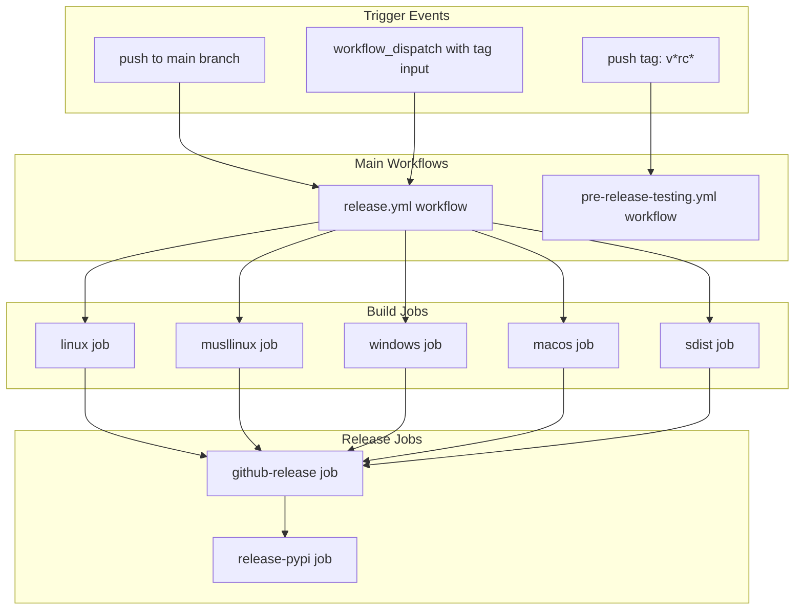
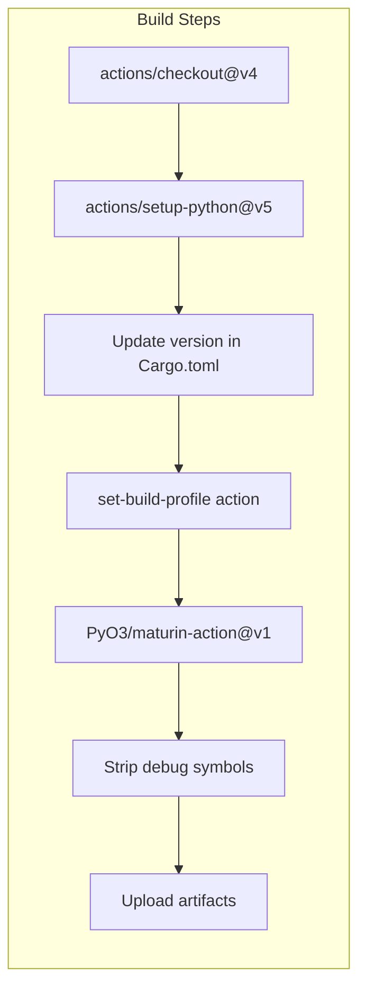
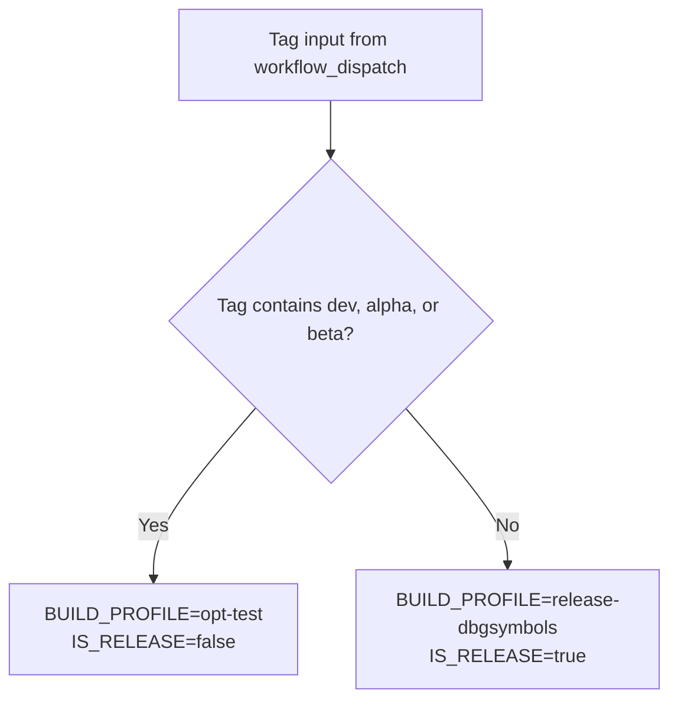
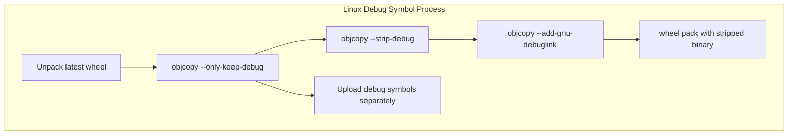
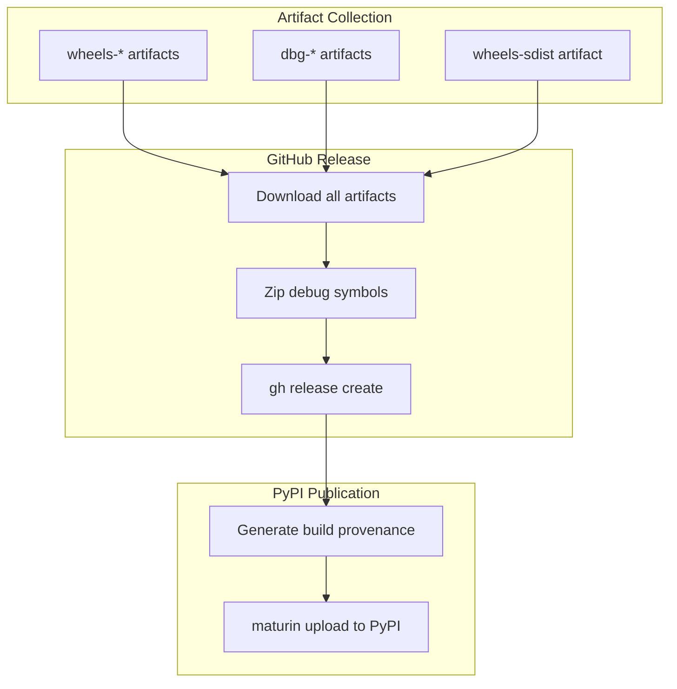
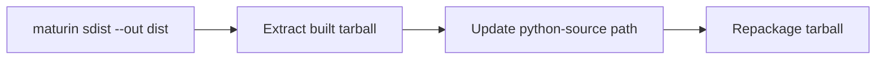
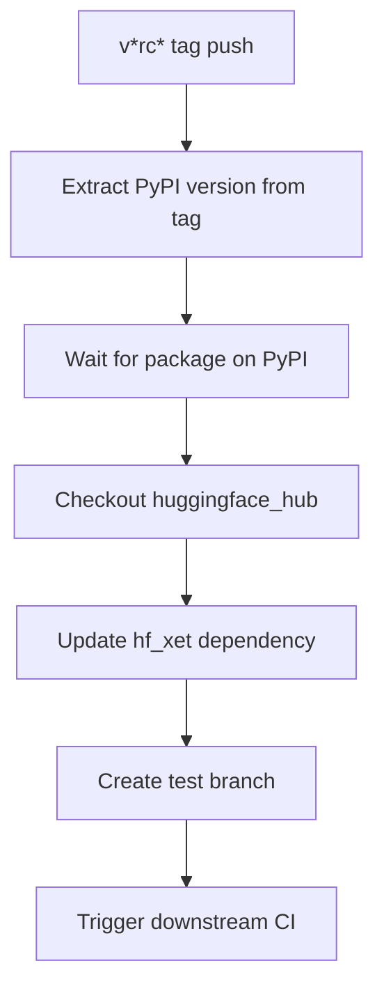

<!-- source: DeepWiki mcp.deepwiki.com · repo huggingface/xet-core · page 6.2 CI/CD and Release Process · fetched 2026-10-26 -->

# CI/CD and Release Process

<details>
<summary>Relevant source files</summary>

The following files were used as context for generating this wiki page:

- [.github/actions/cache-rust-build/action.yml](.github/actions/cache-rust-build/action.yml)
- [.github/workflows/ci.yml](.github/workflows/ci.yml)
- [.github/workflows/git-xet-release.yml](.github/workflows/git-xet-release.yml)
- [.github/workflows/hf-xet-tests.yml](.github/workflows/hf-xet-tests.yml)
- [.github/workflows/pre-release-testing.yml](.github/workflows/pre-release-testing.yml)
- [.github/workflows/release.yml](.github/workflows/release.yml)
- [git_xet/entitlements.xml](git_xet/entitlements.xml)

</details>


This document covers the automated build, testing, and release infrastructure for the xet-core repository. The CI/CD system handles multi-platform Python wheel generation, debug symbol extraction, PyPI publication, and GitHub releases using GitHub Actions workflows.

For information about the workspace structure and dependencies, see [Workspace Dependencies](#6.1). For details about user-facing APIs and integration patterns, see [Python Integration](#4.2).

## Release Workflow Architecture

The xet-core project uses a comprehensive GitHub Actions-based CI/CD pipeline that builds Python wheels for multiple platforms and publishes them to both PyPI and GitHub releases.

### Workflow Trigger Structure



Sources: [.github/workflows/release.yml:6-23](), [.github/workflows/pre-release-testing.yml:4-12]()

## Build Matrix and Platform Support

The release process builds Python wheels for multiple platforms using a comprehensive build matrix that ensures broad compatibility.

### Platform Build Configuration

| Platform | Runner | Target Architecture | Python Target | Special Requirements |
|----------|--------|-------------------|---------------|---------------------|
| Linux x86_64 | ubuntu-22.04 | x86_64 | x86_64 | manylinux auto, libatomic-ops-dev |
| Linux aarch64 | ubuntu-22.04 | aarch64 | arm64 | manylinux_2_28, cross-compilation tools |
| MuslLinux x86_64 | ubuntu-22.04 | x86_64 | x86_64 | musllinux_1_2 |
| MuslLinux aarch64 | ubuntu-22.04 | aarch64 | arm64 | musllinux_1_2, cross-compilation tools |
| Windows x64 | windows-latest | x64 | x64 | MSVC toolchain |
| macOS x86_64 | macos-13 | x86_64 | x86_64 | Intel-based runner |
| macOS aarch64 | macos-14 | aarch64 | aarch64 | Apple Silicon runner |

### Build Process Flow



Sources: [.github/workflows/release.yml:37-113](), [.github/workflows/release.yml:126-193]()

## Version Management and Build Profiles

The system uses semantic versioning with automatic Cargo.toml updates and conditional build profile selection based on the release type.

### Build Profile Selection Logic

The `set-build-profile` action determines the appropriate build configuration based on the tag name:



The version update process extracts the semantic version from the Git tag and updates the version field in [hf_xet/Cargo.toml]():

```bash
TAG=${{ github.event.inputs.tag }}
VERSION=${TAG#v}
sed -i '/^version /s/=.*$/= "'"$VERSION"'"/' hf_xet/Cargo.toml
```

Sources: [.github/actions/set-build-profile/action.yml:6-18](), [.github/workflows/release.yml:47-53]()

## Debug Symbol Generation

The release process generates and manages debug symbols separately from the main wheel distributions to optimize package size while maintaining debugging capabilities.

### Debug Symbol Extraction Process

For Linux platforms, the workflow uses `objcopy` to extract debug symbols:



Platform-specific debug symbol formats:
- **Linux**: `.so.dbg` files with GNU debug link
- **Windows**: `.pdb` files from MSVC compilation  
- **macOS**: `.dSYM` bundles with updated binary paths

Sources: [.github/workflows/release.yml:74-97](), [.github/workflows/release.yml:224-233](), [.github/workflows/release.yml:273-285]()

## Publication and Distribution

The release system publishes artifacts to both GitHub releases and PyPI through a coordinated multi-stage process.

### Publication Pipeline



The PyPI publication includes build provenance attestation using `actions/attest-build-provenance@v1` for supply chain security.

Sources: [.github/workflows/release.yml:352-375](), [.github/workflows/release.yml:327-350]()

## Source Distribution Processing

The sdist (source distribution) generation includes special processing to handle the Python source path configuration correctly.

### Sdist Build and Patching

The process involves building the sdist with maturin and then patching the `pyproject.toml` to correct the Python source path:



The patching step updates the python source configuration from the workspace root to the package-specific location:

```bash
sed -i '/^python-source =/ s/= .*/= "hf_xet\/python"/' ${DISTNAME}/pyproject.toml
```

Sources: [.github/workflows/release.yml:304-325]()

## Pre-release Testing Integration

The pre-release testing workflow automatically triggers integration testing with downstream repositories when release candidate tags are pushed.

### RC Testing Flow



The workflow automatically updates the `huggingface_hub` repository's dependency specification and enables pre-release package installation in CI workflows.

Sources: [.github/workflows/pre-release-testing.yml:14-87]()