# Page: Overview

# Overview

<details>
<summary>Relevant source files</summary>

The following files were used as context for generating this wiki page:

- [Cargo.lock](Cargo.lock)
- [Cargo.toml](Cargo.toml)
- [cas_client/Cargo.toml](cas_client/Cargo.toml)
- [cas_client/src/error.rs](cas_client/src/error.rs)
- [cas_client/src/http_client.rs](cas_client/src/http_client.rs)
- [cas_client/src/remote_client.rs](cas_client/src/remote_client.rs)
- [cas_client/src/retry_wrapper.rs](cas_client/src/retry_wrapper.rs)
- [data/Cargo.toml](data/Cargo.toml)
- [data/src/bin/example.rs](data/src/bin/example.rs)
- [data/src/data_client.rs](data/src/data_client.rs)
- [data/src/file_upload_session.rs](data/src/file_upload_session.rs)
- [data/src/lib.rs](data/src/lib.rs)
- [data/tests/test_clean_smudge.rs](data/tests/test_clean_smudge.rs)
- [hf_xet/Cargo.lock](hf_xet/Cargo.lock)
- [hf_xet/Cargo.toml](hf_xet/Cargo.toml)
- [hf_xet/src/lib.rs](hf_xet/src/lib.rs)

</details>


The `xet-core` repository implements a content-addressable storage (CAS) system designed for efficient file deduplication and transfer operations at scale. The system enables applications to upload and download files with automatic deduplication across files and users, reducing storage costs and transfer bandwidth.

This document provides a high-level overview of the system architecture, core concepts, and main components. For detailed information about specific subsystems, see:
- Upload/download workflows: [Upload Workflow](#5.1) and [Download Workflow](#5.2)
- Deduplication architecture: [Deduplication Architecture](#2.3)
- Python integration: [Python Integration](#4.2)
- Configuration options: [Configuration and Constants](#3.7)

## System Purpose

The xet-core system provides:

1. **Content-addressable storage** with automatic deduplication at the chunk level using FastCDC (content-defined chunking)
2. **Multiple client interfaces**: Python extension (`hf_xet`), command-line tools (`git-xet`, `xtool`), and WebAssembly modules
3. **Efficient data transfer** through compressed binary objects (XORBs) and metadata shards (MDB shards)
4. **Local caching** to minimize redundant downloads and support offline operation
5. **Cross-user deduplication** to maximize storage efficiency in production deployments

**Sources**: [data/src/data_client.rs:1-390](), [hf_xet/Cargo.toml:1-78](), [hf_xet/src/lib.rs:1-346]()

## Core Concepts

### XORBs (Extended Object Blocks)

XORBs are the fundamental storage unit for file content in the system. Each XORB:
- Contains multiple content-defined chunks compressed together
- Has a maximum size controlled by `MAX_XORB_BYTES` and `MAX_XORB_CHUNKS`
- Uses LZ4 or byte grouping compression schemes
- Is identified by a content hash for deduplication

**Sources**: [data/src/file_upload_session.rs:374-388](), [Diagram 2: Upload Data Flow Architecture]()

### MDB Shards

MDB (Merkle Database) shards store metadata about file reconstructions:
- Map file hashes to lists of XORB hashes and byte ranges
- Enable efficient querying for which chunks belong to which files
- Support local caching and session management
- Organized in three tiers: session shards, cache shards, and resumed shards

**Sources**: [data/src/configurations.rs:62-68](), [Diagram 4: Deduplication and Caching Architecture]()

### Content-Defined Chunking

Files are split into variable-size chunks using the FastCDC algorithm:
- Produces content-defined boundaries that remain stable across file edits
- Target chunk size controlled by `TARGET_CHUNK_SIZE` constant
- Chunks are hashed using BLAKE3 for content addressing
- Enables deduplication of common data segments across different files

**Sources**: [Diagram 2: Upload Data Flow Architecture](), [data/src/file_upload_session.rs:189-219]()

## System Architecture

### High-Level Component Structure

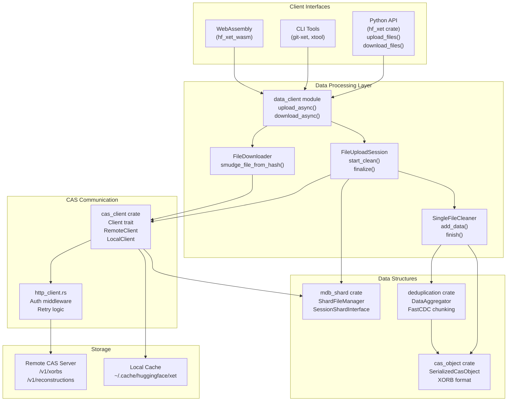

**Sources**: [Diagram 1: Overall System Architecture](), [data/src/data_client.rs:1-96](), [hf_xet/src/lib.rs:40-125](), [data/src/file_upload_session.rs:40-71](), [data/src/file_downloader.rs:17-59]()

### Module Dependencies

The system is organized into distinct Rust crates with clear dependency relationships:

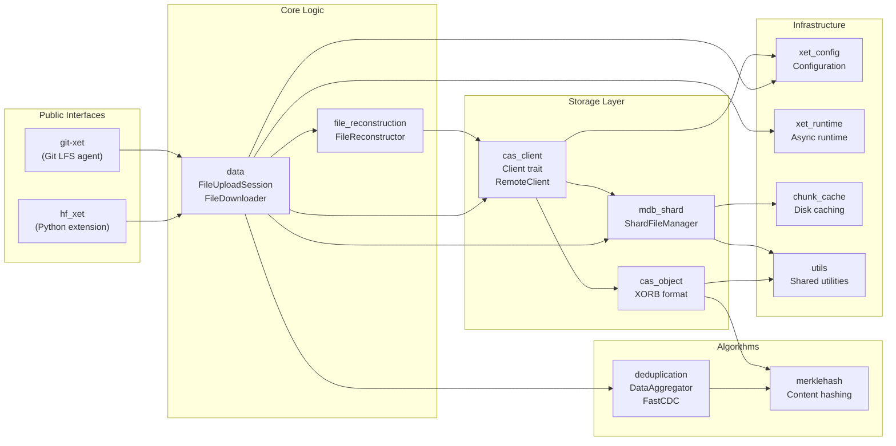

**Sources**: [Diagram 5: Module Dependency and Crate Structure](), [hf_xet/Cargo.toml:12-20](), [data/src/file_upload_session.rs:1-22](), [data/src/file_downloader.rs:1-15]()

## Primary Interfaces

### Python API (hf_xet)

The Python extension provides the primary interface for applications:

| Function | Purpose | Location |
|----------|---------|----------|
| `upload_files()` | Upload files from disk paths | [hf_xet/src/lib.rs:84-125]() |
| `upload_bytes()` | Upload in-memory byte arrays | [hf_xet/src/lib.rs:42-80]() |
| `download_files()` | Download files using XetFileInfo | [hf_xet/src/lib.rs:129-168]() |

The Python API wraps the core data client functions and handles:
- Token refresh callbacks for authentication
- Progress update callbacks for tracking
- Async/sync bridge using `async_run()`

**Example usage pattern**:
```python
import hf_xet

# Upload files
file_infos = hf_xet.upload_files(
    ["path/to/file1.txt", "path/to/file2.txt"],
    endpoint="https://cas.example.com",
    token_info=("token", expiry_timestamp),
    token_refresher=refresh_callback,
    progress_updater=progress_callback
)

# Download files
paths = hf_xet.download_files(
    [PyXetDownloadInfo(dest_path, hash, size)],
    endpoint="https://cas.example.com",
    token_info=("token", expiry_timestamp)
)
```

**Sources**: [hf_xet/src/lib.rs:40-168](), [data/src/data_client.rs:98-240]()

### Command-Line Tools

The system provides command-line interfaces for:
- **git-xet**: Custom Git LFS transfer agent for seamless Git integration
- **xtool**: Standalone tool for file deduplication and migration
- **example binary**: Demonstrates clean/smudge operations

**Sources**: [data/src/bin/example.rs:1-157](), [Diagram 1: Overall System Architecture]()

## Data Flow Patterns

### Upload Flow

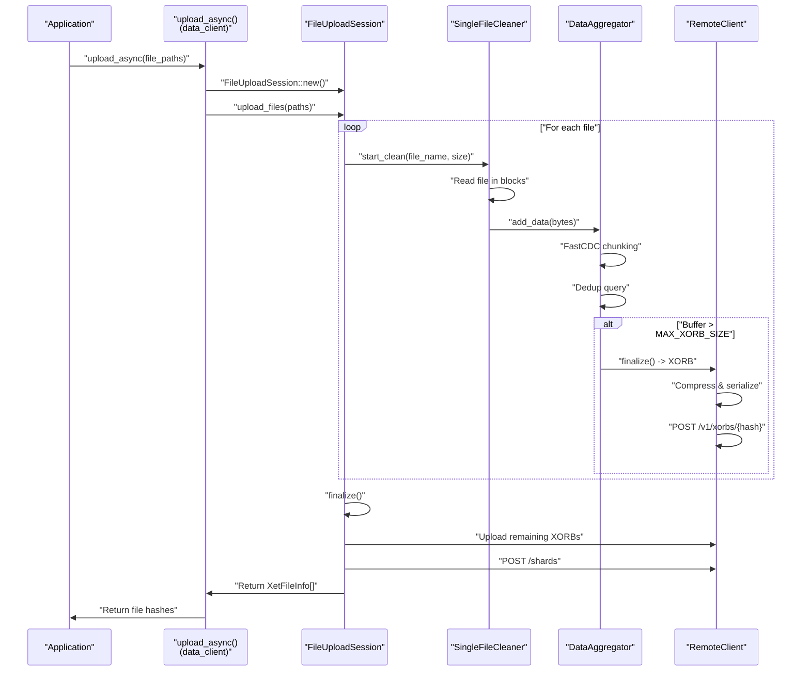

**Sources**: [Diagram 2: Upload Data Flow Architecture](), [data/src/data_client.rs:143-199](), [data/src/file_upload_session.rs:149-248]()

### Download Flow

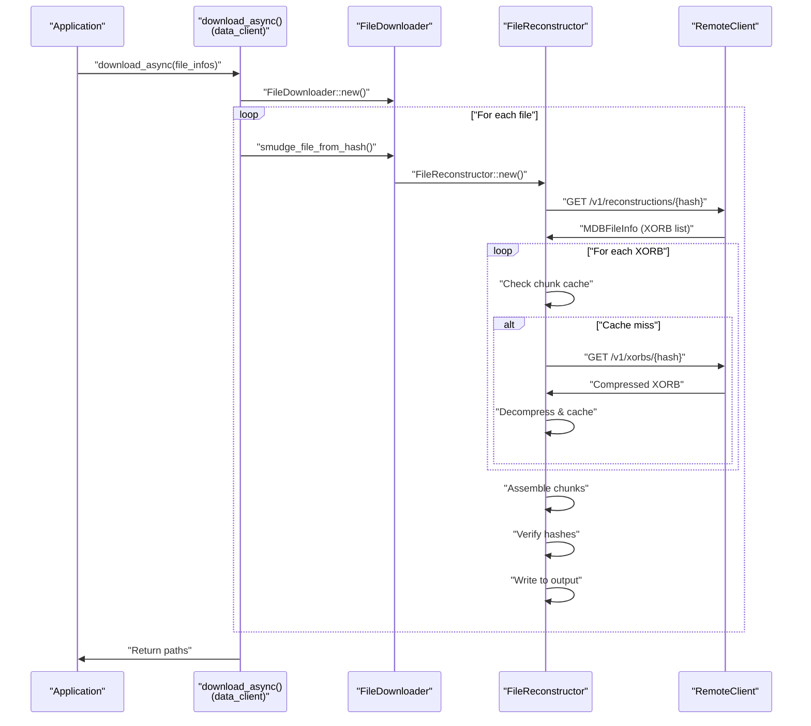

**Sources**: [Diagram 3: Download and Reconstruction Flow](), [data/src/data_client.rs:202-240](), [data/src/file_downloader.rs:33-58]()

## Configuration and Initialization

The system uses a configuration hierarchy to control behavior:

| Configuration Component | Purpose | Source |
|------------------------|---------|--------|
| `TranslatorConfig` | Main configuration container | [data/src/configurations.rs:76-82]() |
| `DataConfig` | Endpoint, compression, auth settings | [data/src/configurations.rs:18-25]() |
| `ShardConfig` | Shard cache and session directories | [data/src/configurations.rs:63-68]() |
| `xet_config()` | Global runtime constants | [data/src/data_client.rs:18]() |

**Default configuration initialization**:

The `default_config()` function in [data/src/data_client.rs:30-96]() sets up:
1. Cache directory resolution (`HF_XET_CACHE` or `HF_HOME` environment variables)
2. Endpoint tagging for cache separation
3. Authentication configuration with token refresh support
4. Session and staging directories

**Sources**: [data/src/data_client.rs:30-96](), [data/src/configurations.rs:76-163]()

## Deduplication Strategy

The system implements a five-tier deduplication hierarchy:

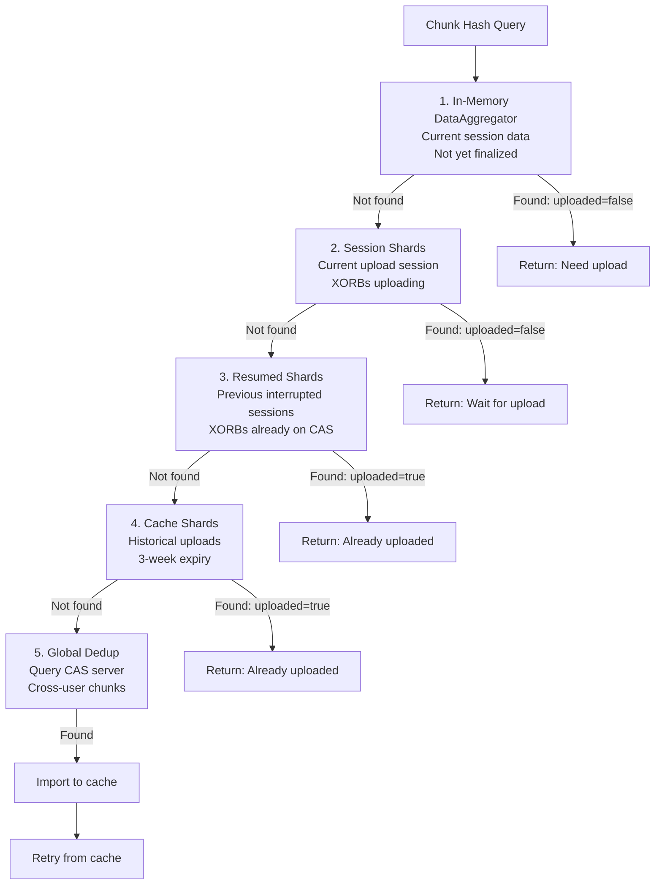

This hierarchy maximizes deduplication opportunities while ensuring correctness:
- **Tier 1-2**: Session-local deduplication (highest priority)
- **Tier 3-4**: Local cache deduplication (fast, no network)
- **Tier 5**: Global deduplication (requires network query)

The `uploaded` flag in dedup results allows the system to distinguish between data that needs uploading versus data already persisted, preventing duplicate uploads.

**Sources**: [Diagram 4: Deduplication and Caching Architecture](), [data/src/file_upload_session.rs:60-71]()

## Production Deployment

In production environments, the system operates as a client-server architecture:

| Component | Location | Purpose |
|-----------|----------|---------|
| **Client Libraries** | User machines | Python extension, Git binary, WASM module |
| **Local Cache** | `~/.cache/huggingface/xet` | Chunk and shard caching (3-week expiry) |
| **CAS Server** | Remote infrastructure | XORB and shard storage, dedup queries |
| **CDN** | Edge locations | Accelerated downloads via presigned URLs |

**Authentication flow**:
1. Client receives Hugging Face JWT token with expiration
2. Token included in Authorization header for all requests
3. Automatic token refresh via callback when near expiration
4. Server validates token and applies rate limits/quotas

**Sources**: [Diagram 6: Production Deployment Architecture](), [data/src/data_client.rs:49-50](), [hf_xet/src/lib.rs:51-52]()

## Key Design Patterns

### Async Runtime

The system uses Tokio for async operations with:
- Global semaphores to limit concurrent file ingestion and downloads
- Task spawning for parallel XORB uploads
- Async/await throughout the stack

**Key concurrency controls**:
- `CONCURRENT_FILE_INGESTION_LIMITER`: Controls parallel file processing during upload
- `CONCURRENT_FILE_DOWNLOAD_LIMITER`: Controls parallel file downloads
- Per-client upload permits for rate limiting

**Sources**: [data/src/file_upload_session.rs:35-38](), [data/src/data_client.rs:25-28]()

### Progress Tracking

The system provides detailed progress updates through:
- `TrackingProgressUpdater` trait for byte-level tracking
- `AggregatingProgressUpdater` for batched updates to reduce overhead
- `CompletionTracker` for file-XORB dependency tracking
- Separate tracking for total bytes vs transfer bytes (deduplication visibility)

**Sources**: [data/src/file_upload_session.rs:55-71](), [hf_xet/src/lib.rs:51-52]()

### Session Management

Upload operations use session-based coordination:
- Each `FileUploadSession` has a unique session ID (ULID)
- Session state includes in-progress XORBs, shard metadata, and dedup cache
- Checkpoint support allows interrupted sessions to resume
- Finalization ensures atomic upload completion

**Sources**: [data/src/file_upload_session.rs:40-147](), [data/src/file_upload_session.rs:445-500]()

---

This overview establishes the foundation for understanding xet-core. For detailed information about specific subsystems, workflows, and implementation details, refer to the subsequent pages in this wiki.

---

# Page: Architecture

# Architecture

<details>
<summary>Relevant source files</summary>

The following files were used as context for generating this wiki page:

- [data/src/bin/example.rs](data/src/bin/example.rs)
- [data/src/data_client.rs](data/src/data_client.rs)
- [data/src/file_upload_session.rs](data/src/file_upload_session.rs)
- [data/src/lib.rs](data/src/lib.rs)
- [data/tests/test_clean_smudge.rs](data/tests/test_clean_smudge.rs)
- [mdb_shard/Cargo.toml](mdb_shard/Cargo.toml)
- [mdb_shard/src/file_structs.rs](mdb_shard/src/file_structs.rs)
- [mdb_shard/src/lib.rs](mdb_shard/src/lib.rs)
- [mdb_shard/src/set_operations.rs](mdb_shard/src/set_operations.rs)
- [mdb_shard/src/shard_format.rs](mdb_shard/src/shard_format.rs)
- [mdb_shard/src/shard_in_memory.rs](mdb_shard/src/shard_in_memory.rs)
- [mdb_shard/src/streaming_shard.rs](mdb_shard/src/streaming_shard.rs)
- [utils/src/async_read.rs](utils/src/async_read.rs)

</details>


This document describes the high-level architectural patterns and design principles of xet-core. It provides an overview of the major subsystems, their relationships, and the foundational design decisions that shape the codebase.

For details on the content-addressable storage format (XORBs, shards, chunks), see [Content-Addressable Storage Design](#2.1). For information about upload and download flows, see [Data Flow and Processing](#2.2). For the deduplication system, see [Deduplication Architecture](#2.3).

## Layered Architecture

xet-core follows a strict layered architecture where each layer has a well-defined responsibility and interacts only with adjacent layers.

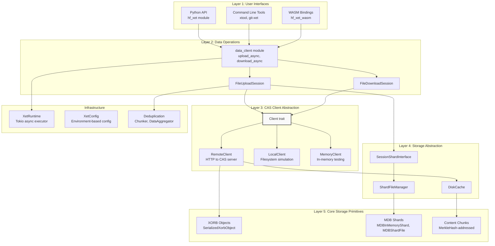

**Sources:** [data/src/data_client.rs:1-410](), [data/src/file_upload_session.rs:1-648](), [data/src/file_download_session.rs]()

### Layer Responsibilities

| Layer | Components | Responsibility |
|-------|------------|----------------|
| **User Interfaces** | Python API, CLI tools, WASM | Present user-facing APIs, handle authentication, convert to internal types |
| **Data Operations** | `FileUploadSession`, `FileDownloadSession`, `data_client` | Orchestrate multi-file operations, manage sessions, coordinate progress tracking |
| **CAS Client** | `RemoteClient`, `LocalClient`, `MemoryClient` | Abstract storage backend, handle HTTP/network operations, implement retry logic |
| **Storage Abstraction** | `ShardFileManager`, `SessionShardInterface`, `DiskCache` | Manage metadata and caching, provide query interfaces, coordinate shard lifecycle |
| **Storage Primitives** | XORB, MDB Shard, Chunk | Define on-disk formats, implement serialization, provide reconstruction data |

**Sources:** [data/src/lib.rs:1-25](), [mdb_shard/src/lib.rs:1-29]()

## Key Architectural Principles

### 1. Content-Addressable Everything

All data is identified by its content hash (`MerkleHash`). This applies at multiple levels:

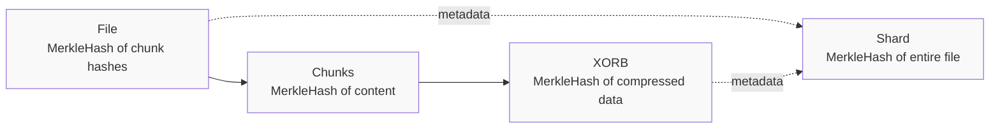

- **Files** are identified by the aggregated hash of their constituent chunk hashes (computed via `merklehash::file_hash`)
- **Chunks** are identified by the hash of their decompressed content
- **XORBs** are identified by the hash of their compressed payload
- **Shards** are identified by the hash of the entire shard file

This enables:
- Automatic deduplication at the chunk level
- Verification of data integrity at every level
- Location-independent addressing

**Sources:** [data/src/data_client.rs:312-364](), [mdb_shard/src/file_structs.rs:1-634]()

### 2. Separation of Data and Metadata

The architecture strictly separates data storage from metadata storage:

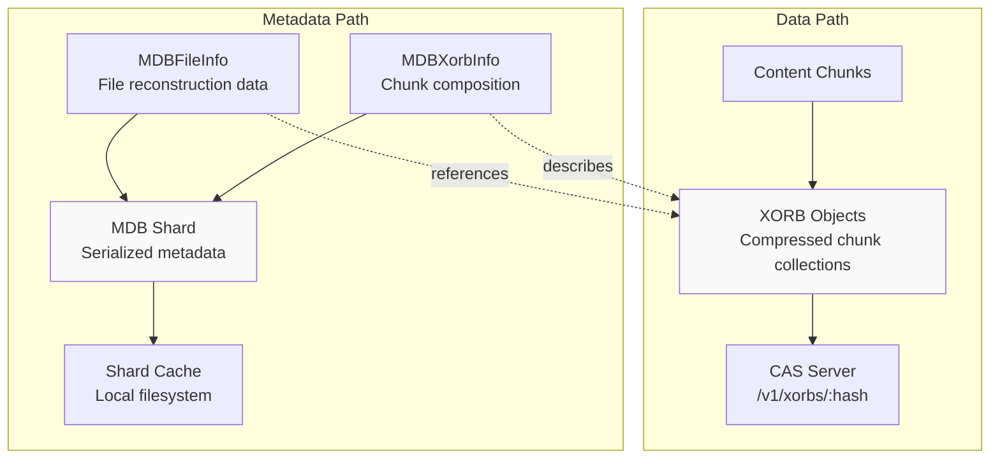

- **Data objects (XORBs)** contain only compressed chunks
- **Metadata objects (Shards)** contain reconstruction information, lookup tables, and statistics
- This separation allows efficient queries without downloading data

**Sources:** [mdb_shard/src/shard_format.rs:1-800](), [mdb_shard/src/file_structs.rs:349-471]()

### 3. Asynchronous and Concurrent Design

All I/O operations use async/await with Tokio for efficient concurrency:

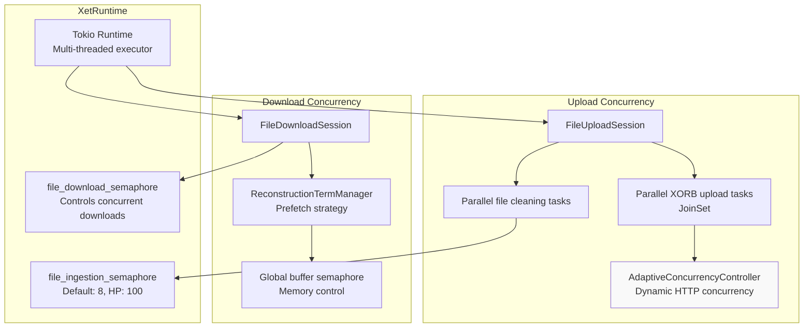

Key concurrency mechanisms:
- **Semaphores** limit resource usage (`file_ingestion_semaphore`, buffer limits)
- **AdaptiveConcurrencyController** adjusts HTTP parallelism based on RTT and success rates
- **JoinSet** manages parallel upload tasks
- **Spawn blocking** offloads CPU-intensive work (compression, hashing)

**Sources:** [data/src/file_upload_session.rs:165-235](), [xet_runtime/src/lib.rs](), [cas_client/src/adaptive_concurrency.rs]()

### 4. Pluggable Storage Backends

The `Client` trait abstracts the storage backend, enabling multiple implementations:

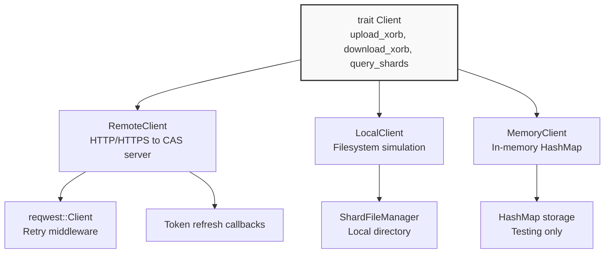

The abstraction enables:
- **Production**: `RemoteClient` with HTTP retry and authentication
- **Local testing**: `LocalClient` using filesystem paths prefixed with `local://`
- **Unit tests**: `MemoryClient` for fast in-memory operations

**Sources:** [cas_client/src/interface.rs](), [cas_client/src/remote_client.rs](), [cas_client/src/local_client.rs]()

## Component Interaction Patterns

### Upload Session Lifecycle

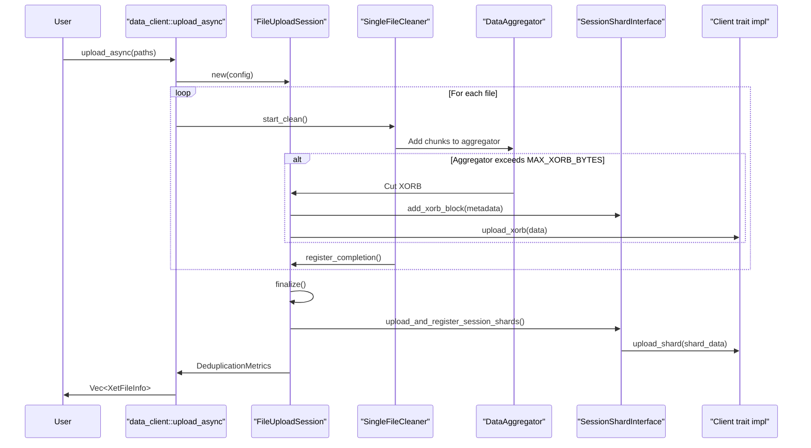

**Sources:** [data/src/data_client.rs:140-197](), [data/src/file_upload_session.rs:143-245](), [data/src/file_upload_session.rs:450-505]()

### Download Session Lifecycle

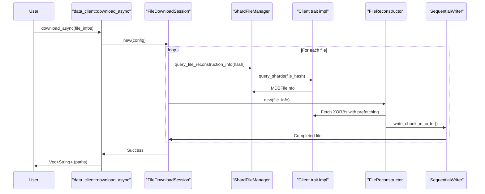

**Sources:** [data/src/data_client.rs:199-257](), [file_reconstruction/src/lib.rs]()

## Configuration and Runtime Management

Configuration follows a hierarchical model with environment variable overrides:

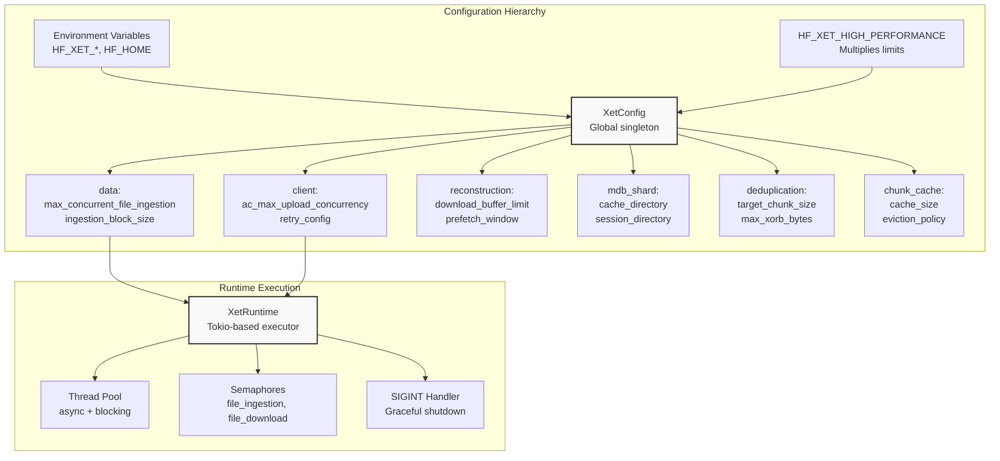

**High-Performance Mode** multiplies concurrency limits:
- File ingestion: 8 → 100
- Upload concurrency: 32 → 124
- Download buffer: 4GB → 64GB

**Sources:** [xet_runtime/src/config.rs](), [xet_runtime/src/runtime.rs](), [data/src/configurations.rs]()

## Error Handling and Resilience

The architecture implements multiple layers of error handling:

| Layer | Mechanism | Implementation |
|-------|-----------|----------------|
| **HTTP** | Exponential backoff retry | `RetryClientMiddleware` in `cas_client` |
| **Network** | Adaptive concurrency | `AdaptiveConcurrencyController` adjusts based on failures |
| **Data** | Content verification | All objects verified against `MerkleHash` |
| **Session** | Transactional upload | XORBs uploaded before shards; atomic shard registration |
| **Cache** | LRU eviction | `DiskCache` with configurable size limits |
| **Runtime** | SIGINT handling | Graceful task cancellation via `check_sigint_shutdown()` |

**Sources:** [cas_client/src/retry_client.rs](), [cas_client/src/adaptive_concurrency.rs](), [chunk_cache/src/lib.rs]()

## Storage Format Versioning

Shards include versioned headers and footers to support backward compatibility:

```rust
// From shard_format.rs
const MDB_SHARD_HEADER_VERSION: u64 = 2;
const MDB_SHARD_FOOTER_VERSION: u64 = 1;
const MDB_SHARD_HEADER_TAG: [u8; 32] = [
    b'H', b'F', b'R', b'e', b'p', b'o', ...
];
```

- **Header** contains magic number and version
- **Footer** contains offsets and metadata
- Version checks prevent incompatible format usage

**Sources:** [mdb_shard/src/shard_format.rs:36-100]()

## Memory Management

Memory usage is controlled through several mechanisms:

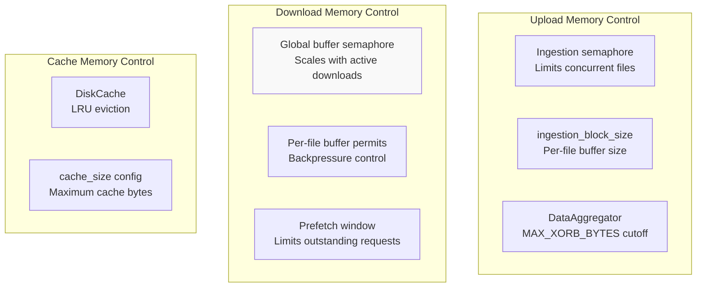

- **Upload**: Limited by file concurrency × block size × 2 (double buffering)
- **Download**: Dynamically scaled buffer semaphore prevents runaway memory
- **Cache**: LRU eviction maintains configured size limit

**Sources:** [data/src/file_upload_session.rs:194-216](), [file_reconstruction/src/buffer_manager.rs](), [chunk_cache/src/disk_cache.rs]()

---

# Page: Content-Addressable Storage Design

# Content-Addressable Storage Design

<details>
<summary>Relevant source files</summary>

The following files were used as context for generating this wiki page:

- [chunk_cache/Cargo.toml](chunk_cache/Cargo.toml)
- [chunk_cache/src/disk.rs](chunk_cache/src/disk.rs)
- [chunk_cache/src/disk/cache_item.rs](chunk_cache/src/disk/cache_item.rs)
- [chunk_cache/src/disk/test_utils.rs](chunk_cache/src/disk/test_utils.rs)
- [chunk_cache/src/lib.rs](chunk_cache/src/lib.rs)
- [data/src/configurations.rs](data/src/configurations.rs)
- [mdb_shard/Cargo.toml](mdb_shard/Cargo.toml)
- [mdb_shard/src/file_structs.rs](mdb_shard/src/file_structs.rs)
- [mdb_shard/src/lib.rs](mdb_shard/src/lib.rs)
- [mdb_shard/src/set_operations.rs](mdb_shard/src/set_operations.rs)
- [mdb_shard/src/shard_format.rs](mdb_shard/src/shard_format.rs)
- [mdb_shard/src/shard_in_memory.rs](mdb_shard/src/shard_in_memory.rs)
- [mdb_shard/src/streaming_shard.rs](mdb_shard/src/streaming_shard.rs)
- [utils/src/async_read.rs](utils/src/async_read.rs)

</details>


## Purpose and Scope

This document describes the content-addressable storage (CAS) architecture at the core of xet-core. It explains how data is chunked, compressed, addressed by cryptographic hashes, and stored in XORB (XET Object Repository Block) containers. This page focuses on the storage format and addressing scheme. For details on the upload/download workflows that use this storage system, see [Data Flow and Processing](#2.2). For the deduplication mechanisms that leverage content addressing, see [Deduplication Architecture](#2.3).

## Content Addressing Fundamentals

The xet-core system uses content-addressable storage, where data is identified and retrieved by its cryptographic hash rather than by location. This design enables automatic deduplication: identical content always produces the same hash, allowing the system to detect and eliminate redundant storage.

### Hash-Based Addressing Model

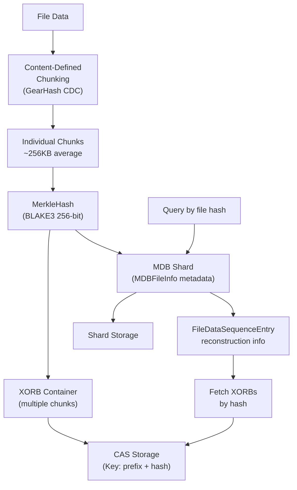

**Content Addressing Flow**

Sources: [mdb_shard/src/file_structs.rs:1-50](), [deduplication/](https://github.com/huggingface/xet-core/tree/main/deduplication)

The system uses `MerkleHash` as the addressing primitive, a 256-bit BLAKE3 hash. Each chunk is identified by its `MerkleHash`, computed over the chunk's raw bytes. The architecture consists of three layers:

- **Chunk Layer**: Content-defined chunks (via GearHash) addressed by `MerkleHash`
- **XORB Layer**: Compressed chunk collections addressed by their own `MerkleHash`  
- **Shard Layer**: Metadata linking file hashes to XORB reconstruction information

This multi-layer design enables:
- **Global deduplication**: Identical chunks produce identical hashes across all users and files
- **Integrity verification**: Each layer's hash serves as a checksum to detect corruption
- **Efficient lookups**: Hashes provide uniform distribution for indexing
- **Metadata separation**: File reconstruction metadata stored separately from chunk data

Sources: [mdb_shard/src/file_structs.rs:27-50](), [cas_types/src/lib.rs](https://github.com/huggingface/xet-core/tree/main/cas_types/src/lib.rs)

## XORB (XET Object Repository Block) Format

XORBs are the fundamental storage containers in the CAS system. A XORB aggregates multiple compressed chunks into a single serialized blob, optimizing for bulk transfer and storage efficiency.

### XORB Structure Overview

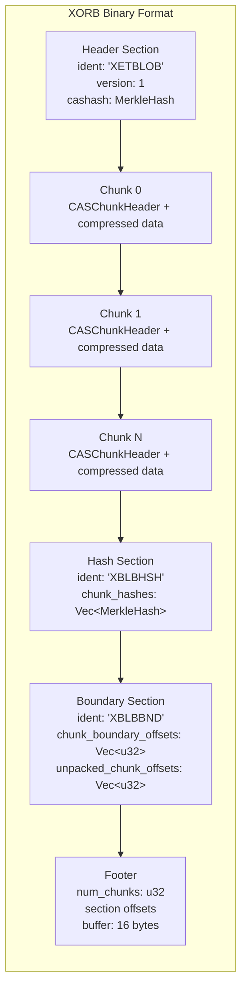

**XORB Binary Layout**

Sources: [cas_object/src/cas_object_format.rs:280-357]()

### XORB Metadata Structure

The `CasObjectInfoV1` structure defines the XORB metadata, which is serialized at the end of the XORB blob:

| Section | Fields | Description |
|---------|--------|-------------|
| **Header** | `ident: [u8; 7]`<br/>`version: u8`<br/>`cashash: MerkleHash` | Magic bytes "XETBLOB", format version (1), XORB hash |
| **Hash Section** | `ident_hash_section: [u8; 7]`<br/>`hashes_version: u8`<br/>`num_chunks: u32`<br/>`chunk_hashes: Vec<MerkleHash>` | Magic bytes "XBLBHSH", list of chunk hashes |
| **Boundary Section** | `ident_boundary_section: [u8; 7]`<br/>`boundaries_version: u8`<br/>`num_chunks: u32`<br/>`chunk_boundary_offsets: Vec<u32>`<br/>`unpacked_chunk_offsets: Vec<u32>` | Magic bytes "XBLBBND", chunk boundaries in compressed and uncompressed space |
| **Footer** | `num_chunks: u32`<br/>`hashes_section_offset_from_end: u32`<br/>`boundary_section_offset_from_end: u32`<br/>`_buffer: [u8; 16]` | Fixed-size footer for seeking to sections |

Sources: [cas_object/src/cas_object_format.rs:281-357]()

The footer is positioned at a fixed offset from the end of the XORB, enabling efficient metadata parsing without reading the entire blob. The offset fields allow seeking directly to the hash and boundary sections.

### XORB Serialization and Deserialization

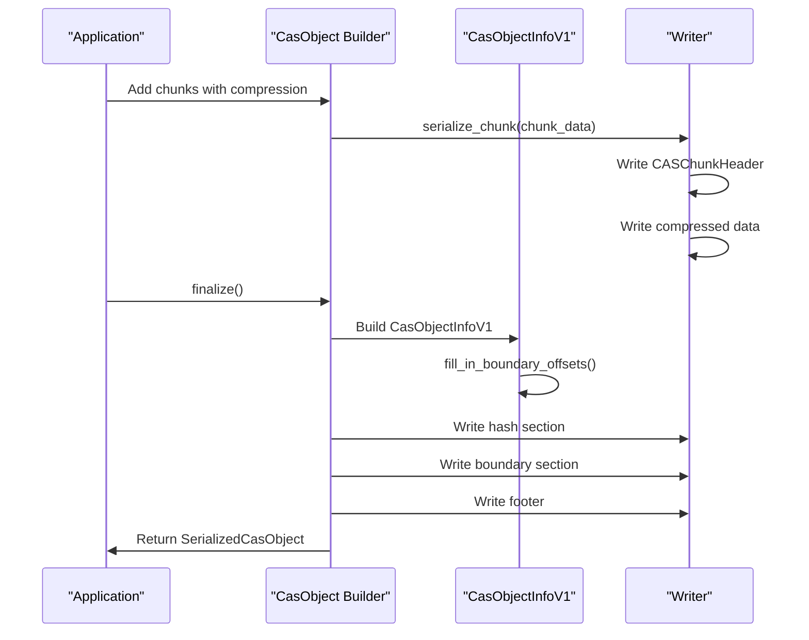

**XORB Build Process**

Sources: [cas_object/src/cas_object_format.rs:399-479](), [cas_object/src/lib.rs:1-11]()

Key implementation details:

- **Serialization**: `CasObjectInfoV1::serialize()` writes the metadata sections in order [cas_object/src/cas_object_format.rs:402-479]()
- **Deserialization**: `CasObjectInfoV1::deserialize()` reads from the footer backwards [cas_object/src/cas_object_format.rs:484-602]()
- **Partial deserialization**: `deserialize_only_boundaries_section()` reads just boundaries for range queries [cas_object/src/cas_object_format.rs:607-673]()
- **Async support**: `deserialize_async()` provides non-blocking deserialization [cas_object/src/cas_object_format.rs:789-804]()

Sources: [cas_object/src/cas_object_format.rs:399-804]()

## Chunk Format and Compression

Each chunk within a XORB is independently compressed and prefixed with a header describing the compression scheme and sizes.

### Chunk Header Structure

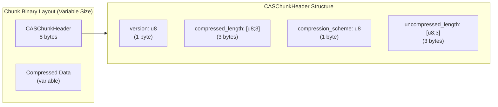

**Chunk Format Layout**

Sources: [cas_object/src/cas_chunk_format.rs:13-23]()

The `CASChunkHeader` is an 8-byte packed structure:

```rust
#[repr(C, packed)]
pub struct CASChunkHeader {
    pub version: u8,              // 1 byte
    compressed_length: [u8; 3],   // 3 bytes (24-bit, max 16MB)
    compression_scheme: u8,       // 1 byte
    uncompressed_length: [u8; 3], // 3 bytes (24-bit, max 16MB)
}
```

Sources: [cas_object/src/cas_chunk_format.rs:16-23]()

The use of 3-byte length fields limits individual chunks to 16MB (2^24 bytes), which is sufficient given typical chunk sizes of 8KB-256KB from FastCDC.

### Compression Schemes

The system supports three compression schemes, enumerated by `CompressionScheme`:

| Scheme | Value | Description | Use Case |
|--------|-------|-------------|----------|
| `None` | 0 | No compression | Already compressed data, small chunks |
| `LZ4` | 1 | LZ4 frame compression | General-purpose compression |
| `ByteGrouping4LZ4` | 2 | Byte grouping + LZ4 | Floating-point tensor data |

Sources: [xorb_object/src/compression_scheme.rs](https://github.com/huggingface/xet-core/tree/main/xorb_object/src/compression_scheme.rs)

**ByteGrouping4LZ4** is a specialized scheme that exploits the byte-level patterns in floating-point data:

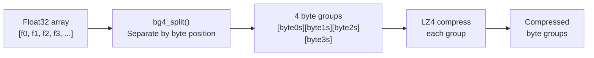

**ByteGrouping4LZ4 Compression Flow**

Sources: [xorb_object/src/compression_scheme.rs](https://github.com/huggingface/xet-core/tree/main/xorb_object/src/compression_scheme.rs)

This scheme achieves better compression on floating-point data (f16, bf16, f32, f64) because grouping by byte position increases locality of similar byte values, improving LZ4's compression ratio.

### Compression Selection

The system automatically selects the compression scheme using a KL-divergence heuristic:

```rust
pub fn choose_from_data(data: &[u8]) -> Self {
    let mut bg4_predictor = BG4Predictor::default();
    bg4_predictor.add_data(0, data);
    
    if bg4_predictor.bg4_recommended() {
        CompressionScheme::ByteGrouping4LZ4
    } else {
        CompressionScheme::LZ4
    }
}
```

Sources: [cas_object/src/compression_scheme.rs:89-99]()

The `BG4Predictor` analyzes the bit-count distribution of the data to determine if byte grouping would be beneficial. This is particularly effective for machine learning model weights stored as tensors.

Sources: [cas_object/src/byte_grouping/]()

## Hash-Based Storage Keys

The CAS system uses a `Key` structure to uniquely identify and retrieve XORBs:

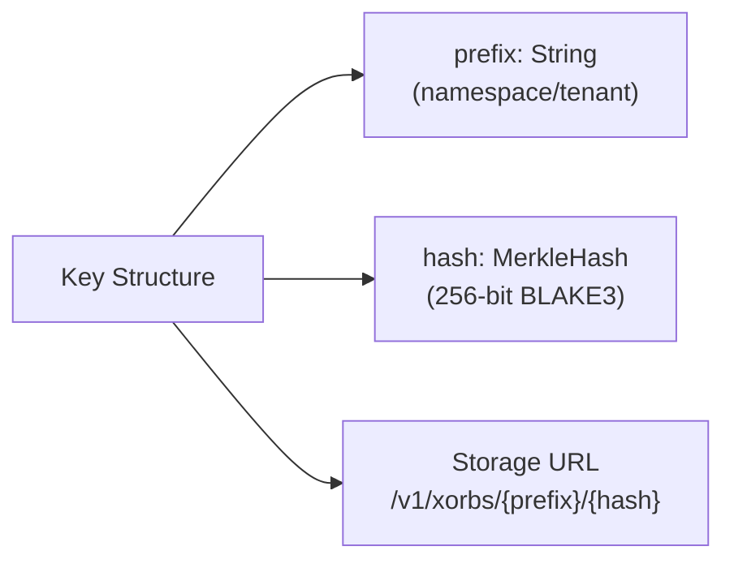

**Key Structure and URL Mapping**

Sources: [cas_types/src/lib.rs](https://github.com/huggingface/xet-core/tree/main/cas_types/src/lib.rs)

The `prefix` field provides multi-tenancy, allowing different users or organizations to maintain separate namespaces while sharing the same CAS infrastructure. The default prefix is `"default"`.

Sources: [cas_client/src/remote_client.rs:30-31]()

## Client-Server Architecture

The CAS system follows a client-server model with the `RemoteClient` implementing the `Client` trait for network operations.

### Client Trait Interface

```mermaid
graph TB
    subgraph ClientTrait["Client Trait Methods"]
        Upload["upload_xorb()<br/>Upload XORB by prefix+hash"]
        UploadShard["upload_shard()<br/>Upload metadata shard"]
        GetRecon["get_reconstruction()<br/>Get file reconstruction info"]
        GetTerms["get_file_term_data()<br/>Download XORB range"]
        QueryDedup["query_for_global_dedup_shard()<br/>Check chunk existence"]
        Permits["acquire_upload_permit()<br/>acquire_download_permit()<br/>Concurrency control"]
    end
    
    subgraph Implementations["Implementations"]
        Remote["RemoteClient<br/>(HTTP/HTTPS)"]
        Local["LocalClient<br/>(Filesystem)"]
        Memory["MemoryClient<br/>(Testing)"]
    end
    
    ClientTrait --> Remote
    ClientTrait --> Local
    ClientTrait --> Memory
```

**Client Trait Architecture**

Sources: [cas_client/src/interface.rs](https://github.com/huggingface/xet-core/tree/main/cas_client/src/interface.rs), [cas_client/src/remote_client.rs:39-46]()

### RemoteClient Structure

The `RemoteClient` maintains connection state and configuration:

```rust
pub struct RemoteClient {
    endpoint: String,
    dry_run: bool,
    http_client: Arc<ClientWithMiddleware>,
    authenticated_http_client: Arc<ClientWithMiddleware>,
    upload_concurrency_controller: Arc<AdaptiveConcurrencyController>,
    download_concurrency_controller: Arc<AdaptiveConcurrencyController>,
}
```

Sources: [cas_client/src/remote_client.rs:39-46]()

Key components:
- **Two HTTP clients**: One authenticated (for CAS operations) and one unauthenticated (for presigned URLs)
- **Concurrency controllers**: Adaptive rate limiting for uploads and downloads
- **Endpoint**: Base URL for the CAS server (default: `http://localhost:8080`)

Sources: [cas_client/src/remote_client.rs:48-66]()

### CAS API Endpoints

| Endpoint | Method | Purpose | Request Body | Response |
|----------|--------|---------|--------------|----------|
| `/v1/xorbs/{key}` | POST | Upload XORB | XORB binary data | `UploadXorbResponse` |
| `/shards` | POST | Upload metadata shard | Shard binary data | `UploadShardResponse` |
| `/v1/reconstructions/{file_id}` | GET | Get file reconstruction info | - | `QueryReconstructionResponse` |
| `/v1/chunks/{key}` | GET | Check chunk existence | - | Shard bytes or 404 |

Sources: [cas_client/src/remote_client.rs:73-120](), [cas_client/src/remote_client.rs:365-413](), [cas_client/src/remote_client.rs:415-524](), [cas_client/src/remote_client.rs:170-216]()

### Upload Operation Flow

```mermaid
sequenceDiagram
    participant App as "Application"
    participant Client as "RemoteClient"
    participant Permit as "ConnectionPermit"
    participant Retry as "RetryWrapper"
    participant HTTP as "ClientWithMiddleware"
    participant Server as "CAS Server"
    
    App->>Client: upload_xorb(prefix, xorb)
    Client->>Permit: acquire_upload_permit()
    Permit-->>Client: ConnectionPermit
    
    Client->>Retry: RetryWrapper::new("cas::upload_xorb")
    Retry->>HTTP: POST /v1/xorbs/{prefix}/{hash}
    HTTP->>Server: XORB binary + CONTENT_LENGTH
    Server-->>HTTP: UploadXorbResponse {was_inserted}
    HTTP-->>Retry: Response
    Retry-->>Client: Result
    Client->>Permit: Release permit
    Client-->>App: bytes uploaded
```

**XORB Upload Sequence**

Sources: [cas_client/src/remote_client.rs:415-524]()

The upload process includes:
1. **Permit acquisition**: Throttles concurrent uploads via `AdaptiveConcurrencyController`
2. **Retry logic**: `RetryWrapper` handles transient failures with exponential backoff
3. **Progress tracking**: Optional `CompletionTracker` for UI updates
4. **Deduplication check**: Server returns `was_inserted: false` if XORB already exists

Sources: [cas_client/src/remote_client.rs:419-524]()

### Download Operation Flow

```mermaid
sequenceDiagram
    participant App as "Application"
    participant Client as "RemoteClient"
    participant Server as "CAS Server"
    participant S3 as "Object Storage"
    
    App->>Client: get_file_reconstruction_info(file_hash)
    Client->>Server: GET /v1/reconstructions/{file_hash}
    Server-->>Client: QueryReconstructionResponse<br/>{terms: [{hash, range}...]}
    
    loop For each term
        App->>Client: get_file_term_data(url_provider)
        Client->>S3: GET range with presigned URL
        S3-->>Client: XORB chunk bytes
        Client->>Client: deserialize_chunks_from_stream()
        Client-->>App: (chunk_data, chunk_indices)
    end
```

**File Download Sequence**

Sources: [cas_client/src/remote_client.rs:314-351](), [cas_client/src/remote_client.rs:257-312]()

Key features:
- **Presigned URLs**: Downloads use S3 presigned URLs for CDN acceleration
- **URL refresh**: Automatically refreshes expired presigned URLs on 403 responses
- **Streaming decompression**: Chunks are decompressed as they stream in
- **Async deserialization**: Uses `deserialize_chunks_from_stream()` for efficient memory usage

Sources: [cas_client/src/remote_client.rs:257-312](), [cas_object/src/cas_chunk_format/deserialize_async.rs:87-110]()

## Storage Operations Implementation

### Serialization Path

The path from raw chunks to stored XORB:

```mermaid
graph TB
    RawChunks["Raw Chunks<br/>Vec&lt;Vec&lt;u8&gt;&gt;"]
    CompressChunks["serialize_chunk()<br/>Apply compression"]
    CompressedData["Compressed Chunks<br/>with headers"]
    BuildInfo["Build CasObjectInfoV1<br/>Collect hashes, boundaries"]
    Serialize["Serialize metadata sections"]
    FinalXORB["Complete XORB blob<br/>SerializedCasObject"]
    
    RawChunks --> CompressChunks
    CompressChunks --> CompressedData
    CompressedData --> BuildInfo
    BuildInfo --> Serialize
    Serialize --> FinalXORB
    
    FinalXORB --> Upload["upload_xorb()"]
```

**Serialization Flow**

Sources: [cas_object/src/cas_chunk_format.rs:114-135](), [cas_object/src/cas_object_format.rs:402-479]()

### Deserialization Path

The path from stored XORB to reconstructed file:

```mermaid
graph TB
    Query["Query for file<br/>get_reconstruction()"]
    Terms["Get terms list<br/>{xorb_hash, range}"]
    FetchXORB["Fetch XORB from storage<br/>get_file_term_data()"]
    Stream["Stream XORB bytes"]
    DeserHeader["deserialize_chunk_header()"]
    DecompressChunk["Decompress chunk<br/>based on scheme"]
    CollectChunks["Collect all chunks<br/>in order"]
    Reconstruct["Reconstructed file data"]
    
    Query --> Terms
    Terms --> FetchXORB
    FetchXORB --> Stream
    
    Stream --> DeserHeader
    DeserHeader --> DecompressChunk
    DecompressChunk --> CollectChunks
    CollectChunks --> Reconstruct
```

**Deserialization Flow**

Sources: [cas_client/src/remote_client.rs:257-312](), [cas_object/src/cas_chunk_format/deserialize_async.rs:79-110]()

### Error Handling

The CAS client defines specific error types for different failure modes:

| Error Type | Description | Example |
|------------|-------------|---------|
| `CasObjectError` | XORB format errors | Invalid header, corrupted chunk |
| `FileNotFound(MerkleHash)` | File hash not in CAS | Requested file doesn't exist |
| `XORBNotFound(MerkleHash)` | XORB hash not in CAS | Missing XORB during reconstruction |
| `ReqwestError` | Network errors | Timeout, connection refused |
| `PresignedUrlExpirationError` | URL expired during download | Retry with fresh URL |

Sources: [cas_client/src/error.rs:12-65](), [cas_object/src/error.rs:6-35]()

The system distinguishes between retriable errors (network failures, expired URLs) and permanent errors (format corruption, missing data) to guide retry logic.

Sources: [cas_client/src/retry_wrapper.rs](https://github.com/huggingface/xet-core/tree/main/cas_client/src/retry_wrapper.rs)

## Design Rationale

### Footer-at-End Design

Placing metadata at the end of the XORB enables:
- **Streaming writes**: Chunks can be written sequentially without knowing total count upfront
- **Efficient metadata reads**: Fixed footer size allows seeking directly to metadata
- **Append-only writes**: Natural for streaming scenarios

Sources: [cas_object/src/cas_object_format.rs:607-673]()

### Separate Hash and Boundary Sections

The split metadata design allows:
- **Partial reads**: Download only boundaries for range queries without full hash list
- **Extensibility**: New sections can be added without breaking compatibility
- **Validation**: Each section has its own identifier for corruption detection

Sources: [cas_object/src/cas_object_format.rs:280-357]()

### Content-Defined Chunking

Using FastCDC (content-defined chunking) instead of fixed-size chunks:
- **Better deduplication**: Chunk boundaries adapt to content, surviving insertions/deletions
- **Consistent chunk identity**: Same content produces same chunks regardless of file offset

Sources: [deduplication/](https://github.com/huggingface/xet-core/tree/main/deduplication)

### Variable Compression

Supporting multiple compression schemes:
- **Flexibility**: Different data types benefit from different compression
- **Performance**: Skip compression for already-compressed data
- **Optimization**: Specialized schemes (ByteGrouping4LZ4) for specific workloads

Sources: [cas_object/src/compression_scheme.rs:19-100]()

---

# Page: Data Flow and Processing

# Data Flow and Processing

<details>
<summary>Relevant source files</summary>

The following files were used as context for generating this wiki page:

- [cas_client/src/adaptive_concurrency/controller.rs](cas_client/src/adaptive_concurrency/controller.rs)
- [cas_client/src/interface.rs](cas_client/src/interface.rs)
- [cas_client/src/lib.rs](cas_client/src/lib.rs)
- [data/src/bin/example.rs](data/src/bin/example.rs)
- [data/src/data_client.rs](data/src/data_client.rs)
- [data/src/file_download_session.rs](data/src/file_download_session.rs)
- [data/src/file_upload_session.rs](data/src/file_upload_session.rs)
- [data/src/lib.rs](data/src/lib.rs)
- [data/src/shard_interface.rs](data/src/shard_interface.rs)
- [data/src/test_utils.rs](data/src/test_utils.rs)
- [data/tests/test_clean_smudge.rs](data/tests/test_clean_smudge.rs)
- [data/tests/test_session_resume.rs](data/tests/test_session_resume.rs)
- [file_reconstruction/Cargo.toml](file_reconstruction/Cargo.toml)
- [file_reconstruction/src/data_writer/data_writer.rs](file_reconstruction/src/data_writer/data_writer.rs)
- [file_reconstruction/src/data_writer/sequential_writer.rs](file_reconstruction/src/data_writer/sequential_writer.rs)
- [file_reconstruction/src/error.rs](file_reconstruction/src/error.rs)
- [file_reconstruction/src/file_reconstructor.rs](file_reconstruction/src/file_reconstructor.rs)
- [hf_xet_wasm/src/wasm_file_upload_session.rs](hf_xet_wasm/src/wasm_file_upload_session.rs)
- [xet_config/src/groups/reconstruction.rs](xet_config/src/groups/reconstruction.rs)

</details>


This page describes how data flows through xet-core during file upload and download operations, including session management, data processing pipelines, and coordination between components. For details on content-addressable storage structure, see [Content-Addressable Storage Design](#2.1). For deduplication mechanics, see [Deduplication Architecture](#2.3). For step-by-step workflows, see [Upload Workflow](#5.1) and [Download Workflow](#5.2).

## Session-Based Processing Model

xet-core organizes all file operations around **sessions** that manage the lifecycle of uploads and downloads. Sessions handle resource allocation, progress tracking, concurrency control, and transactional completion semantics.

### Upload Sessions

The `FileUploadSession` ([data/src/file_upload_session.rs:40-537]()) serves as the central coordinator for upload operations. A session is atomic: either all files are successfully uploaded with their metadata, or the session fails as a unit.

**Session Lifecycle:**

```mermaid
stateDiagram-v2
    [*] --> Created: FileUploadSession::new()
    Created --> Processing: upload_files() / start_clean()
    Processing --> Processing: add_data() on multiple files
    Processing --> Checkpointed: checkpoint() [optional]
    Checkpointed --> Processing: continue processing
    Processing --> Finalizing: finalize()
    Finalizing --> XorbUpload: process_aggregated_data_as_xorb()
    XorbUpload --> ShardUpload: upload_and_register_session_shards()
    ShardUpload --> Completed: session complete
    Completed --> [*]
    
    Processing --> Failed: error in any file
    Finalizing --> Failed: upload failure
    Failed --> [*]
```

**Key State Components:**

| Component | Type | Purpose |
|-----------|------|---------|
| `client` | `Arc<dyn Client>` | CAS communication |
| `shard_interface` | `SessionShardInterface` | Metadata management |
| `current_session_data` | `Mutex<DataAggregator>` | Cross-file dedup accumulator |
| `completion_tracker` | `Arc<CompletionTracker>` | Progress coordination |
| `xorb_upload_tasks` | `Mutex<JoinSet<Result<()>>>` | Concurrent XORB uploads |
| `deduplication_metrics` | `Mutex<DeduplicationMetrics>` | Upload statistics |

Sources: [data/src/file_upload_session.rs:40-66](), [data/src/file_upload_session.rs:83-141]()

### Download Sessions

The `FileDownloadSession` ([data/src/file_download_session.rs:27-220]()) manages download operations with simpler state since downloads are idempotent and don't require transactional coordination.

**Session Lifecycle:**

```mermaid
stateDiagram-v2
    [*] --> Created: FileDownloadSession::new()
    Created --> Active: download_file() / download_stream()
    Active --> Reconstructing: FileReconstructor::run()
    Reconstructing --> QueryPhase: query reconstruction info
    QueryPhase --> FetchPhase: fetch XORBs and chunks
    FetchPhase --> WritePhase: write data sequentially
    WritePhase --> Complete: file written
    Complete --> Active: download next file
    Active --> Finalized: finalize()
    Finalized --> [*]
    
    Active --> Failed: reconstruction error
    Failed --> [*]
```

**Key State Components:**

| Component | Type | Purpose |
|-----------|------|---------|
| `client` | `Arc<dyn Client>` | CAS query and fetch |
| `progress_tracker` | `Option<Arc<DownloadProgressTracker>>` | Session-wide progress |
| `progress_aggregator` | `Option<Arc<AggregatingProgressUpdater>>` | Batched updates |

Sources: [data/src/file_download_session.rs:27-31](), [data/src/file_download_session.rs:33-54]()

## Upload Data Flow

### Entry Points and Configuration

Upload operations begin through one of several entry points in `data_client.rs`:

- `upload_async()`: Upload files from disk ([data/src/data_client.rs:140-197]())
- `upload_bytes_async()`: Upload in-memory byte arrays ([data/src/data_client.rs:96-127]())
- `hash_files_async()`: Compute hashes without uploading ([data/src/data_client.rs:391-410]())

Each creates a `TranslatorConfig` via `default_config()` ([data/src/data_client.rs:27-93]()) which sets up:
- CAS endpoint (server URL or `local://` path)
- Authentication configuration
- Cache directories (endpoint-tagged for isolation)
- Staging directories for temporary session data

```mermaid
graph TB
    subgraph "Entry Points"
        UploadAsync["upload_async()"]
        UploadBytes["upload_bytes_async()"]
        HashFiles["hash_files_async()"]
    end
    
    subgraph "Configuration"
        DefaultConfig["default_config()"]
        TransConfig["TranslatorConfig"]
        EndpointTag["endpoint tag hash"]
        CachePath["cache_path = ~/.cache/huggingface/xet/&lt;tag&gt;"]
        StagingPath["staging_root = cache_path/staging"]
    end
    
    subgraph "Session Creation"
        FUS["FileUploadSession::new()"]
        Client["create_remote_client()"]
        ShardIF["SessionShardInterface::new()"]
    end
    
    UploadAsync --> DefaultConfig
    UploadBytes --> DefaultConfig
    HashFiles --> DefaultConfig
    DefaultConfig --> TransConfig
    TransConfig --> EndpointTag
    EndpointTag --> CachePath
    CachePath --> StagingPath
    TransConfig --> FUS
    FUS --> Client
    FUS --> ShardIF
```

Sources: [data/src/data_client.rs:27-93](), [data/src/data_client.rs:140-197](), [data/src/file_upload_session.rs:83-141]()

### File Processing Pipeline

Individual files flow through `SingleFileCleaner` ([data/src/file_cleaner.rs]()) which orchestrates chunking, deduplication, and aggregation:

```mermaid
graph TB
    subgraph "File Input"
        FileReader["File reader<br/>(blocks of ingestion_block_size)"]
        BytesInput["In-memory bytes"]
    end
    
    subgraph "SingleFileCleaner State"
        Chunker["Chunker<br/>(GearHash CDC)"]
        DedupQuery["Deduplication queries"]
        LocalAgg["DataAggregator<br/>(file-local)"]
    end
    
    subgraph "Session State"
        SessionAgg["DataAggregator<br/>(session-wide)"]
        ShardIF["SessionShardInterface<br/>(dedup cache)"]
    end
    
    subgraph "Outputs"
        XorbQueue["XORB upload queue"]
        FileInfo["MDBFileInfo<br/>(reconstruction metadata)"]
    end
    
    FileReader --> Chunker
    BytesInput --> Chunker
    Chunker --> DedupQuery
    DedupQuery --> ShardIF
    ShardIF -->|"hit: FileDataSequenceEntry"| FileInfo
    DedupQuery -->|"miss: new chunk"| LocalAgg
    LocalAgg -->|"finish()"| SessionAgg
    SessionAgg -->|"exceeds MAX_XORB_BYTES<br/>or MAX_XORB_CHUNKS"| XorbQueue
    LocalAgg --> FileInfo
```

Sources: [data/src/file_cleaner.rs](), [data/src/file_upload_session.rs:184-217]()

**Processing Steps:**

1. **Chunking**: `Chunker::next_block_bytes()` performs content-defined chunking using GearHash ([data/src/file_cleaner.rs:91-101]())
   - Reads file in blocks of `ingestion_block_size` (default 8MB)
   - Produces variable-sized chunks (~256KB average)
   - Each chunk gets a MerkleHash address

2. **Deduplication Query**: For each chunk hash, query the shard interface ([data/src/file_cleaner.rs:103-139]())
   - Check `SessionShardInterface::chunk_hash_dedup_query()` ([data/src/shard_interface.rs:154-180]())
   - Order: resumed session → current session → cache shards → global query
   - On hit: return `FileDataSequenceEntry` pointing to existing XORB
   - On miss: add chunk to local `DataAggregator`

3. **Local Aggregation**: New chunks accumulate in file's `DataAggregator` ([data/src/file_cleaner.rs:68-69]())
   - Tracks chunk data, hashes, and offsets
   - Maintains file reconstruction metadata

4. **Completion**: On `finish()` ([data/src/file_cleaner.rs:142-178]()):
   - Merges local aggregator into session-wide aggregator
   - Updates deduplication metrics
   - Registers file reconstruction info

Sources: [data/src/file_cleaner.rs:50-178](), [data/src/shard_interface.rs:154-180]()

### Data Aggregation and XORB Creation

The session-wide `DataAggregator` ([data/src/file_upload_session.rs:55]()) accumulates chunks across multiple files to maximize deduplication:

```mermaid
graph LR
    subgraph "File Cleaners"
        F1["File 1 cleaner"]
        F2["File 2 cleaner"]
        F3["File 3 cleaner"]
    end
    
    subgraph "Session Aggregation"
        SessionAgg["current_session_data<br/>(Mutex&lt;DataAggregator&gt;)"]
        Check{{"num_bytes &gt; MAX_XORB_BYTES<br/>or<br/>num_chunks &gt; MAX_XORB_CHUNKS"}}
    end
    
    subgraph "XORB Processing"
        Finalize["data_agg.finalize()"]
        Xorb["RawXorbData"]
        Serialize["SerializedXorbObject::from_xorb()"]
        Upload["register_new_xorb()"]
    end
    
    F1 -->|"finish()"| SessionAgg
    F2 -->|"finish()"| SessionAgg
    F3 -->|"finish()"| SessionAgg
    SessionAgg --> Check
    Check -->|"Yes: swap larger"| Finalize
    Check -->|"No: merge_in()"| SessionAgg
    Finalize --> Xorb
    Xorb --> Serialize
    Serialize --> Upload
```

**XORB Cutting Logic** ([data/src/file_upload_session.rs:368-410]()):

When `register_single_file_clean_completion()` is called:
1. Lock `current_session_data`
2. Check if combined size exceeds `MAX_XORB_BYTES` (64MB) or `MAX_XORB_CHUNKS` (8192)
3. If yes:
   - Swap to make larger aggregator the one to finalize
   - Call `process_aggregated_data_as_xorb()` outside lock
4. If no: merge file's data into session aggregator

**XORB Upload** ([data/src/file_upload_session.rs:274-365]()):

1. `register_new_xorb()` checks if XORB already queued (deduplication at XORB level)
2. Register XORB with `CompletionTracker` for progress tracking
3. Register file-to-XORB dependencies
4. Add XORB metadata to `SessionShardInterface`
5. Serialize XORB on compute thread with compression
6. Acquire upload permit from `AdaptiveConcurrencyController`
7. Spawn async upload task with progress callback
8. Task uploads to CAS and marks completion

Sources: [data/src/file_upload_session.rs:274-365](), [data/src/file_upload_session.rs:368-410](), [data/src/file_upload_session.rs:412-442]()

### Session Finalization

The `finalize()` method ([data/src/file_upload_session.rs:450-505]()) completes the upload:

```mermaid
sequenceDiagram
    participant Caller
    participant FUS as FileUploadSession
    participant Agg as current_session_data
    participant Tasks as xorb_upload_tasks
    participant Shard as shard_interface
    participant CAS as CAS Server
    
    Caller->>FUS: finalize()
    FUS->>Agg: take remaining data
    FUS->>FUS: process_aggregated_data_as_xorb()
    FUS->>Tasks: join all XORB upload tasks
    loop For each upload task
        Tasks->>CAS: upload_xorb()
        CAS-->>Tasks: completion
    end
    FUS->>Shard: upload_and_register_session_shards()
    Shard->>Shard: consolidate_shards_in_directory()
    loop For each shard
        Shard->>CAS: upload_shard()
        CAS-->>Shard: completion
        Shard->>Shard: move to cache directory
    end
    Shard-->>FUS: bytes_uploaded
    FUS->>FUS: assert_complete() [debug only]
    FUS->>FUS: flush progress updates
    FUS-->>Caller: DeduplicationMetrics
```

**Steps:**

1. **Final XORB**: Cut remaining aggregated data to XORB
2. **Wait for XORBs**: Join all `xorb_upload_tasks` to ensure completion
3. **Consolidate Shards**: Merge session shards into optimal size
4. **Upload Shards**: Upload each shard with concurrency control
5. **Move to Cache**: Export uploaded shards to cache directory with expiration
6. **Cleanup**: Remove obsolete staged shards from previous incomplete sessions
7. **Assertions**: Verify all uploads complete and progress tracking consistent
8. **Finalize Progress**: Flush aggregated progress updates

Sources: [data/src/file_upload_session.rs:450-505](), [data/src/shard_interface.rs:232-312]()

## Download Data Flow

### Session Initialization and Query

Download begins by setting up a `FileDownloadSession` and querying for reconstruction metadata:

```mermaid
graph TB
    subgraph "Initialization"
        Config["TranslatorConfig"]
        Client["create_remote_client()"]
        FDS["FileDownloadSession::new()"]
        Tracker["DownloadProgressTracker"]
    end
    
    subgraph "Download Request"
        DownloadFile["download_file()"]
        DownloadWriter["download_to_writer()"]
        DownloadStream["download_stream()"]
    end
    
    subgraph "Reconstruction Setup"
        Setup["setup_reconstructor()"]
        FileHash["XetFileInfo.merkle_hash()"]
        TaskUpdater["new_download_task()"]
        Reconstructor["FileReconstructor::new()"]
    end
    
    Config --> Client
    Client --> FDS
    FDS --> Tracker
    FDS --> DownloadFile
    FDS --> DownloadWriter
    FDS --> DownloadStream
    DownloadFile --> Setup
    DownloadWriter --> Setup
    DownloadStream --> Setup
    Setup --> FileHash
    Setup --> TaskUpdater
    Setup --> Reconstructor
```

Sources: [data/src/file_download_session.rs:33-54](), [data/src/file_download_session.rs:78-85](), [data/src/file_download_session.rs:187-219]()

### Reconstruction Pipeline

The `FileReconstructor` ([file_reconstruction/src/file_reconstructor.rs:26-355]()) coordinates the entire download process:

```mermaid
graph TB
    subgraph "Initialization"
        FR["FileReconstructor::new()"]
        Config["ReconstructionConfig"]
        RunState["RunState<br/>(error tracking, cancellation)"]
    end
    
    subgraph "Metadata Query"
        QueryRecon["client.get_reconstruction()"]
        BatchQuery["client.batch_get_reconstruction()"]
        ReconInfo["QueryReconstructionResponse"]
        TermMgr["ReconstructionTermManager::new()"]
    end
    
    subgraph "Term Fetching Loop"
        NextTerms["term_manager.next_file_terms()"]
        BufferSem["download_buffer_semaphore"]
        FileTerm["FileTerm<br/>(XORB block + byte range)"]
    end
    
    subgraph "Data Retrieval"
        GetData["file_term.get_data_task()"]
        FetchXorb["client.get_file_term_data()"]
        DataFuture["Pin&lt;Box&lt;Future&lt;Bytes&gt;&gt;&gt;"]
    end
    
    subgraph "Writing"
        DataWriter["SequentialWriter"]
        SetSource["set_next_term_data_source()"]
        Finish["finish()"]
    end
    
    FR --> Config
    FR --> RunState
    FR --> QueryRecon
    QueryRecon --> ReconInfo
    ReconInfo --> TermMgr
    TermMgr --> NextTerms
    NextTerms --> FileTerm
    FileTerm --> BufferSem
    BufferSem -->|"acquire permit"| GetData
    GetData --> FetchXorb
    FetchXorb --> DataFuture
    DataFuture --> SetSource
    SetSource --> DataWriter
    TermMgr -->|"all terms fetched"| Finish
    Finish --> DataWriter
```

Sources: [file_reconstruction/src/file_reconstructor.rs:105-183](), [file_reconstruction/src/file_reconstructor.rs:184-354]()

### Reconstruction Term Management

`ReconstructionTermManager` ([file_reconstruction/src/reconstruction_terms.rs]()) handles intelligent prefetching and batching:

**Prefetch Strategy:**

```mermaid
graph LR
    subgraph "Completion Rate Tracking"
        EWMA["ExpWeightedMovingAvg<br/>(completion_rate_estimator)"]
        BytesPerSec["bytes/sec estimation"]
    end
    
    subgraph "Prefetch Calculation"
        TargetTime["target_block_completion_time<br/>(15 minutes)"]
        MinBuffer["min_prefetch_buffer<br/>(1GB)"]
        PrefetchSize["max(MinBuffer, Rate × TargetTime)"]
    end
    
    subgraph "Fetch Sizing"
        MinFetch["min_reconstruction_fetch_size<br/>(256MB)"]
        MaxFetch["max_reconstruction_fetch_size<br/>(8GB)"]
        FetchSize["clamp(PrefetchSize, MinFetch, MaxFetch)"]
    end
    
    EWMA --> BytesPerSec
    BytesPerSec --> PrefetchSize
    TargetTime --> PrefetchSize
    MinBuffer --> PrefetchSize
    PrefetchSize --> FetchSize
    MinFetch --> FetchSize
    MaxFetch --> FetchSize
```

**Query Batching:**

Multiple file terms are fetched in a single HTTP request when possible ([file_reconstruction/src/reconstruction_terms.rs]):
1. Collect up to `min_reconstruction_fetch_size` worth of terms
2. If terms come from different reconstruction blocks, use `batch_get_reconstruction()`
3. Otherwise, request single block with appropriate byte range
4. Returns `Vec<FileTerm>` for parallel processing

Sources: [file_reconstruction/src/reconstruction_terms.rs](), [xet_config/src/groups/reconstruction.rs:1-83]()

### Buffer Management and Backpressure

Memory usage is controlled via dynamic buffer sizing:

```mermaid
graph TB
    subgraph "Global State"
        ActiveDownloads["active_downloads<br/>(AtomicU64)"]
        GlobalSem["reconstruction_download_buffer<br/>(AdjustableSemaphore)"]
    end
    
    subgraph "Per-Download Setup"
        Increment["active_downloads.fetch_add(1)"]
        CalcTarget["target = base + n × perfile<br/>min(target, limit)"]
        SeedPermit["increment_permits_to_target()"]
    end
    
    subgraph "Term Processing"
        SplitSeed{"seed_permit.split()"}
        AcquireShared["semaphore.acquire_many()"]
        TermSize["term byte_range size"]
    end
    
    subgraph "Cleanup"
        Decrement["active_downloads.fetch_sub(1)"]
        Shrink["decrement_permits_to_target()"]
    end
    
    ActiveDownloads --> Increment
    Increment --> CalcTarget
    CalcTarget --> SeedPermit
    GlobalSem --> SeedPermit
    SeedPermit --> SplitSeed
    SplitSeed -->|"Success"| TermSize
    SplitSeed -->|"Exhausted"| AcquireShared
    AcquireShared --> TermSize
    GlobalSem --> AcquireShared
    Increment -.->|"on completion"| Decrement
    Decrement --> Shrink
    Shrink --> GlobalSem
```

**Buffer Scaling Formula:**
- Base: `download_buffer_size` (2GB default)
- Per-file: `download_buffer_perfile_size` (512MB default)
- Limit: `download_buffer_limit` (8GB default)
- Target: `min(base + n × perfile, limit)` where n = active downloads

**Seed Permit Optimization:**
When a download starts, it gets a "virtual permit" that allows immediate processing without queuing. This permit is split as terms are processed until exhausted, then the download falls back to the shared semaphore queue.

Sources: [file_reconstruction/src/file_reconstructor.rs:211-244](), [file_reconstruction/src/file_reconstructor.rs:286-306]()

### Sequential Writing

`SequentialWriter` ([file_reconstruction/src/data_writer/sequential_writer.rs:220-407]()) ensures in-order writes despite out-of-order term completion:

```mermaid
graph TB
    subgraph "Async Layer"
        SetSource["set_next_term_data_source()"]
        DataFuture["DataFuture<br/>(async XORB fetch)"]
        SpawnTask["tokio::spawn(task)"]
        OneShot["oneshot::channel()"]
    end
    
    subgraph "Queue"
        Sender["UnboundedSender"]
        Receiver["UnboundedReceiver"]
        QueueItem["SequentialRetrievalItem::Data"]
    end
    
    subgraph "Background Thread"
        SyncWriter["SyncWriterThread"]
        NextWrite["next_write()"]
        BlockRecv["receiver.blocking_recv()"]
        WriteAll["writer.write_all()"]
        Vectorized["write_vectored() [optional]"]
    end
    
    SetSource --> OneShot
    SetSource --> QueueItem
    QueueItem --> Sender
    Sender --> Receiver
    SetSource --> SpawnTask
    SpawnTask --> DataFuture
    DataFuture -->|"resolved"| OneShot
    Receiver --> SyncWriter
    SyncWriter --> NextWrite
    NextWrite --> BlockRecv
    BlockRecv -->|"oneshot.blocking_recv()"| WriteAll
    WriteAll --> Vectorized
```

**Key Features:**

1. **Async-to-Sync Bridge**: Spawns tasks for async futures, uses oneshot channels to bridge to blocking thread
2. **Sequential Guarantee**: Validates byte ranges are sequential in `set_next_term_data_source()` ([file_reconstruction/src/data_writer/sequential_writer.rs:239-282]())
3. **Vectorized I/O**: When enabled, batches multiple pending writes into single `write_vectored()` call ([file_reconstruction/src/data_writer/sequential_writer.rs:145-207]())
4. **Buffer Release**: Drops `AdjustableSemaphorePermit` after write completes, freeing memory for next term

**Vectorized Write Batching:**
- Accumulates up to `WRITEV_MAX_SLICE` (24) pending writes
- Builds `Vec<IoSlice>` from `Bytes` buffers
- Calls `write_vectored()` for efficient batched writes
- Handles partial writes by slicing Bytes and retrying

Sources: [file_reconstruction/src/data_writer/sequential_writer.rs:220-407](), [file_reconstruction/src/data_writer/sequential_writer.rs:145-207]()

## Session Management Details

### Upload Session State Transitions

```mermaid
stateDiagram-v2
    [*] --> Uninitialized
    Uninitialized --> Ready: new()
    
    state Ready {
        [*] --> AcceptingFiles
        AcceptingFiles --> ProcessingFiles: start_clean() / upload_files()
    }
    
    state ProcessingFiles {
        [*] --> IngestionActive
        IngestionActive --> Checkpointed: checkpoint()
        Checkpointed --> IngestionActive: continue
        IngestionActive --> AggregationFull: data exceeds XORB limits
        AggregationFull --> XorbQueued: register_new_xorb()
        XorbQueued --> IngestionActive: continue
    }
    
    Ready --> Finalizing: finalize()
    ProcessingFiles --> Finalizing: finalize()
    
    state Finalizing {
        [*] --> FinalXorb
        FinalXorb --> WaitingXorbs
        WaitingXorbs --> ConsolidatingShards
        ConsolidatingShards --> UploadingShards
        UploadingShards --> MovingCache
        MovingCache --> [*]
    }
    
    Finalizing --> Completed
    Completed --> [*]
```

**State Tracking:**
- `xorb_upload_tasks`: Active XORB uploads (checked on completion)
- `current_session_data`: Accumulated chunks (locked, merged on file completion)
- `shard_interface`: Metadata (flushed periodically and on finalize)
- `completion_tracker`: Progress (file/XORB dependency graph)

Sources: [data/src/file_upload_session.rs:40-537](), [data/src/file_upload_session.rs:450-505]()

### Download Session State Transitions

```mermaid
stateDiagram-v2
    [*] --> Created: new() / from_client()
    Created --> Active
    
    state Active {
        [*] --> Idle
        Idle --> Reconstructing: download_file()
        Idle --> StreamSetup: download_stream()
        
        state Reconstructing {
            [*] --> QueryMetadata
            QueryMetadata --> FetchingTerms
            FetchingTerms --> Writing
            Writing --> FileComplete
            FileComplete --> [*]
        }
        
        state StreamSetup {
            [*] --> StreamCreated
            StreamCreated --> StreamActive: start() / next()
            StreamActive --> StreamComplete
            StreamComplete --> [*]
        }
        
        Reconstructing --> Idle: file complete
        StreamSetup --> Idle: stream consumed
    }
    
    Active --> Finalized: finalize()
    Finalized --> [*]
```

**State Characteristics:**
- Stateless per-file: Each download is independent
- Progress-only state: `progress_tracker` accumulates across files
- No transaction: Downloads can be retried without cleanup

Sources: [data/src/file_download_session.rs:33-181]()

### Concurrency Control

Both upload and download sessions use concurrency limiters:

**Upload Concurrency:**

| Semaphore | Default | Controls |
|-----------|---------|----------|
| `file_ingestion_semaphore` | 8 | Parallel file reading/chunking |
| `upload_concurrency` | 32 (adaptive) | Concurrent XORB/shard uploads |

**Download Concurrency:**

| Semaphore | Default | Controls |
|-----------|---------|----------|
| `file_download_semaphore` | 4 | Parallel file reconstructions |
| `download_concurrency` | 32 (adaptive) | Concurrent XORB fetches |
| `reconstruction_download_buffer` | Dynamic | Memory usage |

The `AdaptiveConcurrencyController` ([cas_client/src/adaptive_concurrency/controller.rs:214-568]()) dynamically adjusts upload/download concurrency based on:
- RTT prediction (online linear regression)
- Success ratio (exponentially weighted moving average)
- Network conditions (bandwidth estimation)

Sources: [xet_config/src/groups/data.rs](), [xet_config/src/groups/client.rs](), [cas_client/src/adaptive_concurrency/controller.rs:214-568]()

### Progress Tracking Integration

Progress flows through multiple layers:

```mermaid
graph TB
    subgraph "User Layer"
        PyProgress["Python progress callback"]
        WrappedUpdater["WrappedProgressUpdater"]
    end
    
    subgraph "Aggregation Layer"
        AggUpdater["AggregatingProgressUpdater"]
        FlushTimer["Periodic flush (500ms)"]
    end
    
    subgraph "Tracking Layer"
        CompTracker["CompletionTracker [upload]"]
        DownTracker["DownloadProgressTracker [download]"]
        TaskUpdater["DownloadTaskUpdater [per file]"]
    end
    
    subgraph "Source Layer"
        FileProgress["File bytes processed"]
        XorbProgress["XORB upload progress"]
        TermProgress["Term fetch progress"]
    end
    
    PyProgress --> WrappedUpdater
    WrappedUpdater --> AggUpdater
    AggUpdater --> FlushTimer
    FlushTimer --> CompTracker
    FlushTimer --> DownTracker
    CompTracker --> FileProgress
    CompTracker --> XorbProgress
    DownTracker --> TaskUpdater
    TaskUpdater --> TermProgress
```

**Upload Progress:**
- `CompletionTracker` maintains file→XORB dependency graph
- Reports completion only when all XORB dependencies uploaded
- Batches updates via `AggregatingProgressUpdater`

**Download Progress:**
- `DownloadTaskUpdater` per file/range
- Reports bytes as written (not fetched)
- Aggregated at session level via `DownloadProgressTracker`

Sources: [progress_tracking/src/upload_tracking.rs](), [progress_tracking/src/download_tracking.rs](), [progress_tracking/src/aggregator.rs]()

## Data Processing Stages

### Chunking Stage

Input data flows through `Chunker` ([deduplication/src/chunker.rs]()) which implements GearHash content-defined chunking:

**Chunk Production:**
1. Input: `Bytes` block from file reader
2. Process: Scan for gear hash boundaries (rolling hash = 0 mod 2^N)
3. Output: Variable-sized chunks with MerkleHash addresses

**Configuration:**
- `TARGET_CHUNK_SIZE`: 256KB (average)
- `MIN_CHUNK_SIZE`: 64KB
- `MAX_CHUNK_SIZE`: 1MB

Sources: [deduplication/src/chunker.rs](), [deduplication/src/constants.rs]()

### Deduplication Stage

Chunks are queried against multiple sources in priority order:

```mermaid
graph TB
    ChunkHash["MerkleHash of chunk"]
    
    subgraph "Query Priority"
        Q1["1. Resumed session shards"]
        Q2["2. Current session shards"]
        Q3["3. Local cache shards"]
        Q4["4. Global dedup query (remote)"]
    end
    
    ChunkHash --> Q1
    Q1 -->|"miss"| Q2
    Q2 -->|"miss"| Q3
    Q3 -->|"miss"| Q4
    
    Q1 -->|"hit"| Return["FileDataSequenceEntry<br/>(already uploaded)"]
    Q2 -->|"hit"| Return2["FileDataSequenceEntry<br/>(session-local)"]
    Q3 -->|"hit"| Return3["FileDataSequenceEntry<br/>(cached)"]
    Q4 -->|"hit"| Download["Download shard<br/>Import to cache"]
    Q4 -->|"miss"| NewChunk["Add to DataAggregator"]
    Download --> Return4["FileDataSequenceEntry"]
```

Sources: [data/src/shard_interface.rs:154-180](), [data/src/file_cleaner.rs:103-139]()

### Aggregation Stage

`DataAggregator` ([deduplication/src/data_aggregator.rs]()) accumulates new chunks with metadata:

**Accumulation:**
```rust
// Simplified structure
struct DataAggregator {
    data: Vec<(MerkleHash, Bytes)>,  // Chunk hash and data
    file_info: HashMap<FileId, Vec<FileDataSequenceEntry>>,  // Reconstruction metadata
}
```

**Operations:**
- `add_chunk()`: Append new chunk data
- `merge_in()`: Combine another aggregator
- `finalize()`: Convert to `RawXorbData` and file infos

Sources: [deduplication/src/data_aggregator.rs]()

### Reconstruction Stage

Reverse process for downloads:

1. **Query**: `get_file_reconstruction_info()` → `MDBFileInfo`
2. **Term Extraction**: Parse file's sequence of `FileDataSequenceEntry` records
3. **XORB Fetching**: Download XORBs containing needed chunks
4. **Decompression**: Decompress XORB data (zstd or lz4)
5. **Assembly**: Extract chunk ranges and write in file order

Sources: [file_reconstruction/src/file_reconstructor.rs:184-354](), [file_reconstruction/src/reconstruction_terms.rs]()

---

# Page: Deduplication Architecture

# Deduplication Architecture

<details>
<summary>Relevant source files</summary>

The following files were used as context for generating this wiki page:

- [cas_client/src/interface.rs](cas_client/src/interface.rs)
- [cas_client/src/lib.rs](cas_client/src/lib.rs)
- [data/src/bin/example.rs](data/src/bin/example.rs)
- [data/src/data_client.rs](data/src/data_client.rs)
- [data/src/file_upload_session.rs](data/src/file_upload_session.rs)
- [data/src/lib.rs](data/src/lib.rs)
- [data/src/shard_interface.rs](data/src/shard_interface.rs)
- [data/tests/test_clean_smudge.rs](data/tests/test_clean_smudge.rs)
- [hf_xet_wasm/src/wasm_file_upload_session.rs](hf_xet_wasm/src/wasm_file_upload_session.rs)
- [mdb_shard/src/session_directory.rs](mdb_shard/src/session_directory.rs)
- [mdb_shard/src/shard_benchmark.rs](mdb_shard/src/shard_benchmark.rs)
- [mdb_shard/src/shard_file_handle.rs](mdb_shard/src/shard_file_handle.rs)
- [mdb_shard/src/shard_file_manager.rs](mdb_shard/src/shard_file_manager.rs)
- [mdb_shard/src/utils.rs](mdb_shard/src/utils.rs)

</details>


## Purpose and Scope

This document describes the deduplication architecture in xet-core, explaining how duplicate data is eliminated during file uploads. It covers content-defined chunking using GearHash, MerkleHash-based content addressing, and the multi-tier deduplication query system that avoids redundant uploads.

For information about the upload workflow that uses this deduplication system, see [Upload Workflow](#5.1). For details on XORB storage format, see [CAS Object Format (XORB)](#3.4). For shard-based metadata storage, see [Shard Management System](#3.5).

---

## Overview

The deduplication system eliminates redundant data storage by:
1. **Chunking**: Breaking files into variable-sized chunks using content-defined chunking (CDC)
2. **Addressing**: Computing content-based MerkleHash identifiers for each chunk
3. **Querying**: Checking if chunks already exist before uploading
4. **Aggregating**: Grouping new chunks across multiple files into compressed XORBs

This approach enables global deduplication across all files in a repository and across different upload sessions.

**Key Components**

| Component | Location | Purpose |
|-----------|----------|---------|
| `Chunker` | `deduplication` crate | Performs content-defined chunking using GearHash |
| `DataAggregator` | `deduplication` crate | Accumulates chunks and cuts XORBs |
| `SessionShardInterface` | [data/src/shard_interface.rs]() | Orchestrates deduplication queries |
| `ShardFileManager` | [mdb_shard/src/shard_file_manager.rs]() | Provides chunk lookup for dedup queries |
| `SingleFileCleaner` | [data/src/file_cleaner.rs]() | Processes individual files with dedup |

Sources: [data/src/data_client.rs:1-410](), [data/src/file_upload_session.rs:1-648](), [mdb_shard/src/shard_file_manager.rs:1-564]()

---

## Content-Defined Chunking (CDC)

### Chunking Process

The system uses **GearHash**, a rolling hash algorithm, to identify chunk boundaries based on content rather than fixed byte offsets. This ensures that identical data sequences produce identical chunks even when embedded at different file positions.

```mermaid
graph LR
    File["File Data Stream"] --> Chunker["Chunker<br/>(GearHash rolling hash)"]
    Chunker --> Boundary1["Chunk Boundary<br/>(hash & mask = 0)"]
    Chunker --> Boundary2["Chunk Boundary<br/>(hash & mask = 0)"]
    Chunker --> MinMax["Min/Max Size<br/>Enforcement"]
    
    MinMax --> Chunk1["Chunk 1<br/>~256KB avg"]
    MinMax --> Chunk2["Chunk 2<br/>~256KB avg"]
    MinMax --> Chunk3["Chunk 3<br/>~256KB avg"]
    
    Chunk1 --> Hash1["MerkleHash<br/>computed"]
    Chunk2 --> Hash2["MerkleHash<br/>computed"]
    Chunk3 --> Hash3["MerkleHash<br/>computed"]
```

**Chunking in Code**

The `Chunker` is invoked during file upload processing:

```mermaid
sequenceDiagram
    participant Client as data_client::clean_file
    participant Cleaner as SingleFileCleaner
    participant Chunker as Chunker
    participant Agg as DataAggregator
    
    Client->>Cleaner: add_data(&buffer)
    Cleaner->>Chunker: next_block_bytes(data, false)
    Chunker->>Chunker: Rolling hash scan
    Chunker-->>Cleaner: Vec<ChunkInfo>
    
    loop For each chunk
        Cleaner->>Cleaner: Compute MerkleHash
        Cleaner->>Agg: Check/add chunk
    end
    
    Client->>Cleaner: finish()
    Cleaner->>Chunker: finish()
    Chunker-->>Cleaner: Final chunk (if any)
```

The chunker maintains state across multiple `add_data()` calls, ensuring correct boundary detection regardless of read buffer sizes. When the file completes, `chunker.finish()` is called to emit any remaining data as the final chunk.

Sources: [data/src/data_client.rs:333-364](), [data/src/file_upload_session.rs:184-217]()

### Chunk Size Parameters

The chunking algorithm uses configurable parameters (defined in `deduplication::constants`):

| Parameter | Default | Purpose |
|-----------|---------|---------|
| `TARGET_CHUNK_SIZE` | ~256 KB | Average chunk size target |
| `MIN_CHUNK_SIZE` | 16 KB | Minimum chunk boundary |
| `MAX_CHUNK_SIZE` | 1 MB | Maximum chunk boundary |

These parameters balance deduplication effectiveness (smaller chunks = better dedup) against metadata overhead and compression efficiency (larger chunks = less overhead).

Sources: [data/tests/test_clean_smudge.rs:1-11]()

---

## MerkleHash Addressing

### Content-Based Addressing

Each chunk is identified by its **MerkleHash**—a cryptographic hash of its content. This content-addressing scheme provides:
- **Deduplication**: Identical content produces identical hashes
- **Integrity**: Hash mismatches detect corruption
- **Immutability**: Content cannot change without changing its hash

```mermaid
graph TD
    Chunk["Chunk Data<br/>(variable size)"] --> Hash["merklehash::compute_data_hash()"]
    Hash --> MH["MerkleHash<br/>(256-bit identifier)"]
    
    MH --> Hex["Hex encoding<br/>0xABC...DEF"]
    MH --> Trunc["Truncated hash<br/>First 64 bits"]
    
    Hex --> FileInfo["File reconstruction<br/>metadata"]
    Trunc --> Lookup["Dedup lookup<br/>index"]
```

The `MerkleHash` type is a 256-bit hash used throughout the system:
- Full hash stored in file reconstruction metadata
- Truncated 64-bit hash used for dedup lookup indices
- Hex encoding used in filenames and external references

Sources: [mdb_shard/src/utils.rs:30-33](), [data/src/data_client.rs:338-363]()

### Hash Aggregation

File-level hashes are computed from chunk hashes:

```mermaid
graph LR
    C1["Chunk 1<br/>Hash + Size"] --> FileHash["merklehash::file_hash()"]
    C2["Chunk 2<br/>Hash + Size"] --> FileHash
    C3["Chunk 3<br/>Hash + Size"] --> FileHash
    
    FileHash --> FH["File MerkleHash"]
    FH --> Pointer["Pointer file<br/>identifier"]
```

The `merklehash::file_hash()` function aggregates chunk hashes and sizes to produce a deterministic file-level hash. This enables file-level deduplication and verification without re-chunking.

Sources: [data/src/data_client.rs:362-363]()

---

## Deduplication Query System

### Multi-Tier Query Architecture

The deduplication system performs queries across multiple tiers to determine if chunks need uploading:

```mermaid
graph TD
    Query["chunk_hash_dedup_query<br/>(query_hashes[])"]
    
    Query --> T1["Tier 1: Resumed Session<br/>ShardFileManager"]
    T1 -->|Found| Return1["Return (n, FDSE, true)"]
    T1 -->|Not Found| T2["Tier 2: Current Session<br/>SessionShardInterface"]
    
    T2 -->|Found| Return2["Return (n, FDSE, false)"]
    T2 -->|Not Found| T3["Tier 3: Local Cache<br/>ShardFileManager"]
    
    T3 -->|Found| Return3["Return (n, FDSE, true)"]
    T3 -->|Not Found| T4["Tier 4: Global Server<br/>query_for_global_dedup_shard"]
    
    T4 -->|Found| Download["Download shard<br/>Import to cache"]
    Download --> Retry["Retry from Tier 1"]
    
    T4 -->|Not Found| None["Return None<br/>(chunk must be uploaded)"]
    
    style Return1 fill:#e1ffe1
    style Return2 fill:#fff4e1
    style Return3 fill:#e1ffe1
    style None fill:#ffe1e1
```

**Return Value Semantics**

The query returns `Option<(usize, FileDataSequenceEntry, bool)>`:
- `usize`: Number of consecutive chunks matched
- `FileDataSequenceEntry`: XORB location and chunk range
- `bool`: Whether the XORB is already uploaded (`true`) or session-local (`false`)

This information allows the upload process to:
1. Skip uploading duplicate chunks
2. Reference existing XORBs in file reconstruction metadata
3. Track dependencies between files and XORBs for completion tracking

Sources: [data/src/shard_interface.rs:154-180](), [mdb_shard/src/shard_file_manager.rs:410-446]()

### Query Implementation

**SessionShardInterface Query Flow**

[data/src/shard_interface.rs:154-180]()

```
async fn chunk_hash_dedup_query(
    &self,
    query_hashes: &[MerkleHash],
) -> Result<Option<(usize, FileDataSequenceEntry, bool)>>
```

The query checks three local sources before attempting a remote query:

1. **Resumed Session**: Previously staged XORBs from interrupted uploads
2. **Current Session**: XORBs queued for upload in this session
3. **Cache**: XORBs successfully uploaded in previous sessions

**ShardFileManager Chunk Lookup**

[mdb_shard/src/shard_file_manager.rs:410-446]()

```
async fn chunk_hash_dedup_query(
    &self,
    query_hashes: &[MerkleHash],
) -> Result<Option<(usize, FileDataSequenceEntry)>>
```

The shard file manager maintains an in-memory index:

```mermaid
graph LR
    subgraph "ShardBookkeeper"
        KeyedColl["KeyedShardCollection<br/>(per HMACKey)"]
        ChunkLookup["TruncatedMerkleHashMap<br/>u64 -> ChunkCacheElement"]
    end
    
    QueryHash["Query hash<br/>(truncated to u64)"] --> ChunkLookup
    ChunkLookup --> Element["ChunkCacheElement<br/>{xorb_start_index,<br/>xorb_chunk_offset,<br/>shard_index}"]
    
    Element --> Shard["Shard file<br/>(indexed)"]
    Shard --> Verify["Verify consecutive<br/>hashes match"]
    Verify --> Result["Return (count, FDSE)"]
```

The truncated hash lookup is a performance optimization—truncating to 64 bits reduces memory usage while maintaining negligible collision probability for dedup purposes.

Sources: [mdb_shard/src/shard_file_manager.rs:28-73](), [mdb_shard/src/shard_file_manager.rs:252-332]()

### Global Deduplication

When local queries fail, the system can query a global dedup server:

```mermaid
sequenceDiagram
    participant SI as SessionShardInterface
    participant Client as RemoteClient
    participant Server as CAS Server
    participant Cache as Cache ShardFileManager
    
    SI->>Client: query_for_global_dedup_shard(chunk_hash)
    Client->>Server: GET /v1/dedup/shard?chunk=...
    Server-->>Client: Shard bytes (if exists)
    Client-->>SI: Some(shard_data)
    
    SI->>Cache: import_shard_from_bytes(shard_data)
    Cache->>Cache: Register shard
    SI->>SI: Retry query (now hits cache)
```

The server returns a complete shard containing the queried chunk's XORB metadata. This shard is imported into the local cache, making subsequent queries for related chunks faster.

Sources: [data/src/shard_interface.rs:135-151]()

---

## Data Aggregation and XORB Formation

### DataAggregator Role

The `DataAggregator` collects chunks across multiple files before cutting XORBs. This cross-file aggregation maximizes deduplication opportunities and compression efficiency.

```mermaid
graph TD
    subgraph "File Processing"
        F1["File 1<br/>Chunks A,B,C"] --> DA["DataAggregator"]
        F2["File 2<br/>Chunks B,D,E"] --> DA
        F3["File 3<br/>Chunks E,F,G"] --> DA
    end
    
    DA --> Dedup["Dedup: B and E<br/>already in aggregator"]
    Dedup --> NewChunks["New chunks:<br/>A,B,C,D,E,F,G"]
    
    NewChunks --> Check{"num_bytes() ><br/>MAX_XORB_BYTES<br/>OR<br/>num_chunks() ><br/>MAX_XORB_CHUNKS"}
    
    Check -->|Yes| Cut["Cut XORB"]
    Check -->|No| Continue["Continue<br/>aggregating"]
    
    Cut --> XORB["RawXorbData<br/>(compressed)"]
    Cut --> FileInfo["File reconstruction<br/>metadata"]
    
    XORB --> Upload["Upload to CAS"]
    FileInfo --> Shard["Add to session shard"]
```

**Aggregation Logic**

[data/src/file_upload_session.rs:368-410]()

When a file completes processing:

```
async fn register_single_file_clean_completion(
    &self,
    mut file_data: DataAggregator,
    dedup_metrics: &DeduplicationMetrics,
) -> Result<()>
```

The session checks if adding the file's data would exceed XORB size limits:
- `MAX_XORB_BYTES`: 64 MB maximum uncompressed size
- `MAX_XORB_CHUNKS`: 8192 chunks maximum

If limits would be exceeded, the larger aggregator (session or file) is cut into a XORB and uploaded.

Sources: [data/src/file_upload_session.rs:368-410]()

### XORB Cutting Strategy

```mermaid
graph LR
    CS["current_session_data<br/>(DataAggregator)"]
    FD["file_data<br/>(DataAggregator)"]
    
    CS --> Compare{"Compare sizes"}
    FD --> Compare
    
    Compare -->|"session >= file"| Swap["Swap to make<br/>file_data larger"]
    Compare -->|"file > session"| Cut
    Swap --> Cut["Cut file_data<br/>as XORB"]
    
    Cut --> Finalize["data_agg.finalize()"]
    Finalize --> XORB["RawXorbData"]
    Finalize --> Files["Vec<(file_id, MDBFileInfo,<br/>bytes_in_xorb)>"]
    
    XORB --> Register["register_new_xorb()"]
    Files --> Deps["Register file<br/>dependencies"]
```

This strategy ensures:
1. XORBs are cut at reasonable sizes for compression/transmission
2. The session aggregator continues accumulating data
3. Files can share XORBs when uploaded concurrently

Sources: [data/src/file_upload_session.rs:374-396](), [data/src/file_upload_session.rs:412-442]()

---

## Deduplication Metrics

The system tracks deduplication effectiveness through `DeduplicationMetrics`:

| Metric | Description |
|--------|-------------|
| `new_bytes` | Bytes uploaded as new data |
| `deduped_bytes` | Bytes skipped due to deduplication |
| `defrag_prevented_dedup_bytes` | Bytes that couldn't be deduped due to fragmentation |
| `new_chunks` | Number of new chunks created |
| `deduped_chunks` | Number of chunks deduplicated |
| `defrag_prevented_dedup_chunks` | Chunks that couldn't be deduped |

These metrics are aggregated at both file and session levels and recorded in tracing spans for observability.

Sources: [data/src/data_client.rs:130-196](), [data/src/file_upload_session.rs:218-228]()

---

## Integration with Upload Pipeline

### Complete Upload Flow with Deduplication

```mermaid
sequenceDiagram
    participant File as File Reader
    participant Cleaner as SingleFileCleaner
    participant Chunker as Chunker
    participant SI as SessionShardInterface
    participant Agg as DataAggregator
    participant Session as FileUploadSession
    
    File->>Cleaner: add_data(block)
    Cleaner->>Chunker: next_block_bytes()
    Chunker-->>Cleaner: Vec<ChunkInfo>
    
    loop For each chunk
        Cleaner->>Cleaner: Compute MerkleHash
        Cleaner->>SI: chunk_hash_dedup_query([hash])
        
        alt Chunk exists
            SI-->>Cleaner: Some((1, FDSE, uploaded))
            Cleaner->>Cleaner: Record dedup metric
            Cleaner->>Agg: Reference existing XORB
        else Chunk new
            SI-->>Cleaner: None
            Cleaner->>Cleaner: Record new metric
            Cleaner->>Agg: Add new chunk data
        end
    end
    
    Cleaner->>Session: register_single_file_clean_completion()
    Session->>Session: Merge/cut XORBs if needed
```

**File Processing Entry Point**

[data/src/file_upload_session.rs:143-245]()

```
pub async fn upload_files(
    self: &Arc<Self>,
    files_sha256_and_tracking_ids: impl IntoIterator<Item = (impl AsRef<Path>, Option<Sha256>, Ulid)> + Send,
) -> Result<Vec<XetFileInfo>>
```

Each file is processed concurrently (up to `max_concurrent_file_ingestion` limit), with deduplication queries performed during chunk processing. The session aggregator collects all new data and cuts XORBs as needed.

Sources: [data/src/file_upload_session.rs:143-245](), [data/src/data_client.rs:140-197]()

### Hash-Only Mode

For verification without upload, the system supports hash-only computation:

```mermaid
graph LR
    File["File"] --> Read["Read blocks"]
    Read --> Chunk["Chunker.next_block_bytes()"]
    Chunk --> Hashes["Collect chunk hashes"]
    Hashes --> Finish["Chunker.finish()"]
    Finish --> FileHash["merklehash::file_hash()"]
    FileHash --> Result["XetFileInfo<br/>(hash + size)"]
```

[data/src/data_client.rs:333-410]()

```
pub async fn hash_files_async(file_paths: Vec<String>) -> Result<Vec<XetFileInfo>>
```

This mode performs the same chunking and hashing but skips dedup queries and uploads. It's used for:
- Verifying downloaded files
- Checking if files need uploading
- Generating cache keys

Sources: [data/src/data_client.rs:333-410]()

---

## Summary

The deduplication architecture achieves efficient storage through:

1. **Content-Defined Chunking**: GearHash produces identical chunks for identical content regardless of position
2. **Content Addressing**: MerkleHash provides cryptographic identification and verification
3. **Multi-Tier Queries**: Local and global lookups minimize redundant data transfer
4. **Cross-File Aggregation**: DataAggregator maximizes XORB compression and dedup opportunities

This design enables global deduplication across repositories and sessions while maintaining reasonable upload performance through local caching and efficient lookup indices.

Sources: All files referenced throughout this document

---

# Page: Core Components

# Core Components

<details>
<summary>Relevant source files</summary>

The following files were used as context for generating this wiki page:

- [cas_client/src/error.rs](cas_client/src/error.rs)
- [cas_client/src/http_client.rs](cas_client/src/http_client.rs)
- [cas_client/src/remote_client.rs](cas_client/src/remote_client.rs)
- [cas_client/src/retry_wrapper.rs](cas_client/src/retry_wrapper.rs)
- [data/src/bin/example.rs](data/src/bin/example.rs)
- [data/src/data_client.rs](data/src/data_client.rs)
- [data/src/file_upload_session.rs](data/src/file_upload_session.rs)
- [data/src/lib.rs](data/src/lib.rs)
- [data/tests/test_clean_smudge.rs](data/tests/test_clean_smudge.rs)
- [hf_xet/Cargo.lock](hf_xet/Cargo.lock)
- [hf_xet/Cargo.toml](hf_xet/Cargo.toml)
- [hf_xet/src/lib.rs](hf_xet/src/lib.rs)

</details>


This document provides an overview of the major Rust crates that comprise the xet-core system. These crates are organized into distinct layers that handle public interfaces, core data operations, CAS communication, metadata management, and supporting infrastructure.

The system follows a modular architecture where each crate has specific responsibilities and communicates through well-defined interfaces. Understanding these components and their relationships is essential for working with the codebase.

For detailed information about specific subsystems, see:
- [Python API (hf_xet)](#3.1) - Python extension module
- [Data Client and Sessions](#3.2) - Upload/download orchestration
- [CAS Client System](#3.3) - Content-addressable storage client
- [CAS Object Format (XORB)](#3.4) - Binary format for chunks
- [Shard Management System](#3.5) - Metadata and deduplication
- [Chunk Caching](#3.6) - Local disk cache
- [Configuration and Constants](#3.7) - System configuration

## Workspace Structure

The xet-core repository is organized as a Cargo workspace with 22 member crates. The workspace uses a shared resolver (version 2) and defines common dependencies that are reused across crates.

**Workspace Member Crates**
```mermaid
graph TB
    subgraph "Public Interfaces"
        hf_xet["hf_xet<br/>(Python extension)"]
        git_xet["git-xet<br/>(Git LFS agent)"]
        hf_xet_wasm["hf_xet_wasm<br/>(WebAssembly)"]
    end
    
    subgraph "Core Data Operations"
        data["data<br/>(orchestration)"]
        deduplication["deduplication<br/>(chunking)"]
        file_reconstruction["file_reconstruction<br/>(reassembly)"]
    end
    
    subgraph "CAS Communication"
        cas_client["cas_client<br/>(HTTP client)"]
        cas_object["cas_object<br/>(XORB format)"]
        cas_types["cas_types<br/>(shared types)"]
    end
    
    subgraph "Metadata & Deduplication"
        mdb_shard["mdb_shard<br/>(shard files)"]
        merklehash["merklehash<br/>(content addressing)"]
        chunk_cache["chunk_cache<br/>(local cache)"]
    end
    
    subgraph "Infrastructure"
        xet_runtime["xet_runtime<br/>(async runtime)"]
        xet_config["xet_config<br/>(configuration)"]
        xet_logging["xet_logging<br/>(logging setup)"]
        utils["utils<br/>(auth, common)"]
        error_printer["error_printer<br/>(error handling)"]
        progress_tracking["progress_tracking<br/>(progress reporting)"]
        file_utils["file_utils<br/>(file operations)"]
        hub_client["hub_client<br/>(Hub integration)"]
    end
    
    hf_xet --> data
    git_xet --> data
    hf_xet_wasm --> data
    
    data --> cas_client
    data --> deduplication
    data --> file_reconstruction
    
    cas_client --> cas_object
    cas_client --> cas_types
    cas_client --> mdb_shard
    
    file_reconstruction --> cas_client
    
    cas_object --> merklehash
    deduplication --> merklehash
    mdb_shard --> merklehash
    
    cas_client --> chunk_cache
    
    data --> xet_runtime
    cas_client --> xet_runtime
    data --> xet_config
    hf_xet --> xet_logging
    
    cas_client --> utils
    data --> utils
    
    cas_client --> progress_tracking
    data --> progress_tracking
    
    cas_client --> error_printer
    
    cas_client --> file_utils
    
    data --> hub_client
```

**Sources:** [Cargo.toml:1-24]()

## Crate Dependency Overview

The workspace defines common dependencies that are shared across multiple crates, ensuring version consistency and reducing duplication. Key shared dependencies include:

| Category | Dependencies | Usage |
|----------|--------------|-------|
| **Async Runtime** | `tokio`, `async-trait`, `futures` | Async operations and concurrency |
| **HTTP** | `reqwest`, `reqwest-middleware`, `hyper` | Network communication |
| **Serialization** | `serde`, `serde_json`, `bincode` | Data serialization/deserialization |
| **Hashing** | `blake3`, `sha2` | Content hashing and addressing |
| **Compression** | `lz4_flex` | Data compression in XORBs |
| **CLI** | `clap` | Command-line argument parsing |
| **Error Handling** | `anyhow`, `thiserror` | Error types and propagation |
| **Configuration** | `chrono`, `dirs` | Time handling and path resolution |

**Sources:** [Cargo.toml:37-120]()

## Public Interface Crates

These crates provide the external interfaces for interacting with xet-core:

### hf_xet
The `hf_xet` crate is a Python extension module built with PyO3 that exposes the core functionality to Python applications. It provides the primary interface for Hugging Face Hub integration.

**Crate type:** `cdylib` (Python shared library)  
**Key exports:**
- `upload_files()`: Upload files from disk paths
- `upload_bytes()`: Upload in-memory file contents
- `download_files()`: Download files to disk
- `PyXetUploadInfo`, `PyXetDownloadInfo`: Return types for Python

**Dependencies:** `data`, `cas_client`, `xet_config`, `xet_logging`, `xet_runtime`, `progress_tracking`

**Sources:** [hf_xet/Cargo.toml:1-11](), [hf_xet/src/lib.rs:41-168]()

### git_xet (git-xet)
The `git_xet` crate provides a Git LFS custom transfer agent that integrates xet-core with Git workflows. This crate is excluded from the main workspace to allow independent versioning.

**Crate type:** Binary  
**Key functionality:**
- Git LFS protocol implementation
- Integration with Git LFS smudge/clean filters
- Batch transfer operations

**Sources:** [Cargo.toml:25]()

### hf_xet_wasm
The `hf_xet_wasm` crate compiles xet-core to WebAssembly for browser-based usage. This enables file uploads and downloads directly from web applications.

**Crate type:** WebAssembly module  
**Key considerations:**
- Limited to WASM-compatible dependencies
- No multi-threading support
- Uses browser-based HTTP client

**Sources:** [Cargo.toml:25]()

## Core Data Processing Crates

These crates handle the primary business logic for file operations:

### data
The `data` crate orchestrates file upload and download operations, coordinating between all other system components. It implements the high-level data client API and provides command-line tools.

**Key modules:**
- `data_client`: Public API with `upload_async()`, `download_async()`, `upload_bytes_async()`
- Session management for upload and download operations
- Binaries: `x` (example), `xtool` (migration tool)

**Dependencies:** 
- Primary: `cas_client`, `cas_object`, `deduplication`, `file_reconstruction`, `mdb_shard`
- Infrastructure: `xet_runtime`, `progress_tracking`, `utils`

**Sources:** [data/Cargo.toml:1-16](), [data/Cargo.toml:29-60]()

### deduplication
The `deduplication` crate implements content-defined chunking algorithms and manages the deduplication workflow.

**Key functionality:**
- FastCDC (Content-Defined Chunking) implementation using `gearhash`
- Chunk boundary detection
- Integration with `mdb_shard` for deduplication queries
- Coordination with `merklehash` for content addressing

**Dependencies:** `merklehash`, `mdb_shard`, `progress_tracking`

**Sources:** [Cargo.toml:11]()

### file_reconstruction
The `file_reconstruction` crate handles reassembling files from chunks stored in the CAS system.

**Key functionality:**
- Retrieves chunks from `cas_client` based on reconstruction metadata
- Assembles chunks in correct order to reconstruct files
- Verifies integrity using hashes from `merklehash`

**Dependencies:** `cas_client`, `cas_types`, `merklehash`, `xet_config`, `xet_runtime`

**Sources:** [Cargo.toml:13]()

## CAS Communication Crates

These crates handle all communication with the Content-Addressable Storage system:

### cas_client
The `cas_client` crate is the central component for CAS operations, providing HTTP-based communication with remote CAS servers and local filesystem-based storage for development/testing.

**Key modules:**
- `Client` trait: Unified interface for CAS operations
- `RemoteClient`: HTTP-based CAS communication using `reqwest`
- `LocalClient`: Filesystem-based CAS for development
- `http_client`: HTTP client setup with authentication and retry middleware
- `retry_wrapper`: Sophisticated retry logic with exponential backoff
- `adaptive_concurrency`: Connection pooling and rate limiting

**Key functions:**
- `upload_xorb()`: Upload compressed chunk bundles
- `get_reconstruction_info()`: Query metadata for file reconstruction
- `exists()`: Check if chunks exist in CAS

**Dependencies:**
- Core: `cas_object`, `cas_types`, `mdb_shard`, `merklehash`
- HTTP: `reqwest`, `reqwest-middleware`, `reqwest-retry`, `hyper`
- Infrastructure: `xet_runtime`, `utils`, `progress_tracking`

**Features:** 
- `rustls-tls` (default): Rust-based TLS implementation
- `native-tls`: System TLS libraries
- `native-tls-vendored`: Statically linked OpenSSL

**Sources:** [cas_client/Cargo.toml:1-78](), [cas_client/src/http_client.rs:1-239](), [cas_client/src/retry_wrapper.rs:1-50]()

### cas_object
The `cas_object` crate defines the XORB (eXchangeable Object Representation Bundle) binary format for storing and transmitting chunks.

**Key components:**
- XORB serialization/deserialization
- Compression schemes: LZ4, ByteGrouping4LZ4
- Chunk header format and validation
- Integration with `merklehash` for content addressing

**Dependencies:** `merklehash`, `deduplication`, `blake3`, `lz4_flex`, `mdb_shard`

**Sources:** [Cargo.toml:6]()

### cas_types
The `cas_types` crate provides shared type definitions used across the CAS system.

**Key types:**
- Request/response types for CAS APIs
- Header constants: `REQUEST_ID_HEADER`, `SESSION_ID_HEADER`
- Error types for CAS operations
- Serialization formats

**Dependencies:** `merklehash`, `serde`, `thiserror`

**Sources:** [Cargo.toml:7]()

### hub_client
The `hub_client` crate provides integration with Hugging Face Hub services, enabling authentication and Hub-specific operations.

**Key functionality:**
- Hub authentication flow
- Integration with `cas_client` for Hub-based CAS
- Hub-specific metadata queries

**Dependencies:** `cas_client`, `reqwest`, `reqwest-middleware`

**Sources:** [Cargo.toml:16]()

## Metadata & Deduplication Crates

These crates manage metadata storage and enable efficient deduplication:

### mdb_shard
The `mdb_shard` crate implements a shard-based metadata storage system that tracks which chunks belong to which files and enables efficient deduplication queries.

**Key components:**
- `MDBShardFile`: Persistent shard file format
- `ShardFileManager`: Manages shard lifecycle (loading, registration, consolidation)
- `SessionShardInterface`: In-memory shard management for active sessions
- `MDBFileInfo`: File reconstruction metadata (which XORBs and chunks needed)
- `MDBCASInfo`: XORB content metadata

**Shard types:**
- Session shards: Current upload session data
- Resumed shards: Previous session data already on CAS
- Cache shards: Historical data for deduplication (3-week expiry)

**Dependencies:** `merklehash`, `cas_object`

**Sources:** [Cargo.toml:17]()

### merklehash
The `merklehash` crate provides content-addressable hashing primitives used throughout the system.

**Key functionality:**
- Merkle hash computation using BLAKE3
- Content addressing for chunks and files
- Hash-based integrity verification
- Used by: `cas_object`, `deduplication`, `mdb_shard`, `chunk_cache`

**Sources:** [Cargo.toml:18]()

### chunk_cache
The `chunk_cache` crate implements a disk-based cache for frequently accessed chunks, reducing redundant CAS queries.

**Key components:**
- `ChunkCache` trait: Abstract interface
- `DiskCache`: Concrete implementation using filesystem
- Cache eviction policies
- Cache metadata tracking (hits, misses)

**Storage location:** `~/.cache/huggingface/xet/` (configurable)

**Dependencies:** `merklehash`, `cas_types`, `utils`

**Sources:** [Cargo.toml:8]()

## Infrastructure Crates

These crates provide cross-cutting infrastructure used throughout the system:

### xet_runtime
The `xet_runtime` crate manages the async runtime and provides concurrency primitives for the entire system.

**Key functionality:**
- Tokio runtime management and initialization
- Thread pool configuration
- Signal handling (SIGINT/SIGTERM) for graceful shutdown
- Python GIL (Global Interpreter Lock) management for `hf_xet`
- Reqwest client pooling and reuse
- File handle limit management

**Used by:** All crates that perform async operations

**Sources:** [Cargo.toml:22]()

### xet_config
The `xet_config` crate provides system configuration management, loading settings from environment variables, config files, and defaults.

**Key components:**
- `TranslatorConfig`: Main configuration structure
- Client configuration: timeouts, connection limits, retry parameters
- Adaptive concurrency parameters
- Cache settings
- Feature flags

**Configuration sources:** Environment variables, TOML config files, hardcoded defaults

**Features:**
- `no-default-cache`: Disables disk cache by default (used by `hf_xet`)

**Sources:** [Cargo.toml:9](), [hf_xet/Cargo.toml:18]()

### xet_logging
The `xet_logging` crate sets up logging infrastructure using `tracing` and `tracing-subscriber`.

**Key functionality:**
- Log level configuration
- Log format setup (plain text, JSON)
- Log output destinations (stderr, files)
- Integration with `console-subscriber` for tokio-console debugging

**Features:**
- `tokio-console`: Enables tokio-console integration for async debugging

**Sources:** [Cargo.toml:21]()

### utils
The `utils` crate provides common utilities used across the system.

**Key modules:**
- `auth`: Authentication configuration and token management
  - `AuthConfig`: Auth settings
  - `TokenProvider`: Token refresh logic
- Common helper functions
- Shared constants

**Features:**
- `elevated_information_level`: More verbose logging for debugging

**Sources:** [Cargo.toml:20]()

### progress_tracking
The `progress_tracking` crate provides progress reporting abstractions used throughout upload and download operations.

**Key traits:**
- `TrackingProgressUpdater`: Reports progress updates
- `ItemProgressUpdater`: Per-item progress tracking

**Used by:** `data`, `cas_client`, and exposed through `hf_xet` for Python callbacks

**Sources:** [Cargo.toml:19]()

### error_printer
The `error_printer` crate provides utilities for standardized error logging and formatting.

**Key traits:**
- `ErrorPrinter`: Extensions for logging errors at different levels
- `OptionPrinter`: Extensions for logging `Option` values

**Used by:** All crates for consistent error reporting

**Sources:** [Cargo.toml:12]()

### file_utils
The `file_utils` crate provides file system utilities and cross-platform file operations.

**Key functionality:**
- File manipulation helpers
- Temporary file management
- Platform-specific file operations
- File permissions and metadata

**Sources:** [Cargo.toml:14]()

## Component Dependencies and Communication

The following diagram shows the key dependency relationships and communication patterns between components:

```mermaid
graph TD
    subgraph "Primary Dependencies"
        data_to_cas["data → cas_client<br/>Main orchestration"]
        cas_to_object["cas_client → cas_object<br/>Object operations"]
        cas_to_cache["cas_client → chunk_cache<br/>Caching operations"]
        cas_to_shard["cas_client → mdb_shard<br/>Metadata operations"]
    end
    
    subgraph "Hash Dependencies"
        object_to_hash["cas_object → merklehash<br/>Content addressing"]
        dedup_to_hash["deduplication → merklehash<br/>Chunk hashing"]
        shard_to_hash["mdb_shard → merklehash<br/>Metadata hashing"]
    end
    
    subgraph "Infrastructure Dependencies"
        data_to_thread["data → xet_threadpool<br/>Async runtime"]
        cas_to_utils["cas_client → utils<br/>Auth & config"]
        cas_to_progress["cas_client → progress_tracking<br/>Progress reporting"]
        progress_to_error["progress_tracking → error_printer<br/>Error handling"]
    end
    
    subgraph "Cross-cutting Dependencies"
        cas_to_dedup["cas_client → deduplication<br/>Chunking operations"]
        cas_to_file["cas_client → file_utils<br/>File operations"]
        data_to_progress["data → progress_tracking<br/>Progress coordination"]
    end
```

**Sources:** [cas_client/Cargo.toml:8-19](), [data/Cargo.toml:18-29]()

## Inter-Component Communication Patterns

The system uses several key communication patterns between components:

| Pattern | Components | Purpose |
|---------|------------|---------|
| **Client Traits** | `cas_client` → `cas_object`, `chunk_cache` | Unified interface for CAS operations |
| **Progress Callbacks** | `progress_tracking` ← All components | Centralized progress reporting |
| **Hash-based Addressing** | `merklehash` ← `cas_object`, `deduplication`, `mdb_shard` | Content addressing throughout system |
| **Async Coordination** | `xet_threadpool` ← `data`, `cas_client` | Concurrent operation management |
| **Error Propagation** | `error_printer` ← `progress_tracking` ← All components | Centralized error handling |
| **Shard Queries** | `mdb_shard` ← `cas_client`, `data` | Metadata and deduplication lookup |

The components are designed to work together through well-defined interfaces, enabling modularity while maintaining system cohesion. The `data` crate serves as the primary orchestrator, coordinating between the CAS layer (`cas_client`, `cas_object`), the metadata layer (`mdb_shard`), and the infrastructure layer (`xet_threadpool`, `utils`, `progress_tracking`).

**Sources:** [cas_client/Cargo.toml:8-19](), [data/Cargo.toml:18-29](), [Cargo.toml:4-19]()

---

# Page: Python API (hf_xet)

# Python API (hf_xet)

<details>
<summary>Relevant source files</summary>

The following files were used as context for generating this wiki page:

- [hf_xet/Cargo.lock](hf_xet/Cargo.lock)
- [hf_xet/Cargo.toml](hf_xet/Cargo.toml)
- [hf_xet/src/lib.rs](hf_xet/src/lib.rs)
- [hf_xet/src/runtime.rs](hf_xet/src/runtime.rs)
- [utils/src/singleflight.rs](utils/src/singleflight.rs)

</details>


## Overview

The `hf_xet` Python module is a PyO3-based extension that provides Python bindings to the Rust-based content-addressable storage system. It exposes high-level functions for uploading and downloading files with built-in deduplication, progress tracking, and authentication token management.

This module serves as the primary programmatic interface for Python applications. For command-line usage, see [Command Line Tools](#4.1). For details on the underlying data processing, see [Data Client and Sessions](#3.2).

**Sources:** [hf_xet/src/lib.rs:1-346](), [hf_xet/Cargo.toml:1-78]()

## Module Architecture

```mermaid
graph TB
    subgraph "Python Space"
        PyApp["Python Application"]
        PyFunc["upload_files()<br/>upload_bytes()<br/>download_files()"]
        PyClasses["PyXetUploadInfo<br/>PyXetDownloadInfo<br/>PyPointerFile"]
    end
    
    subgraph "hf_xet Extension [lib.rs]"
        ModInit["hf_xet module<br/>initialization"]
        UploadFiles["upload_files<br/>line 84-125"]
        UploadBytes["upload_bytes<br/>line 42-80"]
        DownloadFiles["download_files<br/>line 128-168"]
        ForceShutdown["force_sigint_shutdown<br/>line 171-175"]
        
        Wrappers["Wrapper Types:<br/>WrappedTokenRefresher<br/>WrappedProgressUpdater"]
        Runtime["async_run<br/>runtime.rs"]
        Logging["init_logging<br/>logging.rs"]
    end
    
    subgraph "Core Layer [data crate]"
        DataClient["data_client::upload_async<br/>data_client::download_async<br/>data_client::upload_bytes_async"]
    end
    
    PyApp --> PyFunc
    PyFunc --> UploadFiles
    PyFunc --> UploadBytes
    PyFunc --> DownloadFiles
    
    UploadFiles --> Wrappers
    UploadBytes --> Wrappers
    DownloadFiles --> Wrappers
    
    UploadFiles --> Runtime
    UploadBytes --> Runtime
    DownloadFiles --> Runtime
    
    Runtime --> DataClient
    
    ModInit --> Logging
    
    PyClasses -.created by.-> UploadFiles
    PyClasses -.consumed by.-> DownloadFiles
```

**Sources:** [hf_xet/src/lib.rs:304-345](), [hf_xet/src/lib.rs:1-5]()

## Public Functions

### upload_files

Uploads files from filesystem paths to the CAS server.

```python
def upload_files(
    file_paths: List[str],
    endpoint: Optional[str],
    token_info: Optional[Tuple[str, int]],
    token_refresher: Optional[Callable[[], Tuple[str, int]]],
    progress_updater: Optional[Callable[[int], None]],
    _repo_type: Optional[str]
) -> List[PyXetUploadInfo]
```

**Parameters:**
- `file_paths`: List of filesystem paths to upload
- `endpoint`: Optional CAS endpoint URL override
- `token_info`: Optional tuple of (auth_token, expiry_timestamp_seconds)
- `token_refresher`: Optional callback to refresh authentication token
- `progress_updater`: Optional callback receiving byte progress updates
- `_repo_type`: Reserved parameter (unused)

**Returns:** List of `PyXetUploadInfo` objects containing hash and file size for each uploaded file.

**Implementation Details:**
- Wraps `data_client::upload_async` from the data crate [hf_xet/src/lib.rs:108-124]()
- Generates a random call ID for logging and debugging [hf_xet/src/lib.rs:98]()
- Executes asynchronously via `async_run` [hf_xet/src/lib.rs:100]()
- User agent is set to `hf_xet/<version>` [hf_xet/src/lib.rs:26]()

**Sources:** [hf_xet/src/lib.rs:83-125](), [hf_xet/src/lib.rs:26]()

### upload_bytes

Uploads in-memory byte arrays to the CAS server without touching the filesystem.

```python
def upload_bytes(
    file_contents: List[bytes],
    endpoint: Optional[str],
    token_info: Optional[Tuple[str, int]],
    token_refresher: Optional[Callable[[], Tuple[str, int]]],
    progress_updater: Optional[Callable[[int], None]],
    _repo_type: Optional[str]
) -> List[PyXetUploadInfo]
```

**Parameters:** Same as `upload_files`, except `file_contents` is a list of byte arrays instead of file paths.

**Returns:** List of `PyXetUploadInfo` objects.

**Implementation Details:**
- Wraps `data_client::upload_bytes_async` [hf_xet/src/lib.rs:62-74]()
- Useful for streaming uploads or when file data is already in memory
- Follows the same chunking and deduplication pipeline as file uploads

**Sources:** [hf_xet/src/lib.rs:41-80]()

### download_files

Downloads files from the CAS server to filesystem paths.

```python
def download_files(
    files: List[PyXetDownloadInfo],
    endpoint: Optional[str],
    token_info: Optional[Tuple[str, int]],
    token_refresher: Optional[Callable[[], Tuple[str, int]]],
    progress_updater: Optional[List[Callable[[int], None]]]
) -> List[str]
```

**Parameters:**
- `files`: List of `PyXetDownloadInfo` objects specifying what to download
- `endpoint`: Optional CAS endpoint URL override
- `token_info`: Authentication token and expiry
- `token_refresher`: Optional callback to refresh token
- `progress_updater`: Optional list of callbacks, one per file, for progress tracking

**Returns:** List of destination paths where files were written.

**Implementation Details:**
- Converts `PyXetDownloadInfo` to internal `(XetFileInfo, DestinationPath)` tuples [hf_xet/src/lib.rs:137]()
- Wraps `data_client::download_async` [hf_xet/src/lib.rs:153-162]()
- Supports per-file progress tracking via callback list [hf_xet/src/lib.rs:177-184]()

**Sources:** [hf_xet/src/lib.rs:128-168](), [hf_xet/src/lib.rs:177-184](), [hf_xet/src/lib.rs:298-302]()

### force_sigint_shutdown

Forces a SIGINT-style shutdown of the runtime, typically used to interrupt long-running operations.

```python
def force_sigint_shutdown() -> None
```

**Behavior:** Triggers the runtime's signal handler and raises `KeyboardInterrupt` [hf_xet/src/lib.rs:171-175]().

**Sources:** [hf_xet/src/lib.rs:170-175]()

## Data Classes

### PyXetUploadInfo

Returned by upload functions to represent successfully uploaded data.

**Attributes:**
| Attribute | Type | Description |
|-----------|------|-------------|
| `hash` | `str` | Content hash of the uploaded file |
| `file_size` | `u64` | Size of the file in bytes |
| `filesize` | `u64` | Legacy getter (deprecated) |

**Implementation:**
- Defined as a PyO3 `pyclass` [hf_xet/src/lib.rs:256-285]()
- Implements `__str__` and `__repr__` for debugging [hf_xet/src/lib.rs:272-277]()
- Converted from internal `XetFileInfo` struct [hf_xet/src/lib.rs:289-296]()

**Sources:** [hf_xet/src/lib.rs:256-285](), [hf_xet/src/lib.rs:289-296]()

### PyXetDownloadInfo

Input to `download_files` specifying what file to download and where to save it.

**Attributes:**
| Attribute | Type | Description |
|-----------|------|-------------|
| `destination_path` | `str` | Where to write the downloaded file |
| `hash` | `str` | Content hash to download |
| `file_size` | `u64` | Expected size of the file |

**Constructor:**
```python
PyXetDownloadInfo(destination_path: str, hash: str, file_size: int)
```

**Implementation:**
- Defined as a `pyclass(subclass)` to allow Python subclassing [hf_xet/src/lib.rs:187]()
- Converted to internal `(XetFileInfo, DestinationPath)` tuple [hf_xet/src/lib.rs:298-302]()
- Supports both read and write for `destination_path` [hf_xet/src/lib.rs:191]()

**Sources:** [hf_xet/src/lib.rs:187-216](), [hf_xet/src/lib.rs:298-302]()

### PyPointerFile (Legacy)

A backward-compatible subclass of `PyXetDownloadInfo` for older versions of `huggingface_hub`.

**Attributes:**
| Attribute | Type | Description |
|-----------|------|-------------|
| `path` | `str` | Alias for `destination_path` |
| `hash` | `str` | Inherited from parent |
| `filesize` | `u64` | Alias for `file_size` |

**Note:** This class is deprecated and scheduled for removal in the next major version [hf_xet/src/lib.rs:218-219]().

**Sources:** [hf_xet/src/lib.rs:218-254]()

## Progress Tracking System

```mermaid
graph LR
    subgraph "Python Side"
        PyCallback["Python Callback<br/>def progress(bytes: int)"]
    end
    
    subgraph "hf_xet Module"
        WrappedUpdater["WrappedProgressUpdater<br/>progress_update.rs"]
        Conversion["Convert to<br/>TrackingProgressUpdater"]
    end
    
    subgraph "Core Layer"
        DataClient["data_client<br/>upload/download"]
        ProgressTrait["TrackingProgressUpdater<br/>trait"]
    end
    
    PyCallback --> WrappedUpdater
    WrappedUpdater --> Conversion
    Conversion --> ProgressTrait
    DataClient --> ProgressTrait
```

The progress tracking system allows Python code to receive real-time updates during upload and download operations.

**Key Components:**

1. **WrappedProgressUpdater** [hf_xet/src/lib.rs:24](): Wraps a Python callback function to implement the `TrackingProgressUpdater` trait from the progress_tracking crate.

2. **Callback Conversion** [hf_xet/src/lib.rs:52](), [hf_xet/src/lib.rs:94](): Python callbacks are wrapped in `Arc` for thread-safe sharing across async tasks.

3. **Per-File Progress** [hf_xet/src/lib.rs:177-184](): `download_files` accepts a list of progress callbacks, one for each file being downloaded.

**Update Types:**
- `PyItemProgressUpdate`: Progress for individual files
- `PyTotalProgressUpdate`: Aggregate progress across all operations

These classes are registered with the module [hf_xet/src/lib.rs:314-315]().

**Sources:** [hf_xet/src/lib.rs:52](), [hf_xet/src/lib.rs:94](), [hf_xet/src/lib.rs:139](), [hf_xet/src/lib.rs:177-184](), [hf_xet/src/lib.rs:314-315]()

## Token Management

The module supports automatic authentication token refresh for long-running operations.

```mermaid
graph TB
    subgraph "Python Side"
        InitialToken["Initial token_info:<br/>(token, expiry)"]
        RefreshFunc["token_refresher:<br/>Callable[[], Tuple[str, int]]"]
    end
    
    subgraph "hf_xet Module"
        Wrapper["WrappedTokenRefresher<br/>token_refresh.rs"]
        Validate["Validate callable<br/>and wrap"]
    end
    
    subgraph "Core Operations"
        HTTPClient["HTTP Client<br/>cas_client"]
        CheckExpiry["Check token expiry<br/>before requests"]
        CallRefresh["Call refresh<br/>if needed"]
    end
    
    InitialToken --> HTTPClient
    RefreshFunc --> Wrapper
    Wrapper --> Validate
    Validate --> HTTPClient
    
    HTTPClient --> CheckExpiry
    CheckExpiry --> CallRefresh
    CallRefresh --> RefreshFunc
```

**Token Format:**
- Tuple of `(token_string, expiry_timestamp_seconds)`
- `expiry_timestamp_seconds` is a Unix timestamp (seconds since epoch)

**Refresh Mechanism:**
1. Python provides initial `token_info` and optional `token_refresher` callback
2. Callback is wrapped in `WrappedTokenRefresher` [hf_xet/src/lib.rs:51](), [hf_xet/src/lib.rs:93]()
3. Core HTTP client automatically calls refresh before token expires
4. New token returned by callback replaces the expired one

**Error Handling:** If the refresh callback raises an exception or returns invalid data, the operation fails with a `PyRuntimeError` [hf_xet/src/lib.rs:32-38]().

**Sources:** [hf_xet/src/lib.rs:51](), [hf_xet/src/lib.rs:93](), [hf_xet/src/lib.rs:138]()

## Async Runtime Integration

The module bridges synchronous Python calls to asynchronous Rust operations using a custom runtime manager.

```mermaid
graph TB
    subgraph "Python Thread"
        PythonCall["upload_files() or<br/>download_files() call"]
        GILRelease["Release Python GIL"]
        BlockWait["Block until<br/>operation completes"]
    end
    
    subgraph "Runtime Manager [runtime.rs]"
        AsyncRun["async_run()<br/>dispatcher"]
        TokioRT["Tokio Runtime<br/>multi-threaded"]
        SigintHandler["SIGINT Handler<br/>Unix: signal-hook<br/>Windows: SetConsoleCtrlHandler"]
    end
    
    subgraph "Async Operations"
        UploadTask["Upload task<br/>chunking + upload"]
        DownloadTask["Download task<br/>query + download"]
        HTTPCalls["HTTP requests<br/>concurrent"]
    end
    
    PythonCall --> AsyncRun
    AsyncRun --> GILRelease
    GILRelease --> TokioRT
    TokioRT --> UploadTask
    TokioRT --> DownloadTask
    UploadTask --> HTTPCalls
    DownloadTask --> HTTPCalls
    HTTPCalls --> TokioRT
    TokioRT --> BlockWait
    BlockWait --> PythonCall
    
    SigintHandler -.interrupts.-> TokioRT
```

**Key Components:**

1. **async_run Function** [hf_xet/src/lib.rs:18](): Dispatches async operations to the runtime
   - Releases Python GIL during execution
   - Blocks until async operation completes
   - Re-acquires GIL to return results

2. **Error Conversion** [hf_xet/src/lib.rs:32-38](): Maps `DataProcessingError` to `PyRuntimeError` with debug or release formatting

3. **Signal Handling**:
   - Unix: Uses `signal-hook` crate [hf_xet/Cargo.toml:41]()
   - Windows: Uses Win32 API console control handler [hf_xet/Cargo.toml:44-45]()

4. **Shutdown Mechanism** [hf_xet/src/lib.rs:171-175](): `force_sigint_shutdown()` triggers clean shutdown and raises `KeyboardInterrupt`

**Sources:** [hf_xet/src/lib.rs:18](), [hf_xet/src/lib.rs:32-38](), [hf_xet/src/lib.rs:100](), [hf_xet/src/lib.rs:55](), [hf_xet/src/lib.rs:145](), [hf_xet/Cargo.toml:40-45]()

## Module Initialization

The module performs several initialization steps when first imported:

| Step | Function | Purpose |
|------|----------|---------|
| 1 | Register functions | `upload_files`, `upload_bytes`, `download_files`, `force_sigint_shutdown` [hf_xet/src/lib.rs:307-310]() |
| 2 | Register classes | `PyXetUploadInfo`, `PyXetDownloadInfo`, `PyPointerFile`, progress types [hf_xet/src/lib.rs:311-320]() |
| 3 | Initialize logging | `init_logging(py)` [hf_xet/src/lib.rs:323]() |
| 4 | Raise file limits | `raise_nofile_soft_to_hard()` [hf_xet/src/lib.rs:326]() |
| 5 | Profiler setup | Optional, only when `profiling` feature enabled [hf_xet/src/lib.rs:328-342]() |

**Logging Configuration:**
- Default log level is elevated for the `hf_xet` module [hf_xet/Cargo.toml:48]()
- Uses `tracing` framework internally
- See logging initialization in [hf_xet/src/logging.rs]()

**File Handle Limits:**
- Automatically raises the soft limit to the hard limit on Unix systems
- Prevents "too many open files" errors during large uploads/downloads
- Implemented in `xet_runtime::file_handle_limits` module

**Sources:** [hf_xet/src/lib.rs:304-345](), [hf_xet/Cargo.toml:48]()

## Build Configuration

The module is built as a `cdylib` (C dynamic library) for Python to load [hf_xet/Cargo.toml:10]().

**Key Build Features:**

| Feature | Purpose | Default |
|---------|---------|---------|
| `no-default-cache` | Disables default disk cache location | ✓ |
| `elevated_information_level` | Increases log verbosity | ✓ |
| `native-tls` | Uses system native TLS | ✗ |
| `native-tls-vendored` | Bundles TLS implementation | ✗ |
| `profiling` | Enables CPU profiling with pprof | ✗ |
| `tokio-console` | Enables tokio async debugging | ✗ |

**PyO3 Configuration:**
- Extension module mode for Python import [hf_xet/Cargo.toml:32]()
- ABI3 compatibility with Python 3.7+ [hf_xet/Cargo.toml:33]()
- Auto-initialize Python interpreter [hf_xet/Cargo.toml:34]()

**Release Optimizations:**
- Size optimization (`opt-level = "s"`) [hf_xet/Cargo.toml:58]()
- Link-time optimization enabled [hf_xet/Cargo.toml:59]()
- Single codegen unit for better optimization [hf_xet/Cargo.toml:60]()

**Sources:** [hf_xet/Cargo.toml:8-78]()

## Dependencies

```mermaid
graph TB
    HfXet["hf_xet module<br/>(Python extension)"]
    
    DataCrate["data crate<br/>data_client module"]
    CasClient["cas_client crate<br/>HTTP communication"]
    ErrorPrinter["error_printer<br/>Error formatting"]
    ProgressTracking["progress_tracking<br/>Progress traits"]
    XetConfig["xet_config<br/>Configuration"]
    XetLogging["xet_logging<br/>Logging setup"]
    XetRuntime["xet_runtime<br/>Async runtime"]
    Utils["utils<br/>Utilities"]
    
    Pyo3["pyo3<br/>Python bindings"]
    Tokio["tokio<br/>Async runtime"]
    Tracing["tracing<br/>Logging framework"]
    
    HfXet --> DataCrate
    HfXet --> CasClient
    HfXet --> ErrorPrinter
    HfXet --> ProgressTracking
    HfXet --> XetConfig
    HfXet --> XetLogging
    HfXet --> XetRuntime
    HfXet --> Utils
    
    HfXet --> Pyo3
    HfXet --> Tracing
    
    DataCrate --> CasClient
    XetRuntime --> Tokio
```

**Internal Dependencies:**
- `data`: Core upload/download orchestration [hf_xet/Cargo.toml:14]()
- `cas_client`: HTTP client for CAS server [hf_xet/Cargo.toml:13]()
- `xet_runtime`: Async runtime management [hf_xet/Cargo.toml:20]()
- `progress_tracking`: Progress callback traits [hf_xet/Cargo.toml:16]()
- `xet_config`: Configuration system [hf_xet/Cargo.toml:18]()
- `xet_logging`: Logging initialization [hf_xet/Cargo.toml:19]()
- `error_printer`: Error formatting [hf_xet/Cargo.toml:15]()
- `utils`: Shared utilities [hf_xet/Cargo.toml:17]()

**External Dependencies:**
- `pyo3`: Python-Rust FFI framework [hf_xet/Cargo.toml:31-35]()
- `async-trait`: Async trait support [hf_xet/Cargo.toml:22]()
- `chrono`: Date/time handling [hf_xet/Cargo.toml:23]()
- `itertools`: Iterator utilities [hf_xet/Cargo.toml:24]()
- `tracing`: Structured logging [hf_xet/Cargo.toml:37]()

**Platform-Specific:**
- Unix: `signal-hook` for signal handling [hf_xet/Cargo.toml:41]()
- Windows: `winapi` for console control [hf_xet/Cargo.toml:45]()

**Sources:** [hf_xet/Cargo.toml:12-45]()

---

# Page: Data Client and Sessions

# Data Client and Sessions

<details>
<summary>Relevant source files</summary>

The following files were used as context for generating this wiki page:

- [cas_client/src/interface.rs](cas_client/src/interface.rs)
- [cas_client/src/lib.rs](cas_client/src/lib.rs)
- [data/src/bin/example.rs](data/src/bin/example.rs)
- [data/src/data_client.rs](data/src/data_client.rs)
- [data/src/file_upload_session.rs](data/src/file_upload_session.rs)
- [data/src/lib.rs](data/src/lib.rs)
- [data/src/shard_interface.rs](data/src/shard_interface.rs)
- [data/tests/test_clean_smudge.rs](data/tests/test_clean_smudge.rs)
- [hf_xet_wasm/src/wasm_file_upload_session.rs](hf_xet_wasm/src/wasm_file_upload_session.rs)

</details>


## Purpose and Scope

The Data Client and Sessions module provides the core orchestration layer for file upload and download operations in xet-core. It manages the lifecycle of file processing sessions, coordinates chunking and deduplication during uploads, and handles reconstruction during downloads. This module sits between the user-facing APIs (see [Python API](#3.1)) and the lower-level CAS client system (see [CAS Client System](#3.3)).

The main components documented here are:
- `data_client` module - Public API functions for upload, download, and hashing operations
- `FileUploadSession` - Manages state and coordination for file upload sessions
- `FileDownloadSession` - Manages state and coordination for file download sessions  
- Session configuration and lifecycle management

For details on the actual deduplication algorithms, see [Deduplication Architecture](#2.3). For details on file reconstruction, see [File Reconstruction](#5.3).

## Component Architecture

The data client layer provides a session-based abstraction over the underlying storage system. Each upload or download operation creates a session that maintains state throughout the operation and ensures atomic success or failure.

```mermaid
graph TB
    subgraph "Public API Functions"
        UploadAsync["upload_async()<br/>file paths + sha256s"]
        DownloadAsync["download_async()<br/>file_infos + paths"]
        UploadBytesAsync["upload_bytes_async()<br/>in-memory data"]
        HashFilesAsync["hash_files_async()<br/>local hash computation"]
    end
    
    subgraph "Session Management"
        FUS["FileUploadSession<br/>Arc&lt;Self&gt;"]
        FDS["FileDownloadSession<br/>Arc&lt;Self&gt;"]
        Config["TranslatorConfig<br/>Arc&lt;TranslatorConfig&gt;"]
    end
    
    subgraph "Per-File Processing"
        Cleaner["SingleFileCleaner<br/>upload handler"]
        Reconstructor["FileReconstructor<br/>download handler"]
    end
    
    subgraph "State Management"
        SessionShard["SessionShardInterface<br/>shard operations"]
        DataAgg["DataAggregator<br/>Mutex&lt;DataAggregator&gt;"]
        CompTracker["CompletionTracker<br/>progress tracking"]
    end
    
    subgraph "Backend"
        CASClient["dyn Client<br/>CAS operations"]
        ShardMgr["ShardFileManager<br/>metadata storage"]
    end
    
    UploadAsync --> FUS
    DownloadAsync --> FDS
    UploadBytesAsync --> FUS
    HashFilesAsync -.local only.-> Cleaner
    
    FUS --> Cleaner
    FDS --> Reconstructor
    
    FUS --> Config
    FDS --> Config
    FUS --> SessionShard
    FUS --> DataAgg
    FUS --> CompTracker
    
    Cleaner --> DataAgg
    SessionShard --> ShardMgr
    
    FUS --> CASClient
    FDS --> CASClient
    SessionShard --> CASClient
```

**Sources:** [data/src/data_client.rs:1-629](), [data/src/file_upload_session.rs:1-648](), [data/src/lib.rs:1-25]()

## FileUploadSession

### Structure and Responsibilities

`FileUploadSession` is the core coordinator for file upload operations. It maintains session-wide state, manages concurrent file processing, and ensures all XORBs and shards are properly uploaded before finalization.

```mermaid
graph TB
    subgraph "FileUploadSession Fields"
        Client["client: Arc&lt;dyn Client&gt;<br/>CAS operations"]
        ShardIface["shard_interface:<br/>SessionShardInterface"]
        Config["config:<br/>Arc&lt;TranslatorConfig&gt;"]
        Tracker["completion_tracker:<br/>Arc&lt;CompletionTracker&gt;"]
        Aggregator["current_session_data:<br/>Mutex&lt;DataAggregator&gt;"]
        Metrics["deduplication_metrics:<br/>Mutex&lt;DeduplicationMetrics&gt;"]
        Tasks["xorb_upload_tasks:<br/>Mutex&lt;JoinSet&lt;Result&gt;&gt;"]
        Progress["progress_aggregator:<br/>Option&lt;Arc&lt;AggregatingProgressUpdater&gt;&gt;"]
    end
    
    subgraph "Key Operations"
        New["new() / dry_run()<br/>session initialization"]
        StartClean["start_clean()<br/>create SingleFileCleaner"]
        UploadFiles["upload_files()<br/>process file list"]
        RegisterXorb["register_new_xorb()<br/>upload XORB async"]
        RegisterFile["register_single_file_clean_completion()<br/>merge file data"]
        Finalize["finalize()<br/>upload remaining + shards"]
    end
    
    New --> Client
    New --> ShardIface
    New --> Tracker
    
    StartClean --> Tracker
    UploadFiles --> StartClean
    RegisterFile --> Aggregator
    RegisterXorb --> Tasks
    RegisterXorb --> Tracker
    
    Finalize --> Tasks
    Finalize --> ShardIface
```

**Sources:** [data/src/file_upload_session.rs:34-141]()

The session is designed to be shared across multiple concurrent file processing tasks via `Arc<FileUploadSession>`. Each file gets its own `SingleFileCleaner` handle, but all cleaners coordinate through the shared session state.

### Session Lifecycle

```mermaid
sequenceDiagram
    participant API as data_client API
    participant FUS as FileUploadSession
    participant Cleaner as SingleFileCleaner
    participant DataAgg as DataAggregator
    participant Shard as SessionShardInterface
    participant CAS as CAS Client
    
    API->>FUS: new(config, progress_updater)
    FUS->>Shard: SessionShardInterface::new()
    FUS->>CAS: create_remote_client()
    
    loop For each file
        API->>FUS: start_clean(name, size, sha256)
        FUS->>Cleaner: SingleFileCleaner::new()
        
        loop Process data blocks
            Cleaner->>Cleaner: add_data_impl()
            Cleaner->>DataAgg: accumulate chunks
        end
        
        Cleaner->>FUS: register_single_file_clean_completion()
        
        alt Aggregated data exceeds threshold
            FUS->>FUS: process_aggregated_data_as_xorb()
            FUS->>FUS: register_new_xorb()
            FUS-->>CAS: spawn upload task
            FUS->>Shard: add_xorb_block()
        end
    end
    
    API->>FUS: finalize()
    FUS->>FUS: process remaining data as XORB
    FUS->>FUS: join all xorb_upload_tasks
    FUS->>Shard: upload_and_register_session_shards()
    Shard->>CAS: upload shards
    FUS-->>API: DeduplicationMetrics
```

**Sources:** [data/src/file_upload_session.rs:68-141](), [data/src/file_upload_session.rs:143-245](), [data/src/file_upload_session.rs:450-536]()

### Key Methods

#### Session Initialization

The `new()` and `dry_run()` methods initialize a session with the given configuration. The constructor sets up:

- CAS client for remote operations
- `SessionShardInterface` for metadata management
- `CompletionTracker` for progress tracking
- Optional `AggregatingProgressUpdater` for batched progress updates

[data/src/file_upload_session.rs:68-141]()

#### File Processing Entry Points

**`upload_files()`** - Processes multiple files concurrently:
- Reads file metadata and registers each file with the completion tracker
- Spawns a task per file with semaphore-controlled concurrency
- Each task reads the file in blocks and feeds data to a `SingleFileCleaner`
- Collects results and returns `Vec<XetFileInfo>`

[data/src/file_upload_session.rs:143-245]()

**`start_clean()`** - Creates a new `SingleFileCleaner` for a single file or byte stream:
- Registers the file with the completion tracker
- Returns a cleaner handle for streaming data via `add_data()`

[data/src/file_upload_session.rs:256-270]()

#### XORB Management

**`register_new_xorb()`** - Uploads a new XORB asynchronously:
- Checks if the XORB is already being uploaded (deduplication across files)
- Serializes the XORB with compression
- Spawns an async task to upload to CAS
- Registers XORB metadata with `SessionShardInterface`
- Tracks progress via callbacks

[data/src/file_upload_session.rs:274-365]()

**`register_single_file_clean_completion()`** - Called when a file's chunking is complete:
- Merges the file's `DataAggregator` into the session-wide aggregator
- If combined data exceeds `MAX_XORB_BYTES` or `MAX_XORB_CHUNKS`, cuts a new XORB
- Swaps aggregators to cut the larger one, minimizing fragmentation

[data/src/file_upload_session.rs:368-410]()

#### Finalization

**`finalize()`** - Completes the upload session:
1. Processes remaining aggregated data as a final XORB
2. Waits for all XORB upload tasks to complete
3. Calls `SessionShardInterface::upload_and_register_session_shards()`
4. Returns `DeduplicationMetrics` with bytes uploaded, deduplicated, etc.

Debug builds also verify that:
- All upload parts are complete (`completion_tracker.assert_complete()`)
- All progress updates were correctly reported (`progress_verifier.assert_complete()`)

[data/src/file_upload_session.rs:450-536]()

**Sources:** [data/src/file_upload_session.rs:34-537]()

## FileDownloadSession

`FileDownloadSession` manages the download and reconstruction of files from the CAS. While the full implementation is in `file_download_session.rs` (not provided), the key responsibilities include:

- Querying shards for file reconstruction information
- Fetching required XORBs from CAS
- Using the chunk cache to avoid redundant downloads
- Managing concurrent downloads with buffer limits
- Writing reconstructed data to disk or streams

The session is created with a `TranslatorConfig` and optional progress updater, then provides methods like:
- `download_file()` - Downloads a file to a specified path
- `download_file_with_updater()` - Downloads with per-file progress tracking
- `download_to_stream()` - Reconstructs to an async write stream

For detailed download workflow, see [Download Workflow](#5.2) and [File Reconstruction](#5.3).

**Sources:** [data/src/data_client.rs:199-257](), [data/src/lib.rs:19]()

## Data Client API

The `data_client` module provides the public API functions that user-facing interfaces call. These functions handle configuration setup, session creation, and result aggregation.

### API Functions Overview

| Function | Purpose | Key Parameters | Returns |
|----------|---------|----------------|---------|
| `upload_async()` | Upload files from disk | `file_paths`, `sha256s`, endpoint, auth | `Vec<XetFileInfo>` |
| `upload_bytes_async()` | Upload in-memory data | `file_contents`, endpoint, auth | `Vec<XetFileInfo>` |
| `download_async()` | Download files to disk | `file_infos`, output paths, endpoint, auth | `Vec<String>` (paths) |
| `hash_files_async()` | Compute hashes locally | `file_paths` | `Vec<XetFileInfo>` |

**Sources:** [data/src/data_client.rs:95-410]()

### Upload Flow

```mermaid
graph LR
    subgraph "API Layer"
        UploadAPI["upload_async()"]
        Config["default_config()"]
    end
    
    subgraph "Session Layer"
        FUS["FileUploadSession::new()"]
        UploadFiles["upload_files()"]
    end
    
    subgraph "File Processing"
        Spawn["tokio::spawn tasks<br/>with semaphore"]
        OpenFile["File::open()<br/>read in blocks"]
        Cleaner["SingleFileCleaner<br/>chunking"]
    end
    
    subgraph "Finalization"
        Finalize["session.finalize()"]
        Metrics["return DeduplicationMetrics"]
    end
    
    UploadAPI --> Config
    Config --> FUS
    FUS --> UploadFiles
    UploadFiles --> Spawn
    Spawn --> OpenFile
    OpenFile --> Cleaner
    Cleaner --> Finalize
    Finalize --> Metrics
    Metrics --> UploadAPI
```

**`upload_async()`** orchestrates file uploads:
1. Creates a `TranslatorConfig` via `default_config()`
2. Initializes a `FileUploadSession` with optional progress updater
3. Parses optional SHA256 hints for each file
4. Calls `upload_files()` with file paths, SHA256s, and tracking IDs
5. Finalizes the session, which uploads remaining XORBs and all shards
6. Records deduplication metrics to the tracing span
7. Returns file hashes and sizes as `Vec<XetFileInfo>`

[data/src/data_client.rs:130-197]()

**`upload_bytes_async()`** is similar but for in-memory data:
1. Creates session and semaphore for concurrency control
2. Creates `clean_bytes` futures for each byte vector
3. Runs futures with `run_constrained_with_semaphore()` for parallelism
4. Finalizes and returns results

[data/src/data_client.rs:95-127]()

**Sources:** [data/src/data_client.rs:95-197]()

### Download Flow

**`download_async()`** orchestrates file downloads:
1. Validates that progress updaters (if provided) match the number of files
2. Creates a shared `FileDownloadSession` 
3. Spawns a tokio task for each file download
4. Each task acquires a download semaphore permit
5. Calls `session.download_file()` or `session.download_file_with_updater()`
6. Collects and returns all output paths

[data/src/data_client.rs:199-257]()

### Local Hashing

**`hash_files_async()`** computes file hashes without uploading:
- Useful for verifying downloaded files or checking if upload is needed
- Uses the same chunking algorithm as uploads (`Chunker`)
- Processes files in parallel with semaphore control
- Calls `hash_single_file()` which reads files in blocks and computes chunk hashes
- Returns `Vec<XetFileInfo>` with file hashes and sizes

The hash computation uses:
- `Chunker::next_block_bytes()` for content-defined chunking
- `Chunker::finish()` to flush remaining data
- `merklehash::file_hash()` to aggregate chunk hashes into file hash

[data/src/data_client.rs:333-410]()

**Sources:** [data/src/data_client.rs:333-410]()

## Configuration and Setup

### TranslatorConfig Structure

`TranslatorConfig` (defined in `configurations` module) contains all settings needed for a session:

```mermaid
graph TB
    subgraph "TranslatorConfig"
        DataConfig["data_config: DataConfig<br/>endpoint, compression, auth"]
        ShardConfig["shard_config: ShardConfig<br/>cache paths, dedup policy"]
        RepoInfo["repo_info: Option&lt;RepoInfo&gt;<br/>repo paths"]
        SessionID["session_id: Option&lt;String&gt;<br/>ULID for tracking"]
        ProgressCfg["progress_config: ProgressConfig<br/>aggregation settings"]
    end
    
    subgraph "DataConfig"
        Endpoint["endpoint: Endpoint<br/>Server or Local"]
        Compression["compression: CompressionScheme<br/>Zstd/LZ4/None"]
        Auth["auth: AuthConfig<br/>token + refresher"]
        Prefix["prefix: String<br/>CAS path prefix"]
        Staging["staging_directory: PathBuf<br/>temp upload area"]
    end
    
    subgraph "ShardConfig"
        CacheDir["cache_directory: PathBuf<br/>shard metadata cache"]
        SessionDir["session_directory: PathBuf<br/>temp session shards"]
        GlobalDedup["global_dedup_policy<br/>query behavior"]
    end
    
    TranslatorConfig --> DataConfig
    TranslatorConfig --> ShardConfig
    DataConfig --> Endpoint
    DataConfig --> Compression
    DataConfig --> Auth
    ShardConfig --> CacheDir
    ShardConfig --> SessionDir
```

**Sources:** [data/src/data_client.rs:27-93]()

### default_config() Function

The `default_config()` function creates a standard configuration:

1. **Local endpoint handling**: If endpoint starts with `"local://"`, creates a `LocalClient` configuration pointing to a filesystem directory
2. **Cache path setup**: Derives cache directory from environment variables:
   - `HF_XET_CACHE` (highest priority)
   - `HF_HOME` (fallback)
   - `~/.cache/huggingface/xet` (default)
3. **Endpoint fingerprinting**: Creates a unique subdirectory per endpoint using:
   - First 16 alphanumeric characters of endpoint
   - 16 characters of MerkleHash of full endpoint
   - Example: `http___localhost_-dGVzdF9lbmRwb2lu`
4. **Directory structure**:
   - `{cache_root}/{endpoint_tag}/shard-cache/` - Cached shard metadata
   - `{cache_root}/{endpoint_tag}/staging/shard-session/` - Temporary session shards
5. **Session ID**: Generates a new ULID for tracking
6. **Authentication**: Wraps token and refresher in `AuthConfig`

[data/src/data_client.rs:27-93]()

**Sources:** [data/src/data_client.rs:27-93]()

## Per-File Processing

### SingleFileCleaner

Each file being uploaded gets its own `SingleFileCleaner` instance. The cleaner:
- Maintains a per-file `DataAggregator`
- Receives data blocks via `add_data()` or `add_data_impl()`
- Performs chunking and deduplication
- Tracks file-level progress
- Calls back to the session on completion

The cleaner is created by `FileUploadSession::start_clean()` and handed to the caller, who streams data into it before calling `finish()`.

**Sources:** [data/src/file_upload_session.rs:256-270](), [data/src/file_cleaner.rs]() (referenced but not provided)

### File Reading and Chunking

The `upload_files()` method demonstrates the typical file processing pattern:

```rust
// Open file
let mut reader = File::open(&file_path)?;
let file_size = reader.metadata()?.len();

// Create cleaner
let mut cleaner = SingleFileCleaner::new(Some(file_name), file_id, sha256, session);

// Read in blocks
while bytes_read < file_size {
    let n_bytes_read = min(INGESTION_BLOCK_SIZE, bytes_left);
    let mut buffer = Vec::with_capacity(n_bytes_read);
    reader.read_exact(&mut buffer)?;
    cleaner.add_data_impl(Bytes::from(buffer)).await?;
}

// Finish and get result
let (xfi, metrics) = cleaner.finish().await?;
```

The block size is controlled by `xet_config().data.ingestion_block_size`, typically 8MB. Reading in blocks allows:
- Bounded memory usage
- Progress tracking
- Cancellation on errors

[data/src/file_upload_session.rs:168-234]()

**Sources:** [data/src/file_upload_session.rs:143-245]()

## Session State Management

### DataAggregator and XORB Cutting

The `current_session_data: Mutex<DataAggregator>` field accumulates chunks across multiple files. When thresholds are exceeded, a XORB is cut:

```mermaid
graph LR
    File1["File 1 chunks"] --> SessionAgg["Session DataAggregator<br/>Mutex protected"]
    File2["File 2 chunks"] --> SessionAgg
    File3["File 3 chunks"] --> SessionAgg
    
    SessionAgg --> Check{"Exceeds<br/>MAX_XORB_BYTES<br/>or<br/>MAX_XORB_CHUNKS?"}
    
    Check -->|Yes| Cut["Cut XORB<br/>swap larger aggregator"]
    Check -->|No| Accumulate["Continue accumulating"]
    
    Cut --> Upload["register_new_xorb()<br/>async upload"]
    Cut --> Reset["Reset aggregator"]
```

The algorithm in `register_single_file_clean_completion()`:
1. Lock the session aggregator
2. Check if combined size exceeds thresholds
3. If yes, swap so the larger aggregator becomes the file's aggregator
4. Process the file's (now larger) aggregator as a XORB
5. Session aggregator is now the smaller one

This strategy minimizes fragmentation by cutting larger XORBs.

[data/src/file_upload_session.rs:368-410]()

**Sources:** [data/src/file_upload_session.rs:368-442]()

### CompletionTracker

The `CompletionTracker` maintains a dependency graph between files and XORBs:
- Each file depends on one or more XORBs
- XORB uploads report progress incrementally
- File completion is tracked when all its XORBs are uploaded
- Provides atomic progress updates to the user

The tracker enables:
- Accurate overall progress percentage
- Per-file progress tracking
- Backpressure when XORBs upload slowly
- Verification that all parts uploaded successfully

[data/src/file_upload_session.rs:42-65]()

**Sources:** [data/src/file_upload_session.rs:34-65]()

### Async Upload Tasks

XORB uploads happen asynchronously in a `JoinSet`:

```rust
self.xorb_upload_tasks.lock().await.spawn(
    async move {
        let n_bytes = session.client.upload_xorb(...).await?;
        session.completion_tracker.register_xorb_upload_completion(xorb_hash).await;
        Ok(())
    }
    .instrument(info_span!("upload_xorb_task"))
);
```

This allows:
- Multiple XORBs uploading in parallel
- Files continuing to chunk while uploads proceed
- Bounded concurrency via `acquire_upload_permit()`
- Progress callbacks during transfer

On finalization, all tasks in `xorb_upload_tasks` are joined before shard upload begins.

[data/src/file_upload_session.rs:343-363]()

**Sources:** [data/src/file_upload_session.rs:274-365](), [data/src/file_upload_session.rs:450-465]()

## SessionShardInterface Integration

The `SessionShardInterface` manages shard operations during the upload session:

### Deduplication Queries

During chunking, the interface is queried for existing chunks:
- `chunk_hash_dedup_query()` checks session shards, resumed shards, and cache
- Returns matching chunk sequences and their XORBs
- `query_dedup_shard_by_chunk()` fetches global dedup shards from server

### Metadata Registration

As files are processed, metadata is added:
- `add_xorb_block()` - Registers XORB metadata (which chunks it contains)
- `add_file_reconstruction_info()` - Registers file metadata (which XORBs it needs)
- Data is accumulated in `MDBInMemoryShard` structures

### Shard Flushing and Upload

On finalization:
1. `upload_and_register_session_shards()` is called
2. All in-memory shards are flushed to disk
3. Shards are consolidated and merged to target size
4. Each shard is uploaded to CAS in parallel
5. Successfully uploaded shards are moved to cache directory
6. Old staged shards are cleaned up

[data/src/shard_interface.rs:232-311]()

**Sources:** [data/src/shard_interface.rs:26-312]()

## Progress Tracking

### AggregatingProgressUpdater

When `config.progress_config.aggregate` is true and a flush interval is configured, progress updates are batched:

```mermaid
sequenceDiagram
    participant Task as Upload Tasks
    participant Tracker as CompletionTracker
    participant Agg as AggregatingProgressUpdater
    participant User as User Callback
    
    loop Many small updates
        Task->>Tracker: register_xorb_upload_progress()
        Tracker->>Agg: update(delta)
        Agg->>Agg: accumulate in buffer
    end
    
    Note over Agg: Flush interval expires
    Agg->>User: on_progress(aggregated_delta)
    
    Task->>Tracker: finalize()
    Tracker->>Agg: flush()
    Agg->>User: on_progress(remaining)
```

Benefits:
- Reduces callback overhead for high-frequency updates
- Provides smoother progress bars
- Configurable interval via `xet_config().data.progress_update_interval`
- Speed estimation over configurable window

[data/src/file_upload_session.rs:94-111]()

**Sources:** [data/src/file_upload_session.rs:94-111]()

### Debug Verification

In debug builds, a `ProgressUpdaterVerificationWrapper` wraps the actual updater:
- Records all progress updates
- Tracks expected vs. actual progress
- Asserts correctness on finalization
- Helps catch progress tracking bugs during development

[data/src/file_upload_session.rs:113-121](), [data/src/file_upload_session.rs:486-493]()

**Sources:** [data/src/file_upload_session.rs:113-121](), [data/src/file_upload_session.rs:486-493]()

## Testing and Examples

### Example Usage

The `data/src/bin/example.rs` demonstrates basic usage:

**Cleaning (uploading):**
```rust
let translator = FileUploadSession::new(config, None).await?;
let mut handle = translator.start_clean(None, size, None, Ulid::new()).await;

loop {
    let bytes = reader.read(&mut read_buf)?;
    if bytes == 0 { break; }
    handle.add_data(&read_buf[0..bytes]).await?;
}

let (file_info, _) = handle.finish().await?;
translator.finalize().await?;
```

**Smudging (downloading):**
```rust
let xet_file: XetFileInfo = serde_json::from_str(&input)?;
let session = FileDownloadSession::new(config, None).await?;
session.download_file(&xet_file, &output_path, Ulid::new()).await?;
```

[data/src/bin/example.rs:74-146]()

### Test Infrastructure

The `test_clean_smudge.rs` tests demonstrate round-trip verification:
1. Create random files in source directory
2. Dehydrate (upload) via `FileUploadSession`
3. Hydrate (download) via `FileDownloadSession`
4. Verify downloaded files match originals

Tests cover:
- Empty files
- Small files (single chunk)
- Large files (multiple XORBs)
- Multiple files with common data (deduplication)
- Identical files (extreme deduplication)
- Sequential vs. concurrent processing

[data/tests/test_clean_smudge.rs:13-166]()

**Sources:** [data/src/bin/example.rs:1-147](), [data/tests/test_clean_smudge.rs:1-167]()

## WASM Variant

The WASM build includes a simplified `FileUploadSession` in `hf_xet_wasm`:

Key differences:
- No `CompletionTracker` (simpler progress model)
- No background aggregation of progress
- Simpler XORB uploader with fixed concurrency
- All shards kept in memory, uploaded as single blob
- No shard caching or resumption

The core structure and flow remain similar, but WASM constraints require:
- No file system access for caching
- No fork-safe runtime considerations
- Simpler concurrency primitives

[hf_xet_wasm/src/wasm_file_upload_session.rs:1-182]()

**Sources:** [hf_xet_wasm/src/wasm_file_upload_session.rs:1-182]()

## Summary

The Data Client and Sessions module provides:

1. **Session abstraction** - `FileUploadSession` and `FileDownloadSession` manage state for atomic operations
2. **Public API** - `upload_async()`, `download_async()`, etc. orchestrate sessions
3. **Concurrency control** - Semaphores limit parallel file processing and network operations
4. **Progress tracking** - `CompletionTracker` and optional aggregation provide accurate updates
5. **Configuration** - `TranslatorConfig` and `default_config()` handle setup with sensible defaults
6. **State management** - `DataAggregator` accumulates chunks, automatic XORB cutting at thresholds
7. **Integration** - `SessionShardInterface` bridges to shard system, CAS client handles network

The design enables efficient batch uploads with cross-file deduplication while maintaining per-file granularity for progress tracking and error handling.

---

# Page: CAS Client System

# CAS Client System

<details>
<summary>Relevant source files</summary>

The following files were used as context for generating this wiki page:

- [cas_client/src/error.rs](cas_client/src/error.rs)
- [cas_client/src/http_client.rs](cas_client/src/http_client.rs)
- [cas_client/src/remote_client.rs](cas_client/src/remote_client.rs)
- [cas_client/src/retry_wrapper.rs](cas_client/src/retry_wrapper.rs)

</details>


## Purpose and Scope

The CAS Client System provides the abstraction layer for communicating with Content-Addressable Storage (CAS) backends. This system handles all network operations including XORB uploads, shard uploads, reconstruction queries, and chunk deduplication queries. It manages HTTP client construction, authentication, retry logic, concurrency control, and error handling.

This page provides an overview of the CAS client architecture and its core components. For detailed information about HTTP client construction and retry mechanisms, see [HTTP Client and Retry Logic](#3.3.1). For specific RemoteClient operations and their implementation, see [Remote Client Operations](#3.3.2).

## Architecture Overview

The CAS Client System is organized around a trait-based abstraction that allows multiple backend implementations. The primary implementation is `RemoteClient`, which communicates with a remote CAS server over HTTP/HTTPS. Alternative implementations (not detailed in the provided files) include `LocalClient` for filesystem-based testing and `MemoryClient` for in-memory testing.

```mermaid
graph TD
    subgraph "Client Abstraction"
        ClientTrait["Client Trait<br/>get_reconstruction()<br/>upload_xorb()<br/>upload_shard()<br/>query_for_global_dedup_shard()"]
    end
    
    subgraph "RemoteClient Implementation"
        RemoteClient["RemoteClient<br/>endpoint: String<br/>dry_run: bool"]
        HttpClient["authenticated_http_client<br/>Arc&lt;ClientWithMiddleware&gt;"]
        UnauthClient["http_client<br/>Arc&lt;ClientWithMiddleware&gt;"]
        UploadCC["upload_concurrency_controller<br/>Arc&lt;AdaptiveConcurrencyController&gt;"]
        DownloadCC["download_concurrency_controller<br/>Arc&lt;AdaptiveConcurrencyController&gt;"]
    end
    
    subgraph "HTTP Client Construction"
        BuildAuth["build_auth_http_client()"]
        BuildHttp["build_http_client()"]
        ReqwestClient["reqwest_client()"]
    end
    
    subgraph "Middleware Stack"
        AuthMW["AuthMiddleware<br/>TokenProvider"]
        LogMW["LoggingMiddleware<br/>Request/Response logging"]
        SessionMW["SessionMiddleware<br/>Session ID header"]
        HttpsToHttpMW["HttpsToHttpMiddleware<br/>Unix socket support"]
    end
    
    subgraph "Retry and Error Handling"
        RetryWrapper["RetryWrapper<br/>Exponential backoff<br/>Transient/Fatal classification"]
        CasError["CasClientError<br/>Error type enum"]
    end
    
    ClientTrait -.implements.-> RemoteClient
    RemoteClient --> HttpClient
    RemoteClient --> UnauthClient
    RemoteClient --> UploadCC
    RemoteClient --> DownloadCC
    
    HttpClient -.constructed by.-> BuildAuth
    UnauthClient -.constructed by.-> BuildHttp
    
    BuildAuth --> ReqwestClient
    BuildHttp --> ReqwestClient
    
    BuildAuth --> AuthMW
    BuildAuth --> LogMW
    BuildAuth --> SessionMW
    BuildAuth --> HttpsToHttpMW
    
    RemoteClient --> RetryWrapper
    RetryWrapper --> CasError
```

**Diagram: CAS Client System Architecture**

The `Client` trait defines the interface for all CAS operations. `RemoteClient` is the primary implementation that communicates with a remote HTTP endpoint. It maintains two HTTP clients: one with authentication for CAS API calls and one without authentication for direct S3 operations. Each has its own `AdaptiveConcurrencyController` to manage upload and download parallelism independently.

Sources: [cas_client/src/remote_client.rs:40-47](), [cas_client/src/http_client.rs:128-150]()

## RemoteClient Structure

The `RemoteClient` struct encapsulates all state needed to communicate with a remote CAS server:

| Field | Type | Purpose |
|-------|------|---------|
| `endpoint` | `String` | Base URL of the CAS server (e.g., `http://localhost:8080`) |
| `dry_run` | `bool` | If true, skip actual uploads (testing mode) |
| `http_client` | `Arc<ClientWithMiddleware>` | Unauthenticated client for S3 operations |
| `authenticated_http_client` | `Arc<ClientWithMiddleware>` | Authenticated client for CAS API calls |
| `upload_concurrency_controller` | `Arc<AdaptiveConcurrencyController>` | Manages upload parallelism |
| `download_concurrency_controller` | `Arc<AdaptiveConcurrencyController>` | Manages download parallelism |

The client is constructed using either `RemoteClient::new()` or `RemoteClient::new_with_socket()`. Both methods create HTTP clients with the appropriate middleware stack and initialize concurrency controllers:

```mermaid
sequenceDiagram
    participant Caller
    participant RemoteClient
    participant HttpClientBuilder
    participant AccController as AdaptiveConcurrencyController
    
    Caller->>RemoteClient: new(endpoint, auth, session_id, dry_run, headers)
    
    RemoteClient->>HttpClientBuilder: build_auth_http_client(auth, session_id, None, headers)
    HttpClientBuilder->>HttpClientBuilder: reqwest_client(None, headers)
    HttpClientBuilder->>HttpClientBuilder: Add AuthMiddleware
    HttpClientBuilder->>HttpClientBuilder: Add LoggingMiddleware
    HttpClientBuilder->>HttpClientBuilder: Add SessionMiddleware
    HttpClientBuilder-->>RemoteClient: authenticated_http_client
    
    RemoteClient->>HttpClientBuilder: build_http_client(session_id, None, headers)
    HttpClientBuilder-->>RemoteClient: http_client
    
    RemoteClient->>AccController: new_upload("upload")
    AccController-->>RemoteClient: upload_concurrency_controller
    
    RemoteClient->>AccController: new_download("download")
    AccController-->>RemoteClient: download_concurrency_controller
    
    RemoteClient-->>Caller: Arc<RemoteClient>
```

**Diagram: RemoteClient Construction Flow**

The constructor returns an `Arc<RemoteClient>` because the client is meant to be shared across multiple concurrent operations. The two HTTP clients serve different purposes: `authenticated_http_client` is used for CAS API endpoints that require authentication, while `http_client` is used for presigned S3 URLs where authentication is embedded in the URL.

Sources: [cas_client/src/remote_client.rs:93-110](), [cas_client/src/http_client.rs:128-159]()

## Client Trait Interface

The `Client` trait defines the contract that all CAS backend implementations must fulfill. It uses conditional async trait attributes to support both native and WASM targets:

```mermaid
graph LR
    subgraph "Client Trait Methods"
        GetRecon["get_reconstruction()<br/>Query file metadata"]
        BatchGetRecon["batch_get_reconstruction()<br/>Batch query files"]
        GetFileReconInfo["get_file_reconstruction_info()<br/>Get MDBFileInfo"]
        GetFileTerm["get_file_term_data()<br/>Download and decompress XORB"]
        QueryDedup["query_for_global_dedup_shard()<br/>Check if chunk exists"]
        UploadXorb["upload_xorb()<br/>Upload compressed chunk collection"]
        UploadShard["upload_shard()<br/>Upload metadata shard"]
        AcquireUpload["acquire_upload_permit()<br/>Get upload concurrency slot"]
        AcquireDownload["acquire_download_permit()<br/>Get download concurrency slot"]
    end
    
    subgraph "Return Types"
        GetRecon --> QRR["QueryReconstructionResponse"]
        BatchGetRecon --> BQRR["BatchQueryReconstructionResponse"]
        GetFileReconInfo --> MDBInfo["MDBFileInfo"]
        GetFileTerm --> BytesAndIndices["(Bytes, Vec&lt;u32&gt;)"]
        QueryDedup --> OptionBytes["Option&lt;Bytes&gt;"]
        UploadXorb --> U64["u64 (bytes uploaded)"]
        UploadShard --> Bool["bool (was inserted)"]
        AcquireUpload --> Permit["ConnectionPermit"]
        AcquireDownload --> Permit2["ConnectionPermit"]
    end
```

**Diagram: Client Trait Method Overview**

The trait is declared with platform-specific async trait attributes:
- On non-WASM targets: `#[async_trait::async_trait]` (requires `Send` bounds)
- On WASM targets: `#[async_trait::async_trait(?Send)]` (relaxes `Send` requirement)

This pattern appears throughout the CAS client codebase to maintain WASM compatibility while preserving optimal behavior on native platforms.

Sources: [cas_client/src/remote_client.rs:211-212]()

## HTTP Client Configuration

The HTTP client construction is centralized in the `http_client` module, which provides several configuration options:

```mermaid
graph TD
    subgraph "Configuration Sources"
        ExplicitSocket["Explicit unix_socket_path"]
        ConfigSocket["xet_config().client.unix_socket_path"]
        CustomHeaders["Custom HeaderMap<br/>User-Agent, etc"]
    end
    
    subgraph "Client Builder Parameters"
        ReqwestBuilder["reqwest::Client::builder()"]
        IdleTimeout["pool_idle_timeout"]
        MaxIdle["pool_max_idle_per_host"]
        ConnTimeout["connect_timeout"]
        ReadTimeout["read_timeout"]
        Http1Only["http1_only()"]
    end
    
    subgraph "Platform-Specific"
        UnixSocket["Unix Socket Path<br/>Unix only"]
        HttpsRewrite["HttpsToHttpMiddleware<br/>Unix only"]
    end
    
    subgraph "Middleware Chain"
        Chain1["AuthMiddleware (optional)"]
        Chain2["LoggingMiddleware"]
        Chain3["SessionMiddleware (optional)"]
        Chain4["HttpsToHttpMiddleware (Unix only)"]
    end
    
    ExplicitSocket --> UnixSocket
    ConfigSocket --> UnixSocket
    CustomHeaders --> ReqwestBuilder
    
    ReqwestBuilder --> IdleTimeout
    ReqwestBuilder --> MaxIdle
    ReqwestBuilder --> ConnTimeout
    ReqwestBuilder --> ReadTimeout
    ReqwestBuilder --> Http1Only
    ReqwestBuilder --> UnixSocket
    
    ReqwestBuilder --> Chain4
    Chain4 --> Chain1
    Chain1 --> Chain2
    Chain2 --> Chain3
    
    UnixSocket -.enables.-> HttpsRewrite
```

**Diagram: HTTP Client Configuration Flow**

The `reqwest_client()` function creates the underlying HTTP client with configuration from `xet_config().client`. On Unix platforms, if a Unix socket path is provided (either explicitly or via configuration), the client is configured to use that socket for all connections. The `HttpsToHttpMiddleware` rewrites `https://` URLs to `http://` when using Unix sockets, allowing a local proxy to handle TLS termination.

The client is cached in the `XetRuntime` by a tag (either the socket path or "tcp") to avoid recreating clients unnecessarily. This is important for connection pooling efficiency.

Sources: [cas_client/src/http_client.rs:56-109](), [cas_client/src/http_client.rs:19-39]()

## Authentication Middleware

The `AuthMiddleware` handles token management and refresh for authenticated CAS requests. It wraps a `TokenProvider` in a `Mutex` to ensure thread-safe token refresh:

```mermaid
sequenceDiagram
    participant Request
    participant AuthMW as AuthMiddleware
    participant TokenProv as TokenProvider (Mutex)
    participant HubAPI as Hugging Face Hub
    participant Next as Next Handler
    
    Request->>AuthMW: handle(req, extensions, next)
    
    AuthMW->>TokenProv: lock().await
    Note over TokenProv: Hold lock during refresh
    
    TokenProv->>TokenProv: Check token expiry
    
    alt Token expired or missing
        TokenProv->>HubAPI: Refresh token
        HubAPI-->>TokenProv: New token
    end
    
    TokenProv-->>AuthMW: Valid token
    Note over TokenProv: Release lock
    
    AuthMW->>AuthMW: Insert Authorization header<br/>"Bearer {token}"
    
    AuthMW->>Next: next.run(req, extensions)
    Next-->>AuthMW: Response
    AuthMW-->>Request: Response
```

**Diagram: AuthMiddleware Token Refresh Flow**

The middleware acquires a lock on the `TokenProvider` for each request. In the common case, the token is still valid and the lock is held only briefly to read the token from memory. However, when the token has expired (typically every 15 minutes), the lock is held while making a network call to refresh the token. This blocks other concurrent requests from the same client, which is acceptable since they would fail without a valid token anyway.

Sources: [cas_client/src/http_client.rs:207-259]()

## Concurrency Management

Each `RemoteClient` maintains two `AdaptiveConcurrencyController` instances—one for uploads and one for downloads. Operations must acquire a `ConnectionPermit` before proceeding:

```mermaid
graph TD
    subgraph "RemoteClient"
        RemoteC["RemoteClient"]
        UploadOp["upload_xorb() / upload_shard()"]
        DownloadOp["get_file_term_data()"]
    end
    
    subgraph "Concurrency Controllers"
        UploadCC["upload_concurrency_controller"]
        DownloadCC["download_concurrency_controller"]
    end
    
    subgraph "Permit Acquisition"
        AcqUpload["acquire_upload_permit()"]
        AcqDownload["acquire_download_permit()"]
    end
    
    subgraph "Connection Permit"
        Permit["ConnectionPermit"]
        TransferStart["transfer_starting()"]
        ReportCompletion["report_completion(bytes, success)"]
        ReportRetry["report_retryable_failure()"]
        PartialReport["get_partial_completion_reporting_function()"]
    end
    
    subgraph "Adaptive Control"
        RTTPredictor["RTT Predictor<br/>Online linear regression"]
        SuccessRatio["Success Ratio<br/>Exp-weighted moving average"]
        AdjustSemaphore["AdjustableSemaphore<br/>Dynamic permit pool"]
    end
    
    RemoteC --> UploadOp
    RemoteC --> DownloadOp
    
    UploadOp --> AcqUpload
    DownloadOp --> AcqDownload
    
    AcqUpload --> UploadCC
    AcqDownload --> DownloadCC
    
    UploadCC --> Permit
    DownloadCC --> Permit
    
    Permit --> TransferStart
    Permit --> ReportCompletion
    Permit --> ReportRetry
    Permit --> PartialReport
    
    Permit -.updates.-> RTTPredictor
    Permit -.updates.-> SuccessRatio
    RTTPredictor --> AdjustSemaphore
    SuccessRatio --> AdjustSemaphore
```

**Diagram: Concurrency Control Architecture**

The `ConnectionPermit` serves dual purposes:
1. **Concurrency Limiting**: Ensures the number of concurrent operations stays within bounds
2. **Metrics Collection**: Tracks transfer timing, bytes transferred, and success/failure for adaptive adjustment

The permit must be passed to `RetryWrapper` via `.with_connection_permit()` so that retry logic can properly report progress and handle failures. The permit's `get_partial_completion_reporting_function()` can be attached to `StreamProgressReporter` to report partial progress during large transfers.

Sources: [cas_client/src/remote_client.rs:298-300](), [cas_client/src/remote_client.rs:442-444](), [cas_client/src/retry_wrapper.rs:77-83]()

## Error Handling

The `CasClientError` enum provides comprehensive error classification for all failure modes in the CAS client system:

| Error Variant | Description | Typical Cause |
|---------------|-------------|---------------|
| `XorbObjectError` | XORB serialization/deserialization failure | Corrupted XORB data, decompression failure |
| `ConfigurationError` | Invalid client configuration | Missing required config, invalid endpoint URL |
| `InvalidRange` | Byte range request error | Malformed range header, out-of-bounds range |
| `FileNotFound(MerkleHash)` | File reconstruction data not found | Hash not in CAS, file never uploaded |
| `IOError` | Filesystem or stream I/O error | Disk full, permission denied, broken pipe |
| `MDBShardError` | Shard parsing or query error | Corrupted shard, invalid lookup table |
| `ReqwestError(Error, String)` | HTTP request failure | Network timeout, DNS failure, connection refused |
| `ReqwestMiddlewareError` | Middleware processing failure | Authentication failure, middleware crash |
| `XORBNotFound(MerkleHash)` | XORB not present in CAS | Hash not uploaded, storage backend issue |
| `PresignedUrlExpirationError` | S3 presigned URL expired | URL TTL exceeded, clock skew |

The error type implements `Clone` via a `Cloned` variant that captures a string representation, allowing errors to be shared across async boundaries. The `.status()` method extracts HTTP status codes from network errors, enabling retry logic to distinguish between client errors (4xx) and server errors (5xx).

Sources: [cas_client/src/error.rs:12-104]()

## Retry Strategy

The `RetryWrapper` provides sophisticated retry logic with exponential backoff and configurable behavior:

```mermaid
stateDiagram-v2
    [*] --> MakeRequest
    
    MakeRequest --> ProcessResponse: Request sent
    
    ProcessResponse --> CheckStatus: Response received
    ProcessResponse --> ProcessError: Error received
    
    CheckStatus --> ProcessOK: 2xx status
    CheckStatus --> FatalError: 4xx status<br/>(except 403/429 with special config)
    CheckStatus --> RetryableError: 5xx status
    CheckStatus --> RetryableError: 429 status<br/>(unless no_retry_on_429)
    CheckStatus --> RetryableError: 403 status<br/>(if retry_on_403)
    
    ProcessError --> FatalError: Non-retryable error<br/>(e.g., DNS, auth)
    ProcessError --> RetryableError: Transient error<br/>(e.g., timeout, connection)
    
    ProcessOK --> RunProcessFn: Parse response
    RunProcessFn --> Success: Parse succeeded
    RunProcessFn --> FatalError: Fatal parse error
    RunProcessFn --> RetryableError: Retryable parse error
    
    RetryableError --> CheckRetryCount: Wait with backoff
    CheckRetryCount --> MakeRequest: Retries remaining
    CheckRetryCount --> FatalError: Retries exhausted
    
    FatalError --> [*]
    Success --> [*]
```

**Diagram: Retry Logic State Machine**

The wrapper uses `tokio_retry::RetryIf` with an exponential backoff strategy. Key configuration options:

- **Base Delay**: Starting delay between retries (from config)
- **Max Attempts**: Total number of attempts including initial (from config)
- **No Retry on 429**: Disables retry for rate limit errors (via `.with_429_no_retry()`)
- **Retry on 403**: Enables retry for forbidden errors (via `.with_retry_on_403()`, useful for presigned URL expiration)

The wrapper integrates with `ConnectionPermit` to report partial progress during retries, ensuring the concurrency controller receives accurate metrics even when transfers fail and retry.

Sources: [cas_client/src/retry_wrapper.rs:29-455]()

## Request Lifecycle

A complete CAS request goes through multiple layers of processing:

```mermaid
sequenceDiagram
    participant Caller
    participant RemoteClient
    participant RetryWrapper
    participant Middleware
    participant CASServer
    participant ACController as AdaptiveConcurrencyController
    
    Caller->>RemoteClient: upload_xorb(prefix, xorb, callback, permit)
    RemoteClient->>RemoteClient: Construct URL<br/>/v1/xorbs/{prefix}:{hash}
    
    RemoteClient->>RetryWrapper: new("cas::upload_xorb")<br/>.with_connection_permit(permit, size)
    
    loop Retry attempts (up to max_attempts)
        RetryWrapper->>ACController: permit.transfer_starting()
        
        RetryWrapper->>Middleware: Execute request closure
        Middleware->>Middleware: AuthMiddleware: Add Bearer token
        Middleware->>Middleware: LoggingMiddleware: Log request
        Middleware->>Middleware: SessionMiddleware: Add session ID
        
        Middleware->>CASServer: POST /v1/xorbs/{key}<br/>Body: XORB data stream
        
        alt Success
            CASServer-->>Middleware: 200 OK<br/>UploadXorbResponse
            Middleware-->>RetryWrapper: Response
            RetryWrapper->>RetryWrapper: process_fn: Parse JSON
            RetryWrapper->>ACController: permit.report_completion(bytes, true)
            RetryWrapper-->>RemoteClient: u64 (bytes uploaded)
        else Retryable Error (5xx, timeout)
            CASServer-->>Middleware: 503 Service Unavailable
            Middleware-->>RetryWrapper: Error
            RetryWrapper->>ACController: permit.report_retryable_failure()
            RetryWrapper->>RetryWrapper: Wait with exponential backoff
            Note over RetryWrapper: Loop continues
        else Fatal Error (4xx)
            CASServer-->>Middleware: 400 Bad Request
            Middleware-->>RetryWrapper: Error
            RetryWrapper->>ACController: permit.report_completion(0, false)
            RetryWrapper-->>RemoteClient: CasClientError
        end
    end
    
    RemoteClient-->>Caller: Result<u64>
```

**Diagram: Complete Request Lifecycle for upload_xorb()**

The lifecycle demonstrates several key patterns:

1. **URL Construction**: RemoteClient formats the endpoint URL with the appropriate path and parameters
2. **Retry Wrapper Setup**: The wrapper is configured with the API tag (for logging) and connection permit
3. **Middleware Chain**: Each middleware modifies the request (auth, logging, session tracking)
4. **Response Processing**: The process function (JSON parsing, decompression, etc.) is executed on successful responses
5. **Permit Reporting**: The connection permit receives progress updates at each stage, feeding the adaptive concurrency controller

This same pattern applies to all CAS operations: uploads, downloads, and queries.

Sources: [cas_client/src/remote_client.rs:500-590](), [cas_client/src/retry_wrapper.rs:202-326]()

## Platform-Specific Considerations

The CAS client system includes several platform-specific adaptations:

### Unix Socket Support

On Unix platforms, the client can route traffic through a Unix domain socket instead of TCP. This is useful for proxying requests through a local daemon:

```mermaid
graph LR
    subgraph "Unix Platform"
        Client["RemoteClient"]
        Socket["Unix Socket<br/>/tmp/xet.sock"]
        Proxy["Local Proxy<br/>TLS termination"]
        CASServer["CAS Server<br/>https://"]
    end
    
    subgraph "Other Platforms"
        ClientOther["RemoteClient"]
        DirectTLS["Direct TCP+TLS"]
        CASServerOther["CAS Server<br/>https://"]
    end
    
    Client -->|http://| Socket
    Socket --> Proxy
    Proxy -->|https://| CASServer
    
    ClientOther -->|https://| DirectTLS
    DirectTLS --> CASServerOther
```

**Diagram: Unix Socket vs. Direct TCP Connection**

The Unix socket path can be specified via:
1. Explicit parameter to `RemoteClient::new_with_socket()`
2. Configuration: `xet_config().client.unix_socket_path`
3. Environment variable: `HF_XET_CLIENT_UNIX_SOCKET_PATH`

When using Unix sockets, the `HttpsToHttpMiddleware` rewrites HTTPS URLs to HTTP, allowing the local proxy to parse plain HTTP and upgrade to HTTPS when forwarding to the actual CAS server.

Sources: [cas_client/src/http_client.rs:19-39](), [cas_client/src/http_client.rs:56-109]()

### WASM Target

The WASM target has several limitations and adaptations:

- **No Unix Sockets**: Socket path parameters are ignored
- **No Send Bounds**: Async traits use `#[async_trait(?Send)]`
- **Simplified Error Detection**: `is_connect()` check is always false in WASM
- **No Progress Reporting**: XORB uploads skip progress callbacks

The `upload_xorb()` method has a separate WASM implementation that bypasses streaming and progress reporting:

Sources: [cas_client/src/remote_client.rs:592-618](), [cas_client/src/retry_wrapper.rs:395-399]()

## Logging and Observability

The CAS client system provides extensive logging through the `tracing` crate:

```mermaid
graph TD
    subgraph "Logging Points"
        APICall["API Call Start<br/>call_id, params"]
        APIComplete["API Call Complete<br/>call_id, result"]
        RequestLog["HTTP Request<br/>api tag, span"]
        ResponseLog["HTTP Response<br/>request_id, status_code"]
        ErrorLog["Error Details<br/>retry count, error type"]
        RetryLog["Retry Strategy<br/>max_attempts, base_delay"]
    end
    
    subgraph "Logging Middleware"
        LogMW["LoggingMiddleware"]
        LogMW --> RequestLog
        LogMW --> ResponseLog
        LogMW --> ErrorLog
    end
    
    subgraph "RemoteClient Methods"
        Methods["upload_xorb()<br/>upload_shard()<br/>get_reconstruction()"]
        Methods --> APICall
        Methods --> APIComplete
    end
    
    subgraph "RetryWrapper"
        Retry["RetryWrapper"]
        Retry --> RetryLog
        Retry --> ErrorLog
    end
    
    subgraph "Call ID Generation"
        FnCallId["FN_CALL_ID: AtomicU64"]
        FnCallId -.generates.-> APICall
        FnCallId -.generates.-> APIComplete
    end
```

**Diagram: Logging Infrastructure**

Each API call is assigned a unique `call_id` using an atomic counter. This ID is logged at both the start and completion of the call, making it easy to trace individual operations through the logs. The `REQUEST_ID_HEADER` from the server response is also logged, allowing correlation with server-side logs.

The `#[instrument]` macro is used on key methods to automatically create tracing spans with relevant context (file hash, size, etc.). Structured logging with `event!` and `info!` provides machine-parseable logs for analysis.

Sources: [cas_client/src/remote_client.rs:36-38](), [cas_client/src/remote_client.rs:451-494](), [cas_client/src/http_client.rs:178-203]()

---

# Page: HTTP Client and Retry Logic

# HTTP Client and Retry Logic

<details>
<summary>Relevant source files</summary>

The following files were used as context for generating this wiki page:

- [cas_client/src/error.rs](cas_client/src/error.rs)
- [cas_client/src/http_client.rs](cas_client/src/http_client.rs)
- [cas_client/src/remote_client.rs](cas_client/src/remote_client.rs)
- [cas_client/src/retry_wrapper.rs](cas_client/src/retry_wrapper.rs)

</details>


## Purpose and Scope

This document describes the HTTP client implementation and sophisticated retry mechanisms used by the CAS (Content-Addressable Storage) client system. The HTTP client provides reliable communication with CAS servers through automatic authentication, connection pooling, and intelligent error handling. For information about the higher-level CAS client operations that use this HTTP infrastructure, see [Remote Client Operations](#3.3.2).

**Sources:** [cas_client/src/http_client.rs:1-239](), [cas_client/src/retry_wrapper.rs:1-918]()

---

## Architecture Overview

The HTTP client system is built on a layered middleware architecture using `reqwest` and `reqwest-middleware`. It provides three core capabilities:

1. **HTTP Client Construction** - Creates configured `reqwest::Client` instances with connection pooling, timeouts, and user-agent settings
2. **Middleware Stack** - Composable request/response interceptors for authentication, logging, and session tracking
3. **Retry Logic** - Exponential backoff retry strategies with error classification and adaptive concurrency integration

The system supports both native (non-WASM) and WASM compilation targets, with different client configurations for each environment.

**Sources:** [cas_client/src/http_client.rs:16-92](), [cas_client/Cargo.toml:30-43]()

---

## HTTP Client Construction

### Client Configuration

The `reqwest_client()` function builds the underlying HTTP client with production-optimized settings:

```mermaid
graph TB
    Config["xet_config()<br/>Configuration Source"]
    Builder["reqwest::Client::builder()"]
    Settings["Client Settings"]
    Runtime["XetRuntime::get_or_create_reqwest_client()"]
    Client["reqwest::Client<br/>Configured Instance"]
    
    Config --> Settings
    Settings --> Builder
    Builder --> Runtime
    Runtime --> Client
    
    Settings --> PoolIdle["pool_idle_timeout<br/>Connection reuse"]
    Settings --> MaxIdle["pool_max_idle_per_host<br/>Connection pooling"]
    Settings --> ConnTimeout["connect_timeout<br/>Initial connection"]
    Settings --> ReadTimeout["read_timeout<br/>Packet-level timeout"]
    Settings --> HTTP1["http1_only()<br/>High throughput mode"]
    Settings --> UserAgent["user_agent<br/>Client identification"]
```

**Key Configuration Parameters:**

| Parameter | Purpose | Notes |
|-----------|---------|-------|
| `pool_idle_timeout` | Duration to keep idle connections alive | Enables connection reuse |
| `pool_max_idle_per_host` | Max idle connections per host | Connection pool size |
| `connect_timeout` | Timeout for establishing connections | Initial handshake only |
| `read_timeout` | Timeout for packet reception | Resets on data received |
| No transfer timeout | Allows slow but progressing transfers | Prevents premature abortion |
| `http1_only()` | Forces HTTP/1.1 protocol | Better parallel I/O throughput |

The client is cached globally via `XetRuntime::get_or_create_reqwest_client()` for efficient reuse across multiple operations.

**Sources:** [cas_client/src/http_client.rs:16-46](), [cas_client/src/http_client.rs:48-57]()

### WASM vs Native

The system provides two implementations of `reqwest_client()`:

- **Native (non-WASM):** Uses `XetRuntime` for global client caching with full timeout and connection pool configuration
- **WASM:** Creates per-call clients with minimal configuration due to browser environment limitations

**Sources:** [cas_client/src/http_client.rs:16-46](), [cas_client/src/http_client.rs:48-57]()

---

## Middleware Architecture

The HTTP client uses a composable middleware stack built with `reqwest-middleware`. Each middleware intercepts requests and responses to add cross-cutting functionality.

### Middleware Stack Diagram

```mermaid
graph LR
    Request["HTTP Request"]
    Auth["AuthMiddleware<br/>Token Management"]
    Logging["LoggingMiddleware<br/>Request/Response Logs"]
    Session["SessionMiddleware<br/>Session Header"]
    Client["reqwest::Client<br/>HTTP Transport"]
    Server["CAS Server"]
    
    Request --> Auth
    Auth --> Logging
    Logging --> Session
    Session --> Client
    Client --> Server
    
    Server --> Client
    Client --> Session
    Session --> Logging
    Logging --> Auth
    Auth --> Response["HTTP Response"]
```

**Sources:** [cas_client/src/http_client.rs:60-92]()

### AuthMiddleware

The `AuthMiddleware` provides automatic authentication with token refresh capabilities:

**Key Components:**
- `TokenProvider` wrapped in `Arc<Mutex<>>` for thread-safe token management
- Automatic token refresh when expired (typically every ~15 minutes)
- Locks token provider during refresh to prevent concurrent token requests
- Adds `Authorization: Bearer <token>` header to all requests

```mermaid
sequenceDiagram
    participant Req as "Request"
    participant Auth as "AuthMiddleware"
    participant Provider as "TokenProvider (Mutex)"
    participant Remote as "Token Service"
    participant Next as "Next Middleware"
    
    Req->>Auth: handle(request)
    Auth->>Provider: lock().await
    Provider->>Provider: Check token expiry
    
    alt Token expired
        Provider->>Remote: Refresh token
        Remote-->>Provider: New token
    end
    
    Provider-->>Auth: Valid token
    Auth->>Req: Add Authorization header
    Auth->>Next: Forward request
    Next-->>Auth: Response
    Auth-->>Req: Return response
```

**Important Behavior:** During token refresh, the mutex lock blocks all other requests from this client. This is intentional and acceptable since requests would fail without a valid token anyway.

**Sources:** [cas_client/src/http_client.rs:124-178]()

### LoggingMiddleware

Simple middleware that logs all requests and responses with their status codes and request IDs:

- Extracts `Api` extension from request for structured logging
- Logs response status codes and request IDs from `REQUEST_ID_HEADER`
- Uses `tracing` spans for request correlation
- Logs errors at `warn` level, responses at `info` level

**Sources:** [cas_client/src/http_client.rs:94-122]()

### SessionMiddleware

Adds the session ID to outbound requests via the `SESSION_ID_HEADER`:

- Conditionally created only when session ID is non-empty
- Enables server-side session tracking and request correlation
- Simple header injection with no complex logic

**Sources:** [cas_client/src/http_client.rs:180-203]()

### Middleware Composition

The `build_auth_http_client()` and `build_http_client()` functions compose middleware using a builder pattern:

```rust
ClientBuilder::new(reqwest_client(user_agent)?)
    .maybe_with(auth_middleware)      // Optional: if AuthConfig provided
    .maybe_with(logging_middleware)    // Always included
    .maybe_with(session_middleware)    // Optional: if session_id non-empty
    .build()
```

The `OptionalMiddleware` trait extension allows conditional middleware insertion.

**Sources:** [cas_client/src/http_client.rs:60-92]()

---

## Retry Logic

The `RetryWrapper` provides sophisticated retry logic with exponential backoff, error classification, and integration with the adaptive concurrency system.

### RetryWrapper Configuration

```mermaid
graph TD
    Constructor["RetryWrapper::new(api_tag)"]
    Config["Configuration Options"]
    Wrapper["RetryWrapper Instance"]
    
    Constructor --> Config
    Config --> Wrapper
    
    Config --> MaxAttempts["max_attempts<br/>From xet_config()"]
    Config --> BaseDelay["base_delay<br/>From xet_config()"]
    Config --> NoRetry429["no_retry_on_429<br/>Optional flag"]
    Config --> Retry403["retry_on_403<br/>Optional flag"]
    Config --> LogInfo["log_errors_as_info<br/>Optional flag"]
    Config --> Permit["connection_permit<br/>Optional adaptive concurrency"]
```

**Configuration Methods:**

| Method | Purpose | Default |
|--------|---------|---------|
| `new(api_tag)` | Creates wrapper with tag for logging | Uses `xet_config()` defaults |
| `with_max_attempts()` | Sets retry limit | From config |
| `with_base_delay()` | Sets initial backoff delay | From config |
| `with_429_no_retry()` | Disables retry on rate limiting | Retries enabled |
| `with_retry_on_403()` | Enables retry on forbidden errors | No retry on 403 |
| `log_errors_as_info()` | Logs errors at info level | Errors at error level |
| `with_connection_permit()` | Integrates adaptive concurrency | No permit |

**Sources:** [cas_client/src/retry_wrapper.rs:29-83]()

### Exponential Backoff Strategy

The retry strategy uses exponential backoff with jitter to prevent thundering herd problems:

```rust
ExponentialBackoff::from_millis(base_delay)
    .map(jitter)           // Add randomization
    .take(max_attempts)    // Limit retries
```

This produces delays like: `base_delay`, `2*base_delay`, `4*base_delay`, etc., each with random jitter added to spread out retry attempts.

**Sources:** [cas_client/src/retry_wrapper.rs:213-215]()

### Error Classification

The system distinguishes between **fatal** and **retryable** errors using `RetryableReqwestError`:

```mermaid
graph TD
    Error["HTTP Error or<br/>Response Status"]
    Classify["on_request_failure()<br/>or status check"]
    Decision{Error Type}
    
    Error --> Classify
    Classify --> Decision
    
    Decision -->|Fatal| FatalError["RetryableReqwestError::FatalError<br/>No retry, return immediately"]
    Decision -->|Transient| RetryError["RetryableReqwestError::RetryableError<br/>Retry with backoff"]
    
    FatalError --> Examples1["• 400 Bad Request<br/>• 401 Unauthorized<br/>• 403 Forbidden (default)<br/>• 404 Not Found<br/>• Request builder errors"]
    
    RetryError --> Examples2["• 429 Too Many Requests<br/>• 500 Internal Server Error<br/>• 502 Bad Gateway<br/>• 503 Service Unavailable<br/>• Timeout errors<br/>• Connection errors<br/>• Incomplete message errors"]
```

**Error Classification Logic (`on_request_failure`):**

The `on_request_failure()` function in [cas_client/src/retry_wrapper.rs:475-517]() implements custom error classification that improves upon `reqwest-retry` defaults:

- **Timeouts and connection errors:** Always retryable (transient network issues)
- **IO errors:** All retried (including system-specific errors like "No buffer space available")
- **Hyper incomplete message:** Retryable (connection dropped mid-response)
- **Request builder/redirect errors:** Fatal (client-side bugs)
- **Body/decode errors:** Fatal (data corruption)

**Special Cases:**

1. **429 Rate Limiting:** Normally retryable, but can be made fatal via `with_429_no_retry()` to fail fast when rate limited
2. **403 Forbidden:** Normally fatal, but can be made retryable via `with_retry_on_403()` for temporary permission issues

**Sources:** [cas_client/src/retry_wrapper.rs:18-22](), [cas_client/src/retry_wrapper.rs:475-517](), [cas_client/src/retry_wrapper.rs:125-182]()

---

## Request Execution Methods

The `RetryWrapper` provides several methods for executing HTTP requests with retry logic:

### Method Overview

| Method | Return Type | Use Case |
|--------|-------------|----------|
| `run()` | `Response` | Raw response handling |
| `run_and_extract_json()` | `T: Deserialize` | JSON API responses |
| `run_and_extract_bytes()` | `Bytes` | Binary data download |
| `run_and_extract_custom()` | `T` | Custom response processing |
| `run_and_process()` | `T` | Full control over processing |

### Request Execution Flow

```mermaid
sequenceDiagram
    participant Caller
    participant Wrapper as "RetryWrapper"
    participant Strategy as "Retry Strategy"
    participant MakeReq as "make_request()"
    participant Process as "process_fn()"
    participant Permit as "ConnectionPermit"
    
    Caller->>Wrapper: run_and_process(make_request, process_fn)
    Wrapper->>Strategy: Initialize exponential backoff
    
    loop Until success or max retries
        Strategy->>Permit: transfer_starting()
        Strategy->>MakeReq: Execute request
        MakeReq-->>Strategy: Response or Error
        
        alt Error before response
            Strategy->>Wrapper: process_error_response()
            Wrapper->>Wrapper: Classify error (fatal/retryable)
        else Response received
            Strategy->>Wrapper: process_ok_response()
            Wrapper->>Wrapper: Check status code
            
            alt Status OK
                Wrapper->>Process: process_fn(response)
                Process-->>Wrapper: Result<T, RetryableReqwestError>
            else Status error
                Wrapper->>Wrapper: Classify by status code
            end
        end
        
        alt Success
            Wrapper->>Permit: report_completion(size, true)
            Wrapper-->>Caller: Ok(T)
        else Fatal error
            Wrapper->>Permit: report_completion(0, false)
            Wrapper-->>Caller: Err(CasClientError)
        else Retryable error
            Wrapper->>Permit: report_retryable_failure()
            Strategy->>Strategy: Wait with backoff
        end
    end
    
    alt Max retries exhausted
        Wrapper->>Permit: report_completion(0, false)
        Wrapper-->>Caller: Err(CasClientError)
    end
```

**Sources:** [cas_client/src/retry_wrapper.rs:202-467]()

### Connection Permit Integration

When a `ConnectionPermit` is provided (via `with_connection_permit()`), the retry wrapper integrates with the adaptive concurrency system:

1. **Transfer Starting:** Calls `permit.transfer_starting()` before each attempt
2. **Partial Progress:** Passes progress reporting function to `make_request()` for streaming updates
3. **Success:** Calls `permit.report_completion(size, true)` and releases permit
4. **Fatal Error:** Calls `permit.report_completion(0, false)` and releases permit
5. **Retryable Error:** Calls `permit.report_retryable_failure()` but keeps permit for retry

This integration enables the system to dynamically adjust concurrency based on server response times and error rates.

**Sources:** [cas_client/src/retry_wrapper.rs:77-83](), [cas_client/src/retry_wrapper.rs:229-304]()

### JSON Extraction with Retry

The `run_and_extract_json()` method automatically retries on incomplete or corrupted JSON responses:

```rust
self.run_and_process(make_request, |resp: Response| {
    async move {
        let r: Result<JsonDest, reqwest::Error> = resp.json().await;
        match r {
            Ok(v) => Ok(v),
            Err(e) if is_transient(e) => Err(RetryableReqwestError::RetryableError(e.into())),
            Err(e) => Err(RetryableReqwestError::FatalError(e.into())),
        }
    }
})
```

**Transient JSON errors** (retried):
- Connection errors during JSON transfer
- Decode errors (incomplete/truncated responses)
- Body errors (stream interrupted)
- Timeout errors

**Sources:** [cas_client/src/retry_wrapper.rs:350-384]()

### Bytes Extraction with Retry

Similar to JSON extraction, `run_and_extract_bytes()` retries on incomplete binary transfers:

**Sources:** [cas_client/src/retry_wrapper.rs:395-425]()

---

## Error Handling and Logging

The retry system provides comprehensive error logging with context:

### Logging Strategy

```mermaid
graph TD
    Error["Error Occurs"]
    TryIndex{Retry Attempt}
    LogLevel{log_errors_as_info<br/>or error type}
    
    Error --> TryIndex
    TryIndex --> LogLevel
    
    TryIndex -->|try_idx = 0| FirstAttempt["'api call failed'"]
    TryIndex -->|try_idx > 0| RetryAttempt["'api call failed (retry N)'"]
    
    LogLevel -->|Info| InfoLog["info!() macro<br/>Expected transient errors"]
    LogLevel -->|Error| ErrorLog["error!() macro<br/>Unexpected/fatal errors"]
    
    InfoLog --> Context["Log Context:<br/>• API tag<br/>• Request ID<br/>• Attempt number<br/>• Error details"]
    ErrorLog --> Context
```

**Logged Information:**
- API operation tag (e.g., "upload_xorb", "get_reconstruction")
- Request ID from server response headers
- Attempt number (1/N, 2/N, etc.)
- Error classification (Fatal/Retryable/Unknown)
- Full error details and context

**Sources:** [cas_client/src/retry_wrapper.rs:85-123](), [cas_client/src/retry_wrapper.rs:125-182]()

### Response Error Processing

The `ResponseErrorLogger` trait in [cas_client/src/http_client.rs:206-231]() transforms raw `reqwest_middleware::Result<Response>` into `cas_client::error::Result<Response>` with appropriate logging:

```rust
impl ResponseErrorLogger<error::Result<Response>> for reqwest_middleware::Result<Response> {
    fn process_error(self, api: &str) -> error::Result<Response> {
        let res = self.map_err(CasClientError::from).log_error(...)?;
        let status = res.status();
        match (api, status) {
            ("get_reconstruction", StatusCode::RANGE_NOT_SATISFIABLE) => res.debug_error(...),
            _ => res.info_error(...),
        }
    }
}
```

This allows API-specific error handling, such as treating `416 Range Not Satisfiable` as a debug-level error for reconstruction queries.

**Sources:** [cas_client/src/http_client.rs:206-231]()

---

## Configuration Integration

The HTTP client and retry logic integrate with the global configuration system via `xet_config()`:

### Configuration Parameters

```mermaid
graph TD
    XetConfig["xet_config()"]
    ClientConfig["client section"]
    
    XetConfig --> ClientConfig
    
    ClientConfig --> IdleTimeout["idle_connection_timeout<br/>Connection pool reuse"]
    ClientConfig --> MaxIdle["max_idle_connections<br/>Pool size per host"]
    ClientConfig --> ConnTimeout["connect_timeout<br/>Handshake timeout"]
    ClientConfig --> ReadTimeout["read_timeout<br/>Packet timeout"]
    ClientConfig --> MaxAttempts["retry_max_attempts<br/>Retry limit"]
    ClientConfig --> BaseDelay["retry_base_delay<br/>Initial backoff"]
    
    IdleTimeout --> ReqwestClient["reqwest::Client"]
    MaxIdle --> ReqwestClient
    ConnTimeout --> ReqwestClient
    ReadTimeout --> ReqwestClient
    
    MaxAttempts --> RetryWrapper["RetryWrapper"]
    BaseDelay --> RetryWrapper
```

These parameters can be customized via configuration files or environment variables to tune client behavior for different environments (development, production, high-latency networks, etc.).

**Sources:** [cas_client/src/http_client.rs:22-25](), [cas_client/src/retry_wrapper.rs:42-43]()

---

## Usage Patterns

### Basic HTTP Client Creation

```rust
// Without authentication
let client = build_http_client(session_id, user_agent)?;

// With authentication
let auth_config = AuthConfig { /* ... */ };
let client = build_auth_http_client(&Some(auth_config), session_id, user_agent)?;
```

**Sources:** [cas_client/src/http_client.rs:60-78]()

### Simple Retry Request

```rust
let result = RetryWrapper::new("my_api")
    .run(|_progress| client.get(url).send())
    .await?;
```

**Sources:** [cas_client/src/retry_wrapper.rs:459-466]()

### JSON Response with Retry

```rust
let data: MyStruct = RetryWrapper::new("fetch_config")
    .with_max_attempts(5)
    .run_and_extract_json(|_progress| client.get(url).send())
    .await?;
```

**Sources:** [cas_client/src/retry_wrapper.rs:350-384]()

### Custom Response Processing

```rust
let result = RetryWrapper::new("upload")
    .with_connection_permit(permit, Some(size))
    .run_and_process(
        |progress| client.post(url).body(data).send(),
        |response| async move {
            // Custom processing
            Ok(extract_metadata(response).await?)
        }
    )
    .await?;
```

**Sources:** [cas_client/src/retry_wrapper.rs:202-338]()

### Rate Limiting Handling

```rust
// Fail fast on rate limiting
let result = RetryWrapper::new("upload_xorb")
    .with_429_no_retry()
    .run(|_progress| client.post(url).send())
    .await?;
```

**Sources:** [cas_client/src/retry_wrapper.rs:62-65](), [cas_client/src/retry_wrapper.rs:161-164]()

---

## Testing

The retry wrapper includes comprehensive tests covering various scenarios:

### Test Coverage

| Test | Scenario | File Location |
|------|----------|---------------|
| `check_success_first_try` | Successful request on first attempt | [cas_client/src/retry_wrapper.rs:559-582]() |
| `check_retry_then_success` | Transient errors followed by success | [cas_client/src/retry_wrapper.rs:584-616]() |
| `check_retry_limit_exceeded` | Max retries exhausted | [cas_client/src/retry_wrapper.rs:618-643]() |
| `check_non_retryable_status` | Fatal error stops immediately | [cas_client/src/retry_wrapper.rs:645-669]() |
| `check_429_retry_if_specified` | Rate limiting with retry | [cas_client/src/retry_wrapper.rs:671-696]() |
| `check_429_no_retry` | Rate limiting without retry | [cas_client/src/retry_wrapper.rs:698-724]() |
| `check_json_reserialization` | JSON extraction | [cas_client/src/retry_wrapper.rs:732-761]() |
| `check_json_unexpected_eof_retry` | Corrupted JSON retry | [cas_client/src/retry_wrapper.rs:763-803]() |
| `test_403_no_retry_by_default` | Forbidden fails immediately | [cas_client/src/retry_wrapper.rs:826-851]() |
| `test_403_retry_when_enabled` | Forbidden with retry enabled | [cas_client/src/retry_wrapper.rs:854-880]() |

Tests use `wiremock` for HTTP mocking and verify correct retry counts, error handling, and response processing.

**Sources:** [cas_client/src/retry_wrapper.rs:537-917]()

---

## WASM Compatibility

The HTTP client system supports compilation to WebAssembly with conditional compilation:

### Async Trait Annotations

```rust
#[cfg_attr(not(target_family = "wasm"), async_trait::async_trait)]
#[cfg_attr(target_family = "wasm", async_trait::async_trait(?Send))]
impl Middleware for AuthMiddleware { /* ... */ }
```

WASM requires `?Send` bound relaxation since browser environments are single-threaded.

### Platform-Specific Features

```rust
#[cfg(not(target_arch = "wasm32"))]
let is_connect = error.is_connect();

#[cfg(target_arch = "wasm32")]
let is_connect = false;
```

Some `reqwest::Error` methods are not available in WASM builds.

**Sources:** [cas_client/src/http_client.rs:100-101](), [cas_client/src/http_client.rs:163-164](), [cas_client/src/retry_wrapper.rs:367-370](), [cas_client/src/retry_wrapper.rs:481-484]()

---

## Summary

The HTTP client and retry logic provide a robust foundation for CAS communication:

- **Middleware architecture** enables composable request/response processing
- **Automatic authentication** with token refresh prevents auth failures
- **Connection pooling** optimizes network resource usage
- **Intelligent retry logic** distinguishes transient from fatal errors
- **Exponential backoff** with jitter prevents thundering herds
- **Adaptive concurrency integration** enables dynamic throughput optimization
- **Comprehensive logging** aids debugging and monitoring
- **WASM support** enables browser-based usage

This infrastructure is used by all CAS client operations including XORB uploads, shard queries, and file reconstruction requests.

**Sources:** [cas_client/src/http_client.rs:1-239](), [cas_client/src/retry_wrapper.rs:1-918]()

---

# Page: Remote Client Operations

# Remote Client Operations

<details>
<summary>Relevant source files</summary>

The following files were used as context for generating this wiki page:

- [cas_client/src/error.rs](cas_client/src/error.rs)
- [cas_client/src/http_client.rs](cas_client/src/http_client.rs)
- [cas_client/src/remote_client.rs](cas_client/src/remote_client.rs)
- [cas_client/src/retry_wrapper.rs](cas_client/src/retry_wrapper.rs)

</details>


## Purpose and Scope

This page documents the `RemoteClient` implementation, which handles all HTTP-based communication with the Content-Addressable Storage (CAS) server. The `RemoteClient` provides methods for uploading XORBs and shards, downloading file data, and querying reconstruction metadata. It also manages concurrency control through adaptive concurrency controllers and integrates with the retry logic system.

For information about HTTP client construction and middleware stack, see [HTTP Client and Retry Logic](#3.3.1). For the higher-level data client orchestration, see [Data Client and Sessions](#3.2).

**Sources:** [cas_client/src/remote_client.rs:1-656]()

---

## RemoteClient Structure

The `RemoteClient` struct maintains HTTP clients, endpoint configuration, and concurrency controllers for managing communication with the CAS server:

```rust
pub struct RemoteClient {
    endpoint: String,
    dry_run: bool,
    http_client: Arc<ClientWithMiddleware>,
    authenticated_http_client: Arc<ClientWithMiddleware>,
    upload_concurrency_controller: Arc<AdaptiveConcurrencyController>,
    download_concurrency_controller: Arc<AdaptiveConcurrencyController>,
}
```

| Field | Type | Purpose |
|-------|------|---------|
| `endpoint` | `String` | Base URL for CAS server (e.g., `http://localhost:8080`) |
| `dry_run` | `bool` | If true, skip actual uploads (testing mode) |
| `http_client` | `Arc<ClientWithMiddleware>` | Unauthenticated client for S3 presigned URLs |
| `authenticated_http_client` | `Arc<ClientWithMiddleware>` | Client with auth middleware for CAS APIs |
| `upload_concurrency_controller` | `Arc<AdaptiveConcurrencyController>` | Manages upload concurrency limits |
| `download_concurrency_controller` | `Arc<AdaptiveConcurrencyController>` | Manages download concurrency limits |

The separation of authenticated and unauthenticated clients allows the system to use presigned S3 URLs for data transfer while using authenticated requests for CAS metadata operations.

**Sources:** [cas_client/src/remote_client.rs:40-47]()

---

## Client Construction

### Constructor Methods

```mermaid
graph LR
    NewMethod["new()"] --> BuildAuth["build_auth_http_client()"]
    NewWithSocket["new_with_socket()"] --> BuildAuth
    
    BuildAuth --> AuthClient["authenticated_http_client"]
    BuildAuth --> PlainClient["http_client"]
    
    NewMethod --> UploadCC["AdaptiveConcurrencyController::new_upload()"]
    NewMethod --> DownloadCC["AdaptiveConcurrencyController::new_download()"]
    
    NewWithSocket --> UnixSocket["Unix socket path (optional)"]
    NewMethod --> ConfigSocket["HF_XET_CLIENT_UNIX_SOCKET_PATH"]
```

The `RemoteClient` provides two constructors:

**`new()`** - Standard constructor that checks configuration for Unix socket path:

```rust
pub fn new(
    endpoint: &str,
    auth: &Option<AuthConfig>,
    session_id: &str,
    dry_run: bool,
    custom_headers: Option<Arc<HeaderMap>>,
) -> Arc<Self>
```

**`new_with_socket()`** - Explicit Unix socket path for proxying:

```rust
pub fn new_with_socket(
    endpoint: &str,
    auth: &Option<AuthConfig>,
    session_id: &str,
    dry_run: bool,
    unix_socket_path: Option<&str>,
    custom_headers: Option<Arc<HeaderMap>>,
) -> Arc<Self>
```

Both constructors:
1. Build authenticated and unauthenticated HTTP clients
2. Create separate `AdaptiveConcurrencyController` instances for uploads and downloads
3. Return an `Arc<RemoteClient>` for shared ownership across async tasks

**Sources:** [cas_client/src/remote_client.rs:59-110]()

---

## Concurrency Control

The `RemoteClient` uses separate adaptive concurrency controllers for uploads and downloads, allowing independent tuning of parallelism based on observed network conditions.

```mermaid
graph TD
    subgraph "Upload Path"
        UploadReq["Upload Request"] --> AcquireUpload["acquire_upload_permit()"]
        AcquireUpload --> UploadCC["upload_concurrency_controller"]
        UploadCC --> UploadPermit["ConnectionPermit"]
        UploadPermit --> UploadXorb["upload_xorb()"]
    end
    
    subgraph "Download Path"
        DownloadReq["Download Request"] --> AcquireDownload["acquire_download_permit()"]
        AcquireDownload --> DownloadCC["download_concurrency_controller"]
        DownloadCC --> DownloadPermit["ConnectionPermit"]
        DownloadPermit --> GetTermData["get_file_term_data()"]
    end
    
    subgraph "AdaptiveConcurrencyController"
        UploadCC --> RTT["RTT Predictor"]
        DownloadCC --> RTT
        RTT --> AdjustSem["AdjustableSemaphore"]
        SuccessRate["Success Rate"] --> AdjustSem
    end
```

### Permit Acquisition

Before performing any upload or download operation, the caller must acquire a `ConnectionPermit`:

```rust
async fn acquire_upload_permit(&self) -> Result<ConnectionPermit>
async fn acquire_download_permit(&self) -> Result<ConnectionPermit>
```

The permit:
- Counts toward the concurrency limit
- Tracks transfer metrics (bytes, RTT, success/failure)
- Automatically adjusts concurrency based on network performance
- Must be passed to the actual upload/download operation

**Sources:** [cas_client/src/remote_client.rs:298-300](), [cas_client/src/remote_client.rs:442-444](), [cas_client/src/remote_client.rs:77-79]()

---

## Upload Operations

### XORB Upload

The `upload_xorb()` method uploads a serialized XORB object to the CAS server:

```mermaid
sequenceDiagram
    participant Caller
    participant RemoteClient
    participant RetryWrapper
    participant UploadStream["UploadProgressStream"]
    participant Server["CAS Server"]
    
    Caller->>RemoteClient: upload_xorb(prefix, xorb, callback, permit)
    
    alt dry_run mode
        RemoteClient-->>Caller: return n_upload_bytes
    end
    
    RemoteClient->>UploadStream: wrap_bytes_as_stream(data, block_size, reporter)
    RemoteClient->>RetryWrapper: run_and_extract_json()
    
    loop Until success or max retries
        RetryWrapper->>Server: POST /v1/xorbs/{prefix}:{hash}
        Note over RetryWrapper,Server: Streaming upload with progress
        Server-->>RetryWrapper: UploadXorbResponse
    end
    
    RetryWrapper-->>RemoteClient: response.was_inserted
    RemoteClient-->>Caller: n_upload_bytes
```

**Method Signature (non-WASM):**

```rust
async fn upload_xorb(
    &self,
    prefix: &str,
    serialized_xorb_object: SerializedXorbObject,
    progress_callback: Option<ProgressCallback>,
    upload_permit: ConnectionPermit,
) -> Result<u64>
```

**Key Features:**

1. **URL Construction**: `POST {endpoint}/v1/xorbs/{prefix}:{hash}`
2. **Progress Tracking**: Uses `UploadProgressStream` with configurable block size
3. **Retry Integration**: `ConnectionPermit` passed to `RetryWrapper.with_connection_permit()`
4. **Dry-Run Support**: Returns immediately if `self.dry_run` is true
5. **Deduplication**: Server returns `was_inserted` (false if XORB already exists)

**WASM Differences:**

The WASM implementation at [cas_client/src/remote_client.rs:592-618]() is simplified:
- No progress callbacks (not supported)
- No streaming upload
- No connection permit integration
- Direct `post().body().send()` call

**Sources:** [cas_client/src/remote_client.rs:496-619]()

---

### Shard Upload

The `upload_shard()` method uploads MDB shard data containing metadata and reconstruction information:

```rust
async fn upload_shard(
    &self, 
    shard_data: Bytes, 
    upload_permit: ConnectionPermit
) -> Result<bool>
```

**API Endpoint:** `POST {endpoint}/shards`

**Response Handling:**

| `UploadShardResponseType` | Return Value | Meaning |
|---------------------------|--------------|---------|
| `Exists` | `false` | Shard already present on server |
| `SyncPerformed` | `true` | Shard was uploaded and synced |

The boolean return value indicates whether the shard was actually uploaded (not deduplicated). The method skips the upload entirely if `dry_run` is enabled.

**Sources:** [cas_client/src/remote_client.rs:446-494]()

---

## Download Operations

### File Reconstruction Info Query

The `get_file_reconstruction_info()` method retrieves metadata about how to reconstruct a file:

```rust
async fn get_file_reconstruction_info(
    &self,
    file_hash: &MerkleHash,
) -> Result<Option<(MDBFileInfo, Option<MerkleHash>)>>
```

**Request:** `GET {endpoint}/v1/reconstructions/{file_hash}`

**Response Transformation:**

```mermaid
graph LR
    QRR["QueryReconstructionResponse"] --> Terms["terms: Vec&lt;ChunkEntry&gt;"]
    
    Terms --> FileInfo["MDBFileInfo"]
    
    FileInfo --> Header["FileDataSequenceHeader"]
    FileInfo --> Segments["segments: Vec&lt;FileDataSequenceEntry&gt;"]
    
    Header --> Hash["file_hash"]
    Header --> Count["terms_count"]
    
    Segments --> Entry1["Entry: hash, unpacked_length, range"]
    Segments --> Entry2["Entry: hash, unpacked_length, range"]
```

The method converts the server's `QueryReconstructionResponse` format into the internal `MDBFileInfo` structure used by the reconstruction system. Each term (XORB chunk range) is converted to a `FileDataSequenceEntry`.

**Sources:** [cas_client/src/remote_client.rs:395-432]()

---

### File Term Data Download

The `get_file_term_data()` method downloads and decompresses a specific XORB chunk range for file reconstruction:

```rust
async fn get_file_term_data(
    &self,
    url_info: Box<dyn URLProvider>,
    download_permit: ConnectionPermit,
    progress_callback: Option<ProgressCallback>,
    uncompressed_size_if_known: Option<usize>,
) -> Result<(Bytes, Vec<u32>)>
```

**Download Flow:**

```mermaid
sequenceDiagram
    participant Caller
    participant RemoteClient
    participant URLProvider
    participant RetryWrapper
    participant Stream["DownloadProgressStream"]
    participant Deserializer["xorb_object::deserialize_async"]
    
    Caller->>RemoteClient: get_file_term_data(url_info, permit, callback)
    RemoteClient->>URLProvider: retrieve_url()
    URLProvider-->>RemoteClient: (url_string, url_range)
    
    RemoteClient->>RetryWrapper: run_and_extract_custom()
    
    loop Until success or max retries
        RetryWrapper->>URLProvider: retrieve_url()
        RetryWrapper->>URLProvider: GET with Range header
        
        alt 403 Forbidden (presigned URL expired)
            RetryWrapper->>URLProvider: refresh_url()
            Note over RetryWrapper: Retry with new URL
        end
    end
    
    RetryWrapper->>Stream: wrap_stream(bytes_stream, reporter)
    Stream->>Deserializer: deserialize_chunks_to_writer_from_stream()
    Deserializer-->>RetryWrapper: (compressed_len, chunk_byte_indices)
    
    RetryWrapper-->>RemoteClient: (Bytes, Vec&lt;u32&gt;)
    RemoteClient-->>Caller: Decompressed chunks + indices
```

**Key Features:**

1. **URLProvider Interface**: Supports presigned URL refresh on 403 errors
2. **Streaming Decompression**: Data is decompressed as it arrives
3. **Progress Tracking**: Integrated with `StreamProgressReporter`
4. **Chunk Indices**: Returns byte offsets of each chunk for reconstruction
5. **Size Validation**: Verifies uncompressed size if known

The return value is a tuple:
- `Bytes`: Decompressed chunk data
- `Vec<u32>`: Byte offsets where each chunk begins

**Sources:** [cas_client/src/remote_client.rs:302-393]()

---

## Query Operations

### Reconstruction Queries

#### Single File Query

```rust
async fn get_reconstruction(
    &self,
    file_id: &MerkleHash,
    bytes_range: Option<FileRange>,
) -> Result<Option<QueryReconstructionResponse>>
```

**Endpoint:** `GET {endpoint}/v1/reconstructions/{file_id}`

**Range Support:**

If `bytes_range` is provided, the method adds a `Range` HTTP header (converted to inclusive-end format). The server may return:
- `200 OK` with partial reconstruction info
- `416 Range Not Satisfiable` → returns `Ok(None)`

**Sources:** [cas_client/src/remote_client.rs:214-261]()

---

#### Batch File Query

```rust
async fn batch_get_reconstruction(
    &self, 
    file_ids: &[MerkleHash]
) -> Result<BatchQueryReconstructionResponse>
```

**Endpoint:** `GET {endpoint}/reconstructions?file_id={hash1}&file_id={hash2}&...`

The method constructs a query string with multiple `file_id` parameters and returns a batch response containing reconstruction info for all available files.

**Sources:** [cas_client/src/remote_client.rs:263-296]()

---

### Deduplication Queries

The `query_for_global_dedup_shard()` method checks if a chunk already exists in the global deduplication database:

```rust
async fn query_for_global_dedup_shard(
    &self,
    prefix: &str,
    chunk_hash: &MerkleHash,
) -> Result<Option<Bytes>>
```

**Flow:**

```mermaid
graph TD
    QueryDedup["query_for_global_dedup_shard(prefix, hash)"] --> Internal["query_dedup_api()"]
    
    Internal --> URL["GET /v1/chunks/{prefix}:{hash}"]
    Internal --> RetryWrapper["RetryWrapper::new()"]
    
    RetryWrapper --> With429["with_429_no_retry()"]
    RetryWrapper --> LogInfo["log_errors_as_info()"]
    
    URL --> Response{Response?}
    Response -->|404| NotFound["return Ok(None)"]
    Response -->|200| Found["return Ok(Some(bytes))"]
```

**Key Behaviors:**

1. **No Retry on 429**: Uses `with_429_no_retry()` to fail fast on rate limits
2. **Info-level Logging**: Logs errors as info (not fatal) via `log_errors_as_info()`
3. **404 Handling**: Returns `Ok(None)` for missing chunks (not an error)
4. **Response**: If found, returns raw shard bytes

This is used during upload to avoid re-uploading chunks that already exist globally.

**Sources:** [cas_client/src/remote_client.rs:434-440](), [cas_client/src/remote_client.rs:117-164]()

---

## Progress Tracking

### Progress Callback Integration

Both upload and download operations accept an optional `ProgressCallback`:

```rust
type ProgressCallback = Arc<dyn Fn(u64) + Send + Sync>;
```

**Integration Points:**

| Operation | Progress Reporter | What's Tracked |
|-----------|------------------|----------------|
| `upload_xorb` | `UploadProgressStream` | Bytes uploaded in blocks |
| `get_file_term_data` | `DownloadProgressStream` | Bytes downloaded and decompressed |

**StreamProgressReporter Setup:**

```mermaid
graph LR
    Reporter["StreamProgressReporter::new(total_bytes)"] --> WithACC["with_adaptive_concurrency_reporter()"]
    WithACC --> WithCallback["with_progress_callback()"]
    
    WithCallback --> Stream["Wrap stream/bytes"]
    
    Stream --> Partial["partial_completion() callback"]
    Stream --> User["user callback()"]
```

The `StreamProgressReporter`:
1. Tracks total bytes transferred
2. Reports partial completion to `ConnectionPermit` (for concurrency adjustment)
3. Calls user-provided callback with cumulative bytes

**Sources:** [cas_client/src/remote_client.rs:316-320](), [cas_client/src/remote_client.rs:531-535]()

---

## Request Tracking and Logging

### Call ID Generation

All API operations generate a unique call ID for request correlation:

```rust
lazy_static! {
    static ref FN_CALL_ID: AtomicU64 = AtomicU64::new(1);
}

let call_id = FN_CALL_ID.fetch_add(1, Ordering::Relaxed);
```

Each operation logs:
- **Start**: `call_id`, parameters (prefix, hash, size)
- **Completion**: `call_id`, result status, response metadata

Example log output structure:
```
[INFO] call_id=42, prefix="default", hash=0xABCD..., size=1048576, "Starting upload_xorb API call"
[INFO] call_id=42, prefix="default", hash=0xABCD..., result="inserted", "Completed upload_xorb API call"
```

This enables tracing individual requests through the system for debugging and performance analysis.

**Sources:** [cas_client/src/remote_client.rs:34-38](), [cas_client/src/remote_client.rs:124-132](), [cas_client/src/remote_client.rs:452-454]()

---

## API Endpoint Summary

| Method | HTTP Method | Endpoint | Purpose |
|--------|-------------|----------|---------|
| `query_dedup_api` | GET | `/v1/chunks/{prefix}:{hash}` | Check if chunk exists globally |
| `get_reconstruction` | GET | `/v1/reconstructions/{file_id}` | Get file reconstruction metadata |
| `batch_get_reconstruction` | GET | `/reconstructions?file_id=...` | Get multiple file reconstructions |
| `get_file_reconstruction_info` | GET | `/v1/reconstructions/{file_id}` | Same as get_reconstruction, different format |
| `upload_xorb` | POST | `/v1/xorbs/{prefix}:{hash}` | Upload XORB object |
| `upload_shard` | POST | `/shards` | Upload MDB shard |
| `get_file_term_data` | GET | S3 presigned URL | Download XORB chunk range |

**Sources:** [cas_client/src/remote_client.rs:125](), [cas_client/src/remote_client.rs:220](), [cas_client/src/remote_client.rs:264](), [cas_client/src/remote_client.rs:402](), [cas_client/src/remote_client.rs:513](), [cas_client/src/remote_client.rs:459]()

---

## Platform-Specific Behavior

### WASM Simplifications

The WASM target (`target_family = "wasm"`) uses simplified implementations:

**Upload XORB:**
- No streaming upload (direct body)
- No progress tracking
- No connection permit integration
- No partial completion reporting

**Async Trait Bounds:**
```rust
#[cfg_attr(not(target_family = "wasm"), async_trait::async_trait)]
#[cfg_attr(target_family = "wasm", async_trait::async_trait(?Send))]
```

WASM does not enforce `Send` bounds since it runs single-threaded.

**Sources:** [cas_client/src/remote_client.rs:592-618](), [cas_client/src/remote_client.rs:211-212]()

---

## Error Handling

The `RemoteClient` leverages the error handling infrastructure from `RetryWrapper` (see [HTTP Client and Retry Logic](#3.3.1)):

**Retry Strategies by Operation:**

| Operation | 429 Retry | 403 Retry | Logging Level |
|-----------|-----------|-----------|---------------|
| `query_dedup_api` | No | No | Info |
| `get_reconstruction` | Yes | No | Error |
| `upload_xorb` | Yes | No | Error |
| `upload_shard` | Yes | No | Error |
| `get_file_term_data` | Yes | Yes | Error |

**Special Cases:**

1. **Range Not Satisfiable (416)**: `get_reconstruction` returns `Ok(None)` instead of error
2. **Presigned URL Expiration**: `get_file_term_data` retries on 403 by refreshing URL
3. **Size Mismatch**: `get_file_term_data` validates decompressed size and treats mismatch as retryable error

**Sources:** [cas_client/src/remote_client.rs:138-139](), [cas_client/src/remote_client.rs:255-260](), [cas_client/src/remote_client.rs:323-324](), [cas_client/src/remote_client.rs:375-382]()

---

# Page: CAS Object Format (XORB)

# CAS Object Format (XORB)

<details>
<summary>Relevant source files</summary>

The following files were used as context for generating this wiki page:

- [utils/src/async_read.rs](utils/src/async_read.rs)

</details>


This document describes the binary format of CAS Objects (XORBs), the fundamental storage unit for deduplicated chunks in the xet-core system. A XORB is a compressed container that stores multiple content-addressable chunks with metadata for efficient reconstruction and range queries.

For information about how XORBs are created and uploaded during file processing, see [Upload Workflow](#5.1). For details on the CAS client that manages XORB network operations, see [CAS Client System](#3.3).

---

## Overview

A XORB is a binary blob that aggregates multiple content-defined chunks from potentially different files. Each XORB contains:

1. **Compressed chunk data** with per-chunk `CASChunkHeader` structs
2. **`CasObjectInfo` footer** with hash lists and boundary offsets
3. **Format version identifiers** for backward compatibility

Design characteristics:
- **Compression**: Chunks compressed using `CompressionScheme` enum (None, LZ4, ByteGrouping4LZ4)
- **Range queries**: `unpacked_chunk_offsets` enable partial decompression
- **Verification**: `chunk_hashes` array validates decompressed data
- **Extensibility**: Section-based footer (Calf, Ankle, Foot, Toes) allows format evolution

**Sources:** [cas_object/src/cas_object_format.rs:1-950]()

---

## Physical Layout

The XORB binary format follows this structure:

```mermaid
graph TB
    Start["XORB Start (offset 0)"]
    
    subgraph Chunks["Compressed Chunks"]
        C0["CASChunkHeader (8 bytes)<br/>+ compressed data"]
        C1["CASChunkHeader (8 bytes)<br/>+ compressed data"]
        CDots["..."]
        CN["CASChunkHeader (8 bytes)<br/>+ compressed data"]
    end
    
    subgraph Footer["CasObjectInfoV1 Footer"]
        Calf["CAS_OBJECT_FORMAT_IDENT (7 bytes)<br/>version: u8<br/>cashash: MerkleHash (32 bytes)"]
        Ankle["IDENT_HASHES (7 bytes)<br/>hashes_version: u8<br/>num_chunks: u32<br/>chunk_hashes: Vec&lt;MerkleHash&gt;"]
        Foot["IDENT_BOUNDARIES (7 bytes)<br/>boundaries_version: u8<br/>num_chunks: u32<br/>chunk_boundary_offsets: Vec&lt;u32&gt;<br/>unpacked_chunk_offsets: Vec&lt;u32&gt;"]
        Toes["num_chunks: u32<br/>hashes_section_offset_from_end: u32<br/>boundary_section_offset_from_end: u32<br/>_buffer: [u8; 16]"]
    end
    
    InfoLen["info_length: u32<br/>(last 4 bytes)"]
    
    Start --> Chunks
    Chunks --> C0
    C0 --> C1
    C1 --> CDots
    CDots --> CN
    CN --> Footer
    Footer --> Calf
    Calf --> Ankle
    Ankle --> Foot
    Foot --> Toes
    Toes --> InfoLen
```

**Key characteristics:**
- **Footer-first reading**: The last 4 bytes contain `info_length`, enabling readers to seek backward and read the entire footer
- **Section-based footer**: V1 format divides the footer into independently identifiable sections
- **Variable-length arrays**: Chunk hashes and boundaries scale with `num_chunks`
- **Redundant counters**: `num_chunks` appears in multiple sections for validation

**Sources:** [cas_object/src/cas_object_format.rs:882-914](), [cas_object/src/cas_object_format.rs:406-478]()

---

## Format Versions

### Version 0 (Deprecated)

The original XORB format with a simpler footer structure:

| Field | Type | Size | Description |
|-------|------|------|-------------|
| `ident` | `[u8; 7]` | 7 bytes | Magic bytes: `XETBLOB` |
| `version` | `u8` | 1 byte | Always 0 |
| `cashash` | `MerkleHash` | 32 bytes | Hash of entire XORB |
| `num_chunks` | `u32` | 4 bytes | Number of chunks |
| `chunk_boundary_offsets` | `Vec<u32>` | Variable | Compressed boundary offsets |
| `chunk_hashes` | `Vec<MerkleHash>` | Variable | Per-chunk hashes |
| `_buffer` | `[u8; 16]` | 16 bytes | Reserved for future use |

**Limitations:**
- Missing `unpacked_chunk_offsets`, preventing efficient range queries on uncompressed data
- Single-block footer structure less extensible

**Sources:** [cas_object/src/cas_object_format.rs:49-96]()

### Version 1 (Current)

Enhanced format with multi-section footer for better extensibility:

```mermaid
graph LR
    subgraph CalfSection["<b>Calf Section</b>"]
        CI["CAS_OBJECT_FORMAT_IDENT<br/>Version<br/>CAS Hash"]
    end
    
    subgraph AnkleSection["<b>Ankle (Hashes)</b>"]
        HI["IDENT_HASHES<br/>Version"]
        HC["Num Chunks"]
        HL["Chunk Hash List"]
    end
    
    subgraph FootSection["<b>Foot (Boundaries)</b>"]
        BI["IDENT_BOUNDARIES<br/>Version"]
        BC["Num Chunks"]
        BO["Chunk Boundaries"]
        UO["Unpacked Offsets"]
    end
    
    subgraph ToesSection["<b>Toes (Fixed)</b>"]
        NC["Num Chunks"]
        HO["Hash Offset"]
        BO2["Boundary Offset"]
        Buf["Buffer[16]"]
    end
    
    CalfSection --> AnkleSection
    AnkleSection --> FootSection
    FootSection --> ToesSection
```

**Additions in V1:**
- `unpacked_chunk_offsets`: Enables range queries on uncompressed data without decompression
- Section identifiers: `XBLBHSH` (hashes) and `XBLBBND` (boundaries) for independent parsing
- Offset fields: `hashes_section_offset_from_end` and `boundary_section_offset_from_end` for direct section access

**Backward compatibility:** V1 readers can deserialize V0 XORBs, converting them internally using `CasObjectInfoV1::from_v0()`.

**Sources:** [cas_object/src/cas_object_format.rs:280-384](), [cas_object/src/cas_object_format.rs:806-827]()

---

## CasObjectInfo Structure

The `CasObjectInfoV1` struct represents the XORB footer metadata:

```mermaid
classDiagram
    class CasObjectInfoV1 {
        +CasObjectIdent ident
        +u8 version
        +MerkleHash cashash
        +CasObjectIdent ident_hash_section
        +u8 hashes_version
        +Vec~MerkleHash~ chunk_hashes
        +CasObjectIdent ident_boundary_section
        +u8 boundaries_version
        +Vec~u32~ chunk_boundary_offsets
        +Vec~u32~ unpacked_chunk_offsets
        +u32 num_chunks
        +u32 hashes_section_offset_from_end
        +u32 boundary_section_offset_from_end
        +serialize(writer) usize
        +deserialize(reader) Result
        +deserialize_only_boundaries_section(reader) Result
        +fill_in_boundary_offsets()
    }
    
    class CasObject {
        +CasObjectInfoV1 info
        +u32 info_length
        +get_info_length(reader) Result~u32~
        +deserialize(reader) Result
        +read_chunk_range(reader, ranges) Result
    }
    
    CasObject --> CasObjectInfoV1 : contains
```

**Key methods:**

- **`deserialize<R: Read + Seek>(reader)`**: Reads the footer by seeking to the end, reading `info_length`, then seeking back to read the full footer [cas_object/src/cas_object_format.rs:935-949]()

- **`deserialize_only_boundaries_section<R: Read + Seek>(reader)`**: Optimized method that reads only the boundary section, skipping hash data for faster initialization during range queries [cas_object/src/cas_object_format.rs:607-673]()

- **`fill_in_boundary_offsets()`**: Computes the offset fields based on current footer size [cas_object/src/cas_object_format.rs:859-875]()

**Boundary offset semantics:**
- `chunk_boundary_offsets[i]` is the **end** position of chunk `i` in compressed layout
- Chunk `i` spans bytes `[chunk_boundary_offsets[i-1], chunk_boundary_offsets[i])`
- First chunk starts at offset 0
- `unpacked_chunk_offsets[i]` is the **end** position of chunk `i` in uncompressed layout

**Sources:** [cas_object/src/cas_object_format.rs:280-384](), [cas_object/src/cas_object_format.rs:386-880]()

---

## Chunk Format

Each chunk stored in a XORB has a header followed by compressed data:

```mermaid
graph LR
    subgraph ChunkHeader["<b>CASChunkHeader (8 bytes)</b>"]
        V["version<br/>(1 byte)"]
        CL["compressed_length<br/>(3 bytes)"]
        CS["compression_scheme<br/>(1 byte)"]
        UL["uncompressed_length<br/>(3 bytes)"]
    end
    
    Data["<b>Compressed Data</b><br/>(compressed_length bytes)"]
    
    ChunkHeader --> Data
```

**CASChunkHeader structure:**

| Field | Type | Size | Range | Description |
|-------|------|------|-------|-------------|
| `version` | `u8` | 1 byte | 0 | Header format version |
| `compressed_length` | `[u8; 3]` | 3 bytes | 0 - 16,777,215 | Compressed data size |
| `compression_scheme` | `u8` | 1 byte | 0-2 | Compression method used |
| `uncompressed_length` | `[u8; 3]` | 3 bytes | 0 - 16,777,215 | Original data size (max 16MB) |

**Why 3-byte lengths?**
- Saves 2 bytes per chunk compared to `u32`
- Maximum chunk size enforced at 16MB (`MAX_CHUNK_SIZE`)
- With ~1000 chunks per XORB, saves ~2KB per XORB

**Header validation:**
- `version` must be ≤ `CURRENT_VERSION` (0)
- `compressed_length` must be ≤ `MAX_CHUNK_SIZE * 2`
- `uncompressed_length` must be ≤ `MAX_CHUNK_SIZE`
- `compression_scheme` must be valid enum value (0-2)

**Sources:** [cas_object/src/cas_chunk_format.rs:13-91]()

---

## Compression Schemes

The `CompressionScheme` enum defines three compression methods:

```mermaid
graph TB
    Input["Input Data"]
    Decision{"Choose Compression"}
    
    None["CompressionScheme::None<br/>(value = 0)<br/>No compression"]
    LZ4["CompressionScheme::LZ4<br/>(value = 1)<br/>Standard LZ4 frame"]
    BG4["CompressionScheme::ByteGrouping4LZ4<br/>(value = 2)<br/>Byte-group then LZ4"]
    
    Input --> Decision
    Decision -->|"Random/Text data"| LZ4
    Decision -->|"Structured numeric data"| BG4
    Decision -->|"Already compressed"| None
    
    subgraph BG4Process["<b>BG4 Transform</b>"]
        Split["bg4_split()<br/>Interleave bytes:<br/>[a,b,c,d,e,f,g,h]<br/>→ [a,e,b,f,c,g,d,h]"]
        Compress["LZ4 compress<br/>grouped data"]
        Split --> Compress
    end
    
    BG4 --> BG4Process
```

### CompressionScheme::None (0)

No compression applied. Used when:
- Compression would increase size (checked during serialization)
- Data is already compressed
- Explicit override requested

### CompressionScheme::LZ4 (1)

Standard LZ4 frame compression. Good for:
- Text and code files
- Random binary data
- General-purpose compression

**Implementation:** Uses `lz4_flex::frame::{FrameEncoder, FrameDecoder}` [cas_object/src/compression_scheme.rs:102-117]()

### CompressionScheme::ByteGrouping4LZ4 (2)

Specialized compression for structured numeric data:

1. **Byte grouping** (`bg4_split`): Interleaves bytes from 4-byte-aligned positions:
   - Original: `[a₀, b₀, c₀, d₀, a₁, b₁, c₁, d₁, ...]`
   - Grouped: `[a₀, a₁, ..., b₀, b₁, ..., c₀, c₁, ..., d₀, d₁, ...]`

2. **LZ4 compression**: Compress the grouped data

3. **Benefit**: Similar bytes (e.g., sign bits, exponents in floats) are adjacent, improving compression ratio

**Effectiveness for different data types:**

| Data Type | Typical Improvement |
|-----------|---------------------|
| `f32` (4-byte floats) | 8-15% better |
| `bf16` (bfloat16) | 18-37% better |
| `i32` / `u32` integers | 0-10% better |
| Random bytes | No improvement |

**Automatic selection:** `CompressionScheme::choose_from_data()` uses KL-divergence heuristic on byte distributions to predict whether BG4 will help [cas_object/src/compression_scheme.rs:89-99]()

**Sources:** [cas_object/src/compression_scheme.rs:19-100](), [cas_object/src/compression_scheme.rs:119-161]()

---

## Serialization Workflow

### Chunk Serialization

Function signature: `serialize_chunk<W: Write>(data: &[u8], writer: &mut W, compression_override: Option<CompressionScheme>) -> Result<usize, CasObjectError>`

```mermaid
flowchart TD
    Start["serialize_chunk()"]
    
    Choose["compression_override.unwrap_or_else(||<br/>CompressionScheme::choose_from_data(data))"]
    
    Compress["scheme.compress(data)"]
    
    Compare{"compressed.len()<br/>&gt;= data.len()?"}
    
    UseNone["scheme = CompressionScheme::None<br/>compressed = data"]
    UseCompressed["Use compressed buffer"]
    
    CreateHeader["CASChunkHeader::new(<br/>scheme,<br/>compressed.len(),<br/>data.len())"]
    
    WriteHeader["header.serialize(writer)"]
    WriteData["writer.write_all(compressed)"]
    
    Return["Ok(8 + compressed.len())"]
    
    Start --> Choose
    Choose --> Compress
    Compress --> Compare
    Compare -->|Yes| UseNone
    Compare -->|No| UseCompressed
    UseNone --> CreateHeader
    UseCompressed --> CreateHeader
    CreateHeader --> WriteHeader
    WriteHeader --> WriteData
    WriteData --> Return
```

Anti-expansion protection at [cas_object/src/cas_chunk_format.rs:125-129]()

**Sources:** [cas_object/src/cas_chunk_format.rs:114-135]()

### XORB Serialization

Function signature: `CasObjectInfoV1::serialize<W: Write>(&self, writer: &mut W) -> Result<usize, CasObjectError>`

```mermaid
sequenceDiagram
    participant Caller
    participant Serialize as "CasObjectInfoV1::serialize()"
    participant Writer as "W: Write"
    
    Note over Serialize: Calf Section
    Serialize->>Writer: write_all(&self.ident)
    Serialize->>Writer: write_all(&[self.version])
    Serialize->>Writer: write_all(self.cashash.as_bytes())
    
    Note over Serialize: Ankle Section
    Serialize->>Writer: write_all(&self.ident_hash_section)
    Serialize->>Writer: write_all(&[self.hashes_version])
    Serialize->>Writer: write_u32_le(self.num_chunks)
    loop self.chunk_hashes.iter()
        Serialize->>Writer: write_all(hash.as_bytes())
    end
    
    Note over Serialize: Foot Section
    Serialize->>Writer: write_all(&self.ident_boundary_section)
    Serialize->>Writer: write_all(&[self.boundaries_version])
    Serialize->>Writer: write_u32_le(self.num_chunks)
    loop self.chunk_boundary_offsets
        Serialize->>Writer: write_u32_le(offset)
    end
    loop self.unpacked_chunk_offsets
        Serialize->>Writer: write_u32_le(offset)
    end
    
    Note over Serialize: Toes Section
    Serialize->>Writer: write_u32_le(self.num_chunks)
    Serialize->>Writer: write_u32_le(self.hashes_section_offset_from_end)
    Serialize->>Writer: write_u32_le(self.boundary_section_offset_from_end)
    Serialize->>Writer: write_all(&[0u8; 16])
    
    Serialize->>Caller: Ok(bytes_written)
```

Validation assertions at [cas_object/src/cas_object_format.rs:406-410]()

**Sources:** [cas_object/src/cas_object_format.rs:402-479]()

---

## Deserialization Workflow

### Footer Deserialization

Function signature: `CasObject::deserialize<R: Read + Seek>(reader: &mut R) -> Result<CasObject, CasObjectError>`

```mermaid
flowchart TD
    Start["CasObject::deserialize(reader)"]
    
    GetLen["CasObject::get_info_length(reader)"]
    SeekEnd["reader.seek(SeekFrom::End(-4))"]
    ReadLen["read_u32_le() → info_length"]
    
    SeekFooter["reader.seek(SeekFrom::End(<br/>-(info_length + 4)))"]
    
    DeserInfo["CasObjectInfoV1::deserialize(reader)"]
    
    ReadIdent["read_exact(&mut ident)"]
    ReadVer["read_exact(&mut [version])"]
    
    CheckVer{"version == 0?"}
    
    DeserV0["deserialize_v0(reader)<br/>→ CasObjectInfoV0<br/>.into()"]
    DeserV1Cont["Continue V1 parsing"]
    
    ReadHash["read_exact(&mut cashash)"]
    
    ParseHashes["Read IDENT_HASHES<br/>Read hashes_version<br/>Read num_chunks<br/>Loop: read chunk_hashes"]
    
    ParseBoundaries["Read IDENT_BOUNDARIES<br/>Read boundaries_version<br/>Read num_chunks<br/>Loop: read chunk_boundary_offsets<br/>Loop: read unpacked_chunk_offsets"]
    
    ParseToes["Read num_chunks<br/>Read hashes_section_offset_from_end<br/>Read boundary_section_offset_from_end<br/>Skip buffer[16]"]
    
    Return["Ok(CasObject {<br/>info, info_length })"]
    
    Start --> GetLen
    GetLen --> SeekEnd
    SeekEnd --> ReadLen
    ReadLen --> SeekFooter
    SeekFooter --> DeserInfo
    DeserInfo --> ReadIdent
    ReadIdent --> ReadVer
    ReadVer --> CheckVer
    CheckVer -->|Yes| DeserV0
    CheckVer -->|No| DeserV1Cont
    DeserV0 --> Return
    DeserV1Cont --> ReadHash
    ReadHash --> ParseHashes
    ParseHashes --> ParseBoundaries
    ParseBoundaries --> ParseToes
    ParseToes --> Return
```

Optimized variant: `deserialize_only_boundaries_section()` skips hash section at [cas_object/src/cas_object_format.rs:607-673]()

**Sources:** [cas_object/src/cas_object_format.rs:484-602](), [cas_object/src/cas_object_format.rs:935-949]()

### Chunk Deserialization

Function signature: `deserialize_chunk_to_writer<R: Read, W: Write>(reader: &mut R, writer: &mut W) -> Result<(usize, usize), CasObjectError>`

```mermaid
flowchart TD
    Start["deserialize_chunk_to_writer(reader, writer)"]
    
    ReadHeader["CASChunkHeader::deserialize(reader)"]
    ParseHeader["Parse version, compressed_length,<br/>compression_scheme, uncompressed_length"]
    
    Validate["header.validate()"]
    CheckVer["version <= CURRENT_VERSION"]
    CheckCompLen["compressed_length <= MAX_CHUNK_SIZE * 2"]
    CheckUncompLen["uncompressed_length <= MAX_CHUNK_SIZE"]
    
    ReadBuf["compressed_buf = vec![0; compressed_length]<br/>reader.read_exact(&mut compressed_buf)"]
    
    Decompress["decompressed = compression_scheme.decompress(<br/>&compressed_buf)"]
    Switch{"compression_scheme"}
    CaseNone["CompressionScheme::None<br/>→ copy buffer"]
    CaseLZ4["CompressionScheme::LZ4<br/>→ FrameDecoder::new().read_to_end()"]
    CaseBG4["CompressionScheme::ByteGrouping4LZ4<br/>→ FrameDecoder + bg4_regroup()"]
    
    VerifyLen{"decompressed.len()<br/>== uncompressed_length?"}
    
    Error["Err(CasObjectError::FormatError)"]
    
    Write["writer.write_all(&decompressed)"]
    
    Return["Ok((compressed_length + 8,<br/>uncompressed_length))"]
    
    Start --> ReadHeader
    ReadHeader --> ParseHeader
    ParseHeader --> Validate
    Validate --> CheckVer
    CheckVer --> CheckCompLen
    CheckCompLen --> CheckUncompLen
    CheckUncompLen --> ReadBuf
    ReadBuf --> Decompress
    Decompress --> Switch
    Switch --> CaseNone
    Switch --> CaseLZ4
    Switch --> CaseBG4
    CaseNone --> VerifyLen
    CaseLZ4 --> VerifyLen
    CaseBG4 --> VerifyLen
    VerifyLen -->|No| Error
    VerifyLen -->|Yes| Write
    Write --> Return
```

Async variant: `deserialize_chunk_to_writer_async()` at [cas_object/src/cas_chunk_format/deserialize_async.rs:18-38]()

**Sources:** [cas_object/src/cas_chunk_format.rs:159-177](), [cas_object/src/cas_chunk_format/deserialize_async.rs:1-111]()

---

## Range Queries and Reconstruction

Function signature: `CasObject::read_chunk_range<R: Read + Seek>(reader: &mut R, chunk_ranges: &[(usize, Range<usize>)]) -> Result<Vec<u8>, CasObjectError>`

```mermaid
flowchart TD
    Start["read_chunk_range(reader, chunk_ranges)"]
    
    GetInfo["CasObject::deserialize_only_boundaries_section(reader)"]
    
    Prepare["output = Vec::with_capacity(estimated_size)<br/>chunk_buf = Vec::new()"]
    
    Loop["For (chunk_idx, byte_range) in chunk_ranges"]
    
    GetOffsets["start_offset = chunk_boundary_offsets[chunk_idx - 1]<br/>end_offset = chunk_boundary_offsets[chunk_idx]<br/>unpack_start = unpacked_chunk_offsets[chunk_idx - 1]<br/>unpack_end = unpacked_chunk_offsets[chunk_idx]"]
    
    Seek["reader.seek(SeekFrom::Start(start_offset))"]
    
    Deser["chunk_buf.clear()<br/>deserialize_chunk_to_writer(reader, &mut chunk_buf)"]
    
    Extract["extract_start = byte_range.start - unpack_start<br/>extract_end = byte_range.end - unpack_start<br/>slice = &chunk_buf[extract_start..extract_end]"]
    
    Append["output.extend_from_slice(slice)"]
    
    Return["Ok(output)"]
    
    Start --> GetInfo
    GetInfo --> Prepare
    Prepare --> Loop
    Loop --> GetOffsets
    GetOffsets --> Seek
    Seek --> Deser
    Deser --> Extract
    Extract --> Append
    Append --> Loop
    Loop --> Return
```

Usage example:
```rust
// chunk_ranges: vec![(2, 0..1024), (3, 512..2048)]
// Reads bytes 0..1024 from chunk 2 and bytes 512..2048 from chunk 3
let data = CasObject::read_chunk_range(&mut reader, &chunk_ranges)?;
```

Only decompresses chunks in `chunk_ranges`, not entire XORB.

**Sources:** [cas_object/src/cas_object_format.rs:1019-1115]()

---

## Format Constants and Identifiers

```rust
// Magic byte sequences
const CAS_OBJECT_FORMAT_IDENT: [u8; 7] = [b'X', b'E', b'T', b'B', b'L', b'O', b'B'];
const CAS_OBJECT_FORMAT_IDENT_HASHES: [u8; 7] = [b'X', b'B', b'L', b'B', b'H', b'S', b'H'];
const CAS_OBJECT_FORMAT_IDENT_BOUNDARIES: [u8; 7] = [b'X', b'B', b'L', b'B', b'B', b'N', b'D'];

// Versions
const CAS_OBJECT_FORMAT_VERSION_V0: u8 = 0;  // Deprecated
const CAS_OBJECT_FORMAT_VERSION: u8 = 1;     // Current
const CAS_OBJECT_FORMAT_HASHES_VERSION: u8 = 0;
const CAS_OBJECT_FORMAT_BOUNDARIES_VERSION: u8 = 1;

// Sizes
const CAS_OBJECT_INFO_DEFAULT_LENGTH: u32 = 92;  // V1 footer base size
const CAS_CHUNK_HEADER_LENGTH: usize = 8;        // Chunk header size
```

**Identifier purpose:** Each section has a unique identifier to:
- Detect format errors early (reading garbage data)
- Enable section-level parsing in future tools
- Distinguish between different format versions

**Sources:** [cas_object/src/cas_object_format.rs:24-36](), [cas_object/src/cas_chunk_format.rs:13-14]()

---

## Error Handling

The `CasObjectError` enum defines error categories:

| Error | Description | When It Occurs |
|-------|-------------|----------------|
| `FormatError` | Invalid XORB structure | Wrong identifier, version mismatch, corrupted footer |
| `InvalidRange` | Bad range query | Chunk index out of bounds |
| `HashMismatch` | Verification failure | Decompressed chunk hash ≠ expected |
| `InternalIOError` | I/O failure | Read/write/seek errors |
| `CompressionError` | Compression failure | LZ4 decode error |
| `ChunkHeaderParseErrorFooterIdent` | Chunk header reads as footer | Indicates corruption or misalignment |

**Validation trait:** The `Validate<T>` trait provides `.ok_for_format_error()` to convert `FormatError` into `Ok(None)`, useful for skipping invalid XORBs during bulk processing [cas_object/src/error.rs:48-63]()

**Sources:** [cas_object/src/error.rs:1-64]()

---

## Integration with System Components

```mermaid
graph TB
    subgraph DataCrate["data crate"]
        DataAgg["DataAggregator"]
        Finalize["finalize() → Vec&lt;u8&gt;"]
    end
    
    subgraph CasObjectCrate["cas_object crate"]
        SerChunk["serialize_chunk()"]
        SerInfo["CasObjectInfoV1::serialize()"]
        DeserObj["CasObject::deserialize()"]
        ReadRange["read_chunk_range()"]
    end
    
    subgraph CasClientCrate["cas_client crate"]
        UploadXorb["RemoteClient::upload_xorb(<br/>xorb_hash, data)"]
        FetchXorb["RemoteClient::fetch_xorb(<br/>xorb_hash)"]
    end
    
    subgraph MdbShardCrate["mdb_shard crate"]
        AddXorb["SessionShardInterface::add_xorb_block(<br/>MDBXorbInfo)"]
        QueryFile["ShardFileManager::query_by_hash(<br/>file_hash) → MDBFileInfo"]
    end
    
    DataAgg -->|"For each chunk"| SerChunk
    Finalize -->|"Write footer"| SerInfo
    SerInfo -->|"Bytes"| UploadXorb
    
    FetchXorb -->|"Bytes"| DeserObj
    DeserObj -->|"CasObjectInfo"| AddXorb
    
    QueryFile -->|"chunk_ranges"| ReadRange
```

### Upload Flow

| Step | Component | Method | Output |
|------|-----------|--------|--------|
| 1 | `DataAggregator` | `.add_chunk()` | Accumulates chunks in memory |
| 2 | `DataAggregator` | `.finalize()` | Calls `serialize_chunk()` per chunk |
| 3 | `CasObjectInfoV1` | `.serialize()` | Writes footer to buffer |
| 4 | `RemoteClient` | `.upload_xorb()` | POSTs to `/v1/xorbs/:hash` |
| 5 | `SessionShardInterface` | `.add_xorb_block()` | Stores `MDBXorbInfo` |

### Download Flow

| Step | Component | Method | Input |
|------|-----------|--------|-------|
| 1 | `ShardFileManager` | `.query_by_hash()` | `file_hash` → `MDBFileInfo` |
| 2 | `MDBFileInfo` | `.reconstruction_terms` | List of `(xorb_hash, chunk_ranges)` |
| 3 | `RemoteClient` | `.fetch_xorb()` | GETs `/v1/xorbs/:hash` |
| 4 | `CasObject` | `.deserialize_only_boundaries_section()` | Reads footer metadata |
| 5 | `CasObject` | `.read_chunk_range()` | Decompresses specified chunks |

**Sources:** [cas_object/Cargo.toml:17-21]()

---

## Performance Considerations

**Memory allocation:**
- `prealloc_num_chunks()` limits pre-allocation to prevent OOM attacks from malicious `num_chunks` values [cas_object/src/cas_object_format.rs:40-47]()
- Typical XORB has ~1000 chunks, pre-allocates for ~1125 chunks (9/8 ratio)

**Compression ratios:**
- LZ4 on random data: ~1.0x (no compression benefit)
- LZ4 on text: 2-4x compression
- BG4+LZ4 on f32 arrays: 2-6x compression
- BG4+LZ4 on bf16 arrays: 3-8x compression

**Range query optimization:**
- `deserialize_only_boundaries_section()` reduces deserialization time by 50-70% for range queries
- Avoids reading the hash section (~32KB per 1000 chunks)

**Async operations:**
- All deserialization methods have `async` variants for non-blocking I/O
- Streams can be processed chunk-by-chunk without buffering entire XORB

**Sources:** [cas_object/src/cas_object_format.rs:40-47](), [cas_object/src/compression_scheme.rs:164-266]()

---

# Page: Shard Management System

# Shard Management System

<details>
<summary>Relevant source files</summary>

The following files were used as context for generating this wiki page:

- [cas_client/src/interface.rs](cas_client/src/interface.rs)
- [cas_client/src/lib.rs](cas_client/src/lib.rs)
- [data/src/shard_interface.rs](data/src/shard_interface.rs)
- [hf_xet_wasm/src/wasm_file_upload_session.rs](hf_xet_wasm/src/wasm_file_upload_session.rs)
- [mdb_shard/Cargo.toml](mdb_shard/Cargo.toml)
- [mdb_shard/src/file_structs.rs](mdb_shard/src/file_structs.rs)
- [mdb_shard/src/lib.rs](mdb_shard/src/lib.rs)
- [mdb_shard/src/session_directory.rs](mdb_shard/src/session_directory.rs)
- [mdb_shard/src/set_operations.rs](mdb_shard/src/set_operations.rs)
- [mdb_shard/src/shard_benchmark.rs](mdb_shard/src/shard_benchmark.rs)
- [mdb_shard/src/shard_file_handle.rs](mdb_shard/src/shard_file_handle.rs)
- [mdb_shard/src/shard_file_manager.rs](mdb_shard/src/shard_file_manager.rs)
- [mdb_shard/src/shard_format.rs](mdb_shard/src/shard_format.rs)
- [mdb_shard/src/shard_in_memory.rs](mdb_shard/src/shard_in_memory.rs)
- [mdb_shard/src/streaming_shard.rs](mdb_shard/src/streaming_shard.rs)
- [mdb_shard/src/utils.rs](mdb_shard/src/utils.rs)

</details>


The Shard Management System manages MDB (MerkleDB) shard files that store metadata for content-addressable storage. Shards contain lookup tables and reconstruction information that enable file deduplication and retrieval. The system handles shard creation during upload sessions, caching for fast deduplication queries, consolidation of small shards, and expiration of cached shards.

For the binary format specification of XORBs referenced by shards, see [CAS Object Format (XORB)](#3.4). For session-level coordination of shard uploads, see [Session Shard Interface](#3.5.1). For the actual file reconstruction process that uses shard metadata, see [File Reconstruction](#5.3).

## Architecture Overview

The shard management system operates at multiple levels: individual shard files, collections of shards managed together, and session-specific shard operations.

### Component Hierarchy

```mermaid
graph TD
    SSI["SessionShardInterface<br/>(data/shard_interface.rs)"]
    SFM_Session["ShardFileManager<br/>(session)"]
    SFM_Cache["ShardFileManager<br/>(cache)"]
    SFM_Resumed["ShardFileManager<br/>(resumed session)"]
    
    InMem["MDBInMemoryShard<br/>(shard_in_memory.rs)"]
    SFH["MDBShardFile<br/>(shard_file_handle.rs)"]
    
    SSI --> SFM_Session
    SSI --> SFM_Cache
    SSI --> SFM_Resumed
    
    SFM_Session --> InMem
    SFM_Session --> SFH
    SFM_Cache --> SFH
    SFM_Resumed --> SFH
    
    InMem -->|"flush()"| SFH
    
    SFH --> Disk["Shard Files on Disk<br/>{hash}.mdb"]
```

**Sources:** [data/src/shard_interface.rs:26-50](), [mdb_shard/src/shard_file_manager.rs:75-81](), [mdb_shard/src/shard_in_memory.rs:21-27]()

The system uses three types of shard managers during an upload session:

| Manager Type | Purpose | Location | Expiration |
|--------------|---------|----------|------------|
| **Session Manager** | Accumulates new metadata during upload | Temporary session directory | None (deleted after upload) |
| **Cache Manager** | Stores downloaded shards for dedup queries | `~/.cache/huggingface/xet` | 30 days default |
| **Resumed Session Manager** | Holds metadata from previous failed upload attempts | Session directory | None (merged into current session) |

**Sources:** [data/src/shard_interface.rs:26-50](), [xet_runtime/src/config.rs]()

## MDB Shard Binary Format

Shards are binary files with the extension `.mdb` and filename `{MerkleHash}.mdb`. Each shard contains multiple sections with lookup tables for efficient queries.

### Shard File Structure

```mermaid
graph TB
    subgraph "MDB Shard File Structure"
        Header["Header (48 bytes)<br/>tag, version, footer_size"]
        FileInfo["File Info Section<br/>FileDataSequenceHeader<br/>FileDataSequenceEntry[]<br/>FileVerificationEntry[]<br/>FileMetadataExt?"]
        XorbInfo["XORB Info Section<br/>XorbChunkSequenceHeader<br/>XorbChunkSequenceEntry[]"]
        FileLookup["File Lookup Table<br/>Sorted (u64, u32)[]<br/>truncated_hash → file_index"]
        XorbLookup["XORB Lookup Table<br/>Sorted (u64, u32)[]<br/>truncated_hash → xorb_index"]
        ChunkLookup["Chunk Lookup Table<br/>Sorted (u64, (u32, u32))[]<br/>truncated_hash → (xorb_idx, chunk_offset)"]
        Footer["Footer (224 bytes)<br/>offsets, counts, stats"]
    end
    
    Header --> FileInfo
    FileInfo --> XorbInfo
    XorbInfo --> FileLookup
    FileLookup --> XorbLookup
    XorbLookup --> ChunkLookup
    ChunkLookup --> Footer
```

**Sources:** [mdb_shard/src/shard_format.rs:227-283](), [mdb_shard/src/shard_format.rs:58-101](), [mdb_shard/src/shard_format.rs:103-225]()

### Key Structures

#### MDBShardFileHeader

Fixed-size header at file start:

| Field | Type | Purpose |
|-------|------|---------|
| `tag` | `[u8; 32]` | Magic number for file identification |
| `version` | `u64` | Format version (currently 2) |
| `footer_size` | `u64` | Size of footer in bytes |

**Sources:** [mdb_shard/src/shard_format.rs:58-101]()

#### MDBShardFileFooter

Located at end of file, contains all section offsets and metadata:

| Field | Type | Purpose |
|-------|------|---------|
| `file_info_offset` | `u64` | Byte offset to file info section |
| `xorb_info_offset` | `u64` | Byte offset to XORB info section |
| `file_lookup_offset` | `u64` | Byte offset to file lookup table |
| `xorb_lookup_offset` | `u64` | Byte offset to XORB lookup table |
| `chunk_lookup_offset` | `u64` | Byte offset to chunk lookup table |
| `chunk_hash_hmac_key` | `HMACKey` | Optional HMAC key for chunk hashes |
| `shard_creation_timestamp` | `u64` | Creation time (seconds since epoch) |
| `shard_key_expiry` | `u64` | Expiration time (seconds since epoch) |
| `materialized_bytes` | `u64` | Total uncompressed file bytes |
| `stored_bytes` | `u64` | Total compressed XORB bytes |

**Sources:** [mdb_shard/src/shard_format.rs:103-225]()

### Hash Truncation

All lookup tables use truncated hashes (first 8 bytes) to reduce size. The `truncate_hash()` function extracts the first `u64`:

```rust
pub fn truncate_hash(hash: &MerkleHash) -> u64 {
    hash.deref()[0]
}
```

This creates collisions that are resolved by checking the full hash after lookup. Up to 8 collisions are handled per truncated hash.

**Sources:** [mdb_shard/src/utils.rs:31-33](), [mdb_shard/src/shard_format.rs:478-499]()

## ShardFileManager

`ShardFileManager` is the primary interface for shard operations. It maintains both in-memory state and registered on-disk shards.

### Core Components

```mermaid
graph TB
    SFM["ShardFileManager"]
    
    subgraph "Internal State"
        Bookkeeper["ShardBookkeeper<br/>shard_collections: Vec"]
        CurrentState["MDBInMemoryShard<br/>current_state"]
    end
    
    subgraph "ShardBookkeeper"
        Collections["KeyedShardCollection[]<br/>grouped by HMACKey"]
        CollectionByKey["collection_by_key<br/>HMACKey → index"]
        ShardLookup["shard_lookup_by_shard_hash<br/>MerkleHash → (col_idx, shard_idx)"]
    end
    
    subgraph "KeyedShardCollection"
        ShardList["shard_list: Vec<MDBShardFile>"]
        ChunkLookup["chunk_lookup<br/>TruncatedMerkleHashMap"]
    end
    
    SFM --> Bookkeeper
    SFM --> CurrentState
    
    Bookkeeper --> Collections
    Bookkeeper --> CollectionByKey
    Bookkeeper --> ShardLookup
    
    Collections --> ShardList
    Collections --> ChunkLookup
```

**Sources:** [mdb_shard/src/shard_file_manager.rs:75-81](), [mdb_shard/src/shard_file_manager.rs:53-73](), [mdb_shard/src/shard_file_manager.rs:35-49]()

### Construction and Initialization

`ShardFileManager` can be created in two modes:

```rust
// Session directory - for upload sessions
let session_sfm = ShardFileManager::new_in_session_directory(
    session_dir,
    scan_directory
).await?;

// Cache directory - for local shard cache with LRU eviction
let cache_sfm = ShardFileManager::new_in_cache_directory(
    cache_dir
).await?;
```

Cache instances are stored in a global cache keyed by directory path to avoid duplicate loading.

**Sources:** [mdb_shard/src/shard_file_manager.rs:102-119](), [mdb_shard/src/shard_file_manager.rs:121-169]()

### Adding Metadata

During an upload session, metadata is accumulated in the in-memory shard:

```mermaid
sequenceDiagram
    participant Client
    participant SFM as ShardFileManager
    participant InMem as MDBInMemoryShard
    participant Disk as Disk Shard File
    
    Client->>SFM: add_xorb_block(xorb_info)
    SFM->>InMem: Check if adding exceeds target_shard_max_size
    alt Size threshold exceeded
        SFM->>InMem: write_to_directory()
        InMem->>Disk: Create new shard file
        SFM->>SFM: register_shards([new_shard])
        SFM->>InMem: Reset to default
    end
    SFM->>InMem: add_xorb_block(xorb_info)
    
    Client->>SFM: add_file_reconstruction_info(file_info)
    SFM->>InMem: Same size check and auto-flush
    SFM->>InMem: add_file_reconstruction_info(file_info)
```

**Sources:** [mdb_shard/src/shard_file_manager.rs:448-493](), [mdb_shard/src/shard_file_manager.rs:495-499]()

The manager automatically cuts new shards when the in-memory size exceeds `target_shard_max_size` (configurable via `xet_config().mdb_shard.max_target_size`).

### Shard Registration

Shards are registered to make them queryable:

```rust
pub async fn register_shards(&self, new_shards: &[Arc<MDBShardFile>]) -> Result<()>
```

Registration process:

1. **Sort by timestamp** - Newest shards first for LRU behavior
2. **Skip duplicates** - Check `shard_lookup_by_shard_hash` 
3. **Load chunk hashes** - Background task reads all truncated hashes
4. **Group by HMAC key** - Shards with same key go in same collection
5. **Update chunk lookup** - Insert into `TruncatedMerkleHashMap` (limited by `chunk_index_table_max_size`)

**Sources:** [mdb_shard/src/shard_file_manager.rs:221-340]()

### Deduplication Queries

The primary query operation is `chunk_hash_dedup_query()`:

```rust
pub async fn chunk_hash_dedup_query(
    &self,
    query_hashes: &[MerkleHash],
) -> Result<Option<(usize, FileDataSequenceEntry)>>
```

This checks if a sequence of chunk hashes exists in registered XORBs, returning the number of matched chunks and a `FileDataSequenceEntry` describing the XORB and chunk range.

**Query Flow:**

```mermaid
graph TD
    Start["chunk_hash_dedup_query(query_hashes)"]
    InMemCheck["Check current_state<br/>(in-memory)"]
    InMemHit{Hit?}
    ReturnInMem["Return (count, entry)"]
    
    ShardCheck["For each shard_collection"]
    TruncLookup["Lookup truncate_hash(query_hashes[0])<br/>in chunk_lookup"]
    Found{Found?}
    
    ShardQuery["shard.chunk_hash_dedup_query_direct()<br/>with xorb_start_index, xorb_chunk_offset"]
    VerifyMatch["Read XORB chunks,<br/>verify full hashes match"]
    CountMatch["Count consecutive matches"]
    
    ReturnShard["Return (count, entry)"]
    NextShard["Try next collection"]
    ReturnNone["Return None"]
    
    Start --> InMemCheck
    InMemCheck --> InMemHit
    InMemHit -->|Yes| ReturnInMem
    InMemHit -->|No| ShardCheck
    
    ShardCheck --> TruncLookup
    TruncLookup --> Found
    Found -->|Yes| ShardQuery
    Found -->|No| NextShard
    
    ShardQuery --> VerifyMatch
    VerifyMatch --> CountMatch
    CountMatch --> ReturnShard
    
    NextShard --> ShardCheck
    ShardCheck -->|All checked| ReturnNone
```

**Sources:** [mdb_shard/src/shard_file_manager.rs:410-446](), [mdb_shard/src/shard_format.rs:674-732]()

The query uses a two-level strategy:
1. **Truncated hash lookup** - Fast lookup in `chunk_lookup` using first 8 bytes
2. **Full hash verification** - Read actual XORB chunks and verify full 256-bit hashes

This allows the lookup table to be ~10x smaller while handling hash collisions correctly.

### File Reconstruction Queries

To reconstruct a file, query by file hash:

```rust
pub async fn get_file_reconstruction_info(
    &self,
    file_hash: &MerkleHash,
) -> Result<Option<(MDBFileInfo, Option<MerkleHash>)>>
```

Returns `MDBFileInfo` containing a sequence of `FileDataSequenceEntry` that specify which XORB chunks to fetch.

**Sources:** [mdb_shard/src/shard_file_manager.rs:369-403]()

## Session Shard Interface

`SessionShardInterface` coordinates shard operations during an upload session. It manages three separate `ShardFileManager` instances and handles session resumption.

### Manager Coordination

```mermaid
graph LR
    SSI["SessionShardInterface"]
    
    subgraph "Query Priority Order"
        direction TB
        Resumed["resumed_session_shard_manager<br/>(already uploaded)"]
        Session["session_shard_manager<br/>(current session)"]
        Cache["cache_shard_manager<br/>(downloaded shards)"]
    end
    
    SSI --> Resumed
    SSI --> Session
    SSI --> Cache
    
    Resumed -->|"1. Check first"| DedupeResult["Dedup Result<br/>(n_entries, fse, is_uploaded)"]
    Session -->|"2. Check if not in resumed"| DedupeResult
    Cache -->|"3. Check if not in session"| DedupeResult
```

**Sources:** [data/src/shard_interface.rs:26-50](), [data/src/shard_interface.rs:154-180]()

### Session Resumption

On initialization, `SessionShardInterface` merges shards from previous incomplete uploads:

```rust
let shard_merge_jh = merge_shards_background(
    &xorb_metadata_staging_dir,  // Previous session shards
    &session_dir,                 // Current session dir
    target_max_size,
    true  // skip_on_error
);
```

Merged shards are loaded into `resumed_session_shard_manager` and marked with `is_uploaded=true` for deduplication queries. Original staging shards are added to `staged_shards_to_remove_on_success` for cleanup after successful upload.

**Sources:** [data/src/shard_interface.rs:72-119]()

### Deduplication with Remote Queries

When local dedup fails, `SessionShardInterface` can query the remote server:

```rust
pub async fn query_dedup_shard_by_chunk(&self, chunk_hash: &MerkleHash) -> Result<bool>
```

If the server has a shard containing the chunk, it's downloaded and imported into the cache manager:

```rust
self.cache_shard_manager.import_shard_from_bytes(&new_shard).await?;
```

This enables deduplication against the global repository state.

**Sources:** [data/src/shard_interface.rs:135-151]()

### XORB Metadata Staging

To support session resumption, XORB metadata is periodically flushed to disk:

```mermaid
sequenceDiagram
    participant Client
    participant SSI as SessionShardInterface
    participant Staging as xorb_metadata_staging<br/>(Mutex)
    participant Disk as xorb_metadata_staging_dir
    
    Client->>SSI: add_uploaded_xorb_block(xorb_info)
    SSI->>Staging: Lock and add to in-memory shard
    Staging->>Staging: Check flush conditions
    alt Time interval exceeded OR count threshold reached
        Staging->>Disk: write_to_directory(with expiration)
        Staging->>Staging: Reset in-memory shard
    end
```

Flush triggers:
- **Time interval**: `session_xorb_metadata_flush_interval` (default from config)
- **Count threshold**: `session_xorb_metadata_flush_max_count` (default from config)

**Sources:** [data/src/shard_interface.rs:189-215]()

### Shard Upload and Finalization

After all XORBs are uploaded, session shards are consolidated and uploaded:

```rust
pub async fn upload_and_register_session_shards(&self) -> Result<u64>
```

**Upload Process:**

```mermaid
graph TD
    Flush["flush() current in-memory state"]
    Consolidate["consolidate_shards_in_directory()<br/>Merge small shards"]
    
    Upload["For each consolidated shard"]
    RemoveFooter["read_shard_to_bytes_remove_footer()<br/>Strip lookup tables"]
    UploadShard["client.upload_shard()"]
    
    Export["Export with expiration timestamp"]
    Move["Move to cache_shard_manager directory"]
    Register["Register in cache_shard_manager"]
    
    Cleanup["Remove staged_shards_to_remove_on_success"]
    
    Flush --> Consolidate
    Consolidate --> Upload
    Upload --> RemoveFooter
    RemoveFooter --> UploadShard
    UploadShard --> Export
    Export --> Move
    Move --> Register
    Register --> Cleanup
```

**Sources:** [data/src/shard_interface.rs:232-311](), [data/src/shard_interface.rs:314-332]()

The uploaded shards exclude footer and lookup tables since the server reconstructs them from the data sections. The `footer_size` field is set to 0 before upload.

## Shard File Lifecycle

### Creation Flow

```mermaid
stateDiagram-v2
    [*] --> InMemory: add_xorb_block()<br/>add_file_reconstruction_info()
    
    InMemory --> Flushing: Size exceeds threshold<br/>OR flush() called
    
    Flushing --> TempFile: write_to_temp_shard_file()
    
    TempFile --> Hashing: Compute MerkleHash
    
    Hashing --> Renamed: Rename to {hash}.mdb
    
    Renamed --> Registered: register_shards()
    
    Registered --> [*]
```

**Sources:** [mdb_shard/src/shard_in_memory.rs:247-267](), [mdb_shard/src/shard_file_manager.rs:503-526]()

### Consolidation

Small shards are merged to improve query performance:

```rust
pub fn consolidate_shards_in_directory(
    session_directory: impl AsRef<Path>,
    target_max_size: u64,
    skip_on_error: bool,
) -> Result<Vec<Arc<MDBShardFile>>>
```

**Merge Algorithm:**

1. **Load all shards** from directory
2. **Sort by modification time** (oldest first for LRU)
3. **Accumulate** shards until combined size approaches `target_max_size`
4. **Union operation** - Merge file info and XORB info sections
5. **Write merged shard** 
6. **Delete source shards**

The union operation (`shard_set_union()`) efficiently merges sorted lookup tables without loading entire contents into memory.

**Sources:** [mdb_shard/src/session_directory.rs:21-40](), [mdb_shard/src/session_directory.rs:56-151](), [mdb_shard/src/set_operations.rs:376-384]()

### Cache Management

Cache shards have expiration timestamps and are pruned by size and time:

```rust
pub fn load_managed_directory(
    path: impl AsRef<Path>,
    skip_on_error: bool,
    load_expired: bool,
    prune_expired: bool,
    prune_dir_storage_to_size: u64,
) -> Result<Vec<Arc<Self>>>
```

**Pruning Logic:**

| Condition | Action |
|-----------|--------|
| `shard_key_expiry + buffer < current_time` | Delete if `prune_expired=true` |
| `total_size > prune_dir_storage_to_size` | Delete oldest shards (by `shard_creation_timestamp`) |

Oldest shards are identified using a min-heap on creation timestamp.

**Sources:** [mdb_shard/src/shard_file_handle.rs:190-248](), [mdb_shard/src/shard_file_handle.rs:250-263]()

## Shard File Handle

`MDBShardFile` represents a single shard on disk with parsed metadata. It provides efficient query operations without loading the full file.

### Structure

| Field | Type | Purpose |
|-------|------|---------|
| `shard_hash` | `MerkleHash` | Content hash of shard file |
| `path` | `PathBuf` | Filesystem path |
| `shard` | `MDBShardInfo` | Parsed header and footer |
| `last_modified_time` | `SystemTime` | For LRU tracking |

Instances are cached in `MDB_SHARD_FILE_CACHE` (global `HashMap<PathBuf, Arc<MDBShardFile>>`) to avoid redundant loading.

**Sources:** [mdb_shard/src/shard_file_handle.rs:23-65]()

### Query Operations

All queries use `BufReader` for efficient disk access:

```rust
pub fn get_file_reconstruction_info(&self, file_hash: &MerkleHash) 
    -> Result<Option<MDBFileInfo>>
{
    let Some(mut reader) = self.get_reader_if_present()? else {
        return Ok(None);
    };
    self.shard.get_file_reconstruction_info(&mut reader, file_hash)
}
```

The `get_reader_if_present()` method returns `None` if the file was deleted (e.g., during cache eviction), allowing graceful degradation.

**Sources:** [mdb_shard/src/shard_file_handle.rs:358-386](), [mdb_shard/src/shard_file_handle.rs:365-377]()

### Export Operations

Shards can be exported with modifications:

**Add Expiration:**
```rust
pub fn export_with_expiration(
    &self,
    target_directory: impl AsRef<Path>,
    shard_valid_for: Duration,
) -> Result<Arc<Self>>
```

Copies the shard with an updated `shard_key_expiry` timestamp in the footer.

**Apply HMAC Key:**
```rust
pub fn export_as_keyed_shard(
    &self,
    target_directory: impl AsRef<Path>,
    hmac_key: HMACKey,
    key_valid_for: Duration,
    include_file_info: bool,
    include_xorb_lookup_table: bool,
    include_chunk_lookup_table: bool,
) -> Result<Arc<Self>>
```

Creates a new shard with chunk hashes protected by HMAC. This is used for sharing deduplication information with limited access to chunk content.

**Sources:** [mdb_shard/src/shard_file_handle.rs:103-136](), [mdb_shard/src/shard_file_handle.rs:324-351]()

## Performance Characteristics

### Query Performance

| Operation | Time Complexity | Notes |
|-----------|----------------|-------|
| `chunk_hash_dedup_query()` | O(log n + m) | Binary search on truncated hash + sequential match of m chunks |
| `get_file_reconstruction_info()` | O(log n) | Binary search on file lookup table |
| Shard registration | O(n log n) | Sort chunk hashes for lookup table |

Where:
- n = number of entries in lookup table
- m = number of consecutive matching chunks

**Sources:** [mdb_shard/src/shard_format.rs:674-732](), [mdb_shard/src/interpolation_search.rs]()

### Memory Usage

The chunk lookup index is capped at `chunk_index_table_max_size` (default from config). Beyond this limit, new chunks are not indexed, and deduplication falls back to remote queries.

```rust
let update_chunk_lookup = 
    sbkp_lg.total_indexed_chunks < xet_config().mdb_shard.chunk_index_table_max_size;
```

Each indexed chunk uses:
- 8 bytes (truncated hash key)
- 8 bytes (`ChunkCacheElement`: `u32 xorb_start_index`, `u16 xorb_chunk_offset`, `u16 shard_index`)

**Sources:** [mdb_shard/src/shard_file_manager.rs:271-322](), [mdb_shard/src/shard_file_manager.rs:28-33]()

### Disk I/O Optimization

Shards use `BufReader` with 2048-byte buffer for sequential reads. Lookup table queries use `seek()` to jump directly to relevant sections, minimizing unnecessary I/O.

**Sources:** [mdb_shard/src/shard_file_handle.rs:358-360]()

---

# Page: Session Shard Interface

# Session Shard Interface

<details>
<summary>Relevant source files</summary>

The following files were used as context for generating this wiki page:

- [cas_client/src/interface.rs](cas_client/src/interface.rs)
- [cas_client/src/lib.rs](cas_client/src/lib.rs)
- [data/src/shard_interface.rs](data/src/shard_interface.rs)
- [hf_xet_wasm/src/wasm_file_upload_session.rs](hf_xet_wasm/src/wasm_file_upload_session.rs)

</details>


## Purpose and Scope

The `SessionShardInterface` manages the lifecycle of MDB shards during file upload sessions. It coordinates deduplication queries across multiple shard sources, stages XORB metadata for session resumability, and handles the finalization and upload of session shards to the CAS server.

This interface is the bridge between the upload workflow and the shard management system. For details on the underlying shard file format and operations, see [Shard Binary Format](#3.5.3). For the higher-level file upload orchestration that uses this interface, see [Upload Workflow](#5.1).

**Sources:** [data/src/shard_interface.rs:1-50]()

## Core Components

The `SessionShardInterface` struct maintains three distinct `ShardFileManager` instances and coordinates their interaction during an upload session.

```mermaid
graph TB
    SSI["SessionShardInterface"]
    
    subgraph "Shard Managers"
        Session["session_shard_manager<br/>ShardFileManager<br/>(current session)"]
        Cache["cache_shard_manager<br/>ShardFileManager<br/>(cached/uploaded)"]
        Resumed["resumed_session_shard_manager<br/>Option&lt;ShardFileManager&gt;<br/>(previous session)"]
    end
    
    subgraph "External Dependencies"
        Client["client: Arc&lt;dyn Client&gt;<br/>(CAS upload/query)"]
        Config["config: Arc&lt;TranslatorConfig&gt;<br/>(shard_config)"]
    end
    
    subgraph "Staging"
        MetadataStaging["xorb_metadata_staging<br/>Mutex&lt;SystemTime, MDBInMemoryShard&gt;<br/>(periodic flush)"]
        StagingDir["xorb_metadata_staging_dir<br/>PathBuf<br/>(resume directory)"]
    end
    
    subgraph "Temporary Storage"
        TempDir["_shard_session_dir<br/>TempDir<br/>(auto-cleanup)"]
    end
    
    SSI --> Session
    SSI --> Cache
    SSI --> Resumed
    SSI --> Client
    SSI --> Config
    SSI --> MetadataStaging
    SSI --> StagingDir
    SSI --> TempDir
```

**Sources:** [data/src/shard_interface.rs:26-50]()

### Key Fields

| Field | Type | Purpose |
|-------|------|---------|
| `session_shard_manager` | `Arc<ShardFileManager>` | Manages shards being built during current session |
| `cache_shard_manager` | `Arc<ShardFileManager>` | Manages cached shards from previous uploads |
| `resumed_session_shard_manager` | `Option<Arc<ShardFileManager>>` | Manages shards from resumed previous session |
| `client` | `Arc<dyn Client + Send + Sync>` | CAS client for uploads and global dedup queries |
| `xorb_metadata_staging_dir` | `PathBuf` | Directory for staging XORB metadata for resume |
| `xorb_metadata_staging` | `Mutex<(SystemTime, MDBInMemoryShard)>` | In-memory accumulator flushed periodically |
| `dry_run` | `bool` | If true, skip uploads and staging operations |

**Sources:** [data/src/shard_interface.rs:26-50]()

## Session Initialization and Resume

The `SessionShardInterface::new()` method sets up the session with support for resuming from previous interrupted uploads.

```mermaid
sequenceDiagram
    participant Caller
    participant New as "SessionShardInterface::new()"
    participant Merge as "merge_shards_background()"
    participant SessionMgr as "session_shard_manager"
    participant CacheMgr as "cache_shard_manager"
    participant ResumedMgr as "resumed_session_shard_manager"
    
    Caller->>New: new(config, client, dry_run)
    
    New->>New: Create TempDir in session_directory
    New->>New: Create xorb_metadata_staging_dir
    
    alt not dry_run
        New->>Merge: merge_shards_background(<br/>xorb_metadata_staging_dir,<br/>session_dir)
        Note over Merge: Background task merges<br/>shards from previous session
    end
    
    New->>CacheMgr: new_in_cache_directory()
    New->>SessionMgr: new_in_session_directory()
    
    New->>Merge: await merge result
    Merge-->>New: ShardMergeResult
    
    alt merged_shards not empty
        New->>ResumedMgr: new_in_session_directory()
        New->>ResumedMgr: register_shards(merged_shards)
        Note over ResumedMgr: Track XORBs already uploaded<br/>from previous session
    end
    
    New->>New: Track obsolete_shards<br/>for deletion on success
    
    New-->>Caller: SessionShardInterface
```

**Sources:** [data/src/shard_interface.rs:53-133]()

### Directory Structure

```mermaid
graph TB
    subgraph "Configuration Directories"
        SessionDir["shard_config.session_directory<br/>(persistent across sessions)"]
        CacheDir["shard_config.cache_directory<br/>(shared cache)"]
    end
    
    subgraph "Session-Specific"
        TempSession["TempDir in session_directory<br/>(auto-deleted)"]
        MetadataStaging["xorb_metadata_staging/<br/>(for resume)"]
    end
    
    subgraph "Shard Sources"
        SessionShards["Session shards<br/>(in TempDir)"]
        CachedShards["Cached shards<br/>(in cache_directory)"]
        ResumedShards["Resumed shards<br/>(merged from staging)"]
    end
    
    SessionDir --> TempSession
    SessionDir --> MetadataStaging
    CacheDir --> CachedShards
    
    TempSession --> SessionShards
    MetadataStaging --> ResumedShards
```

**Sources:** [data/src/shard_interface.rs:59-86]()

## Deduplication Query Hierarchy

The `chunk_hash_dedup_query()` method implements a three-tier query hierarchy to check if chunk sequences have already been uploaded.

```mermaid
graph TD
    Query["chunk_hash_dedup_query(query_hashes)"]
    
    Resumed["resumed_session_shard_manager?<br/>chunk_hash_dedup_query()"]
    Session["session_shard_manager<br/>chunk_hash_dedup_query()"]
    Cache["cache_shard_manager<br/>chunk_hash_dedup_query()"]
    
    ReturnResumed["Return (n_entries, fse, true)<br/>(already uploaded)"]
    ReturnSession["Return (n_entries, fse, false)<br/>(this session only)"]
    ReturnCache["Return (n_entries, fse, true)<br/>(from cache)"]
    ReturnNone["Return None"]
    
    Query --> Resumed
    Resumed -->|Found| ReturnResumed
    Resumed -->|Not found| Session
    
    Session -->|Found| ReturnSession
    Session -->|Not found| Cache
    
    Cache -->|Found| ReturnCache
    Cache -->|Not found| ReturnNone
    
    style ReturnResumed fill:#e8f5e9
    style ReturnSession fill:#fff3e0
    style ReturnCache fill:#e8f5e9
```

**Query Priority:**
1. **Resumed session shards** - XORBs from previous upload attempts (already on server)
2. **Current session shards** - XORBs created in this session (not yet uploaded)
3. **Cache shards** - XORBs from previous successful uploads (on server)

The boolean return value indicates whether the referenced XORB is already uploaded, which affects how the upload workflow tracks completion.

**Sources:** [data/src/shard_interface.rs:154-180]()

### Global Deduplication Query

For chunks not found locally, the system can query the remote CAS server for global deduplication.

```mermaid
sequenceDiagram
    participant Caller
    participant SSI as "SessionShardInterface"
    participant Client as "CAS Client"
    participant Cache as "cache_shard_manager"
    
    Caller->>SSI: query_dedup_shard_by_chunk(chunk_hash)
    SSI->>Client: query_for_global_dedup_shard(prefix, chunk_hash)
    
    alt Shard found on server
        Client-->>SSI: Some(shard_bytes)
        SSI->>Cache: import_shard_from_bytes(shard_bytes)
        Note over Cache: Shard now available<br/>for local queries
        SSI-->>Caller: Ok(true)
    else Not found or error
        Client-->>SSI: None or Error
        SSI-->>Caller: Ok(false)
    end
```

**Sources:** [data/src/shard_interface.rs:136-151]()

## XORB Metadata Management

The interface tracks XORB metadata through two mechanisms: immediate session tracking and staged metadata for resume.

### Adding XORB Blocks

```mermaid
graph LR
    subgraph "Immediate Tracking"
        AddXorb["add_xorb_block(xorb_info)"]
        SessionShard["session_shard_manager<br/>add_xorb_block()"]
    end
    
    subgraph "Upload Success Tracking"
        AddUploaded["add_uploaded_xorb_block(xorb_info)"]
        InMemory["xorb_metadata_staging<br/>MDBInMemoryShard"]
        CheckFlush{"Flush needed?<br/>(time or count)"}
        FlushToDisk["write_to_directory(<br/>xorb_metadata_staging_dir)"]
    end
    
    AddXorb --> SessionShard
    AddUploaded --> InMemory
    InMemory --> CheckFlush
    CheckFlush -->|Yes| FlushToDisk
    CheckFlush -->|No| InMemory
```

**Sources:** [data/src/shard_interface.rs:183-215]()

### Staging Flush Triggers

XORB metadata is flushed to the staging directory when either condition is met:

| Condition | Configuration | Purpose |
|-----------|---------------|---------|
| Time interval | `session_xorb_metadata_flush_interval` | Periodic persistence (default from config) |
| Entry count | `session_xorb_metadata_flush_max_count` | Limit memory usage (default from config) |

After flushing, the expiration time is set to `MDB_SHARD_LOCAL_CACHE_EXPIRATION` to allow cleanup of old resume files.

**Sources:** [data/src/shard_interface.rs:190-215]()

## File Reconstruction Tracking

File reconstruction information is added to the session shard manager as files complete processing.

```mermaid
graph LR
    AddFile["add_file_reconstruction_info(file_info)"]
    SessionMgr["session_shard_manager<br/>add_file_reconstruction_info()"]
    GetList["session_file_info_list()"]
    AllFiles["session_shard_manager<br/>all_file_info()"]
    
    AddFile --> SessionMgr
    GetList --> AllFiles
    
    note1["Must be called before<br/>upload_and_register_session_shards()"]
    GetList -.-> note1
```

The `MDBFileInfo` structures contain the reconstruction terms (XORB references and chunk ranges) needed to rebuild each file.

**Sources:** [data/src/shard_interface.rs:218-228]()

## Session Finalization and Upload

The `upload_and_register_session_shards()` method consolidates all session shards, uploads them to the CAS server, and moves them to the cache directory.

```mermaid
sequenceDiagram
    participant Caller
    participant SSI as "SessionShardInterface"
    participant SessionMgr as "session_shard_manager"
    participant Consolidate as "consolidate_shards_in_directory()"
    participant Upload as "Upload Tasks (JoinSet)"
    participant Client as "CAS Client"
    participant Cache as "cache_shard_manager"
    
    Caller->>SSI: upload_and_register_session_shards()
    
    SSI->>SessionMgr: flush()
    Note over SessionMgr: Write all in-memory<br/>shards to disk
    
    SSI->>Consolidate: consolidate_shards_in_directory(<br/>session_dir, max_target_size)
    Consolidate-->>SSI: Vec&lt;ShardInfo&gt;
    Note over Consolidate: Merge and optimize<br/>shard files
    
    loop For each shard
        SSI->>Client: acquire_upload_permit()
        Client-->>SSI: ConnectionPermit
        
        SSI->>Upload: spawn upload task
        
        par Upload Task
            Upload->>Upload: read_shard_to_bytes_remove_footer()
            Note over Upload: Strip footer/lookup tables<br/>Set footer_size=0
            
            alt not dry_run
                Upload->>Client: upload_shard(data, permit)
                Note over Client: POST to /shards endpoint
                
                Upload->>Upload: export_with_expiration(<br/>cache_directory)
                Upload->>Cache: register_shards([shard_path])
                Note over Cache: Move to cache,<br/>add expiration
            end
        end
    end
    
    SSI->>Upload: await all tasks
    
    SSI->>SSI: Remove obsolete staged shards
    Note over SSI: Clean up shards from<br/>previous resume attempts
    
    SSI-->>Caller: total_bytes_uploaded
```

**Sources:** [data/src/shard_interface.rs:232-311]()

### Shard Footer Removal

Before upload, the footer and lookup tables are stripped from shard files to reduce transfer size. The server reconstructs these sections from the shard content.

```mermaid
graph LR
    Full["Full Shard File<br/>(on disk)"]
    Read["read_shard_to_bytes_remove_footer()"]
    Split["Split at file_lookup_offset"]
    Header["Rewrite header<br/>footer_size = 0"]
    Upload["Upload truncated shard"]
    
    Full --> Read
    Read --> Split
    Split --> Header
    Header --> Upload
```

The `read_shard_to_bytes_remove_footer()` helper:
1. Reads up to `file_lookup_offset` (excludes footer and lookup tables)
2. Rewrites the header with `footer_size = 0`
3. Returns the truncated bytes for upload

**Sources:** [data/src/shard_interface.rs:314-332]()

## Parallel Upload Coordination

Shard uploads are executed in parallel with concurrency control via the CAS client's upload permits.

```mermaid
graph TB
    JoinSet["JoinSet&lt;Result&lt;()&gt;&gt;<br/>(parallel task pool)"]
    
    subgraph "Per-Shard Flow"
        Acquire["acquire_upload_permit()"]
        Spawn["Spawn task with permit"]
        Read["read_shard_to_bytes_remove_footer()"]
        Upload["upload_shard(data, permit)"]
        Export["export_with_expiration()"]
        Register["cache_shard_manager<br/>register_shards()"]
    end
    
    Complete["join_next().await<br/>(collect results)"]
    
    JoinSet --> Spawn
    Acquire --> Spawn
    Spawn --> Read
    Read --> Upload
    Upload --> Export
    Export --> Register
    Register --> Complete
    Complete --> JoinSet
```

The upload permit acquisition happens **before** spawning each task to prevent unbounded task creation and memory exhaustion.

**Sources:** [data/src/shard_interface.rs:246-301]()

## WASM Implementation Differences

The WASM implementation (`hf_xet_wasm/src/wasm_file_upload_session.rs`) uses a simplified approach without the full `SessionShardInterface`.

| Feature | Native (`SessionShardInterface`) | WASM (`FileUploadSession`) |
|---------|----------------------------------|----------------------------|
| Shard managers | Three separate managers | Single `MDBInMemoryShard` |
| Session resume | Supported via staging directory | Not supported |
| Cache shards | Separate cache directory | No cache |
| Dedup hierarchy | Three-tier query | Single in-memory shard |
| Footer removal | Strips footer before upload | Uploads without footer |

The WASM version maintains all metadata in a single `session_shard: Mutex<MDBInMemoryShard>` and uploads it directly without consolidation or caching.

**Sources:** [hf_xet_wasm/src/wasm_file_upload_session.rs:28-38](), [hf_xet_wasm/src/wasm_file_upload_session.rs:161-180]()

## Error Handling and Dry Run Mode

The `dry_run` flag allows testing the upload workflow without actual uploads or staging operations.

**Dry Run Behavior:**

| Operation | Normal Mode | Dry Run Mode |
|-----------|-------------|---------------|
| Session resume | Merge previous shards | Skip merge |
| XORB metadata staging | Write to disk periodically | Skip all writes |
| Shard upload | Upload to CAS server | Skip upload |
| Cache registration | Move shards to cache | Skip registration |
| Cleanup | Remove obsolete shards | Skip removal |

**Sources:** [data/src/shard_interface.rs:76-84](), [data/src/shard_interface.rs:191-194](), [data/src/shard_interface.rs:272-275]()

## Integration with Upload Workflow

The `SessionShardInterface` is created at the start of a `FileUploadSession` and used throughout the upload process.

```mermaid
graph TB
    FUS["FileUploadSession::new()"]
    SSI["SessionShardInterface::new()"]
    
    Process["Process files<br/>(SingleFileCleaner)"]
    
    subgraph "Per-XORB"
        AddXorb["add_xorb_block()"]
        Upload["Upload XORB"]
        AddUploaded["add_uploaded_xorb_block()"]
    end
    
    subgraph "Per-File"
        Dedup["chunk_hash_dedup_query()"]
        AddFile["add_file_reconstruction_info()"]
    end
    
    Finalize["upload_and_register_session_shards()"]
    
    FUS --> SSI
    SSI --> Process
    Process --> Dedup
    Process --> AddXorb
    AddXorb --> Upload
    Upload --> AddUploaded
    Process --> AddFile
    AddFile --> Finalize
```

**Sources:** [data/src/shard_interface.rs:26-50]()

---

# Page: Shard File Manager

# Shard File Manager

<details>
<summary>Relevant source files</summary>

The following files were used as context for generating this wiki page:

- [mdb_shard/src/session_directory.rs](mdb_shard/src/session_directory.rs)
- [mdb_shard/src/shard_benchmark.rs](mdb_shard/src/shard_benchmark.rs)
- [mdb_shard/src/shard_file_handle.rs](mdb_shard/src/shard_file_handle.rs)
- [mdb_shard/src/shard_file_manager.rs](mdb_shard/src/shard_file_manager.rs)
- [mdb_shard/src/utils.rs](mdb_shard/src/utils.rs)

</details>


## Purpose and Scope

The Shard File Manager (`ShardFileManager`) is a thread-safe, async-enabled component that manages collections of MDB shard files. It provides a unified interface for querying file reconstruction information, performing deduplication queries across multiple shards, and accumulating new content in memory before flushing it to disk. The manager handles shard registration, maintains efficient lookup indexes, and coordinates shard consolidation to prevent fragmentation.

For information about the binary format of individual shard files, see [Shard Binary Format](#3.5.3). For details on session-based shard management during uploads, see [Session Shard Interface](#3.5.1).

Sources: [mdb_shard/src/shard_file_manager.rs:75-100]()

## Architecture Overview

The `ShardFileManager` orchestrates access to both on-disk shard files and in-memory accumulation state. It maintains a two-level index structure for efficient deduplication queries and provides atomic operations for content addition and shard cutting.

```mermaid
graph TB
    subgraph "ShardFileManager Structure"
        SFM["ShardFileManager"]
        SB["shard_bookkeeper<br/>RwTaskLock&lt;ShardBookkeeper&gt;"]
        CS["current_state<br/>RwLock&lt;MDBInMemoryShard&gt;"]
        SD["shard_directory<br/>PathBuf"]
    end
    
    subgraph "ShardBookkeeper"
        SC["shard_collections<br/>Vec&lt;KeyedShardCollection&gt;"]
        CBK["collection_by_key<br/>MerkleHashMap&lt;usize&gt;"]
        SLSH["shard_lookup_by_shard_hash<br/>MerkleHashMap&lt;(usize, usize)&gt;"]
    end
    
    subgraph "KeyedShardCollection"
        HMAC["hmac_key: HMACKey"]
        SL["shard_list<br/>Vec&lt;Arc&lt;MDBShardFile&gt;&gt;"]
        CL["chunk_lookup<br/>TruncatedMerkleHashMap"]
    end
    
    subgraph "Operations"
        REG["register_shards()"]
        QUERY["chunk_hash_dedup_query()"]
        ADDF["add_file_reconstruction_info()"]
        ADDX["add_xorb_block()"]
        FLUSH["flush()"]
    end
    
    SFM --> SB
    SFM --> CS
    SFM --> SD
    
    SB --> SC
    SB --> CBK
    SB --> SLSH
    
    SC --> HMAC
    SC --> SL
    SC --> CL
    
    SFM --> REG
    SFM --> QUERY
    SFM --> ADDF
    SFM --> ADDX
    SFM --> FLUSH
    
    REG -.updates.-> SB
    QUERY -.reads.-> SB
    QUERY -.reads.-> CS
    ADDF -.updates.-> CS
    ADDX -.updates.-> CS
    FLUSH -.writes.-> SD
```

Sources: [mdb_shard/src/shard_file_manager.rs:75-82](), [mdb_shard/src/shard_file_manager.rs:35-73]()

## Internal Data Structures

### ShardFileManager

The main manager struct maintains both persistent and transient state:

| Field | Type | Purpose |
|-------|------|---------|
| `shard_bookkeeper` | `RwTaskLock<ShardBookkeeper>` | Thread-safe index of registered shard files |
| `current_state` | `RwLock<MDBInMemoryShard>` | Accumulates new content before flushing |
| `shard_directory` | `PathBuf` | Directory for shard file storage |
| `target_shard_max_size` | `u64` | Target size threshold for cutting new shards |
| `shard_directory_cleaned` | `AtomicBool` | Tracks whether expired shards have been cleaned |

Sources: [mdb_shard/src/shard_file_manager.rs:75-81]()

### ShardBookkeeper

The bookkeeper organizes shards by their HMAC key and maintains lookup indexes:

```mermaid
graph LR
    subgraph "Bookkeeping Structure"
        SC["shard_collections<br/>Organized by HMAC key"]
        CBK["collection_by_key<br/>HMACKey → collection index"]
        SLSH["shard_lookup_by_shard_hash<br/>ShardHash → (collection, shard)"]
        TIC["total_indexed_chunks<br/>Tracks index size limit"]
    end
    
    SC --> |"Index 0<br/>(default key)"| KSC0["KeyedShardCollection"]
    SC --> |"Index 1"| KSC1["KeyedShardCollection"]
    SC --> |"Index N"| KSCN["KeyedShardCollection"]
    
    CBK -.maps.-> KSC0
    CBK -.maps.-> KSC1
    CBK -.maps.-> KSCN
    
    SLSH -.locates.-> KSC0
    SLSH -.locates.-> KSC1
    SLSH -.locates.-> KSCN
```

The bookkeeper maintains a cap on the total number of indexed chunks (`chunk_index_table_max_size` from config). Once this limit is reached, new shards are registered but their chunks are not added to the deduplication index.

Sources: [mdb_shard/src/shard_file_manager.rs:53-73]()

### KeyedShardCollection

Each collection groups shards that share the same HMAC key:

```mermaid
graph TB
    subgraph "KeyedShardCollection"
        HK["hmac_key: HMACKey"]
        SL["shard_list<br/>Vec&lt;Arc&lt;MDBShardFile&gt;&gt;<br/>Ordered newest → oldest"]
        CL["chunk_lookup<br/>TruncatedMerkleHashMap&lt;ChunkCacheElement&gt;"]
    end
    
    subgraph "ChunkCacheElement"
        XSI["xorb_start_index: u32"]
        XCO["xorb_chunk_offset: u16"]
        SI["shard_index: u16"]
    end
    
    CL --> |"Truncated hash → location"| CCE["ChunkCacheElement"]
    CCE --> XSI
    CCE --> XCO
    CCE --> SI
    
    SI -.references.-> SL
```

The `chunk_lookup` table maps truncated chunk hashes (first 64 bits) to their location within the shard collection. The packed `ChunkCacheElement` struct efficiently stores the three-part location: which shard, which XORB block, and which offset within that block.

Sources: [mdb_shard/src/shard_file_manager.rs:35-49](), [mdb_shard/src/shard_file_manager.rs:28-33]()

## Construction and Initialization

### Session Directory Mode

Used for temporary accumulation during upload sessions:

```rust
// Creates a new manager in a session directory
ShardFileManager::new_in_session_directory(
    session_directory: impl AsRef<Path>,
    scan_directory: bool  // Whether to load existing shards
) -> Result<Arc<Self>>
```

This mode:
- Does not cache the manager instance globally
- Allows multiple concurrent managers in different directories
- Scans and registers existing shards if `scan_directory` is true

Sources: [mdb_shard/src/shard_file_manager.rs:102-107]()

### Cache Directory Mode

Used for persistent client-side caching:

```rust
// Creates or retrieves a cached manager instance
ShardFileManager::new_in_cache_directory(
    cache_directory: impl AsRef<Path>
) -> Result<Arc<Self>>
```

This mode:
- Caches the manager instance in `MDB_SHARD_FILE_MANAGER_CACHE`
- Automatically scans and registers all shards in the directory
- Prunes expired shards and enforces cache size limits
- Returns the same instance for subsequent calls with the same directory

Sources: [mdb_shard/src/shard_file_manager.rs:110-119](), [mdb_shard/src/shard_file_manager.rs:23-25]()

### Initialization Flow

```mermaid
sequenceDiagram
    participant Client
    participant SFM as ShardFileManager
    participant Cache as MDB_SHARD_FILE_MANAGER_CACHE
    participant Dir as Directory
    
    Client->>Cache: Check if manager exists
    
    alt Manager exists
        Cache->>SFM: Return cached instance
        SFM->>Dir: refresh_shard_dir()
        SFM->>Client: Return manager
    else Manager doesn't exist
        Client->>SFM: Create new instance
        SFM->>Dir: create_dir_all if needed
        alt scan_directory = true
            SFM->>Dir: Load all valid shards
            SFM->>SFM: register_shards()
            alt prune_cache_to_size > 0
                SFM->>Dir: Prune oldest shards
            end
        end
        alt is_cachable
            SFM->>Cache: Store instance
        end
        SFM->>Client: Return manager
    end
```

Sources: [mdb_shard/src/shard_file_manager.rs:121-169]()

## Shard Registration

Registration loads shard files and builds the deduplication index. Shards are registered in reverse chronological order (newest first) to prioritize recent content in deduplication queries.

```mermaid
graph TB
    subgraph "Registration Process"
        START["register_shards(new_shards)"]
        SORT["Sort by last_modified_time<br/>(newest first)"]
        CHECK["Check if already registered"]
        SPAWN["Spawn background task:<br/>read_all_truncated_hashes()"]
        UPDATE["Update ShardBookkeeper"]
        INDEX["Build chunk lookup index"]
    end
    
    START --> SORT
    SORT --> CHECK
    CHECK --> |"Not registered"| SPAWN
    CHECK --> |"Already registered"| END["Skip"]
    SPAWN --> UPDATE
    UPDATE --> INDEX
    INDEX --> END
    
    subgraph "Bookkeeper Update"
        FINDCOL["Find or create KeyedShardCollection"]
        APPEND["Append to shard_list"]
        AWAIT["Await truncated hashes"]
        INSERT["Insert hashes into chunk_lookup"]
        LIMIT["Check chunk_index_table_max_size"]
    end
    
    UPDATE --> FINDCOL
    FINDCOL --> APPEND
    APPEND --> AWAIT
    AWAIT --> LIMIT
    LIMIT --> |"Under limit"| INSERT
    LIMIT --> |"Over limit"| SKIP["Skip indexing"]
    INSERT --> RECORD["Record in shard_lookup_by_shard_hash"]
    SKIP --> RECORD
```

The registration process spawns background tasks to read truncated hashes from each shard file, allowing concurrent I/O while updating the bookkeeper. The chunk index has a configurable size limit to prevent unbounded memory growth.

Sources: [mdb_shard/src/shard_file_manager.rs:221-340]()

### Registration Methods

| Method | Purpose |
|--------|---------|
| `register_shards(&[Arc<MDBShardFile>])` | Register pre-loaded shard file handles |
| `register_shards_by_path(&[P: AsRef<Path>])` | Load and register shards from file paths |
| `import_shard_from_bytes(&[u8])` | Import a shard from serialized bytes |
| `refresh_shard_dir(prune_expired, prune_cache_to_size)` | Scan directory for new shards and optionally prune |

Sources: [mdb_shard/src/shard_file_manager.rs:211-219](), [mdb_shard/src/shard_file_manager.rs:190-194](), [mdb_shard/src/shard_file_manager.rs:171-188]()

## Query Operations

### File Reconstruction Query

Retrieves the information needed to reconstruct a file from its hash:

```rust
async fn get_file_reconstruction_info(
    &self,
    file_hash: &MerkleHash,
) -> Result<Option<(MDBFileInfo, Option<MerkleHash>)>>
```

The query searches in order:
1. In-memory state (`current_state`)
2. Registered shards (newest to oldest within each HMAC key collection)

Returns `(MDBFileInfo, shard_hash)` where `shard_hash` indicates which shard contained the result (None if from in-memory state).

Sources: [mdb_shard/src/shard_file_manager.rs:367-403]()

### Deduplication Query

Attempts to find a sequence of consecutive chunks in the existing content:

```rust
pub async fn chunk_hash_dedup_query(
    &self,
    query_hashes: &[MerkleHash],
) -> Result<Option<(usize, FileDataSequenceEntry)>>
```

Returns `(count, entry)` where:
- `count`: Number of consecutive hashes matched (may be less than input length)
- `entry`: `FileDataSequenceEntry` describing the XORB block and chunk range

**Query Algorithm:**

```mermaid
graph TD
    START["Query with N hashes"]
    MEM["Check current_state"]
    SHARD["For each KeyedShardCollection"]
    TRUNC["Truncate first hash<br/>(apply HMAC if needed)"]
    LOOKUP["Lookup in chunk_lookup"]
    FOUND["ChunkCacheElement found"]
    DIRECT["Call chunk_hash_dedup_query_direct()"]
    VERIFY["Verify consecutive matches"]
    
    START --> MEM
    MEM --> |"Found"| RETURN["Return match"]
    MEM --> |"Not found"| SHARD
    SHARD --> TRUNC
    TRUNC --> LOOKUP
    LOOKUP --> |"Hit"| FOUND
    LOOKUP --> |"Miss"| NEXT["Next collection"]
    FOUND --> DIRECT
    DIRECT --> VERIFY
    VERIFY --> |"Match"| RETURN
    VERIFY --> |"No match"| NEXT
    NEXT --> |"More collections"| SHARD
    NEXT --> |"Exhausted"| NONE["Return None"]
```

The query uses truncated hashes (first 64 bits) for efficient indexing. When a potential match is found via the chunk lookup table, it performs a direct query against the shard file to verify the full hash sequence.

Sources: [mdb_shard/src/shard_file_manager.rs:410-446]()

## Content Addition

The manager maintains an in-memory accumulation buffer (`current_state`) for new content. When adding content causes the buffer to exceed `target_shard_max_size`, the manager automatically cuts a new shard and registers it.

### Adding XORB Blocks

```rust
pub async fn add_xorb_block(
    &self,
    xorb_block_contents: impl Into<Arc<MDBXorbInfo>>
) -> Result<()>
```

**Flow:**

```mermaid
sequenceDiagram
    participant Client
    participant SFM as ShardFileManager
    participant State as current_state
    participant Disk as shard_directory
    
    Client->>SFM: add_xorb_block(xorb_info)
    SFM->>State: Lock write
    
    alt current_size + new_size > target_max_size
        SFM->>Disk: cut_shard()
        Note over Disk: Write to disk
        SFM->>State: Reset to empty
        SFM->>SFM: register_shards(new_shard)
    end
    
    SFM->>State: Add xorb_block
    SFM->>State: Unlock
    SFM->>Client: Ok
```

Sources: [mdb_shard/src/shard_file_manager.rs:448-470]()

### Adding File Reconstruction Info

```rust
pub async fn add_file_reconstruction_info(
    &self,
    file_info: MDBFileInfo
) -> Result<()>
```

Uses the same automatic shard cutting mechanism as XORB blocks. The size check includes both XORB metadata and file reconstruction entries to ensure balanced shard files.

Sources: [mdb_shard/src/shard_file_manager.rs:472-493]()

### Shard Cutting

```rust
fn cut_shard(
    lg: &mut MDBInMemoryShard,
    shard_directory: &Path
) -> Result<PathBuf>
```

The cutting process:
1. Writes `current_state` to a temporary file in `shard_directory`
2. Computes the shard hash during write
3. Renames the file to its final hash-based name
4. Resets `current_state` to empty
5. Returns the path to the new shard file

Sources: [mdb_shard/src/shard_file_manager.rs:495-499]()

## Flushing

Explicit flush writes any accumulated in-memory state to disk:

```rust
pub async fn flush(&self) -> Result<Option<PathBuf>>
```

Returns:
- `Some(path)`: Path to the newly created shard file
- `None`: No content to flush

The flush operation is atomic from the caller's perspective - the write lock is held during the entire flush and register sequence.

Sources: [mdb_shard/src/shard_file_manager.rs:503-526]()

## Shard Consolidation

Over time, many small shards accumulate in the directory. Consolidation merges them into larger shards to improve query performance and reduce file system overhead.

### Consolidation Functions

```rust
// Merge shards in-place
pub fn consolidate_shards_in_directory(
    session_directory: impl AsRef<Path>,
    target_max_size: u64,
    skip_on_error: bool,
) -> Result<Vec<Arc<MDBShardFile>>>

// Merge with separate source/target
pub fn merge_shards(
    source_directory: impl AsRef<Path>,
    target_directory: impl AsRef<Path>,
    target_max_size: u64,
    skip_on_error: bool,
) -> Result<ShardMergeResult>
```

Sources: [mdb_shard/src/session_directory.rs:16-40](), [mdb_shard/src/session_directory.rs:49-151]()

### Merge Algorithm

```mermaid
graph TB
    START["Load all shards from source"]
    SORT["Sort by last_modified_time"]
    INIT["Initialize buffers:<br/>cur_data, next_data, out_data"]
    LOOP["For each shard"]
    READ["Read shard into next_data"]
    
    CHECK{"cur_data empty?"}
    SWAP1["Swap next_data → cur_data"]
    
    SIZECHECK{"cur + next<br/>> target_max?"}
    UNION["shard_set_union()<br/>cur + next → out"]
    SWAPOUT["Swap out_data → cur_data"]
    
    FLUSH1["Flush cur_data to target"]
    SWAP2["Swap next_data → cur_data"]
    
    NEXT["Next shard"]
    FINAL["Flush any remaining cur_data"]
    CLEANUP["Delete obsolete source shards"]
    
    START --> SORT
    SORT --> INIT
    INIT --> LOOP
    LOOP --> READ
    READ --> CHECK
    
    CHECK --> |"Yes"| SWAP1
    CHECK --> |"No"| SIZECHECK
    
    SWAP1 --> NEXT
    
    SIZECHECK --> |"No<br/>(can merge)"| UNION
    SIZECHECK --> |"Yes<br/>(too large)"| FLUSH1
    
    UNION --> SWAPOUT
    SWAPOUT --> NEXT
    
    FLUSH1 --> SWAP2
    SWAP2 --> NEXT
    
    NEXT --> |"More shards"| LOOP
    NEXT --> |"Done"| FINAL
    FINAL --> CLEANUP
```

The merge algorithm accumulates shards sequentially, performing set union operations when the combined size stays under the target. When adding a new shard would exceed the target, it flushes the current accumulation and starts a new shard. This preserves temporal ordering - older content is merged together, and newer content is merged together.

Sources: [mdb_shard/src/session_directory.rs:56-151]()

### ShardMergeResult

The merge operation returns detailed results:

| Field | Type | Description |
|-------|------|-------------|
| `merged_shards` | `Vec<Arc<MDBShardFile>>` | New consolidated shard files |
| `obsolete_shards` | `Vec<Arc<MDBShardFile>>` | Source shards that were merged and can be deleted |
| `skipped_shards` | `Vec<Arc<MDBShardFile>>` | Shards that had errors (if `skip_on_error = true`) |

Sources: [mdb_shard/src/session_directory.rs:42-47]()

## Cache Management

### Cache Directory Operation

When operating in cache mode, the manager enforces storage limits and expiration policies:

**Expiration Handling:**
- Shards have an expiration timestamp (`shard_key_expiry`)
- Expired shards are not loaded during `refresh_shard_dir()`
- Expired shards are deleted with an expiration buffer window (default: `MDB_SHARD_EXPIRATION_BUFFER`)

**Size Pruning:**
- When total shard size exceeds `prune_cache_to_size`, oldest shards are deleted first
- Uses a heap to efficiently find the oldest shards by `shard_creation_timestamp`
- Continues pruning until under the size limit

Sources: [mdb_shard/src/shard_file_handle.rs:190-248]()

### Clean Expired Shards

```rust
pub fn clean_expired_shards_if_needed(&self) -> Result<()>
```

Removes expired shards from the directory. Uses an atomic flag to ensure cleaning happens at most once per manager instance.

Sources: [mdb_shard/src/shard_file_manager.rs:201-209]()

## Statistics and Reporting

The manager provides methods to calculate total storage metrics:

```rust
pub async fn calculate_total_materialized_bytes(&self) -> Result<u64>
pub async fn calculate_total_stored_bytes(&self) -> Result<u64>
```

- **Materialized bytes**: Original file sizes before deduplication
- **Stored bytes**: Actual storage consumed after deduplication

These aggregate statistics from both in-memory state and all registered shards.

Sources: [mdb_shard/src/shard_file_manager.rs:528-563]()

## Thread Safety and Concurrency

The manager is fully thread-safe through careful lock management:

**Read-Write Locks:**
- `shard_bookkeeper`: `RwTaskLock` allows concurrent reads, exclusive writes
- `current_state`: Standard `RwLock` for in-memory accumulation

**Lock Ordering:**
- Queries take read locks on `shard_bookkeeper` or `current_state` independently
- Updates take a write lock on `current_state`, potentially cutting shards
- Registration updates `shard_bookkeeper` under write lock

**Async Safety:**
- All locks are released before any `.await` points
- Background tasks (e.g., hash loading) run on separate threads
- Shard cutting and registration are atomic from the caller's perspective

Sources: [mdb_shard/src/shard_file_manager.rs:75-82]()

## Usage Patterns

### Upload Session Pattern

```rust
// Create manager for session directory
let mdb = ShardFileManager::new_in_session_directory(&session_dir, false).await?;

// Add content as it's processed
for xorb_info in xorb_blocks {
    mdb.add_xorb_block(xorb_info).await?;
}

for file_info in file_reconstructions {
    mdb.add_file_reconstruction_info(file_info).await?;
}

// Flush final shard
let final_shard = mdb.flush().await?;

// Consolidate all session shards
let consolidated = consolidate_shards_in_directory(
    &session_dir, 
    config.max_target_size,
    false
)?;
```

Sources: [mdb_shard/src/shard_file_manager.rs:84-98]()

### Download/Query Pattern

```rust
// Create cached manager
let mdb = ShardFileManager::new_in_cache_directory(&cache_dir).await?;

// Register remote shards
mdb.register_shards_by_path(&remote_shard_paths).await?;

// Query for file reconstruction
if let Some((file_info, shard_hash)) = mdb.get_file_reconstruction_info(&file_hash).await? {
    // Reconstruct file using file_info
}

// Query for deduplication
if let Some((count, entry)) = mdb.chunk_hash_dedup_query(&chunk_hashes).await? {
    // Use existing XORB instead of uploading
}
```

Sources: [mdb_shard/src/shard_file_manager.rs:110-119]()

---

# Page: Shard Binary Format

# Shard Binary Format

<details>
<summary>Relevant source files</summary>

The following files were used as context for generating this wiki page:

- [mdb_shard/Cargo.toml](mdb_shard/Cargo.toml)
- [mdb_shard/src/file_structs.rs](mdb_shard/src/file_structs.rs)
- [mdb_shard/src/lib.rs](mdb_shard/src/lib.rs)
- [mdb_shard/src/set_operations.rs](mdb_shard/src/set_operations.rs)
- [mdb_shard/src/shard_format.rs](mdb_shard/src/shard_format.rs)
- [mdb_shard/src/shard_in_memory.rs](mdb_shard/src/shard_in_memory.rs)
- [mdb_shard/src/streaming_shard.rs](mdb_shard/src/streaming_shard.rs)

</details>


## Purpose and Scope

This document describes the MDB (Metadata Database) shard binary file format used to store file reconstruction metadata and deduplication information. Shards are serialized to disk to persist metadata about which CAS blocks (XORBs) contain which chunks, and how to reconstruct files from those chunks. For information about managing shard files in memory and on disk, see [Shard File Manager](#3.5.2). For information about the session-level shard interface, see [Session Shard Interface](#3.5.1).

## File Structure Overview

The shard binary format consists of several sections written sequentially to disk. The footer at the end contains offsets to all sections, enabling random access to any part of the file.

### Overall Layout

```mermaid
graph TB
    subgraph "Shard File Layout"
        H["MDBShardFileHeader<br/>(48 bytes)"]
        FIS["File Info Section<br/>FileDataSequenceHeader +<br/>FileDataSequenceEntry[] +<br/>Optional Verification/Metadata"]
        CIS["CAS Info Section<br/>CASChunkSequenceHeader +<br/>CASChunkSequenceEntry[]"]
        FLT["File Lookup Table<br/>(u64, u32) pairs<br/>sorted by truncated hash"]
        CLT["CAS Lookup Table<br/>(u64, u32) pairs<br/>sorted by truncated hash"]
        CHLT["Chunk Lookup Table<br/>(u64, (u32, u32)) tuples<br/>sorted by truncated hash"]
        F["MDBShardFileFooter<br/>(232 bytes)"]
    end
    
    H --> FIS
    FIS --> CIS
    CIS --> FLT
    FLT --> CLT
    CLT --> CHLT
    CHLT --> F
    
    F -.offsets.-> FIS
    F -.offsets.-> CIS
    F -.offsets.-> FLT
    F -.offsets.-> CLT
    F -.offsets.-> CHLT
```

**Sources:** [mdb_shard/src/shard_format.rs:36-848]()

The file structure is designed for efficient queries via lookup tables while maintaining sequential scanning capability through bookend markers.

## Header Format

The header identifies the file as a valid MDB shard and provides version information.

### MDBShardFileHeader Structure

| Field | Type | Size | Description |
|-------|------|------|-------------|
| `tag` | `[u8; 32]` | 32 bytes | Magic number: `MDB_SHARD_HEADER_TAG` |
| `version` | `u64` | 8 bytes | Header format version (currently 2) |
| `footer_size` | `u64` | 8 bytes | Size of footer structure |

**Total Size:** 48 bytes

The magic number `MDB_SHARD_HEADER_TAG` is a fixed byte sequence that begins with `"HFRepoMetaData"` followed by specific byte values for quick file type validation.

**Sources:** [mdb_shard/src/shard_format.rs:44-101]()

### Header Serialization

```mermaid
sequenceDiagram
    participant Caller
    participant Header as MDBShardFileHeader
    participant Writer as Write stream
    
    Caller->>Header: serialize(writer)
    Header->>Writer: write_all(MDB_SHARD_HEADER_TAG)
    Header->>Writer: write_u64(version)
    Header->>Writer: write_u64(footer_size)
    Header-->>Caller: Ok(48)
```

**Sources:** [mdb_shard/src/shard_format.rs:77-83]()

## File Info Section

The file info section contains reconstruction instructions for each file. This section enables the system to rebuild files by specifying which CAS blocks contain the file's data and in what order.

### Section Structure

Each file entry in this section consists of:

1. **FileDataSequenceHeader** - Metadata about the file
2. **FileDataSequenceEntry[]** - Array of CAS block references
3. **FileVerificationEntry[]** - Optional verification hashes (if `MDB_FILE_FLAG_WITH_VERIFICATION` is set)
4. **FileMetadataExt** - Optional extended metadata (if `MDB_FILE_FLAG_WITH_METADATA_EXT` is set)

The section ends with a bookend entry (all bits set to 1) for sequential scanning.

### FileDataSequenceHeader

| Field | Type | Size | Description |
|-------|------|------|-------------|
| `file_hash` | `MerkleHash` | 32 bytes | Content hash of the file |
| `file_flags` | `u32` | 4 bytes | Flags indicating optional sections |
| `num_entries` | `u32` | 4 bytes | Number of CAS block references |
| `_unused` | `u64` | 8 bytes | Reserved for future use |

**Total Size:** 48 bytes

**Flag Constants:**
- `MDB_FILE_FLAG_WITH_VERIFICATION = 1 << 31` - Indicates verification entries present
- `MDB_FILE_FLAG_WITH_METADATA_EXT = 1 << 30` - Indicates extended metadata present

**Sources:** [mdb_shard/src/file_structs.rs:15-162]()

### FileDataSequenceEntry

| Field | Type | Size | Description |
|-------|------|------|-------------|
| `cas_hash` | `MerkleHash` | 32 bytes | Hash of the CAS block (XORB) |
| `cas_flags` | `u32` | 4 bytes | CAS block flags |
| `unpacked_segment_bytes` | `u32` | 4 bytes | Number of bytes this segment contributes |
| `chunk_index_start` | `u32` | 4 bytes | Starting chunk index in CAS block |
| `chunk_index_end` | `u32` | 4 bytes | Ending chunk index (exclusive) |

**Total Size:** 48 bytes

This entry describes a contiguous range of chunks from a CAS block that form part of the file's content.

**Sources:** [mdb_shard/src/file_structs.rs:173-259]()

### FileVerificationEntry

| Field | Type | Size | Description |
|-------|------|------|-------------|
| `range_hash` | `MerkleHash` | 32 bytes | Hash of this file segment for verification |
| `_unused` | `[u64; 2]` | 16 bytes | Reserved for future use |

**Total Size:** 48 bytes

**Sources:** [mdb_shard/src/file_structs.rs:261-302]()

### FileMetadataExt

| Field | Type | Size | Description |
|-------|------|------|-------------|
| `sha256` | `Sha256` | 32 bytes | SHA256 hash of the file |
| `_unused` | `[u64; 2]` | 16 bytes | Reserved for future use |

**Total Size:** 48 bytes

**Sources:** [mdb_shard/src/file_structs.rs:304-346]()

### File Info Section Layout

```mermaid
graph LR
    subgraph "File 1"
        FH1["FileDataSequenceHeader"]
        FE1A["FileDataSequenceEntry 0"]
        FE1B["FileDataSequenceEntry 1"]
        FE1N["FileDataSequenceEntry n-1"]
        FV1["FileVerificationEntry[] (optional)"]
        FM1["FileMetadataExt (optional)"]
    end
    
    subgraph "File 2"
        FH2["FileDataSequenceHeader"]
        FE2["FileDataSequenceEntry[]"]
        FV2["Optional sections"]
    end
    
    BE["Bookend<br/>(file_hash = all 1s)"]
    
    FH1 --> FE1A
    FE1A --> FE1B
    FE1B --> FE1N
    FE1N --> FV1
    FV1 --> FM1
    FM1 --> FH2
    FH2 --> FE2
    FE2 --> FV2
    FV2 --> BE
```

**Sources:** [mdb_shard/src/shard_format.rs:227-284](), [mdb_shard/src/file_structs.rs:348-470]()

All file info structures are exactly 48 bytes (`MDB_FILE_INFO_ENTRY_SIZE`), enabling efficient indexing and random access.

## CAS Info Section

The CAS info section contains metadata about each CAS block (XORB) and its constituent chunks. This enables chunk-level deduplication queries.

### Section Structure

Each CAS entry consists of:

1. **CASChunkSequenceHeader** - Metadata about the CAS block
2. **CASChunkSequenceEntry[]** - Array of chunk information

The section ends with a bookend entry (cas_hash = all 1s) for sequential scanning.

### CASChunkSequenceHeader

| Field | Type | Size | Description |
|-------|------|------|-------------|
| `cas_hash` | `MerkleHash` | 32 bytes | Hash of the CAS block (XORB) |
| `cas_flags` | `u32` | 4 bytes | Flags for CAS block |
| `num_entries` | `u32` | 4 bytes | Number of chunks in this block |
| `num_bytes_in_cas` | `u32` | 4 bytes | Uncompressed bytes in CAS block |
| `num_bytes_on_disk` | `u32` | 4 bytes | Compressed bytes stored on disk |

**Total Size:** 48 bytes

**Sources:** [mdb_shard/src/cas_structs.rs:17-89]()

### CASChunkSequenceEntry

| Field | Type | Size | Description |
|-------|------|------|-------------|
| `chunk_hash` | `MerkleHash` | 32 bytes | Hash of the chunk (possibly HMAC-keyed) |
| `chunk_byte_range_start` | `u32` | 4 bytes | Starting byte offset in CAS block |
| `unpacked_segment_bytes` | `u32` | 4 bytes | Decompressed size of chunk |
| `flags` | `u32` | 4 bytes | Chunk flags (e.g., global dedup eligibility) |
| `_unused` | `u32` | 4 bytes | Reserved for future use |

**Total Size:** 48 bytes

**Flag Constants:**
- `MDB_CHUNK_WITH_GLOBAL_DEDUP_FLAG = 1 << 31` - Marks chunk for global deduplication service

**Sources:** [mdb_shard/src/cas_structs.rs:91-171]()

### CAS Info Section Layout

```mermaid
graph LR
    subgraph "CAS Block 1"
        CH1["CASChunkSequenceHeader"]
        CE1A["CASChunkSequenceEntry 0"]
        CE1B["CASChunkSequenceEntry 1"]
        CE1N["CASChunkSequenceEntry n-1"]
    end
    
    subgraph "CAS Block 2"
        CH2["CASChunkSequenceHeader"]
        CE2["CASChunkSequenceEntry[]"]
    end
    
    BE["Bookend<br/>(cas_hash = all 1s)"]
    
    CH1 --> CE1A
    CE1A --> CE1B
    CE1B --> CE1N
    CE1N --> CH2
    CH2 --> CE2
    CE2 --> BE
```

**Sources:** [mdb_shard/src/shard_format.rs:242-284](), [mdb_shard/src/cas_structs.rs:173-217]()

All CAS info structures are exactly 48 bytes (`MDB_CAS_INFO_ENTRY_SIZE`), matching the file info entry size.

## Lookup Tables

Three lookup tables provide O(log n) hash-based queries using interpolation search on sorted truncated hashes.

### File Lookup Table

Maps truncated file hashes to indices in the file info section.

| Field 1 | Field 2 | Description |
|---------|---------|-------------|
| `u64` | `u32` | (truncated file hash, file entry index) |

The table is sorted by the truncated hash (first 8 bytes of the full hash) and stored as consecutive pairs.

**Sources:** [mdb_shard/src/shard_format.rs:257-264](), [mdb_shard/src/shard_format.rs:326-333]()

### CAS Lookup Table

Maps truncated CAS block hashes to indices in the CAS info section.

| Field 1 | Field 2 | Description |
|---------|---------|-------------|
| `u64` | `u32` | (truncated CAS hash, CAS entry index) |

**Sources:** [mdb_shard/src/shard_format.rs:269-273](), [mdb_shard/src/shard_format.rs:339-346]()

### Chunk Lookup Table

Maps truncated chunk hashes to locations within the CAS info section.

| Field 1 | Field 2 | Field 3 | Description |
|---------|---------|---------|-------------|
| `u64` | `u32` | `u32` | (truncated chunk hash, CAS entry index, chunk offset) |

This table is sorted by truncated chunk hash and enables efficient chunk-level deduplication queries.

**Sources:** [mdb_shard/src/shard_format.rs:275-283](), [mdb_shard/src/shard_format.rs:348-360]()

### Lookup Table Query Flow

```mermaid
graph TD
    Query["Query with MerkleHash"]
    Trunc["Truncate to u64<br/>truncate_hash()"]
    Search["Interpolation Search<br/>search_on_sorted_u64s()"]
    Check["Check each collision<br/>(up to 8)"]
    Result["Return matching entry"]
    
    Query --> Trunc
    Trunc --> Search
    Search --> Check
    Check --> Result
```

**Sources:** [mdb_shard/src/shard_format.rs:478-550](), [mdb_shard/src/interpolation_search.rs]()

Hash truncation to 64 bits allows compact lookup tables with acceptable collision rates. The system handles collisions by storing up to 8 candidate indices and checking each for a full hash match.

## Footer Format

The footer contains metadata about the shard and offsets to all sections, enabling direct access without sequential scanning.

### MDBShardFileFooter Structure

| Field | Type | Size | Description |
|-------|------|------|-------------|
| `version` | `u64` | 8 bytes | Footer format version (currently 1) |
| `file_info_offset` | `u64` | 8 bytes | Byte offset to file info section |
| `cas_info_offset` | `u64` | 8 bytes | Byte offset to CAS info section |
| `file_lookup_offset` | `u64` | 8 bytes | Byte offset to file lookup table |
| `file_lookup_num_entry` | `u64` | 8 bytes | Number of file lookup entries |
| `cas_lookup_offset` | `u64` | 8 bytes | Byte offset to CAS lookup table |
| `cas_lookup_num_entry` | `u64` | 8 bytes | Number of CAS lookup entries |
| `chunk_lookup_offset` | `u64` | 8 bytes | Byte offset to chunk lookup table |
| `chunk_lookup_num_entry` | `u64` | 8 bytes | Number of chunk lookup entries |
| `chunk_hash_hmac_key` | `HMACKey` | 32 bytes | HMAC key for chunk hash protection |
| `shard_creation_timestamp` | `u64` | 8 bytes | Creation time (seconds since epoch) |
| `shard_key_expiry` | `u64` | 8 bytes | Expiry time (seconds since epoch) |
| `_buffer` | `[u64; 6]` | 48 bytes | Reserved for future expansion |
| `stored_bytes_on_disk` | `u64` | 8 bytes | Total compressed bytes on disk |
| `materialized_bytes` | `u64` | 8 bytes | Total decompressed file bytes |
| `stored_bytes` | `u64` | 8 bytes | Total bytes in CAS blocks |
| `footer_offset` | `u64` | 8 bytes | Byte offset to footer (always last) |

**Total Size:** 232 bytes

**Sources:** [mdb_shard/src/shard_format.rs:103-225]()

### HMAC Key Protection

When `chunk_hash_hmac_key` is non-zero, chunk hashes in the shard are HMAC-keyed. This provides:
- Protection against hash collision attacks
- Time-limited shard validity via `shard_key_expiry`
- Ability to regenerate shards with new keys

The `keyed_chunk_hash()` method applies the HMAC transformation:

```rust
pub fn keyed_chunk_hash(&self, chunk_hash: impl AsRef<MerkleHash>) -> MerkleHash {
    let chunk_hash = *chunk_hash.as_ref();
    if self.metadata.chunk_hash_hmac_key != HMACKey::default() {
        chunk_hash.hmac(self.metadata.chunk_hash_hmac_key)
    } else {
        chunk_hash
    }
}
```

**Sources:** [mdb_shard/src/shard_format.rs:466-477](), [mdb_shard/src/shard_format.rs:600-609]()

### Footer Access Pattern

```mermaid
sequenceDiagram
    participant Reader
    participant Shard as Shard File
    participant Footer as MDBShardFileFooter
    
    Reader->>Shard: seek(End, -232)
    Shard-->>Reader: positioned at footer
    Reader->>Footer: deserialize(reader)
    Footer-->>Reader: MDBShardFileFooter
    
    Note over Reader: Now has all section offsets
    
    Reader->>Shard: seek(Start, file_info_offset)
    Reader->>Shard: read file info section
    
    Reader->>Shard: seek(Start, chunk_lookup_offset)
    Reader->>Shard: read chunk lookup table
```

**Sources:** [mdb_shard/src/shard_format.rs:292-304]()

## Serialization Process

The `MDBShardInfo::serialize_from()` method converts an in-memory `MDBInMemoryShard` to the binary format.

### Serialization Flow

```mermaid
graph TB
    Start["serialize_from(writer, mdb)"]
    Header["Write MDBShardFileHeader"]
    FileInfo["Write File Info Section<br/>convert_and_save_file_info()"]
    CASInfo["Write CAS Info Section<br/>convert_and_save_cas_info()"]
    FileLookup["Write File Lookup Table<br/>(sorted by truncated hash)"]
    CASLookup["Write CAS Lookup Table<br/>(sorted by truncated hash)"]
    ChunkLookup["Write Chunk Lookup Table<br/>(sorted by truncated hash)"]
    Footer["Write MDBShardFileFooter<br/>(with all offsets)"]
    
    Start --> Header
    Header --> FileInfo
    FileInfo --> CASInfo
    CASInfo --> FileLookup
    FileLookup --> CASLookup
    CASLookup --> ChunkLookup
    ChunkLookup --> Footer
```

**Sources:** [mdb_shard/src/shard_format.rs:306-375]()

### Lookup Table Generation

During serialization, lookup tables are generated by:

1. **File Lookup:** Truncate each file hash and record its position index
2. **CAS Lookup:** Truncate each CAS hash and record its position index
3. **Chunk Lookup:** For each chunk in each CAS block:
   - Truncate the (keyed) chunk hash
   - Record (CAS index, chunk offset within CAS) pair
   - Sort by truncated hash

**Sources:** [mdb_shard/src/shard_format.rs:377-463]()

## Deserialization and Query Operations

### Loading Shard Metadata

```mermaid
sequenceDiagram
    participant Caller
    participant SI as MDBShardInfo
    participant Reader as File Reader
    
    Caller->>SI: load_from_reader(reader)
    SI->>Reader: rewind()
    SI->>Reader: deserialize header
    Reader-->>SI: MDBShardFileHeader
    SI->>Reader: seek(End, -232)
    SI->>Reader: deserialize footer
    Reader-->>SI: MDBShardFileFooter
    SI-->>Caller: MDBShardInfo
```

**Sources:** [mdb_shard/src/shard_format.rs:292-304]()

### File Reconstruction Query

To retrieve reconstruction information for a file:

```mermaid
graph TD
    Start["get_file_reconstruction_info(file_hash)"]
    Truncate["truncate_hash(file_hash)"]
    Search["Search file lookup table<br/>get_file_info_index_by_hash()"]
    Indices["Get up to 8 candidate indices"]
    Loop["For each index"]
    Read["read_file_info(index)"]
    Compare["Compare full hash"]
    Match{Match?}
    Return["Return MDBFileInfo"]
    Next["Try next index"]
    NotFound["Return None"]
    
    Start --> Truncate
    Truncate --> Search
    Search --> Indices
    Indices --> Loop
    Loop --> Read
    Read --> Compare
    Compare --> Match
    Match -->|Yes| Return
    Match -->|No| Next
    Next --> Loop
    Loop -->|No more| NotFound
```

**Sources:** [mdb_shard/src/shard_format.rs:648-666]()

### Chunk Deduplication Query

To find if chunks are already present in the shard:

```mermaid
graph TD
    Start["chunk_hash_dedup_query(query_hashes)"]
    Truncate["truncate_hash(query_hashes[0])"]
    Search["Search chunk lookup table<br/>get_cas_info_index_by_chunk()"]
    Indices["Get candidate (cas_index, chunk_offset) pairs"]
    Loop["For each candidate"]
    Direct["chunk_hash_dedup_query_direct()"]
    SeekCAS["Seek to CAS entry at cas_index"]
    ReadHeader["Read CASChunkSequenceHeader"]
    SeekChunk["Seek to chunk at chunk_offset"]
    ReadChunk["Read CASChunkSequenceEntry"]
    HashMatch{chunk_hash matches?}
    Sequential["Read subsequent chunks<br/>while hashes match"]
    ReturnMatch["Return (num_matched, FileDataSequenceEntry)"]
    Next["Try next candidate"]
    NotFound["Return None"]
    
    Start --> Truncate
    Truncate --> Search
    Search --> Indices
    Indices --> Loop
    Loop --> Direct
    Direct --> SeekCAS
    SeekCAS --> ReadHeader
    ReadHeader --> SeekChunk
    SeekChunk --> ReadChunk
    ReadChunk --> HashMatch
    HashMatch -->|Yes| Sequential
    Sequential --> ReturnMatch
    HashMatch -->|No| Next
    Next --> Loop
    Loop -->|No more| NotFound
```

**Sources:** [mdb_shard/src/shard_format.rs:738-758](), [mdb_shard/src/shard_format.rs:674-732]()

The deduplication query attempts to match as many consecutive chunks as possible, enabling efficient multi-chunk deduplication.

## Streaming and Partial Loading

The `MDBMinimalShard` provides efficient streaming access without loading entire file info or CAS info sections into memory.

### Streaming Access Pattern

```mermaid
graph LR
    subgraph "Streaming Functions"
        PFIS["process_shard_file_info_section()"]
        PCIS["process_shard_cas_info_section()"]
    end
    
    subgraph "Callbacks"
        FC["file_callback(MDBFileInfoView)"]
        CC["cas_callback(MDBCASInfoView)"]
    end
    
    PFIS --> FC
    PCIS --> CC
    
    FC -.processes.-> FIV["MDBFileInfoView<br/>(reference-counted)"]
    CC -.processes.-> CIV["MDBCASInfoView<br/>(reference-counted)"]
```

**Sources:** [mdb_shard/src/streaming_shard.rs:18-168]()

### MDBFileInfoView and MDBCASInfoView

These structures provide zero-copy views into shard data:

- `MDBFileInfoView` - Reference-counted view of file info (header + entries)
- `MDBCASInfoView` - Reference-counted view of CAS info (header + chunks)

Both use `Bytes` (reference-counted buffer) to avoid copying large data sections.

**Sources:** [mdb_shard/src/file_structs.rs:472-599](), [mdb_shard/src/cas_structs.rs:219-298]()

## Bookend Markers

Both file info and CAS info sections end with bookend markers - special entries with all hash bits set to 1. These enable sequential scanning without consulting the footer.

```rust
pub fn bookend() -> Self {
    Self {
        file_hash: [!0u64; 4].into(),  // All bits set to 1
        ..Default::default()
    }
}

pub fn is_bookend(&self) -> bool {
    self.file_hash == [!0u64; 4].into()
}
```

**Sources:** [mdb_shard/src/file_structs.rs:71-81](), [mdb_shard/src/cas_structs.rs:45-55]()

## Set Operations

The shard format supports efficient set operations (union, difference) on two shards, producing a new shard without loading all content into memory.

### Set Operation Algorithm

```mermaid
graph TD
    Start["set_operation(shard1, shard2, op)"]
    Header["Write header"]
    
    subgraph "File Info Merge"
        FI_Compare["Compare file hashes from both shards"]
        FI_Less["shard1 < shard2"]
        FI_Equal["shard1 == shard2"]
        FI_Greater["shard1 > shard2"]
        FI_Copy1["Copy from shard1"]
        FI_Copy2["Copy from shard2"]
        FI_Merge["Merge flags if union"]
        FI_Skip["Skip if difference"]
    end
    
    subgraph "CAS Info Merge"
        CI_Compare["Compare CAS hashes"]
        CI_Copy["Copy based on operation"]
    end
    
    Lookups["Build and write lookup tables"]
    Footer["Write footer with offsets"]
    
    Start --> Header
    Header --> FI_Compare
    FI_Compare --> FI_Less
    FI_Compare --> FI_Equal
    FI_Compare --> FI_Greater
    FI_Less --> FI_Copy1
    FI_Greater --> FI_Copy2
    FI_Equal --> FI_Merge
    FI_Equal --> FI_Skip
    FI_Merge --> CI_Compare
    FI_Skip --> CI_Compare
    FI_Copy1 --> FI_Compare
    FI_Copy2 --> FI_Compare
    CI_Compare --> CI_Copy
    CI_Copy --> Lookups
    Lookups --> Footer
```

**Sources:** [mdb_shard/src/set_operations.rs:104-373]()

When performing a union of two file entries with the same hash but different flags (e.g., one has verification, other has metadata extension), the system merges them into a single complete entry.

## Version Information and Compatibility

### Current Versions

- **Header Version:** `MDB_SHARD_HEADER_VERSION = 2`
- **Footer Version:** `MDB_SHARD_FOOTER_VERSION = 1`

Version checking occurs during deserialization to prevent reading incompatible shard formats.

```rust
if version != MDB_SHARD_FOOTER_VERSION {
    return Err(MDBShardError::ShardVersionError(format!(
        "Error: Expected footer version {MDB_SHARD_FOOTER_VERSION}, got {version}"
    )));
}
```

**Sources:** [mdb_shard/src/shard_format.rs:36-38](), [mdb_shard/src/shard_format.rs:186-193]()

### Entry Size Constants

All entry types are fixed at 48 bytes for efficient indexing:

```rust
pub const MDB_FILE_INFO_ENTRY_SIZE: usize = 48;
const MDB_CAS_INFO_ENTRY_SIZE: usize = 48;
```

Static assertions verify this at compile time:

```rust
const_assert!(MDB_FILE_INFO_ENTRY_SIZE == size_of::<FileDataSequenceHeader>());
const_assert!(MDB_FILE_INFO_ENTRY_SIZE == size_of::<FileDataSequenceEntry>());
const_assert!(MDB_FILE_INFO_ENTRY_SIZE == size_of::<FileVerificationEntry>());
const_assert!(MDB_FILE_INFO_ENTRY_SIZE == size_of::<FileMetadataExt>());
```

**Sources:** [mdb_shard/src/shard_format.rs:24-32]()

## Global Deduplication Support

The format includes support for marking chunks eligible for global deduplication via the `MDB_CHUNK_WITH_GLOBAL_DEDUP_FLAG` in `CASChunkSequenceEntry.flags`. This flag identifies chunks that should be included in cross-user deduplication queries.

### Global Dedup Chunk Extraction

```mermaid
graph TD
    Start["global_dedup_eligible_chunks()"]
    FileStarts["Identify first chunk<br/>of each file"]
    ScanCAS["Scan all CAS blocks"]
    Check1{First chunk<br/>of a file?}
    Check2{Flag set?}
    Check3{hash_is_global_dedup_eligible?}
    Include["Include in result set"]
    Continue["Continue scanning"]
    Return["Return HashSet<MerkleHash>"]
    
    Start --> FileStarts
    FileStarts --> ScanCAS
    ScanCAS --> Check1
    Check1 -->|Yes| Include
    Check1 -->|No| Check2
    Check2 -->|Yes| Include
    Check2 -->|No| Check3
    Check3 -->|Yes| Include
    Check3 -->|No| Continue
    Include --> Continue
    Continue --> ScanCAS
    ScanCAS -->|Done| Return
```

**Sources:** [mdb_shard/src/streaming_shard.rs:438-481](), [mdb_shard/src/cas_structs.rs:119-137]()

The system automatically sets the global dedup flag on chunks at file boundaries during serialization to optimize global deduplication queries.

---

# Page: Chunk Caching

# Chunk Caching

<details>
<summary>Relevant source files</summary>

The following files were used as context for generating this wiki page:

- [cas_client/src/adaptive_concurrency/controller.rs](cas_client/src/adaptive_concurrency/controller.rs)
- [chunk_cache/Cargo.toml](chunk_cache/Cargo.toml)
- [chunk_cache/src/disk.rs](chunk_cache/src/disk.rs)
- [chunk_cache/src/disk/cache_item.rs](chunk_cache/src/disk/cache_item.rs)
- [chunk_cache/src/disk/test_utils.rs](chunk_cache/src/disk/test_utils.rs)
- [chunk_cache/src/lib.rs](chunk_cache/src/lib.rs)
- [data/src/configurations.rs](data/src/configurations.rs)
- [data/src/file_download_session.rs](data/src/file_download_session.rs)
- [data/src/test_utils.rs](data/src/test_utils.rs)
- [data/tests/test_session_resume.rs](data/tests/test_session_resume.rs)
- [file_reconstruction/Cargo.toml](file_reconstruction/Cargo.toml)
- [file_reconstruction/src/data_writer/data_writer.rs](file_reconstruction/src/data_writer/data_writer.rs)
- [file_reconstruction/src/data_writer/sequential_writer.rs](file_reconstruction/src/data_writer/sequential_writer.rs)
- [file_reconstruction/src/error.rs](file_reconstruction/src/error.rs)
- [file_reconstruction/src/file_reconstructor.rs](file_reconstruction/src/file_reconstructor.rs)
- [xet_config/src/groups/reconstruction.rs](xet_config/src/groups/reconstruction.rs)

</details>


The chunk cache provides local disk-based storage for frequently accessed chunk data from XORBs (compressed data blocks). This enables efficient reuse of previously downloaded data across multiple download sessions, reducing bandwidth usage and improving performance when accessing the same or overlapping file content.

For information about the XORB format that stores the compressed chunks, see [CAS Object Format](#3.4). For details on how chunks are retrieved during downloads, see [Download Workflow](#5.2).

---

## Purpose and Role

The chunk cache sits between the CAS client and file reconstruction logic, intercepting chunk requests to check for locally cached data before fetching from remote storage. During download operations, when XORBs are fetched and decompressed, the resulting chunk data is stored in the cache for future reuse. This architecture enables:

- **Cross-session persistence**: Cached chunks remain available across multiple program executions
- **Partial content reuse**: Different files sharing identical chunks benefit from cached data
- **Bandwidth optimization**: Repeated access to the same content requires only a single download

**Sources:** [chunk_cache/src/lib.rs:29-36]()

---

## ChunkCache Trait

The `ChunkCache` trait defines the interface for cache implementations:

```rust
pub trait ChunkCache: Sync + Send {
    async fn get(&self, key: &Key, range: &ChunkRange) 
        -> Result<Option<CacheRange>, ChunkCacheError>;
    
    async fn put(&self, key: &Key, range: &ChunkRange, 
        chunk_byte_indices: &[u32], data: &[u8]) 
        -> Result<(), ChunkCacheError>;
}
```

### CacheRange Structure

The `CacheRange` type returned by `get()` contains:

| Field | Type | Description |
|-------|------|-------------|
| `offsets` | `Vec<u32>` | Byte offsets for each chunk boundary (length = num_chunks + 1) |
| `data` | `Vec<u8>` | Raw chunk data bytes |
| `range` | `ChunkRange` | The chunk index range [start, end) |

The `offsets` vector always starts with `0` and ends with `data.len()`, providing byte boundaries for each chunk in the range. For example, for chunks [2, 5) with offsets `[0, 2000, 4000, 6000]`, chunk 2 occupies bytes [0, 2000), chunk 3 occupies [2000, 4000), and chunk 4 occupies [4000, 6000).

**Sources:** [chunk_cache/src/lib.rs:16-27](), [chunk_cache/src/lib.rs:38-72]()

---

## DiskCache Implementation

The primary implementation is `DiskCache`, which persists cache data to the filesystem:

```mermaid
graph TB
    subgraph "DiskCache Structure"
        DiskCache["DiskCache"]
        CacheRoot["cache_root: PathBuf"]
        Capacity["capacity: u64"]
        State["state: Arc&lt;RwLock&lt;CacheState&gt;&gt;"]
    end
    
    subgraph "CacheState"
        Inner["inner: HashMap&lt;Key, Vec&lt;VerificationCell&lt;CacheItem&gt;&gt;&gt;"]
        NumItems["num_items: usize"]
        TotalBytes["total_bytes: u64"]
    end
    
    subgraph "CacheItem Metadata"
        Range["range: ChunkRange"]
        Len["len: u64"]
        Checksum["checksum: u32 (CRC32)"]
    end
    
    DiskCache --> CacheRoot
    DiskCache --> Capacity
    DiskCache --> State
    State --> Inner
    State --> NumItems
    State --> TotalBytes
    Inner --> Range
    Inner --> Len
    Inner --> Checksum
```

### Key Components

**DiskCache**: The main cache implementation that manages both in-memory state and on-disk storage.

**CacheState**: Thread-safe in-memory index tracking all cached items, their locations, and verification status. Protected by `RwLock` for concurrent access.

**VerificationCell**: Wrapper around `CacheItem` that tracks whether the cache file's checksum has been verified, avoiding redundant CRC32 computations.

**CacheItem**: Metadata for a single cached range, including the chunk range, file length, and CRC32 checksum for integrity verification.

**Sources:** [chunk_cache/src/disk.rs:36-50](), [chunk_cache/src/disk.rs:129-135](), [chunk_cache/src/disk/cache_item.rs:16-20](), [chunk_cache/src/disk/cache_item.rs:98-107]()

---

## Storage Layout

The cache uses a hierarchical directory structure for efficient organization:

```mermaid
graph TB
    CacheRoot["cache_root/"]
    
    PrefixDir1["ab/ (prefix dir)"]
    PrefixDir2["cd/ (prefix dir)"]
    PrefixDirN["... (up to 64x64 dirs)"]
    
    KeyDir1["ab123... (key dir)"]
    KeyDir2["ab456... (key dir)"]
    KeyDir3["cd789... (key dir)"]
    
    Item1["range_0-100_len_hash"]
    Item2["range_102-300_len_hash"]
    Item3["range_0-1020_len_hash"]
    Item4["range_30-31_len_hash"]
    
    CacheRoot --> PrefixDir1
    CacheRoot --> PrefixDir2
    CacheRoot --> PrefixDirN
    
    PrefixDir1 --> KeyDir1
    PrefixDir1 --> KeyDir2
    PrefixDir2 --> KeyDir3
    
    KeyDir1 --> Item1
    KeyDir1 --> Item2
    KeyDir2 --> Item3
    KeyDir3 --> Item4
```

### Directory Hierarchy

**Level 1: Prefix Directories** - The first 2 characters of the base64-encoded key serve as prefix directory names, limiting the maximum to 4,096 directories (64 × 64).

**Level 2: Key Directories** - Each key (CAS hash + prefix) has its own directory named using base64 encoding of the concatenated `[hash_bytes, prefix_bytes]`.

**Level 3: Cache Item Files** - Individual files representing cached chunk ranges, with filenames encoding the `CacheItem` metadata.

### File Naming Convention

Cache item filenames are base64-encoded binary representations containing:

```
BASE64_encode([range.start, range.end, file_len, crc32_checksum])
             (4 bytes)    (4 bytes)  (8 bytes) (4 bytes)
```

**Sources:** [chunk_cache/src/disk.rs:186-207](), [chunk_cache/src/disk.rs:774-794](), [chunk_cache/src/disk/cache_item.rs:133-141]()

---

## Cache File Format

Each cache file contains a header followed by raw chunk data:

```mermaid
graph LR
    subgraph "Cache File Structure"
        Header["CacheFileHeader"]
        Data["Chunk Data Bytes"]
    end
    
    subgraph "CacheFileHeader"
        NumChunks["num_chunks: u32"]
        Offsets["chunk_byte_indices: Vec&lt;u32&gt;"]
    end
    
    Header --> Data
    NumChunks --> Offsets
```

### CacheFileHeader Format

The header serializes as:

| Offset | Field | Type | Description |
|--------|-------|------|-------------|
| 0 | `num_chunks` | `u32` | Number of chunks in the range |
| 4 | `chunk_byte_indices[0]` | `u32` | Always 0 (start of first chunk) |
| 8 | `chunk_byte_indices[1]` | `u32` | Byte offset where chunk 1 ends |
| ... | ... | ... | ... |
| 4 + 4×n | `chunk_byte_indices[n]` | `u32` | Total data length |

Following the header, the raw chunk data bytes are stored contiguously. The combination of header length + data length equals the `len` field in the `CacheItem` metadata.

**Sources:** [chunk_cache/src/disk/cache_file_header.rs:1-80]() (referenced but not provided in files, inferred from usage)

---

## Cache Operations

### Get Operation Flow

```mermaid
sequenceDiagram
    participant Caller
    participant DiskCache
    participant CacheState
    participant FileSystem
    
    Caller->>DiskCache: get(key, range)
    DiskCache->>CacheState: find_match(key, range)
    
    alt Cache miss
        CacheState-->>DiskCache: None
        DiskCache-->>Caller: Ok(None)
    else Cache hit
        CacheState-->>DiskCache: VerificationCell&lt;CacheItem&gt;
        DiskCache->>FileSystem: Open cache file
        
        alt File not found
            FileSystem-->>DiskCache: NotFound error
            DiskCache->>CacheState: remove_item()
            Note over DiskCache: Retry from start
        else File exists
            alt Needs verification
                DiskCache->>FileSystem: Compute CRC32
                alt Checksum mismatch
                    DiskCache->>CacheState: remove_item()
                    Note over DiskCache: Retry from start
                else Checksum valid
                    DiskCache->>DiskCache: Mark as verified
                end
            end
            
            DiskCache->>FileSystem: Read header + data
            DiskCache->>DiskCache: Extract requested range
            DiskCache-->>Caller: Ok(Some(CacheRange))
        end
    end
```

The `get()` operation implements a retry loop that handles inconsistencies between in-memory state and disk state, automatically removing corrupted or missing items.

### Put Operation Flow

```mermaid
sequenceDiagram
    participant Caller
    participant DiskCache
    participant CacheState
    participant FileSystem
    
    Caller->>DiskCache: put(key, range, offsets, data)
    DiskCache->>DiskCache: Validate inputs
    DiskCache->>CacheState: Check for existing match
    
    alt Match exists and valid
        DiskCache-->>Caller: Ok() (no-op)
    else No match or invalid
        DiskCache->>DiskCache: Create CacheFileHeader
        DiskCache->>DiskCache: Compute CRC32 checksum
        DiskCache->>FileSystem: Write temp file via SafeFileCreator
        
        DiskCache->>CacheState: Acquire write lock
        
        alt Another thread added item
            DiskCache->>FileSystem: Delete temp file
            DiskCache-->>Caller: Ok()
        else Still no match
            DiskCache->>CacheState: evict_to_capacity()
            Note over CacheState: Random eviction if needed
            
            DiskCache->>FileSystem: Commit temp file
            DiskCache->>CacheState: Update state (add item)
            DiskCache->>CacheState: Release write lock
            
            loop For each evicted item
                DiskCache->>FileSystem: Delete cache file
                DiskCache->>FileSystem: Remove empty directories
            end
            
            DiskCache-->>Caller: Ok()
        end
    end
```

**Key Features:**
- **Atomic writes**: Uses `SafeFileCreator` to write to a temporary file, then atomically rename
- **Race condition handling**: Checks for duplicate inserts after acquiring the write lock
- **Deferred cleanup**: Eviction deletion happens after releasing the lock to minimize contention

**Sources:** [chunk_cache/src/disk.rs:313-361](), [chunk_cache/src/disk.rs:363-453]()

---

## Eviction Policy

The cache implements a **random eviction** policy when capacity limits are exceeded:

```mermaid
graph TB
    CheckCapacity["Check: total_bytes > capacity?"]
    SelectRandom["Select random item index"]
    ComputeKey["Compute which key owns item"]
    RemoveFromMap["Remove item from HashMap"]
    UpdateState["Update num_items, total_bytes"]
    CheckEmpty["Key's item list empty?"]
    RemoveKey["Remove key from HashMap"]
    Continue["Continue while over capacity"]
    Done["Return list of evicted items"]
    
    CheckCapacity -->|Yes| SelectRandom
    CheckCapacity -->|No| Done
    SelectRandom --> ComputeKey
    ComputeKey --> RemoveFromMap
    RemoveFromMap --> UpdateState
    UpdateState --> CheckEmpty
    CheckEmpty -->|Yes| RemoveKey
    CheckEmpty -->|No| Continue
    RemoveKey --> Continue
    Continue --> CheckCapacity
```

### Eviction Algorithm

The `evict_to_capacity()` method:

1. **Random selection**: Chooses a random item index from the total item count
2. **Key traversal**: Iterates through keys to find which one owns the selected index
3. **Removal**: Removes the item using `swap_remove` for O(1) performance
4. **State update**: Decrements `num_items` and `total_bytes`
5. **Iteration**: Repeats until `total_bytes <= target_capacity`

The evicted items are returned as a list of `(Key, CacheItem)` tuples for later filesystem deletion outside the lock.

**Sources:** [chunk_cache/src/disk.rs:64-101](), [chunk_cache/src/disk.rs:103-126]()

---

## Cache Initialization

The `initialize()` method scans the cache directory to rebuild in-memory state:

```mermaid
graph TB
    Start["DiskCache::initialize(config)"]
    ValidateConfig["Validate cache_size > 0"]
    ScanRoot["Scan cache_root directory"]
    
    LoopPrefixDirs["For each prefix directory"]
    ValidatePrefix["Check 2-char prefix name"]
    LoopKeyDirs["For each key directory"]
    DecodeKey["Decode key from directory name"]
    LoopItems["For each cache item file"]
    ParseItem["Parse CacheItem from filename"]
    ValidateLen["Validate file length matches"]
    AddToState["Add VerificationCell to state"]
    CheckCapacity["total_bytes >= 2×capacity?"]
    
    Start --> ValidateConfig
    ValidateConfig --> ScanRoot
    ScanRoot --> LoopPrefixDirs
    LoopPrefixDirs --> ValidatePrefix
    ValidatePrefix --> LoopKeyDirs
    LoopKeyDirs --> DecodeKey
    DecodeKey --> LoopItems
    LoopItems --> ParseItem
    ParseItem --> ValidateLen
    ValidateLen -->|Valid| AddToState
    ValidateLen -->|Invalid| RemoveFile["Delete invalid file"]
    AddToState --> CheckCapacity
    CheckCapacity -->|Yes| Done["Return CacheState"]
    CheckCapacity -->|No| LoopItems
    RemoveFile --> LoopItems
```

### Initialization Behavior

- **Early termination**: Stops loading once `total_bytes >= 2 × capacity` to handle oversized caches
- **Validation**: Removes files with incorrect lengths or unparseable names
- **Unverified state**: All loaded items are marked as unverified, requiring CRC32 check on first access
- **Missing directories**: Treats missing cache root as an empty cache (no error)

**Sources:** [chunk_cache/src/disk.rs:208-223](), [chunk_cache/src/disk.rs:225-311]()

---

## Configuration

The chunk cache is configured through `CacheConfig`:

```rust
pub struct CacheConfig {
    pub cache_directory: PathBuf,
    pub cache_size: u64,
}
```

### Configuration Parameters

| Parameter | Type | Description | Default |
|-----------|------|-------------|---------|
| `cache_directory` | `PathBuf` | Root directory for cache storage | `/tmp` |
| `cache_size` | `u64` | Maximum cache capacity in bytes | 10 GB (or 0 if `no-default-cache` feature) |

### Environment Variable

The cache size can be configured via the `HF_XET_CHUNK_CACHE_SIZE_BYTES` environment variable, which overrides the default capacity.

### Feature Flags

The `no-default-cache` feature flag sets the default capacity to 0 bytes, effectively disabling the cache unless explicitly configured. This is useful for environments where local disk caching is undesirable.

**Sources:** [chunk_cache/src/lib.rs:74-87](), [xet_config/src/groups/chunk_cache.rs:1-12]()

---

## Cache Manager

The `get_cache()` function provides a global singleton access point:

```rust
pub fn get_cache() -> Arc<DiskCache>
```

This function initializes the `DiskCache` once based on the global configuration from `xet_config()` and returns a shared reference. All components in the system use this function to access the same cache instance.

**Sources:** [chunk_cache/src/cache_manager.rs:1-40]() (referenced but not provided, inferred from usage)

---

## Integration with Download Flow

During file downloads, the chunk cache is queried before fetching XORBs from remote storage:

```mermaid
sequenceDiagram
    participant Downloader as FileDownloader
    participant Cache as DiskCache
    participant CAS as CAS Client
    participant Reconstructor as File Reconstructor
    
    Downloader->>Downloader: Query reconstruction info
    Note over Downloader: Get list of XORB keys + ranges
    
    loop For each required chunk range
        Downloader->>Cache: get(xorb_key, chunk_range)
        
        alt Cache hit
            Cache-->>Downloader: CacheRange with data
            Downloader->>Reconstructor: Forward cached chunks
        else Cache miss
            Cache-->>Downloader: None
            Downloader->>CAS: Fetch XORB
            CAS-->>Downloader: Compressed XORB data
            Downloader->>Downloader: Decompress XORB
            Downloader->>Cache: put(key, range, offsets, data)
            Downloader->>Reconstructor: Forward decompressed chunks
        end
    end
    
    Reconstructor->>Reconstructor: Assemble file from chunks
```

This integration pattern ensures that chunks are automatically cached for future reuse while maintaining transparency to the download logic.

**Sources:** Architecture diagrams (Diagram 3), [chunk_cache/src/lib.rs:29-36]()

---

# Page: Configuration and Runtime

# Configuration and Runtime

<details>
<summary>Relevant source files</summary>

The following files were used as context for generating this wiki page:

- [hf_xet/src/runtime.rs](hf_xet/src/runtime.rs)
- [hf_xet_thin_wasm/Cargo.lock](hf_xet_thin_wasm/Cargo.lock)
- [hf_xet_wasm/Cargo.lock](hf_xet_wasm/Cargo.lock)
- [utils/Cargo.toml](utils/Cargo.toml)
- [utils/src/guards.rs](utils/src/guards.rs)
- [utils/src/lib.rs](utils/src/lib.rs)
- [utils/src/singleflight.rs](utils/src/singleflight.rs)
- [xet_config/src/xet_config.rs](xet_config/src/xet_config.rs)

</details>


This page documents the configuration system (`XetConfig`) and the async runtime infrastructure (`XetRuntime`) that provide foundational services for all operations in xet-core. These components manage system-wide settings, async task execution, thread pooling, signal handling, and Python integration.

For information about concurrency control and adaptive semaphores, see [Remote Client Operations](#3.3.2). For buffer management during downloads, see [File Reconstruction](#5.3).

---

## Overview

The configuration and runtime system consists of two main components:

1. **XetConfig**: A hierarchical configuration structure with environment variable overrides and a high-performance mode
2. **XetRuntime**: A Tokio-based async runtime with special handling for Python GIL release, SIGINT detection, and fork detection

These systems work together to provide a consistent execution environment across different use cases (Python API, CLI tools, WASM).

---

## XetConfig Structure

The `XetConfig` struct organizes all system configuration into logical groups. Each group corresponds to a major subsystem.

```mermaid
graph TD
    XetConfig["XetConfig"]
    
    XetConfig --> Data["data: ConfigValues<br/>File ingestion settings"]
    XetConfig --> MDB["mdb_shard: ConfigValues<br/>Shard management"]
    XetConfig --> Dedup["deduplication: ConfigValues<br/>Chunking parameters"]
    XetConfig --> Cache["chunk_cache: ConfigValues<br/>Cache settings"]
    XetConfig --> Client["client: ConfigValues<br/>Network & concurrency"]
    XetConfig --> Log["log: ConfigValues<br/>Logging configuration"]
    XetConfig --> Recon["reconstruction: ConfigValues<br/>Download buffers"]
    XetConfig --> Xorb["xorb: ConfigValues<br/>XORB settings"]
    XetConfig --> SysMon["system_monitor: ConfigValues<br/>Resource monitoring<br/>(native only)"]
    
    Data --> MaxConc["max_concurrent_file_ingestion<br/>Default: 8<br/>HP: 100"]
    
    Client --> ACUpload["ac_max_upload_concurrency<br/>Default: 32<br/>HP: 124"]
    Client --> ACDownload["ac_max_download_concurrency<br/>Default: 32<br/>HP: 124"]
    
    Recon --> DownBuf["download_buffer_limit<br/>Default: 4GB<br/>HP: 64GB"]
    Recon --> PerFileBuf["download_buffer_perfile_size<br/>Default: 512MB<br/>HP: 2GB"]
```

**Key Configuration Groups:**

| Group | Purpose | Key Settings |
|-------|---------|-------------|
| `data` | Controls file upload/download concurrency | `max_concurrent_file_ingestion` |
| `client` | HTTP client and adaptive concurrency | `ac_max_upload_concurrency`, `ac_initial_upload_concurrency` |
| `reconstruction` | Download buffer management | `download_buffer_limit`, `min_reconstruction_fetch_size` |
| `mdb_shard` | MDB shard behavior | Shard size limits, consolidation thresholds |
| `deduplication` | Chunking algorithm parameters | GearHash window sizes |
| `chunk_cache` | Disk cache configuration | Cache size, eviction policies |
| `xorb` | XORB creation thresholds | `MAX_XORB_BYTES`, `MAX_XORB_CHUNKS` |

**Sources:** [xet_config/src/xet_config.rs:1-83]()

---

## Configuration Initialization

The configuration system supports three initialization modes:

```mermaid
graph LR
    Start["Configuration<br/>Initialization"]
    
    Start --> Default["XetConfig::default()"]
    Start --> New["XetConfig::new()"]
    Start --> Custom["Custom builder"]
    
    Default --> BaseValues["Base default values<br/>from each group"]
    
    New --> BaseValues
    New --> EnvOverride["Apply environment<br/>variable overrides"]
    New --> CheckHP["Check if HP mode<br/>enabled"]
    CheckHP -->|"HF_XET_HIGH_PERFORMANCE<br/>or HF_XET_HP set"| ApplyHP["Apply high performance<br/>settings"]
    CheckHP -->|Not set| Return["Return config"]
    ApplyHP --> Return
    
    EnvOverride --> CheckHP
    
    Custom --> BaseValues
    Custom --> ManualHP["with_high_performance()"]
    Custom --> ManualEnv["with_env_overrides()"]
```

### Environment Variable Pattern

All configuration fields can be overridden using environment variables following the pattern:
```
HF_XET_{GROUP_NAME}_{FIELD_NAME}
```

Examples:
- `HF_XET_DATA_MAX_CONCURRENT_FILE_INGESTION=50`
- `HF_XET_CLIENT_AC_MAX_UPLOAD_CONCURRENCY=64`
- `HF_XET_RECONSTRUCTION_DOWNLOAD_BUFFER_LIMIT=8gb`

The configuration system automatically parses environment variables during initialization via `with_env_overrides()`.

**Sources:** [xet_config/src/xet_config.rs:34-50](), [utils/src/configuration_utils.rs]()

---

## High Performance Mode

High performance mode dramatically increases concurrency limits and buffer sizes for maximum throughput. It is enabled by setting either:
- `HF_XET_HIGH_PERFORMANCE=1`
- `HF_XET_HP=1`

### High Performance Settings

| Configuration | Default | High Performance | Change |
|--------------|---------|------------------|--------|
| `max_concurrent_file_ingestion` | 8 | 100 | +12.5× |
| `ac_max_upload_concurrency` | 32 | 124 | +3.9× |
| `ac_max_download_concurrency` | 32 | 124 | +3.9× |
| `ac_min_upload_concurrency` | 1 | 4 | +4× |
| `ac_min_download_concurrency` | 1 | 4 | +4× |
| `ac_initial_upload_concurrency` | 4 | 16 | +4× |
| `ac_initial_download_concurrency` | 4 | 16 | +4× |
| `min_reconstruction_fetch_size` | 64MB | 1GB | +16× |
| `max_reconstruction_fetch_size` | 1GB | 16GB | +16× |
| `download_buffer_size` | 1GB | 16GB | +16× |
| `download_buffer_perfile_size` | 512MB | 2GB | +4× |
| `download_buffer_limit` | 4GB | 64GB | +16× |

High performance mode is automatically applied by `XetConfig::new()` if the environment variables are detected. It can also be manually applied using `config.with_high_performance()`.

**Sources:** [xet_config/src/xet_config.rs:52-82]()

---

## XetRuntime Architecture

The `XetRuntime` provides a Tokio-based async execution environment with special handling for Python integration, signal handling, and fork detection.

```mermaid
graph TB
    subgraph "Python Process"
        PyThread["Python Thread<br/>(with GIL)"]
        PyCode["Python Code<br/>calls hf_xet API"]
    end
    
    subgraph "XetRuntime Initialization"
        InitCheck["init_threadpool()"]
        RwLock["MULTITHREADED_RUNTIME<br/>RwLock&lt;Option&lt;(pid, Runtime)&gt;&gt;"]
        CheckPID["Check process ID<br/>for fork detection"]
        CreateRuntime["XetRuntime::new()<br/>Creates Tokio runtime"]
        SigintSetup["check_sigint_handler()<br/>Install signal handler"]
        BGThread["Spawn background thread<br/>signal_check_background_loop()"]
    end
    
    subgraph "Task Execution"
        AsyncRun["async_run(py, future)"]
        Detach["py.detach()<br/>Release GIL"]
        OSThread["spawn_os_thread()<br/>New OS thread"]
        GetPool["get_threadpool()"]
        ExternalRun["runtime.external_run_async_task()"]
        TokioTask["Tokio task execution"]
    end
    
    subgraph "Signal Handling"
        SigintFlag["SIGINT_DETECTED<br/>AtomicBool"]
        BGLoop["Background thread<br/>polls every 250ms"]
        Shutdown["perform_sigint_shutdown()"]
        Cancel["Cancel all tasks<br/>runtime.perform_sigint_shutdown()"]
    end
    
    PyCode --> AsyncRun
    AsyncRun --> Detach
    Detach --> OSThread
    OSThread --> GetPool
    GetPool --> InitCheck
    InitCheck --> RwLock
    RwLock --> CheckPID
    CheckPID -->|"PID matches"| Return["Return existing runtime"]
    CheckPID -->|"PID changed<br/>(fork detected)"| Discard["Discard old runtime<br/>runtime.discard_runtime()"]
    Discard --> CreateRuntime
    CheckPID -->|"No runtime"| CreateRuntime
    CreateRuntime --> SigintSetup
    SigintSetup --> BGThread
    BGThread --> Return
    Return --> ExternalRun
    ExternalRun --> TokioTask
    TokioTask --> Result["Return result<br/>to Python"]
    
    BGThread --> BGLoop
    BGLoop --> SigintFlag
    SigintFlag -->|"Set to true"| Shutdown
    Shutdown --> Cancel
```

### Key Runtime Components

**Global State:**
- `MULTITHREADED_RUNTIME`: Thread-safe storage for the runtime, keyed by process ID
- `SIGINT_DETECTED`: Atomic flag indicating SIGINT signal received
- `SIGINT_HANDLER_INSTALL_PID`: Tracks which process installed the signal handler

**Thread Safety:**
- Uses `RwLock` for runtime access (read-many, write-once pattern)
- Process ID checked on every access to detect fork
- Runtime is "poisoned" and discarded after fork-exec

**Sources:** [hf_xet/src/runtime.rs:1-250]()

---

## Python Integration

The async bridge between Python and Rust requires careful GIL management and thread-local storage handling.

```mermaid
sequenceDiagram
    participant Python
    participant PyAPI as "Python API<br/>(hf_xet.upload_files)"
    participant AsyncRun as "async_run()"
    participant Detach as "py.detach()"
    participant OSThread as "OS Thread"
    participant Runtime as "XetRuntime"
    participant Tokio as "Tokio Tasks"
    
    Python->>PyAPI: Call API function
    PyAPI->>AsyncRun: async_run(py, future)
    Note over AsyncRun: Python has GIL
    
    AsyncRun->>Detach: Release GIL
    Note over Detach: GIL released
    
    Detach->>OSThread: spawn_os_thread()
    Note over OSThread: New OS thread<br/>avoids Tokio TLS corruption
    
    OSThread->>Runtime: get_threadpool()
    Runtime->>Runtime: Check PID for fork
    Runtime->>Tokio: external_run_async_task(future)
    
    Note over Tokio: Execute async operations<br/>without GIL
    
    Tokio-->>Runtime: Result
    Runtime-->>OSThread: Result
    OSThread-->>Detach: Result
    
    Detach->>AsyncRun: Reacquire GIL
    Note over AsyncRun: Python has GIL again
    
    AsyncRun->>PyAPI: Return result
    PyAPI->>Python: Return to Python
```

### async_run Implementation

The `async_run` function is the bridge from synchronous Python code to async Rust code:

1. **GIL Release**: Uses `py.detach()` to release Python's Global Interpreter Lock
2. **OS Thread Spawn**: Creates a new OS thread (not Tokio thread) to avoid TLS corruption after fork
3. **Runtime Retrieval**: Gets or initializes the global `XetRuntime`
4. **Task Execution**: Runs the async task on the Tokio runtime
5. **GIL Reacquisition**: Automatically reacquires GIL when returning to Python
6. **Error Handling**: Converts Rust errors to Python exceptions

### Why OS Threads?

Tokio uses thread-local storage (TLS) for task scheduling. After a fork-exec, this TLS becomes invalid. By spawning a new OS thread for each external call, we ensure clean TLS state.

**Sources:** [hf_xet/src/runtime.rs:215-249]()

---

## SIGINT Handling

The system implements graceful shutdown on Ctrl+C (SIGINT) by detecting the signal, cancelling in-flight tasks, and cleaning up resources.

```mermaid
graph TB
    subgraph "Signal Detection"
        UserCTRLC["User presses Ctrl+C"]
        
        Unix["Unix Platform"]
        Windows["Windows Platform"]
        
        UnixHandler["signal_hook::flag::register()<br/>SIGINT to AtomicBool"]
        WinHandler["SetConsoleCtrlHandler()<br/>Console event handler"]
        
        UserCTRLC -->|Unix| Unix
        UserCTRLC -->|Windows| Windows
        Unix --> UnixHandler
        Windows --> WinHandler
    end
    
    subgraph "Background Monitoring"
        BGThread["Background thread<br/>signal_check_background_loop()"]
        Poll["Poll SIGINT_DETECTED<br/>every 250ms"]
        
        BGThread --> Poll
    end
    
    subgraph "Shutdown Sequence"
        DetectFlag["SIGINT_DETECTED == true"]
        Shutdown["perform_sigint_shutdown()"]
        AcquireLock["Acquire write lock<br/>on MULTITHREADED_RUNTIME"]
        TakeRuntime["Take ownership<br/>of runtime"]
        CheckPID["Verify PID matches"]
        CancelTasks["runtime.perform_sigint_shutdown()<br/>Cancel all external tasks"]
        ClearFlag["Clear SIGINT_DETECTED flag"]
        ExitBG["Exit background thread"]
        
        Poll --> DetectFlag
        DetectFlag --> Shutdown
        Shutdown --> AcquireLock
        AcquireLock --> TakeRuntime
        TakeRuntime --> CheckPID
        CheckPID -->|Match| CancelTasks
        CheckPID -->|Mismatch| ExitBG
        CancelTasks --> ClearFlag
        ClearFlag --> ExitBG
    end
    
    subgraph "Task Response"
        AsyncTask["Async task running"]
        CheckCancelled["Task checks cancellation"]
        Return["Return early"]
        ConvertErr["Convert to<br/>PyKeyboardInterrupt"]
        
        CancelTasks -.-> AsyncTask
        AsyncTask --> CheckCancelled
        CheckCancelled --> Return
        Return --> ConvertErr
    end
    
    UnixHandler --> DETECTED["SIGINT_DETECTED<br/>AtomicBool set to true"]
    WinHandler --> DETECTED
    DETECTED --> DetectFlag
```

### Platform-Specific Handlers

**Unix (Linux, macOS):**
- Uses `signal_hook` crate for async-safe signal handling
- Registers SIGINT handler that sets `SIGINT_DETECTED` atomic flag
- Allows Python's signal handler to also receive SIGINT

**Windows:**
- Uses Windows Console API `SetConsoleCtrlHandler`
- Custom handler that sets `SIGINT_DETECTED` flag
- Always returns `FALSE` to allow Python handler to run

### Background Monitoring Thread

A dedicated non-Tokio thread polls the `SIGINT_DETECTED` flag every 250ms. When set:
1. Calls `perform_sigint_shutdown()` to cancel tasks
2. Clears the flag for next invocation
3. Exits the monitoring thread

This approach ensures SIGINT handling works even when Python is blocking on I/O or long-running operations.

### Error Translation

When tasks return errors during SIGINT shutdown, `async_run` converts them to `PyKeyboardInterrupt` instead of reporting internal errors. This provides a clean Python experience.

**Sources:** [hf_xet/src/runtime.rs:19-139](), [hf_xet/src/runtime.rs:211-249]()

---

## Fork Detection

Python's multiprocessing module uses fork-exec, which invalidates Tokio runtime state. The system detects this and reinitializes.

```mermaid
graph TD
    Parent["Parent Process<br/>PID: 1000"]
    Fork["fork()"]
    Child["Child Process<br/>PID: 1001"]
    
    Parent --> Init1["init_threadpool()<br/>Creates runtime<br/>Stores (1000, runtime)"]
    Init1 --> Store1["MULTITHREADED_RUNTIME<br/>(1000, runtime)"]
    
    Parent --> Fork
    Fork --> Child
    
    Child --> APICall["Child calls<br/>hf_xet API"]
    APICall --> GetPool["get_threadpool()"]
    GetPool --> Read["Read MULTITHREADED_RUNTIME"]
    Read --> Compare["Compare stored PID (1000)<br/>vs current PID (1001)"]
    Compare -->|"Mismatch"| Discard["Discard old runtime<br/>runtime.discard_runtime()"]
    Discard --> NewInit["Create new runtime<br/>for child process"]
    NewInit --> NewStore["Store (1001, new_runtime)"]
    NewStore --> Return["Return new runtime"]
    
    Compare -->|"Match"| ReturnOld["Return existing runtime"]
    
    style Discard fill:#f9f9f9
    style NewInit fill:#f9f9f9
```

### Fork Detection Logic

1. **PID Storage**: Runtime is stored with process ID in `MULTITHREADED_RUNTIME`
2. **PID Check**: Every access checks current PID against stored PID
3. **Mismatch Handling**: If PID changed (fork detected):
   - Call `runtime.discard_runtime()` to mark old runtime as invalid
   - Create fresh runtime for child process
   - Reinstall SIGINT handler
4. **Memory Safety**: Old runtime is leaked but resources freed on process exit

### Why Discard Instead of Cleanup?

Tokio's runtime cannot be safely stopped from a different process. The old runtime's threads and resources belong to the parent process. The child process simply abandons them (via leak) and creates a clean new runtime.

**Sources:** [hf_xet/src/runtime.rs:142-209]()

---

## Utility Guards

The system provides RAII guards for temporary environment changes, useful for testing and scoped configuration modifications.

### EnvVarGuard

Temporarily sets an environment variable and restores the previous value on drop.

```rust
// Example usage
let _guard = EnvVarGuard::set("HF_XET_DATA_MAX_CONCURRENT_FILE_INGESTION", "50");
// Variable is set to "50" within this scope
// Automatically restored on drop
```

### CwdGuard

Temporarily changes current working directory and restores on drop.

```rust
let _guard = CwdGuard::set(Path::new("/tmp"))?;
// Working directory is /tmp within this scope
// Automatically restored on drop
```

### ClosureGuard

Executes a closure when dropped, ensuring cleanup logic runs even on early returns or panics.

```rust
let _guard = ClosureGuard::new(|| {
    println!("Cleanup code runs here");
});
// Closure executes when _guard is dropped
```

These guards use RAII (Resource Acquisition Is Initialization) patterns to ensure cleanup happens reliably, even in the presence of panics or early returns.

**Sources:** [utils/src/guards.rs:1-253]()

---

## Configuration Usage Patterns

### Basic Initialization

```rust
// Default configuration with environment overrides and auto HP detection
let config = XetConfig::new();
```

### Custom Configuration

```rust
// Start with defaults
let config = XetConfig::default()
    // Apply environment variables
    .with_env_overrides()
    // Force high performance mode
    .with_high_performance();
    
// Or manually customize
let mut config = XetConfig::default();
config.client.ac_max_upload_concurrency = 64;
config.reconstruction.download_buffer_limit = ByteSize::from("8gb");
```

### Per-Module Access

Configuration is typically passed to modules that need it:

```rust
// Example from CAS client
let client = RemoteClient::new(
    config.client.clone(),
    endpoint_url,
    token_refresher,
)?;

// Example from reconstruction
let reconstructor = FileReconstructor::new(
    config.reconstruction.clone(),
    shard_manager,
)?;
```

**Sources:** [xet_config/src/xet_config.rs:20-83]()

---

## Runtime Usage Patterns

### External Task Execution (from Python)

```rust
// In Python API bindings
pub fn upload_files(
    py: Python,
    // ... other params
) -> PyResult<Vec<PyXetUploadInfo>> {
    async_run(py, async move {
        // Async Rust code here, GIL released
        let result = data_client::upload_async(...).await?;
        Ok(result)
    })
}
```

### Internal Task Spawning

```rust
// Within async Rust code
let runtime = XetRuntime::new()?;
let result = runtime.external_run_async_task(async {
    // Async operations
    Ok(data)
}).await?;
```

### Singleflight Pattern (for deduplication)

The `Group` type from `utils::singleflight` uses the runtime for executing and deduplicating concurrent requests:

```rust
let group: Arc<Group<DataType, ErrorType>> = Arc::new(Group::new());

// Multiple concurrent calls with same key
let (result, is_owner) = group.work("unique_key", async {
    // Expensive operation only runs once
    Ok(compute_expensive_value())
}).await;
```

**Sources:** [hf_xet/src/runtime.rs:215-249](), [utils/src/singleflight.rs:219-244]()

---

## Thread Pool Configuration

The runtime creates a Tokio thread pool with the following characteristics:

- **Thread Count**: Auto-detected based on CPU cores (Tokio default)
- **Scheduler**: Multi-threaded work-stealing scheduler
- **Task Limits**: No hard limit on spawned tasks (memory-bound)
- **External Executor Tracking**: Counts external tasks for graceful shutdown

The runtime tracks "external executors" - tasks spawned via `external_run_async_task()`. During SIGINT shutdown, it waits for these to complete or cancels them after a timeout.

**Sources:** [xet_runtime crate](https://github.com/huggingface/xet-core/tree/main/xet_runtime)

---

## Summary

The Configuration and Runtime system provides:

1. **Hierarchical Configuration** (`XetConfig`) with environment variable overrides
2. **High Performance Mode** for maximum throughput scenarios
3. **Async Runtime** (`XetRuntime`) with Tokio-based task execution
4. **Python Integration** via GIL-aware async bridge
5. **SIGINT Handling** for graceful shutdown
6. **Fork Detection** to prevent runtime corruption
7. **RAII Guards** for scoped environment changes

These components form the foundation for all operations in xet-core, ensuring consistent behavior across different execution environments and handling edge cases like signal interruption and process forking.

---

# Page: WASM Support

# WASM Support

<details>
<summary>Relevant source files</summary>

The following files were used as context for generating this wiki page:

- [hf_xet_thin_wasm/Cargo.lock](hf_xet_thin_wasm/Cargo.lock)
- [hf_xet_wasm/Cargo.lock](hf_xet_wasm/Cargo.lock)
- [utils/Cargo.toml](utils/Cargo.toml)
- [utils/src/guards.rs](utils/src/guards.rs)
- [utils/src/lib.rs](utils/src/lib.rs)
- [xet_config/src/xet_config.rs](xet_config/src/xet_config.rs)

</details>


This document describes the WebAssembly (WASM) compilation support in xet-core, including build targets, conditional compilation strategies, platform-specific limitations, and browser integration mechanisms. WASM support enables the core deduplication and content-addressable storage functionality to run in browser environments.

For information about the runtime execution infrastructure, see [Configuration and Runtime](#3.7). For Python API integration patterns, see [Python API (hf_xet)](#3.1).

## WASM Build Targets

The codebase maintains two distinct WASM build targets with different feature sets and dependency profiles:

### Full WASM Package (hf_xet_wasm)

The `hf_xet_wasm` package provides complete functionality for browser environments, including HTTP client operations, deduplication, and shard management.

```mermaid
graph TB
    subgraph "hf_xet_wasm Package"
        Main["hf_xet_wasm crate"]
        CasClient["cas_client<br/>HTTP/CAS operations"]
        Dedup["deduplication<br/>GearHash chunking"]
        MdbShard["mdb_shard<br/>Metadata storage"]
        XorbObject["xorb_object<br/>XORB handling"]
        ProgressTracking["progress_tracking"]
    end
    
    subgraph "WASM Runtime Dependencies"
        WasmBindgen["wasm-bindgen<br/>JS interop layer"]
        WasmBindgenFutures["wasm-bindgen-futures<br/>Promise integration"]
        JsSys["js-sys<br/>JavaScript types"]
        WebSys["web-sys<br/>Browser APIs"]
        TokioWasm["tokio_with_wasm<br/>Async runtime"]
        WasmThread["wasm_thread<br/>Threading support"]
    end
    
    subgraph "Browser Environment"
        ConsoleLog["console_log<br/>Logging to console"]
        ConsolePanic["console_error_panic_hook<br/>Better panics"]
        WebTime["web-time<br/>Time APIs"]
    end
    
    Main --> CasClient
    Main --> Dedup
    Main --> MdbShard
    Main --> XorbObject
    Main --> ProgressTracking
    
    Main --> WasmBindgen
    Main --> WasmBindgenFutures
    Main --> JsSys
    Main --> WebSys
    Main --> TokioWasm
    Main --> WasmThread
    Main --> ConsoleLog
    Main --> ConsolePanic
    Main --> WebTime
```

**Sources:** [hf_xet_wasm/Cargo.lock:1108-1140]()

### Thin WASM Package (hf_xet_thin_wasm)

The `hf_xet_thin_wasm` package provides a minimal build with reduced functionality, targeting scenarios where binary size is critical.

```mermaid
graph TB
    subgraph "hf_xet_thin_wasm Package"
        Main["hf_xet_thin_wasm crate"]
        Dedup["deduplication<br/>Core chunking only"]
        MdbShard["mdb_shard<br/>Metadata only"]
        Merklehash["merklehash<br/>Hash operations"]
    end
    
    subgraph "Minimal Dependencies"
        WasmBindgen["wasm-bindgen"]
        SerdeWasm["serde-wasm-bindgen"]
        Getrandom["getrandom<br/>WASM-compatible RNG"]
    end
    
    Main --> Dedup
    Main --> MdbShard
    Main --> Merklehash
    Main --> WasmBindgen
    Main --> SerdeWasm
    Main --> Getrandom
```

**Sources:** [hf_xet_thin_wasm/Cargo.lock:694-704]()

| Package | Size Priority | Network I/O | Full Dedup | Progress Tracking |
|---------|--------------|-------------|------------|-------------------|
| `hf_xet_wasm` | Standard | Yes (reqwest) | Yes | Yes |
| `hf_xet_thin_wasm` | Minimal | No | Yes | No |

## Conditional Compilation Strategy

The codebase uses Rust's conditional compilation features extensively to exclude non-WASM-compatible code from browser builds.

### Target Family Detection

All platform-specific code uses the `target_family = "wasm"` cfg attribute:

```mermaid
graph LR
    subgraph "Code Organization"
        SourceFile["Rust source file"]
        WasmCheck{"#[cfg(not(target_family = 'wasm'))]"}
        WasmCode["WASM build<br/>Feature excluded"]
        NativeCode["Native build<br/>Feature included"]
    end
    
    SourceFile --> WasmCheck
    WasmCheck -->|WASM target| WasmCode
    WasmCheck -->|Native target| NativeCode
```

**Sources:** [utils/src/lib.rs:9-53]()

### Excluded Modules by Category

The following table summarizes modules conditionally excluded from WASM builds:

| Module Category | Module Name | Reason for Exclusion |
|----------------|-------------|---------------------|
| System monitoring | `system_monitor` | No access to system APIs |
| Concurrency | `limited_joinset` | Depends on OS threads |
| Synchronization | `singleflight` | Requires native threading |
| File system | `pipe` | No pipe support in browser |
| File paths | `file_paths`, `TemplatedPathBuf` | No native filesystem |
| Guards | `EnvVarGuard`, `CwdGuard`, `ClosureGuard` | No environment/cwd access |

**Sources:** [utils/src/lib.rs:9-53]()

### Configuration System Adaptations

The `XetConfig` system adapts its structure for WASM targets:

```mermaid
graph TB
    subgraph "XetConfig Structure"
        Config["XetConfig"]
        Data["data: ConfigValues"]
        Client["client: ConfigValues"]
        Dedup["deduplication: ConfigValues"]
        Cache["chunk_cache: ConfigValues"]
        Recon["reconstruction: ConfigValues"]
        SysMon["system_monitor: ConfigValues<br/>#[cfg(not(target_family = 'wasm'))]"]
    end
    
    Config --> Data
    Config --> Client
    Config --> Dedup
    Config --> Cache
    Config --> Recon
    Config -.->|Native only| SysMon
    
    subgraph "WASM Build"
        ConfigWasm["XetConfig<br/>(WASM variant)"]
        Note["system_monitor field<br/>not present"]
    end
    
    Config -.->|Compiled for WASM| ConfigWasm
    ConfigWasm --> Note
```

**Sources:** [xet_config/src/xet_config.rs:1-82]()

In WASM builds, the `system_monitor` configuration group and its initialization code are completely excluded:

- Configuration struct field excluded: [xet_config/src/xet_config.rs:16-17]()
- Environment override application excluded: [xet_config/src/xet_config.rs:47-48]()

## Platform Limitations in WASM

WASM builds impose several platform-specific limitations that affect system capabilities.

### Missing System Access

```mermaid
graph TB
    subgraph "Native Build Capabilities"
        FileSystem["Native Filesystem<br/>std::fs"]
        EnvVars["Environment Variables<br/>std::env"]
        Threading["OS Threads<br/>std::thread"]
        Processes["Process Spawning<br/>std::process"]
        SystemInfo["System Monitoring<br/>sysinfo crate"]
    end
    
    subgraph "WASM Build Limitations"
        NoFS["No native FS access<br/>Browser APIs only"]
        NoEnv["No environment access<br/>Hardcoded defaults"]
        LimitedThread["Limited threading<br/>wasm_thread wrapper"]
        NoProcess["No process spawning"]
        NoSysInfo["No system monitoring"]
    end
    
    FileSystem -.->|Not available| NoFS
    EnvVars -.->|Not available| NoEnv
    Threading -.->|Restricted| LimitedThread
    Processes -.->|Not available| NoProcess
    SystemInfo -.->|Not available| NoSysInfo
```

**Sources:** [utils/src/lib.rs:9-53](), [utils/Cargo.toml:40-52]()

### Dependency Substitutions

Several dependencies are replaced or excluded in WASM builds:

| Native Dependency | WASM Replacement | Purpose |
|------------------|------------------|---------|
| `sysinfo` | Excluded | System resource monitoring not needed |
| `tokio` (full) | `tokio_with_wasm` | WASM-compatible async runtime |
| `std::time` | `web-time` | Browser-compatible time APIs |
| `shellexpand` | Excluded | No shell environment |
| `rand` (OS RNG) | `getrandom` (wasm32) | Browser crypto.getRandomValues |

**Sources:** [utils/Cargo.toml:40-52](), [hf_xet_wasm/Cargo.lock:1119-1140]()

### Guard Utilities Unavailable

The guard utilities that manage environment state are excluded entirely from WASM builds:

```mermaid
graph LR
    subgraph "Native Guard Utilities"
        EnvGuard["EnvVarGuard<br/>Temporary env vars"]
        CwdGuard["CwdGuard<br/>Directory changes"]
        ClosureGuard["ClosureGuard<br/>Cleanup on drop"]
    end
    
    subgraph "WASM Environment"
        NoGuards["Guards not available<br/>Browser has no env/cwd"]
    end
    
    EnvGuard -.->|Excluded| NoGuards
    CwdGuard -.->|Excluded| NoGuards
    ClosureGuard -.->|Excluded| NoGuards
```

**Sources:** [utils/src/lib.rs:30-34](), [utils/src/guards.rs:1-253]()

These guards rely on POSIX-like system capabilities (environment variables, working directory) that do not exist in the browser sandbox.

## WASM-Specific Dependencies

### Browser Integration Layer

The WASM build includes a comprehensive browser integration layer through `wasm-bindgen` and related crates:

```mermaid
graph TB
    subgraph "JavaScript Interop"
        WasmBindgen["wasm-bindgen<br/>Core JS bindings"]
        WasmBindgenFutures["wasm-bindgen-futures<br/>Promise <-> Future"]
        SerdeWasm["serde-wasm-bindgen<br/>Rust <-> JsValue"]
    end
    
    subgraph "Browser APIs"
        WebSys["web-sys<br/>DOM, Fetch, Console, etc"]
        JsSys["js-sys<br/>Array, Object, Map, etc"]
    end
    
    subgraph "Developer Experience"
        ConsoleLog["console_log<br/>tracing -> console.log"]
        PanicHook["console_error_panic_hook<br/>Better panic output"]
    end
    
    subgraph "Runtime"
        TokioWasm["tokio_with_wasm<br/>Browser-compatible runtime"]
        WasmThread["wasm_thread<br/>Web Workers"]
    end
    
    WasmBindgen --> WasmBindgenFutures
    WasmBindgen --> SerdeWasm
    WasmBindgen --> WebSys
    WasmBindgen --> JsSys
    WasmBindgen --> ConsoleLog
    WasmBindgen --> PanicHook
    TokioWasm --> WasmBindgen
    WasmThread --> WasmBindgen
```

**Sources:** [hf_xet_wasm/Cargo.lock:1108-1140]()

### Key WASM Dependencies

| Crate | Version | Purpose |
|-------|---------|---------|
| `wasm-bindgen` | 0.3.77 | Core FFI layer between Rust and JavaScript |
| `wasm-bindgen-futures` | 0.4.x | Convert JavaScript Promises to Rust Futures |
| `wasm-bindgen-test` | 0.3.x | Test runner for browser environment |
| `web-sys` | 0.3.77 | Typed bindings to Web APIs (Fetch, Console, etc) |
| `js-sys` | 0.3.77 | Bindings to JavaScript built-in objects |
| `serde-wasm-bindgen` | 0.6.5 | Efficient Serde serialization to JsValue |
| `console_log` | 1.0.0 | Route tracing logs to browser console |
| `console_error_panic_hook` | 0.1.7 | Human-readable panic messages |
| `tokio_with_wasm` | (custom) | Tokio fork with WASM support |
| `wasm_thread` | (custom) | Web Workers abstraction |

**Sources:** [hf_xet_wasm/Cargo.lock:459-477](), [hf_xet_wasm/Cargo.lock:1133-1137]()

### Random Number Generation

The WASM build uses `getrandom` configured for WASM, which maps to the browser's `crypto.getRandomValues()`:

```mermaid
graph LR
    subgraph "Native"
        OsRng["rand crate<br/>OS entropy source"]
    end
    
    subgraph "WASM"
        GetRandom["getrandom 0.3.4<br/>wasm32 feature"]
        CryptoApi["crypto.getRandomValues()<br/>Browser API"]
    end
    
    GetRandom --> CryptoApi
    
    OsRng -.->|Replaced by| GetRandom
```

**Sources:** [hf_xet_wasm/Cargo.lock:1119](), [hf_xet_thin_wasm/Cargo.lock:698]()

## Runtime and Async Execution

### Tokio WASM Adaptation

The WASM build uses a specialized Tokio fork (`tokio_with_wasm`) that adapts the async runtime for browser environments:

```mermaid
graph TB
    subgraph "Native Tokio Runtime"
        NativeTokio["tokio<br/>OS thread pool"]
        ThreadPool["Multi-threaded scheduler"]
        Reactor["I/O reactor<br/>epoll/kqueue/IOCP"]
    end
    
    subgraph "tokio_with_wasm"
        WasmTokio["tokio_with_wasm<br/>Browser-compatible"]
        SingleThread["Single-threaded executor"]
        BrowserAsync["Browser Promise integration"]
    end
    
    subgraph "JavaScript Event Loop"
        EventLoop["Browser event loop"]
        Microtasks["Microtask queue"]
        MacroTasks["Task queue"]
    end
    
    NativeTokio --> ThreadPool
    NativeTokio --> Reactor
    
    WasmTokio --> SingleThread
    WasmTokio --> BrowserAsync
    
    BrowserAsync --> EventLoop
    EventLoop --> Microtasks
    EventLoop --> MacroTasks
```

**Sources:** [hf_xet_wasm/Cargo.lock:1131]()

The key differences in WASM runtime:
- **No OS threads**: Uses single-threaded executor integrated with browser event loop
- **No blocking I/O**: All I/O operations must be async and use browser APIs
- **Promise integration**: Rust Futures map to JavaScript Promises via `wasm-bindgen-futures`

### Threading with Web Workers

For scenarios requiring parallelism, the WASM build can use `wasm_thread` to spawn Web Workers:

```mermaid
graph LR
    subgraph "Main Thread"
        MainWasm["Main WASM module"]
        Coordinator["Work coordinator"]
    end
    
    subgraph "Worker Pool"
        Worker1["Web Worker 1<br/>WASM instance"]
        Worker2["Web Worker 2<br/>WASM instance"]
        WorkerN["Web Worker N<br/>WASM instance"]
    end
    
    MainWasm --> Coordinator
    Coordinator -->|postMessage| Worker1
    Coordinator -->|postMessage| Worker2
    Coordinator -->|postMessage| WorkerN
    
    Worker1 -.->|Results| Coordinator
    Worker2 -.->|Results| Coordinator
    WorkerN -.->|Results| Coordinator
```

**Sources:** [hf_xet_wasm/Cargo.lock:1137]()

Each Web Worker runs an independent WASM instance with its own memory, requiring explicit message passing for communication.

## Browser Compatibility Considerations

### Compilation Target

The WASM packages compile to the `wasm32-unknown-unknown` target:

```
rustc --target wasm32-unknown-unknown
```

This target produces standalone WASM modules without requiring any system-specific imports beyond the JavaScript environment.

### API Surface Restrictions

When running in browsers, xet-core functionality is limited to operations compatible with Web APIs:

```mermaid
graph TB
    subgraph "Available in WASM"
        Chunking["Content-defined chunking<br/>GearHash"]
        Hashing["MerkleHash computation"]
        Dedup["Deduplication logic"]
        ShardOps["Shard operations<br/>in-memory"]
        HttpClient["HTTP requests<br/>via Fetch API"]
    end
    
    subgraph "Not Available in WASM"
        FileIO["Direct file I/O"]
        DiskCache["Disk-based caching"]
        EnvConfig["Environment-based config"]
        SystemMon["System monitoring"]
        Processes["Process management"]
    end
    
    Chunking -.->|Can use| HttpClient
    Dedup -.->|Can use| ShardOps
    
    DiskCache -.->|Alternative| IndexedDB["IndexedDB<br/>Browser storage"]
```

**Sources:** [utils/src/lib.rs:1-56](), [xet_config/src/xet_config.rs:1-83]()

### Testing in Browser Environment

The `wasm-bindgen-test` crate enables running tests directly in browser or Node.js environments:

```
wasm-pack test --headless --chrome
```

This test runner:
1. Compiles tests to WASM
2. Generates JavaScript test harness
3. Loads WASM module in browser
4. Executes tests and reports results

**Sources:** [hf_xet_wasm/Cargo.lock:1136]()

---

# Page: User Interfaces

# User Interfaces

<details>
<summary>Relevant source files</summary>

The following files were used as context for generating this wiki page:

- [data/src/bin/xtool.rs](data/src/bin/xtool.rs)
- [data/src/migration_tool/migrate.rs](data/src/migration_tool/migrate.rs)
- [data/src/remote_client_interface.rs](data/src/remote_client_interface.rs)
- [git_xet/src/app/xet_agent.rs](git_xet/src/app/xet_agent.rs)
- [hf_xet/Cargo.lock](hf_xet/Cargo.lock)
- [hf_xet/Cargo.toml](hf_xet/Cargo.toml)
- [hf_xet/src/lib.rs](hf_xet/src/lib.rs)

</details>


The xet-core system provides three distinct interfaces for interacting with the content-addressable storage system: a Python extension module, command-line tools, and a WebAssembly module. Each interface targets different deployment environments and use cases while sharing the same underlying data processing core. This page provides an overview of these interfaces and their architectural relationships.

For detailed information about specific interfaces, see:
- Command-line tools and utilities: [Command Line Tools](#4.1)
- Python SDK integration and API reference: [Python Integration](#4.2)
- Git LFS custom transfer agent: [Git LFS Integration](#4.3)

---

## Interface Architecture

The system implements a layered architecture where all user-facing interfaces depend on the same core data processing layer, ensuring consistent behavior across deployment targets.

**User Interface Layer Architecture**

```mermaid
graph TB
    subgraph "User Interface Layer"
        PyExt["hf_xet Python Extension<br/>lib.rs<br/>PyO3 bindings"]
        CLI["xtool CLI<br/>data/bin/xtool.rs<br/>Clap argument parser"]
        GitLFS["git-xet Agent<br/>xet_agent.rs<br/>Custom transfer protocol"]
        WASM["hf_xet_wasm<br/>wasm_file_upload_session.rs<br/>Browser/Node.js"]
    end
    
    subgraph "Core Data Layer"
        DataClient["data_client module<br/>upload_async<br/>download_async<br/>clean_file"]
        UploadSession["FileUploadSession<br/>Session management"]
        Downloader["FileDownloader<br/>Reconstruction"]
    end
    
    subgraph "CAS Layer"
        CASClient["cas_client crate<br/>Client trait<br/>RemoteClient"]
    end
    
    PyExt -->|"upload_files()<br/>download_files()"| DataClient
    CLI -->|"migrate_files_impl()"| DataClient
    GitLFS -->|"clean_file()<br/>default_config()"| DataClient
    WASM -->|"FileUploadSession::new()"| UploadSession
    
    DataClient --> UploadSession
    DataClient --> Downloader
    
    UploadSession --> CASClient
    Downloader --> CASClient
    
    style PyExt fill:#f9f9f9
    style CLI fill:#f9f9f9
    style GitLFS fill:#f9f9f9
    style WASM fill:#f9f9f9
```

Sources: [hf_xet/src/lib.rs:1-346](), [data/src/bin/xtool.rs:1-233](), [git_xet/src/app/xet_agent.rs:1-177](), [hf_xet_wasm/src/wasm_file_upload_session.rs:1-174]()

---

## Interface Comparison

Each interface is optimized for its target environment and provides different deployment characteristics:

| Feature | Python Extension | CLI Tools | Git LFS Agent | WebAssembly |
|---------|-----------------|-----------|---------------|-------------|
| **Primary File** | `hf_xet/src/lib.rs` | `data/src/bin/xtool.rs` | `git_xet/src/app/xet_agent.rs` | `hf_xet_wasm/src/lib.rs` |
| **Build Target** | `cdylib` (shared library) | Native binary | Native binary | `wasm32-unknown-unknown` |
| **Binding Layer** | PyO3 | Clap CLI parser | Git LFS protocol | wasm-bindgen |
| **Runtime** | Python 3.7+ | Standalone | Git subprocess | Browser/Node.js |
| **Concurrency Model** | Tokio async + Python GIL | Tokio multi-threaded | Tokio async | Single-threaded |
| **Local Caching** | Disk cache (disabled by default) | Disk cache (enabled) | Disk cache (enabled) | No disk cache |
| **Progress Updates** | Python callback | Console output | Git LFS protocol | JavaScript callback |
| **Authentication** | Token + refresh callback | HF_TOKEN env var | Git credential helper | Token passed explicitly |

Sources: [hf_xet/Cargo.toml:1-78](), [hf_xet/src/lib.rs:1-346](), [data/src/bin/xtool.rs:1-233](), [git_xet/src/app/xet_agent.rs:1-177]()

---

## Python Extension (hf_xet)

The `hf_xet` Python extension is built with PyO3 and exposes a high-level API for file upload and download operations. It is the primary interface for integration with the Hugging Face Hub Python SDK.

**Core Python API Functions**

```mermaid
graph LR
    subgraph "Python Functions in lib.rs"
        UploadFiles["upload_files()<br/>lines 84-125"]
        UploadBytes["upload_bytes()<br/>lines 42-80"]
        DownloadFiles["download_files()<br/>lines 128-168"]
        ForceShutdown["force_sigint_shutdown()<br/>lines 171-175"]
    end
    
    subgraph "Python Classes"
        PyXetUploadInfo["PyXetUploadInfo<br/>hash, file_size<br/>lines 256-285"]
        PyXetDownloadInfo["PyXetDownloadInfo<br/>destination_path<br/>hash, file_size<br/>lines 188-216"]
        PyPointerFile["PyPointerFile<br/>Backward compat<br/>lines 220-254"]
    end
    
    subgraph "Core Data Client"
        DataUploadAsync["data_client::upload_async"]
        DataDownloadAsync["data_client::download_async"]
    end
    
    UploadFiles --> DataUploadAsync
    UploadBytes --> DataUploadAsync
    DownloadFiles --> DataDownloadAsync
    
    UploadFiles -.returns.-> PyXetUploadInfo
    UploadBytes -.returns.-> PyXetUploadInfo
    DownloadFiles -.accepts.-> PyXetDownloadInfo
```

The Python extension handles:
- **Async Runtime Management**: Bridges Python's event loop with Tokio's async runtime ([hf_xet/src/lib.rs:100-124]())
- **Token Refresh Integration**: Wraps Python callbacks for JWT token refresh ([hf_xet/src/lib.rs:51](), [hf_xet/src/lib.rs:93]())
- **Progress Callbacks**: Converts Python progress functions to Rust trait implementations ([hf_xet/src/lib.rs:177-184]())
- **Signal Handling**: Intercepts SIGINT to enable graceful shutdown ([hf_xet/src/lib.rs:171-175]())

The extension is compiled as a `cdylib` with Python 3.7+ ABI compatibility using the `abi3-py37` feature ([hf_xet/Cargo.toml:33-34]()).

Sources: [hf_xet/src/lib.rs:1-346](), [hf_xet/Cargo.toml:1-78]()

---

## Command Line Tools

The `xtool` binary provides a command-line interface for file deduplication analysis and migration operations. It is primarily used for batch processing and testing deduplication behavior.

**xtool Command Structure**

```mermaid
graph TB
    XCommand["XCommand struct<br/>lines 23-71"]
    
    subgraph "CLI Arguments"
        Overrides["CliOverrides<br/>--endpoint<br/>--token<br/>--repo-type<br/>--repo-id<br/>lines 32-46"]
    end
    
    subgraph "Subcommands"
        Dedup["dedup command<br/>DedupArg<br/>lines 76-108"]
        Query["query command<br/>QueryArg<br/>lines 110-117"]
    end
    
    subgraph "Core Operations"
        MigrateImpl["migrate_files_impl()<br/>data/migration_tool/migrate.rs"]
        QueryReconstruction["query_reconstruction()<br/>lines 197-224"]
    end
    
    XCommand --> Overrides
    XCommand --> Dedup
    XCommand --> Query
    
    Dedup --> MigrateImpl
    Query --> QueryReconstruction
```

Key features:
- **Dry-run Mode**: Analyze deduplication without uploading data ([data/src/bin/xtool.rs:106-107]())
- **Recursive Directory Walking**: Process entire directory trees ([data/src/bin/xtool.rs:87-88](), [data/src/bin/xtool.rs:169-191]())
- **Sequential Processing**: Control concurrency for temporal analysis ([data/src/bin/xtool.rs:92-93]())
- **Compression Control**: Override compression scheme for testing ([data/src/bin/xtool.rs:98-104]())
- **JSON Output**: Export file reconstruction metadata ([data/src/bin/xtool.rs:95-97](), [data/src/bin/xtool.rs:138-146]())

The tool authenticates using environment variables `HF_ENDPOINT` and `HF_TOKEN` and constructs a `HubClient` for CAS operations ([data/src/bin/xtool.rs:50-67]()).

Sources: [data/src/bin/xtool.rs:1-233](), [data/src/migration_tool/migrate.rs:1-122]()

---

## Git LFS Integration

The `git-xet` binary implements a Git LFS custom transfer agent that enables transparent integration with Git workflows. It communicates with `git-lfs` via a line-delimited JSON protocol over stdin/stdout.

**Git LFS Transfer Agent Flow**

```mermaid
sequenceDiagram
    participant GitLFS as "git-lfs process"
    participant XetAgent as "XetAgent<br/>xet_agent.rs"
    participant DataClient as "data_client<br/>clean_file()"
    participant CAS as "CAS Server"
    
    GitLFS->>XetAgent: init upload request
    XetAgent->>XetAgent: Parse remote URL<br/>Setup token refresher
    XetAgent-->>GitLFS: ACK
    
    loop For each file
        GitLFS->>XetAgent: upload request + path
        Note over XetAgent: Extract CAS URL, JWT from headers<br/>XET_CAS_URL, XET_ACCESS_TOKEN_HEADER
        XetAgent->>XetAgent: Create FileUploadSession<br/>with DirectRefreshRouteTokenRefresher
        XetAgent->>DataClient: clean_file(session, path, oid)
        DataClient->>CAS: Upload XORBs
        XetAgent->>XetAgent: session.finalize()<br/>Upload shard immediately
        XetAgent->>CAS: Upload shard
        XetAgent-->>GitLFS: Upload complete<br/>with progress updates
    end
    
    GitLFS->>XetAgent: terminate
    XetAgent-->>GitLFS: Cleanup complete
```

The agent implements the `TransferAgent` trait with key methods:
- **`init_upload()`**: Parses Git remote URL and initializes repository context ([git_xet/src/app/xet_agent.rs:34-61]())
- **`upload_one()`**: Processes a single file upload with progress reporting ([git_xet/src/app/xet_agent.rs:70-152]())
- **Immediate Shard Upload**: Unlike batch processing, uploads shards after each file to prevent data loss from SIGKILL ([git_xet/src/app/xet_agent.rs:138-149]())

The agent extracts authentication and configuration from Git LFS action headers:
- `XET_SESSION_ID`: Session identifier for correlation ([git_xet/src/app/xet_agent.rs:80]())
- `XET_CAS_URL`: CAS server endpoint ([git_xet/src/app/xet_agent.rs:106-111]())
- `XET_ACCESS_TOKEN_HEADER`: JWT token ([git_xet/src/app/xet_agent.rs:112-117]())
- `XET_TOKEN_EXPIRATION_HEADER`: Token expiry timestamp ([git_xet/src/app/xet_agent.rs:118-124]())

Token refresh is handled by `DirectRefreshRouteTokenRefresher`, which uses Git's credential helper system ([git_xet/src/app/xet_agent.rs:82-89]()).

Sources: [git_xet/src/app/xet_agent.rs:1-177](), [data/src/data_client.rs]()

---

## WebAssembly Interface

The `hf_xet_wasm` crate compiles to WebAssembly for browser and Node.js environments. It provides a simplified upload-only API with different architectural constraints.

**WASM-Specific Implementation**

```mermaid
graph TB
    subgraph "WASM Entry Points"
        WasmLib["hf_xet_wasm crate<br/>wasm-bindgen exports"]
    end
    
    subgraph "Upload Session"
        FileUploadSession["FileUploadSession<br/>wasm_file_upload_session.rs"]
        SessionShard["MDBInMemoryShard<br/>Session-local metadata"]
        DataAggregator["DataAggregator<br/>Cross-file dedup"]
    end
    
    subgraph "WASM-Specific Utilities"
        ConsoleTimer["ConsoleTimer<br/>wasm_timer.rs<br/>console.time() wrapper"]
        XorbUploader["XorbUploaderSpawnParallel<br/>UPLOAD_CONCURRENCY=5<br/>lines 19-50"]
    end
    
    subgraph "Client"
        RemoteClient["RemoteClient<br/>HTTP only<br/>no LocalClient"]
    end
    
    WasmLib --> FileUploadSession
    FileUploadSession --> SessionShard
    FileUploadSession --> DataAggregator
    FileUploadSession --> XorbUploader
    FileUploadSession --> RemoteClient
    
    XorbUploader --> ConsoleTimer
```

Key WASM-specific characteristics:
- **No Disk Cache**: Browser environments lack filesystem access ([hf_xet_wasm/src/wasm_file_upload_session.rs:1-174]())
- **Fixed Concurrency**: Hardcoded to 5 parallel uploads ([hf_xet_wasm/src/wasm_file_upload_session.rs:19]())
- **Remote Client Only**: No `LocalClient` or `MemoryClient` support ([data/src/remote_client_interface.rs:27-38]())
- **Single-Threaded**: WASM lacks thread support, uses async I/O exclusively
- **In-Memory Shards**: Uses `MDBInMemoryShard` instead of disk-backed shards ([hf_xet_wasm/src/wasm_file_upload_session.rs:8](), [hf_xet_wasm/src/wasm_file_upload_session.rs:32]())

The WASM build uses conditional compilation to exclude unsupported features:

```rust
#[cfg(not(target_family = "wasm"))]
{
    Ok(cas_client::LocalClient::new(path).await?)
}
#[cfg(target_family = "wasm")]
unimplemented!("Local file system access is not supported in WASM builds")
```

Sources: [hf_xet_wasm/src/wasm_file_upload_session.rs:1-174](), [data/src/remote_client_interface.rs:1-41]()

---

## Common Design Patterns

All interfaces share common architectural patterns that ensure consistency:

### Configuration Initialization

Each interface constructs a `TranslatorConfig` using the `default_config()` helper:

| Interface | Configuration Location | Key Parameters |
|-----------|----------------------|----------------|
| Python | [hf_xet/src/lib.rs:108-116]() | `endpoint`, `token_info`, `token_refresher` |
| CLI | [data/src/bin/xtool.rs:74-80]() | `cas_url`, `compression`, `jwt_info` |
| Git LFS | [git_xet/src/app/xet_agent.rs:126-129]() | `cas_url`, `token_info`, `session_id` |
| WASM | [hf_xet_wasm/src/wasm_file_upload_session.rs:40-58]() | `config.data_config` fields |

### Token Refresh Mechanism

All interfaces support token refresh to handle long-running operations:

```mermaid
graph LR
    subgraph "Token Refresher Implementations"
        PythonRefresh["WrappedTokenRefresher<br/>Python callback<br/>hf_xet/token_refresh.rs"]
        GitRefresh["DirectRefreshRouteTokenRefresher<br/>Git credential helper<br/>git_xet/token_refresher.rs"]
        HubRefresh["HubClientTokenRefresher<br/>Hub API call<br/>data/migration_tool"]
    end
    
    subgraph "Common Trait"
        TokenRefresher["TokenRefresher trait<br/>utils/auth.rs<br/>async fn refresh()"]
    end
    
    PythonRefresh -.implements.-> TokenRefresher
    GitRefresh -.implements.-> TokenRefresher
    HubRefresh -.implements.-> TokenRefresher
```

Sources: [hf_xet/src/lib.rs:51](), [git_xet/src/app/xet_agent.rs:82-89](), [data/src/migration_tool/migrate.rs:68-71]()

### Progress Reporting

All interfaces implement `TrackingProgressUpdater` for consistent progress tracking:

```mermaid
graph TB
    Trait["TrackingProgressUpdater trait<br/>register_updates()"]
    
    PyUpdater["WrappedProgressUpdater<br/>Python callback"]
    GitUpdater["XetProgressUpdaterWrapper<br/>Git LFS protocol"]
    
    Trait -.implemented by.-> PyUpdater
    Trait -.implemented by.-> GitUpdater
    
    PyUpdater --> PythonFunc["Python function<br/>Callable[[int], None]"]
    GitUpdater --> GitLFS["ProgressUpdater<br/>update_bytes_so_far()"]
```

Sources: [hf_xet/src/lib.rs:177-184](), [git_xet/src/app/xet_agent.rs:167-176]()

### User Agent Strings

Each interface identifies itself with a specific user agent for telemetry:

- Python: `"hf_xet/1.2.1"` ([hf_xet/src/lib.rs:26]())
- CLI: `"xtool/[version]"` ([data/src/bin/xtool.rs:21]())
- Git LFS: `"git-xet/[version]"` ([git_xet/src/app/xet_agent.rs:16]())

These user agents are passed to the CAS client for request attribution ([hf_xet/src/lib.rs:68](), [data/src/bin/xtool.rs:64](), [git_xet/src/app/xet_agent.rs:86]()).

Sources: [hf_xet/src/lib.rs:26](), [data/src/bin/xtool.rs:21](), [git_xet/src/app/xet_agent.rs:16]()

---

# Page: Command Line Tools

# Command Line Tools

<details>
<summary>Relevant source files</summary>

The following files were used as context for generating this wiki page:

- [data/src/bin/xtool.rs](data/src/bin/xtool.rs)
- [data/src/migration_tool/migrate.rs](data/src/migration_tool/migrate.rs)
- [data/src/remote_client_interface.rs](data/src/remote_client_interface.rs)
- [git_xet/src/app/xet_agent.rs](git_xet/src/app/xet_agent.rs)

</details>


The xet-core repository provides the `xtool` command-line utility for file migration, deduplication analysis, and CAS queries with Hugging Face Hub integration. This tool serves as both a demonstration of the system's capabilities and a production-ready utility for batch file operations.

For information about the Python API integration, see [Python API (hf_xet)](#3.1). For Git LFS integration with the `git-xet` transfer agent, see [Git LFS Integration](#4.2). For details about the underlying file processing workflows, see [File Processing Workflows](#5).

## Overview

The `xtool` binary provides two primary operations:

- **Dedup command**: Analyzes files for deduplication opportunities and optionally migrates them to CAS storage
- **Query command**: Retrieves reconstruction information for files by their Merkle hash

The tool utilizes the same underlying [Data Client and Sessions](#3.2) and [CAS Client System](#3.3) components that power the Python API and Git integration.

*Sources: [data/src/bin/xtool.rs:1-232]()*

## XTool Command Structure

The `xtool` binary is structured around two main components: global overrides for Hub configuration and subcommands for specific operations.

### CLI Argument Structure

```mermaid
graph TD
    XCommand["XCommand"] --> CliOverrides["CliOverrides"]
    XCommand --> Command["Command enum"]
    
    CliOverrides --> endpoint["--endpoint<br/>HF Hub URL"]
    CliOverrides --> token["--token<br/>Access token"]
    CliOverrides --> repo_type["--repo-type<br/>model/dataset/space"]
    CliOverrides --> repo_id["--repo-id<br/>namespace/repo"]
    
    Command --> Dedup["Dedup<br/>DedupArg"]
    Command --> Query["Query<br/>QueryArg"]
    
    Dedup --> files["files: Vec&lt;String&gt;"]
    Dedup --> recursive["-r, --recursive"]
    Dedup --> sequential["-s, --sequential"]
    Dedup --> output["-o, --output"]
    Dedup --> compression["-c, --compression"]
    Dedup --> migrate["-m, --migrate"]
    
    Query --> hash["hash: String"]
    Query --> bytes_range["bytes_range: Option&lt;FileRange&gt;"]
```

**CLI Argument Mapping to Code Entities**

The `CliOverrides` struct [data/src/bin/xtool.rs:32-46]() provides Hub authentication configuration:

| Field | Type | Environment Variable | Description |
|-------|------|---------------------|-------------|
| `endpoint` | `Option<String>` | `HF_ENDPOINT` | Hub endpoint URL (defaults to https://huggingface.co) |
| `token` | `Option<String>` | `HF_TOKEN` | Hub access token |
| `repo_type` | `String` | - | Repository type: "model", "dataset", or "space" |
| `repo_id` | `String` | - | Repository identifier in format "namespace/repo" |

*Sources: [data/src/bin/xtool.rs:23-46]()*

### Authentication and Hub Client Setup

The tool establishes a Hub connection using the provided credentials:

```mermaid
sequenceDiagram
    participant Main as main()
    participant XCommand
    participant BearerCredentialHelper
    participant HubClient
    participant Command
    
    Main->>XCommand: parse CLI args
    XCommand->>XCommand: resolve endpoint & token
    XCommand->>BearerCredentialHelper: new(token)
    XCommand->>HubClient: new(endpoint, RepoInfo, ...)
    XCommand->>Command: run(hub_client)
    Command->>Command: execute subcommand
```

The authentication flow [data/src/bin/xtool.rs:48-70]() creates a `BearerCredentialHelper` and initializes a `HubClient` with the repository information. The command is then executed with the authenticated client.

*Sources: [data/src/bin/xtool.rs:48-70]()*

## Dedup Command

The `dedup` subcommand analyzes files for deduplication opportunities and optionally migrates them to CAS storage.

### Dedup Command Arguments

The `DedupArg` struct [data/src/bin/xtool.rs:81-108]() defines the command parameters:

| Argument | Type | Description |
|----------|------|-------------|
| `files` | `Vec<String>` | Input files or directories to process |
| `--recursive` / `-r` | `bool` | Recursively process directories |
| `--sequential` / `-s` | `bool` | Process files sequentially (default: parallel) |
| `--output` / `-o` | `Option<PathBuf>` | JSON output file for reconstruction info |
| `--compression` / `-c` | `Option<u8>` | Compression scheme: 0=none, 1=LZ4, 2=byte-groups+LZ4 |
| `--migrate` / `-m` | `bool` | Actually upload to CAS (default: dry-run) |

*Sources: [data/src/bin/xtool.rs:81-108]()*

### Dedup Execution Flow

```mermaid
sequenceDiagram
    participant User
    participant Command as Command::Dedup
    participant walk_files
    participant migrate_files_impl
    participant clean_file
    participant FileUploadSession
    participant CAS as CAS Server
    
    User->>Command: dedup files --recursive
    Command->>walk_files: walk_files(files, recursive)
    walk_files-->>Command: Vec<String> file paths
    
    Command->>migrate_files_impl: migrate_files_impl(...)
    migrate_files_impl->>FileUploadSession: new() or dry_run()
    
    loop For each file
        migrate_files_impl->>clean_file: clean_file(processor, path)
        clean_file->>FileUploadSession: chunk & deduplicate
        FileUploadSession->>CAS: upload XORBs (if !dry_run)
    end
    
    migrate_files_impl->>FileUploadSession: finalize()
    FileUploadSession->>CAS: upload shards (if !dry_run)
    migrate_files_impl-->>Command: (file_info, clean_ret, bytes_trans)
    
    Command->>User: Output JSON & statistics
```

**File Discovery**

The `walk_files` function [data/src/bin/xtool.rs:169-191]() discovers files to process:
- In recursive mode, uses `WalkDir` to traverse directories
- Filters out Git special files (`.git`, `.gitignore`, `.gitattributes`)
- Returns a flat list of file paths

**Migration Invocation**

The command invokes `migrate_files_impl` [data/src/bin/xtool.rs:126-135]() with the discovered files:
- Creates a `FileUploadSession` (dry-run or actual)
- Processes files in parallel or sequentially based on `--sequential` flag
- Returns file info, clean results, and total bytes transmitted

**Output**

For dry-run mode (default), the command outputs:
- JSON-formatted reconstruction info to file or stdout [data/src/bin/xtool.rs:138-145]()
- Statistics showing original size vs deduplicated size per file [data/src/bin/xtool.rs:148-151]()
- Total bytes that would be transmitted [data/src/bin/xtool.rs:153]()

*Sources: [data/src/bin/xtool.rs:122-156](), [data/src/bin/xtool.rs:169-191]()*

## Query Command

The `query` subcommand retrieves reconstruction information for a file from CAS using its Merkle hash.

### Query Command Arguments

The `QueryArg` struct [data/src/bin/xtool.rs:110-117]() defines the query parameters:

| Argument | Type | Description |
|----------|------|-------------|
| `hash` | `String` | Merkle hash (xet-hash) of the file in hexadecimal |
| `bytes_range` | `Option<FileRange>` | Optional byte range to query (format: "start-end") |

### Query Execution Flow

```mermaid
sequenceDiagram
    participant User
    participant Command as Command::Query
    participant query_reconstruction
    participant HubClient
    participant RemoteClient
    participant CAS as CAS Server
    
    User->>Command: query <hash> [range]
    Command->>Command: MerkleHash::from_hex(hash)
    Command->>query_reconstruction: query_reconstruction(hash, range, hub_client)
    
    query_reconstruction->>HubClient: get_cas_jwt(Operation::Download)
    HubClient-->>query_reconstruction: JWT info (token, URL, expiry)
    
    query_reconstruction->>query_reconstruction: create token_refresher
    query_reconstruction->>query_reconstruction: default_config(...)
    query_reconstruction->>RemoteClient: new(cas_url, auth, ...)
    
    query_reconstruction->>RemoteClient: get_reconstruction(hash, range)
    RemoteClient->>CAS: GET /v1/reconstructions/<hash>
    CAS-->>RemoteClient: QueryReconstructionResponse
    RemoteClient-->>query_reconstruction: Option<QueryReconstructionResponse>
    query_reconstruction-->>Command: Result
    Command->>User: Print response
```

**JWT Authentication Setup**

The query operation [data/src/bin/xtool.rs:197-224]() performs the following setup:
1. Obtains CAS JWT from Hub [data/src/bin/xtool.rs:203]()
2. Creates a `HubClientTokenRefresher` for token refresh [data/src/bin/xtool.rs:204-207]()
3. Builds configuration using `default_config` [data/src/bin/xtool.rs:209-215]()
4. Initializes `RemoteClient` with JWT authentication [data/src/bin/xtool.rs:217-218]()

**Reconstruction Query**

The `RemoteClient::get_reconstruction` method queries the CAS endpoint [data/src/bin/xtool.rs:220-223](), returning an `Option<QueryReconstructionResponse>` that contains:
- List of XORB hashes needed to reconstruct the file
- Byte ranges within each XORB
- File metadata

*Sources: [data/src/bin/xtool.rs:157-164](), [data/src/bin/xtool.rs:197-224]()*

## Migration Implementation

The `migrate_files_impl` function in [data/src/migration_tool/migrate.rs:56-121]() provides the core migration logic used by the dedup command.

### Migration Workflow

```mermaid
graph TB
    Input["file_paths<br/>sha256s<br/>hub_client"] --> GetJWT["hub_client.get_cas_jwt()"]
    GetJWT --> CreateRefresher["HubClientTokenRefresher::new()"]
    CreateRefresher --> DefaultConfig["default_config()"]
    DefaultConfig --> CreateSession["FileUploadSession::new()<br/>or dry_run()"]
    
    CreateSession --> DetermineWorkers["Determine num_workers<br/>sequential ? 1 : num_threads"]
    DetermineWorkers --> MapCleanFuts["Map files to clean_file futures"]
    MapCleanFuts --> RunConstrained["run_constrained(futures, workers)"]
    
    RunConstrained --> Finalize["processor.finalize()"]
    
    Finalize --> DryRunCheck{"dry_run?"}
    DryRunCheck -->|true| FinalizeWithInfo["finalize_with_file_info()"]
    DryRunCheck -->|false| FinalizeNormal["finalize()"]
    
    FinalizeWithInfo --> ReturnWithInfo["Return (MDBFileInfo[], clean_ret, bytes)"]
    FinalizeNormal --> ReturnWithoutInfo["Return ([], clean_ret, bytes)"]
```

**JWT Authentication and Token Refresh**

The migration process begins by obtaining CAS access credentials [data/src/migration_tool/migrate.rs:66-67]():

1. Calls `hub_client.get_cas_jwt(Operation::Upload)` to get JWT token
2. Creates `HubClientTokenRefresher` [data/src/migration_tool/migrate.rs:68-71]() to handle token expiration
3. Builds `TranslatorConfig` using `default_config` [data/src/migration_tool/migrate.rs:74-80]()

**Session Creation and Processing Mode**

The function creates a `FileUploadSession` based on the `dry_run` flag [data/src/migration_tool/migrate.rs:88-92]():
- `FileUploadSession::dry_run()` - does not upload to CAS, returns detailed file info
- `FileUploadSession::new()` - performs actual uploads to CAS

**Parallel Processing**

Files are processed concurrently using `run_constrained` [data/src/migration_tool/migrate.rs:112]():
- Determines worker count: 1 for sequential, otherwise uses thread pool size [data/src/migration_tool/migrate.rs:83-87]()
- Creates futures for each file calling `clean_file` [data/src/migration_tool/migrate.rs:104-111]()
- Each future returns `(XetFileInfo, new_bytes)` tuple

**Finalization and Results**

The session is finalized differently based on mode [data/src/migration_tool/migrate.rs:114-120]():
- Dry-run: calls `finalize_with_file_info()` returning `MDBFileInfo` array
- Actual: calls `finalize()` uploading shards to CAS

The return type `MigrationInfo` is defined as [data/src/migration_tool/migrate.rs:54]():
```
type MigrationInfo = (Vec<MDBFileInfo>, Vec<(XetFileInfo, u64)>, u64)
```
Containing file reconstruction info, clean results, and total bytes uploaded.

*Sources: [data/src/migration_tool/migrate.rs:54-121]()*

### Token Refresher Pattern

The `HubClientTokenRefresher` [data/src/migration_tool/migrate.rs:68-71]() enables long-running operations:

```mermaid
graph LR
    CASClient["CAS Client"] --> CheckExpiry{"Token<br/>expired?"}
    CheckExpiry -->|yes| CallRefresh["token_refresher.refresh()"]
    CheckExpiry -->|no| UseToken["Use existing token"]
    CallRefresh --> HubClient["hub_client.get_cas_jwt()"]
    HubClient --> UpdateToken["Update token & expiry"]
    UpdateToken --> UseToken
    UseToken --> CASRequest["Make CAS request"]
```

The refresher implements the `TokenRefresher` trait, allowing the CAS client to automatically refresh expired JWT tokens by calling back to the Hub. This pattern is also used in the Git LFS integration.

*Sources: [data/src/migration_tool/migrate.rs:68-71](), [git_xet/src/app/xet_agent.rs:82-89]()*

## Runtime Management

Both CLI tools use the `XetRuntime` for async task execution:

```mermaid
graph TD
    main_fn["main()"] --> XetRuntime_new["XetRuntime::new()"]
    XetRuntime_new --> external_run["external_run_async_task()"]
    external_run --> async_main["Async main logic"]
    async_main --> result["Result handling"]
```

The example binary uses a singleton pattern with `OnceLock` [data/src/bin/example.rs:60-65](), while xtool creates a runtime instance directly [data/src/bin/xtool.rs:225-226]().

*Sources: [data/src/bin/example.rs:60-72](), [data/src/bin/xtool.rs:223-229]()*

---

# Page: Git LFS Integration

# Git LFS Integration

<details>
<summary>Relevant source files</summary>

The following files were used as context for generating this wiki page:

- [data/src/bin/xtool.rs](data/src/bin/xtool.rs)
- [data/src/migration_tool/migrate.rs](data/src/migration_tool/migrate.rs)
- [data/src/remote_client_interface.rs](data/src/remote_client_interface.rs)
- [git_xet/src/app/xet_agent.rs](git_xet/src/app/xet_agent.rs)

</details>


This document covers the `git-xet` custom transfer agent that integrates xet-core's deduplication and content-addressable storage with Git Large File Storage (LFS) workflows. The agent implements the Git LFS custom transfer protocol to enable efficient file handling within Git repositories.

For command-line tools, see page 4.1. For details about the underlying file upload system, see page 5.1.
</thinking>

## Overview

Git LFS allows custom transfer agents to handle file upload and download operations using alternative protocols. The `git-xet` binary implements a custom transfer agent that:

- Uploads files through the xet-core deduplication pipeline
- Integrates with Hugging Face Hub authentication
- Provides progress tracking compatible with Git LFS expectations
- Manages token refresh for long-running operations

The agent communicates with Git LFS through stdin/stdout using the standardized JSON-based protocol, processing files sequentially as requested by Git LFS.

**Sources:** [git_xet/src/app/xet_agent.rs:1-177]()

## XetAgent Architecture

The `XetAgent` struct implements the `TransferAgent` trait to handle Git LFS custom transfer operations:

XetAgent Component Architecture
```mermaid
graph TB
    subgraph "Git LFS Process"
        GitLFS["git-lfs"]
    end
    
    subgraph "XetAgent Implementation"
        Agent["XetAgent<br/>TransferAgent trait"]
        Repo["GitRepo<br/>Repository context"]
        RemoteURL["GitUrl<br/>Remote URL parser"]
        HFEndpoint["hf_endpoint<br/>Optional override"]
    end
    
    subgraph "Core Operations"
        InitUpload["init_upload()<br/>Setup session"]
        UploadOne["upload_one()<br/>Process file"]
        Terminate["terminate()<br/>Cleanup"]
    end
    
    subgraph "Data Layer"
        Config["default_config()<br/>TranslatorConfig"]
        Session["FileUploadSession<br/>Upload orchestration"]
        Cleaner["clean_file()<br/>Dedup & chunk"]
    end
    
    subgraph "Authentication"
        TokenRefresher["DirectRefreshRouteTokenRefresher<br/>Token management"]
        Headers["CAS headers<br/>XET_CAS_URL, tokens"]
    end
    
    GitLFS -->|"stdin/stdout JSON"| Agent
    
    Agent --> Repo
    Agent --> RemoteURL
    Agent --> HFEndpoint
    
    Agent --> InitUpload
    Agent --> UploadOne
    Agent --> Terminate
    
    InitUpload --> Repo
    InitUpload --> RemoteURL
    
    UploadOne --> Config
    UploadOne --> Session
    UploadOne --> TokenRefresher
    UploadOne --> Headers
    
    Session --> Cleaner
```

**Sources:** [git_xet/src/app/xet_agent.rs:26-31](), [git_xet/src/app/xet_agent.rs:33-165]()

### Key Components

| Component | Type | Purpose |
|-----------|------|---------|
| `repo` | `OnceLock<GitRepo>` | Git repository context, initialized once |
| `remote_url` | `Option<GitUrl>` | Parsed remote URL for authentication |
| `hf_endpoint` | `Option<String>` | Optional HF Hub endpoint override |

**Sources:** [git_xet/src/app/xet_agent.rs:26-31]()

## Upload Initialization

The `init_upload` method prepares the agent for file uploads by resolving the Git repository context and remote URL:

Upload Initialization Flow
```mermaid
sequenceDiagram
    participant LFS as "git-lfs"
    participant Agent as "XetAgent::init_upload"
    participant Repo as "GitRepo"
    participant URL as "GitUrl::from_str"
    participant Env as "Environment"
    
    LFS->>Agent: InitRequestInner{remote}
    Agent->>Repo: open_from_cur_dir()
    Repo-->>Agent: GitRepo instance
    
    Agent->>Repo: remote_name_to_url(remote)
    alt "remote is a name"
        Repo-->>Agent: URL from git config
    else "remote is a URL"
        Agent->>URL: parse remote string
        URL-->>Agent: GitUrl
    end
    
    alt "Non-standard URL with port"
        Agent->>Env: Check HF_ENDPOINT
        Env-->>Agent: Custom endpoint
    end
    
    Agent->>Agent: Store repo, remote_url, hf_endpoint
```

**Sources:** [git_xet/src/app/xet_agent.rs:34-61]()

### Configuration Detection

The initialization process handles different remote URL formats:

| Remote Format | Detection | HF Endpoint |
|--------------|-----------|-------------|
| Named remote (`origin`) | `remote_name_to_url()` | From URL |
| HTTP/HTTPS URL | Direct parsing | From URL |
| Custom scheme/port | Manual parsing | `HF_ENDPOINT` env required |

**Sources:** [git_xet/src/app/xet_agent.rs:36-54]()

## File Upload Process

The `upload_one` method processes individual file uploads through the xet-core pipeline:

Single File Upload Flow
```mermaid
sequenceDiagram
    participant LFS as "git-lfs"
    participant Agent as "XetAgent::upload_one"
    participant Progress as "XetProgressUpdaterWrapper"
    participant Refresher as "DirectRefreshRouteTokenRefresher"
    participant Config as "default_config"
    participant Session as "FileUploadSession"
    participant Clean as "clean_file"
    
    LFS->>Agent: TransferRequest{path, oid, action}
    
    Note over Agent: Extract headers
    Agent->>Agent: XET_SESSION_ID
    Agent->>Agent: XET_CAS_URL
    Agent->>Agent: XET_ACCESS_TOKEN_HEADER
    Agent->>Agent: XET_TOKEN_EXPIRATION_HEADER
    
    Agent->>Refresher: new(repo, remote_url, href)
    Refresher-->>Agent: Token refresher
    
    Note over Agent: Send immediate progress
    Agent->>Progress: update_bytes_so_far(1)
    Progress->>LFS: Trigger parallel uploads
    
    Agent->>Config: default_config(cas_url, token, refresher)
    Config-->>Agent: TranslatorConfig
    
    Agent->>Session: new(config, progress_updater)
    Session-->>Agent: FileUploadSession
    
    Agent->>Clean: clean_file(session, file_path, oid)
    Clean->>Clean: Chunk, dedup, upload XORBs
    Clean-->>Agent: XetFileInfo
    
    Agent->>Session: finalize()
    Note over Session: Upload shard immediately
    Session-->>Agent: Success
    
    Agent-->>LFS: Upload complete
```

**Sources:** [git_xet/src/app/xet_agent.rs:70-152]()

### Upload Configuration

File uploads require several headers from the Hub:

| Header | Constant | Purpose |
|--------|----------|---------|
| Session ID | `XET_SESSION_ID` | Upload session identifier |
| CAS URL | `XET_CAS_URL` | Content-addressable storage endpoint |
| Access Token | `XET_ACCESS_TOKEN_HEADER` | JWT for CAS authentication |
| Token Expiration | `XET_TOKEN_EXPIRATION_HEADER` | Token expiry timestamp |

**Sources:** [git_xet/src/app/xet_agent.rs:80](), [git_xet/src/app/xet_agent.rs:106-124](), [git_xet/src/constants.rs]()

## Authentication and Token Management

The agent uses `DirectRefreshRouteTokenRefresher` to maintain valid JWT tokens throughout the upload process:

Token Refresh Architecture
```mermaid
graph TB
    subgraph "Token Refresher"
        Refresher["DirectRefreshRouteTokenRefresher"]
        RepoRef["GitRepo reference"]
        RemoteURL["GitUrl (remote)"]
        RefreshHref["Refresh endpoint href"]
        Operation["Operation::Upload"]
    end
    
    subgraph "Token Flow"
        Initial["Initial token from Hub"]
        Expiry["Check expiry timestamp"]
        Refresh["Refresh via Hub endpoint"]
        Credential["Git credential helper"]
    end
    
    subgraph "Config Integration"
        Config["TranslatorConfig"]
        Auth["CASAuth with JWT"]
        Session["FileUploadSession"]
    end
    
    Refresher --> RepoRef
    Refresher --> RemoteURL
    Refresher --> RefreshHref
    Refresher --> Operation
    
    Initial --> Expiry
    Expiry -->|"Expired"| Refresh
    Refresh --> Credential
    Credential --> Auth
    
    Refresher --> Refresh
    Auth --> Config
    Config --> Session
```

**Sources:** [git_xet/src/app/xet_agent.rs:82-89](), [git_xet/src/token_refresher.rs]()

### Token Lifecycle

The token refresher ensures continuous authentication:

1. **Initial Token**: Extracted from `XET_ACCESS_TOKEN_HEADER` in transfer request
2. **Expiry Tracking**: Monitored via `XET_TOKEN_EXPIRATION_HEADER` timestamp
3. **Automatic Refresh**: Triggered before expiry through Hub's refresh endpoint
4. **Credential Fallback**: Uses Git credential helper if interactive auth needed

**Sources:** [git_xet/src/app/xet_agent.rs:112-124](), [git_xet/src/app/xet_agent.rs:82-89]()

## Progress Tracking

The agent implements progress tracking compatible with Git LFS protocol requirements through `XetProgressUpdaterWrapper`:

Progress Update Integration
```mermaid
graph LR
    subgraph "LFS Protocol"
        LFS["git-lfs process"]
        Stdout["stdout monitoring"]
    end
    
    subgraph "Progress Wrapper"
        Wrapper["XetProgressUpdaterWrapper"]
        Updater["ProgressUpdater<W>"]
    end
    
    subgraph "Xet Core"
        Tracking["TrackingProgressUpdater trait"]
        Updates["ProgressUpdate events"]
        DataClient["FileUploadSession"]
    end
    
    DataClient --> Updates
    Updates --> Tracking
    Tracking --> Wrapper
    Wrapper --> Updater
    Updater --> Stdout
    Stdout --> LFS
```

**Sources:** [git_xet/src/app/xet_agent.rs:167-176](), [git_xet/src/app/xet_agent.rs:102-104]()

### Initial Progress Signal

Git LFS has special handling for the first worker in a batch:

```
// From git-lfs protocol:
// First worker is the only one allowed to start immediately.
// The rest wait until successful response from 1st worker to
// make sure only 1 login prompt is presented if necessary.
```

The agent sends an immediate progress update (1 byte) to trigger simultaneous uploads since xet-core doesn't require interactive authentication:

```rust
progress_updater.update_bytes_so_far(1)?;
```

**Sources:** [git_xet/src/app/xet_agent.rs:90-100]()

### Progress Update Flow

The `XetProgressUpdaterWrapper` implements `TrackingProgressUpdater` to translate xet-core progress events to LFS format:

| Xet Event | Field | LFS Update |
|-----------|-------|------------|
| `ProgressUpdate` | `total_bytes_completed` | `bytes_so_far` |

**Sources:** [git_xet/src/app/xet_agent.rs:172-175]()

## Platform Support and Limitations

The WebAssembly interface supports multiple JavaScript runtime environments with varying capabilities:

| Environment | Thin Module | Full Module | Threading | File System |
|-------------|-------------|-------------|-----------|------------|
| Browser | ✅ | ✅ | Limited | None |
| Web Worker | ✅ | ✅ | Yes | None |
| Node.js | ✅ | ✅ | Yes | Limited |
| Service Worker | ✅ | ⚠️ | No | None |

The full module requires environments that support:
- WebAssembly threads (`wasm_thread`)
- Async/await with Tokio runtime (`tokio_with_wasm`)
- Web APIs for file handling (`web-sys` features)

**Sources:** [hf_xet_wasm/Cargo.toml:38](), [hf_xet_wasm/Cargo.toml:41](), [.github/workflows/ci.yml:88-91]()

---

# Page: File Processing Workflows

# File Processing Workflows

<details>
<summary>Relevant source files</summary>

The following files were used as context for generating this wiki page:

- [cas_client/src/adaptive_concurrency/controller.rs](cas_client/src/adaptive_concurrency/controller.rs)
- [data/src/bin/example.rs](data/src/bin/example.rs)
- [data/src/data_client.rs](data/src/data_client.rs)
- [data/src/file_download_session.rs](data/src/file_download_session.rs)
- [data/src/file_upload_session.rs](data/src/file_upload_session.rs)
- [data/src/lib.rs](data/src/lib.rs)
- [data/src/test_utils.rs](data/src/test_utils.rs)
- [data/tests/test_clean_smudge.rs](data/tests/test_clean_smudge.rs)
- [data/tests/test_session_resume.rs](data/tests/test_session_resume.rs)
- [file_reconstruction/Cargo.toml](file_reconstruction/Cargo.toml)
- [file_reconstruction/src/data_writer/data_writer.rs](file_reconstruction/src/data_writer/data_writer.rs)
- [file_reconstruction/src/data_writer/sequential_writer.rs](file_reconstruction/src/data_writer/sequential_writer.rs)
- [file_reconstruction/src/error.rs](file_reconstruction/src/error.rs)
- [file_reconstruction/src/file_reconstructor.rs](file_reconstruction/src/file_reconstructor.rs)
- [xet_config/src/groups/reconstruction.rs](xet_config/src/groups/reconstruction.rs)

</details>


This page provides an overview of how files move through xet-core during upload and download operations. Files are transformed between their original format and a content-addressable storage (CAS) representation consisting of deduplicated chunks, compressed XORBs, and metadata shards.

The system provides two primary workflows:
- **Upload Workflow (5.1)**: Chunks files using content-defined chunking, deduplicates against existing data, aggregates chunks into XORBs, and uploads metadata shards
- **Download Workflow (5.2)**: Queries metadata shards for file reconstruction information, fetches required XORBs, and reassembles chunks in correct order
- **File Reconstruction (5.3)**: Manages buffering, prefetching, and sequential writing during downloads

For underlying component details, see [Data Client and Sessions](#3.2), [CAS Client System](#3.3), [CAS Object Format](#3.4), and [Shard Management System](#3.5).

## Overview

File processing in xet-core follows distinct stages for uploads and downloads, coordinated through session objects that manage state, concurrency, and progress tracking.

### Processing Stages Comparison

| Stage | Upload Workflow | Download Workflow |
|-------|----------------|-------------------|
| **Entry Point** | `data_client::upload_async()`<br/>`data_client::upload_bytes_async()` | `data_client::download_async()` |
| **Session Creation** | `FileUploadSession::new()`<br/>Creates `SessionShardInterface` | `FileDownloadSession::new()`<br/>Creates CAS client |
| **Processing Unit** | `SingleFileCleaner` per file<br/>Reads file in blocks | `FileReconstructor` per file<br/>Queries reconstruction terms |
| **Core Operation** | `Chunker::next_block_bytes()`<br/>`DataAggregator::add_chunk()`<br/>Deduplication queries | `ReconstructionTermManager::next_file_terms()`<br/>`SequentialWriter::set_next_term_data_source()` |
| **Batching** | Aggregate chunks into XORBs<br/>(`MAX_XORB_BYTES`, `MAX_XORB_CHUNKS`) | Prefetch multiple terms<br/>Buffer management with permits |
| **Network I/O** | `RemoteClient::upload_xorb()`<br/>`RemoteClient::upload_shard()` | `RemoteClient::download_xorb_chunks()`<br/>Cache lookups first |
| **Finalization** | `FileUploadSession::finalize()`<br/>Uploads remaining XORBs and shards | `SequentialWriter::finish()`<br/>Flushes write buffers |
| **Output** | `Vec<XetFileInfo>`<br/>(file hash, size, reconstruction info) | `Vec<String>`<br/>(output file paths) |

### Concurrency Control

Both workflows manage concurrency at multiple levels:

| Concurrency Limit | Purpose | Configuration |
|-------------------|---------|---------------|
| File ingestion semaphore | Limits concurrent file processing during upload | `XetConfig.data.max_concurrent_file_ingestion` |
| File download semaphore | Limits concurrent file downloads | `XetConfig.data.max_concurrent_file_download` |
| XORB upload semaphore | Limits concurrent XORB uploads | `AdaptiveConcurrencyController` (upload) |
| XORB download semaphore | Limits concurrent XORB fetches | `AdaptiveConcurrencyController` (download) |
| Reconstruction buffer | Limits memory used for prefetched data | `AdjustableSemaphore` with dynamic scaling |

Sources: [data/src/data_client.rs:95-127](), [data/src/data_client.rs:140-197](), [data/src/data_client.rs:199-257](), [data/src/file_upload_session.rs:68-141](), [data/src/file_download_session.rs:33-54]()


## Configuration and Session Management

File processing workflows are configured through the `TranslatorConfig` system which coordinates CAS client settings, shard management, and caching. The `default_config()` function in `data_client` creates configurations with environment-based cache paths:

### Configuration Structure

```mermaid
graph TB
    Config["TranslatorConfig"] --> DataConfig["DataConfig"]
    Config --> ShardConfig["ShardConfig"]
    Config --> RepoInfo["Option<RepoInfo>"]
    Config --> SessionID["Option<String>"]
    Config --> ProgressConfig["ProgressConfig"]
    
    DataConfig --> Endpoint["Endpoint::Server(String)\n| Endpoint::FileSystem(PathBuf)"]
    DataConfig --> Auth["Option<AuthConfig>"]
    DataConfig --> Cache["CacheConfig {\ncache_directory: PathBuf,\ncache_size: *CHUNK_CACHE_SIZE_BYTES\n}"]
    DataConfig --> Compression["Option<CompressionScheme>"]
    DataConfig --> Prefix["String (PREFIX_DEFAULT)"]
    
    ShardConfig --> ShardCache["cache_directory: PathBuf"]
    ShardConfig --> SessionDir["session_directory: PathBuf"]
    ShardConfig --> DedupPolicy["GlobalDedupPolicy::\nNever | Always"]
    ShardConfig --> ShardPrefix["prefix: String"]
    
    RepoInfo --> RepoPaths["repo_paths: Vec<String>"]
    ProgressConfig --> Aggregate["aggregate: bool"]
    
    Environment["HF_XET_CACHE\nHF_HOME\nXDG_CACHE_HOME\n~/.cache/huggingface/xet"] --> CacheRoot["cache_root_path"]
    CacheRoot --> EndpointTag["endpoint_tag hash"]
    EndpointTag --> Cache
```

### Data Client Entry Points

The `data_client` module provides the main entry points for file processing workflows:

| Function | Purpose | Input | Output |
|----------|---------|--------|---------|
| `upload_async()` | Upload files from filesystem paths | `Vec<String>` file paths | `Vec<XetFileInfo>` |
| `upload_bytes_async()` | Upload in-memory byte arrays | `Vec<Vec<u8>>` file contents | `Vec<XetFileInfo>` |
| `download_async()` | Download files to filesystem paths | `Vec<(XetFileInfo, String)>` pairs | `Vec<String>` output paths |
| `clean_file()` | Convert single file to XetFileInfo | File path + session | `(XetFileInfo, DeduplicationMetrics)` |
| `clean_bytes()` | Convert byte array to XetFileInfo | Bytes + session | `(XetFileInfo, DeduplicationMetrics)` |

Sources: [data/src/configurations.rs:77-83](), [data/src/data_client.rs:41-86](), [data/src/configurations.rs:18-74](), [data/src/data_client.rs:121-144](), [data/src/data_client.rs:156-189](), [data/src/data_client.rs:191-228]()

### Session Lifecycle

```mermaid
sequenceDiagram
    participant Client as "Client Code"
    participant Config as "TranslatorConfig"
    participant Session as "FileUploadSession"
    participant CAS as "CAS Client"
    participant Shard as "Shard Interface"
    
    Client->>Config: default_config()
    Config->>Session: FileUploadSession::new()
    Session->>CAS: create_remote_client()
    Session->>Shard: SessionShardInterface::new()
    
    loop File Processing
        Client->>Session: upload_files() / start_clean()
        Session->>Session: Process & Upload XORBs
        Session->>Shard: Update Shard Data
    end
    
    Client->>Session: finalize()
    Session->>CAS: Complete XORB Uploads
    Session->>Shard: upload_and_register_session_shards()
```

Sources: [data/src/file_upload_session.rs:96-187](), [data/src/file_upload_session.rs:477-533]()

---

# Page: Upload Workflow

# Upload Workflow

<details>
<summary>Relevant source files</summary>

The following files were used as context for generating this wiki page:

- [cas_client/src/interface.rs](cas_client/src/interface.rs)
- [cas_client/src/lib.rs](cas_client/src/lib.rs)
- [data/src/bin/example.rs](data/src/bin/example.rs)
- [data/src/data_client.rs](data/src/data_client.rs)
- [data/src/file_upload_session.rs](data/src/file_upload_session.rs)
- [data/src/lib.rs](data/src/lib.rs)
- [data/src/shard_interface.rs](data/src/shard_interface.rs)
- [data/tests/test_clean_smudge.rs](data/tests/test_clean_smudge.rs)
- [hf_xet/Cargo.lock](hf_xet/Cargo.lock)
- [hf_xet/Cargo.toml](hf_xet/Cargo.toml)
- [hf_xet/src/lib.rs](hf_xet/src/lib.rs)
- [hf_xet_wasm/src/wasm_file_upload_session.rs](hf_xet_wasm/src/wasm_file_upload_session.rs)

</details>


## Purpose and Scope

This document provides a detailed walkthrough of the file upload process in xet-core, from the initial API call through content-defined chunking, XORB creation, and final shard upload. It covers the complete pipeline that transforms files into deduplicated, content-addressable storage objects.

For information about downloading and reconstructing files, see [Download Workflow](#5.2). For details on the file reconstruction algorithms, see [File Reconstruction](#5.3). For architectural context on content-addressable storage, see [Content-Addressable Storage Design](#2.1).

---

## Upload Process Overview

The upload workflow consists of several stages that transform user files into deduplicated content-addressable storage objects:

```mermaid
graph TB
    API["Python API<br/>upload_files() / upload_bytes()"]
    Session["FileUploadSession<br/>initialization"]
    FileProc["File Processing<br/>SingleFileCleaner per file"]
    Chunk["Content-Defined Chunking<br/>GearHash + MerkleHash"]
    Dedup["Deduplication Query<br/>SessionShardInterface"]
    Agg["DataAggregator<br/>accumulate chunks"]
    XorbCut["XORB Creation<br/>when MAX_XORB_BYTES reached"]
    XorbUp["XORB Upload<br/>parallel upload tasks"]
    ShardUp["Shard Upload<br/>metadata finalization"]
    
    API --> Session
    Session --> FileProc
    FileProc --> Chunk
    Chunk --> Dedup
    Dedup -->|"new chunk"| Agg
    Dedup -->|"existing chunk"| FileProc
    Agg -->|"threshold exceeded"| XorbCut
    XorbCut --> XorbUp
    XorbCut --> Agg
    FileProc -->|"all files complete"| ShardUp
    
    style API fill:#f9f9f9
    style Session fill:#f9f9f9
    style Agg fill:#f9f9f9
    style XorbCut fill:#f9f9f9
```

**Sources:** [data/src/data_client.rs:130-197](), [data/src/file_upload_session.rs:1-537](), High-level Diagram 2

---

## Entry Points

### Python API Functions

The system exposes two primary upload functions through the Python API:

| Function | Purpose | Input | Output |
|----------|---------|-------|--------|
| `upload_files()` | Upload files from disk | List of file paths, optional SHA256s | List of `PyXetUploadInfo` (hash + size) |
| `upload_bytes()` | Upload in-memory data | List of byte arrays | List of `PyXetUploadInfo` (hash + size) |

Both functions accept optional parameters:
- `endpoint`: CAS server URL (defaults to configured endpoint)
- `token_info`: Authentication token and expiration
- `token_refresher`: Callback for refreshing expired tokens
- `progress_updater`: Callback for progress updates
- `request_headers`: Custom HTTP headers

**Sources:** [hf_xet/src/lib.rs:130-189]()

### Rust Implementation Entry

The Python functions delegate to async Rust implementations:

```mermaid
graph LR
    PyUploadFiles["upload_files()<br/>(Python)"]
    PyUploadBytes["upload_bytes()<br/>(Python)"]
    RustUpload["upload_async()<br/>(Rust)"]
    RustBytes["upload_bytes_async()<br/>(Rust)"]
    
    PyUploadFiles -->|"async_run()"| RustUpload
    PyUploadBytes -->|"async_run()"| RustBytes
    
    RustUpload --> CleanFile["clean_file()<br/>for each file"]
    RustBytes --> CleanBytes["clean_bytes()<br/>for each blob"]
```

The `async_run()` bridge releases the Python GIL, spawns an OS thread (not tokio thread to avoid TLS corruption), and executes the async Rust code.

**Sources:** [hf_xet/src/lib.rs:130-189](), [data/src/data_client.rs:95-127](), [data/src/data_client.rs:140-197]()

---

## Session Initialization

### FileUploadSession Creation

The `FileUploadSession` orchestrates the entire upload process:

```mermaid
graph TB
    Config["TranslatorConfig<br/>data_config + shard_config"]
    Session["FileUploadSession::new()"]
    Client["RemoteClient<br/>HTTP client to CAS"]
    ShardIf["SessionShardInterface<br/>metadata management"]
    Tracker["CompletionTracker<br/>progress coordination"]
    Agg["DataAggregator<br/>chunk accumulation"]
    
    Config --> Session
    Session --> Client
    Session --> ShardIf
    Session --> Tracker
    Session --> Agg
    
    ShardIf --> CacheShard["Cache Shard Manager<br/>~/.cache/huggingface/xet/shard-cache"]
    ShardIf --> SessionShard["Session Shard Manager<br/>temp session directory"]
    ShardIf --> ResumedShard["Resumed Session Shards<br/>(if previous attempt)"]
```

**Key session components:**

| Component | Type | Purpose |
|-----------|------|---------|
| `client` | `Arc<dyn Client>` | Remote CAS client for uploads |
| `shard_interface` | `SessionShardInterface` | Manages MDB shards and dedup queries |
| `completion_tracker` | `Arc<CompletionTracker>` | Tracks file/XORB dependencies and progress |
| `current_session_data` | `Mutex<DataAggregator>` | Accumulates chunks across files |
| `xorb_upload_tasks` | `Mutex<JoinSet>` | Manages parallel XORB upload tasks |
| `deduplication_metrics` | `Mutex<DeduplicationMetrics>` | Tracks dedup statistics |

**Sources:** [data/src/file_upload_session.rs:40-141](), [data/src/shard_interface.rs:26-133]()

### Configuration and Staging Setup

The session sets up several directories:

```mermaid
graph TB
    CacheRoot["Cache Root<br/>~/.cache/huggingface/xet/<endpoint-tag>"]
    ShardCache["Shard Cache<br/>shard-cache/"]
    Staging["Staging Root<br/>staging/"]
    SessionDir["Session Directory<br/>staging/shard-session/<temp>"]
    XorbMeta["XORB Metadata Staging<br/>staging/xorb_metadata/"]
    
    CacheRoot --> ShardCache
    CacheRoot --> Staging
    Staging --> SessionDir
    Staging --> XorbMeta
    
    ShardCache -.->|"query for dedup"| Query["Deduplication Queries"]
    SessionDir -.->|"write during session"| NewShards["New Shards"]
    XorbMeta -.->|"resume on failure"| Resume["Session Resume"]
```

The cache root is computed with an endpoint-specific tag to keep different endpoints isolated.

**Sources:** [data/src/data_client.rs:27-93](), [data/src/shard_interface.rs:53-133]()

---

## File Processing Pipeline

### SingleFileCleaner

Each file is processed by a dedicated `SingleFileCleaner` instance, allowing parallel file processing:

```mermaid
sequenceDiagram
    participant Session as FileUploadSession
    participant Cleaner as SingleFileCleaner
    participant Chunker as Chunker<br/>(GearHash)
    participant Dedup as Deduplication<br/>Engine
    participant Agg as DataAggregator
    
    Session->>Session: register_new_file(tracking_id, name, size)
    Session->>Cleaner: new(file_id, sha256)
    
    loop For each data block
        Cleaner->>Chunker: next_block_bytes(data)
        Chunker-->>Cleaner: Vec<ChunkData>
        
        loop For each chunk
            Cleaner->>Dedup: add_chunk_dedup(hash, data)
            Dedup->>Dedup: query_dedup()
            
            alt Chunk is new
                Dedup->>Agg: add(chunk)
                Agg-->>Dedup: FileDataSequenceEntry
            else Chunk exists
                Dedup-->>Cleaner: existing reference
            end
            
            Cleaner->>Cleaner: append to file sequence
        end
    end
    
    Cleaner->>Session: register_completion(file_data, metrics)
```

**Key responsibilities:**
1. Read file data in blocks (configurable `ingestion_block_size`)
2. Feed blocks to the chunker for content-defined chunking
3. For each chunk, query deduplication and accumulate data
4. Track file reconstruction information (sequence of chunk references)
5. Report metrics (new bytes, deduped bytes, etc.)

**Sources:** [data/src/file_upload_session.rs:143-245](), [data/src/data_client.rs:274-310]()

### Reading and Chunking

File data is read in blocks to balance memory usage and I/O efficiency:

```mermaid
graph LR
    File["File on Disk"]
    Read["Read Block<br/>(8MB default)"]
    Buffer["Vec<u8> Buffer<br/>(allocated without init)"]
    Bytes["Bytes Object<br/>(zero-copy)"]
    Chunker["Chunker::next_block_bytes()"]
    Chunks["Vec<ChunkData><br/>(variable size)"]
    
    File --> Read
    Read --> Buffer
    Buffer -->|"Bytes::from()"| Bytes
    Bytes --> Chunker
    Chunker --> Chunks
```

**Optimization note:** The code allocates the buffer with `Vec::with_capacity()` + `unsafe { buffer.set_len() }` to avoid initialization overhead, since `read_exact()` will fill the entire buffer.

**Sources:** [data/src/file_upload_session.rs:184-216]()

### Content-Defined Chunking

The `Chunker` uses GearHash for content-defined chunking (CDC):

| Parameter | Default Value | Purpose |
|-----------|---------------|---------|
| `TARGET_CHUNK_SIZE` | 256 KB | Average chunk size target |
| `MIN_CHUNK_SIZE` | 128 KB | Minimum chunk size |
| `MAX_CHUNK_SIZE` | 1 MB | Maximum chunk size |

Each chunk is identified by its `MerkleHash`, computed from the chunk content. This enables content-based deduplication across files.

**Sources:** [deduplication module](), see [Deduplication Architecture](#2.3) for details

---

## Deduplication Process

### Deduplication Query Flow

Before adding a chunk to the `DataAggregator`, the system queries whether the chunk already exists:

```mermaid
graph TB
    ChunkHash["Chunk Hash<br/>(MerkleHash)"]
    Query["chunk_hash_dedup_query()"]
    
    Query --> Resumed["Check Resumed Session<br/>resumed_session_shard_manager"]
    Resumed -->|"found"| ReturnExternal["Return (n_entries, FileDataSequenceEntry, true)"]
    Resumed -->|"not found"| SessionMgr["Check Current Session<br/>session_shard_manager"]
    
    SessionMgr -->|"found"| ReturnSession["Return (n_entries, FileDataSequenceEntry, false)"]
    SessionMgr -->|"not found"| CacheMgr["Check Cache<br/>cache_shard_manager"]
    
    CacheMgr -->|"found"| ReturnCache["Return (n_entries, FileDataSequenceEntry, true)"]
    CacheMgr -->|"not found"| GlobalQuery["query_for_global_dedup_shard()"]
    
    GlobalQuery -->|"found"| ImportShard["Import shard to cache<br/>restart query"]
    GlobalQuery -->|"not found"| ReturnNone["Return None<br/>(new chunk)"]
    
    ReturnExternal --> Dedup["Deduplication Decision"]
    ReturnSession --> Dedup
    ReturnCache --> Dedup
    ImportShard --> Resumed
    ReturnNone --> Dedup
```

The third boolean in the return tuple indicates whether the chunk is "external" (already uploaded) or "internal" (only in this session).

**Sources:** [data/src/shard_interface.rs:154-180](), [data/src/shard_interface.rs:135-151]()

### Deduplication Metrics

The system tracks detailed deduplication statistics:

| Metric | Description |
|--------|-------------|
| `new_bytes` | Bytes in newly created chunks |
| `deduped_bytes` | Bytes saved through deduplication |
| `defrag_prevented_dedup_bytes` | Bytes that could have been deduped but weren't (to avoid fragmentation) |
| `new_chunks` | Count of new chunks created |
| `deduped_chunks` | Count of chunks deduplicated |
| `defrag_prevented_dedup_chunks` | Count of chunks not deduped to avoid fragmentation |

**Sources:** [data/src/file_upload_session.rs:56-58](), [data/src/data_client.rs:188-194]()

---

## DataAggregator and XORB Creation

### Accumulating Chunks Across Files

The `DataAggregator` accumulates chunks from multiple files to maximize deduplication and create efficient XORBs:

```mermaid
stateDiagram-v2
    [*] --> Accumulating
    
    Accumulating --> CheckThreshold: add_chunk()
    CheckThreshold --> Accumulating: Below threshold
    CheckThreshold --> CutXORB: Exceeds MAX_XORB_BYTES<br/>or MAX_XORB_CHUNKS
    
    CutXORB --> Finalize: Create RawXorbData
    Finalize --> Upload: Serialize and upload
    Upload --> Accumulating: Continue with new aggregator
    
    Accumulating --> FinalCut: finalize()
    FinalCut --> [*]
```

**XORB cutting thresholds:**

| Threshold | Default Value | Purpose |
|-----------|---------------|---------|
| `MAX_XORB_BYTES` | 64 MB | Maximum uncompressed data per XORB |
| `MAX_XORB_CHUNKS` | 8192 | Maximum chunk count per XORB |

**Sources:** [deduplication/constants](), [data/src/file_upload_session.rs:368-410]()

### XORB Creation Logic

When the aggregator exceeds thresholds, the system cuts a XORB:

```mermaid
sequenceDiagram
    participant Cleaner as SingleFileCleaner
    participant Session as FileUploadSession
    participant Agg as DataAggregator
    participant Xorb as RawXorbData
    participant Upload as XORB Upload Task
    
    Cleaner->>Session: register_completion(file_data)
    Session->>Session: lock current_session_data
    
    alt Threshold exceeded
        Session->>Session: swap larger aggregator to file_data
        Session->>Agg: finalize()
        Agg-->>Session: (RawXorbData, file_dependencies)
        Session->>Session: process_aggregated_data_as_xorb()
        Session->>Session: register_new_xorb()
        Session->>Upload: spawn upload task
    else Below threshold
        Session->>Agg: merge_in(file_data)
    end
```

The system always cuts the **larger** of the two aggregators to minimize the number of XORBs created.

**Sources:** [data/src/file_upload_session.rs:368-442]()

---

## XORB Upload Process

### Parallel Upload Tasks

XORBs are uploaded in parallel using a `JoinSet` of async tasks:

```mermaid
graph TB
    Register["register_new_xorb()"]
    Serialize["Serialize XORB<br/>spawn_blocking()"]
    Permit["acquire_upload_permit()<br/>(concurrency control)"]
    Upload["upload_xorb()<br/>HTTP PUT"]
    Complete["register_xorb_upload_completion()"]
    AddUploaded["add_uploaded_xorb_block()<br/>(cache for resume)"]
    
    Register --> CheckNew["Check if XORB already registered"]
    CheckNew -->|"new"| AddXorbBlock["add_xorb_block()<br/>(shard metadata)"]
    CheckNew -->|"duplicate"| Return["Return false"]
    
    AddXorbBlock --> Serialize
    Serialize --> Spawn["spawn task in xorb_upload_tasks"]
    Spawn --> Permit
    Permit --> Upload
    Upload --> Complete
    Complete --> AddUploaded
```

**Key aspects:**

1. **Deduplication check:** The `completion_tracker.register_new_xorb()` returns false if the same XORB hash was already registered, preventing duplicate uploads.

2. **Serialization:** XORB serialization (compression) runs on `spawn_blocking()` to avoid blocking the async runtime.

3. **Concurrency control:** The `AdaptiveConcurrencyController` dynamically adjusts upload parallelism based on network conditions.

4. **Progress tracking:** A progress callback reports upload progress, converting compressed bytes to raw bytes for accurate progress display.

**Sources:** [data/src/file_upload_session.rs:274-365]()

### XORB Serialization

XORBs are serialized without footers (the server reconstructs them from chunk data):

```mermaid
graph LR
    Raw["RawXorbData<br/>(uncompressed chunks)"]
    Compress["Compression<br/>(Zstd/LZ4)"]
    Serialize["SerializedXorbObject<br/>(no footer)"]
    Upload["upload_xorb()"]
    
    Raw --> Compress
    Compress --> Serialize
    Serialize --> Upload
    
    Serialize -.->|"stores"| Hash["XORB Hash"]
    Serialize -.->|"stores"| RawBytes["raw_num_bytes"]
    Serialize -.->|"stores"| CompressedData["compressed data"]
```

The compression scheme is configurable (`CompressionScheme::Zstd` or `CompressionScheme::Lz4`).

**Sources:** [data/src/file_upload_session.rs:324-326](), [xorb_object module]()

### Upload Progress Reporting

Progress is reported in terms of **raw bytes** (uncompressed), not transfer bytes:

```mermaid
sequenceDiagram
    participant Task as Upload Task
    participant Callback as Progress Callback
    participant Tracker as CompletionTracker
    participant Updater as Python ProgressUpdater
    
    Task->>Callback: (delta_compressed, completed, total)
    Callback->>Callback: raw_delta = delta * raw_num_bytes / total
    Callback->>Tracker: register_xorb_upload_progress(raw_delta)
    Tracker->>Updater: aggregate and report
```

This ensures progress is meaningful to users who see progress in terms of file content, not compressed transfer size.

**Sources:** [data/src/file_upload_session.rs:334-341]()

---

## Shard Management

### SessionShardInterface

The `SessionShardInterface` manages MDB shards during the upload session:

| Component | Type | Purpose |
|-----------|------|---------|
| `session_shard_manager` | `Arc<ShardFileManager>` | Manages session-specific shards (temp directory) |
| `cache_shard_manager` | `Arc<ShardFileManager>` | Manages cached shards (~/.cache) |
| `resumed_session_shard_manager` | `Option<Arc<ShardFileManager>>` | Holds shards from resumed session |
| `xorb_metadata_staging` | `Mutex<MDBInMemoryShard>` | Accumulates XORB metadata for periodic flushing |

**Sources:** [data/src/shard_interface.rs:26-50]()

### Shard Content Types

Shards store two types of metadata:

```mermaid
graph TB
    Shard["MDB Shard"]
    
    Shard --> XorbInfo["XORB Metadata<br/>MDBXorbInfo"]
    Shard --> FileInfo["File Reconstruction<br/>MDBFileInfo"]
    
    XorbInfo --> XorbHash["XORB Hash"]
    XorbInfo --> ChunkList["List of chunk hashes + offsets"]
    
    FileInfo --> FileHash["File Hash"]
    FileInfo --> Sequence["FileDataSequenceEntry<br/>(XORB refs + ranges)"]
```

- **XORB metadata:** Added via `add_xorb_block()` when a XORB is created
- **File reconstruction:** Added via `add_file_reconstruction_info()` when a file completes

**Sources:** [data/src/shard_interface.rs:183-222]()

### XORB Metadata Staging

To enable session resume, XORB metadata is periodically flushed to disk:

```mermaid
sequenceDiagram
    participant Upload as XORB Upload Task
    participant Interface as SessionShardInterface
    participant Staging as xorb_metadata_staging
    participant Disk as xorb_metadata/
    
    Upload->>Interface: add_uploaded_xorb_block()
    Interface->>Staging: lock and add XORB info
    
    alt Flush needed
        Note over Interface: time since last flush > interval<br/>OR num_xorb_entries >= max_count
        Interface->>Disk: write_to_directory()
        Interface->>Staging: reset to empty shard
    else Continue accumulating
        Interface->>Staging: unlock
    end
```

**Flush triggers:**

| Parameter | Default | Description |
|-----------|---------|-------------|
| `session_xorb_metadata_flush_interval` | 30 seconds | Time between flushes |
| `session_xorb_metadata_flush_max_count` | 1000 | Max XORB entries before flush |

**Sources:** [data/src/shard_interface.rs:189-215]()

---

## Finalization

### Finalization Sequence

The `finalize()` method completes the upload session:

```mermaid
sequenceDiagram
    participant Caller as upload_async()
    participant Session as FileUploadSession
    participant Agg as Current DataAggregator
    participant Tasks as xorb_upload_tasks
    participant Shard as SessionShardInterface
    
    Caller->>Session: finalize()
    
    Session->>Agg: take() and process as XORB
    Note over Session,Agg: Cut final XORB from remaining data
    
    Session->>Tasks: join_next() until complete
    Note over Tasks: Wait for all XORB uploads
    
    Session->>Session: flush xorb metadata
    Session->>Shard: flush() session shards
    
    Session->>Shard: consolidate_shards_in_directory()
    Note over Shard: Merge small shards, validate
    
    Session->>Shard: upload_and_register_session_shards()
    Note over Shard: Parallel shard uploads
    
    Session->>Session: Remove obsolete staging shards
    Session->>Session: flush CompletionTracker
    Session-->>Caller: DeduplicationMetrics
```

**Sources:** [data/src/file_upload_session.rs:450-537]()

### Shard Consolidation and Upload

Session shards are consolidated before upload:

```mermaid
graph TB
    SessionDir["Session Directory<br/>(temp shards)"]
    Consolidate["consolidate_shards_in_directory()"]
    Merge["Merge small shards<br/>target: max_target_size"]
    Validate["Validate headers<br/>compute hashes"]
    ShardList["List of MDBShardFile"]
    
    SessionDir --> Consolidate
    Consolidate --> Merge
    Merge --> Validate
    Validate --> ShardList
    
    ShardList --> Upload1["Upload Task 1"]
    ShardList --> Upload2["Upload Task 2"]
    ShardList --> Upload3["Upload Task N"]
    
    Upload1 --> Remove["Remove footer"]
    Upload2 --> Remove
    Upload3 --> Remove
    
    Remove --> PUT["HTTP PUT /shards"]
    PUT --> Cache["Move to cache directory<br/>with expiration time"]
```

**Key steps:**

1. **Consolidation:** Small shards are merged to reduce the number of uploads
2. **Footer removal:** Shards are uploaded without the footer (lookup tables) - the server reconstructs them
3. **Parallel upload:** Each shard uploads in parallel with concurrency control
4. **Cache registration:** Successfully uploaded shards are moved to the cache directory for future dedup queries

**Sources:** [data/src/shard_interface.rs:232-312](), [data/src/shard_interface.rs:314-332]()

### Cleanup and Metrics

After successful upload:

```mermaid
graph LR
    Cleanup["Cleanup Operations"]
    
    Cleanup --> RemoveStaging["Remove obsolete staging shards<br/>(from previous failed attempts)"]
    Cleanup --> UpdateMetrics["Update Prometheus metrics"]
    Cleanup --> VerifyProgress["Verify progress tracking<br/>(debug builds only)"]
    Cleanup --> FlushProgress["Flush progress aggregator"]
    
    UpdateMetrics --> FilterBytes["FILTER_CAS_BYTES_PRODUCED"]
    UpdateMetrics --> CleanedBytes["FILTER_BYTES_CLEANED"]
```

**Sources:** [data/src/file_upload_session.rs:478-502](), [data/src/shard_interface.rs:303-309]()

---

## Progress Tracking

### CompletionTracker Architecture

The `CompletionTracker` coordinates progress between files and XORBs:

```mermaid
graph TB
    Tracker["CompletionTracker"]
    
    Tracker --> Files["File Tracking<br/>HashMap<FileId, FileProgress>"]
    Tracker --> Xorbs["XORB Tracking<br/>HashMap<XorbHash, XorbProgress>"]
    Tracker --> Deps["Dependencies<br/>Vec<FileXorbDependency>"]
    
    Files --> FileSize["file_size: u64"]
    Files --> BytesUploaded["bytes_uploaded: u64"]
    
    Xorbs --> XorbSize["xorb_size: u64"]
    Xorbs --> XorbUploaded["bytes_uploaded: u64"]
    
    Deps --> FileId["file_id"]
    Deps --> XorbHash["xorb_hash"]
    Deps --> NumBytes["n_bytes"]
    Deps --> IsExternal["is_external"]
```

**Dependency tracking:** Each file's progress depends on the XORBs it references. The tracker maintains a list of `FileXorbDependency` records that specify which XORBs contribute to each file, and how many bytes from each XORB.

**Sources:** [progress_tracking module]()

### Progress Aggregation

Progress updates are aggregated before reporting to Python:

```mermaid
sequenceDiagram
    participant Task as Worker Task
    participant Tracker as CompletionTracker
    participant Agg as AggregatingProgressUpdater
    participant Python as Python Callback
    
    Task->>Tracker: register_xorb_upload_progress(delta)
    Tracker->>Tracker: Update internal state
    Tracker->>Agg: progress_update(TotalProgressUpdate)
    
    Note over Agg: Accumulate until flush interval
    
    alt Flush interval reached
        Agg->>Agg: Aggregate updates
        Agg->>Python: callback(aggregated_update)
    else Continue accumulating
        Agg->>Agg: Store update
    end
```

**Configuration:**

| Parameter | Default | Description |
|-----------|---------|-------------|
| `progress_update_interval` | 0.5 seconds | Time between progress flushes |
| `progress_update_speed_sampling_window` | 10 seconds | Window for speed calculation |

**Sources:** [data/src/file_upload_session.rs:94-111]()

---

## Concurrency and Memory Management

### Concurrency Limits

The system uses semaphores to control parallelism:

```mermaid
graph TB
    Config["XetConfig"]
    
    Config --> FileIngestion["file_ingestion_semaphore<br/>max_concurrent_file_ingestion"]
    Config --> Upload["upload_concurrency<br/>ac_max_upload_concurrency"]
    
    FileIngestion --> FileLimit["Limit: 8 (default)<br/>100 (high-performance)"]
    Upload --> UploadLimit["Limit: 32 (default)<br/>124 (high-performance)"]
    
    FileIngestion -.->|"controls"| CleanTasks["File Cleaning Tasks"]
    Upload -.->|"controls"| UploadTasks["XORB/Shard Upload Tasks"]
```

**Sources:** [xet_config module](), see [Configuration and Runtime](#3.7) for details

### Memory Management

Several mechanisms prevent unbounded memory growth:

```mermaid
graph TB
    Memory["Memory Management"]
    
    Memory --> BlockSize["Ingestion Block Size<br/>8MB default"]
    Memory --> XorbThreshold["XORB Cutting Thresholds<br/>64MB / 8192 chunks"]
    Memory --> UploadPermits["Upload Permits<br/>(acquired before spawn)"]
    Memory --> BufferReuse["Zero-Copy Buffers<br/>Bytes::from()"]
    
    BlockSize -.->|"limits"| FileRead["File Read Buffer"]
    XorbThreshold -.->|"prevents"| AggGrowth["DataAggregator Growth"]
    UploadPermits -.->|"prevents"| TaskSpam["Task Spawning Spam"]
    BufferReuse -.->|"avoids"| Copies["Memory Copies"]
```

**Key technique:** Upload permits are acquired **before** spawning upload tasks, forcing backpressure when the upload pipeline is saturated. Without this, an unlimited number of tasks could be spawned, each holding serialized XORB data in memory.

**Sources:** [data/src/file_upload_session.rs:165-166](), [data/src/file_upload_session.rs:329-330](), [data/src/shard_interface.rs:256-262]()

### Upload Permit Acquisition

```mermaid
sequenceDiagram
    participant Session as FileUploadSession
    participant Client as RemoteClient
    participant ACC as AdaptiveConcurrencyController
    participant Task as Upload Task
    
    Session->>Client: acquire_upload_permit()
    Client->>ACC: acquire_permit()
    
    Note over ACC: Blocks if at concurrency limit<br/>Adjusts limit based on network conditions
    
    ACC-->>Client: ConnectionPermit
    Client-->>Session: ConnectionPermit
    
    Session->>Task: spawn with permit
    Note over Task: Upload completes
    Task->>Task: drop(permit)
    Note over ACC: Permit released, next upload can proceed
```

**Sources:** [data/src/file_upload_session.rs:329](), [data/src/shard_interface.rs:262](), [cas_client/src/adaptive_concurrency]()

---

## Key Data Structures

### FileDataSequenceEntry

Describes a portion of a file's reconstruction:

| Field | Type | Description |
|-------|------|-------------|
| `xorb_hash` | `MerkleHash` | XORB containing the chunks |
| `xorb_start` | `u32` | Starting chunk index in XORB |
| `xorb_end` | `u32` | Ending chunk index in XORB |
| `file_start` | `u64` | Starting byte offset in file |
| `file_end` | `u64` | Ending byte offset in file |

**Sources:** [mdb_shard/file_structs module]()

### RawXorbData

Represents an uncompressed XORB before serialization:

| Field | Type | Description |
|-------|------|-------------|
| `data` | `Vec<(MerkleHash, Bytes)>` | Chunks with their hashes |
| `xorb_info` | `Arc<MDBXorbInfo>` | Metadata (chunk offsets, etc.) |

**Methods:**
- `hash()`: Computes the XORB's MerkleHash
- `num_bytes()`: Total uncompressed size
- `num_chunks()`: Chunk count

**Sources:** [deduplication module]()

### DeduplicationMetrics

Tracks deduplication statistics:

```mermaid
graph LR
    Metrics["DeduplicationMetrics"]
    
    Metrics --> NewBytes["new_bytes: u64"]
    Metrics --> DedupBytes["deduped_bytes: u64"]
    Metrics --> DefragBytes["defrag_prevented_dedup_bytes: u64"]
    Metrics --> NewChunks["new_chunks: u64"]
    Metrics --> DedupChunks["deduped_chunks: u64"]
    Metrics --> DefragChunks["defrag_prevented_dedup_chunks: u64"]
    Metrics --> XorbUploaded["xorb_bytes_uploaded: u64"]
    Metrics --> ShardUploaded["shard_bytes_uploaded: u64"]
    Metrics --> Total["total_bytes_uploaded: u64"]
```

**Sources:** [data/src/file_upload_session.rs:56-58](), [deduplication module]()

---

## Error Handling

### Error Propagation

Errors bubble up through the async pipeline:

```mermaid
graph BT
    Task["Upload Task<br/>Result<()>"]
    JoinSet["xorb_upload_tasks<br/>JoinSet<Result<()>>"]
    Finalize["finalize()<br/>Result<Metrics>"]
    UploadAsync["upload_async()<br/>Result<Vec<XetFileInfo>>"]
    Python["Python upload_files()<br/>PyResult"]
    
    Task -->|"??"| JoinSet
    JoinSet -->|"??"| Finalize
    Finalize -->|"?"| UploadAsync
    UploadAsync -->|"map_err"| Python
```

**Error conversion:** The `convert_data_processing_error()` function converts Rust errors to Python exceptions, with debug information in debug builds.

**Sources:** [hf_xet/src/lib.rs:75-81](), [data/src/file_upload_session.rs:460-464]()

### Cleanup on Error

If an error occurs during upload:
- Session directory is automatically cleaned up (via `TempDir`)
- In-progress XORB uploads are cancelled (tasks are dropped)
- Staging shards remain for potential session resume
- No partial data is committed to the cache

**Sources:** [data/src/shard_interface.rs:49](), [data/src/file_upload_session.rs:83-141]()

---

## Example Upload Scenarios

### Scenario 1: Single Small File

```
File: 100 KB
Chunks: 1 chunk (< MIN_CHUNK_SIZE, treated as single chunk)
XORBs: 0 (stays in DataAggregator until finalize)
Result: 1 XORB created at finalize, 1 shard uploaded
```

### Scenario 2: Multiple Small Files with Deduplication

```
Files: 10 files × 5 MB each = 50 MB
Common data: 30 MB shared across files
Chunks: ~200 chunks total, ~120 unique chunks
XORBs: 0 during processing (50 MB < 64 MB threshold)
Result: 1 XORB at finalize containing 120 unique chunks, 10 file reconstructions in 1 shard
```

### Scenario 3: Large File

```
File: 200 MB
Chunks: ~800 chunks
XORBs: 3 XORBs cut during processing (at 64 MB each), 1 final XORB at finalize
Result: 4 XORBs uploaded, 1 shard with file reconstruction info
```

### Scenario 4: Many Files with Common Large Prefix

```
Files: 100 files, each with 50 MB unique + 50 MB shared = 10 GB total, 5 GB unique
Processing:
  1. First file creates chunks for unique + shared data
  2. Second file dedups shared portion, adds unique chunks
  3. Continue for remaining files
  4. Multiple XORBs cut as thresholds reached
Result: ~80 XORBs (5 GB unique / 64 MB), 1 consolidated shard with 100 file reconstructions
```

**Sources:** [data/tests/test_clean_smudge.rs](), which tests various scenarios

---

# Page: Download Workflow

# Download Workflow

<details>
<summary>Relevant source files</summary>

The following files were used as context for generating this wiki page:

- [cas_client/src/adaptive_concurrency/controller.rs](cas_client/src/adaptive_concurrency/controller.rs)
- [chunk_cache/Cargo.toml](chunk_cache/Cargo.toml)
- [chunk_cache/src/disk.rs](chunk_cache/src/disk.rs)
- [chunk_cache/src/disk/cache_item.rs](chunk_cache/src/disk/cache_item.rs)
- [chunk_cache/src/disk/test_utils.rs](chunk_cache/src/disk/test_utils.rs)
- [chunk_cache/src/lib.rs](chunk_cache/src/lib.rs)
- [data/src/configurations.rs](data/src/configurations.rs)
- [data/src/file_download_session.rs](data/src/file_download_session.rs)
- [data/src/test_utils.rs](data/src/test_utils.rs)
- [data/tests/test_session_resume.rs](data/tests/test_session_resume.rs)
- [file_reconstruction/Cargo.toml](file_reconstruction/Cargo.toml)
- [file_reconstruction/src/data_writer/data_writer.rs](file_reconstruction/src/data_writer/data_writer.rs)
- [file_reconstruction/src/data_writer/sequential_writer.rs](file_reconstruction/src/data_writer/sequential_writer.rs)
- [file_reconstruction/src/error.rs](file_reconstruction/src/error.rs)
- [file_reconstruction/src/file_reconstructor.rs](file_reconstruction/src/file_reconstructor.rs)
- [hf_xet/Cargo.lock](hf_xet/Cargo.lock)
- [hf_xet/Cargo.toml](hf_xet/Cargo.toml)
- [hf_xet/src/lib.rs](hf_xet/src/lib.rs)
- [xet_config/src/groups/reconstruction.rs](xet_config/src/groups/reconstruction.rs)

</details>


## Purpose and Scope

This document describes the step-by-step process for downloading and reconstructing files from the content-addressable storage system. It covers the complete workflow from the initial download request through metadata retrieval, chunk fetching, caching, and file reconstruction.

For information about the upload process, see [Upload Workflow](#5.1). For details about the CAS client's HTTP operations and retry logic, see [HTTP Client and Retry Logic](#3.3.1). For shard format details, see [Shard Binary Format](#3.5.3).

---

## Overview of the Download Process

The download workflow follows a query-then-fetch pattern. The system first retrieves file reconstruction metadata (which XORBs and chunks are needed), then fetches the required data from CAS or local cache, decompresses it, and assembles the chunks into the final file. The process is highly optimized with local caching and concurrent fetching to minimize redundant network operations.

**Sources:** [data/src/data_client.rs:202-240](), [data/src/file_downloader.rs:1-60]()

---

## High-Level Download Sequence

```mermaid
sequenceDiagram
    participant User as "User Application"
    participant API as "download_async<br/>(data_client)"
    participant Config as "TranslatorConfig<br/>default_config"
    participant Downloader as "FileDownloader"
    participant Reconstructor as "FileReconstructor<br/>(file_reconstruction)"
    participant Client as "CAS Client"
    participant Cache as "DiskCache<br/>(chunk_cache)"
    participant Output as "DataOutput<br/>(File Write)"

    User->>API: "download_async(file_infos, endpoint, ...)"
    API->>Config: "default_config()"
    Config-->>API: "TranslatorConfig"
    
    API->>Downloader: "FileDownloader::new(config)"
    Downloader->>Client: "create_remote_client()"
    Client-->>Downloader: "Arc<dyn Client>"
    Downloader-->>API: "FileDownloader"
    
    loop "For each file"
        API->>API: "smudge_file(downloader, file_info, path)"
        API->>Reconstructor: "FileReconstructor::new(client, hash, output)"
        Reconstructor->>Client: "query_reconstruction_info(hash)"
        Client-->>Reconstructor: "MDBFileInfo (XORBs + ranges)"
        
        loop "For each chunk range"
            Reconstructor->>Cache: "get(xorb_hash, chunk_range)"
            alt "Cache hit"
                Cache-->>Reconstructor: "CacheRange (data + offsets)"
            else "Cache miss"
                Reconstructor->>Client: "fetch_xorb(xorb_hash)"
                Client-->>Reconstructor: "SerializedCasObject"
                Reconstructor->>Reconstructor: "decompress()"
                Reconstructor->>Cache: "put(xorb_hash, range, data)"
            end
            Reconstructor->>Reconstructor: "verify_chunk_hashes()"
            Reconstructor->>Output: "write_chunk(data)"
        end
        
        Reconstructor->>Reconstructor: "verify_file_hash()"
        Reconstructor-->>API: "bytes_written"
    end
    
    API-->>User: "Vec<String> (paths)"
```

**Sources:** [data/src/data_client.rs:202-240](), [data/src/file_downloader.rs:33-58]()

---

## Entry Point and Session Setup

### Main Entry Function

The primary entry point for downloads is `data_client::download_async`, which coordinates the download of multiple files concurrently.

```mermaid
graph TB
    download_async["download_async()<br/>data/src/data_client.rs:202"]
    default_config["default_config()<br/>Creates TranslatorConfig"]
    FileDownloader["FileDownloader::new()<br/>data/src/file_downloader.rs:23"]
    create_client["create_remote_client()<br/>Creates CAS client"]
    semaphore["CONCURRENT_FILE_DOWNLOAD_LIMITER<br/>Global semaphore"]
    smudge_tasks["Spawn smudge_file tasks<br/>One per file"]
    run_constrained["run_constrained_with_semaphore()<br/>Execute with concurrency limit"]
    
    download_async --> default_config
    download_async --> FileDownloader
    FileDownloader --> create_client
    download_async --> semaphore
    download_async --> smudge_tasks
    smudge_tasks --> run_constrained
    run_constrained --> |"Limit concurrent downloads"| semaphore
```

**Sources:** [data/src/data_client.rs:202-240](), [data/src/data_client.rs:30-96]()

### Key Parameters

| Parameter | Type | Description |
|-----------|------|-------------|
| `file_infos` | `Vec<(XetFileInfo, String)>` | File metadata (hash, size) and destination paths |
| `endpoint` | `Option<String>` | CAS server endpoint (defaults from config) |
| `token_info` | `Option<(String, u64)>` | Authentication token and expiration |
| `token_refresher` | `Option<Arc<dyn TokenRefresher>>` | Callback for token refresh |
| `progress_updaters` | `Option<Vec<Arc<dyn TrackingProgressUpdater>>>` | Progress callbacks per file |
| `user_agent` | `String` | User agent for HTTP requests |

**Sources:** [data/src/data_client.rs:202-210](), [hf_xet/src/lib.rs:127-168]()

### Configuration Resolution

The `default_config` function sets up the download environment:

1. **Endpoint Resolution**: Supports `local://` prefix for filesystem-based testing, otherwise uses HTTP endpoint
2. **Cache Path Calculation**: Creates cache directory based on `HF_XET_CACHE` or `HF_HOME` environment variables
3. **Endpoint Fingerprinting**: Generates a unique cache subdirectory per endpoint to avoid conflicts
4. **Staging Directories**: Creates `shard-cache` and `shard-session` subdirectories

**Sources:** [data/src/data_client.rs:30-96]()

---

## Query Phase: Retrieving Reconstruction Metadata

### Metadata Query Process

Before fetching any data, the system must determine which XORBs and chunk ranges are needed to reconstruct each file. This information comes from the MDB shard system.

```mermaid
graph LR
    subgraph "FileReconstructor Initialization"
        new["FileReconstructor::new()<br/>(file_reconstruction crate)"]
        query["query_reconstruction_info()"]
        MDBFileInfo["MDBFileInfo<br/>Reconstruction metadata"]
    end
    
    subgraph "CAS Client Query"
        Client["CAS Client"]
        QueryEndpoint["GET /v1/reconstructions/{hash}"]
        ShardData["Shard data response"]
    end
    
    subgraph "Reconstruction Info"
        CASBlocks["Vec<CASBlockInfo><br/>XORB hashes + ranges"]
        ChunkHashes["Chunk merkle hashes<br/>For verification"]
        FileSize["Total file size"]
    end
    
    new --> query
    query --> Client
    Client --> QueryEndpoint
    QueryEndpoint --> ShardData
    ShardData --> MDBFileInfo
    MDBFileInfo --> CASBlocks
    MDBFileInfo --> ChunkHashes
    MDBFileInfo --> FileSize
```

**Sources:** [data/src/file_downloader.rs:33-58]()

### MDBFileInfo Structure

The `MDBFileInfo` structure returned from the query contains all information needed to reconstruct the file:

| Field | Type | Description |
|-------|------|-------------|
| `cas_blocks` | `Vec<CASBlockInfo>` | List of XORBs and their chunk ranges |
| `chunk_merkle_hashes` | `Vec<MerkleHash>` | Expected hash for each chunk (for verification) |
| `file_size` | `u64` | Total size of reconstructed file |
| `chunk_boundaries` | `Vec<u32>` | Byte offsets for each chunk boundary |

Each `CASBlockInfo` contains:
- `xorb_hash`: The XORB (CAS block) hash
- `chunk_range`: Start and end chunk indices within that XORB
- `byte_range`: Start and end byte offsets within the file

**Sources:** Referenced from [mdb_shard crate]()

---

## Data Retrieval Phase

### Chunk Cache Lookup Strategy

The download process always checks the local chunk cache before fetching from CAS. This provides significant performance improvements for repeated downloads or overlapping file content.

```mermaid
graph TB
    subgraph "Cache Lookup Process"
        NeedChunks["Need chunks [start, end) from XORB"]
        CheckCache["DiskCache::get(xorb_hash, range)"]
        CacheHit{{"Cache Hit?"}}
        VerifyChecksum["Verify CRC32 checksum"]
        DeserializeHeader["Deserialize CacheFileHeader"]
        ReadData["Read chunk data from cache file"]
        ReturnCached["Return CacheRange"]
    end
    
    subgraph "Cache Miss Path"
        FetchXORB["Fetch XORB from CAS"]
        Decompress["Decompress XORB"]
        CacheStore["DiskCache::put(data)"]
        ReturnFetched["Return data"]
    end
    
    NeedChunks --> CheckCache
    CheckCache --> CacheHit
    CacheHit -->|"Yes"| VerifyChecksum
    VerifyChecksum --> DeserializeHeader
    DeserializeHeader --> ReadData
    ReadData --> ReturnCached
    
    CacheHit -->|"No"| FetchXORB
    FetchXORB --> Decompress
    Decompress --> CacheStore
    CacheStore --> ReturnFetched
```

**Sources:** [chunk_cache/src/disk.rs:313-361](), [chunk_cache/src/lib.rs:36-72]()

### Cache File Structure

The disk cache stores chunks in files organized by XORB hash. Each cache file contains:

1. **CacheFileHeader**: Serialized array of chunk byte offsets
2. **Chunk Data**: Raw bytes for all chunks in the range

The cache layout on disk:
```
cache_root/
├── [prefix_dir (2 chars)]/
│   ├── [xorb_hash_base64]/
│   │   ├── [range_start-range_end_len_checksum (base64)]
│   │   └── [range_start-range_end_len_checksum (base64)]
```

**Sources:** [chunk_cache/src/disk.rs:186-311](), [chunk_cache/src/disk/cache_file_header.rs]()

### Cache Verification

When retrieving from cache, the system performs verification:

1. **File Existence Check**: Verify the cache file exists
2. **CRC32 Verification**: Compute and compare checksum (on first access)
3. **Header Deserialization**: Parse the chunk offset table
4. **Verification Cell**: Mark as verified to skip future checks

```mermaid
stateDiagram-v2
    [*] --> Unverified
    Unverified --> Computing: "First access"
    Computing --> Verified: "Checksum matches"
    Computing --> Removed: "Checksum mismatch"
    Verified --> [*]: "Return data"
    Removed --> [*]: "Retry (cache miss)"
    
    note right of Unverified
        VerificationCell<CacheItem>
        chunk_cache/src/disk/cache_item.rs
    end note
```

**Sources:** [chunk_cache/src/disk.rs:336-346](), [chunk_cache/src/disk/cache_item.rs:16-87]()

### XORB Fetching from CAS

When data is not in cache, the system fetches the entire XORB from CAS:

```mermaid
sequenceDiagram
    participant Reconstructor as "FileReconstructor"
    participant Client as "CAS Client"
    participant HTTP as "HTTP Client<br/>(cas_client)"
    participant Server as "CAS Server"
    
    Reconstructor->>Client: "fetch_xorb(xorb_hash, range)"
    Client->>HTTP: "GET /v1/xorbs/{prefix}/{hash}"
    
    alt "Success"
        HTTP->>Server: "HTTP GET with auth"
        Server-->>HTTP: "SerializedCasObject (compressed)"
        HTTP-->>Client: "Bytes"
        Client->>Client: "Deserialize + verify hash"
        Client-->>Reconstructor: "RawXorbData"
    else "Retry on failure"
        HTTP->>HTTP: "Exponential backoff retry"
        Note over HTTP: "Uses reqwest-retry middleware"
    end
```

**Sources:** [cas_client crate]()

### Decompression and Caching

After fetching an XORB, the data is decompressed and stored in the cache:

1. **Deserialize XORB**: Parse the `SerializedCasObject` format
2. **Decompress**: Apply LZ4 or ByteGrouping decompression based on header
3. **Extract Chunks**: Split decompressed data into individual chunks using offset table
4. **Cache Storage**: Store chunks in cache with proper range metadata
5. **Eviction**: If cache is full, randomly evict entries until capacity is met

**Cache Capacity Management:**

| Configuration | Default | Environment Variable |
|--------------|---------|---------------------|
| Cache Size | 10 GB (0 for `hf_xet`) | `HF_XET_CHUNK_CACHE_SIZE_BYTES` |
| Eviction Policy | Random selection | N/A |

**Sources:** [chunk_cache/src/disk.rs:364-453](), [xet_config/src/groups/chunk_cache.rs:1-12]()

---

## File Reconstruction Phase

### Chunk Assembly and Verification

Once all required chunks are available (from cache or fetched), the `FileReconstructor` assembles them into the output file:

```mermaid
graph TB
    subgraph "Reconstruction Loop"
        NextChunk["Get next chunk from MDBFileInfo"]
        FetchChunk["Fetch/retrieve chunk data"]
        VerifyHash["Verify chunk merkle hash"]
        WriteOutput["Write to DataOutput"]
        CheckComplete{{"All chunks processed?"}}
    end
    
    subgraph "Final Verification"
        ComputeFileHash["Compute file merkle hash"]
        CompareHash["Compare with expected hash"]
        Success["Return bytes written"]
        Error["Return error"]
    end
    
    NextChunk --> FetchChunk
    FetchChunk --> VerifyHash
    VerifyHash --> WriteOutput
    WriteOutput --> CheckComplete
    CheckComplete -->|"No"| NextChunk
    CheckComplete -->|"Yes"| ComputeFileHash
    ComputeFileHash --> CompareHash
    CompareHash -->|"Match"| Success
    CompareHash -->|"Mismatch"| Error
```

**Sources:** [file_reconstruction crate]()

### Output Mechanisms

The `DataOutput` enum supports multiple output targets:

| Output Type | Use Case | Code Reference |
|------------|----------|----------------|
| `File` | Write to filesystem | `DataOutput::write_in_file(path)` |
| `Memory` | In-memory buffer | `DataOutput::Memory(Vec<u8>)` |
| `Custom` | Custom writer trait | `DataOutput::Custom(Box<dyn Write>)` |

**Sources:** [data/src/data_client.rs:297]()

### Hash Verification

The system performs two levels of hash verification:

1. **Chunk-Level Verification**: Each chunk's merkle hash is verified against `MDBFileInfo.chunk_merkle_hashes`
2. **File-Level Verification**: Final file hash is computed and verified against the requested `file_id`

This ensures data integrity at both the chunk and file level.

**Sources:** [file_reconstruction crate]()

---

## Progress Tracking During Download

### Progress Update Flow

Download progress is reported through the `TrackingProgressUpdater` interface:

```mermaid
graph LR
    subgraph "Progress Events"
        TotalBytes["Total bytes to download"]
        BytesCompleted["Bytes downloaded"]
        TransferBytes["Bytes actually transferred"]
        TransferCompleted["Transfer bytes completed"]
    end
    
    subgraph "Update Path"
        Reconstructor["FileReconstructor"]
        ItemTracker["ItemProgressUpdater"]
        UserCallback["User's progress callback"]
    end
    
    TotalBytes --> Reconstructor
    BytesCompleted --> Reconstructor
    Reconstructor --> ItemTracker
    ItemTracker --> UserCallback
    
    Note1["progress_tracking/item_tracking"]
    Note2["Wraps per-file tracking"]
```

**Sources:** [data/src/data_client.rs:295](), [data/src/file_downloader.rs:42-43]()

### Progress Tracking Hierarchy

The progress system distinguishes between:

- **Total Bytes**: Size of the reconstructed file
- **Transfer Bytes**: Actual bytes downloaded from CAS (may be less due to caching)

This allows users to see both file progress and network transfer progress separately.

**Sources:** [progress_tracking crate]()

---

## Concurrency and Resource Management

### Download Concurrency Control

Downloads are throttled to prevent resource exhaustion:

```mermaid
graph TB
    subgraph "Concurrency Limits"
        MaxDownloads["CONCURRENT_FILE_DOWNLOAD_LIMITER<br/>max_concurrent_file_downloads"]
        Semaphore["GlobalSemaphoreHandle"]
        Config["xet_config().data.max_concurrent_file_downloads"]
    end
    
    subgraph "Task Execution"
        DownloadTasks["Multiple download_file tasks"]
        Acquire["Semaphore acquire()"]
        Execute["Execute download"]
        Release["Semaphore release()"]
    end
    
    Config --> MaxDownloads
    MaxDownloads --> Semaphore
    DownloadTasks --> Acquire
    Acquire --> |"Wait if limit reached"| Semaphore
    Acquire --> Execute
    Execute --> Release
    Release --> Semaphore
```

**Sources:** [data/src/data_client.rs:26-28](), [data/src/data_client.rs:235]()

### Semaphore Configuration

| Setting | Default | Environment Variable |
|---------|---------|---------------------|
| Max Concurrent Downloads | From config | Part of `XetConfig` |
| Acquisition | Async | Tokio runtime |

The semaphore ensures that the system respects system resource limits and doesn't overwhelm the network or disk I/O.

**Sources:** [xet_runtime crate]()

---

## Error Handling and Retry Logic

### Download Error Categories

The download process handles several error types:

| Error Type | Handling Strategy | Code Location |
|-----------|------------------|---------------|
| Network Errors | Exponential backoff retry | `cas_client::http_client` |
| Cache Corruption | Remove and retry | `chunk_cache::disk` |
| Hash Mismatch | Return error | `file_reconstruction` |
| File Write Errors | Propagate to caller | `data_client` |

**Sources:** [data/src/data_client.rs:202-240]()

### Retry Mechanisms

Network requests use the `reqwest-retry` middleware with exponential backoff:

1. **Initial Request**: Attempt fetch
2. **Transient Failure**: Wait with exponential backoff
3. **Retry**: Attempt again (up to configured max retries)
4. **Fatal Error**: Return error to caller

**Sources:** [cas_client HTTP client implementation]()

### Cache Error Recovery

When cache data is corrupted:

```mermaid
stateDiagram-v2
    [*] --> ReadCache
    ReadCache --> VerifyChecksum
    VerifyChecksum --> Valid: "Checksum OK"
    VerifyChecksum --> Invalid: "Checksum mismatch"
    Invalid --> RemoveItem: "Delete cache file"
    RemoveItem --> FetchFromCAS: "Cache miss path"
    FetchFromCAS --> StoreInCache
    StoreInCache --> Valid
    Valid --> [*]
```

The system automatically recovers from cache corruption by removing invalid entries and re-fetching from CAS.

**Sources:** [chunk_cache/src/disk.rs:325-345]()

---

## Complete Download Code Flow

The following diagram shows the complete code path for a single file download:

```mermaid
graph TD
    Entry["hf_xet::download_files<br/>hf_xet/src/lib.rs:129"]
    
    DataClient["data_client::download_async<br/>data/src/data_client.rs:202"]
    
    Config["default_config()<br/>data/src/data_client.rs:30"]
    
    NewDownloader["FileDownloader::new()<br/>data/src/file_downloader.rs:23"]
    
    CreateClient["create_remote_client()<br/>data/src/remote_client_interface.rs"]
    
    SmudgeLoop["Loop: smudge_file() per file<br/>data/src/data_client.rs:283"]
    
    NewReconstructor["FileReconstructor::new()<br/>file_reconstruction crate"]
    
    QueryInfo["query_reconstruction_info()<br/>Get MDBFileInfo from CAS"]
    
    ChunkLoop["Loop: For each chunk range"]
    
    CacheGet["DiskCache::get()<br/>chunk_cache/src/disk.rs:313"]
    
    CacheHit{{"Cache hit?"}}
    
    FetchXORB["Client::fetch_xorb()<br/>cas_client crate"]
    
    Decompress["Decompress XORB data"]
    
    CachePut["DiskCache::put()<br/>chunk_cache/src/disk.rs:363"]
    
    VerifyChunk["Verify chunk hash"]
    
    WriteOutput["Write to DataOutput"]
    
    VerifyFile["Verify final file hash"]
    
    Return["Return file paths"]
    
    Entry --> DataClient
    DataClient --> Config
    DataClient --> NewDownloader
    NewDownloader --> CreateClient
    DataClient --> SmudgeLoop
    SmudgeLoop --> NewReconstructor
    NewReconstructor --> QueryInfo
    QueryInfo --> ChunkLoop
    ChunkLoop --> CacheGet
    CacheGet --> CacheHit
    CacheHit -->|"Yes"| VerifyChunk
    CacheHit -->|"No"| FetchXORB
    FetchXORB --> Decompress
    Decompress --> CachePut
    CachePut --> VerifyChunk
    VerifyChunk --> WriteOutput
    WriteOutput --> ChunkLoop
    ChunkLoop --> VerifyFile
    VerifyFile --> Return
```

**Sources:** [hf_xet/src/lib.rs:127-168](), [data/src/data_client.rs:202-304](), [data/src/file_downloader.rs:23-58]()

---

## Summary

The download workflow efficiently reconstructs files from content-addressable storage through a multi-phase process:

1. **Configuration**: Set up CAS client, cache paths, and authentication
2. **Query**: Retrieve file reconstruction metadata (XORBs and chunk ranges)
3. **Retrieval**: Check local cache first, fetch from CAS on cache miss
4. **Decompression**: Decompress XORBs and cache the results
5. **Assembly**: Combine chunks in order with hash verification
6. **Output**: Write to destination file or memory buffer

The system optimizes performance through aggressive caching, concurrent downloads with semaphore-based throttling, and sophisticated retry logic for network failures. Hash verification at both chunk and file levels ensures data integrity throughout the process.

**Sources:** [data/src/data_client.rs:202-304](), [data/src/file_downloader.rs:1-60](), [chunk_cache/src/disk.rs:1-530]()

---

# Page: File Reconstruction

# File Reconstruction

<details>
<summary>Relevant source files</summary>

The following files were used as context for generating this wiki page:

- [cas_client/src/adaptive_concurrency/controller.rs](cas_client/src/adaptive_concurrency/controller.rs)
- [data/src/file_download_session.rs](data/src/file_download_session.rs)
- [data/src/test_utils.rs](data/src/test_utils.rs)
- [data/tests/test_session_resume.rs](data/tests/test_session_resume.rs)
- [file_reconstruction/Cargo.toml](file_reconstruction/Cargo.toml)
- [file_reconstruction/src/data_writer/data_writer.rs](file_reconstruction/src/data_writer/data_writer.rs)
- [file_reconstruction/src/data_writer/sequential_writer.rs](file_reconstruction/src/data_writer/sequential_writer.rs)
- [file_reconstruction/src/error.rs](file_reconstruction/src/error.rs)
- [file_reconstruction/src/file_reconstructor.rs](file_reconstruction/src/file_reconstructor.rs)
- [mdb_shard/src/session_directory.rs](mdb_shard/src/session_directory.rs)
- [mdb_shard/src/shard_benchmark.rs](mdb_shard/src/shard_benchmark.rs)
- [mdb_shard/src/shard_file_handle.rs](mdb_shard/src/shard_file_handle.rs)
- [mdb_shard/src/shard_file_manager.rs](mdb_shard/src/shard_file_manager.rs)
- [mdb_shard/src/utils.rs](mdb_shard/src/utils.rs)
- [xet_config/src/groups/reconstruction.rs](xet_config/src/groups/reconstruction.rs)

</details>


## Purpose and Scope

File reconstruction is the process of downloading and reassembling files from their content-addressed representation in the CAS storage system. This page documents the `file_reconstruction` crate, which provides the core download infrastructure including:

- Querying shard metadata to determine which XORBs contain the required data
- Adaptive prefetching of reconstruction terms to optimize network utilization
- Memory-bounded buffering to prevent unbounded resource consumption
- Sequential writing from out-of-order data fetches
- Support for byte range downloads and streaming

For information about the upload process and how files are converted to XORBs and shards, see [Upload Workflow](#5.1). For the higher-level download session management API, see [Download Workflow](#5.2).

**Sources:** [file_reconstruction/Cargo.toml:1-27](), [file_reconstruction/src/file_reconstructor.rs:1-50]()

---

## Architecture Overview

The file reconstruction system follows a pipeline architecture where metadata queries feed into term planning, which drives parallel data fetching, and all results flow through a sequential writer that ensures in-order output.

**File Reconstruction Pipeline**

```mermaid
graph TB
    subgraph "Entry Points"
        FR["FileReconstructor"]
        FDS["FileDownloadSession"]
    end
    
    subgraph "Metadata Layer"
        SFM["ShardFileManager"]
        MDBFileInfo["MDBFileInfo<br/>(reconstruction metadata)"]
    end
    
    subgraph "Term Planning"
        RTM["ReconstructionTermManager"]
        Prefetch["Prefetch Strategy<br/>next_file_terms()"]
    end
    
    subgraph "Memory Management"
        GlobalSem["Global Buffer Semaphore<br/>reconstruction_download_buffer"]
        SeedPermit["Seed Permit<br/>(virtual, per-download)"]
        TermPermit["Term Permits<br/>(acquired per-term)"]
    end
    
    subgraph "Data Fetching"
        CacheCheck["Chunk Cache Check"]
        XORBFetch["XORB Fetch<br/>(CAS Client)"]
        Decompress["Decompress & Extract"]
    end
    
    subgraph "Writing"
        SW["SequentialWriter"]
        Queue["UnboundedSender<br/>SequentialRetrievalItem"]
        BGThread["Background Writer Thread<br/>(blocking I/O)"]
    end
    
    FR --> SFM
    FDS --> FR
    SFM --> MDBFileInfo
    MDBFileInfo --> RTM
    
    RTM --> Prefetch
    Prefetch --> GlobalSem
    GlobalSem --> SeedPermit
    SeedPermit --> TermPermit
    
    TermPermit --> CacheCheck
    CacheCheck --> XORBFetch
    XORBFetch --> Decompress
    
    Decompress --> SW
    SW --> Queue
    Queue --> BGThread
    
    style FR fill:#f9f9f9
    style RTM fill:#f9f9f9
    style SW fill:#f9f9f9
```

**Sources:** [file_reconstruction/src/file_reconstructor.rs:42-183](), [file_reconstruction/src/data_writer/sequential_writer.rs:1-50](), [data/src/file_download_session.rs:22-70]()

---

## FileReconstructor

`FileReconstructor` is the main entry point for file reconstruction. It uses a builder pattern to configure the reconstruction process and provides three output modes: file, writer, and stream.

**FileReconstructor Core Structure**

```mermaid
graph LR
    subgraph "FileReconstructor Builder"
        New["new(client, file_hash)"]
        ByteRange["with_byte_range(range)"]
        Progress["with_progress_updater(updater)"]
        Config["with_config(config)"]
        BufferSem["with_buffer_semaphore(sem)"]
        Cancel["with_cancellation_token(token)"]
    end
    
    subgraph "Output Methods"
        ToFile["reconstruct_to_file(path, write_offset)"]
        ToWriter["reconstruct_to_writer(writer)"]
        ToStream["reconstruct_to_stream()"]
    end
    
    New --> ByteRange
    ByteRange --> Progress
    Progress --> Config
    Config --> BufferSem
    BufferSem --> Cancel
    
    Cancel --> ToFile
    Cancel --> ToWriter
    Cancel --> ToStream
    
    ToFile --> Output1["File on Disk"]
    ToWriter --> Output2["Writer<br/>(any Write impl)"]
    ToStream --> Output3["DownloadStream<br/>(async iterator)"]
```

### Key Methods

| Method | Purpose | Notes |
|--------|---------|-------|
| `new(client, file_hash)` | Creates a new reconstructor for the given file | Returns `FileReconstructor` |
| `with_byte_range(range)` | Reconstructs only a byte range | Useful for partial downloads |
| `with_progress_updater(updater)` | Attaches progress tracking | Uses `DownloadTaskUpdater` |
| `with_config(config)` | Overrides default reconstruction config | See [ReconstructionConfig](#reconstruction-configuration) |
| `reconstruct_to_file(path, offset)` | Writes to file at specified offset | Creates parent directories if needed |
| `reconstruct_to_writer(writer)` | Writes to any `Write` implementation | Writer receives data starting at position 0 |
| `reconstruct_to_stream()` | Returns async stream of data chunks | Lazy evaluation; starts on first `next()` |

**Sources:** [file_reconstruction/src/file_reconstructor.rs:26-157]()

### Byte Range Handling

When a byte range is specified, the reconstructor:
1. Queries only the reconstruction terms needed for that range
2. Adjusts all byte positions to be relative to the range start (0-based for the writer)
3. Still reports progress relative to the original file positions

```rust
// Example from the code showing byte range adjustment
let relative_byte_range = FileRange::new(
    file_term.byte_range.start - range_start_offset,
    file_term.byte_range.end - range_start_offset,
);
```

**Sources:** [file_reconstruction/src/file_reconstructor.rs:318-322]()

---

## Metadata Retrieval and Term Planning

Before reconstruction begins, the system must query the shard metadata to determine which XORBs and chunk ranges are needed to reconstruct the file.

**Metadata Retrieval Flow**

```mermaid
sequenceDiagram
    participant FR as FileReconstructor
    participant RTM as ReconstructionTermManager
    participant Client as CAS Client
    participant SFM as ShardFileManager
    participant Shard as MDBShardFile

    FR->>RTM: new(file_hash, byte_range)
    RTM->>Client: get_file_reconstruction_info(file_hash)
    Client->>SFM: get_file_reconstruction_info(file_hash)
    
    alt In-memory shard
        SFM->>SFM: Check current_state
        SFM-->>Client: MDBFileInfo
    else On-disk shard
        SFM->>Shard: get_file_reconstruction_info(file_hash)
        Shard->>Shard: Binary search file_lookup table
        Shard->>Shard: Read file info section
        Shard-->>SFM: MDBFileInfo
        SFM-->>Client: MDBFileInfo
    end
    
    Client-->>RTM: MDBFileInfo
    RTM->>RTM: Parse segments into FileTerm list
    RTM->>RTM: Initialize prefetch state
    RTM-->>FR: ReconstructionTermManager
```

### MDBFileInfo Structure

The `MDBFileInfo` structure contains the file's reconstruction blueprint. It consists of a list of segments, where each segment describes a contiguous range of chunks within a single XORB.

| Field | Type | Description |
|-------|------|-------------|
| `metadata.file_hash` | `MerkleHash` | The hash identifying this file |
| `metadata.num_file_segments` | `usize` | Number of segments in the file |
| `segments` | `Vec<FileDataSequenceEntry>` | List of XORB references and chunk ranges |

Each `FileDataSequenceEntry` contains:
- `xorb_hash`: Hash of the XORB containing these chunks
- `chunk_index_start`, `chunk_index_end`: Range of chunks within the XORB
- `file_size_bytes`: Number of bytes these chunks contribute to the file

**Sources:** [mdb_shard/src/shard_file_manager.rs:369-402](), [file_reconstruction/src/file_reconstructor.rs:205-210]()

---

## ReconstructionTermManager

The `ReconstructionTermManager` is responsible for converting the flat list of segments from `MDBFileInfo` into batches of `FileTerm` objects that can be fetched in parallel. It implements adaptive prefetching to maintain optimal network utilization.

**Prefetching Strategy**

```mermaid
graph TB
    subgraph "ReconstructionTermManager State"
        TermList["all_file_terms: Vec<FileTerm>"]
        NextIdx["next_term_index: usize"]
        CompRate["completion_rate_estimator<br/>(ExpWeightedMovingAvg)"]
        LastFetch["last_block_fetch_time"]
    end
    
    subgraph "Prefetch Calculation"
        CalcSize["Calculate prefetch size:<br/>completion_rate * target_time"]
        MinSize["Enforce min_prefetch_buffer"]
        MaxSize["Enforce max_reconstruction_fetch_size"]
        MinFetch["Enforce min_reconstruction_fetch_size"]
    end
    
    subgraph "Term Batching"
        Batch["Accumulate terms until<br/>size >= prefetch_size"]
        Return["Return Vec<FileTerm>"]
    end
    
    TermList --> CalcSize
    CompRate --> CalcSize
    LastFetch --> CalcSize
    
    CalcSize --> MinSize
    MinSize --> MaxSize
    MaxSize --> MinFetch
    
    MinFetch --> Batch
    NextIdx --> Batch
    Batch --> Return
    
    Return --> CompRate
```

### Adaptive Prefetch Algorithm

The prefetch size adapts based on observed completion rate:

1. **Estimate completion rate**: Track bytes completed per second using exponentially weighted moving average
2. **Calculate target prefetch**: `completion_rate * target_block_completion_time`
3. **Apply constraints**:
   - Minimum: `max(min_prefetch_buffer, min_reconstruction_fetch_size)`
   - Maximum: `max_reconstruction_fetch_size`
4. **Accumulate terms**: Return terms until cumulative size ≥ prefetch size

The completion rate estimator uses a configurable half-life (default: 4 observations) to adapt quickly to changing network conditions while remaining stable.

**Sources:** [file_reconstruction/src/reconstruction_terms.rs:1-300]() (file not provided but referenced), [xet_config/src/groups/reconstruction.rs:49-63]()

---

## Memory Management

File reconstruction uses a sophisticated memory management system to prevent unbounded memory growth during concurrent downloads while maintaining high throughput.

**Buffer Semaphore Architecture**

```mermaid
graph TB
    subgraph "Global State"
        ActiveCount["active_downloads: AtomicU64<br/>(in XetRuntime common)"]
        GlobalSem["reconstruction_download_buffer<br/>AdjustableSemaphore"]
    end
    
    subgraph "Per-Download Lifecycle"
        Start["Download starts:<br/>active_downloads.fetch_add(1)"]
        CalcTarget["Calculate target permits:<br/>base + (n * perfile).min(limit)"]
        Increment["increment_permits_to_target(target)"]
        SeedPermit["Returns seed permit (virtual)"]
    end
    
    subgraph "Per-Term Acquisition"
        Split["Try split from seed permit"]
        
        Acquire["Acquire from global semaphore"]
        Block["May block if limit reached"]
    end
    
    subgraph "Cleanup"
        Finish["Download finishes:<br/>active_downloads.fetch_sub(1)"]
        Decrement["decrement_permits_to_target(new_target)"]
    end
    
    ActiveCount --> Start
    Start --> CalcTarget
    CalcTarget --> Increment
    GlobalSem --> Increment
    Increment --> SeedPermit
    
    SeedPermit --> Split
    Split -->|Success| TermPermit1["Term Permit"]
    Split -->|Exhausted| Acquire
    GlobalSem --> Acquire
    Acquire --> Block
    Block --> TermPermit2["Term Permit"]
    
    TermPermit1 --> Write["Write completes"]
    TermPermit2 --> Write
    Write --> Release["Permit released"]
    
    Finish --> Decrement
    GlobalSem --> Decrement
```

### Dynamic Buffer Scaling

The total buffer size scales dynamically with the number of active downloads:

```
target_permits = base_size + (active_downloads * perfile_size)
final_permits = min(target_permits, limit)
```

Default values (configurable via `ReconstructionConfig`):
- `base_size`: 2 GB
- `perfile_size`: 512 MB
- `limit`: 8 GB

When a download starts, it increments the global target and receives a "seed permit" — a virtual permit that allows immediate acquisition without queuing. This seed permit is split for each term until exhausted, at which point the download acquires from the shared FIFO queue.

**Sources:** [file_reconstruction/src/file_reconstructor.rs:212-244](), [xet_config/src/groups/reconstruction.rs:23-47]()

---

## Sequential Writing

The `SequentialWriter` solves a critical problem: reconstruction terms may complete out of order due to caching, network variability, and parallel fetching, but the output must be written sequentially.

**SequentialWriter Architecture**

```mermaid
graph TB
    subgraph "Async Frontend"
        SetNext["set_next_term_data_source()<br/>(async)"]
        Queue["Check byte_range is sequential"]
        Spawn["Spawn task to resolve future"]
        Send["Send SequentialRetrievalItem"]
    end
    
    subgraph "Channel"
        UB["UnboundedSender/Receiver<br/>SequentialRetrievalItem"]
    end
    
    subgraph "Background Thread"
        Recv["blocking_recv()"]
        Wait["Wait for data (oneshot)"]
        
        Vectorized{{"Vectorized mode?"}}
        Batch["Accumulate pending writes"]
        WriteV["write_vectored()"]
        Write["write_all()"]
        
        Release["Release permit"]
    end
    
    SetNext --> Queue
    Queue --> Spawn
    Spawn --> Send
    Send --> UB
    
    UB --> Recv
    Recv --> Wait
    
    Wait --> Vectorized
    Vectorized -->|Yes| Batch
    Batch --> WriteV
    Vectorized -->|No| Write
    
    WriteV --> Release
    Write --> Release
```

### Key Design Elements

**Sequential Enforcement**: Each call to `set_next_term_data_source()` must provide a byte range starting exactly where the previous range ended. This is validated at the async boundary before spawning any tasks.

```rust
// From sequential_writer.rs
if byte_range.start != state.next_position {
    return Err(FileReconstructionError::InternalWriterError(format!(
        "Byte range not sequential: expected start at {}, got {}",
        state.next_position, byte_range.start
    )));
}
```

**Out-of-Order Completion**: The data futures can resolve in any order. Each future is spawned as an independent task that resolves the `DataFuture` and sends the result through a oneshot channel to the writer thread.

**Vectorized I/O**: When `use_vectored_write` is enabled, the writer thread accumulates multiple pending writes and submits them via `write_vectored()` for improved performance. The implementation handles partial writes by slicing `Bytes` objects without copying.

**Sources:** [file_reconstruction/src/data_writer/sequential_writer.rs:54-453]()

### SequentialRetrievalItem Queue

The writer thread processes items from an unbounded channel:

```rust
pub(crate) enum SequentialRetrievalItem {
    Data {
        receiver: oneshot::Receiver<Bytes>,
        permit: Option<AdjustableSemaphorePermit>,
    },
    Finish,
}
```

- `Data`: Contains a oneshot receiver for the actual bytes and an optional semaphore permit to release after writing
- `Finish`: Signals no more data will arrive; writer flushes and exits

The writer thread blocks on the channel but uses `try_recv()` to opportunistically gather more pending items for batching in vectorized mode.

**Sources:** [file_reconstruction/src/data_writer/sequential_writer.rs:33-39]()

---

## Data Fetching Pipeline

Once a term is ready to fetch (buffer permit acquired), it goes through a multi-stage pipeline to retrieve and decompress the data.

**Data Fetching Stages**

```mermaid
sequenceDiagram
    participant FR as FileReconstructor
    participant FT as FileTerm
    participant Client as CAS Client
    participant Cache as DiskCache
    participant CAS as CAS Server
    
    FR->>FT: get_data_task()
    FT->>Client: get_reconstructed_file_segment(xorb_hash, chunk_range)
    
    Client->>Cache: check_cache(xorb_hash, chunk_range)
    
    alt Cache hit
        Cache-->>Client: Cached chunks
        Client->>Client: Extract requested range
        Client-->>FT: Bytes
    else Cache miss
        Client->>CAS: fetch_xorb(xorb_hash)
        CAS-->>Client: Compressed XORB data
        Client->>Client: Decompress XORB
        Client->>Client: Extract requested chunks
        Client->>Cache: store_in_cache(xorb_hash, chunks)
        Client-->>FT: Bytes
    end
    
    FT-->>FR: Bytes
```

### Chunk Cache Integration

The `DiskCache` stores decompressed chunks on local disk to avoid re-fetching and re-decompressing frequently accessed XORBs. The cache lookup key is `(xorb_hash, chunk_range)`.

Cache behavior:
- **Hit**: Chunks are read directly from disk cache
- **Miss**: XORB is fetched from CAS server, decompressed, chunks extracted, and stored in cache
- **Eviction**: LRU policy with configurable size limit

**Sources:** [cas_client/src/lib.rs:1-100]() (inferred from context), [file_reconstruction/src/file_reconstructor.rs:308-310]()

---

## Reconstruction Configuration

The reconstruction system is controlled by `ReconstructionConfig`, which is part of the global `XetConfig` system.

### Configuration Parameters

| Parameter | Default | Environment Variable | Description |
|-----------|---------|---------------------|-------------|
| `min_reconstruction_fetch_size` | 256 MB | `HF_XET_RECONSTRUCTION_MIN_RECONSTRUCTION_FETCH_SIZE` | Minimum size per fetch batch |
| `max_reconstruction_fetch_size` | 8 GB | `HF_XET_RECONSTRUCTION_MAX_RECONSTRUCTION_FETCH_SIZE` | Maximum size per fetch batch |
| `download_buffer_size` | 2 GB | `HF_XET_RECONSTRUCTION_DOWNLOAD_BUFFER_SIZE` | Base buffer allocation |
| `download_buffer_perfile_size` | 512 MB | `HF_XET_RECONSTRUCTION_DOWNLOAD_BUFFER_PERFILE_SIZE` | Additional buffer per download |
| `download_buffer_limit` | 8 GB | `HF_XET_RECONSTRUCTION_DOWNLOAD_BUFFER_LIMIT` | Maximum total buffer |
| `completion_rate_estimator_half_life` | 4.0 | `HF_XET_RECONSTRUCTION_COMPLETION_RATE_ESTIMATOR_HALF_LIFE` | Half-life for completion rate tracking |
| `target_block_completion_time` | 15 min | `HF_XET_RECONSTRUCTION_TARGET_BLOCK_COMPLETION_TIME` | Target time for prefetch blocks |
| `min_prefetch_buffer` | 1 GB | `HF_XET_RECONSTRUCTION_MIN_PREFETCH_BUFFER` | Minimum prefetch buffer size |
| `use_vectored_write` | true | `HF_XET_RECONSTRUCTION_USE_VECTORED_WRITE` | Enable vectorized I/O |

**Sources:** [xet_config/src/groups/reconstruction.rs:5-82]()

---

## Main Reconstruction Loop

The core reconstruction logic in `FileReconstructor::run_impl()` orchestrates all components:

**Reconstruction Loop Flow**

```mermaid
graph TB
    Start["Start reconstruction"]
    Init["Initialize ReconstructionTermManager"]
    
    OuterLoop{"More terms?"}
    NextBlock["term_manager.next_file_terms()"]
    CheckCancel1{{"Cancelled?"}}
    
    InnerLoop["For each file_term"]
    CheckCancel2{{"Cancelled?"}}
    
    AcquireBuffer["Acquire buffer permit<br/>(split or queue)"]
    CheckCancel3{{"Cancelled?"}}
    
    GetData["file_term.get_data_task()"]
    SetWriter["data_writer.set_next_term_data_source()"]
    
    FinishWriter["data_writer.finish()"]
    Return["Return bytes_written"]
    
    Start --> Init
    Init --> OuterLoop
    
    OuterLoop -->|Yes| NextBlock
    OuterLoop -->|No| FinishWriter
    
    NextBlock --> CheckCancel1
    CheckCancel1 -->|Yes| Return
    CheckCancel1 -->|No| InnerLoop
    
    InnerLoop --> CheckCancel2
    CheckCancel2 -->|Yes| Return
    CheckCancel2 -->|No| AcquireBuffer
    
    AcquireBuffer --> CheckCancel3
    CheckCancel3 -->|Yes| Return
    CheckCancel3 -->|No| GetData
    
    GetData --> SetWriter
    SetWriter --> InnerLoop
    InnerLoop -->|Done| OuterLoop
    
    FinishWriter --> Return
```

The loop is structured to check cancellation at multiple points:
1. Before fetching the next block of terms
2. Before processing each term in the block
3. Before (or during) buffer permit acquisition

This ensures the reconstruction can be cancelled promptly without waiting for long network operations.

**Sources:** [file_reconstruction/src/file_reconstructor.rs:184-354]()

---

## Progress Tracking

Progress is tracked through `DownloadTaskUpdater`, which reports:
- **Total bytes**: Total size of the file or byte range being reconstructed
- **Bytes completed**: Bytes for which data has been received (not necessarily written yet)
- **Bytes written**: Bytes that have been flushed to the output

The updater is passed to both the term manager (for prefetch planning) and to data fetch tasks (for reporting fetch progress).

**Progress Flow**

```mermaid
graph LR
    subgraph "Setup"
        FDS["FileDownloadSession"]
        Tracker["DownloadProgressTracker"]
        Task["DownloadTaskUpdater"]
    end
    
    subgraph "Reconstruction"
        RTM["ReconstructionTermManager"]
        DataFetch["Data Fetch Task"]
        SW["SequentialWriter"]
    end
    
    FDS --> Tracker
    Tracker --> Task
    Task --> RTM
    Task --> DataFetch
    Task --> SW
    
    RTM -->|Completion rate| CompRate["completion_rate_estimator"]
    DataFetch -->|Bytes received| Task
    SW -->|Bytes written| Task
```

**Sources:** [file_reconstruction/src/file_reconstructor.rs:62-67](), [data/src/file_download_session.rs:183-219]()

---

## Error Handling and Cancellation

The reconstruction system uses a `RunState` to coordinate error handling and cancellation across async tasks and background threads.

**RunState Pattern**

```mermaid
graph TB
    subgraph "RunState"
        Token["CancellationToken"]
        Error["Arc<Mutex<Option<Error>>>"]
        FileHash["file_hash: MerkleHash"]
        Progress["progress_updater"]
    end
    
    subgraph "Error Sources"
        AsyncTask["Async task error"]
        BGThread["Background writer error"]
        External["External cancellation"]
    end
    
    subgraph "Propagation"
        SetError["set_error() → cancels token"]
        CheckError["check_error() in main loop"]
        CheckRunState["check_run_state() combines both"]
    end
    
    AsyncTask --> SetError
    BGThread --> SetError
    External --> Token
    
    SetError --> Token
    Token --> CheckRunState
    Error --> CheckRunState
    
    CheckRunState --> MainLoop["Main reconstruction loop"]
```

When any component encounters an error:
1. It calls `run_state.set_error(err)`, which stores the error and cancels the token
2. The cancellation immediately wakes all tasks waiting on the token via `tokio::select!`
3. The main loop's next `check_run_state()` call returns the stored error

This ensures errors are propagated quickly without requiring periodic polling.

**Sources:** [file_reconstruction/src/run_state.rs:1-100]() (inferred), [file_reconstruction/src/file_reconstructor.rs:165-182]()

---

## Example Usage

### Basic File Download

```rust
// Create a reconstructor
let reconstructor = FileReconstructor::new(&client, file_hash);

// Reconstruct to a file
let bytes_written = reconstructor
    .reconstruct_to_file(&output_path, None)
    .await?;
```

**Sources:** [file_reconstruction/src/file_reconstructor.rs:96-129]()

### Byte Range Download

```rust
// Download bytes 1000-2000 to a file at offset 0
let reconstructor = FileReconstructor::new(&client, file_hash)
    .with_byte_range(FileRange::new(1000, 2000));

let bytes_written = reconstructor
    .reconstruct_to_file(&output_path, Some(0))
    .await?;
```

**Sources:** [file_reconstruction/src/file_reconstructor.rs:55-60]()

### Streaming Download

```rust
// Create a stream
let mut stream = FileReconstructor::new(&client, file_hash)
    .reconstruct_to_stream();

// Start the reconstruction (optional - happens automatically on first next())
stream.start().await;

// Read chunks as they arrive
while let Some(chunk) = stream.next().await? {
    process_chunk(&chunk);
}
```

**Sources:** [file_reconstruction/src/file_reconstructor.rs:147-157]()

### Parallel Partitioned Download

Multiple reconstructors can write to different byte ranges of the same file concurrently:

```rust
let file_size = xfi.file_size();
let n_parts = 4;
let mut tasks = Vec::new();

for idx in 0..n_parts {
    let start = (idx * file_size) / n_parts;
    let end = ((idx + 1) * file_size) / n_parts;
    
    let client = client.clone();
    tasks.push(tokio::spawn(async move {
        let mut writer = std::fs::OpenOptions::new()
            .write(true)
            .open(&output_path)?;
        writer.seek(SeekFrom::Start(start))?;
        
        FileReconstructor::new(&client, file_hash)
            .with_byte_range(FileRange::new(start, end))
            .reconstruct_to_writer(writer)
            .await
    }));
}

for task in tasks {
    task.await??;
}
```

**Sources:** [data/src/test_utils.rs:253-294](), [data/src/file_download_session.rs:336-381]()

---

# Page: Development and Build

# Development and Build

<details>
<summary>Relevant source files</summary>

The following files were used as context for generating this wiki page:

- [.github/actions/cache-rust-build/action.yml](.github/actions/cache-rust-build/action.yml)
- [.github/workflows/ci.yml](.github/workflows/ci.yml)
- [.github/workflows/git-xet-release.yml](.github/workflows/git-xet-release.yml)
- [.github/workflows/hf-xet-tests.yml](.github/workflows/hf-xet-tests.yml)
- [.github/workflows/pre-release-testing.yml](.github/workflows/pre-release-testing.yml)
- [.github/workflows/release.yml](.github/workflows/release.yml)
- [Cargo.lock](Cargo.lock)
- [Cargo.toml](Cargo.toml)
- [cas_client/Cargo.toml](cas_client/Cargo.toml)
- [data/Cargo.toml](data/Cargo.toml)
- [git_xet/entitlements.xml](git_xet/entitlements.xml)

</details>


This document covers the development workflow, build system, continuous integration, and release process for xet-core. It provides practical information for developers building, testing, and releasing the project across multiple platforms.

For information about the workspace organization and module dependencies, see [Workspace Structure and Dependencies](#6.1). For details on the CI/CD pipelines and release workflows, see [CI/CD and Release Process](#6.2).

## Purpose and Scope

This page documents:

- Cargo workspace structure and member crates
- Build profiles and optimization settings
- Local development workflows (building, testing, linting)
- Continuous integration infrastructure
- Multi-platform release process for Python wheels and CLI binaries
- Debug symbol extraction and packaging
- Platform-specific build considerations

For runtime configuration, see [Configuration and Runtime](#3.7). For Python API details, see [Python API (hf_xet)](#3.1).

## Workspace Organization

The xet-core repository is organized as a Cargo workspace containing 18 member crates and 4 excluded crates that require separate build processes:

```mermaid
graph TB
    subgraph "Workspace Root"
        Workspace["Cargo.toml<br/>Workspace manifest"]
    end
    
    subgraph "Storage & CAS"
        CASClient["cas_client<br/>HTTP client, storage abstraction"]
        XORBObj["xorb_object<br/>XORB serialization"]
        CASTypes["cas_types<br/>Common CAS types"]
        ChunkCache["chunk_cache<br/>Disk caching"]
        MDBShard["mdb_shard<br/>Metadata shards"]
    end
    
    subgraph "Data Operations"
        Data["data<br/>High-level API, xtool CLI"]
        Dedup["deduplication<br/>CDC chunking"]
        FileRecon["file_reconstruction<br/>Download/reconstruct"]
        FileUtils["file_utils<br/>File system utils"]
    end
    
    subgraph "Infrastructure"
        XetConfig["xet_config<br/>Configuration"]
        XetRuntime["xet_runtime<br/>Async runtime"]
        XetLog["xet_logging<br/>Logging setup"]
        XetSession["xet_session<br/>Session management"]
        Progress["progress_tracking"]
        ErrorPrint["error_printer"]
        Utils["utils"]
    end
    
    subgraph "Git & Hub"
        GitXet["git_xet<br/>Git LFS, git-xet CLI"]
        HubClient["hub_client<br/>HF Hub API"]
    end
    
    subgraph "Core Primitives"
        MerkleHash["merklehash<br/>Hash implementation"]
    end
    
    subgraph "Excluded from Workspace"
        HfXet["hf_xet<br/>Python bindings"]
        HfXetWasm["hf_xet_wasm<br/>WASM bindings"]
        HfXetThinWasm["hf_xet_thin_wasm<br/>Minimal WASM"]
        ChunkBench["chunk_cache_bench<br/>Benchmarks"]
    end
    
    Workspace --> CASClient
    Workspace --> XORBObj
    Workspace --> CASTypes
    Workspace --> ChunkCache
    Workspace --> MDBShard
    Workspace --> Data
    Workspace --> Dedup
    Workspace --> FileRecon
    Workspace --> FileUtils
    Workspace --> XetConfig
    Workspace --> XetRuntime
    Workspace --> XetLog
    Workspace --> XetSession
    Workspace --> Progress
    Workspace --> ErrorPrint
    Workspace --> Utils
    Workspace --> GitXet
    Workspace --> HubClient
    Workspace --> MerkleHash
    
    Workspace -.exclude.-> HfXet
    Workspace -.exclude.-> HfXetWasm
    Workspace -.exclude.-> HfXetThinWasm
    Workspace -.exclude.-> ChunkBench
```

**Sources:** [Cargo.toml:1-27]()

### Member Crates

The workspace includes 18 crates that are built together:

| Crate | Path | Primary Artifacts | Purpose |
|-------|------|-------------------|---------|
| `cas_client` | `cas_client/` | Library | HTTP client for CAS server, RemoteClient, LocalClient, MemoryClient |
| `xorb_object` | `xorb_object/` | Library | XORB format serialization, compression, async I/O |
| `cas_types` | `cas_types/` | Library | Shared types for CAS operations |
| `chunk_cache` | `chunk_cache/` | Library | DiskCache implementation, LRU eviction |
| `xet_config` | `xet_config/` | Library | XetConfig, high-performance mode settings |
| `data` | `data/` | Library + `xtool` binary | FileUploadSession, FileDownloadSession, data_client module |
| `deduplication` | `deduplication/` | Library | GearHash chunking, MerkleHash addressing, DataAggregator |
| `error_printer` | `error_printer/` | Library | Error formatting utilities |
| `file_reconstruction` | `file_reconstruction/` | Library | FileReconstructor, SequentialWriter, buffer management |
| `file_utils` | `file_utils/` | Library | Platform-specific file operations |
| `git_xet` | `git_xet/` | `git-xet` binary | Git LFS custom transfer agent, XetAgent |
| `hub_client` | `hub_client/` | Library | Hugging Face Hub authentication, API client |
| `mdb_shard` | `mdb_shard/` | Library | MDB shard format, SessionShardInterface, ShardFileManager |
| `merklehash` | `merklehash/` | Library | MerkleHash primitive, Blake3-based |
| `progress_tracking` | `progress_tracking/` | Library | Progress callback infrastructure |
| `utils` | `utils/` | Library | General-purpose utilities |
| `xet_logging` | `xet_logging/` | Library | Tracing subscriber configuration |
| `xet_runtime` | `xet_runtime/` | Library | XetRuntime, tokio thread pool management |
| `xet_session` | `xet_session/` | Library | Session management primitives |

**Sources:** [Cargo.toml:4-24](), [cas_client/Cargo.toml:1-107](), [data/Cargo.toml:1-80]()

### Excluded Crates

Four crates are excluded from the workspace and must be built separately with different toolchains or build systems:

- **`hf_xet`** (`hf_xet/`): Python bindings using PyO3, built with maturin
- **`hf_xet_wasm`** (`hf_xet_wasm/`): WebAssembly bindings with full feature set
- **`hf_xet_thin_wasm`** (`hf_xet_thin_wasm/`): Minimal WASM bindings for size-constrained environments
- **`chunk_cache_bench`** (`chunk_cache_bench/`): Benchmarking utilities

These are excluded because they require Python/WASM targets that conflict with the main workspace's native targets.

**Sources:** [Cargo.toml:26]()

## Build Profiles and Optimization

### Release Profile

```toml
[profile.release]
opt-level = 3
lto = true
debug = 1
```

The release profile enables:
- **`opt-level = 3`**: Maximum optimization (aggressive inlining, vectorization)
- **`lto = true`**: Link-Time Optimization for whole-program optimization across crates
- **`debug = 1`**: Minimal debug info (line numbers only) for stack traces without bloating binaries

This profile is used for production builds and significantly reduces binary size through LTO while retaining basic debuggability.

**Sources:** [Cargo.toml:28-32]()

### Opt-Test Profile

```toml
[profile.opt-test]
inherits = "dev"
opt-level = 3
debug = 1
```

This custom profile is used for performance testing. It inherits from `dev` but adds `opt-level = 3` to make tests run at near-production speed while keeping faster compile times than full `release` mode (no LTO).

**Sources:** [Cargo.toml:33-36]()

### Dynamic Profile Selection

The release workflow dynamically selects build profiles based on release status:

```mermaid
graph LR
    Trigger["Workflow Trigger"]
    CheckTag{"Tag Provided?"}
    SetRelease["BUILD_PROFILE=<br/>release-dbgsymbols<br/>IS_RELEASE=true"]
    SetDev["BUILD_PROFILE=dev<br/>IS_RELEASE=false"]
    Build["maturin build<br/>--profile $BUILD_PROFILE"]
    
    Trigger --> CheckTag
    CheckTag -->|Yes, tag=v0.1.0| SetRelease
    CheckTag -->|No, push to main| SetDev
    SetRelease --> Build
    SetDev --> Build
```

If a version tag is provided (e.g., `v0.1.0`), the workflow uses `release-dbgsymbols` profile with `IS_RELEASE=true` to enable debug symbol extraction. Otherwise, it uses `dev` profile for faster iteration.

**Sources:** [.github/workflows/release.yml:57-59](), [.github/workflows/release.yml:302-304]()

## Dependency Management

### Workspace Dependencies

The workspace defines shared dependency versions to ensure consistency. Key dependencies:

| Category | Dependencies | Purpose |
|----------|--------------|---------|
| **Async Runtime** | `tokio` 1.49, `futures` 0.3, `async-trait` 0.1 | Async execution infrastructure |
| **HTTP Client** | `reqwest` 0.13.1, `reqwest-middleware` 0.5, `reqwest-retry` 0.9 | HTTP communication with retry logic |
| **Serialization** | `serde` 1, `serde_json` 1, `bincode` 1.3 | Data serialization |
| **Hashing** | `blake3` 1.8, `sha2` 0.10 | Fast cryptographic hashing |
| **Compression** | `lz4_flex` 0.12 | Fast compression for XORBs |
| **Chunking** | `gearhash` 0.1 | Content-defined chunking (CDC) |
| **Storage** | `heed` 0.22 | LMDB key-value store for shards |
| **CLI** | `clap` 4, `colored` 3 | Command-line interface |
| **Logging** | `tracing` 0.1, `tracing-subscriber` 0.3 | Structured logging |
| **Testing** | `mockall` 0.14, `tempfile` 3.25, `tracing-test` 0.2 | Test utilities |

**Sources:** [Cargo.toml:38-142]()

### TLS Backend Features

The `cas_client` crate provides three mutually exclusive TLS features:

```toml
[features]
default = ["rustls-tls"]
rustls-tls = ["reqwest/rustls"]
native-tls = ["reqwest/native-tls"]
native-tls-vendored = ["reqwest/native-tls-vendored"]
```

| Feature | TLS Implementation | Certificate Verification | Use Case |
|---------|-------------------|-------------------------|----------|
| `rustls-tls` (default) | Pure Rust (rustls) | Platform-native cert store with webpki fallback | Most environments, WASM-compatible |
| `native-tls` | Platform-native (OpenSSL/SChannel/Security.framework) | System cert store | Legacy compatibility |
| `native-tls-vendored` | Statically compiled OpenSSL | Bundled certs | manylinux builds, containers without system OpenSSL |

**Sources:** [cas_client/Cargo.toml:45-64]()

## Local Development Workflow

### Building the Workspace

Build all member crates:
```bash
cargo build
```

Build in release mode:
```bash
cargo build --release
```

Build specific crate:
```bash
cargo build -p data
cargo build -p cas_client
```

Build the `xtool` CLI:
```bash
cargo build --release --bin xtool
./target/release/xtool --help
```

Build the `git-xet` CLI:
```bash
cargo build --release --bin git-xet
./target/release/git-xet --help
```

**Sources:** [data/Cargo.toml:10-15]()

### Building Python Bindings

The `hf_xet` crate requires separate build commands:

```bash
cd hf_xet

# Development build (installs in current Python environment)
maturin develop

# Or use cargo directly
cargo build

# Release wheel
maturin build --release
```

**Sources:** [.github/workflows/hf-xet-tests.yml:32-36]()

### Testing

Run all workspace tests:
```bash
cargo test --verbose --no-fail-fast
```

Run tests with strict mode (enables additional assertions):
```bash
cargo test --verbose --no-fail-fast --features "strict git-xet-for-integration-test"
```

Test Python bindings:
```bash
cd hf_xet
cargo test --verbose --no-fail-fast
```

Run integration tests with huggingface_hub:
```bash
# Build hf_xet wheel
cd hf_xet
maturin develop

# Run huggingface_hub xet tests
pytest huggingface_hub/tests/test_xet_*.py
```

**Sources:** [.github/workflows/ci.yml:52-57](), [.github/workflows/hf-xet-tests.yml:41-44]()

### Linting and Formatting

Format all code (requires nightly):
```bash
rustup toolchain install nightly
cargo +nightly fmt --manifest-path ./Cargo.toml --all
cargo +nightly fmt --manifest-path ./hf_xet/Cargo.toml --all
```

Run Clippy (treats warnings as errors):
```bash
cargo clippy -r --verbose -- -D warnings
cargo clippy -r --verbose --manifest-path hf_xet/Cargo.toml -- -D warnings
```

Detect unused dependencies:
```bash
cargo install cargo-machete
cargo machete
```

**Sources:** [.github/workflows/ci.yml:14-46]()

### Building WASM

WASM builds require the nightly toolchain and specific tools:

```bash
# Install nightly toolchain with WASM target
rustup toolchain install nightly
rustup target add --toolchain nightly wasm32-unknown-unknown
rustup component add --toolchain nightly rust-src

# Install WASM tools (specific versions required)
cargo install --version 0.2.100 wasm-bindgen-cli
cargo install --version 0.13.1 wasm-pack

# Build thin WASM (minimal size)
cd hf_xet_thin_wasm
./build_wasm.sh

# Build full WASM
cd hf_xet_wasm
./build_wasm.sh
```

**Sources:** [.github/workflows/ci.yml:98-121]()

## Continuous Integration

The CI pipeline runs on every push to main and on all pull requests:

```mermaid
graph TB
    subgraph "CI Triggers"
        Push["Push to main"]
        PR["Pull Request"]
    end
    
    subgraph "Code Quality"
        Fmt["Rustfmt Check<br/>cargo +nightly fmt --check"]
        Machete["Unused Dependencies<br/>cargo-machete"]
        Clippy["Clippy Lints<br/>-D warnings"]
    end
    
    subgraph "Platform Builds"
        Linux["build_and_test-linux<br/>Ubuntu 22.04<br/>Rust 1.89"]
        Windows["build_and_test-win<br/>windows-latest<br/>Rust 1.89"]
        MacOS["build_and_test-macos<br/>macos-latest<br/>Rust 1.89"]
        WASM["build_and_test-wasm<br/>Ubuntu 22.04<br/>Rust nightly"]
    end
    
    subgraph "Integration"
        HubTests["hub-python-tests<br/>huggingface_hub tests"]
    end
    
    subgraph "Validation"
        LockCheck["Cargo.lock<br/>uncommitted changes check"]
    end
    
    Push --> Fmt
    Push --> Machete
    Push --> Linux
    Push --> Windows
    Push --> MacOS
    Push --> WASM
    Push --> HubTests
    
    PR --> Fmt
    PR --> Machete
    PR --> Linux
    PR --> Windows
    PR --> MacOS
    PR --> WASM
    PR --> HubTests
    
    Linux --> Clippy
    Windows --> Clippy
    MacOS --> Clippy
    
    Linux --> LockCheck
    HubTests --> LockCheck
```

**Sources:** [.github/workflows/ci.yml:1-121](), [.github/workflows/hf-xet-tests.yml:1-49]()

### Build Caching

CI uses a custom caching action to speed up builds:

```yaml
- uses: ./.github/actions/cache-rust-build
```

**Cached directories:**
- `~/.cargo/registry` - Downloaded crate sources
- `~/.cargo/git` - Git dependencies  
- `target/` - Main workspace build artifacts
- `hf_xet/target/` - Python bindings artifacts
- `hf_xet_wasm/target/` - WASM artifacts
- `hf_xet_thin_wasm/target/` - Thin WASM artifacts

**Cache key:** `${{ runner.os }}-${{ runner.arch }}-cargo-${{ hashFiles('**/Cargo.lock') }}`

The cache is invalidated when `Cargo.lock` changes, ensuring dependencies are rebuilt when needed.

**Sources:** [.github/actions/cache-rust-build/action.yml:1-16]()

### Platform-Specific Setup

#### Linux

Requires Git LFS and libatomic:

```bash
# Install Git LFS
curl -s https://packagecloud.io/install/repositories/github/git-lfs/script.deb.sh | sudo bash
sudo apt-get install git-lfs
git lfs install

# For manylinux builds
apt-get update && apt-get install libatomic-ops-dev -y

# For CentOS-based manylinux
yum install devtoolset-10-libatomic-devel perl-IPC-Cmd -y
```

**Sources:** [.github/workflows/ci.yml:47-51](), [.github/workflows/release.yml:68-77]()

#### macOS

Requires Git LFS via Homebrew:

```bash
brew install git-lfs
git lfs install
```

**Sources:** [.github/workflows/ci.yml:87-90]()

#### Windows

No special setup required - uses default Windows toolchain.

**Sources:** [.github/workflows/ci.yml:62-77]()

### Cargo.lock Validation

CI checks that `Cargo.lock` has no uncommitted changes after building:

```bash
test -z "$(git status --porcelain Cargo.lock)" || \
  (echo "Cargo.lock has uncommitted changes!" && exit 1)
```

This ensures that `Cargo.lock` is always up-to-date with `Cargo.toml` changes. If this fails locally, run `cargo build` and commit the updated `Cargo.lock`.

**Sources:** [.github/workflows/ci.yml:58-61](), [.github/workflows/hf-xet-tests.yml:45-48]()

## Release Process

Releases are triggered by manual workflow dispatch with a version tag or by pushing to main (test mode):

```mermaid
graph TB
    subgraph "Trigger Events"
        Manual["Manual Workflow Dispatch<br/>inputs.tag = v0.1.0"]
        PushMain["Push to main<br/>(test build only)"]
    end
    
    subgraph "Version Update"
        UpdateVersion["Update Cargo.toml version<br/>sed 's/version =.*/version = 0.1.0/'"]
    end
    
    subgraph "Build Matrix"
        Linux["Linux Job<br/>manylinux + musllinux<br/>x86_64 + aarch64"]
        Windows["Windows Job<br/>x64 + aarch64"]
        MacOS["macOS Job<br/>x86_64 + aarch64"]
        Sdist["Sdist Job<br/>Source distribution"]
    end
    
    subgraph "Artifacts"
        Wheels["wheels-*<br/>Python wheels"]
        DebugSymbols["dbg-*<br/>Debug symbols"]
    end
    
    subgraph "Release Jobs"
        GitHubRelease["github-release<br/>Create tag + release notes"]
        PyPIRelease["release-pypi<br/>Publish to PyPI<br/>OIDC + attestation"]
    end
    
    Manual --> UpdateVersion
    PushMain --> UpdateVersion
    UpdateVersion --> Linux
    UpdateVersion --> Windows
    UpdateVersion --> MacOS
    UpdateVersion --> Sdist
    
    Linux --> Wheels
    Windows --> Wheels
    MacOS --> Wheels
    Sdist --> Wheels
    
    Linux --> DebugSymbols
    Windows --> DebugSymbols
    MacOS --> DebugSymbols
    
    Wheels --> GitHubRelease
    DebugSymbols --> GitHubRelease
    GitHubRelease --> PyPIRelease
```

**Sources:** [.github/workflows/release.yml:6-426]()

### Version Management

The workflow extracts the semantic version from the tag and updates `hf_xet/Cargo.toml`:

```bash
TAG=${{ github.event.inputs.tag }}  # e.g., "v0.1.0"
VERSION=${TAG#v}                     # Strip 'v' prefix -> "0.1.0"
if [ -n "$VERSION" ]; then
  sed -i '/^version /s/=.*$/= "'"$VERSION"'"/' hf_xet/Cargo.toml
fi
```

This ensures the built wheels have the correct version number embedded.

**Sources:** [.github/workflows/release.yml:49-56](), [.github/workflows/release.yml:145-152](), [.github/workflows/release.yml:231-239](), [.github/workflows/release.yml:294-301]()

### Platform Build Matrix

The release builds wheels for 10+ platform/architecture combinations across 3 Python versions:

| Job | Platforms | Architectures | Python Versions | Manylinux |
|-----|-----------|---------------|-----------------|-----------|
| `linux` | Ubuntu 22.04 | x86_64, aarch64 | 3.13t, 3.14, 3.14t | manylinux_2_28 |
| `musllinux` | Ubuntu 22.04 | x86_64, aarch64 | 3.13t, 3.14, 3.14t | musllinux_1_2 |
| `windows` | Windows Latest, Windows 11 ARM | x64, aarch64 | 3.13t, 3.14, 3.14t | N/A |
| `macos` | macOS 15 Intel, macOS 14 | x86_64, aarch64 | 3.13t, 3.14, 3.14t | N/A |

**Total:** 4 Linux + 4 musllinux + 2 Windows + 2 macOS = 12 platforms × 3 Python versions = 36 wheels + 1 sdist

**Sources:** [.github/workflows/release.yml:24-38](), [.github/workflows/release.yml:123-134](), [.github/workflows/release.yml:213-224](), [.github/workflows/release.yml:273-283]()

### Maturin Build Configuration

All platform jobs use PyO3/maturin-action with sccache for caching:

```yaml
- name: Build wheels
  uses: PyO3/maturin-action@v1
  with:
    target: ${{ matrix.platform.target }}
    args: --profile ${{ env.BUILD_PROFILE }} -i ${{ matrix.python-version }} --out dist
    sccache: 'true'
    manylinux: ${{ matrix.platform.manylinux }}  # Linux only
    working-directory: hf_xet
```

For macOS, the `--strip` flag is added to separate debug symbols during build:

```yaml
args: --profile ${{ env.BUILD_PROFILE }} -i ${{ matrix.python-version }} --strip --out dist
```

**Sources:** [.github/workflows/release.yml:60-77](), [.github/workflows/release.yml:156-165](), [.github/workflows/release.yml:241-246](), [.github/workflows/release.yml:305-311]()

## Debug Symbol Handling

Debug symbols are stripped and packaged separately for each platform to reduce wheel size while enabling post-mortem debugging:

```mermaid
graph TB
    subgraph "Linux: objcopy"
        LinuxBuild["Build wheel<br/>hf_xet.so"]
        Extract["objcopy --only-keep-debug<br/>hf_xet.so -> hf_xet.so.dbg"]
        Strip["objcopy --strip-debug<br/>hf_xet.so"]
        Link["objcopy --add-gnu-debuglink<br/>link .so to .dbg"]
        PackageLinux["Upload dbg-linux-*"]
    end
    
    subgraph "Windows: PDB"
        WinBuild["Build wheel<br/>hf_xet.pyd"]
        CopyPDB["Copy hf_xet.pdb<br/>from target/release/"]
        PackageWin["Upload dbg-windows-*"]
    end
    
    subgraph "macOS: dSYM"
        MacDBuild["Build wheel<br/>--strip flag<br/>hf_xet.so"]
        Retarget["Retarget dSYM<br/>Update binary-path in YAML"]
        CopydSYM["Copy libhf_xet.dylib.dSYM"]
        PackageMac["Upload dbg-macos-*"]
    end
    
    LinuxBuild --> Extract
    Extract --> Strip
    Strip --> Link
    Link --> PackageLinux
    
    WinBuild --> CopyPDB
    CopyPDB --> PackageWin
    
    MacDuild --> Retarget
    Retarget --> CopydSYM
    CopydSYM --> PackageMac
```

**Sources:** [.github/workflows/release.yml:78-115](), [.github/workflows/release.yml:166-203](), [.github/workflows/release.yml:248-262](), [.github/workflows/release.yml:312-334]()

### Linux: objcopy Workflow

For Linux builds, `objcopy` is used to separate debug symbols:

```bash
# Extract debug symbols into separate file
objcopy --only-keep-debug hf_xet.so hf_xet.so.dbg

# Strip debug symbols from main binary
objcopy --strip-debug hf_xet.so

# Add debug link (allows debuggers to find symbols)
objcopy --add-gnu-debuglink=hf_xet.so.dbg hf_xet.so
```

For ARM64 builds, cross-compilation binutils are used:
```bash
sudo apt-get install -y binutils-aarch64-linux-gnu
alias objcopy=aarch64-linux-gnu-objcopy
```

The process:
1. Build wheel normally
2. Unpack wheel with `wheel unpack`
3. Extract symbols from `.so` file
4. Strip symbols from `.so` file
5. Add debug link to `.so` file
6. Repack wheel with `wheel pack`

**Sources:** [.github/workflows/release.yml:78-104](), [.github/workflows/release.yml:166-192]()

### Windows: PDB Files

Windows debug symbols are in PDB format and generated separately by the compiler:

```bash
# Find latest wheel
LATEST_WHEEL=$(ls -tr1 *.whl | tail -n 1)
WHEEL_NAME=$(basename $LATEST_WHEEL .whl)
SYMBOL_FILE=${WHEEL_NAME}.pdb

# Copy PDB from build directory
cp hf_xet/target/${{ matrix.platform.rust_target }}/release/hf_xet.pdb \
   hf_xet/dbg/${SYMBOL_FILE}
```

No stripping is needed - the PDB is already separate from the DLL.

**Sources:** [.github/workflows/release.yml:248-262]()

### macOS: dSYM Bundles

macOS uses dSYM bundles containing DWARF debug info. The `--strip` flag to maturin automatically creates these:

```bash
# dSYM is created in target/release-dbgsymbols/
# Retarget to match wheel's library name
sed -i '' "s/binary-path:.*/binary-path: '.\/${LIB_NAME}'/" \
  libhf_xet.dylib.dSYM/Contents/Resources/Relocations/${{ matrix.platform.target }}/libhf_xet.dylib.yml

# Copy dSYM bundle
cp -r libhf_xet.dylib.dSYM ../../../dbg/${SYMBOL_FILE}
```

The retargeting step updates the dSYM's internal path to point to the library name in the wheel (e.g., `hf_xet.cpython-314-darwin.so`).

**Sources:** [.github/workflows/release.yml:312-334]()

### Debug Symbol Packaging

All debug symbols are uploaded as separate artifacts:

- `dbg-linux-${{ python-version }}-${{ target }}`
- `dbg-musllinux-${{ python-version }}-${{ target }}`
- `dbg-windows-${{ python-version }}-${{ target }}`
- `dbg-macos-${{ python-version }}-${{ target }}`

In the GitHub release, they're combined into a single `dbg-symbols.zip`:

```bash
mkdir dbg-symbols
cp -r dbg-*/* dbg-symbols/
zip -r dbg-symbols.zip dbg-symbols
```

**Sources:** [.github/workflows/release.yml:110-115](), [.github/workflows/release.yml:198-203](), [.github/workflows/release.yml:258-262](), [.github/workflows/release.yml:329-334](), [.github/workflows/release.yml:419-424]()

## Source Distribution (sdist)

The source distribution requires special patching due to maturin's behavior:

```bash
# Build sdist
maturin sdist --out dist

# Extract and patch
tar -xvzf ${DISTFILE}

# Fix python-source path (maturin overwrites this)
sed -i '/^python\-source =/ s/= .*/= "hf_xet\/python"/' \
  ${DISTNAME}/pyproject.toml

# Repack
tar -cvzf ${DISTFILE} ${DISTNAME}
```

This is necessary because maturin's sdist command overwrites the `python-source` setting in `pyproject.toml` during build, which breaks installation from source.

**Sources:** [.github/workflows/release.yml:341-374]()

## PyPI Publishing

PyPI publishing uses OIDC (OpenID Connect) for secure authentication without long-lived tokens:

```yaml
release-pypi:
  name: Release PyPi
  runs-on: ubuntu-latest
  if: ${{ github.event_name == 'workflow_dispatch' }}
  needs: [github-release]
  permissions:
    id-token: write       # Sign release artifacts
    contents: write       # Upload release artifacts
    attestations: write   # Generate artifact attestation
  environment: release
```

**Process:**

1. Download all wheel artifacts
2. Generate artifact attestation for supply chain security
3. Publish to PyPI using maturin

```yaml
- name: Generate artifact attestation
  uses: actions/attest-build-provenance@v3
  with:
    subject-path: 'wheels-*/*'

- name: Publish to PyPI
  uses: PyO3/maturin-action@v1
  with:
    command: upload
    args: --non-interactive --skip-existing wheels-*/*
```

The attestation provides cryptographic proof of build provenance, linking the published package to the GitHub Actions workflow that built it.

**Sources:** [.github/workflows/release.yml:376-400]()

## GitHub Release Creation

GitHub releases are created for tagged releases:

```bash
# Download all artifacts (wheels and debug symbols)
actions/download-artifact@v7

# Create release with notes
gh release create "$RELEASE_TAG" wheels-*/* dbg-symbols.zip \
  --generate-notes \
  --prerelease \
  --target ${{github.sha}}
```

The release includes:
- All platform wheels (36 `.whl` files)
- Source distribution (`.tar.gz`)
- Combined debug symbols (`dbg-symbols.zip`)
- Auto-generated release notes

**Sources:** [.github/workflows/release.yml:401-426]()

## Git-Xet CLI Release

The `git-xet` binary has a separate release workflow that builds native executables for all platforms:

```mermaid
graph TB
    subgraph "Build Jobs"
        LinuxCLI["linux<br/>x86_64 + aarch64<br/>cargo build --release"]
        MacOSCLI["macos<br/>x86_64 + aarch64<br/>cargo build --release<br/>--features git2-vendored-openssl"]
        WindowsCLI["windows<br/>x64 + aarch64<br/>cargo build --release"]
    end
    
    subgraph "Code Signing"
        MacSign["macOS<br/>lando/code-sign-action<br/>Notarization"]
        WinSign["Windows<br/>Azure Key Vault<br/>EXE + MSI"]
    end
    
    subgraph "Windows Installer"
        WiX["WiX Toolset<br/>Package.wxs -> MSI"]
    end
    
    subgraph "Release"
        Artifacts["Upload artifacts<br/>git-xet-*"]
        Release["GitHub Release<br/>git-xet-$TAG"]
    end
    
    LinuxCLI --> Artifacts
    MacOSCLI --> MacSign
    WindowsCLI --> WinSign
    
    MacSign --> Artifacts
    WinSign --> WiX
    WiX --> Artifacts
    
    Artifacts --> Release
```

**Sources:** [.github/workflows/git-xet-release.yml:1-152]()

### macOS Code Signing and Notarization

macOS binaries must be signed and notarized to avoid Gatekeeper warnings:

```yaml
- name: Codesign and Notarization
  uses: lando/code-sign-action@v3
  with:
    file: dist/git-xet
    certificate-data: ${{ secrets.CLI_MACOS_CERTIFICATE }}
    certificate-id: ${{ secrets.CLI_MACOS_TEAM_ID }}
    apple-notary-user: ${{ secrets.CLI_MACOS_NOTARY_USER }}
    apple-notary-password: ${{ secrets.CLI_MACOS_NOTARY_PWD }}
    apple-product-id: co.huggingface.gitxet
    options: --options runtime --entitlements dist/entitlements.xml
```

The entitlements file (`git_xet/entitlements.xml`) allows JIT compilation and dynamic library loading:

```xml
<key>com.apple.security.cs.allow-unsigned-executable-memory</key>
<true/>
<key>com.apple.security.cs.disable-library-validation</key>
<true/>
```

**Sources:** [.github/workflows/git-xet-release.yml:62-72](), [git_xet/entitlements.xml:1-10]()

### Windows Code Signing and MSI

Windows binaries are signed using Azure Key Vault:

```yaml
- name: Codesign the executable file
  uses: ./.github/actions/windows-codesign
  with:
    file: ${{ github.workspace }}\dist\git-xet.exe
    azure_tenant_id: ${{ secrets.AZURE_TENANT_ID }}
    azure_client_id: ${{ secrets.AZURE_CLIENT_ID }}
    azure_client_secret: ${{ secrets.AZURE_CLIENT_SECRET }}
```

An MSI installer is created with WiX Toolset:

```bash
dotnet tool install --global wix
wix build Package.wxs -o bin\git-xet-windows-installer -arch ${{ matrix.platform.wix_arch }}
```

Both the EXE and MSI are code-signed.

**Sources:** [.github/workflows/git-xet-release.yml:95-131]()

## Prerelease Testing

Release candidates (e.g., `v1.0.3-rc2`) trigger automatic testing in huggingface_hub:

```mermaid
graph LR
    subgraph "Trigger"
        RCTag["RC Tag Push<br/>v1.0.3-rc2"]
        Manual["Manual Dispatch"]
    end
    
    subgraph "Version Processing"
        ExtractVer["Extract Version<br/>1.0.3rc2"]
        Wait["Wait for PyPI<br/>pip install hf_xet==VERSION"]
    end
    
    subgraph "Test Branch Setup"
        CreateBranch["Create Branch<br/>ci_test_hf_xet_1.0.3rc2_release"]
        UpdateSetup["Update setup.py<br/>hf_xet==1.0.3rc2"]
        UpdateCI["Update workflows<br/>--prerelease=allow"]
        Push["git push"]
    end
    
    subgraph "Validation"
        HFCI["huggingface_hub CI<br/>Runs automatically"]
    end
    
    RCTag --> ExtractVer
    Manual --> ExtractVer
    ExtractVer --> Wait
    Wait --> CreateBranch
    CreateBranch --> UpdateSetup
    UpdateSetup --> UpdateCI
    UpdateCI --> Push
    Push --> HFCI
```

**Workflow:**

1. Tag format: `v1.0.3-rc2` → PyPI version: `1.0.3rc2`
2. Wait for package availability: `pip install hf_xet==1.0.3rc2` (retries every 15s)
3. Create test branch: `ci_test_hf_xet_1.0.3rc2_release`
4. Update `setup.py`: Replace `hf_xet>=/<=...` with `hf_xet==1.0.3rc2`
5. Update CI: Add `--prerelease=allow` to all `uv pip install` commands
6. Push and monitor CI results

**Sources:** [.github/workflows/pre-release-testing.yml:1-87]()

## Troubleshooting

### Cargo.lock Out of Sync

**Symptom:** CI fails with "Cargo.lock has uncommitted changes!"

**Cause:** `Cargo.toml` dependencies were modified but `Cargo.lock` wasn't updated.

**Fix:**
```bash
cargo build  # or cargo update
git add Cargo.lock
git commit -m "Update Cargo.lock"
```

**Sources:** [.github/workflows/ci.yml:58-61]()

### ARM64 Cross-Compilation Failures

**Symptom:** `objcopy: command not found` or "unknown file format" on Linux ARM64 builds

**Cause:** Missing cross-compilation binutils for ARM64

**Fix:**
```bash
sudo apt-get update
sudo apt-get install -y binutils-aarch64-linux-gnu
```

Use `aarch64-linux-gnu-objcopy` instead of `objcopy` for ARM64 binaries.

**Sources:** [.github/workflows/release.yml:82-87]()

### WASM Build Failures

**Symptom:** `error: toolchain 'nightly' does not support target 'wasm32-unknown-unknown'`

**Cause:** Missing WASM target or incompatible toolchain

**Fix:**
```bash
rustup toolchain install nightly
rustup target add --toolchain nightly wasm32-unknown-unknown
rustup component add --toolchain nightly rust-src
```

Ensure `wasm-bindgen-cli` version matches `wasm-bindgen` dependency in `Cargo.toml`.

**Sources:** [.github/workflows/ci.yml:104-113]()

### maturin Version Mismatch

**Symptom:** "maturin failed to build" or "incompatible pyproject.toml"

**Cause:** Local maturin version differs from CI

**Fix:**
```bash
pip install maturin==1.7.0  # Match CI version
```

**Sources:** [.github/workflows/release.yml:1]()

### Python Free-Threaded Build Issues

**Symptom:** Wheel built for wrong Python version (e.g., `cp313t` vs `cp314t`)

**Cause:** Python version mismatch in matrix

**Fix:** Verify matrix in `.github/workflows/release.yml`:
```yaml
python-version:
  - 3.14
  - 3.13t    # Free-threaded
  - 3.14t    # Free-threaded
```

**Sources:** [.github/workflows/release.yml:35-38]()

---

# Page: Workspace Structure and Dependencies

# Workspace Structure and Dependencies

<details>
<summary>Relevant source files</summary>

The following files were used as context for generating this wiki page:

- [Cargo.lock](Cargo.lock)
- [Cargo.toml](Cargo.toml)
- [cas_client/Cargo.toml](cas_client/Cargo.toml)
- [data/Cargo.toml](data/Cargo.toml)

</details>


This page documents the Cargo workspace layout, internal crate organization, and dependency management in xet-core. It provides developers with a roadmap of how the codebase is structured and how different components relate to each other.

For information about the build and release pipeline, see [CI/CD and Release Process](#6.2). For details on the runtime infrastructure and configuration, see [Configuration and Runtime](#3.7).

---

## Workspace Overview

The xet-core project uses a Cargo workspace to manage multiple related crates. The workspace is defined in [Cargo.toml:1-27]() and uses Rust 2024 edition with resolver version 2, which provides better dependency resolution and feature unification.

**Sources:** [Cargo.toml:1-27]()

### Workspace Members

The workspace consists of 18 member crates organized by functional area:

```mermaid
graph TB
    subgraph "User Interfaces"
        git_xet["git_xet<br/>(Git LFS integration)"]
    end
    
    subgraph "Data Operations"
        data["data<br/>(Upload/download orchestration)"]
        file_reconstruction["file_reconstruction<br/>(Download pipeline)"]
        deduplication["deduplication<br/>(Chunking & aggregation)"]
    end
    
    subgraph "Storage & CAS"
        cas_client["cas_client<br/>(Remote/Local/Memory clients)"]
        xorb_object["xorb_object<br/>(XORB format & I/O)"]
        cas_types["cas_types<br/>(Shared CAS types)"]
        chunk_cache["chunk_cache<br/>(Disk-based cache)"]
        mdb_shard["mdb_shard<br/>(MDB shard format)"]
    end
    
    subgraph "External Services"
        hub_client["hub_client<br/>(HuggingFace Hub API)"]
    end
    
    subgraph "Core Infrastructure"
        xet_config["xet_config<br/>(Configuration system)"]
        xet_runtime["xet_runtime<br/>(Async runtime)"]
        xet_session["xet_session<br/>(Session management)"]
        xet_logging["xet_logging<br/>(Logging setup)"]
    end
    
    subgraph "Utilities"
        merklehash["merklehash<br/>(Content addressing)"]
        progress_tracking["progress_tracking<br/>(Progress callbacks)"]
        file_utils["file_utils<br/>(File system utilities)"]
        error_printer["error_printer<br/>(Error formatting)"]
        utils["utils<br/>(General utilities)"]
    end
    
    git_xet --> data
    git_xet --> hub_client
    git_xet --> cas_client
    
    data --> file_reconstruction
    data --> deduplication
    data --> cas_client
    data --> hub_client
    
    file_reconstruction --> cas_client
    deduplication --> mdb_shard
    
    cas_client --> xorb_object
    cas_client --> mdb_shard
    cas_client --> chunk_cache
    cas_client --> deduplication
    
    xorb_object --> cas_types
    chunk_cache --> cas_types
    mdb_shard --> cas_types
    
    data --> xet_runtime
    cas_client --> xet_runtime
    file_reconstruction --> xet_runtime
    
    data --> xet_config
    cas_client --> xet_config
    file_reconstruction --> xet_config
    
    deduplication --> merklehash
    cas_client --> merklehash
    xorb_object --> merklehash
    
    data --> progress_tracking
    file_reconstruction --> progress_tracking
    
    cas_client --> file_utils
    chunk_cache --> file_utils
    
    cas_client --> error_printer
    data --> error_printer
```

**Sources:** [Cargo.toml:4-24]()

### Excluded Crates

Three crates are excluded from the workspace and built independently:

| Crate | Purpose | Reason for Exclusion |
|-------|---------|---------------------|
| `hf_xet` | Python bindings (PyO3) | Requires Python-specific build configuration |
| `hf_xet_wasm` | WebAssembly bindings | Requires wasm32-unknown-unknown target |
| `hf_xet_thin_wasm` | Lightweight WASM variant | Separate WASM build with reduced features |
| `chunk_cache_bench` | Performance benchmarks | Development-only tooling |

These crates have their own `Cargo.toml` files and are built using separate commands or CI workflows.

**Sources:** [Cargo.toml:26]()

---

## Internal Crate Dependencies

The following diagram shows the detailed dependency relationships between internal crates, organized by layer:

```mermaid
graph LR
    subgraph "Layer 1: Primitives"
        merklehash
        cas_types
        utils
        error_printer
        file_utils
    end
    
    subgraph "Layer 2: Core Algorithms"
        deduplication
        xorb_object
        mdb_shard
        progress_tracking
    end
    
    subgraph "Layer 3: Infrastructure"
        xet_config
        xet_runtime
        xet_logging
        xet_session
        chunk_cache
    end
    
    subgraph "Layer 4: Storage Client"
        cas_client
    end
    
    subgraph "Layer 5: Data Operations"
        file_reconstruction
        data
        hub_client
    end
    
    subgraph "Layer 6: User Interfaces"
        git_xet
    end
    
    cas_types --> merklehash
    
    deduplication --> merklehash
    deduplication --> mdb_shard
    deduplication --> progress_tracking
    
    xorb_object --> cas_types
    xorb_object --> merklehash
    
    mdb_shard --> cas_types
    mdb_shard --> merklehash
    
    chunk_cache --> cas_types
    chunk_cache --> merklehash
    chunk_cache --> file_utils
    
    cas_client --> xorb_object
    cas_client --> mdb_shard
    cas_client --> deduplication
    cas_client --> xet_runtime
    cas_client --> file_utils
    cas_client --> error_printer
    
    file_reconstruction --> cas_client
    file_reconstruction --> xet_runtime
    file_reconstruction --> xet_config
    file_reconstruction --> progress_tracking
    
    data --> cas_client
    data --> file_reconstruction
    data --> deduplication
    data --> mdb_shard
    data --> xet_runtime
    data --> progress_tracking
    
    hub_client --> xet_runtime
    
    git_xet --> data
    git_xet --> cas_client
    git_xet --> hub_client
    git_xet --> xet_config
```

**Sources:** [cas_client/Cargo.toml:8-16](), [data/Cargo.toml:30-41]()

### Crate Descriptions

| Crate | Lines | Primary Responsibility |
|-------|-------|----------------------|
| `merklehash` | ~500 | Content-addressable hashing using BLAKE3 |
| `cas_types` | ~300 | Shared type definitions for CAS objects |
| `deduplication` | ~2000 | GearHash chunking and data aggregation |
| `xorb_object` | ~1500 | XORB binary format and async I/O |
| `mdb_shard` | ~3000 | MDB shard binary format and operations |
| `chunk_cache` | ~1200 | Disk-based LRU cache for chunks |
| `xet_config` | ~800 | Configuration hierarchy and environment parsing |
| `xet_runtime` | ~600 | Tokio runtime wrapper with Python integration |
| `cas_client` | ~8000 | HTTP/Local/Memory CAS client implementations |
| `file_reconstruction` | ~2500 | File download and reconstruction pipeline |
| `data` | ~5000 | Upload/download session orchestration |
| `hub_client` | ~1000 | HuggingFace Hub authentication and API |
| `git_xet` | ~3000 | Git LFS custom transfer agent |

**Sources:** Estimated from codebase analysis

---

## Build Profiles

The workspace defines three build profiles in [Cargo.toml:28-36]():

```toml
[profile.release]
opt-level = 3          # Maximum optimization
lto = true             # Link-time optimization
debug = 1              # Minimal debug info for backtraces

[profile.opt-test]
inherits = "dev"       # Based on dev profile
opt-level = 3          # But with release-level optimization
debug = 1              # Minimal debug info
```

### Release Profile

The release profile uses aggressive optimizations:
- **`opt-level = 3`**: Full optimization for speed and size
- **`lto = true`**: Cross-crate optimization reduces binary size by ~20%
- **`debug = 1`**: Line numbers for post-mortem debugging without bloating binaries

This profile is used for:
- Python wheel builds (distributed via PyPI)
- `git-xet` CLI binaries
- WASM builds

**Sources:** [Cargo.toml:28-31]()

### Opt-Test Profile

The `opt-test` profile enables optimized test builds for performance-sensitive tests:
- Used in adaptive concurrency controller tests
- Used in large file reconstruction benchmarks
- Reduces test execution time from minutes to seconds

**Sources:** [Cargo.toml:33-36]()

---

## Workspace Dependencies

The workspace uses centralized dependency management through `[workspace.dependencies]` in [Cargo.toml:38-142](). This ensures version consistency across all crates.

### Core Dependencies by Category

```mermaid
graph TB
    subgraph "Async Runtime"
        tokio["tokio 1.49<br/>(Async runtime)"]
        async_trait["async-trait 0.1<br/>(Async trait methods)"]
        futures["futures 0.3<br/>(Futures utilities)"]
    end
    
    subgraph "HTTP & Networking"
        reqwest["reqwest 0.13<br/>(HTTP client)"]
        reqwest_middleware["reqwest-middleware 0.5<br/>(Request/response hooks)"]
        reqwest_retry["reqwest-retry 0.9<br/>(Exponential backoff)"]
        hyper["hyper 1.8<br/>(HTTP server)"]
        axum["axum 0.8<br/>(Web framework)"]
    end
    
    subgraph "Serialization"
        serde["serde 1<br/>(Serialization framework)"]
        serde_json["serde_json 1<br/>(JSON support)"]
        bincode["bincode 1.3<br/>(Binary serialization)"]
    end
    
    subgraph "Cryptography"
        blake3["blake3 1.8<br/>(Content hashing)"]
        sha2["sha2 0.10<br/>(SHA256 for Git)"]
        gearhash["gearhash 0.1<br/>(CDC chunking)"]
    end
    
    subgraph "Storage"
        heed["heed 0.22<br/>(LMDB bindings)"]
        lz4_flex["lz4_flex 0.12<br/>(Compression)"]
    end
    
    subgraph "CLI & Config"
        clap["clap 4<br/>(CLI parsing)"]
        tracing["tracing 0.1<br/>(Structured logging)"]
        anyhow["anyhow 1<br/>(Error handling)"]
    end
    
    reqwest --> tokio
    axum --> tokio
    hyper --> tokio
    
    reqwest_middleware --> reqwest
    reqwest_retry --> reqwest
```

**Sources:** [Cargo.toml:38-122]()

### Key External Dependencies

| Dependency | Version | Purpose | Used By |
|------------|---------|---------|---------|
| `tokio` | 1.49 | Async runtime (multi-threaded) | All async crates |
| `reqwest` | 0.13 | HTTP client with TLS | `cas_client`, `hub_client` |
| `blake3` | 1.8 | Fast cryptographic hashing | `merklehash` |
| `gearhash` | 0.1 | Content-defined chunking | `deduplication` |
| `heed` | 0.22 | LMDB database bindings | `mdb_shard`, `cas_client` |
| `lz4_flex` | 0.12 | Fast compression | `xorb_object` |
| `clap` | 4 | CLI argument parsing | `data`, `cas_client` |
| `tracing` | 0.1 | Structured logging | All crates |
| `serde` | 1 | Serialization framework | All crates |

**Sources:** [Cargo.toml:107](), [Cargo.toml:86-91](), [Cargo.toml:45](), [Cargo.toml:61]()

---

## Feature Flags

Several crates define feature flags for conditional compilation:

### CAS Client Features

The `cas_client` crate defines TLS backend selection:

```toml
[features]
default = ["rustls-tls"]
rustls-tls = ["reqwest/rustls"]              # Platform-native cert verification
native-tls = ["reqwest/native-tls"]          # OpenSSL/SChannel/Security.framework
native-tls-vendored = ["reqwest/native-tls-vendored"]  # Statically linked OpenSSL
```

- **`rustls-tls`**: Default, uses pure Rust TLS with platform certificate stores
- **`native-tls`**: Uses system TLS libraries (required for some corporate proxies)
- **`native-tls-vendored`**: Statically links OpenSSL for manylinux compatibility

**Sources:** [cas_client/Cargo.toml:45-63]()

### Data Crate Features

The `data` crate provides development and testing features:

```toml
[features]
strict = []               # Enable stricter validation
expensive_tests = []      # Enable long-running integration tests
```

**Sources:** [data/Cargo.toml:77-79]()

---

## Platform-Specific Dependencies

The workspace uses target-specific dependencies for platform compatibility:

### WASM vs Native

```mermaid
graph LR
    subgraph "Native Targets"
        axum_native["axum (HTTP server)"]
        heed_native["heed (LMDB)"]
        hyper_native["hyper (HTTP)"]
        tower_http["tower-http (CORS)"]
        warp["warp (Test server)"]
    end
    
    subgraph "WASM Targets"
        web_time["web-time (Browser timing)"]
    end
    
    subgraph "Conditional Logic"
        cas_client_lib["cas_client lib.rs"]
    end
    
    cas_client_lib -.-> axum_native
    cas_client_lib -.-> heed_native
    cas_client_lib -.-> web_time
    
    style axum_native fill:#f9f9f9
    style heed_native fill:#f9f9f9
    style web_time fill:#e8e8e8
```

**Native-only dependencies** (excluded in WASM builds):

```toml
[target.'cfg(not(target_family = "wasm"))'.dependencies]
axum = { workspace = true }           # Web server framework
heed = { workspace = true }           # LMDB database
hyper = { workspace = true }          # HTTP primitives
tower-http = "0.6"                    # CORS middleware
warp = { workspace = true }           # Test server
```

**WASM-only dependencies**:

```toml
[target.'cfg(target_family = "wasm")'.dependencies]
web-time = { workspace = true }       # Browser-compatible timing
```

This allows `cas_client` to compile for both native platforms (with local server support) and WASM (browser-based, remote-only).

**Sources:** [cas_client/Cargo.toml:66-75]()

### Assembly Optimizations

SHA256 hashing uses platform-specific optimizations:

```toml
# Non-Windows: Use assembly-optimized SHA2
[target.'cfg(not(target_os = "windows"))'.dependencies]
sha2 = { workspace = true, features = ["asm"] }

# Windows: Use portable implementation
[target.'cfg(target_os = "windows")'.dependencies]
sha2 = { workspace = true }
```

The `asm` feature enables hand-written assembly for SHA256 on x86_64 and ARM64, providing 2-3x speedup. Windows builds use the portable implementation due to MSVC assembler compatibility issues.

**Sources:** [data/Cargo.toml:65-69]()

---

## Build Targets and Binaries

### Data Crate Binaries

The `data` crate builds multiple binaries and examples:

```toml
[[bin]]
name = "xtool"
path = "src/bin/xtool.rs"        # Primary CLI tool

[[example]]
name = "chunk"
path = "examples/chunk/main.rs"  # Chunking demonstration

[[example]]
name = "hash"
path = "examples/hash/main.rs"   # Hashing example

[[example]]
name = "xorb-check"
path = "examples/xorb-check/main.rs"  # XORB validation
```

The `xtool` binary provides CLI access to deduplication and query operations (see [Command Line Tools](#4.1)).

**Sources:** [data/Cargo.toml:10-27]()

### CAS Client Test Binaries

The `cas_client` crate includes specialized test and simulation binaries:

```toml
[[bin]]
name = "local_cas_server"
path = "src/simulation/local_server/main.rs"  # Local CAS HTTP server

[[bin]]
name = "simulation_server"
path = "tests/adaptive_concurrency/src/simulation_server.rs"  # Network simulator

[[bin]]
name = "simulation_client"
path = "tests/adaptive_concurrency/src/simulation_client.rs"  # Client simulator

[[bin]]
name = "generate_summary"
path = "tests/adaptive_concurrency/src/generate_summary.rs"  # Performance analysis

[[bin]]
name = "generate_scenario_report"
path = "tests/adaptive_concurrency/src/generate_scenario_report.rs"  # Scenario reports
```

These binaries support adaptive concurrency controller testing with simulated network conditions.

**Sources:** [cas_client/Cargo.toml:85-106]()

---

## Development Dependencies

Development-only dependencies are defined in the workspace and used for testing:

| Dependency | Version | Purpose |
|------------|---------|---------|
| `approx` | 0.5 | Floating-point assertions |
| `httpmock` | 0.8 | HTTP mock server |
| `rand_core` | 0.6 | RNG for tests |
| `rand_distr` | 0.5 | Statistical distributions |
| `russh` | 0.55 | SSH server for Git tests |
| `serial_test` | 3 | Sequential test execution |
| `tempdir` | 0.3 | Temporary directories |
| `tracing-test` | 0.2 | Tracing in tests |
| `wiremock` | 0.6 | HTTP stubbing |

**Sources:** [Cargo.toml:134-142]()

---

## Dependency Version Locking

The workspace uses `Cargo.lock` (version 4 format) to ensure reproducible builds. This file is checked into git and contains exact versions of all transitive dependencies.

Key locked dependencies include:

- **reqwest**: 0.13.1 (HTTP client)
- **tokio**: 1.49.x (async runtime)
- **blake3**: 1.8.3 (hashing)
- **heed**: 0.22.x (LMDB)
- **serde**: 1.x (serialization)

The lock file ensures that all developers and CI builds use identical dependency versions, preventing "works on my machine" issues.

**Sources:** [Cargo.lock:1-3]()

---

## Summary

The xet-core workspace is organized into six layers:

1. **Primitives**: Content addressing, types, utilities
2. **Core Algorithms**: Deduplication, XORB format, shards
3. **Infrastructure**: Configuration, runtime, logging, caching
4. **Storage Client**: CAS client implementations
5. **Data Operations**: Upload/download orchestration
6. **User Interfaces**: Git LFS integration, CLI tools

This layered architecture enables:
- Clear separation of concerns
- Incremental compilation (changes to low layers rebuild less)
- Feature flags for platform-specific builds
- Reusable components across Python API, WASM, and CLI

The workspace configuration supports multiple build targets (native x86_64/ARM64, WASM, Windows/Linux/macOS) with platform-specific optimizations while maintaining a single source tree.

**Sources:** [Cargo.toml:1-143](), [cas_client/Cargo.toml:1-107](), [data/Cargo.toml:1-80]()

---

# Page: CI/CD and Release Process

# CI/CD and Release Process

<details>
<summary>Relevant source files</summary>

The following files were used as context for generating this wiki page:

- [.github/actions/cache-rust-build/action.yml](.github/actions/cache-rust-build/action.yml)
- [.github/workflows/ci.yml](.github/workflows/ci.yml)
- [.github/workflows/git-xet-release.yml](.github/workflows/git-xet-release.yml)
- [.github/workflows/hf-xet-tests.yml](.github/workflows/hf-xet-tests.yml)
- [.github/workflows/pre-release-testing.yml](.github/workflows/pre-release-testing.yml)
- [.github/workflows/release.yml](.github/workflows/release.yml)
- [git_xet/entitlements.xml](git_xet/entitlements.xml)

</details>


This document covers the automated build, testing, and release infrastructure for the xet-core repository. The CI/CD system handles multi-platform Python wheel generation, debug symbol extraction, PyPI publication, and GitHub releases using GitHub Actions workflows.

For information about the workspace structure and dependencies, see [Workspace Dependencies](#6.1). For details about user-facing APIs and integration patterns, see [Python Integration](#4.2).

## Release Workflow Architecture

The xet-core project uses a comprehensive GitHub Actions-based CI/CD pipeline that builds Python wheels for multiple platforms and publishes them to both PyPI and GitHub releases.

### Workflow Trigger Structure

```mermaid
graph TB
    subgraph "Trigger Events"
        PUSH["push to main branch"]
        MANUAL["workflow_dispatch with tag input"]
        RC_TAG["push tag: v*rc*"]
    end
    
    subgraph "Main Workflows"
        RELEASE["release.yml workflow"]
        PRERELEASE["pre-release-testing.yml workflow"]
    end
    
    subgraph "Build Jobs"
        LINUX["linux job"]
        MUSLLINUX["musllinux job"] 
        WINDOWS["windows job"]
        MACOS["macos job"]
        SDIST["sdist job"]
    end
    
    subgraph "Release Jobs"
        GITHUB_REL["github-release job"]
        PYPI_REL["release-pypi job"]
    end
    
    PUSH --> RELEASE
    MANUAL --> RELEASE
    RC_TAG --> PRERELEASE
    
    RELEASE --> LINUX
    RELEASE --> MUSLLINUX
    RELEASE --> WINDOWS
    RELEASE --> MACOS
    RELEASE --> SDIST
    
    LINUX --> GITHUB_REL
    MUSLLINUX --> GITHUB_REL
    WINDOWS --> GITHUB_REL
    MACOS --> GITHUB_REL
    SDIST --> GITHUB_REL
    
    GITHUB_REL --> PYPI_REL
```

Sources: [.github/workflows/release.yml:6-23](), [.github/workflows/pre-release-testing.yml:4-12]()

## Build Matrix and Platform Support

The release process builds Python wheels for multiple platforms using a comprehensive build matrix that ensures broad compatibility.

### Platform Build Configuration

| Platform | Runner | Target Architecture | Python Target | Special Requirements |
|----------|--------|-------------------|---------------|---------------------|
| Linux x86_64 | ubuntu-22.04 | x86_64 | x86_64 | manylinux auto, libatomic-ops-dev |
| Linux aarch64 | ubuntu-22.04 | aarch64 | arm64 | manylinux_2_28, cross-compilation tools |
| MuslLinux x86_64 | ubuntu-22.04 | x86_64 | x86_64 | musllinux_1_2 |
| MuslLinux aarch64 | ubuntu-22.04 | aarch64 | arm64 | musllinux_1_2, cross-compilation tools |
| Windows x64 | windows-latest | x64 | x64 | MSVC toolchain |
| macOS x86_64 | macos-13 | x86_64 | x86_64 | Intel-based runner |
| macOS aarch64 | macos-14 | aarch64 | aarch64 | Apple Silicon runner |

### Build Process Flow

```mermaid
graph LR
    subgraph "Build Steps"
        CHECKOUT["actions/checkout@v4"]
        PYTHON_SETUP["actions/setup-python@v5"]
        VERSION_UPDATE["Update version in Cargo.toml"]
        BUILD_PROFILE["set-build-profile action"]
        MATURIN_BUILD["PyO3/maturin-action@v1"]
        DEBUG_STRIP["Strip debug symbols"]
        UPLOAD["Upload artifacts"]
    end
    
    CHECKOUT --> PYTHON_SETUP
    PYTHON_SETUP --> VERSION_UPDATE
    VERSION_UPDATE --> BUILD_PROFILE
    BUILD_PROFILE --> MATURIN_BUILD
    MATURIN_BUILD --> DEBUG_STRIP
    DEBUG_STRIP --> UPLOAD
```

Sources: [.github/workflows/release.yml:37-113](), [.github/workflows/release.yml:126-193]()

## Version Management and Build Profiles

The system uses semantic versioning with automatic Cargo.toml updates and conditional build profile selection based on the release type.

### Build Profile Selection Logic

The `set-build-profile` action determines the appropriate build configuration based on the tag name:

```mermaid
graph TD
    TAG_INPUT["Tag input from workflow_dispatch"]
    TAG_CHECK{"Tag contains dev, alpha, or beta?"}
    DEV_PROFILE["BUILD_PROFILE=opt-test<br/>IS_RELEASE=false"]
    RELEASE_PROFILE["BUILD_PROFILE=release-dbgsymbols<br/>IS_RELEASE=true"]
    
    TAG_INPUT --> TAG_CHECK
    TAG_CHECK -->|Yes| DEV_PROFILE
    TAG_CHECK -->|No| RELEASE_PROFILE
```

The version update process extracts the semantic version from the Git tag and updates the version field in [hf_xet/Cargo.toml]():

```bash
TAG=${{ github.event.inputs.tag }}
VERSION=${TAG#v}
sed -i '/^version /s/=.*$/= "'"$VERSION"'"/' hf_xet/Cargo.toml
```

Sources: [.github/actions/set-build-profile/action.yml:6-18](), [.github/workflows/release.yml:47-53]()

## Debug Symbol Generation

The release process generates and manages debug symbols separately from the main wheel distributions to optimize package size while maintaining debugging capabilities.

### Debug Symbol Extraction Process

For Linux platforms, the workflow uses `objcopy` to extract debug symbols:

```mermaid
graph TB
    subgraph "Linux Debug Symbol Process"
        WHEEL_UNPACK["Unpack latest wheel"]
        EXTRACT_DBG["objcopy --only-keep-debug"]
        STRIP_MAIN["objcopy --strip-debug"]
        LINK_DBG["objcopy --add-gnu-debuglink"]
        REPACK_WHEEL["wheel pack with stripped binary"]
        UPLOAD_DBG["Upload debug symbols separately"]
    end
    
    WHEEL_UNPACK --> EXTRACT_DBG
    EXTRACT_DBG --> STRIP_MAIN
    STRIP_MAIN --> LINK_DBG
    LINK_DBG --> REPACK_WHEEL
    EXTRACT_DBG --> UPLOAD_DBG
```

Platform-specific debug symbol formats:
- **Linux**: `.so.dbg` files with GNU debug link
- **Windows**: `.pdb` files from MSVC compilation  
- **macOS**: `.dSYM` bundles with updated binary paths

Sources: [.github/workflows/release.yml:74-97](), [.github/workflows/release.yml:224-233](), [.github/workflows/release.yml:273-285]()

## Publication and Distribution

The release system publishes artifacts to both GitHub releases and PyPI through a coordinated multi-stage process.

### Publication Pipeline

```mermaid
graph TB
    subgraph "Artifact Collection"
        WHEELS["wheels-* artifacts"]
        DEBUG["dbg-* artifacts"]
        SDIST["wheels-sdist artifact"]
    end
    
    subgraph "GitHub Release"
        DOWNLOAD_ARTIFACTS["Download all artifacts"]
        ZIP_DEBUG["Zip debug symbols"]
        CREATE_RELEASE["gh release create"]
    end
    
    subgraph "PyPI Publication"
        ATTEST["Generate build provenance"]
        MATURIN_UPLOAD["maturin upload to PyPI"]
    end
    
    WHEELS --> DOWNLOAD_ARTIFACTS
    DEBUG --> DOWNLOAD_ARTIFACTS
    SDIST --> DOWNLOAD_ARTIFACTS
    
    DOWNLOAD_ARTIFACTS --> ZIP_DEBUG
    ZIP_DEBUG --> CREATE_RELEASE
    
    CREATE_RELEASE --> ATTEST
    ATTEST --> MATURIN_UPLOAD
```

The PyPI publication includes build provenance attestation using `actions/attest-build-provenance@v1` for supply chain security.

Sources: [.github/workflows/release.yml:352-375](), [.github/workflows/release.yml:327-350]()

## Source Distribution Processing

The sdist (source distribution) generation includes special processing to handle the Python source path configuration correctly.

### Sdist Build and Patching

The process involves building the sdist with maturin and then patching the `pyproject.toml` to correct the Python source path:

```mermaid
graph LR
    BUILD_SDIST["maturin sdist --out dist"]
    EXTRACT["Extract built tarball"]
    PATCH_TOML["Update python-source path"]
    REPACKAGE["Repackage tarball"]
    
    BUILD_SDIST --> EXTRACT
    EXTRACT --> PATCH_TOML
    PATCH_TOML --> REPACKAGE
```

The patching step updates the python source configuration from the workspace root to the package-specific location:

```bash
sed -i '/^python-source =/ s/= .*/= "hf_xet\/python"/' ${DISTNAME}/pyproject.toml
```

Sources: [.github/workflows/release.yml:304-325]()

## Pre-release Testing Integration

The pre-release testing workflow automatically triggers integration testing with downstream repositories when release candidate tags are pushed.

### RC Testing Flow

```mermaid
graph TB
    RC_TAG["v*rc* tag push"]
    VERSION_EXTRACT["Extract PyPI version from tag"]
    WAIT_PYPI["Wait for package on PyPI"]
    CHECKOUT_TARGET["Checkout huggingface_hub"]
    UPDATE_DEPS["Update hf_xet dependency"]
    CREATE_BRANCH["Create test branch"]
    TRIGGER_CI["Trigger downstream CI"]
    
    RC_TAG --> VERSION_EXTRACT
    VERSION_EXTRACT --> WAIT_PYPI
    WAIT_PYPI --> CHECKOUT_TARGET
    CHECKOUT_TARGET --> UPDATE_DEPS
    UPDATE_DEPS --> CREATE_BRANCH
    CREATE_BRANCH --> TRIGGER_CI
```

The workflow automatically updates the `huggingface_hub` repository's dependency specification and enables pre-release package installation in CI workflows.

Sources: [.github/workflows/pre-release-testing.yml:14-87]()