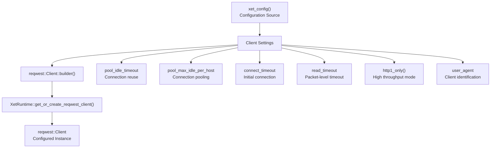
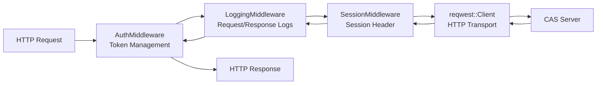
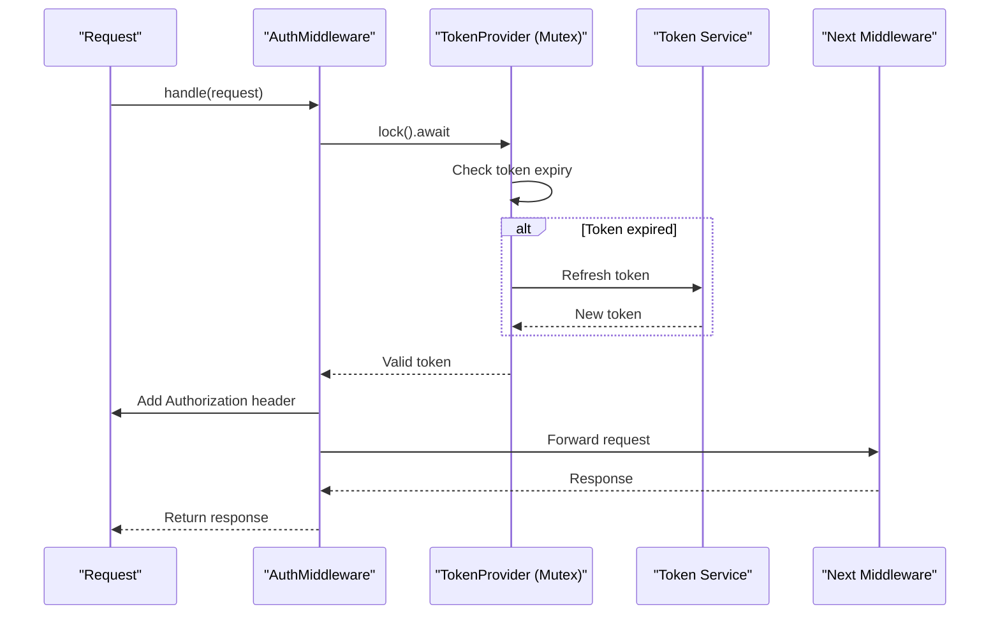
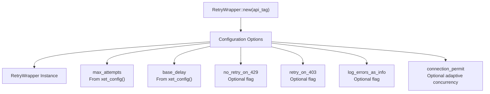
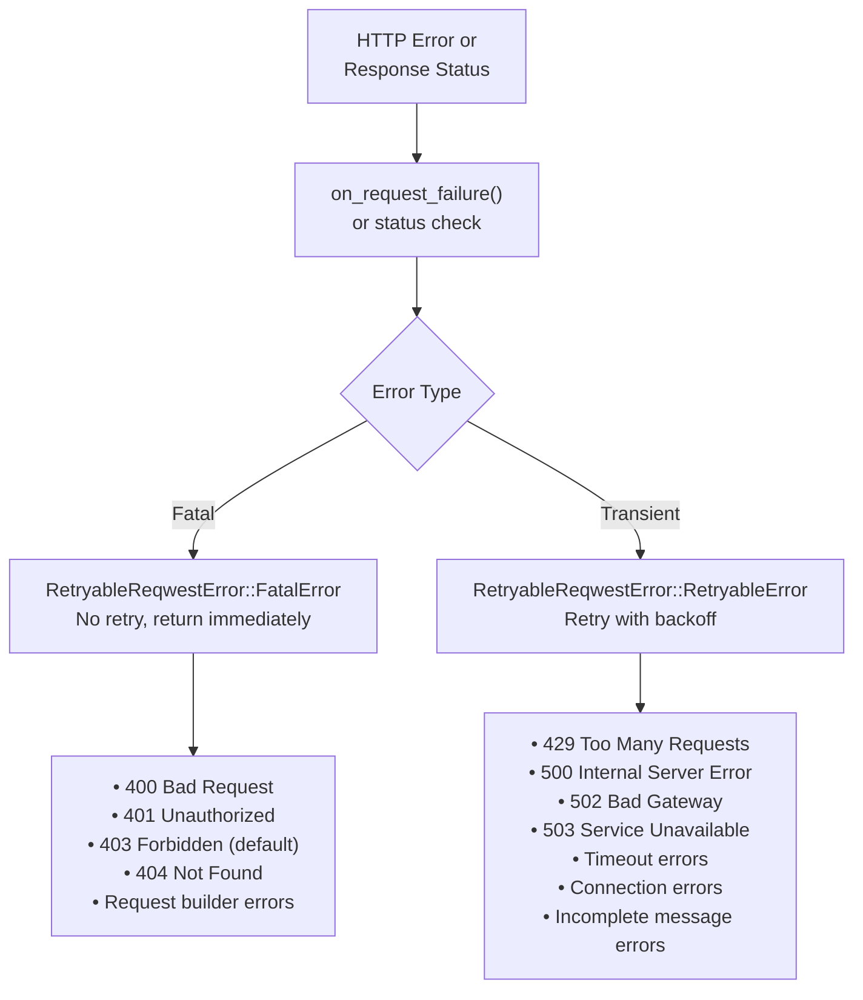
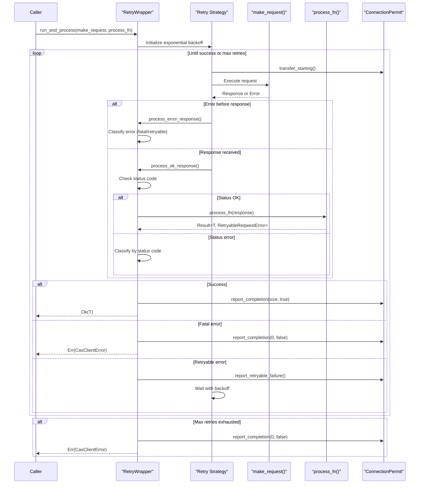
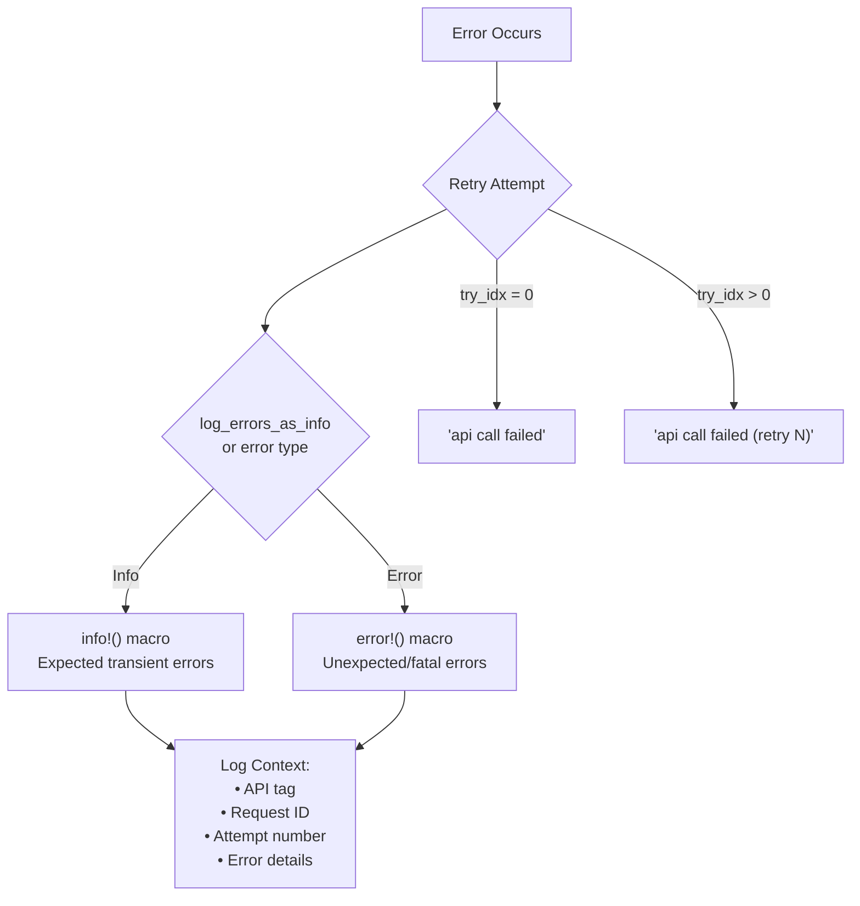
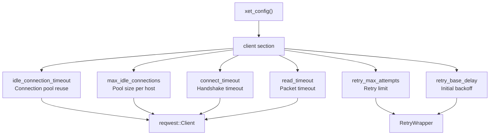

<!-- source: DeepWiki mcp.deepwiki.com · repo huggingface/xet-core · extra page HTTP Client and Retry Logic · fetched 2026-10-26 -->

# HTTP Client and Retry Logic

<details>
<summary>Relevant source files</summary>

The following files were used as context for generating this wiki page:

- [cas_client/src/error.rs](cas_client/src/error.rs)
- [cas_client/src/http_client.rs](cas_client/src/http_client.rs)
- [cas_client/src/remote_client.rs](cas_client/src/remote_client.rs)
- [cas_client/src/retry_wrapper.rs](cas_client/src/retry_wrapper.rs)

</details>


## Purpose and Scope

This document describes the HTTP client implementation and sophisticated retry mechanisms used by the CAS (Content-Addressable Storage) client system. The HTTP client provides reliable communication with CAS servers through automatic authentication, connection pooling, and intelligent error handling. For information about the higher-level CAS client operations that use this HTTP infrastructure, see [Remote Client Operations](#3.3.2).

**Sources:** [cas_client/src/http_client.rs:1-239](), [cas_client/src/retry_wrapper.rs:1-918]()

---

## Architecture Overview

The HTTP client system is built on a layered middleware architecture using `reqwest` and `reqwest-middleware`. It provides three core capabilities:

1. **HTTP Client Construction** - Creates configured `reqwest::Client` instances with connection pooling, timeouts, and user-agent settings
2. **Middleware Stack** - Composable request/response interceptors for authentication, logging, and session tracking
3. **Retry Logic** - Exponential backoff retry strategies with error classification and adaptive concurrency integration

The system supports both native (non-WASM) and WASM compilation targets, with different client configurations for each environment.

**Sources:** [cas_client/src/http_client.rs:16-92](), [cas_client/Cargo.toml:30-43]()

---

## HTTP Client Construction

### Client Configuration

The `reqwest_client()` function builds the underlying HTTP client with production-optimized settings:



**Key Configuration Parameters:**

| Parameter | Purpose | Notes |
|-----------|---------|-------|
| `pool_idle_timeout` | Duration to keep idle connections alive | Enables connection reuse |
| `pool_max_idle_per_host` | Max idle connections per host | Connection pool size |
| `connect_timeout` | Timeout for establishing connections | Initial handshake only |
| `read_timeout` | Timeout for packet reception | Resets on data received |
| No transfer timeout | Allows slow but progressing transfers | Prevents premature abortion |
| `http1_only()` | Forces HTTP/1.1 protocol | Better parallel I/O throughput |

The client is cached globally via `XetRuntime::get_or_create_reqwest_client()` for efficient reuse across multiple operations.

**Sources:** [cas_client/src/http_client.rs:16-46](), [cas_client/src/http_client.rs:48-57]()

### WASM vs Native

The system provides two implementations of `reqwest_client()`:

- **Native (non-WASM):** Uses `XetRuntime` for global client caching with full timeout and connection pool configuration
- **WASM:** Creates per-call clients with minimal configuration due to browser environment limitations

**Sources:** [cas_client/src/http_client.rs:16-46](), [cas_client/src/http_client.rs:48-57]()

---

## Middleware Architecture

The HTTP client uses a composable middleware stack built with `reqwest-middleware`. Each middleware intercepts requests and responses to add cross-cutting functionality.

### Middleware Stack Diagram



**Sources:** [cas_client/src/http_client.rs:60-92]()

### AuthMiddleware

The `AuthMiddleware` provides automatic authentication with token refresh capabilities:

**Key Components:**
- `TokenProvider` wrapped in `Arc<Mutex<>>` for thread-safe token management
- Automatic token refresh when expired (typically every ~15 minutes)
- Locks token provider during refresh to prevent concurrent token requests
- Adds `Authorization: Bearer <token>` header to all requests



**Important Behavior:** During token refresh, the mutex lock blocks all other requests from this client. This is intentional and acceptable since requests would fail without a valid token anyway.

**Sources:** [cas_client/src/http_client.rs:124-178]()

### LoggingMiddleware

Simple middleware that logs all requests and responses with their status codes and request IDs:

- Extracts `Api` extension from request for structured logging
- Logs response status codes and request IDs from `REQUEST_ID_HEADER`
- Uses `tracing` spans for request correlation
- Logs errors at `warn` level, responses at `info` level

**Sources:** [cas_client/src/http_client.rs:94-122]()

### SessionMiddleware

Adds the session ID to outbound requests via the `SESSION_ID_HEADER`:

- Conditionally created only when session ID is non-empty
- Enables server-side session tracking and request correlation
- Simple header injection with no complex logic

**Sources:** [cas_client/src/http_client.rs:180-203]()

### Middleware Composition

The `build_auth_http_client()` and `build_http_client()` functions compose middleware using a builder pattern:

```rust
ClientBuilder::new(reqwest_client(user_agent)?)
    .maybe_with(auth_middleware)      // Optional: if AuthConfig provided
    .maybe_with(logging_middleware)    // Always included
    .maybe_with(session_middleware)    // Optional: if session_id non-empty
    .build()
```

The `OptionalMiddleware` trait extension allows conditional middleware insertion.

**Sources:** [cas_client/src/http_client.rs:60-92]()

---

## Retry Logic

The `RetryWrapper` provides sophisticated retry logic with exponential backoff, error classification, and integration with the adaptive concurrency system.

### RetryWrapper Configuration



**Configuration Methods:**

| Method | Purpose | Default |
|--------|---------|---------|
| `new(api_tag)` | Creates wrapper with tag for logging | Uses `xet_config()` defaults |
| `with_max_attempts()` | Sets retry limit | From config |
| `with_base_delay()` | Sets initial backoff delay | From config |
| `with_429_no_retry()` | Disables retry on rate limiting | Retries enabled |
| `with_retry_on_403()` | Enables retry on forbidden errors | No retry on 403 |
| `log_errors_as_info()` | Logs errors at info level | Errors at error level |
| `with_connection_permit()` | Integrates adaptive concurrency | No permit |

**Sources:** [cas_client/src/retry_wrapper.rs:29-83]()

### Exponential Backoff Strategy

The retry strategy uses exponential backoff with jitter to prevent thundering herd problems:

```rust
ExponentialBackoff::from_millis(base_delay)
    .map(jitter)           // Add randomization
    .take(max_attempts)    // Limit retries
```

This produces delays like: `base_delay`, `2*base_delay`, `4*base_delay`, etc., each with random jitter added to spread out retry attempts.

**Sources:** [cas_client/src/retry_wrapper.rs:213-215]()

### Error Classification

The system distinguishes between **fatal** and **retryable** errors using `RetryableReqwestError`:



**Error Classification Logic (`on_request_failure`):**

The `on_request_failure()` function in [cas_client/src/retry_wrapper.rs:475-517]() implements custom error classification that improves upon `reqwest-retry` defaults:

- **Timeouts and connection errors:** Always retryable (transient network issues)
- **IO errors:** All retried (including system-specific errors like "No buffer space available")
- **Hyper incomplete message:** Retryable (connection dropped mid-response)
- **Request builder/redirect errors:** Fatal (client-side bugs)
- **Body/decode errors:** Fatal (data corruption)

**Special Cases:**

1. **429 Rate Limiting:** Normally retryable, but can be made fatal via `with_429_no_retry()` to fail fast when rate limited
2. **403 Forbidden:** Normally fatal, but can be made retryable via `with_retry_on_403()` for temporary permission issues

**Sources:** [cas_client/src/retry_wrapper.rs:18-22](), [cas_client/src/retry_wrapper.rs:475-517](), [cas_client/src/retry_wrapper.rs:125-182]()

---

## Request Execution Methods

The `RetryWrapper` provides several methods for executing HTTP requests with retry logic:

### Method Overview

| Method | Return Type | Use Case |
|--------|-------------|----------|
| `run()` | `Response` | Raw response handling |
| `run_and_extract_json()` | `T: Deserialize` | JSON API responses |
| `run_and_extract_bytes()` | `Bytes` | Binary data download |
| `run_and_extract_custom()` | `T` | Custom response processing |
| `run_and_process()` | `T` | Full control over processing |

### Request Execution Flow



**Sources:** [cas_client/src/retry_wrapper.rs:202-467]()

### Connection Permit Integration

When a `ConnectionPermit` is provided (via `with_connection_permit()`), the retry wrapper integrates with the adaptive concurrency system:

1. **Transfer Starting:** Calls `permit.transfer_starting()` before each attempt
2. **Partial Progress:** Passes progress reporting function to `make_request()` for streaming updates
3. **Success:** Calls `permit.report_completion(size, true)` and releases permit
4. **Fatal Error:** Calls `permit.report_completion(0, false)` and releases permit
5. **Retryable Error:** Calls `permit.report_retryable_failure()` but keeps permit for retry

This integration enables the system to dynamically adjust concurrency based on server response times and error rates.

**Sources:** [cas_client/src/retry_wrapper.rs:77-83](), [cas_client/src/retry_wrapper.rs:229-304]()

### JSON Extraction with Retry

The `run_and_extract_json()` method automatically retries on incomplete or corrupted JSON responses:

```rust
self.run_and_process(make_request, |resp: Response| {
    async move {
        let r: Result<JsonDest, reqwest::Error> = resp.json().await;
        match r {
            Ok(v) => Ok(v),
            Err(e) if is_transient(e) => Err(RetryableReqwestError::RetryableError(e.into())),
            Err(e) => Err(RetryableReqwestError::FatalError(e.into())),
        }
    }
})
```

**Transient JSON errors** (retried):
- Connection errors during JSON transfer
- Decode errors (incomplete/truncated responses)
- Body errors (stream interrupted)
- Timeout errors

**Sources:** [cas_client/src/retry_wrapper.rs:350-384]()

### Bytes Extraction with Retry

Similar to JSON extraction, `run_and_extract_bytes()` retries on incomplete binary transfers:

**Sources:** [cas_client/src/retry_wrapper.rs:395-425]()

---

## Error Handling and Logging

The retry system provides comprehensive error logging with context:

### Logging Strategy



**Logged Information:**
- API operation tag (e.g., "upload_xorb", "get_reconstruction")
- Request ID from server response headers
- Attempt number (1/N, 2/N, etc.)
- Error classification (Fatal/Retryable/Unknown)
- Full error details and context

**Sources:** [cas_client/src/retry_wrapper.rs:85-123](), [cas_client/src/retry_wrapper.rs:125-182]()

### Response Error Processing

The `ResponseErrorLogger` trait in [cas_client/src/http_client.rs:206-231]() transforms raw `reqwest_middleware::Result<Response>` into `cas_client::error::Result<Response>` with appropriate logging:

```rust
impl ResponseErrorLogger<error::Result<Response>> for reqwest_middleware::Result<Response> {
    fn process_error(self, api: &str) -> error::Result<Response> {
        let res = self.map_err(CasClientError::from).log_error(...)?;
        let status = res.status();
        match (api, status) {
            ("get_reconstruction", StatusCode::RANGE_NOT_SATISFIABLE) => res.debug_error(...),
            _ => res.info_error(...),
        }
    }
}
```

This allows API-specific error handling, such as treating `416 Range Not Satisfiable` as a debug-level error for reconstruction queries.

**Sources:** [cas_client/src/http_client.rs:206-231]()

---

## Configuration Integration

The HTTP client and retry logic integrate with the global configuration system via `xet_config()`:

### Configuration Parameters



These parameters can be customized via configuration files or environment variables to tune client behavior for different environments (development, production, high-latency networks, etc.).

**Sources:** [cas_client/src/http_client.rs:22-25](), [cas_client/src/retry_wrapper.rs:42-43]()

---

## Usage Patterns

### Basic HTTP Client Creation

```rust
// Without authentication
let client = build_http_client(session_id, user_agent)?;

// With authentication
let auth_config = AuthConfig { /* ... */ };
let client = build_auth_http_client(&Some(auth_config), session_id, user_agent)?;
```

**Sources:** [cas_client/src/http_client.rs:60-78]()

### Simple Retry Request

```rust
let result = RetryWrapper::new("my_api")
    .run(|_progress| client.get(url).send())
    .await?;
```

**Sources:** [cas_client/src/retry_wrapper.rs:459-466]()

### JSON Response with Retry

```rust
let data: MyStruct = RetryWrapper::new("fetch_config")
    .with_max_attempts(5)
    .run_and_extract_json(|_progress| client.get(url).send())
    .await?;
```

**Sources:** [cas_client/src/retry_wrapper.rs:350-384]()

### Custom Response Processing

```rust
let result = RetryWrapper::new("upload")
    .with_connection_permit(permit, Some(size))
    .run_and_process(
        |progress| client.post(url).body(data).send(),
        |response| async move {
            // Custom processing
            Ok(extract_metadata(response).await?)
        }
    )
    .await?;
```

**Sources:** [cas_client/src/retry_wrapper.rs:202-338]()

### Rate Limiting Handling

```rust
// Fail fast on rate limiting
let result = RetryWrapper::new("upload_xorb")
    .with_429_no_retry()
    .run(|_progress| client.post(url).send())
    .await?;
```

**Sources:** [cas_client/src/retry_wrapper.rs:62-65](), [cas_client/src/retry_wrapper.rs:161-164]()

---

## Testing

The retry wrapper includes comprehensive tests covering various scenarios:

### Test Coverage

| Test | Scenario | File Location |
|------|----------|---------------|
| `check_success_first_try` | Successful request on first attempt | [cas_client/src/retry_wrapper.rs:559-582]() |
| `check_retry_then_success` | Transient errors followed by success | [cas_client/src/retry_wrapper.rs:584-616]() |
| `check_retry_limit_exceeded` | Max retries exhausted | [cas_client/src/retry_wrapper.rs:618-643]() |
| `check_non_retryable_status` | Fatal error stops immediately | [cas_client/src/retry_wrapper.rs:645-669]() |
| `check_429_retry_if_specified` | Rate limiting with retry | [cas_client/src/retry_wrapper.rs:671-696]() |
| `check_429_no_retry` | Rate limiting without retry | [cas_client/src/retry_wrapper.rs:698-724]() |
| `check_json_reserialization` | JSON extraction | [cas_client/src/retry_wrapper.rs:732-761]() |
| `check_json_unexpected_eof_retry` | Corrupted JSON retry | [cas_client/src/retry_wrapper.rs:763-803]() |
| `test_403_no_retry_by_default` | Forbidden fails immediately | [cas_client/src/retry_wrapper.rs:826-851]() |
| `test_403_retry_when_enabled` | Forbidden with retry enabled | [cas_client/src/retry_wrapper.rs:854-880]() |

Tests use `wiremock` for HTTP mocking and verify correct retry counts, error handling, and response processing.

**Sources:** [cas_client/src/retry_wrapper.rs:537-917]()

---

## WASM Compatibility

The HTTP client system supports compilation to WebAssembly with conditional compilation:

### Async Trait Annotations

```rust
#[cfg_attr(not(target_family = "wasm"), async_trait::async_trait)]
#[cfg_attr(target_family = "wasm", async_trait::async_trait(?Send))]
impl Middleware for AuthMiddleware { /* ... */ }
```

WASM requires `?Send` bound relaxation since browser environments are single-threaded.

### Platform-Specific Features

```rust
#[cfg(not(target_arch = "wasm32"))]
let is_connect = error.is_connect();

#[cfg(target_arch = "wasm32")]
let is_connect = false;
```

Some `reqwest::Error` methods are not available in WASM builds.

**Sources:** [cas_client/src/http_client.rs:100-101](), [cas_client/src/http_client.rs:163-164](), [cas_client/src/retry_wrapper.rs:367-370](), [cas_client/src/retry_wrapper.rs:481-484]()

---

## Summary

The HTTP client and retry logic provide a robust foundation for CAS communication:

- **Middleware architecture** enables composable request/response processing
- **Automatic authentication** with token refresh prevents auth failures
- **Connection pooling** optimizes network resource usage
- **Intelligent retry logic** distinguishes transient from fatal errors
- **Exponential backoff** with jitter prevents thundering herds
- **Adaptive concurrency integration** enables dynamic throughput optimization
- **Comprehensive logging** aids debugging and monitoring
- **WASM support** enables browser-based usage

This infrastructure is used by all CAS client operations including XORB uploads, shard queries, and file reconstruction requests.

**Sources:** [cas_client/src/http_client.rs:1-239](), [cas_client/src/retry_wrapper.rs:1-918]()

---

