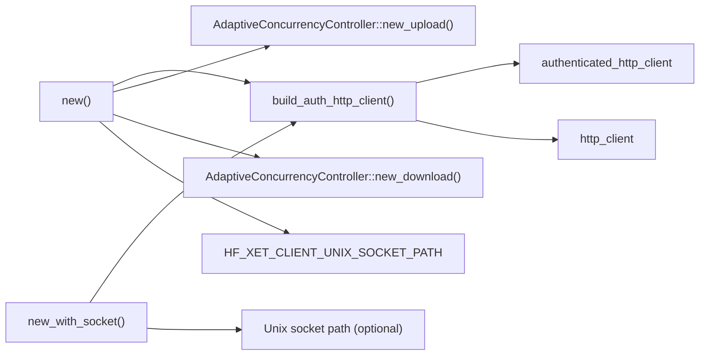
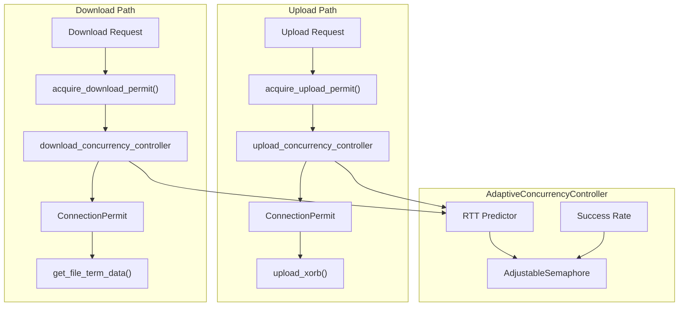
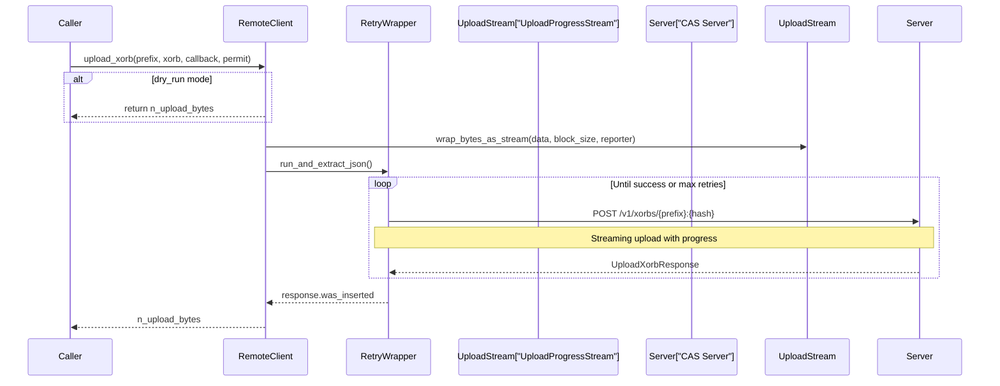
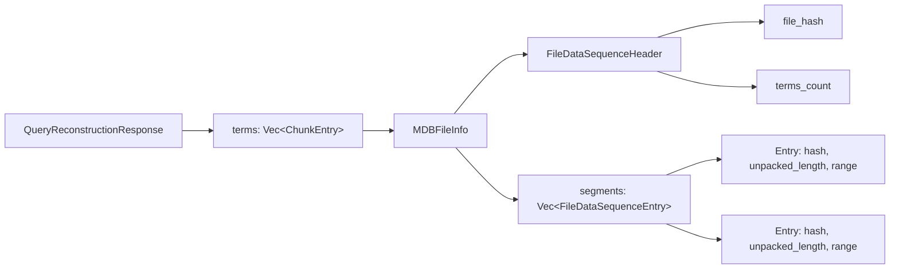
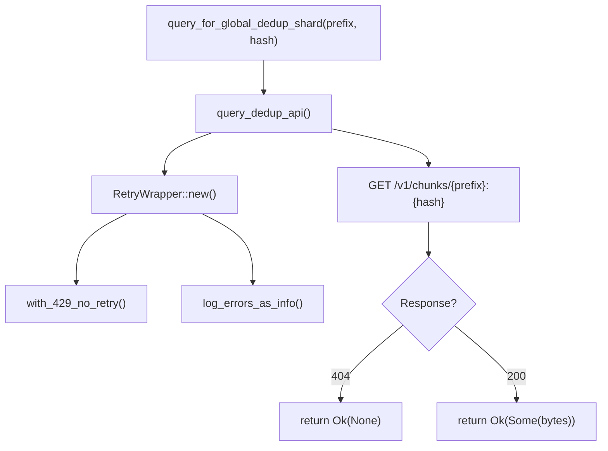
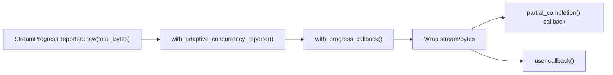

<!-- source: DeepWiki mcp.deepwiki.com · repo huggingface/xet-core · extra page Remote Client Operations · fetched 2026-10-26 -->

# Remote Client Operations

<details>
<summary>Relevant source files</summary>

The following files were used as context for generating this wiki page:

- [cas_client/src/error.rs](cas_client/src/error.rs)
- [cas_client/src/http_client.rs](cas_client/src/http_client.rs)
- [cas_client/src/remote_client.rs](cas_client/src/remote_client.rs)
- [cas_client/src/retry_wrapper.rs](cas_client/src/retry_wrapper.rs)

</details>


## Purpose and Scope

This page documents the `RemoteClient` implementation, which handles all HTTP-based communication with the Content-Addressable Storage (CAS) server. The `RemoteClient` provides methods for uploading XORBs and shards, downloading file data, and querying reconstruction metadata. It also manages concurrency control through adaptive concurrency controllers and integrates with the retry logic system.

For information about HTTP client construction and middleware stack, see [HTTP Client and Retry Logic](#3.3.1). For the higher-level data client orchestration, see [Data Client and Sessions](#3.2).

**Sources:** [cas_client/src/remote_client.rs:1-656]()

---

## RemoteClient Structure

The `RemoteClient` struct maintains HTTP clients, endpoint configuration, and concurrency controllers for managing communication with the CAS server:

```rust
pub struct RemoteClient {
    endpoint: String,
    dry_run: bool,
    http_client: Arc<ClientWithMiddleware>,
    authenticated_http_client: Arc<ClientWithMiddleware>,
    upload_concurrency_controller: Arc<AdaptiveConcurrencyController>,
    download_concurrency_controller: Arc<AdaptiveConcurrencyController>,
}
```

| Field | Type | Purpose |
|-------|------|---------|
| `endpoint` | `String` | Base URL for CAS server (e.g., `http://localhost:8080`) |
| `dry_run` | `bool` | If true, skip actual uploads (testing mode) |
| `http_client` | `Arc<ClientWithMiddleware>` | Unauthenticated client for S3 presigned URLs |
| `authenticated_http_client` | `Arc<ClientWithMiddleware>` | Client with auth middleware for CAS APIs |
| `upload_concurrency_controller` | `Arc<AdaptiveConcurrencyController>` | Manages upload concurrency limits |
| `download_concurrency_controller` | `Arc<AdaptiveConcurrencyController>` | Manages download concurrency limits |

The separation of authenticated and unauthenticated clients allows the system to use presigned S3 URLs for data transfer while using authenticated requests for CAS metadata operations.

**Sources:** [cas_client/src/remote_client.rs:40-47]()

---

## Client Construction

### Constructor Methods



The `RemoteClient` provides two constructors:

**`new()`** - Standard constructor that checks configuration for Unix socket path:

```rust
pub fn new(
    endpoint: &str,
    auth: &Option<AuthConfig>,
    session_id: &str,
    dry_run: bool,
    custom_headers: Option<Arc<HeaderMap>>,
) -> Arc<Self>
```

**`new_with_socket()`** - Explicit Unix socket path for proxying:

```rust
pub fn new_with_socket(
    endpoint: &str,
    auth: &Option<AuthConfig>,
    session_id: &str,
    dry_run: bool,
    unix_socket_path: Option<&str>,
    custom_headers: Option<Arc<HeaderMap>>,
) -> Arc<Self>
```

Both constructors:
1. Build authenticated and unauthenticated HTTP clients
2. Create separate `AdaptiveConcurrencyController` instances for uploads and downloads
3. Return an `Arc<RemoteClient>` for shared ownership across async tasks

**Sources:** [cas_client/src/remote_client.rs:59-110]()

---

## Concurrency Control

The `RemoteClient` uses separate adaptive concurrency controllers for uploads and downloads, allowing independent tuning of parallelism based on observed network conditions.



### Permit Acquisition

Before performing any upload or download operation, the caller must acquire a `ConnectionPermit`:

```rust
async fn acquire_upload_permit(&self) -> Result<ConnectionPermit>
async fn acquire_download_permit(&self) -> Result<ConnectionPermit>
```

The permit:
- Counts toward the concurrency limit
- Tracks transfer metrics (bytes, RTT, success/failure)
- Automatically adjusts concurrency based on network performance
- Must be passed to the actual upload/download operation

**Sources:** [cas_client/src/remote_client.rs:298-300](), [cas_client/src/remote_client.rs:442-444](), [cas_client/src/remote_client.rs:77-79]()

---

## Upload Operations

### XORB Upload

The `upload_xorb()` method uploads a serialized XORB object to the CAS server:



**Method Signature (non-WASM):**

```rust
async fn upload_xorb(
    &self,
    prefix: &str,
    serialized_xorb_object: SerializedXorbObject,
    progress_callback: Option<ProgressCallback>,
    upload_permit: ConnectionPermit,
) -> Result<u64>
```

**Key Features:**

1. **URL Construction**: `POST {endpoint}/v1/xorbs/{prefix}:{hash}`
2. **Progress Tracking**: Uses `UploadProgressStream` with configurable block size
3. **Retry Integration**: `ConnectionPermit` passed to `RetryWrapper.with_connection_permit()`
4. **Dry-Run Support**: Returns immediately if `self.dry_run` is true
5. **Deduplication**: Server returns `was_inserted` (false if XORB already exists)

**WASM Differences:**

The WASM implementation at [cas_client/src/remote_client.rs:592-618]() is simplified:
- No progress callbacks (not supported)
- No streaming upload
- No connection permit integration
- Direct `post().body().send()` call

**Sources:** [cas_client/src/remote_client.rs:496-619]()

---

### Shard Upload

The `upload_shard()` method uploads MDB shard data containing metadata and reconstruction information:

```rust
async fn upload_shard(
    &self, 
    shard_data: Bytes, 
    upload_permit: ConnectionPermit
) -> Result<bool>
```

**API Endpoint:** `POST {endpoint}/shards`

**Response Handling:**

| `UploadShardResponseType` | Return Value | Meaning |
|---------------------------|--------------|---------|
| `Exists` | `false` | Shard already present on server |
| `SyncPerformed` | `true` | Shard was uploaded and synced |

The boolean return value indicates whether the shard was actually uploaded (not deduplicated). The method skips the upload entirely if `dry_run` is enabled.

**Sources:** [cas_client/src/remote_client.rs:446-494]()

---

## Download Operations

### File Reconstruction Info Query

The `get_file_reconstruction_info()` method retrieves metadata about how to reconstruct a file:

```rust
async fn get_file_reconstruction_info(
    &self,
    file_hash: &MerkleHash,
) -> Result<Option<(MDBFileInfo, Option<MerkleHash>)>>
```

**Request:** `GET {endpoint}/v1/reconstructions/{file_hash}`

**Response Transformation:**



The method converts the server's `QueryReconstructionResponse` format into the internal `MDBFileInfo` structure used by the reconstruction system. Each term (XORB chunk range) is converted to a `FileDataSequenceEntry`.

**Sources:** [cas_client/src/remote_client.rs:395-432]()

---

### File Term Data Download

The `get_file_term_data()` method downloads and decompresses a specific XORB chunk range for file reconstruction:

```rust
async fn get_file_term_data(
    &self,
    url_info: Box<dyn URLProvider>,
    download_permit: ConnectionPermit,
    progress_callback: Option<ProgressCallback>,
    uncompressed_size_if_known: Option<usize>,
) -> Result<(Bytes, Vec<u32>)>
```

**Download Flow:**

```mermaid
sequenceDiagram
    participant Caller
    participant RemoteClient
    participant URLProvider
    participant RetryWrapper
    participant Stream["DownloadProgressStream"]
    participant Deserializer["xorb_object::deserialize_async"]
    
    Caller->>RemoteClient: get_file_term_data(url_info, permit, callback)
    RemoteClient->>URLProvider: retrieve_url()
    URLProvider-->>RemoteClient: (url_string, url_range)
    
    RemoteClient->>RetryWrapper: run_and_extract_custom()
    
    loop Until success or max retries
        RetryWrapper->>URLProvider: retrieve_url()
        RetryWrapper->>URLProvider: GET with Range header
        
        alt 403 Forbidden (presigned URL expired)
            RetryWrapper->>URLProvider: refresh_url()
            Note over RetryWrapper: Retry with new URL
        end
    end
    
    RetryWrapper->>Stream: wrap_stream(bytes_stream, reporter)
    Stream->>Deserializer: deserialize_chunks_to_writer_from_stream()
    Deserializer-->>RetryWrapper: (compressed_len, chunk_byte_indices)
    
    RetryWrapper-->>RemoteClient: (Bytes, Vec&lt;u32&gt;)
    RemoteClient-->>Caller: Decompressed chunks + indices
```

**Key Features:**

1. **URLProvider Interface**: Supports presigned URL refresh on 403 errors
2. **Streaming Decompression**: Data is decompressed as it arrives
3. **Progress Tracking**: Integrated with `StreamProgressReporter`
4. **Chunk Indices**: Returns byte offsets of each chunk for reconstruction
5. **Size Validation**: Verifies uncompressed size if known

The return value is a tuple:
- `Bytes`: Decompressed chunk data
- `Vec<u32>`: Byte offsets where each chunk begins

**Sources:** [cas_client/src/remote_client.rs:302-393]()

---

## Query Operations

### Reconstruction Queries

#### Single File Query

```rust
async fn get_reconstruction(
    &self,
    file_id: &MerkleHash,
    bytes_range: Option<FileRange>,
) -> Result<Option<QueryReconstructionResponse>>
```

**Endpoint:** `GET {endpoint}/v1/reconstructions/{file_id}`

**Range Support:**

If `bytes_range` is provided, the method adds a `Range` HTTP header (converted to inclusive-end format). The server may return:
- `200 OK` with partial reconstruction info
- `416 Range Not Satisfiable` → returns `Ok(None)`

**Sources:** [cas_client/src/remote_client.rs:214-261]()

---

#### Batch File Query

```rust
async fn batch_get_reconstruction(
    &self, 
    file_ids: &[MerkleHash]
) -> Result<BatchQueryReconstructionResponse>
```

**Endpoint:** `GET {endpoint}/reconstructions?file_id={hash1}&file_id={hash2}&...`

The method constructs a query string with multiple `file_id` parameters and returns a batch response containing reconstruction info for all available files.

**Sources:** [cas_client/src/remote_client.rs:263-296]()

---

### Deduplication Queries

The `query_for_global_dedup_shard()` method checks if a chunk already exists in the global deduplication database:

```rust
async fn query_for_global_dedup_shard(
    &self,
    prefix: &str,
    chunk_hash: &MerkleHash,
) -> Result<Option<Bytes>>
```

**Flow:**



**Key Behaviors:**

1. **No Retry on 429**: Uses `with_429_no_retry()` to fail fast on rate limits
2. **Info-level Logging**: Logs errors as info (not fatal) via `log_errors_as_info()`
3. **404 Handling**: Returns `Ok(None)` for missing chunks (not an error)
4. **Response**: If found, returns raw shard bytes

This is used during upload to avoid re-uploading chunks that already exist globally.

**Sources:** [cas_client/src/remote_client.rs:434-440](), [cas_client/src/remote_client.rs:117-164]()

---

## Progress Tracking

### Progress Callback Integration

Both upload and download operations accept an optional `ProgressCallback`:

```rust
type ProgressCallback = Arc<dyn Fn(u64) + Send + Sync>;
```

**Integration Points:**

| Operation | Progress Reporter | What's Tracked |
|-----------|------------------|----------------|
| `upload_xorb` | `UploadProgressStream` | Bytes uploaded in blocks |
| `get_file_term_data` | `DownloadProgressStream` | Bytes downloaded and decompressed |

**StreamProgressReporter Setup:**



The `StreamProgressReporter`:
1. Tracks total bytes transferred
2. Reports partial completion to `ConnectionPermit` (for concurrency adjustment)
3. Calls user-provided callback with cumulative bytes

**Sources:** [cas_client/src/remote_client.rs:316-320](), [cas_client/src/remote_client.rs:531-535]()

---

## Request Tracking and Logging

### Call ID Generation

All API operations generate a unique call ID for request correlation:

```rust
lazy_static! {
    static ref FN_CALL_ID: AtomicU64 = AtomicU64::new(1);
}

let call_id = FN_CALL_ID.fetch_add(1, Ordering::Relaxed);
```

Each operation logs:
- **Start**: `call_id`, parameters (prefix, hash, size)
- **Completion**: `call_id`, result status, response metadata

Example log output structure:
```
[INFO] call_id=42, prefix="default", hash=0xABCD..., size=1048576, "Starting upload_xorb API call"
[INFO] call_id=42, prefix="default", hash=0xABCD..., result="inserted", "Completed upload_xorb API call"
```

This enables tracing individual requests through the system for debugging and performance analysis.

**Sources:** [cas_client/src/remote_client.rs:34-38](), [cas_client/src/remote_client.rs:124-132](), [cas_client/src/remote_client.rs:452-454]()

---

## API Endpoint Summary

| Method | HTTP Method | Endpoint | Purpose |
|--------|-------------|----------|---------|
| `query_dedup_api` | GET | `/v1/chunks/{prefix}:{hash}` | Check if chunk exists globally |
| `get_reconstruction` | GET | `/v1/reconstructions/{file_id}` | Get file reconstruction metadata |
| `batch_get_reconstruction` | GET | `/reconstructions?file_id=...` | Get multiple file reconstructions |
| `get_file_reconstruction_info` | GET | `/v1/reconstructions/{file_id}` | Same as get_reconstruction, different format |
| `upload_xorb` | POST | `/v1/xorbs/{prefix}:{hash}` | Upload XORB object |
| `upload_shard` | POST | `/shards` | Upload MDB shard |
| `get_file_term_data` | GET | S3 presigned URL | Download XORB chunk range |

**Sources:** [cas_client/src/remote_client.rs:125](), [cas_client/src/remote_client.rs:220](), [cas_client/src/remote_client.rs:264](), [cas_client/src/remote_client.rs:402](), [cas_client/src/remote_client.rs:513](), [cas_client/src/remote_client.rs:459]()

---

## Platform-Specific Behavior

### WASM Simplifications

The WASM target (`target_family = "wasm"`) uses simplified implementations:

**Upload XORB:**
- No streaming upload (direct body)
- No progress tracking
- No connection permit integration
- No partial completion reporting

**Async Trait Bounds:**
```rust
#[cfg_attr(not(target_family = "wasm"), async_trait::async_trait)]
#[cfg_attr(target_family = "wasm", async_trait::async_trait(?Send))]
```

WASM does not enforce `Send` bounds since it runs single-threaded.

**Sources:** [cas_client/src/remote_client.rs:592-618](), [cas_client/src/remote_client.rs:211-212]()

---

## Error Handling

The `RemoteClient` leverages the error handling infrastructure from `RetryWrapper` (see [HTTP Client and Retry Logic](#3.3.1)):

**Retry Strategies by Operation:**

| Operation | 429 Retry | 403 Retry | Logging Level |
|-----------|-----------|-----------|---------------|
| `query_dedup_api` | No | No | Info |
| `get_reconstruction` | Yes | No | Error |
| `upload_xorb` | Yes | No | Error |
| `upload_shard` | Yes | No | Error |
| `get_file_term_data` | Yes | Yes | Error |

**Special Cases:**

1. **Range Not Satisfiable (416)**: `get_reconstruction` returns `Ok(None)` instead of error
2. **Presigned URL Expiration**: `get_file_term_data` retries on 403 by refreshing URL
3. **Size Mismatch**: `get_file_term_data` validates decompressed size and treats mismatch as retryable error

**Sources:** [cas_client/src/remote_client.rs:138-139](), [cas_client/src/remote_client.rs:255-260](), [cas_client/src/remote_client.rs:323-324](), [cas_client/src/remote_client.rs:375-382]()

---

