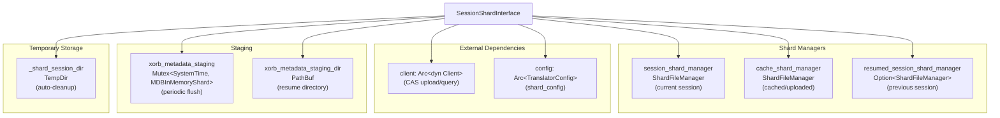
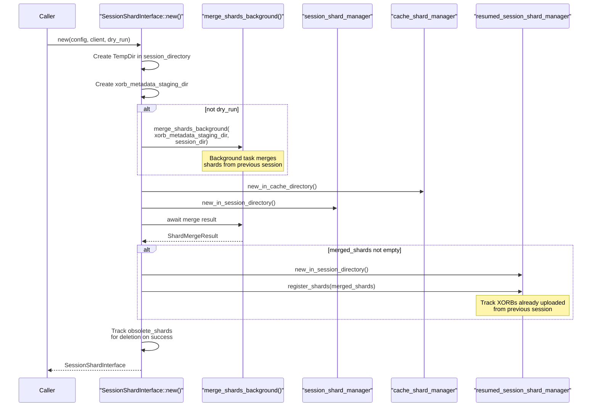
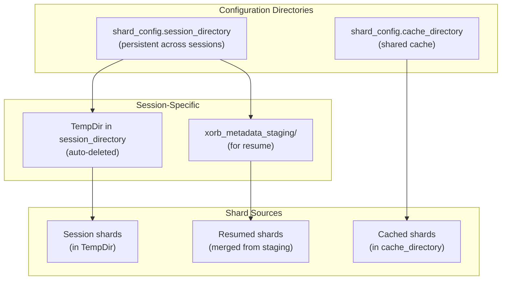
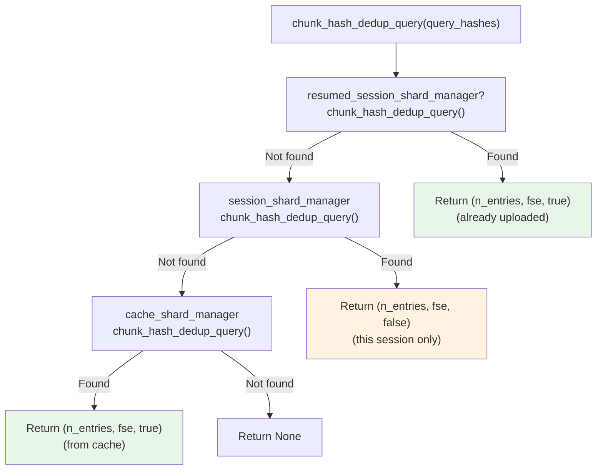
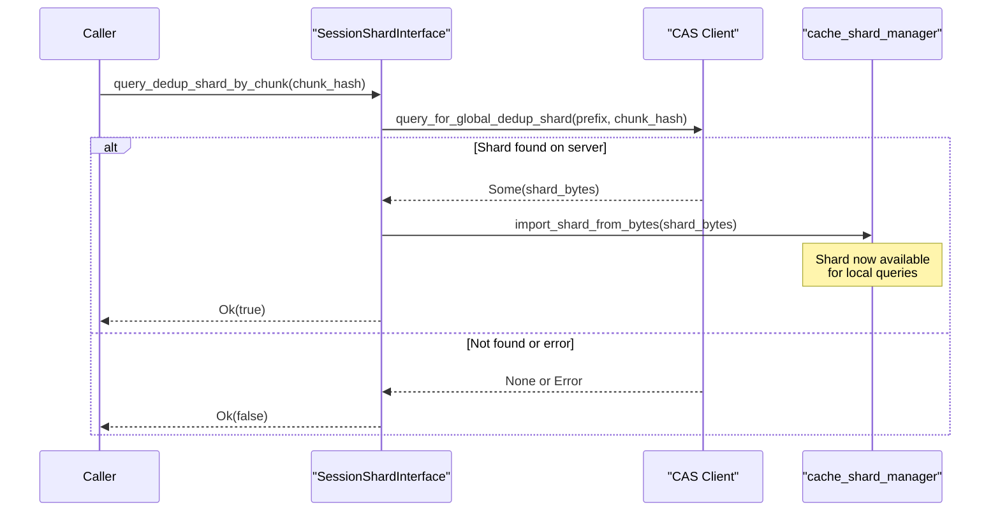
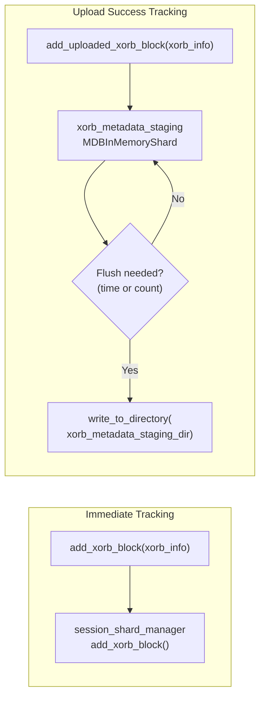
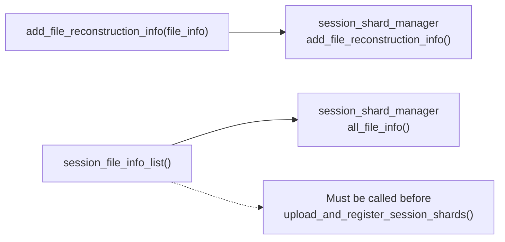
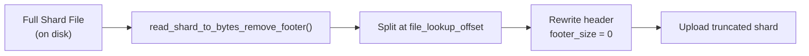
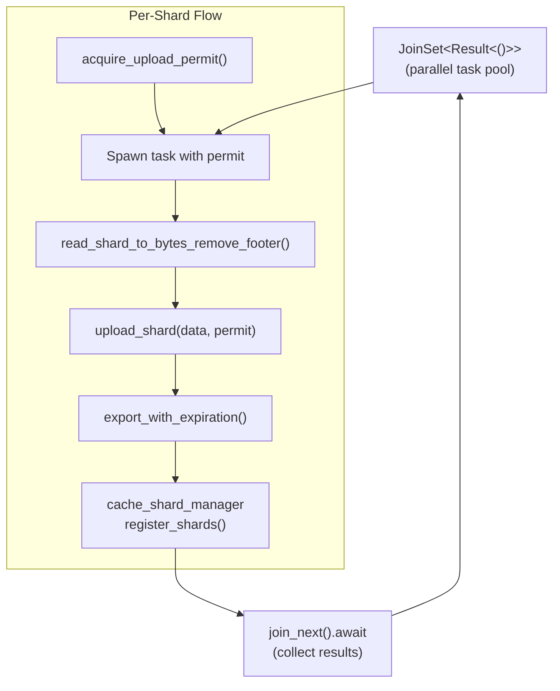
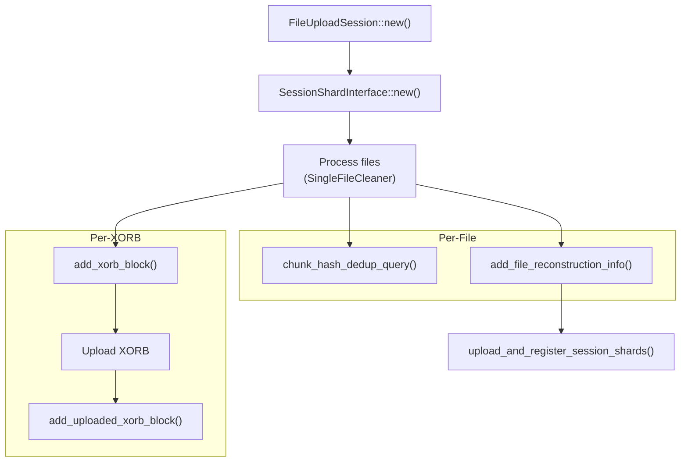

<!-- source: DeepWiki mcp.deepwiki.com · repo huggingface/xet-core · extra page Session Shard Interface · fetched 2026-10-26 -->

# Session Shard Interface

<details>
<summary>Relevant source files</summary>

The following files were used as context for generating this wiki page:

- [cas_client/src/interface.rs](cas_client/src/interface.rs)
- [cas_client/src/lib.rs](cas_client/src/lib.rs)
- [data/src/shard_interface.rs](data/src/shard_interface.rs)
- [hf_xet_wasm/src/wasm_file_upload_session.rs](hf_xet_wasm/src/wasm_file_upload_session.rs)

</details>


## Purpose and Scope

The `SessionShardInterface` manages the lifecycle of MDB shards during file upload sessions. It coordinates deduplication queries across multiple shard sources, stages XORB metadata for session resumability, and handles the finalization and upload of session shards to the CAS server.

This interface is the bridge between the upload workflow and the shard management system. For details on the underlying shard file format and operations, see [Shard Binary Format](#3.5.3). For the higher-level file upload orchestration that uses this interface, see [Upload Workflow](#5.1).

**Sources:** [data/src/shard_interface.rs:1-50]()

## Core Components

The `SessionShardInterface` struct maintains three distinct `ShardFileManager` instances and coordinates their interaction during an upload session.



**Sources:** [data/src/shard_interface.rs:26-50]()

### Key Fields

| Field | Type | Purpose |
|-------|------|---------|
| `session_shard_manager` | `Arc<ShardFileManager>` | Manages shards being built during current session |
| `cache_shard_manager` | `Arc<ShardFileManager>` | Manages cached shards from previous uploads |
| `resumed_session_shard_manager` | `Option<Arc<ShardFileManager>>` | Manages shards from resumed previous session |
| `client` | `Arc<dyn Client + Send + Sync>` | CAS client for uploads and global dedup queries |
| `xorb_metadata_staging_dir` | `PathBuf` | Directory for staging XORB metadata for resume |
| `xorb_metadata_staging` | `Mutex<(SystemTime, MDBInMemoryShard)>` | In-memory accumulator flushed periodically |
| `dry_run` | `bool` | If true, skip uploads and staging operations |

**Sources:** [data/src/shard_interface.rs:26-50]()

## Session Initialization and Resume

The `SessionShardInterface::new()` method sets up the session with support for resuming from previous interrupted uploads.



**Sources:** [data/src/shard_interface.rs:53-133]()

### Directory Structure



**Sources:** [data/src/shard_interface.rs:59-86]()

## Deduplication Query Hierarchy

The `chunk_hash_dedup_query()` method implements a three-tier query hierarchy to check if chunk sequences have already been uploaded.



**Query Priority:**
1. **Resumed session shards** - XORBs from previous upload attempts (already on server)
2. **Current session shards** - XORBs created in this session (not yet uploaded)
3. **Cache shards** - XORBs from previous successful uploads (on server)

The boolean return value indicates whether the referenced XORB is already uploaded, which affects how the upload workflow tracks completion.

**Sources:** [data/src/shard_interface.rs:154-180]()

### Global Deduplication Query

For chunks not found locally, the system can query the remote CAS server for global deduplication.



**Sources:** [data/src/shard_interface.rs:136-151]()

## XORB Metadata Management

The interface tracks XORB metadata through two mechanisms: immediate session tracking and staged metadata for resume.

### Adding XORB Blocks



**Sources:** [data/src/shard_interface.rs:183-215]()

### Staging Flush Triggers

XORB metadata is flushed to the staging directory when either condition is met:

| Condition | Configuration | Purpose |
|-----------|---------------|---------|
| Time interval | `session_xorb_metadata_flush_interval` | Periodic persistence (default from config) |
| Entry count | `session_xorb_metadata_flush_max_count` | Limit memory usage (default from config) |

After flushing, the expiration time is set to `MDB_SHARD_LOCAL_CACHE_EXPIRATION` to allow cleanup of old resume files.

**Sources:** [data/src/shard_interface.rs:190-215]()

## File Reconstruction Tracking

File reconstruction information is added to the session shard manager as files complete processing.



The `MDBFileInfo` structures contain the reconstruction terms (XORB references and chunk ranges) needed to rebuild each file.

**Sources:** [data/src/shard_interface.rs:218-228]()

## Session Finalization and Upload

The `upload_and_register_session_shards()` method consolidates all session shards, uploads them to the CAS server, and moves them to the cache directory.

```mermaid
sequenceDiagram
    participant Caller
    participant SSI as "SessionShardInterface"
    participant SessionMgr as "session_shard_manager"
    participant Consolidate as "consolidate_shards_in_directory()"
    participant Upload as "Upload Tasks (JoinSet)"
    participant Client as "CAS Client"
    participant Cache as "cache_shard_manager"
    
    Caller->>SSI: upload_and_register_session_shards()
    
    SSI->>SessionMgr: flush()
    Note over SessionMgr: Write all in-memory<br/>shards to disk
    
    SSI->>Consolidate: consolidate_shards_in_directory(<br/>session_dir, max_target_size)
    Consolidate-->>SSI: Vec&lt;ShardInfo&gt;
    Note over Consolidate: Merge and optimize<br/>shard files
    
    loop For each shard
        SSI->>Client: acquire_upload_permit()
        Client-->>SSI: ConnectionPermit
        
        SSI->>Upload: spawn upload task
        
        par Upload Task
            Upload->>Upload: read_shard_to_bytes_remove_footer()
            Note over Upload: Strip footer/lookup tables<br/>Set footer_size=0
            
            alt not dry_run
                Upload->>Client: upload_shard(data, permit)
                Note over Client: POST to /shards endpoint
                
                Upload->>Upload: export_with_expiration(<br/>cache_directory)
                Upload->>Cache: register_shards([shard_path])
                Note over Cache: Move to cache,<br/>add expiration
            end
        end
    end
    
    SSI->>Upload: await all tasks
    
    SSI->>SSI: Remove obsolete staged shards
    Note over SSI: Clean up shards from<br/>previous resume attempts
    
    SSI-->>Caller: total_bytes_uploaded
```

**Sources:** [data/src/shard_interface.rs:232-311]()

### Shard Footer Removal

Before upload, the footer and lookup tables are stripped from shard files to reduce transfer size. The server reconstructs these sections from the shard content.



The `read_shard_to_bytes_remove_footer()` helper:
1. Reads up to `file_lookup_offset` (excludes footer and lookup tables)
2. Rewrites the header with `footer_size = 0`
3. Returns the truncated bytes for upload

**Sources:** [data/src/shard_interface.rs:314-332]()

## Parallel Upload Coordination

Shard uploads are executed in parallel with concurrency control via the CAS client's upload permits.



The upload permit acquisition happens **before** spawning each task to prevent unbounded task creation and memory exhaustion.

**Sources:** [data/src/shard_interface.rs:246-301]()

## WASM Implementation Differences

The WASM implementation (`hf_xet_wasm/src/wasm_file_upload_session.rs`) uses a simplified approach without the full `SessionShardInterface`.

| Feature | Native (`SessionShardInterface`) | WASM (`FileUploadSession`) |
|---------|----------------------------------|----------------------------|
| Shard managers | Three separate managers | Single `MDBInMemoryShard` |
| Session resume | Supported via staging directory | Not supported |
| Cache shards | Separate cache directory | No cache |
| Dedup hierarchy | Three-tier query | Single in-memory shard |
| Footer removal | Strips footer before upload | Uploads without footer |

The WASM version maintains all metadata in a single `session_shard: Mutex<MDBInMemoryShard>` and uploads it directly without consolidation or caching.

**Sources:** [hf_xet_wasm/src/wasm_file_upload_session.rs:28-38](), [hf_xet_wasm/src/wasm_file_upload_session.rs:161-180]()

## Error Handling and Dry Run Mode

The `dry_run` flag allows testing the upload workflow without actual uploads or staging operations.

**Dry Run Behavior:**

| Operation | Normal Mode | Dry Run Mode |
|-----------|-------------|---------------|
| Session resume | Merge previous shards | Skip merge |
| XORB metadata staging | Write to disk periodically | Skip all writes |
| Shard upload | Upload to CAS server | Skip upload |
| Cache registration | Move shards to cache | Skip registration |
| Cleanup | Remove obsolete shards | Skip removal |

**Sources:** [data/src/shard_interface.rs:76-84](), [data/src/shard_interface.rs:191-194](), [data/src/shard_interface.rs:272-275]()

## Integration with Upload Workflow

The `SessionShardInterface` is created at the start of a `FileUploadSession` and used throughout the upload process.



**Sources:** [data/src/shard_interface.rs:26-50]()

---

