<!-- source: DeepWiki mcp.deepwiki.com · repo huggingface/xet-core · extra page Shard Binary Format · fetched 2026-10-26 -->

# Shard Binary Format

<details>
<summary>Relevant source files</summary>

The following files were used as context for generating this wiki page:

- [mdb_shard/Cargo.toml](mdb_shard/Cargo.toml)
- [mdb_shard/src/file_structs.rs](mdb_shard/src/file_structs.rs)
- [mdb_shard/src/lib.rs](mdb_shard/src/lib.rs)
- [mdb_shard/src/set_operations.rs](mdb_shard/src/set_operations.rs)
- [mdb_shard/src/shard_format.rs](mdb_shard/src/shard_format.rs)
- [mdb_shard/src/shard_in_memory.rs](mdb_shard/src/shard_in_memory.rs)
- [mdb_shard/src/streaming_shard.rs](mdb_shard/src/streaming_shard.rs)

</details>


## Purpose and Scope

This document describes the MDB (Metadata Database) shard binary file format used to store file reconstruction metadata and deduplication information. Shards are serialized to disk to persist metadata about which CAS blocks (XORBs) contain which chunks, and how to reconstruct files from those chunks. For information about managing shard files in memory and on disk, see [Shard File Manager](#3.5.2). For information about the session-level shard interface, see [Session Shard Interface](#3.5.1).

## File Structure Overview

The shard binary format consists of several sections written sequentially to disk. The footer at the end contains offsets to all sections, enabling random access to any part of the file.

### Overall Layout

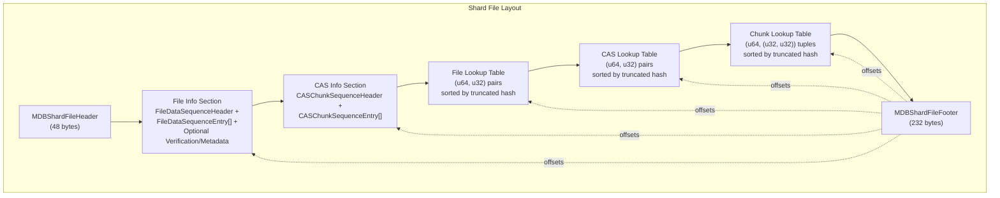

**Sources:** [mdb_shard/src/shard_format.rs:36-848]()

The file structure is designed for efficient queries via lookup tables while maintaining sequential scanning capability through bookend markers.

## Header Format

The header identifies the file as a valid MDB shard and provides version information.

### MDBShardFileHeader Structure

| Field | Type | Size | Description |
|-------|------|------|-------------|
| `tag` | `[u8; 32]` | 32 bytes | Magic number: `MDB_SHARD_HEADER_TAG` |
| `version` | `u64` | 8 bytes | Header format version (currently 2) |
| `footer_size` | `u64` | 8 bytes | Size of footer structure |

**Total Size:** 48 bytes

The magic number `MDB_SHARD_HEADER_TAG` is a fixed byte sequence that begins with `"HFRepoMetaData"` followed by specific byte values for quick file type validation.

**Sources:** [mdb_shard/src/shard_format.rs:44-101]()

### Header Serialization

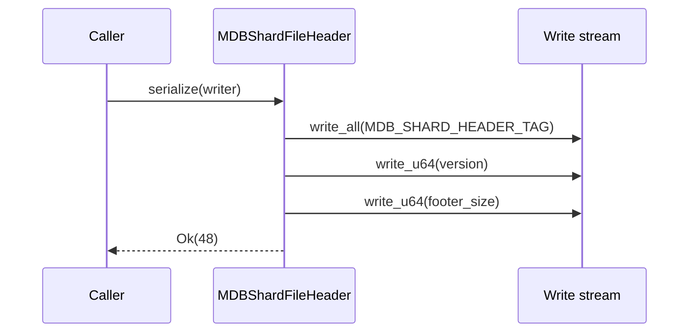

**Sources:** [mdb_shard/src/shard_format.rs:77-83]()

## File Info Section

The file info section contains reconstruction instructions for each file. This section enables the system to rebuild files by specifying which CAS blocks contain the file's data and in what order.

### Section Structure

Each file entry in this section consists of:

1. **FileDataSequenceHeader** - Metadata about the file
2. **FileDataSequenceEntry[]** - Array of CAS block references
3. **FileVerificationEntry[]** - Optional verification hashes (if `MDB_FILE_FLAG_WITH_VERIFICATION` is set)
4. **FileMetadataExt** - Optional extended metadata (if `MDB_FILE_FLAG_WITH_METADATA_EXT` is set)

The section ends with a bookend entry (all bits set to 1) for sequential scanning.

### FileDataSequenceHeader

| Field | Type | Size | Description |
|-------|------|------|-------------|
| `file_hash` | `MerkleHash` | 32 bytes | Content hash of the file |
| `file_flags` | `u32` | 4 bytes | Flags indicating optional sections |
| `num_entries` | `u32` | 4 bytes | Number of CAS block references |
| `_unused` | `u64` | 8 bytes | Reserved for future use |

**Total Size:** 48 bytes

**Flag Constants:**
- `MDB_FILE_FLAG_WITH_VERIFICATION = 1 << 31` - Indicates verification entries present
- `MDB_FILE_FLAG_WITH_METADATA_EXT = 1 << 30` - Indicates extended metadata present

**Sources:** [mdb_shard/src/file_structs.rs:15-162]()

### FileDataSequenceEntry

| Field | Type | Size | Description |
|-------|------|------|-------------|
| `cas_hash` | `MerkleHash` | 32 bytes | Hash of the CAS block (XORB) |
| `cas_flags` | `u32` | 4 bytes | CAS block flags |
| `unpacked_segment_bytes` | `u32` | 4 bytes | Number of bytes this segment contributes |
| `chunk_index_start` | `u32` | 4 bytes | Starting chunk index in CAS block |
| `chunk_index_end` | `u32` | 4 bytes | Ending chunk index (exclusive) |

**Total Size:** 48 bytes

This entry describes a contiguous range of chunks from a CAS block that form part of the file's content.

**Sources:** [mdb_shard/src/file_structs.rs:173-259]()

### FileVerificationEntry

| Field | Type | Size | Description |
|-------|------|------|-------------|
| `range_hash` | `MerkleHash` | 32 bytes | Hash of this file segment for verification |
| `_unused` | `[u64; 2]` | 16 bytes | Reserved for future use |

**Total Size:** 48 bytes

**Sources:** [mdb_shard/src/file_structs.rs:261-302]()

### FileMetadataExt

| Field | Type | Size | Description |
|-------|------|------|-------------|
| `sha256` | `Sha256` | 32 bytes | SHA256 hash of the file |
| `_unused` | `[u64; 2]` | 16 bytes | Reserved for future use |

**Total Size:** 48 bytes

**Sources:** [mdb_shard/src/file_structs.rs:304-346]()

### File Info Section Layout

```mermaid
graph LR
    subgraph "File 1"
        FH1["FileDataSequenceHeader"]
        FE1A["FileDataSequenceEntry 0"]
        FE1B["FileDataSequenceEntry 1"]
        FE1N["FileDataSequenceEntry n-1"]
        FV1["FileVerificationEntry[] (optional)"]
        FM1["FileMetadataExt (optional)"]
    end
    
    subgraph "File 2"
        FH2["FileDataSequenceHeader"]
        FE2["FileDataSequenceEntry[]"]
        FV2["Optional sections"]
    end
    
    BE["Bookend<br/>(file_hash = all 1s)"]
    
    FH1 --> FE1A
    FE1A --> FE1B
    FE1B --> FE1N
    FE1N --> FV1
    FV1 --> FM1
    FM1 --> FH2
    FH2 --> FE2
    FE2 --> FV2
    FV2 --> BE
```

**Sources:** [mdb_shard/src/shard_format.rs:227-284](), [mdb_shard/src/file_structs.rs:348-470]()

All file info structures are exactly 48 bytes (`MDB_FILE_INFO_ENTRY_SIZE`), enabling efficient indexing and random access.

## CAS Info Section

The CAS info section contains metadata about each CAS block (XORB) and its constituent chunks. This enables chunk-level deduplication queries.

### Section Structure

Each CAS entry consists of:

1. **CASChunkSequenceHeader** - Metadata about the CAS block
2. **CASChunkSequenceEntry[]** - Array of chunk information

The section ends with a bookend entry (cas_hash = all 1s) for sequential scanning.

### CASChunkSequenceHeader

| Field | Type | Size | Description |
|-------|------|------|-------------|
| `cas_hash` | `MerkleHash` | 32 bytes | Hash of the CAS block (XORB) |
| `cas_flags` | `u32` | 4 bytes | Flags for CAS block |
| `num_entries` | `u32` | 4 bytes | Number of chunks in this block |
| `num_bytes_in_cas` | `u32` | 4 bytes | Uncompressed bytes in CAS block |
| `num_bytes_on_disk` | `u32` | 4 bytes | Compressed bytes stored on disk |

**Total Size:** 48 bytes

**Sources:** [mdb_shard/src/cas_structs.rs:17-89]()

### CASChunkSequenceEntry

| Field | Type | Size | Description |
|-------|------|------|-------------|
| `chunk_hash` | `MerkleHash` | 32 bytes | Hash of the chunk (possibly HMAC-keyed) |
| `chunk_byte_range_start` | `u32` | 4 bytes | Starting byte offset in CAS block |
| `unpacked_segment_bytes` | `u32` | 4 bytes | Decompressed size of chunk |
| `flags` | `u32` | 4 bytes | Chunk flags (e.g., global dedup eligibility) |
| `_unused` | `u32` | 4 bytes | Reserved for future use |

**Total Size:** 48 bytes

**Flag Constants:**
- `MDB_CHUNK_WITH_GLOBAL_DEDUP_FLAG = 1 << 31` - Marks chunk for global deduplication service

**Sources:** [mdb_shard/src/cas_structs.rs:91-171]()

### CAS Info Section Layout

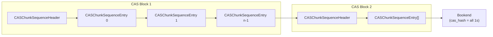

**Sources:** [mdb_shard/src/shard_format.rs:242-284](), [mdb_shard/src/cas_structs.rs:173-217]()

All CAS info structures are exactly 48 bytes (`MDB_CAS_INFO_ENTRY_SIZE`), matching the file info entry size.

## Lookup Tables

Three lookup tables provide O(log n) hash-based queries using interpolation search on sorted truncated hashes.

### File Lookup Table

Maps truncated file hashes to indices in the file info section.

| Field 1 | Field 2 | Description |
|---------|---------|-------------|
| `u64` | `u32` | (truncated file hash, file entry index) |

The table is sorted by the truncated hash (first 8 bytes of the full hash) and stored as consecutive pairs.

**Sources:** [mdb_shard/src/shard_format.rs:257-264](), [mdb_shard/src/shard_format.rs:326-333]()

### CAS Lookup Table

Maps truncated CAS block hashes to indices in the CAS info section.

| Field 1 | Field 2 | Description |
|---------|---------|-------------|
| `u64` | `u32` | (truncated CAS hash, CAS entry index) |

**Sources:** [mdb_shard/src/shard_format.rs:269-273](), [mdb_shard/src/shard_format.rs:339-346]()

### Chunk Lookup Table

Maps truncated chunk hashes to locations within the CAS info section.

| Field 1 | Field 2 | Field 3 | Description |
|---------|---------|---------|-------------|
| `u64` | `u32` | `u32` | (truncated chunk hash, CAS entry index, chunk offset) |

This table is sorted by truncated chunk hash and enables efficient chunk-level deduplication queries.

**Sources:** [mdb_shard/src/shard_format.rs:275-283](), [mdb_shard/src/shard_format.rs:348-360]()

### Lookup Table Query Flow

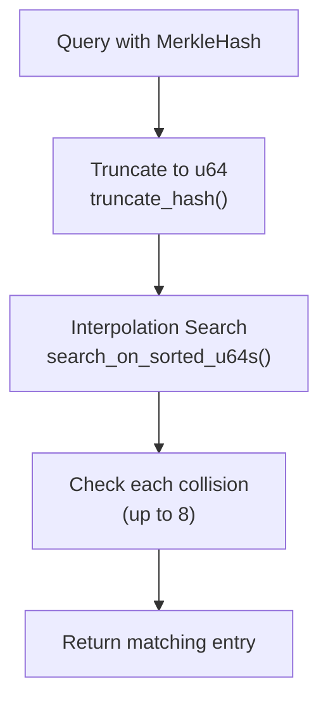

**Sources:** [mdb_shard/src/shard_format.rs:478-550](), [mdb_shard/src/interpolation_search.rs]()

Hash truncation to 64 bits allows compact lookup tables with acceptable collision rates. The system handles collisions by storing up to 8 candidate indices and checking each for a full hash match.

## Footer Format

The footer contains metadata about the shard and offsets to all sections, enabling direct access without sequential scanning.

### MDBShardFileFooter Structure

| Field | Type | Size | Description |
|-------|------|------|-------------|
| `version` | `u64` | 8 bytes | Footer format version (currently 1) |
| `file_info_offset` | `u64` | 8 bytes | Byte offset to file info section |
| `cas_info_offset` | `u64` | 8 bytes | Byte offset to CAS info section |
| `file_lookup_offset` | `u64` | 8 bytes | Byte offset to file lookup table |
| `file_lookup_num_entry` | `u64` | 8 bytes | Number of file lookup entries |
| `cas_lookup_offset` | `u64` | 8 bytes | Byte offset to CAS lookup table |
| `cas_lookup_num_entry` | `u64` | 8 bytes | Number of CAS lookup entries |
| `chunk_lookup_offset` | `u64` | 8 bytes | Byte offset to chunk lookup table |
| `chunk_lookup_num_entry` | `u64` | 8 bytes | Number of chunk lookup entries |
| `chunk_hash_hmac_key` | `HMACKey` | 32 bytes | HMAC key for chunk hash protection |
| `shard_creation_timestamp` | `u64` | 8 bytes | Creation time (seconds since epoch) |
| `shard_key_expiry` | `u64` | 8 bytes | Expiry time (seconds since epoch) |
| `_buffer` | `[u64; 6]` | 48 bytes | Reserved for future expansion |
| `stored_bytes_on_disk` | `u64` | 8 bytes | Total compressed bytes on disk |
| `materialized_bytes` | `u64` | 8 bytes | Total decompressed file bytes |
| `stored_bytes` | `u64` | 8 bytes | Total bytes in CAS blocks |
| `footer_offset` | `u64` | 8 bytes | Byte offset to footer (always last) |

**Total Size:** 232 bytes

**Sources:** [mdb_shard/src/shard_format.rs:103-225]()

### HMAC Key Protection

When `chunk_hash_hmac_key` is non-zero, chunk hashes in the shard are HMAC-keyed. This provides:
- Protection against hash collision attacks
- Time-limited shard validity via `shard_key_expiry`
- Ability to regenerate shards with new keys

The `keyed_chunk_hash()` method applies the HMAC transformation:

```rust
pub fn keyed_chunk_hash(&self, chunk_hash: impl AsRef<MerkleHash>) -> MerkleHash {
    let chunk_hash = *chunk_hash.as_ref();
    if self.metadata.chunk_hash_hmac_key != HMACKey::default() {
        chunk_hash.hmac(self.metadata.chunk_hash_hmac_key)
    } else {
        chunk_hash
    }
}
```

**Sources:** [mdb_shard/src/shard_format.rs:466-477](), [mdb_shard/src/shard_format.rs:600-609]()

### Footer Access Pattern

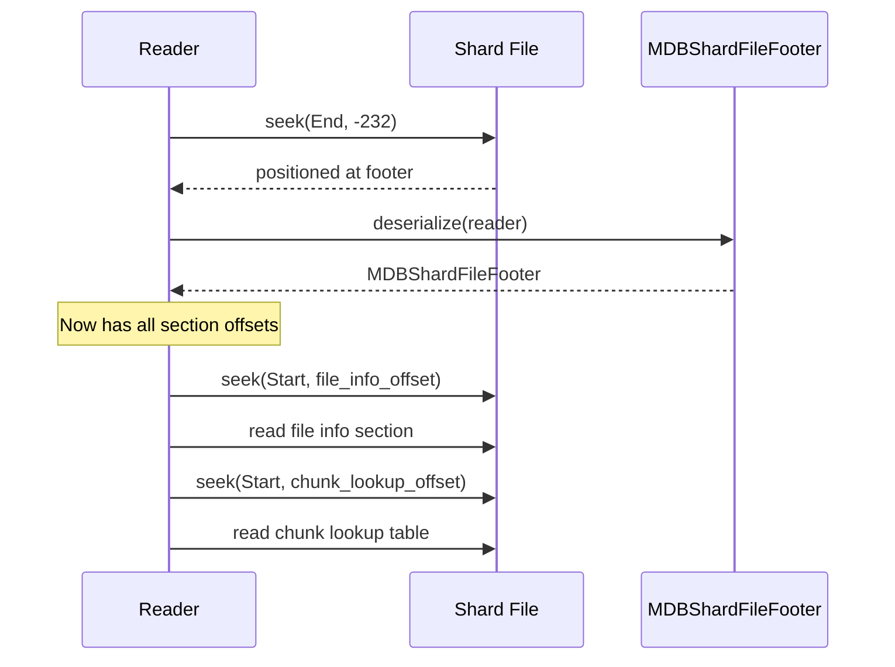

**Sources:** [mdb_shard/src/shard_format.rs:292-304]()

## Serialization Process

The `MDBShardInfo::serialize_from()` method converts an in-memory `MDBInMemoryShard` to the binary format.

### Serialization Flow

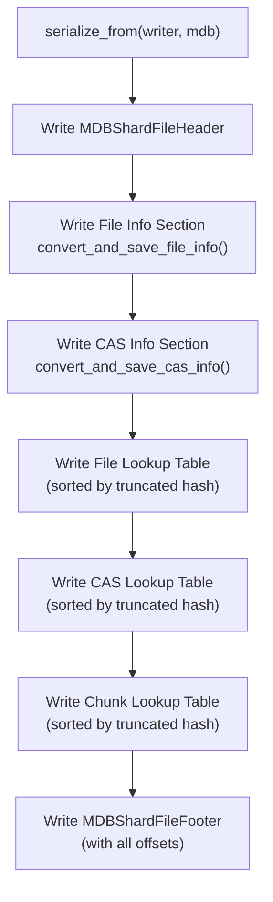

**Sources:** [mdb_shard/src/shard_format.rs:306-375]()

### Lookup Table Generation

During serialization, lookup tables are generated by:

1. **File Lookup:** Truncate each file hash and record its position index
2. **CAS Lookup:** Truncate each CAS hash and record its position index
3. **Chunk Lookup:** For each chunk in each CAS block:
   - Truncate the (keyed) chunk hash
   - Record (CAS index, chunk offset within CAS) pair
   - Sort by truncated hash

**Sources:** [mdb_shard/src/shard_format.rs:377-463]()

## Deserialization and Query Operations

### Loading Shard Metadata

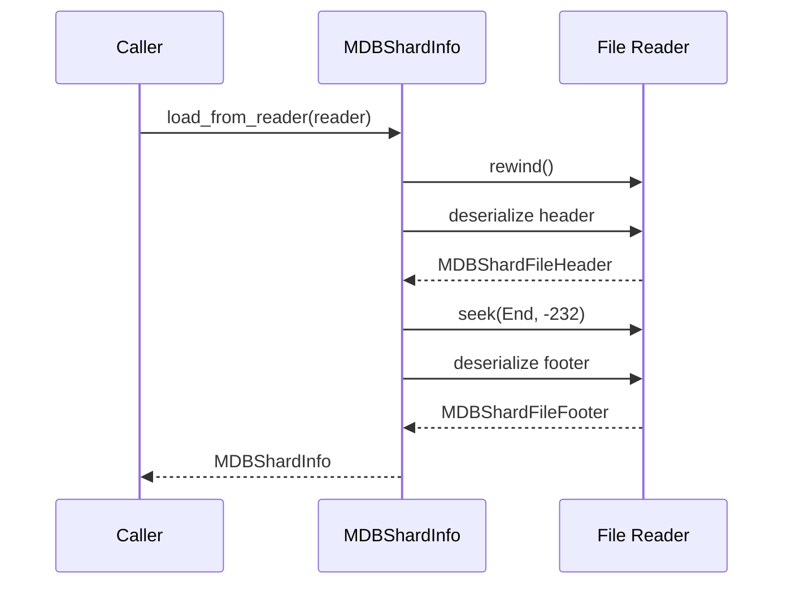

**Sources:** [mdb_shard/src/shard_format.rs:292-304]()

### File Reconstruction Query

To retrieve reconstruction information for a file:

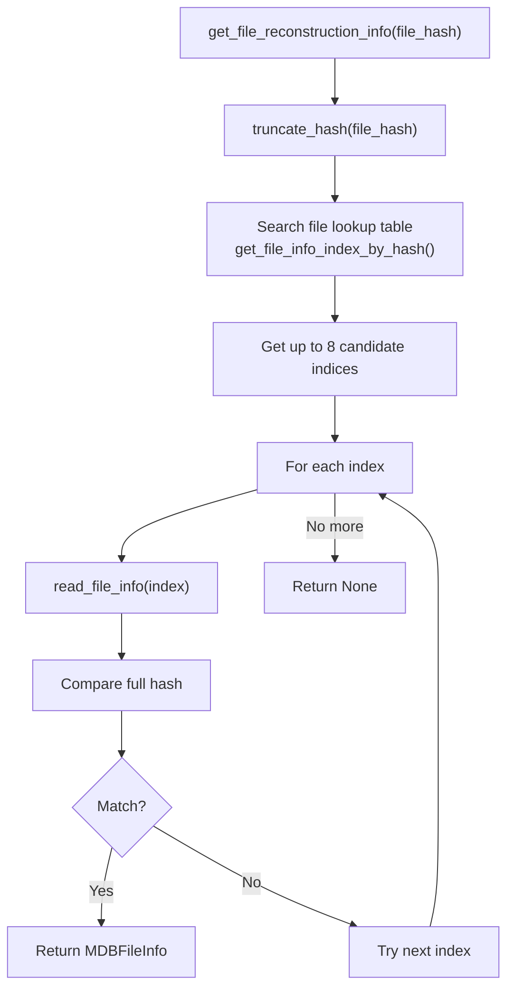

**Sources:** [mdb_shard/src/shard_format.rs:648-666]()

### Chunk Deduplication Query

To find if chunks are already present in the shard:

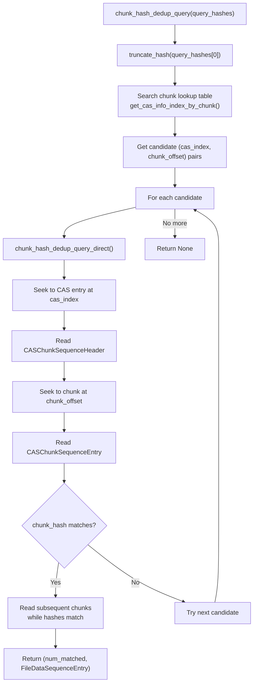

**Sources:** [mdb_shard/src/shard_format.rs:738-758](), [mdb_shard/src/shard_format.rs:674-732]()

The deduplication query attempts to match as many consecutive chunks as possible, enabling efficient multi-chunk deduplication.

## Streaming and Partial Loading

The `MDBMinimalShard` provides efficient streaming access without loading entire file info or CAS info sections into memory.

### Streaming Access Pattern

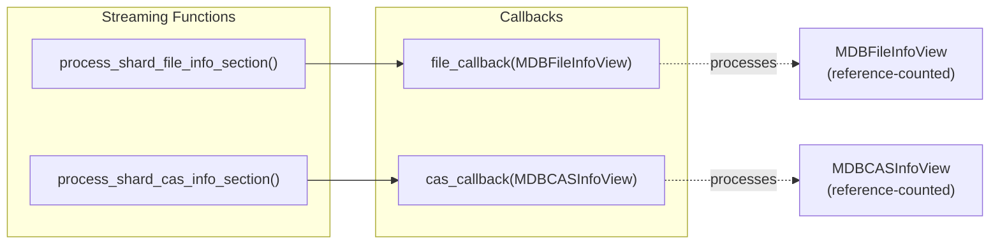

**Sources:** [mdb_shard/src/streaming_shard.rs:18-168]()

### MDBFileInfoView and MDBCASInfoView

These structures provide zero-copy views into shard data:

- `MDBFileInfoView` - Reference-counted view of file info (header + entries)
- `MDBCASInfoView` - Reference-counted view of CAS info (header + chunks)

Both use `Bytes` (reference-counted buffer) to avoid copying large data sections.

**Sources:** [mdb_shard/src/file_structs.rs:472-599](), [mdb_shard/src/cas_structs.rs:219-298]()

## Bookend Markers

Both file info and CAS info sections end with bookend markers - special entries with all hash bits set to 1. These enable sequential scanning without consulting the footer.

```rust
pub fn bookend() -> Self {
    Self {
        file_hash: [!0u64; 4].into(),  // All bits set to 1
        ..Default::default()
    }
}

pub fn is_bookend(&self) -> bool {
    self.file_hash == [!0u64; 4].into()
}
```

**Sources:** [mdb_shard/src/file_structs.rs:71-81](), [mdb_shard/src/cas_structs.rs:45-55]()

## Set Operations

The shard format supports efficient set operations (union, difference) on two shards, producing a new shard without loading all content into memory.

### Set Operation Algorithm

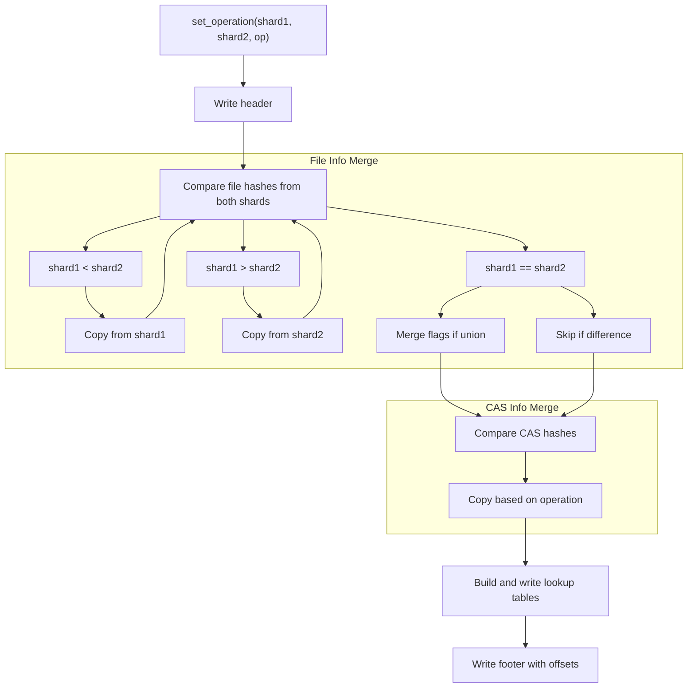

**Sources:** [mdb_shard/src/set_operations.rs:104-373]()

When performing a union of two file entries with the same hash but different flags (e.g., one has verification, other has metadata extension), the system merges them into a single complete entry.

## Version Information and Compatibility

### Current Versions

- **Header Version:** `MDB_SHARD_HEADER_VERSION = 2`
- **Footer Version:** `MDB_SHARD_FOOTER_VERSION = 1`

Version checking occurs during deserialization to prevent reading incompatible shard formats.

```rust
if version != MDB_SHARD_FOOTER_VERSION {
    return Err(MDBShardError::ShardVersionError(format!(
        "Error: Expected footer version {MDB_SHARD_FOOTER_VERSION}, got {version}"
    )));
}
```

**Sources:** [mdb_shard/src/shard_format.rs:36-38](), [mdb_shard/src/shard_format.rs:186-193]()

### Entry Size Constants

All entry types are fixed at 48 bytes for efficient indexing:

```rust
pub const MDB_FILE_INFO_ENTRY_SIZE: usize = 48;
const MDB_CAS_INFO_ENTRY_SIZE: usize = 48;
```

Static assertions verify this at compile time:

```rust
const_assert!(MDB_FILE_INFO_ENTRY_SIZE == size_of::<FileDataSequenceHeader>());
const_assert!(MDB_FILE_INFO_ENTRY_SIZE == size_of::<FileDataSequenceEntry>());
const_assert!(MDB_FILE_INFO_ENTRY_SIZE == size_of::<FileVerificationEntry>());
const_assert!(MDB_FILE_INFO_ENTRY_SIZE == size_of::<FileMetadataExt>());
```

**Sources:** [mdb_shard/src/shard_format.rs:24-32]()

## Global Deduplication Support

The format includes support for marking chunks eligible for global deduplication via the `MDB_CHUNK_WITH_GLOBAL_DEDUP_FLAG` in `CASChunkSequenceEntry.flags`. This flag identifies chunks that should be included in cross-user deduplication queries.

### Global Dedup Chunk Extraction

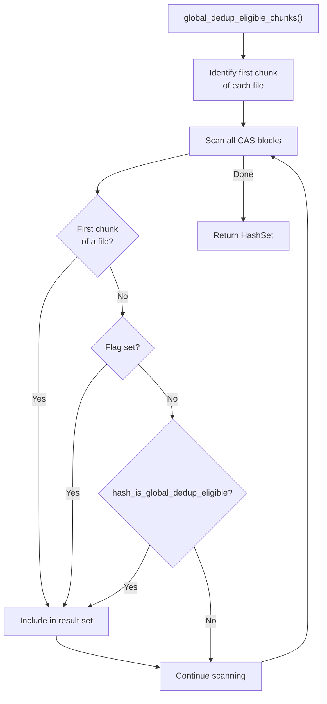

**Sources:** [mdb_shard/src/streaming_shard.rs:438-481](), [mdb_shard/src/cas_structs.rs:119-137]()

The system automatically sets the global dedup flag on chunks at file boundaries during serialization to optimize global deduplication queries.

---

