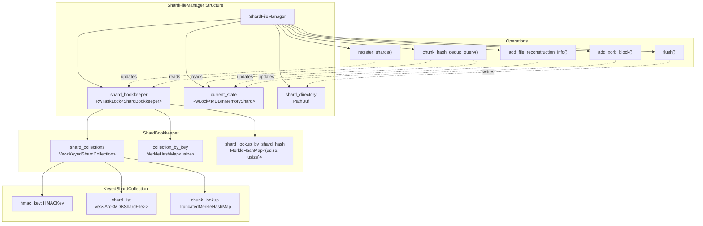
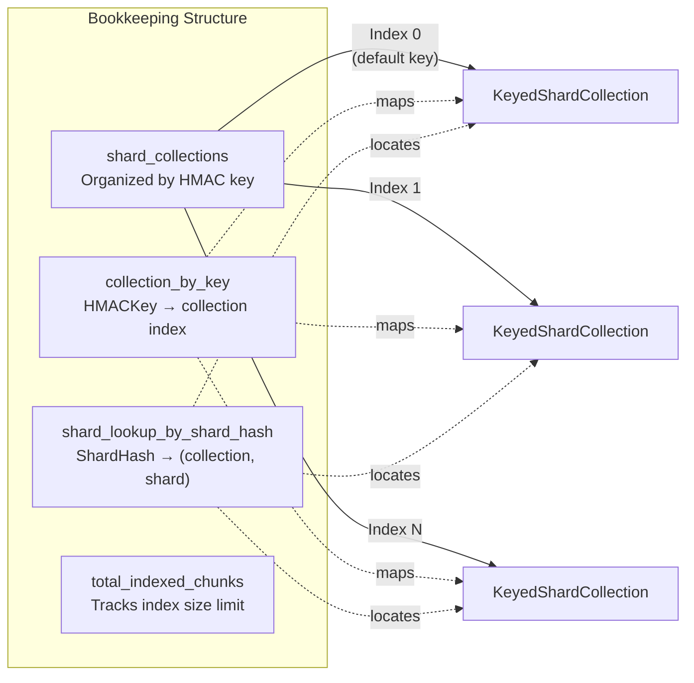
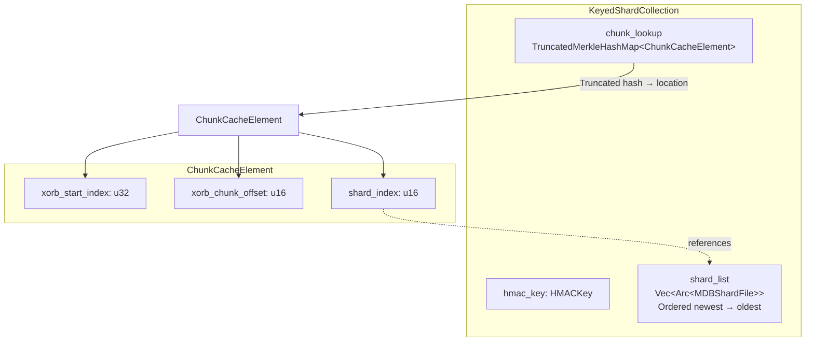
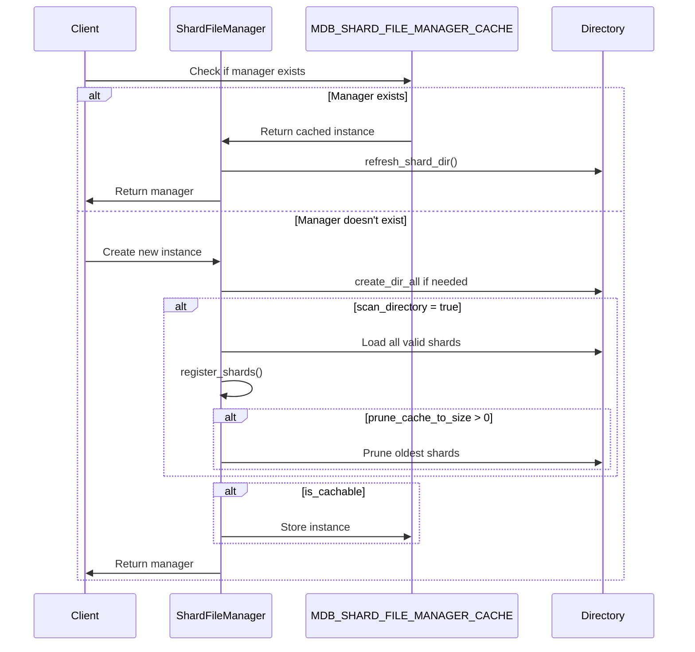
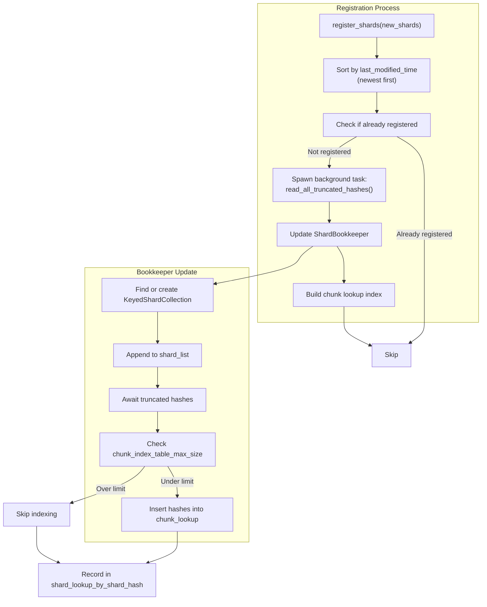
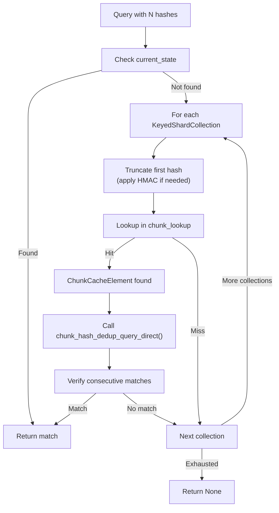
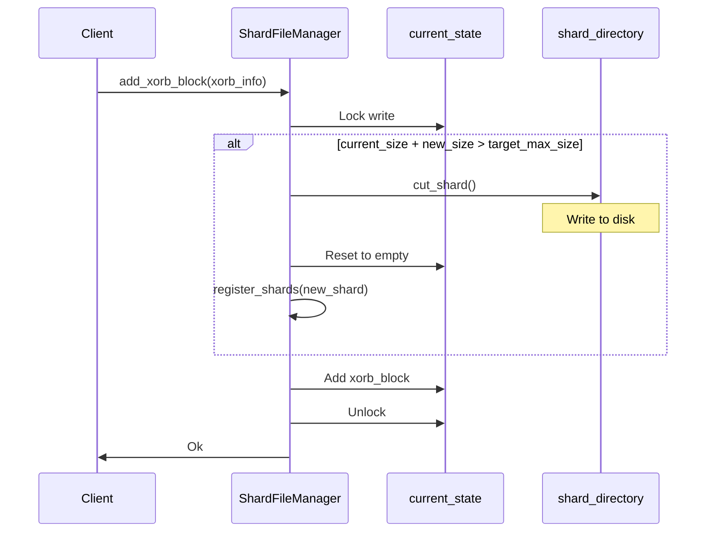
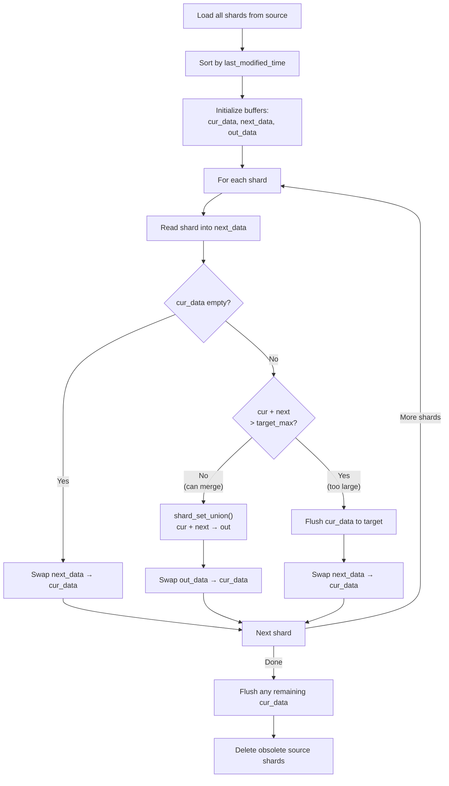

<!-- source: DeepWiki mcp.deepwiki.com · repo huggingface/xet-core · extra page Shard File Manager · fetched 2026-10-26 -->

# Shard File Manager

<details>
<summary>Relevant source files</summary>

The following files were used as context for generating this wiki page:

- [mdb_shard/src/session_directory.rs](mdb_shard/src/session_directory.rs)
- [mdb_shard/src/shard_benchmark.rs](mdb_shard/src/shard_benchmark.rs)
- [mdb_shard/src/shard_file_handle.rs](mdb_shard/src/shard_file_handle.rs)
- [mdb_shard/src/shard_file_manager.rs](mdb_shard/src/shard_file_manager.rs)
- [mdb_shard/src/utils.rs](mdb_shard/src/utils.rs)

</details>


## Purpose and Scope

The Shard File Manager (`ShardFileManager`) is a thread-safe, async-enabled component that manages collections of MDB shard files. It provides a unified interface for querying file reconstruction information, performing deduplication queries across multiple shards, and accumulating new content in memory before flushing it to disk. The manager handles shard registration, maintains efficient lookup indexes, and coordinates shard consolidation to prevent fragmentation.

For information about the binary format of individual shard files, see [Shard Binary Format](#3.5.3). For details on session-based shard management during uploads, see [Session Shard Interface](#3.5.1).

Sources: [mdb_shard/src/shard_file_manager.rs:75-100]()

## Architecture Overview

The `ShardFileManager` orchestrates access to both on-disk shard files and in-memory accumulation state. It maintains a two-level index structure for efficient deduplication queries and provides atomic operations for content addition and shard cutting.



Sources: [mdb_shard/src/shard_file_manager.rs:75-82](), [mdb_shard/src/shard_file_manager.rs:35-73]()

## Internal Data Structures

### ShardFileManager

The main manager struct maintains both persistent and transient state:

| Field | Type | Purpose |
|-------|------|---------|
| `shard_bookkeeper` | `RwTaskLock<ShardBookkeeper>` | Thread-safe index of registered shard files |
| `current_state` | `RwLock<MDBInMemoryShard>` | Accumulates new content before flushing |
| `shard_directory` | `PathBuf` | Directory for shard file storage |
| `target_shard_max_size` | `u64` | Target size threshold for cutting new shards |
| `shard_directory_cleaned` | `AtomicBool` | Tracks whether expired shards have been cleaned |

Sources: [mdb_shard/src/shard_file_manager.rs:75-81]()

### ShardBookkeeper

The bookkeeper organizes shards by their HMAC key and maintains lookup indexes:



The bookkeeper maintains a cap on the total number of indexed chunks (`chunk_index_table_max_size` from config). Once this limit is reached, new shards are registered but their chunks are not added to the deduplication index.

Sources: [mdb_shard/src/shard_file_manager.rs:53-73]()

### KeyedShardCollection

Each collection groups shards that share the same HMAC key:



The `chunk_lookup` table maps truncated chunk hashes (first 64 bits) to their location within the shard collection. The packed `ChunkCacheElement` struct efficiently stores the three-part location: which shard, which XORB block, and which offset within that block.

Sources: [mdb_shard/src/shard_file_manager.rs:35-49](), [mdb_shard/src/shard_file_manager.rs:28-33]()

## Construction and Initialization

### Session Directory Mode

Used for temporary accumulation during upload sessions:

```rust
// Creates a new manager in a session directory
ShardFileManager::new_in_session_directory(
    session_directory: impl AsRef<Path>,
    scan_directory: bool  // Whether to load existing shards
) -> Result<Arc<Self>>
```

This mode:
- Does not cache the manager instance globally
- Allows multiple concurrent managers in different directories
- Scans and registers existing shards if `scan_directory` is true

Sources: [mdb_shard/src/shard_file_manager.rs:102-107]()

### Cache Directory Mode

Used for persistent client-side caching:

```rust
// Creates or retrieves a cached manager instance
ShardFileManager::new_in_cache_directory(
    cache_directory: impl AsRef<Path>
) -> Result<Arc<Self>>
```

This mode:
- Caches the manager instance in `MDB_SHARD_FILE_MANAGER_CACHE`
- Automatically scans and registers all shards in the directory
- Prunes expired shards and enforces cache size limits
- Returns the same instance for subsequent calls with the same directory

Sources: [mdb_shard/src/shard_file_manager.rs:110-119](), [mdb_shard/src/shard_file_manager.rs:23-25]()

### Initialization Flow



Sources: [mdb_shard/src/shard_file_manager.rs:121-169]()

## Shard Registration

Registration loads shard files and builds the deduplication index. Shards are registered in reverse chronological order (newest first) to prioritize recent content in deduplication queries.



The registration process spawns background tasks to read truncated hashes from each shard file, allowing concurrent I/O while updating the bookkeeper. The chunk index has a configurable size limit to prevent unbounded memory growth.

Sources: [mdb_shard/src/shard_file_manager.rs:221-340]()

### Registration Methods

| Method | Purpose |
|--------|---------|
| `register_shards(&[Arc<MDBShardFile>])` | Register pre-loaded shard file handles |
| `register_shards_by_path(&[P: AsRef<Path>])` | Load and register shards from file paths |
| `import_shard_from_bytes(&[u8])` | Import a shard from serialized bytes |
| `refresh_shard_dir(prune_expired, prune_cache_to_size)` | Scan directory for new shards and optionally prune |

Sources: [mdb_shard/src/shard_file_manager.rs:211-219](), [mdb_shard/src/shard_file_manager.rs:190-194](), [mdb_shard/src/shard_file_manager.rs:171-188]()

## Query Operations

### File Reconstruction Query

Retrieves the information needed to reconstruct a file from its hash:

```rust
async fn get_file_reconstruction_info(
    &self,
    file_hash: &MerkleHash,
) -> Result<Option<(MDBFileInfo, Option<MerkleHash>)>>
```

The query searches in order:
1. In-memory state (`current_state`)
2. Registered shards (newest to oldest within each HMAC key collection)

Returns `(MDBFileInfo, shard_hash)` where `shard_hash` indicates which shard contained the result (None if from in-memory state).

Sources: [mdb_shard/src/shard_file_manager.rs:367-403]()

### Deduplication Query

Attempts to find a sequence of consecutive chunks in the existing content:

```rust
pub async fn chunk_hash_dedup_query(
    &self,
    query_hashes: &[MerkleHash],
) -> Result<Option<(usize, FileDataSequenceEntry)>>
```

Returns `(count, entry)` where:
- `count`: Number of consecutive hashes matched (may be less than input length)
- `entry`: `FileDataSequenceEntry` describing the XORB block and chunk range

**Query Algorithm:**



The query uses truncated hashes (first 64 bits) for efficient indexing. When a potential match is found via the chunk lookup table, it performs a direct query against the shard file to verify the full hash sequence.

Sources: [mdb_shard/src/shard_file_manager.rs:410-446]()

## Content Addition

The manager maintains an in-memory accumulation buffer (`current_state`) for new content. When adding content causes the buffer to exceed `target_shard_max_size`, the manager automatically cuts a new shard and registers it.

### Adding XORB Blocks

```rust
pub async fn add_xorb_block(
    &self,
    xorb_block_contents: impl Into<Arc<MDBXorbInfo>>
) -> Result<()>
```

**Flow:**



Sources: [mdb_shard/src/shard_file_manager.rs:448-470]()

### Adding File Reconstruction Info

```rust
pub async fn add_file_reconstruction_info(
    &self,
    file_info: MDBFileInfo
) -> Result<()>
```

Uses the same automatic shard cutting mechanism as XORB blocks. The size check includes both XORB metadata and file reconstruction entries to ensure balanced shard files.

Sources: [mdb_shard/src/shard_file_manager.rs:472-493]()

### Shard Cutting

```rust
fn cut_shard(
    lg: &mut MDBInMemoryShard,
    shard_directory: &Path
) -> Result<PathBuf>
```

The cutting process:
1. Writes `current_state` to a temporary file in `shard_directory`
2. Computes the shard hash during write
3. Renames the file to its final hash-based name
4. Resets `current_state` to empty
5. Returns the path to the new shard file

Sources: [mdb_shard/src/shard_file_manager.rs:495-499]()

## Flushing

Explicit flush writes any accumulated in-memory state to disk:

```rust
pub async fn flush(&self) -> Result<Option<PathBuf>>
```

Returns:
- `Some(path)`: Path to the newly created shard file
- `None`: No content to flush

The flush operation is atomic from the caller's perspective - the write lock is held during the entire flush and register sequence.

Sources: [mdb_shard/src/shard_file_manager.rs:503-526]()

## Shard Consolidation

Over time, many small shards accumulate in the directory. Consolidation merges them into larger shards to improve query performance and reduce file system overhead.

### Consolidation Functions

```rust
// Merge shards in-place
pub fn consolidate_shards_in_directory(
    session_directory: impl AsRef<Path>,
    target_max_size: u64,
    skip_on_error: bool,
) -> Result<Vec<Arc<MDBShardFile>>>

// Merge with separate source/target
pub fn merge_shards(
    source_directory: impl AsRef<Path>,
    target_directory: impl AsRef<Path>,
    target_max_size: u64,
    skip_on_error: bool,
) -> Result<ShardMergeResult>
```

Sources: [mdb_shard/src/session_directory.rs:16-40](), [mdb_shard/src/session_directory.rs:49-151]()

### Merge Algorithm



The merge algorithm accumulates shards sequentially, performing set union operations when the combined size stays under the target. When adding a new shard would exceed the target, it flushes the current accumulation and starts a new shard. This preserves temporal ordering - older content is merged together, and newer content is merged together.

Sources: [mdb_shard/src/session_directory.rs:56-151]()

### ShardMergeResult

The merge operation returns detailed results:

| Field | Type | Description |
|-------|------|-------------|
| `merged_shards` | `Vec<Arc<MDBShardFile>>` | New consolidated shard files |
| `obsolete_shards` | `Vec<Arc<MDBShardFile>>` | Source shards that were merged and can be deleted |
| `skipped_shards` | `Vec<Arc<MDBShardFile>>` | Shards that had errors (if `skip_on_error = true`) |

Sources: [mdb_shard/src/session_directory.rs:42-47]()

## Cache Management

### Cache Directory Operation

When operating in cache mode, the manager enforces storage limits and expiration policies:

**Expiration Handling:**
- Shards have an expiration timestamp (`shard_key_expiry`)
- Expired shards are not loaded during `refresh_shard_dir()`
- Expired shards are deleted with an expiration buffer window (default: `MDB_SHARD_EXPIRATION_BUFFER`)

**Size Pruning:**
- When total shard size exceeds `prune_cache_to_size`, oldest shards are deleted first
- Uses a heap to efficiently find the oldest shards by `shard_creation_timestamp`
- Continues pruning until under the size limit

Sources: [mdb_shard/src/shard_file_handle.rs:190-248]()

### Clean Expired Shards

```rust
pub fn clean_expired_shards_if_needed(&self) -> Result<()>
```

Removes expired shards from the directory. Uses an atomic flag to ensure cleaning happens at most once per manager instance.

Sources: [mdb_shard/src/shard_file_manager.rs:201-209]()

## Statistics and Reporting

The manager provides methods to calculate total storage metrics:

```rust
pub async fn calculate_total_materialized_bytes(&self) -> Result<u64>
pub async fn calculate_total_stored_bytes(&self) -> Result<u64>
```

- **Materialized bytes**: Original file sizes before deduplication
- **Stored bytes**: Actual storage consumed after deduplication

These aggregate statistics from both in-memory state and all registered shards.

Sources: [mdb_shard/src/shard_file_manager.rs:528-563]()

## Thread Safety and Concurrency

The manager is fully thread-safe through careful lock management:

**Read-Write Locks:**
- `shard_bookkeeper`: `RwTaskLock` allows concurrent reads, exclusive writes
- `current_state`: Standard `RwLock` for in-memory accumulation

**Lock Ordering:**
- Queries take read locks on `shard_bookkeeper` or `current_state` independently
- Updates take a write lock on `current_state`, potentially cutting shards
- Registration updates `shard_bookkeeper` under write lock

**Async Safety:**
- All locks are released before any `.await` points
- Background tasks (e.g., hash loading) run on separate threads
- Shard cutting and registration are atomic from the caller's perspective

Sources: [mdb_shard/src/shard_file_manager.rs:75-82]()

## Usage Patterns

### Upload Session Pattern

```rust
// Create manager for session directory
let mdb = ShardFileManager::new_in_session_directory(&session_dir, false).await?;

// Add content as it's processed
for xorb_info in xorb_blocks {
    mdb.add_xorb_block(xorb_info).await?;
}

for file_info in file_reconstructions {
    mdb.add_file_reconstruction_info(file_info).await?;
}

// Flush final shard
let final_shard = mdb.flush().await?;

// Consolidate all session shards
let consolidated = consolidate_shards_in_directory(
    &session_dir, 
    config.max_target_size,
    false
)?;
```

Sources: [mdb_shard/src/shard_file_manager.rs:84-98]()

### Download/Query Pattern

```rust
// Create cached manager
let mdb = ShardFileManager::new_in_cache_directory(&cache_dir).await?;

// Register remote shards
mdb.register_shards_by_path(&remote_shard_paths).await?;

// Query for file reconstruction
if let Some((file_info, shard_hash)) = mdb.get_file_reconstruction_info(&file_hash).await? {
    // Reconstruct file using file_info
}

// Query for deduplication
if let Some((count, entry)) = mdb.chunk_hash_dedup_query(&chunk_hashes).await? {
    // Use existing XORB instead of uploading
}
```

Sources: [mdb_shard/src/shard_file_manager.rs:110-119]()

---

