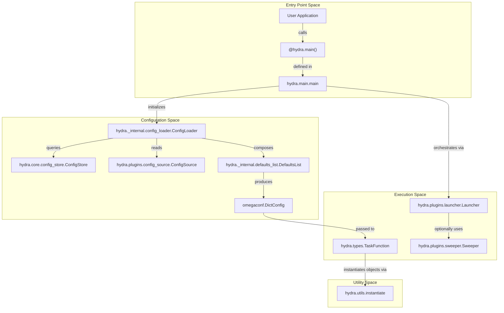
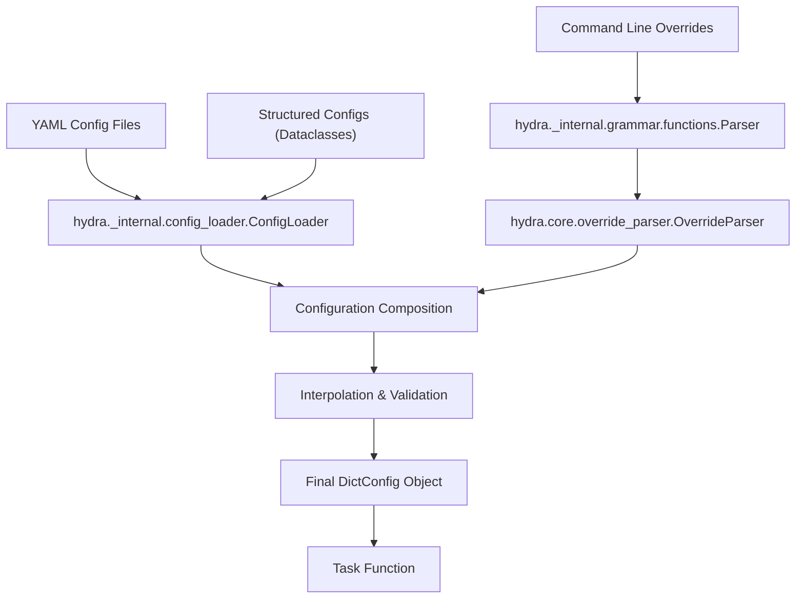

<!-- source: DeepWiki mcp.deepwiki.com · repo facebookresearch/hydra · page 1 Overview · fetched 2026-10-21 -->

# Overview

<details>
<summary>Relevant source files</summary>

The following files were used as context for generating this wiki page:

- [.github/PULL_REQUEST_TEMPLATE.md](.github/PULL_REQUEST_TEMPLATE.md)
- [.pre-commit-config.yaml](.pre-commit-config.yaml)
- [CONTRIBUTING.md](CONTRIBUTING.md)
- [README.md](README.md)
- [hydra/__init__.py](hydra/__init__.py)
- [hydra/errors.py](hydra/errors.py)
- [noxfile.py](noxfile.py)
- [requirements/dev.txt](requirements/dev.txt)
- [requirements/requirements.txt](requirements/requirements.txt)
- [setup.py](setup.py)
- [tests/test_errors.py](tests/test_errors.py)
- [tests/test_examples/test_advanced_package_overrides.py](tests/test_examples/test_advanced_package_overrides.py)
- [tests/test_examples/test_configure_hydra.py](tests/test_examples/test_configure_hydra.py)
- [tests/test_examples/test_instantiate_examples.py](tests/test_examples/test_instantiate_examples.py)
- [tests/test_examples/test_patterns.py](tests/test_examples/test_patterns.py)
- [tests/test_examples/test_structured_configs_tutorial.py](tests/test_examples/test_structured_configs_tutorial.py)
- [tests/test_examples/test_tutorials_basic.py](tests/test_examples/test_tutorials_basic.py)
- [website/docs/intro.md](website/docs/intro.md)
- [website/docs/tutorials/intro.md](website/docs/tutorials/intro.md)
- [website/versioned_docs/version-0.11/intro.md](website/versioned_docs/version-0.11/intro.md)
- [website/versioned_docs/version-1.0/intro.md](website/versioned_docs/version-1.0/intro.md)
- [website/versioned_docs/version-1.1/intro.md](website/versioned_docs/version-1.1/intro.md)
- [website/versioned_docs/version-1.2/intro.md](website/versioned_docs/version-1.2/intro.md)
- [website/versioned_docs/version-1.3/intro.md](website/versioned_docs/version-1.3/intro.md)

</details>


Hydra is an open-source Python framework that simplifies the development of research and other complex applications. Developed by Meta (formerly Facebook) Research, it provides a powerful yet flexible system for managing hierarchical configurations that can be dynamically composed and overridden via config files or the command line.

The name "Hydra" comes from its ability to run multiple similar jobs—much like a Hydra with multiple heads—facilitating complex experiments and parameter sweeps with minimal code changes.

Sources: [README.md:23-24](), [website/docs/intro.md:10-13](), [setup.py:38]()

## Core Capabilities

Hydra's primary value proposition lies in its ability to handle complex configuration requirements that traditional flat configuration files cannot easily manage:

*   **Hierarchical Configuration**: Compose a final configuration object from multiple sources, including YAML files and Structured Configs (Python dataclasses).
*   **Dynamic Overrides**: Modify any part of the configuration tree from the command line using a powerful DSL.
*   **Multirun Execution**: Launch multiple instances of an application with different parameters (sweeps) using a single command.
*   **Plug-and-Play Architecture**: Swap out execution environments (Local, SLURM, Ray) or optimization algorithms (Ax, Optuna, Nevergrad) via a robust plugin system.
*   **Shell Integration**: Automatic generation of tab-completion scripts for Bash, Zsh, and Fish.

Sources: [website/docs/intro.md:15-21](), [README.md:52-58]()

## System Architecture

Hydra's architecture separates configuration discovery, composition, and execution. The following diagram bridges the high-level concepts to the specific code entities that implement them.

### Code Entity Map: From Invocation to Execution



Sources: [hydra/main.py:70-104](), [hydra/__init__.py:4-11](), [hydra/types.py:8](), [hydra/utils.py:16-18]()

## Configuration Processing Flow

Hydra transforms raw input (files, environment, CLI) into a unified `DictConfig` object. This process involves parsing the `defaults` list and applying overrides in a specific order.

### Data Flow: Configuration Composition



Sources: [hydra/compose.py:10-20](), [hydra/errors.py:11-16](), [website/docs/intro.md:103-109]()

## Key Subsystems

### 1. The main() Decorator
The `@hydra.main` decorator is the primary interface for users. It wraps the application's entry point, handles initialization, and ensures the configuration is correctly passed to the task function.

*   **Key Function**: `hydra.main()` in `[hydra/main.py:70-104]()`.
*   **Purpose**: Manages the lifecycle of a Hydra application, including setting up the working directory and logging.

### 2. Plugin System
Hydra is highly extensible. Plugins are discovered at runtime and can modify core behavior.
*   **Launchers**: Determine *where* code runs (e.g., `SubmititLauncher` for SLURM).
*   **Sweepers**: Determine *what* parameters to try (e.g., `AxSweeper` for Bayesian optimization).
*   **Config Sources**: Determine *where* configs come from (Filesystem, Package resources).

Sources: [noxfile.py:187-215](), [setup.py:58]()

### 3. Instantiation System
Hydra allows you to describe objects in configuration and instantiate them dynamically in code. This is particularly useful for switching between different implementations of an interface (e.g., different Optimizer classes in ML).
*   **Key Function**: `hydra.utils.instantiate()` (often aliased to `hydra.utils.call`).
*   **Targeting**: Uses the `_target_` key to locate Python classes or functions.

Sources: [hydra/utils.py:16-18](), [hydra/errors.py:18-18]()

### 4. Error Handling
Hydra provides a hierarchy of exceptions to help developers debug configuration issues.
*   `MissingConfigException`: Raised when a specified config name cannot be found.
*   `OverrideParseException`: Raised when the command-line override DSL is violated.
*   `ConfigCompositionException`: Base class for errors during the composition phase.

Sources: [hydra/errors.py:5-39]()

## Usage Example

A standard Hydra application consists of a configuration file and a Python script.

**Configuration (`conf/config.yaml`):**
```yaml
defaults:
  - db: mysql

db:
  user: root
```

**Application (`my_app.py`):**
```python
import hydra
from omegaconf import DictConfig

@hydra.main(version_base=None, config_path="conf", config_name="config")
def my_app(cfg: DictConfig) -> None:
    print(cfg.db.user)

if __name__ == "__main__":
    my_app()
```

Sources: [website/docs/intro.md:56-65](), [tests/test_examples/test_tutorials_basic.py:39-49]()

## Integration and Ecosystem

Hydra is the foundation for several specialized tools and templates:
*   **Configen**: Generates Structured Configs from existing Python code.
*   **Hydra-Zen**: Provides Pythonic wrappers for more complex Hydra patterns.
*   **Lightning-Hydra-Template**: A popular template for PyTorch Lightning experiments.

Sources: [README.md:52-58]()

---

