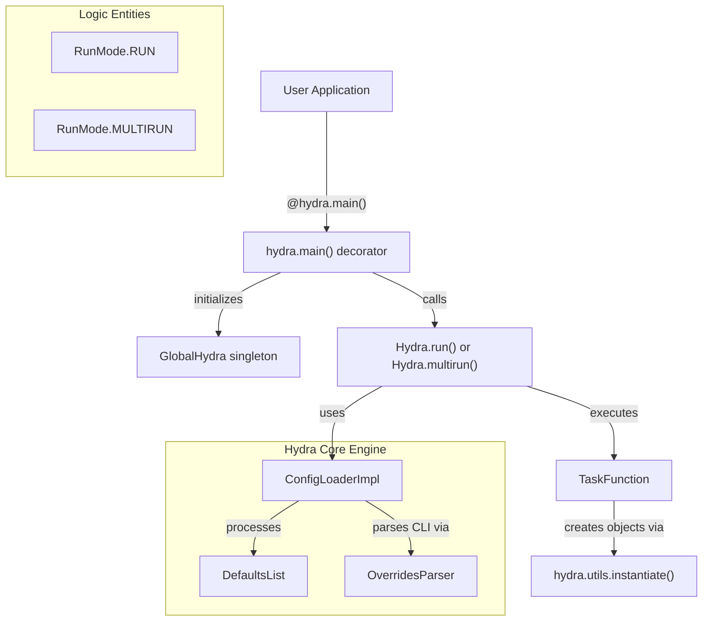
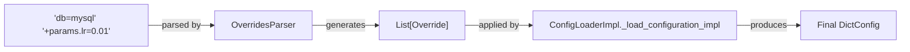

<!-- source: DeepWiki mcp.deepwiki.com · repo facebookresearch/hydra · page 2 Core Concepts · fetched 2026-10-21 -->

# Core Concepts

Relevant source files

The following files were used as context for generating this wiki page:

- [examples/tutorials/basic/your_first_hydra_app/3_using_config/my_app.py](examples/tutorials/basic/your_first_hydra_app/3_using_config/my_app.py)
- [hydra/_internal/config_loader_impl.py](hydra/_internal/config_loader_impl.py)
- [hydra/_internal/hydra.py](hydra/_internal/hydra.py)
- [hydra/_internal/utils.py](hydra/_internal/utils.py)
- [hydra/conf/__init__.py](hydra/conf/__init__.py)
- [hydra/core/config_loader.py](hydra/core/config_loader.py)
- [hydra/core/utils.py](hydra/core/utils.py)
- [hydra/experimental/compose.py](hydra/experimental/compose.py)
- [hydra/experimental/initialize.py](hydra/experimental/initialize.py)
- [hydra/test_utils/launcher_common_tests.py](hydra/test_utils/launcher_common_tests.py)
- [hydra/test_utils/test_utils.py](hydra/test_utils/test_utils.py)
- [tests/test_basic_launcher.py](tests/test_basic_launcher.py)
- [tests/test_compose.py](tests/test_compose.py)
- [tests/test_config_loader.py](tests/test_config_loader.py)
- [tests/test_hydra.py](tests/test_hydra.py)
- [website/docs/advanced/defaults_list.md](website/docs/advanced/defaults_list.md)
- [website/docs/advanced/terminology.md](website/docs/advanced/terminology.md)
- [website/docs/tutorials/basic/running_your_app/2_multirun.md](website/docs/tutorials/basic/running_your_app/2_multirun.md)
- [website/docs/tutorials/basic/your_first_app/2_config_file.md](website/docs/tutorials/basic/your_first_app/2_config_file.md)
- [website/docs/tutorials/basic/your_first_app/3_using_config.md](website/docs/tutorials/basic/your_first_app/3_using_config.md)
- [website/docs/tutorials/basic/your_first_app/4_config_groups.md](website/docs/tutorials/basic/your_first_app/4_config_groups.md)
- [website/docs/tutorials/basic/your_first_app/5_defaults.md](website/docs/tutorials/basic/your_first_app/5_defaults.md)
- [website/docs/tutorials/basic/your_first_app/6_composition.md](website/docs/tutorials/basic/your_first_app/6_composition.md)
- [website/versioned_docs/version-0.11/tutorial/3_config_groups.md](website/versioned_docs/version-0.11/tutorial/3_config_groups.md)
- [website/versioned_docs/version-0.11/tutorial/4_defaults.md](website/versioned_docs/version-0.11/tutorial/4_defaults.md)
- [website/versioned_docs/version-0.11/tutorial/5_composition.md](website/versioned_docs/version-0.11/tutorial/5_composition.md)
- [website/versioned_docs/version-1.0/tutorials/basic/running_your_app/2_multirun.md](website/versioned_docs/version-1.0/tutorials/basic/running_your_app/2_multirun.md)
- [website/versioned_docs/version-1.1/tutorials/basic/running_your_app/2_multirun.md](website/versioned_docs/version-1.1/tutorials/basic/running_your_app/2_multirun.md)
- [website/versioned_docs/version-1.3/advanced/defaults_list.md](website/versioned_docs/version-1.3/advanced/defaults_list.md)
- [website/versioned_docs/version-1.3/advanced/instantiate_objects/overview.md](website/versioned_docs/version-1.3/advanced/instantiate_objects/overview.md)
- [website/versioned_docs/version-1.3/advanced/override_grammar/basic.md](website/versioned_docs/version-1.3/advanced/override_grammar/basic.md)
- [website/versioned_docs/version-1.3/advanced/override_grammar/extended.md](website/versioned_docs/version-1.3/advanced/override_grammar/extended.md)
- [website/versioned_docs/version-1.3/advanced/overriding_packages.md](website/versioned_docs/version-1.3/advanced/overriding_packages.md)
- [website/versioned_docs/version-1.3/advanced/terminology.md](website/versioned_docs/version-1.3/advanced/terminology.md)
- [website/versioned_docs/version-1.3/configure_hydra/job.md](website/versioned_docs/version-1.3/configure_hydra/job.md)
- [website/versioned_docs/version-1.3/experimental/callbacks.md](website/versioned_docs/version-1.3/experimental/callbacks.md)
- [website/versioned_docs/version-1.3/patterns/specializing_config.md](website/versioned_docs/version-1.3/patterns/specializing_config.md)

This page explains the fundamental concepts and mechanisms that form the core of Hydra's design. Hydra is a framework for elegantly configuring complex applications, emphasizing hierarchical composition and dynamic overrides. For detailed information about specific features, refer to their dedicated child pages.

## The Hydra Framework

Hydra simplifies configuration management by separating the configuration structure from the application logic. It allows developers to compose a final configuration object from multiple sources and override any part of it from the command line.

### High-Level Architecture
The following diagram illustrates how Hydra's core components interact during a typical application lifecycle, bridging the gap between the user's entry point and the internal processing engines.

Sources: [hydra/_internal/hydra.py:40-165](), [hydra/core/global_hydra.py:1-50](), [hydra/_internal/config_loader_impl.py:38-49]()

---

## Configuration System
The configuration system is responsible for discovering, loading, and merging configuration data. It supports various formats, primarily YAML, and integrates with `OmegaConf` to provide a `DictConfig` object to the user.

*   **Config Sources**: Hydra can pull data from the local filesystem, Python packages (`pkg://`), or structured configurations (Python dataclasses).
*   **Search Path**: Managed by `ConfigSearchPath`, this determines where Hydra looks for config files. By default, it includes the directory relative to your `@hydra.main` file and internal Hydra configs.

For details, see [Configuration System](#2.1).

Sources: [hydra/_internal/config_loader_impl.py:106-132](), [hydra/_internal/utils.py:184-211]()

---

## Config Composition and DefaultsList
Composition is the process of building a complex configuration from smaller, reusable pieces. This is governed by the `defaults` list.

*   **Config Groups**: Directories (e.g., `db/`, `optimizer/`) containing multiple YAML options.
*   **Defaults List**: A special section in your config that defines which members of a config group to load.
*   **Package Headers**: Control where in the final configuration tree a specific config group's data is placed.

For details, see [Config Composition and DefaultsList](#2.2).

Sources: [hydra/_internal/defaults_list.py:1-100](), [tests/test_config_loader.py:84-122]()

---

## Override System
The override system allows users to modify the composed configuration without changing the underlying files. This is powered by a domain-specific language (DSL) parsed via ANTLR.

*   **Syntax**: Supports simple assignments (`key=value`), additions (`+key=value`), deletions (`~key`), and sweeps (`key=1,2,3`).
*   **Validation**: Hydra validates overrides against the loaded configuration to prevent typos and ensure type safety when using Structured Configs.

For details, see [Override System](#2.3).

Sources: [hydra/core/override_parser/overrides_parser.py:1-50](), [hydra/_internal/config_loader_impl.py:51-85]()

---

## Object Instantiation
Hydra can instantiate Python objects directly from configuration using the `hydra.utils.instantiate()` (or its alias `hydra.utils.call()`) function.

*   **`_target_`**: The fully qualified class or function name to instantiate.
*   **Recursive**: By default, Hydra recursively instantiates nested configurations that contain a `_target_`.
*   **Partial**: Allows creating `functools.partial` objects for delayed execution.

For details, see [Object Instantiation](#2.4).

Sources: [hydra/utils.py:17-60](), [hydra/_internal/utils.py:614-678]()

---

## Working Directory and Output Management
Hydra automates the creation of output directories for every run, ensuring experiment reproducibility and organization.

*   **Automatic Chdir**: Hydra can automatically change the current working directory to the output directory before running your code.
*   **`.hydra` Subdirectory**: A special directory created in every output folder containing the exact `config.yaml`, `hydra.yaml`, and `overrides.yaml` used for that specific run.
*   **Multirun Organization**: When running sweeps, Hydra creates a hierarchical structure to separate the outputs of different parameter combinations.

For details, see [Working Directory and Output Management](#2.5).

Sources: [hydra/core/utils.py:99-181](), [hydra/conf/__init__.py:152-157]()

---

