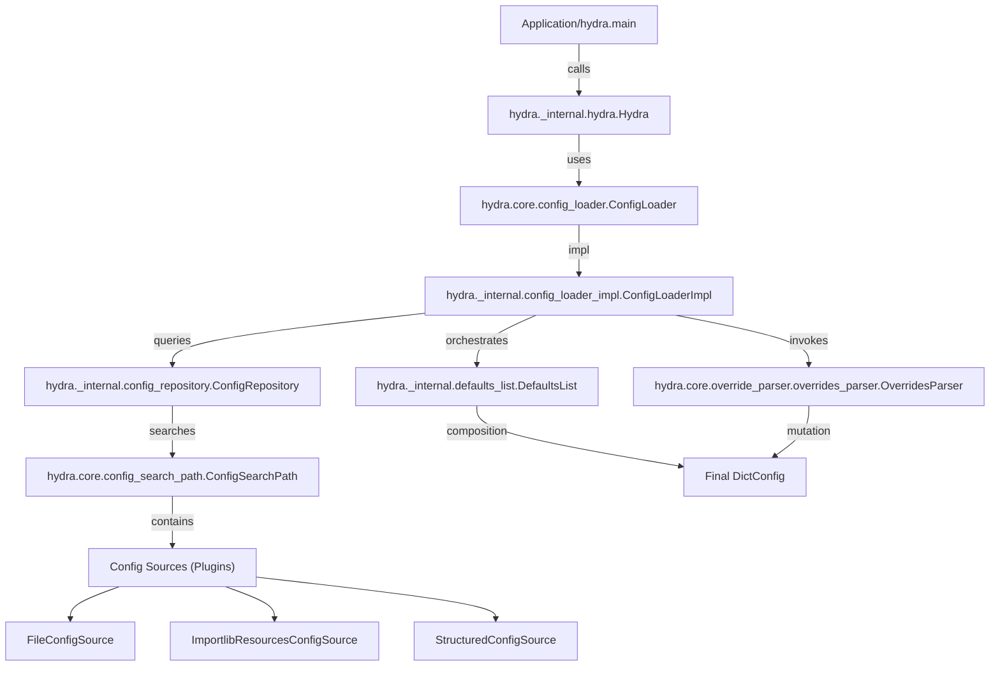
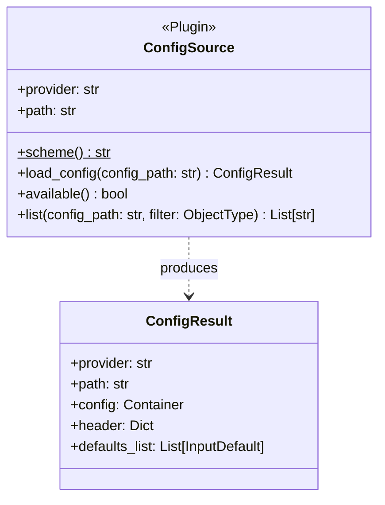

<!-- source: DeepWiki mcp.deepwiki.com · repo facebookresearch/hydra · page 2.1 Configuration System · fetched 2026-10-21 -->

# Configuration System

Relevant source files

The following files were used as context for generating this wiki page:

- [NEWS.md](NEWS.md)
- [examples/advanced/config_search_path/additional_conf/__init__.py](examples/advanced/config_search_path/additional_conf/__init__.py)
- [examples/advanced/config_search_path/additional_conf/dataset/imagenet.yaml](examples/advanced/config_search_path/additional_conf/dataset/imagenet.yaml)
- [examples/advanced/config_search_path/conf/config.yaml](examples/advanced/config_search_path/conf/config.yaml)
- [hydra/_internal/config_loader_impl.py](hydra/_internal/config_loader_impl.py)
- [hydra/_internal/core_plugins/file_config_source.py](hydra/_internal/core_plugins/file_config_source.py)
- [hydra/_internal/core_plugins/importlib_resources_config_source.py](hydra/_internal/core_plugins/importlib_resources_config_source.py)
- [hydra/_internal/core_plugins/structured_config_source.py](hydra/_internal/core_plugins/structured_config_source.py)
- [hydra/_internal/hydra.py](hydra/_internal/hydra.py)
- [hydra/_internal/utils.py](hydra/_internal/utils.py)
- [hydra/conf/__init__.py](hydra/conf/__init__.py)
- [hydra/core/config_loader.py](hydra/core/config_loader.py)
- [hydra/core/config_store.py](hydra/core/config_store.py)
- [hydra/core/utils.py](hydra/core/utils.py)
- [hydra/experimental/compose.py](hydra/experimental/compose.py)
- [hydra/experimental/initialize.py](hydra/experimental/initialize.py)
- [hydra/initialize.py](hydra/initialize.py)
- [hydra/main.py](hydra/main.py)
- [hydra/plugins/config_source.py](hydra/plugins/config_source.py)
- [hydra/test_utils/config_source_common_tests.py](hydra/test_utils/config_source_common_tests.py)
- [hydra/test_utils/launcher_common_tests.py](hydra/test_utils/launcher_common_tests.py)
- [hydra/test_utils/test_utils.py](hydra/test_utils/test_utils.py)
- [news/2928.bugfix](news/2928.bugfix)
- [tests/test_apps/config_source_test/structured.py](tests/test_apps/config_source_test/structured.py)
- [tests/test_basic_launcher.py](tests/test_basic_launcher.py)
- [tests/test_compose.py](tests/test_compose.py)
- [tests/test_config_loader.py](tests/test_config_loader.py)
- [tests/test_config_repository.py](tests/test_config_repository.py)
- [tests/test_config_search_path.py](tests/test_config_search_path.py)
- [tests/test_hydra.py](tests/test_hydra.py)
- [website/docs/advanced/search_path.md](website/docs/advanced/search_path.md)
- [website/versioned_docs/version-1.1/advanced/search_path.md](website/versioned_docs/version-1.1/advanced/search_path.md)
- [website/versioned_docs/version-1.1/advanced/unit_testing.md](website/versioned_docs/version-1.1/advanced/unit_testing.md)
- [website/versioned_docs/version-1.2/advanced/search_path.md](website/versioned_docs/version-1.2/advanced/search_path.md)
- [website/versioned_docs/version-1.3/advanced/search_path.md](website/versioned_docs/version-1.3/advanced/search_path.md)

This document details Hydra's core configuration system, responsible for loading, composing, and manipulating configurations from diverse sources. The system provides a unified interface for handling YAML files, structured Python objects, and command-line overrides, forming the foundation for Hydra's flexibility. For details on the composition logic, see [Config Composition and DefaultsList](2.2).

## Overview of Configuration System Architecture

The configuration system bridges the gap between raw configuration data (files, objects) and the finalized `DictConfig` used by the application.

Sources:
- [hydra/_internal/config_loader_impl.py:38-49]()
- [hydra/_internal/hydra.py:61-69]()
- [hydra/core/config_loader.py:13-24]()
- [hydra/plugins/config_source.py:31-40]()

## Configuration Sources

Hydra supports multiple backends for retrieving configuration data. Every source must implement the `ConfigSource` plugin interface.

| Source Class | Scheme | Description |
| :--- | :--- | :--- |
| `FileConfigSource` | `file://` | Loads YAML files directly from the local filesystem. [hydra/_internal/core_plugins/file_config_source.py:11-15]() |
| `ImportlibResourcesConfigSource` | `pkg://` | Loads configurations embedded within Python packages using `importlib.resources`. [hydra/_internal/core_plugins/importlib_resources_config_source.py:21-25]() |
| `StructuredConfigSource` | `structured://` | Accesses configurations registered in the `ConfigStore` (dataclasses/attr classes). [hydra/_internal/core_plugins/structured_config_source.py:11-15]() |

### The ConfigSource Interface
The `ConfigSource` class defines how Hydra interacts with a storage backend. Key methods include `load_config` for retrieving a `ConfigResult` and `list` for discovering available groups.

Sources:
- [hydra/plugins/config_source.py:31-78]()
- [hydra/plugins/config_source.py:18-25]()

## Configuration Repository and Search Path

The `ConfigRepository` acts as an aggregator for all configured `ConfigSource` instances. It uses the `ConfigSearchPath` to determine the order in which sources are queried.

### Search Path Priority
The search path is typically ordered as follows:
1. **Main**: The primary configuration directory (often relative to the calling script). [hydra/_internal/utils.py:184-211]()
2. **User**: Additional paths added via `hydra.searchpath` in the config or command line. [hydra/_internal/config_loader_impl.py:174-187]()
3. **Plugins**: Paths contributed by `SearchPathPlugin` implementations. [hydra/_internal/utils.py:203-207]()
4. **Schema**: The `structured://` source for validation. [hydra/_internal/utils.py:209-209]()

Sources:
- [hydra/_internal/config_loader_impl.py:17-21]()
- [hydra/_internal/utils.py:193-211]()

## Configuration Loading Pipeline

The `ConfigLoaderImpl._load_configuration_impl` method executes a multi-step pipeline to produce the final configuration object.

1. **Initialization**: Detects the calling file/module and sets up the `ConfigSearchPath`. [hydra/_internal/utils.py:37-61]()
2. **Repository Setup**: Wraps the repository in a `CachingConfigRepository` to avoid redundant I/O. [hydra/_internal/config_loader_impl.py:18-21]()
3. **Defaults List Creation**: Calls `create_defaults_list` to parse the `defaults` tree and resolve overrides. [hydra/_internal/config_loader_impl.py:22-22]()
4. **Composition**: Iteratively merges configurations discovered in the defaults list. [hydra/_internal/config_loader_impl.py:541-573]()
5. **Override Application**: Applies command-line overrides (e.g., `+db=mysql`) using `_apply_overrides_to_config`. [hydra/_internal/config_loader_impl.py:336-340]()
6. **Runtime Population**: Injects `hydra.runtime` metadata (cwd, version, config sources). [hydra/conf/__init__.py:97-107]()

Sources:
- [hydra/_internal/config_loader_impl.py:142-150]()
- [hydra/_internal/config_loader_impl.py:541-573]()
- [hydra/core/utils.py:99-130]()

## Override System

Hydra uses an ANTLR-based parser (`OverridesParser`) to process command-line arguments. Overrides are categorized into **Task Overrides** (modifying user config) and **Hydra Overrides** (modifying `hydra.*` settings).

### Override Syntax Types
The system supports several prefix-based operations:

| Prefix | Type | Description |
| :--- | :--- | :--- |
| (none) | `REGULAR` | Standard assignment: `key=value`. |
| `+` | `ADD` | Adds a new key; fails if key exists. |
| `++` | `FORCE_ADD` | Adds or replaces a key regardless of existence. |
| `~` | `DELETE` | Removes a key or a specific value: `~key` or `~key=val`. |

Sources:
- [hydra/core/override_parser/overrides_parser.py:14-15]()
- [hydra/_internal/config_loader_impl.py:336-408]()
- [tests/test_config_loader.py:649-735]()

## Integration with Hydra Runtime

Once composed, the configuration is stored in the `HydraConfig` singleton. This configuration drives other subsystems:

*   **Logging**: `hydra.job_logging` and `hydra.hydra_logging` are used by `configure_log` to initialize Python loggers. [hydra/core/utils.py:36-70]()
*   **Output Management**: `hydra.run.dir` and `hydra.sweep.dir` determine where job outputs and `.hydra` metadata are saved. [hydra/core/utils.py:116-127]()
*   **Job Execution**: The `run_job` function strips the `hydra` key from the config before passing it to the user's task function. [hydra/core/utils.py:133-137]()

Sources:
- [hydra/core/hydra_config.py:10-25]()
- [hydra/core/utils.py:99-198]()
- [hydra/conf/__init__.py:110-176]()

---

