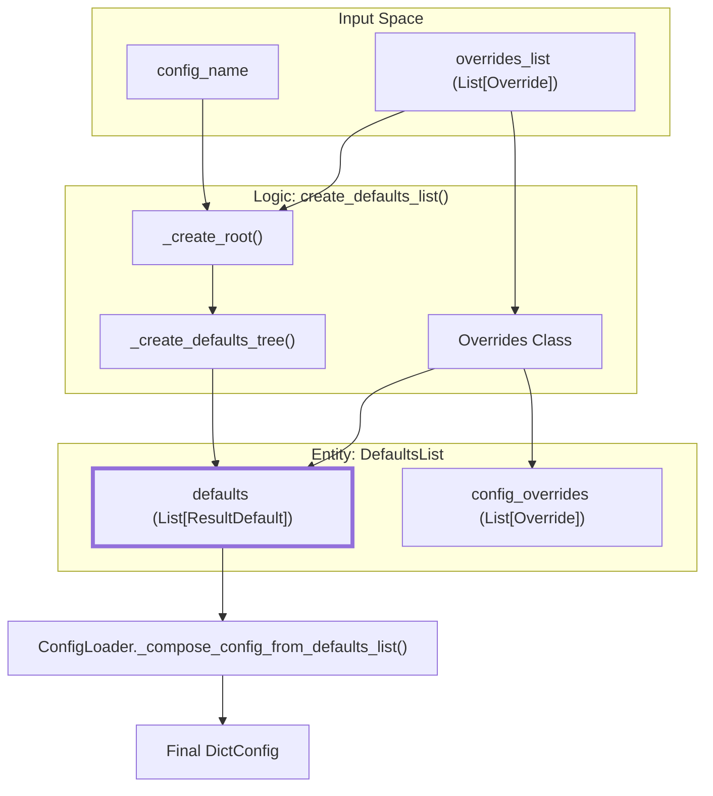
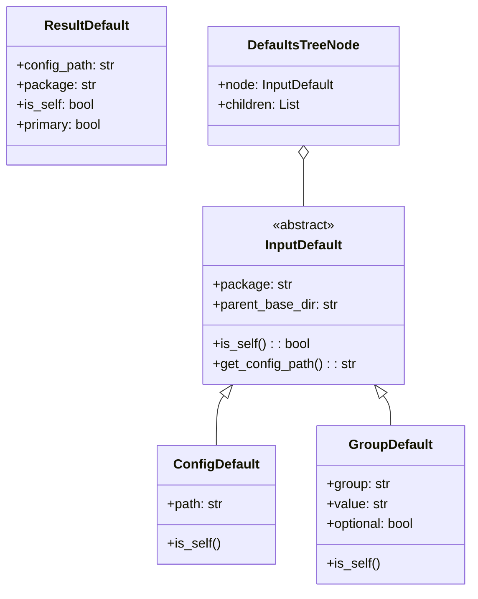
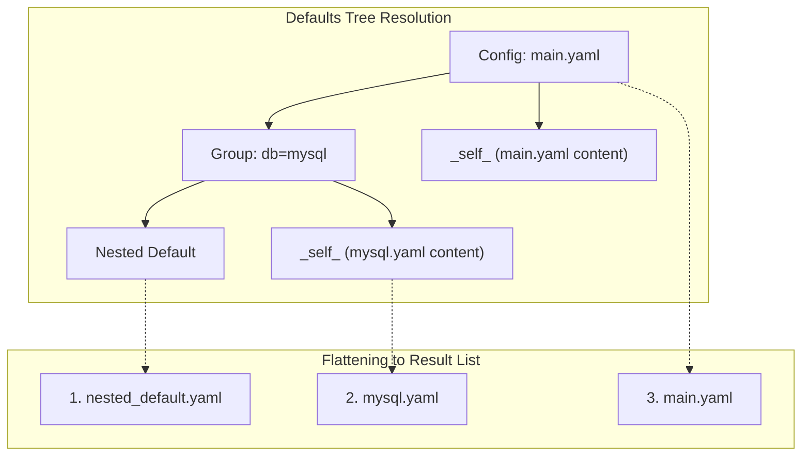

<!-- source: DeepWiki mcp.deepwiki.com · repo facebookresearch/hydra · page 2.2 Config Composition and DefaultsList · fetched 2026-10-21 -->

# Config Composition and DefaultsList

<details>
<summary>Relevant source files</summary>

The following files were used as context for generating this wiki page:

- [examples/tutorials/basic/your_first_hydra_app/3_using_config/my_app.py](examples/tutorials/basic/your_first_hydra_app/3_using_config/my_app.py)
- [hydra/_internal/config_repository.py](hydra/_internal/config_repository.py)
- [hydra/_internal/defaults_list.py](hydra/_internal/defaults_list.py)
- [hydra/core/default_element.py](hydra/core/default_element.py)
- [tests/defaults_list/__init__.py](tests/defaults_list/__init__.py)
- [tests/defaults_list/test_defaults_list.py](tests/defaults_list/test_defaults_list.py)
- [tests/defaults_list/test_defaults_tree.py](tests/defaults_list/test_defaults_tree.py)
- [website/docs/advanced/defaults_list.md](website/docs/advanced/defaults_list.md)
- [website/docs/tutorials/basic/running_your_app/2_multirun.md](website/docs/tutorials/basic/running_your_app/2_multirun.md)
- [website/docs/tutorials/basic/your_first_app/2_config_file.md](website/docs/tutorials/basic/your_first_app/2_config_file.md)
- [website/docs/tutorials/basic/your_first_app/3_using_config.md](website/docs/tutorials/basic/your_first_app/3_using_config.md)
- [website/docs/tutorials/basic/your_first_app/4_config_groups.md](website/docs/tutorials/basic/your_first_app/4_config_groups.md)
- [website/docs/tutorials/basic/your_first_app/5_defaults.md](website/docs/tutorials/basic/your_first_app/5_defaults.md)
- [website/docs/tutorials/basic/your_first_app/6_composition.md](website/docs/tutorials/basic/your_first_app/6_composition.md)
- [website/docs/tutorials/structured_config/0_intro.md](website/docs/tutorials/structured_config/0_intro.md)
- [website/docs/tutorials/structured_config/10_config_store.md](website/docs/tutorials/structured_config/10_config_store.md)
- [website/docs/tutorials/structured_config/1_minimal_example.md](website/docs/tutorials/structured_config/1_minimal_example.md)
- [website/docs/tutorials/structured_config/2_hierarchical_static_config.md](website/docs/tutorials/structured_config/2_hierarchical_static_config.md)
- [website/docs/tutorials/structured_config/3_config_groups.md](website/docs/tutorials/structured_config/3_config_groups.md)
- [website/docs/tutorials/structured_config/4_defaults.md](website/docs/tutorials/structured_config/4_defaults.md)
- [website/docs/tutorials/structured_config/5_schema.md](website/docs/tutorials/structured_config/5_schema.md)
- [website/versioned_docs/version-0.11/tutorial/3_config_groups.md](website/versioned_docs/version-0.11/tutorial/3_config_groups.md)
- [website/versioned_docs/version-0.11/tutorial/4_defaults.md](website/versioned_docs/version-0.11/tutorial/4_defaults.md)
- [website/versioned_docs/version-0.11/tutorial/5_composition.md](website/versioned_docs/version-0.11/tutorial/5_composition.md)
- [website/versioned_docs/version-1.0/tutorials/basic/running_your_app/2_multirun.md](website/versioned_docs/version-1.0/tutorials/basic/running_your_app/2_multirun.md)
- [website/versioned_docs/version-1.1/tutorials/basic/running_your_app/2_multirun.md](website/versioned_docs/version-1.1/tutorials/basic/running_your_app/2_multirun.md)
- [website/versioned_docs/version-1.2/tutorials/structured_config/0_intro.md](website/versioned_docs/version-1.2/tutorials/structured_config/0_intro.md)

</details>


Config composition is a core feature of Hydra that enables combining multiple configuration fragments into a single unified configuration. The `DefaultsList` is an internal mechanism that manages the list of configurations to be loaded and composed. This page explains how configuration composition works in Hydra and the role of the `DefaultsList` in this process.

## What is Config Composition?

Config composition in Hydra allows users to:
- Define reusable configuration fragments in separate files.
- Specify default configurations to use in a modular way.
- Override these defaults via command line or programmatically.
- Establish a well-defined merge order for configurations using the `_self_` keyword.

When users define a `defaults` section in their configuration files, they are leveraging Hydra's config composition system.

```yaml
# Example config with defaults section
defaults:
  - db: mysql       # Use mysql config from the db group
  - _self_          # Include this config file itself
  - override /hydra/job_logging: colorlog
```

Sources: [hydra/_internal/defaults_list.py:108-111](), [website/docs/tutorials/basic/your_first_app/5_defaults.md:20-23](), [website/docs/tutorials/basic/your_first_app/5_defaults.md:89-92]()

## The Config Composition Process

The composition process transforms a set of input choices and overrides into a single `DictConfig`.

### Data Flow: From Overrides to Composed Config



Sources: [hydra/_internal/defaults_list.py:248-278](), [tests/defaults_list/__init__.py:23-50]()

## DefaultsList and Related Components

Hydra uses a set of internal classes to represent the elements within a `defaults` list.



### Key Components

- **`InputDefault`**: The base class for items parsed from a YAML `defaults` list [hydra/core/default_element.py:45-50]().
- **`ConfigDefault`**: Represents a simple file reference like `- my_config` [hydra/core/default_element.py:355-359]().
- **`GroupDefault`**: Represents a config group selection like `- db: mysql` [hydra/core/default_element.py:393-398]().
- **`DefaultsTreeNode`**: A recursive structure used to build the composition hierarchy before flattening [hydra/core/default_element.py:539-543]().
- **`ResultDefault`**: The final flattened representation containing the absolute `config_path` and target `package` [hydra/core/default_element.py:16-24]().

Sources: [hydra/core/default_element.py:15-543](), [hydra/_internal/defaults_list.py:15-22]()

## The Defaults Tree and `_self_`

Hydra constructs a `DefaultsTreeNode` by recursively loading configurations. The `_self_` keyword determines where the contents of the current file are merged relative to its inherited defaults.

### Composition Order Logic
- **`_self_` at the end**: The current config overrides values from the defaults list [website/docs/tutorials/basic/your_first_app/5_defaults.md:81-82]().
- **`_self_` at the beginning**: Configs in the defaults list override values in the current config [website/docs/tutorials/basic/your_first_app/5_defaults.md:82-83]().



Sources: [hydra/_internal/defaults_list.py:280-318](), [tests/defaults_list/test_defaults_tree.py:92-109](), [website/docs/tutorials/basic/your_first_app/5_defaults.md:77-130]()

## Handling Overrides and Deletions

The `Overrides` class processes command-line inputs to modify the `DefaultsList` before composition.

| Override Type | Syntax | Internal Action |
| :--- | :--- | :--- |
| **Selection** | `db=mysql` | Updates `override_choices` for the `db` group [hydra/_internal/defaults_list.py:108-110](). |
| **Addition** | `+db=mysql` | Appends a new `GroupDefault` to `append_group_defaults` [hydra/_internal/defaults_list.py:98-106](). |
| **Deletion** | `~db` | Adds a `Deletion` entry to remove the group from the list [hydra/_internal/defaults_list.py:84-92](). |

### Validation
Hydra ensures all overrides are consumed. If an override refers to a group not present in the defaults list, a `ConfigCompositionException` is raised [hydra/_internal/defaults_list.py:138-168]().

Sources: [hydra/_internal/defaults_list.py:49-175](), [tests/defaults_list/test_defaults_list.py:451-460]()

## Package Headers and Interpolation

### Package Headers
Configs can specify their destination in the final object using the `@package` header. 
- `# @package _global_`: Merges the config into the root [hydra/core/default_element.py:137-141]().
- `# @package _group_`: (Deprecated in 1.2) Merges into a key named after the group [hydra/core/default_element.py:121-133]().

### Package Namespacing
You can redirect a default to a specific package using the `@` syntax in the defaults list:
```yaml
defaults:
  - db@my_db: mysql  # Loads mysql config into 'my_db' key
```

### Interpolation
Hydra supports using values from other parts of the defaults list via interpolation:
```yaml
defaults:
  - db: mysql
  - schema: ${db}_schema
```
The `DefaultsList` resolver handles these by re-evaluating the tree when interpolated values change [hydra/_internal/defaults_list.py:349-355]().

Sources: [hydra/core/default_element.py:114-147](), [hydra/_internal/config_repository.py:142-164](), [hydra/_internal/defaults_list.py:349-370]()

## Implementation Details: `create_defaults_list`

The primary entry point for composition is `hydra._internal.defaults_list.create_defaults_list`.

1. **Initialize Overrides**: Parses command line strings into `Override` objects and categorizes them [hydra/_internal/defaults_list.py:61-71]().
2. **Build Tree**: Calls `_create_defaults_tree` recursively. It loads configs from the `IConfigRepository` and extracts their `defaults` lists [hydra/_internal/defaults_list.py:280-287]().
3. **Apply Overrides**: During tree traversal, if a `GroupDefault` matches an entry in `override_choices`, its value is swapped [hydra/_internal/defaults_list.py:129-136]().
4. **Flatten**: The tree is traversed to produce a flat `List[ResultDefault]`. This list is then used by the `ConfigLoader` to perform the actual `OmegaConf.merge` operations [hydra/_internal/defaults_list.py:270-278]().

Sources: [hydra/_internal/defaults_list.py:248-318](), [hydra/_internal/config_repository.py:78-95](), [tests/defaults_list/__init__.py:32-50]()

---

