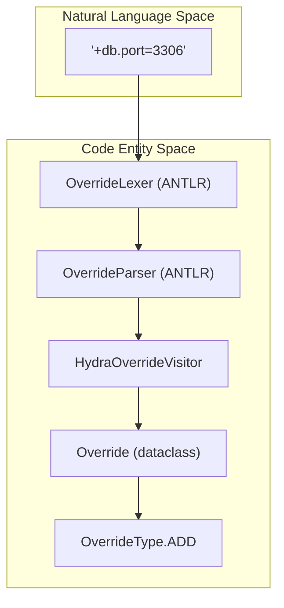
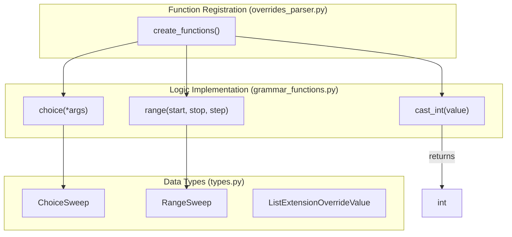

<!-- source: DeepWiki mcp.deepwiki.com · repo facebookresearch/hydra · page 2.3 Override System · fetched 2026-10-21 -->

# Override System

Relevant source files

The following files were used as context for generating this wiki page:

- [examples/tutorials/basic/your_first_hydra_app/1_simple_cli/my_app.py](examples/tutorials/basic/your_first_hydra_app/1_simple_cli/my_app.py)
- [examples/tutorials/structured_configs/2_static_complex/my_app.py](examples/tutorials/structured_configs/2_static_complex/my_app.py)
- [examples/tutorials/structured_configs/3_config_groups/my_app.py](examples/tutorials/structured_configs/3_config_groups/my_app.py)
- [examples/tutorials/structured_configs/3_config_groups/my_app_with_inheritance.py](examples/tutorials/structured_configs/3_config_groups/my_app_with_inheritance.py)
- [examples/tutorials/structured_configs/4_defaults/my_app.py](examples/tutorials/structured_configs/4_defaults/my_app.py)
- [hydra/_internal/grammar/grammar_functions.py](hydra/_internal/grammar/grammar_functions.py)
- [hydra/core/override_parser/overrides_parser.py](hydra/core/override_parser/overrides_parser.py)
- [hydra/core/override_parser/overrides_visitor.py](hydra/core/override_parser/overrides_visitor.py)
- [hydra/core/override_parser/types.py](hydra/core/override_parser/types.py)
- [hydra/grammar/OverrideLexer.g4](hydra/grammar/OverrideLexer.g4)
- [hydra/grammar/OverrideParser.g4](hydra/grammar/OverrideParser.g4)
- [news/1547.feature](news/1547.feature)
- [news/2570.bugfix](news/2570.bugfix)
- [tests/test_hydra_cli_errors.py](tests/test_hydra_cli_errors.py)
- [tests/test_overrides_parser.py](tests/test_overrides_parser.py)
- [website/blog/2020-05-04-New-blog.md](website/blog/2020-05-04-New-blog.md)
- [website/blog/2020-09-03-Hydra_1.0.md](website/blog/2020-09-03-Hydra_1.0.md)
- [website/docs/advanced/override_grammar/basic.md](website/docs/advanced/override_grammar/basic.md)
- [website/docs/advanced/override_grammar/extended.md](website/docs/advanced/override_grammar/extended.md)
- [website/docs/advanced/overriding_packages.md](website/docs/advanced/overriding_packages.md)
- [website/docs/tutorials/basic/your_first_app/1_simple_cli.md](website/docs/tutorials/basic/your_first_app/1_simple_cli.md)
- [website/docs/upgrades/0.11_to_1.0/adding_a_package_directive.md](website/docs/upgrades/0.11_to_1.0/adding_a_package_directive.md)
- [website/src/theme/NotFound.js](website/src/theme/NotFound.js)
- [website/versioned_docs/version-1.0/advanced/override_grammar/basic.md](website/versioned_docs/version-1.0/advanced/override_grammar/basic.md)
- [website/versioned_docs/version-1.0/advanced/overriding_packages.md](website/versioned_docs/version-1.0/advanced/overriding_packages.md)
- [website/versioned_docs/version-1.0/advanced/packaging.md](website/versioned_docs/version-1.0/advanced/packaging.md)
- [website/versioned_docs/version-1.0/advanced/plugins.md](website/versioned_docs/version-1.0/advanced/plugins.md)
- [website/versioned_docs/version-1.0/advanced/unit_testing.md](website/versioned_docs/version-1.0/advanced/unit_testing.md)
- [website/versioned_docs/version-1.0/configure_hydra/Intro.md](website/versioned_docs/version-1.0/configure_hydra/Intro.md)
- [website/versioned_docs/version-1.0/configure_hydra/app_help.md](website/versioned_docs/version-1.0/configure_hydra/app_help.md)
- [website/versioned_docs/version-1.0/configure_hydra/logging.md](website/versioned_docs/version-1.0/configure_hydra/logging.md)
- [website/versioned_docs/version-1.0/configure_hydra/workdir.md](website/versioned_docs/version-1.0/configure_hydra/workdir.md)
- [website/versioned_docs/version-1.0/experimental/hydra_compose.md](website/versioned_docs/version-1.0/experimental/hydra_compose.md)
- [website/versioned_docs/version-1.0/plugins/ax_sweeper.md](website/versioned_docs/version-1.0/plugins/ax_sweeper.md)
- [website/versioned_docs/version-1.0/plugins/colorlog.md](website/versioned_docs/version-1.0/plugins/colorlog.md)
- [website/versioned_docs/version-1.0/plugins/joblib_launcher.md](website/versioned_docs/version-1.0/plugins/joblib_launcher.md)
- [website/versioned_docs/version-1.0/plugins/nevergrad_sweeper.md](website/versioned_docs/version-1.0/plugins/nevergrad_sweeper.md)
- [website/versioned_docs/version-1.0/plugins/rq_launcher.md](website/versioned_docs/version-1.0/plugins/rq_launcher.md)
- [website/versioned_docs/version-1.0/plugins/submitit_launcher.md](website/versioned_docs/version-1.0/plugins/submitit_launcher.md)
- [website/versioned_docs/version-1.0/tutorials/basic/your_first_app/1_simple_cli.md](website/versioned_docs/version-1.0/tutorials/basic/your_first_app/1_simple_cli.md)
- [website/versioned_docs/version-1.0/upgrades/0.11_to_1.0/object_instantiation_changes.md](website/versioned_docs/version-1.0/upgrades/0.11_to_1.0/object_instantiation_changes.md)
- [website/versioned_docs/version-1.1/advanced/plugins/develop.md](website/versioned_docs/version-1.1/advanced/plugins/develop.md)
- [website/versioned_docs/version-1.1/plugins/ax_sweeper.md](website/versioned_docs/version-1.1/plugins/ax_sweeper.md)
- [website/versioned_docs/version-1.2/plugins/ax_sweeper.md](website/versioned_docs/version-1.2/plugins/ax_sweeper.md)

The Override System is a core component of Hydra that allows users to modify configurations at runtime without changing the underlying configuration files. This system utilizes a domain-specific language (DSL) based on ANTLR to parse command-line arguments and programmatic strings, converting them into structured operations applied during config composition.

## Overview

Hydra's Override System empowers users to customize configurations in two primary ways:
1.  **Modifying the Defaults List**: Adding, removing, or changing config groups in the composition tree (e.g., `db=mysql`). [website/docs/advanced/override_grammar/basic.md:14-15]()
2.  **Modifying the Config Object**: Adding, changing, or removing specific values within the config (e.g., `foo.bar=value`). [website/docs/advanced/override_grammar/basic.md:18-22]()

### Natural Language to Code Entity Mapping: Parsing Flow
The following diagram bridges the gap between the "Natural Language" command-line input and the internal "Code Entities" that process them.

| System Phase | Code Entity | Role |
| :--- | :--- | :--- |
| **Input String** | `str` | Raw CLI argument like `+db.port=3306` |
| **Lexing** | `OverrideLexer` | Tokenizes input into `KEY`, `VALUE`, `EQUAL`, etc. [hydra/core/override_parser/overrides_parser.py:55-57]() |
| **Parsing** | `OverrideParser` | Generates a CST (Concrete Syntax Tree). [hydra/core/override_parser/overrides_parser.py:64-69]() |
| **Visiting** | `HydraOverrideVisitor` | Traverses the tree to produce an `Override` object. [hydra/core/override_parser/overrides_visitor.py:44-46]() |
| **Logic** | `Override` | Dataclass holding `key`, `value`, and `OverrideType`. [hydra/core/override_parser/types.py:276-320]() |

Sources: [hydra/core/override_parser/overrides_parser.py:52-74](), [hydra/core/override_parser/overrides_visitor.py:143-200](), [hydra/core/override_parser/types.py:187-193]()

## Override Syntax and Types

The Override System supports a rich syntax defined in `OverrideParser.g4`. [hydra/grammar/OverrideParser.g4:11-15]()

| Override Type | Prefix | Code Enum (`OverrideType`) | Description |
| :--- | :--- | :--- | :--- |
| **Change** | (none) | `CHANGE` | Replaces an existing value. |
| **Add** | `+` | `ADD` | Appends a new field; fails if it exists. |
| **Force Add** | `++` | `FORCE_ADD` | Adds or replaces a field. |
| **Delete** | `~` | `DEL` | Removes a key or a specific key=value pair. |

### Keys and Packages
A `Key` in Hydra consists of a `key_or_group` and an optional `package`. [hydra/core/override_parser/types.py:205-209]()
*   **Config Key**: `foo.bar`
*   **Config Group**: `hydra/launcher`
*   **Package Override**: `group@pkg` (Relocates the group to a specific package). [website/docs/advanced/override_grammar/basic.md:110-113]()

Sources: [hydra/core/override_parser/types.py:187-193](), [website/docs/advanced/override_grammar/basic.md:18-27](), [hydra/grammar/OverrideParser.g4:11-21]()

## Value Types and DSL Functions

Hydra supports primitives, containers, and specialized functions within the override value.

### Primitives and Containers
The parser handles:
*   **Primitives**: `int`, `float`, `bool`, `null`, `quoted_value`, and `interpolation` (`${foo.bar}`). [hydra/grammar/OverrideParser.g4:54-66]()
*   **Containers**: Lists `[1, 2]` and Dicts `{a: 1, b: 2}`. [hydra/grammar/OverrideParser.g4:45-50]()

### Grammar Functions
The `OverridesParser` registers a set of functions used for casting and sweep generation. [hydra/core/override_parser/overrides_parser.py:111-129]()

| Function | Code Implementation | Purpose |
| :--- | :--- | :--- |
| `int()`, `str()`, `bool()` | `grammar_functions.cast_x` | Explicit type coercion. |
| `choice()` | `grammar_functions.choice` | Defines a discrete sweep. |
| `range()` | `grammar_functions.range` | Defines a numeric sweep (int or float). |
| `interval()` | `grammar_functions.interval` | Continuous range for optimization (Ax/Nevergrad). |
| `extend_list()` | `grammar_functions.extend_list` | Appends values to an existing list. |

Sources: [hydra/core/override_parser/overrides_parser.py:111-129](), [hydra/_internal/grammar/grammar_functions.py:85-157](), [hydra/core/override_parser/types.py:82-156]()

## Sweep Mechanism

Sweeps are used by `Sweeper` plugins to perform multi-run executions.
*   **Choice Sweep**: `db=mysql,postgresql` is parsed as a `ChoiceSweep`. [hydra/core/override_parser/types.py:82-88]()
*   **Glob Sweep**: `schema=glob(*)` selects all options in a config group. [website/docs/advanced/override_grammar/extended.md:64-82]()
*   **Intervals**: `interval(1, 5)` defines a continuous space `1.0 <= x < 5.0`, used by optimizers like Ax. [website/docs/advanced/override_grammar/extended.md:108-122]()

### Reordering
Sweeps and lists can be manipulated using `sort()` and `shuffle()`. [website/docs/advanced/override_grammar/extended.md:179-227]()
*   `sort(3,1,2)` results in `1,2,3`.
*   `shuffle(range(1,10))` randomizes the execution order.

Sources: [hydra/core/override_parser/types.py:82-179](), [website/docs/advanced/override_grammar/extended.md:43-136](), [hydra/_internal/grammar/grammar_functions.py:205-276]()

## Implementation Details

### Lexical Modes
The `OverrideLexer` uses two modes:
1.  **DEFAULT_MODE**: Used for parsing the `key`. [hydra/grammar/OverrideLexer.g4:16-30]()
2.  **VALUE_MODE**: Triggered after the `=` sign to allow special characters like `:` and `,` inside values without escaping. [hydra/grammar/OverrideLexer.g4:35-45]()

### Quoted Strings
Hydra handles complex quoting to prevent shell interference. The `QuotedString` class and `with_quotes()` method manage the escaping of backslashes and internal quotes. [hydra/core/override_parser/types.py:28-73]()

### Error Handling
The `OverridesParser` employs a `HydraErrorListener` to catch ANTLR recognition errors. It provides detailed feedback, including a visual pointer (`^`) to the character that caused the lexer failure. [hydra/core/override_parser/overrides_parser.py:81-104]()

Sources: [hydra/core/override_parser/overrides_parser.py:52-74](), [hydra/grammar/OverrideLexer.g4:19](), [hydra/core/override_parser/types.py:28-73]()

---

