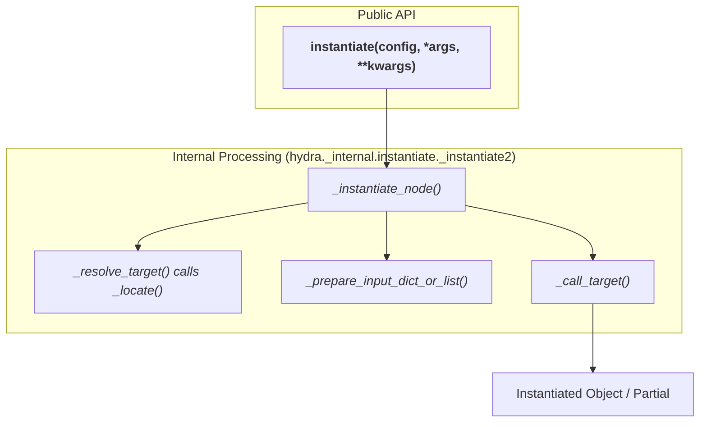
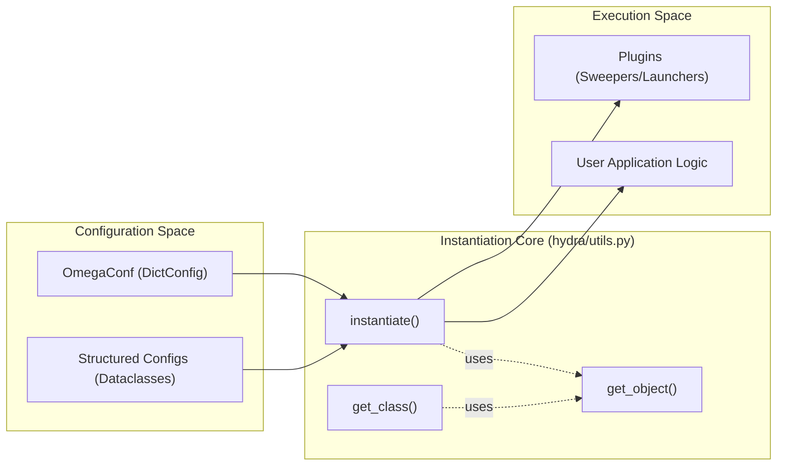

<!-- source: DeepWiki mcp.deepwiki.com · repo facebookresearch/hydra · page 2.4 Object Instantiation · fetched 2026-10-21 -->

# Object Instantiation

Relevant source files

The following files were used as context for generating this wiki page:

- [hydra/_internal/instantiate/_instantiate2.py](hydra/_internal/instantiate/_instantiate2.py)
- [hydra/core/plugins.py](hydra/core/plugins.py)
- [hydra/utils.py](hydra/utils.py)
- [news/3001.bugfix](news/3001.bugfix)
- [news/3074.api_change](news/3074.api_change)
- [tests/__init__.py](tests/__init__.py)
- [tests/instantiate/__init__.py](tests/instantiate/__init__.py)
- [tests/instantiate/test_helpers.py](tests/instantiate/test_helpers.py)
- [tests/instantiate/test_instantiate.py](tests/instantiate/test_instantiate.py)
- [tests/instantiate/test_positional.py](tests/instantiate/test_positional.py)
- [tests/test_apps/app_with_cfg_decorated/my_app.py](tests/test_apps/app_with_cfg_decorated/my_app.py)
- [tests/test_hydra_context_warnings.py](tests/test_hydra_context_warnings.py)
- [tests/test_internal_utils.py](tests/test_internal_utils.py)
- [tests/test_utils.py](tests/test_utils.py)
- [website/docs/advanced/instantiate_objects/config_files.md](website/docs/advanced/instantiate_objects/config_files.md)
- [website/docs/advanced/instantiate_objects/overview.md](website/docs/advanced/instantiate_objects/overview.md)
- [website/docs/advanced/instantiate_objects/structured_config.md](website/docs/advanced/instantiate_objects/structured_config.md)
- [website/docs/configure_hydra/app_help.md](website/docs/configure_hydra/app_help.md)
- [website/docs/configure_hydra/logging.md](website/docs/configure_hydra/logging.md)

Object Instantiation is a core feature of Hydra that provides a powerful mechanism for creating objects dynamically from configuration. It allows you to define Python objects (classes, functions, etc.) in your configuration and have Hydra instantiate them at runtime, making your applications highly configurable without changing code.

## Purpose and Key Features

The Object Instantiation system enables:

1.  **Dynamic Creation**: Creating Python objects directly from configuration using dot-path strings.
2.  **Recursion**: Instantiating nested object hierarchies recursively by default.
3.  **Conversion Control**: Controlling how OmegaConf containers (DictConfig/ListConfig) are converted to standard Python types (dict/list) or Structured Configs (dataclasses).
4.  **Partial Application**: Supporting partial application of functions via `functools.partial`.
5.  **Argument Flexibility**: Handling both positional (`_args_`) and keyword arguments, with the ability to override them at the call-site.

Sources: [hydra/utils.py:17-19](), [hydra/_internal/instantiate/_instantiate2.py:64-71](), [website/docs/advanced/instantiate_objects/overview.md:15-19](), [website/docs/advanced/instantiate_objects/overview.md:35-66]()

## Core Concepts

### The Instantiation Process

The instantiation logic is primarily implemented in `hydra._internal.instantiate._instantiate2`. The entry point is `hydra.utils.instantiate` (aliased as `call`).

| Component | Code Entity | Role |
| :--- | :--- | :--- |
| **Entry Point** | `instantiate()` | Main API function for triggering instantiation [hydra/_internal/instantiate/_instantiate2.py:174]() |
| **Locator** | `_locate()` | Resolves a dot-path string (e.g., `module.Class`) into a Python object [hydra/_internal/utils.py:11]() |
| **Target Caller** | `_call_target()` | Executes the target with processed arguments [hydra/_internal/instantiate/_instantiate2.py:97]() |
| **Recursion Logic** | `_instantiate_node()` | Recursively traverses the config tree to instantiate children [hydra/_internal/instantiate/_instantiate2.py:321]() |

#### Data Flow Diagram
This diagram maps the natural language steps of instantiation to the internal code functions.

Sources: [hydra/utils.py:17-18](), [hydra/_internal/instantiate/_instantiate2.py:174-205](), [hydra/_internal/instantiate/_instantiate2.py:321-340]()

### Special Configuration Keys

The system recognizes specific keys defined in the `_Keys` enum [hydra/_internal/instantiate/_instantiate2.py:64-71]():

| Key | Type | Description |
| :--- | :--- | :--- |
| `_target_` | `str` | Fully qualified path to the class or callable. |
| `_recursive_` | `bool` | If `True` (default), nested configs with `_target_` are instantiated first. |
| `_convert_` | `str` | Conversion strategy for OmegaConf containers (`none`, `partial`, `object`, `all`). |
| `_partial_` | `bool` | If `True`, returns a `functools.partial` object instead of invoking the target. |
| `_args_` | `list` | Positional arguments to pass to the target. |

Sources: [hydra/_internal/instantiate/_instantiate2.py:64-71](), [website/docs/advanced/instantiate_objects/overview.md:35-66]()

## Implementation Details

### Target Resolution and Security
Hydra uses `_locate` to import modules and attributes. To prevent arbitrary code execution vulnerabilities, Hydra maintains a `DEFAULT_BLOCKLISTED_MODULES` list (e.g., `os.system`, `builtins.exec`).

*   **Blocklist Check**: Performed in `_resolve_target` [hydra/_internal/instantiate/_instantiate2.py:179-191]().
*   **Bypass**: Users can override the blocklist via the `HYDRA_INSTANTIATE_ALLOWLIST_OVERRIDE` environment variable [hydra/_internal/instantiate/_instantiate2.py:181-182]().

### Argument Handling
Arguments are gathered from the config and merged with call-site overrides:
1.  **Keyword Arguments**: Any key in the config that is not a special key (like `_target_`) is treated as a keyword argument [website/docs/advanced/instantiate_objects/overview.md:77-79]().
2.  **Positional Arguments**: Extracted from the `_args_` key via `_extract_pos_args` [hydra/_internal/instantiate/_instantiate2.py:82-94]().
3.  **Parent Detachment**: Before calling the target, OmegaConf objects have their parent links cleared to prevent serialization issues [hydra/_internal/instantiate/_instantiate2.py:110-115]().

### Conversion Modes
The `ConvertMode` enum (from `hydra.types`) dictates how Hydra handles OmegaConf containers during instantiation:
*   **`none`**: Passes `DictConfig` and `ListConfig` objects directly.
*   **`partial`**: Converts containers to `dict`/`list`, but preserves Structured Configs.
*   **`object`**: Converts containers and turns Structured Configs into instances of their backing dataclasses.
*   **`all`**: Strips all OmegaConf metadata, converting everything to primitives.

Sources: [hydra/types.py:15](), [website/docs/advanced/instantiate_objects/overview.md:46-55]()

## System Architecture Diagram
The following diagram shows how the Instantiation system interacts with the broader Hydra Plugin and Config environment.

Sources: [hydra/utils.py:17-85](), [hydra/core/plugins.py:94-112](), [hydra/core/plugins.py:128-160]()

## Advanced Usage Patterns

### Recursive vs. Non-Recursive
By default, `_recursive_` is `True`. If set to `False`, nested dictionaries containing `_target_` keys are passed as raw `DictConfig` objects to the parent's constructor rather than being instantiated first [website/docs/advanced/instantiate_objects/overview.md:198-200]().

### Partial Instantiation
When `_partial_: True` is used, `_call_target` wraps the target in `functools.partial` [hydra/_internal/instantiate/_instantiate2.py:128](). This is particularly useful for optimizers or callbacks where some parameters are known from config, but others (like model parameters) are only available at runtime.

### Positional Argument Overrides
If `instantiate(cfg, *args)` is called with positional arguments, these override any values found in the `_args_` key of the configuration [hydra/_internal/instantiate/_instantiate2.py:87-88]().

Sources: [hydra/_internal/instantiate/_instantiate2.py:82-94](), [hydra/_internal/instantiate/_instantiate2.py:126-136](), [tests/instantiate/test_positional.py:120-157]()

## Troubleshooting Common Errors

| Error | Cause | Code Reference |
| :--- | :--- | :--- |
| `InstantiationException` | General failure during argument collection or target calling. | [hydra/_internal/instantiate/_instantiate2.py:14]() |
| `Unsupported _args_ type` | `_args_` is provided as a dict instead of a list/sequence. | [hydra/_internal/instantiate/_instantiate2.py:90-92]() |
| `Target is blocklisted` | Attempting to call a restricted function like `os.system`. | [hydra/_internal/instantiate/_instantiate2.py:183-191]() |
| `Error locating target` | The dot-path string cannot be resolved by `_locate`. | [hydra/_internal/instantiate/_instantiate2.py:195-199]() |

Sources: [hydra/_internal/instantiate/_instantiate2.py:82-145](), [tests/instantiate/test_positional.py:52-81]()

---

