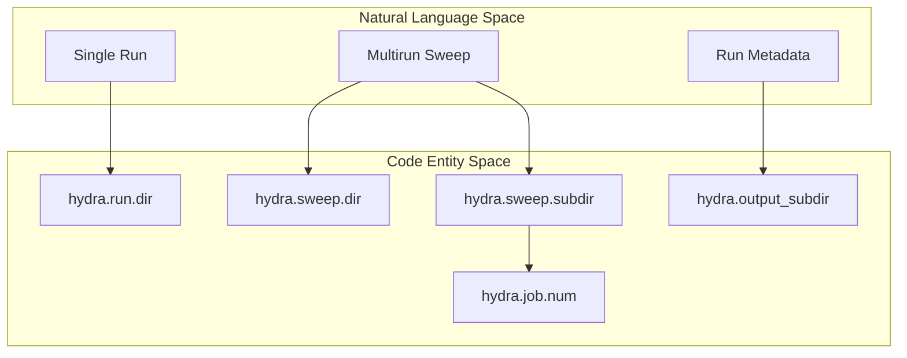
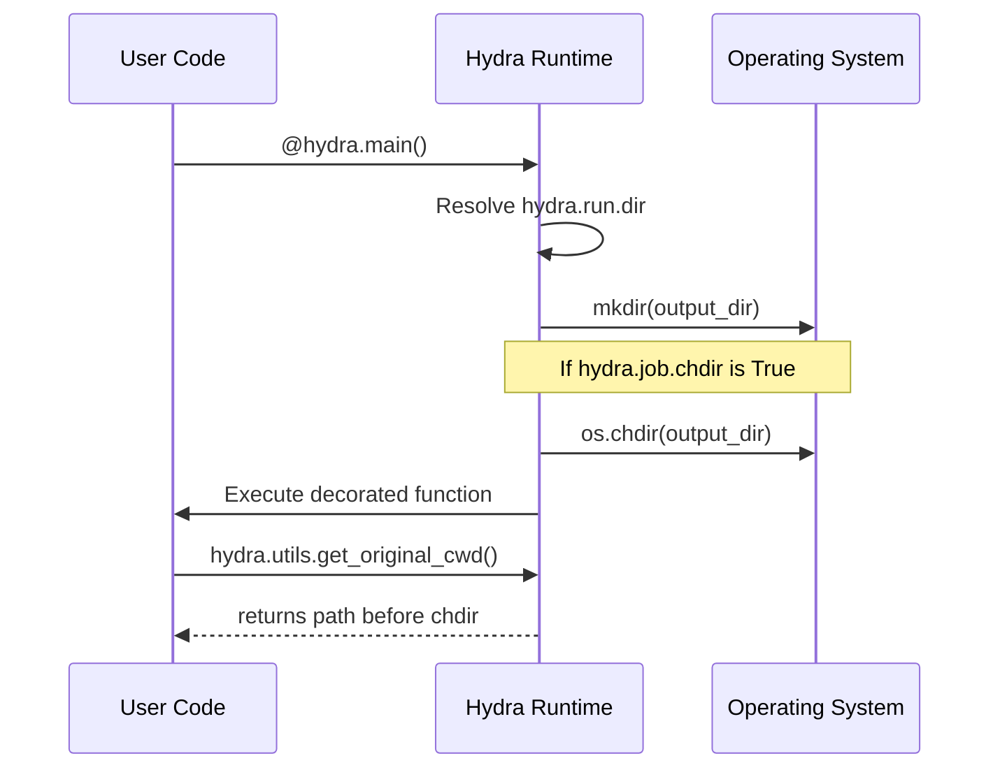

<!-- source: DeepWiki mcp.deepwiki.com · repo facebookresearch/hydra · page 2.5 Working Directory and Output Management · fetched 2026-10-21 -->

# Working Directory and Output Management

Relevant source files

The following files were used as context for generating this wiki page:

- [examples/experimental/rerun/config.yaml](examples/experimental/rerun/config.yaml)
- [examples/experimental/rerun/my_app.py](examples/experimental/rerun/my_app.py)
- [examples/tutorials/basic/running_your_hydra_app/3_working_directory/my_app.py](examples/tutorials/basic/running_your_hydra_app/3_working_directory/my_app.py)
- [tests/test_apps/app_with_pickle_job_info_callback/my_app.py](tests/test_apps/app_with_pickle_job_info_callback/my_app.py)
- [tests/test_apps/run_dir_test/__init__.py](tests/test_apps/run_dir_test/__init__.py)
- [tests/test_apps/run_dir_test/my_app.py](tests/test_apps/run_dir_test/my_app.py)
- [tests/test_examples/test_experimental.py](tests/test_examples/test_experimental.py)
- [website/docs/configure_hydra/Intro.md](website/docs/configure_hydra/Intro.md)
- [website/docs/configure_hydra/job.md](website/docs/configure_hydra/job.md)
- [website/docs/configure_hydra/workdir.md](website/docs/configure_hydra/workdir.md)
- [website/docs/experimental/rerun.md](website/docs/experimental/rerun.md)
- [website/docs/tutorials/basic/running_your_app/3_working_directory.md](website/docs/tutorials/basic/running_your_app/3_working_directory.md)
- [website/docs/upgrades/1.1_to_1.2/changes_to_job_working_dir.md](website/docs/upgrades/1.1_to_1.2/changes_to_job_working_dir.md)
- [website/versioned_docs/version-1.1/tutorials/basic/running_your_app/3_working_directory.md](website/versioned_docs/version-1.1/tutorials/basic/running_your_app/3_working_directory.md)
- [website/versioned_docs/version-1.1/tutorials/basic/your_first_app/3_using_config.md](website/versioned_docs/version-1.1/tutorials/basic/your_first_app/3_using_config.md)
- [website/versioned_docs/version-1.1/tutorials/structured_config/2_hierarchical_static_config.md](website/versioned_docs/version-1.1/tutorials/structured_config/2_hierarchical_static_config.md)
- [website/versioned_docs/version-1.1/tutorials/structured_config/3_config_groups.md](website/versioned_docs/version-1.1/tutorials/structured_config/3_config_groups.md)
- [website/versioned_docs/version-1.1/tutorials/structured_config/4_defaults.md](website/versioned_docs/version-1.1/tutorials/structured_config/4_defaults.md)
- [website/versioned_docs/version-1.2/configure_hydra/Intro.md](website/versioned_docs/version-1.2/configure_hydra/Intro.md)
- [website/versioned_docs/version-1.2/experimental/rerun.md](website/versioned_docs/version-1.2/experimental/rerun.md)
- [website/versioned_docs/version-1.2/tutorials/basic/running_your_app/3_working_directory.md](website/versioned_docs/version-1.2/tutorials/basic/running_your_app/3_working_directory.md)
- [website/versioned_docs/version-1.3/configure_hydra/Intro.md](website/versioned_docs/version-1.3/configure_hydra/Intro.md)
- [website/versioned_docs/version-1.3/experimental/rerun.md](website/versioned_docs/version-1.3/experimental/rerun.md)
- [website/versioned_docs/version-1.3/tutorials/basic/running_your_app/3_working_directory.md](website/versioned_docs/version-1.3/tutorials/basic/running_your_app/3_working_directory.md)

This page documents how Hydra manages working directories and outputs for applications. It covers how Hydra creates and configures output directories, manages the `.hydra` metadata subdirectory, controls job-specific environment variables, and provides utilities for navigating between directories during the job lifecycle.

## Overview

Hydra manages the complexity of experiment tracking by automatically creating unique, timestamped, or parameter-based directory structures. This system ensures that every run is isolated and its configuration is preserved for reproducibility.

### Key Capabilities
- **Automatic Directory Creation**: Generates unique paths for single runs and hierarchical structures for multirun sweeps [website/docs/tutorials/basic/running_your_app/3_working_directory.md:11-15]().
- **Configuration Snapshots**: Saves the exact composed configuration, overrides, and Hydra settings in a protected subdirectory [website/docs/tutorials/basic/running_your_app/3_working_directory.md:39-58]().
- **Working Directory Control**: Optionally changes the Python process's current working directory (CWD) to the output directory [website/docs/configure_hydra/Intro.md:101-102]().
- **Path Resolution Utilities**: Provides functions to map paths between the original launch directory and the new output directory [website/docs/tutorials/basic/running_your_app/3_working_directory.md:103-119]().

Sources: [website/docs/configure_hydra/Intro.md:110-120](), [website/docs/configure_hydra/workdir.md:11-15]()

## Output Directory Structure

By default, Hydra creates a timestamped directory for every execution. This directory contains the application's logs and a `.hydra` subdirectory for metadata.

### The .hydra Subdirectory
The `.hydra` directory (configurable via `hydra.output_subdir`) contains:
- `config.yaml`: The final composed user configuration [website/docs/tutorials/basic/running_your_app/3_working_directory.md:52]().
- `hydra.yaml`: The internal Hydra configuration [website/docs/tutorials/basic/running_your_app/3_working_directory.md:53]().
- `overrides.yaml`: The specific command-line overrides used for the run [website/docs/tutorials/basic/running_your_app/3_working_directory.md:54]().

### Customizing Patterns
Patterns are defined in the Hydra config and support OmegaConf interpolation and a special `${now:}` resolver for timestamps.

| Configuration Key | Default Value | Description |
| :--- | :--- | :--- |
| `hydra.run.dir` | `outputs/${now:%Y-%m-%d}/${now:%H-%M-%S}` | Path for single runs [website/docs/configure_hydra/Intro.md:37-38](). |
| `hydra.sweep.dir` | `multirun/${now:%Y-%m-%d}/${now:%H-%M-%S}` | Root path for a multirun sweep [website/docs/configure_hydra/Intro.md:39-40](). |
| `hydra.sweep.subdir` | `${hydra.job.num}` | Subdirectory for each job in a sweep [website/docs/configure_hydra/Intro.md:41](). |
| `hydra.output_subdir` | `.hydra` | Name of the metadata directory; set to `null` to disable [website/docs/configure_hydra/Intro.md:88-89](). |

Sources: [website/docs/configure_hydra/workdir.md:18-59](), [website/docs/tutorials/basic/running_your_app/3_working_directory.md:98-101]()

## Job Lifecycle and Directory Management

Hydra manages the transition from the user's shell to the execution of the `@hydra.main` function. A critical part of this is the `hydra.job.chdir` setting.

### Current Working Directory (CWD)
- **`hydra.job.chdir=False` (Default since v1.2)**: The process stays in the directory where the script was launched. Outputs are still created in the `output_dir`, but relative file operations in Python will target the launch directory [website/docs/tutorials/basic/running_your_app/3_working_directory.md:63-81]().
- **`hydra.job.chdir=True`**: Hydra calls `os.chdir()` to the output directory before executing the user's code. This allows for simple file writing (e.g., `open("file.txt", "w")`) directly into the experiment folder [website/docs/configure_hydra/Intro.md:101-102]().

### Path Utilities
When `chdir=True`, `hydra.utils` provides helpers to reference the original filesystem:
- `get_original_cwd()`: Returns the directory from which the app was started [website/docs/tutorials/basic/running_your_app/3_working_directory.md:103-108]().
- `to_absolute_path(path)`: Converts a path to be absolute relative to the original CWD [website/docs/tutorials/basic/running_your_app/3_working_directory.md:108-116]().

Sources: [website/docs/tutorials/basic/running_your_app/3_working_directory.md:63-126](), [tests/test_apps/run_dir_test/my_app.py:12-17]()

## Parameter-Based Directory Names

Hydra can generate directory names dynamically based on the command-line overrides using `hydra.job.override_dirname`. This is highly effective for organizing sweeps by their hyperparameters.

### Configuration for Override Names
The `JobConf` object defines how these strings are constructed:
- `kv_sep`: Separator between key and value (default `=`) [website/docs/configure_hydra/job.md:48]().
- `item_sep`: Separator between different overrides (default `,`) [website/docs/configure_hydra/job.md:49]().
- `exclude_keys`: List of keys to omit from the directory name (e.g., `seed`) [website/docs/configure_hydra/job.md:50]().

### Example Usage
If running `python my_app.py --multirun batch_size=32 learning_rate=0.1,0.01`, setting `subdir: ${hydra.job.override_dirname}` results in:
- `multirun/batch_size=32,learning_rate=0.1/`
- `multirun/batch_size=32,learning_rate=0.01/`

Sources: [website/docs/configure_hydra/workdir.md:101-171](), [website/docs/configure_hydra/job.md:15-55]()

## Job Environment Configuration

Hydra allows fine-grained control over the environment variables of the launched job via `hydra.job.env_set` and `hydra.job.env_copy`.

- **`env_set`**: A dictionary of environment variables to set. This supports interpolation, allowing variables like `RANK` to be set to `${hydra:job.num}` [website/docs/configure_hydra/job.md:85-105]().
- **`env_copy`**: A list of environment variables to inherit from the launching machine, which is critical for remote execution (e.g., `AWS_KEY`) [website/docs/configure_hydra/job.md:107-116]().

Sources: [website/docs/configure_hydra/job.md:37-41](), [website/docs/configure_hydra/job.md:85-116]()

## Experimental Re-run Feature

Hydra includes an experimental capability to re-run a job using a saved configuration pickle.

1. **Enable Saving**: Use the `PickleJobInfoCallback` to save `config.pickle` in the `.hydra` directory [website/docs/experimental/rerun.md:19-24]().
2. **Execute Re-run**: Use the `--experimental-rerun` flag pointing to the pickle file [website/docs/experimental/rerun.md:47-50]().

**Note**: Re-run mode passes the configuration directly to the application, bypassing some standard `hydra.main` steps like changing the working directory or executing other callbacks [website/docs/experimental/rerun.md:59-64]().

Sources: [website/docs/experimental/rerun.md:1-68]()

---

