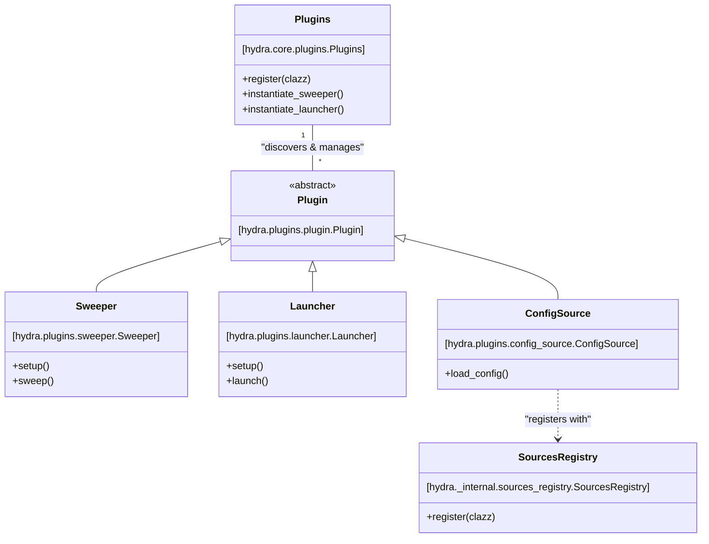
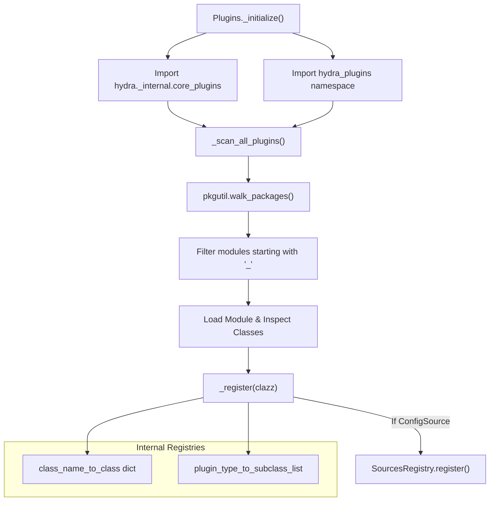

<!-- source: DeepWiki mcp.deepwiki.com · repo facebookresearch/hydra · page 3 Plugin System · fetched 2026-10-21 -->

# Plugin System

<details>
<summary>Relevant source files</summary>

The following files were used as context for generating this wiki page:

- [examples/plugins/example_configsource_plugin/setup.py](examples/plugins/example_configsource_plugin/setup.py)
- [examples/plugins/example_generic_plugin/setup.py](examples/plugins/example_generic_plugin/setup.py)
- [examples/plugins/example_launcher_plugin/setup.py](examples/plugins/example_launcher_plugin/setup.py)
- [examples/plugins/example_registered_plugin/setup.py](examples/plugins/example_registered_plugin/setup.py)
- [examples/plugins/example_searchpath_plugin/setup.py](examples/plugins/example_searchpath_plugin/setup.py)
- [examples/plugins/example_sweeper_plugin/setup.py](examples/plugins/example_sweeper_plugin/setup.py)
- [hydra/core/plugins.py](hydra/core/plugins.py)
- [hydra/utils.py](hydra/utils.py)
- [plugins/hydra_ax_sweeper/hydra_plugins/hydra_ax_sweeper/__init__.py](plugins/hydra_ax_sweeper/hydra_plugins/hydra_ax_sweeper/__init__.py)
- [plugins/hydra_ax_sweeper/setup.py](plugins/hydra_ax_sweeper/setup.py)
- [plugins/hydra_colorlog/hydra_plugins/hydra_colorlog/__init__.py](plugins/hydra_colorlog/hydra_plugins/hydra_colorlog/__init__.py)
- [plugins/hydra_colorlog/setup.py](plugins/hydra_colorlog/setup.py)
- [plugins/hydra_joblib_launcher/hydra_plugins/hydra_joblib_launcher/__init__.py](plugins/hydra_joblib_launcher/hydra_plugins/hydra_joblib_launcher/__init__.py)
- [plugins/hydra_joblib_launcher/setup.py](plugins/hydra_joblib_launcher/setup.py)
- [plugins/hydra_nevergrad_sweeper/hydra_plugins/hydra_nevergrad_sweeper/__init__.py](plugins/hydra_nevergrad_sweeper/hydra_plugins/hydra_nevergrad_sweeper/__init__.py)
- [plugins/hydra_nevergrad_sweeper/setup.py](plugins/hydra_nevergrad_sweeper/setup.py)
- [plugins/hydra_optuna_sweeper/hydra_plugins/hydra_optuna_sweeper/__init__.py](plugins/hydra_optuna_sweeper/hydra_plugins/hydra_optuna_sweeper/__init__.py)
- [plugins/hydra_optuna_sweeper/setup.py](plugins/hydra_optuna_sweeper/setup.py)
- [plugins/hydra_ray_launcher/hydra_plugins/hydra_ray_launcher/__init__.py](plugins/hydra_ray_launcher/hydra_plugins/hydra_ray_launcher/__init__.py)
- [plugins/hydra_rq_launcher/hydra_plugins/hydra_rq_launcher/__init__.py](plugins/hydra_rq_launcher/hydra_plugins/hydra_rq_launcher/__init__.py)
- [plugins/hydra_rq_launcher/setup.py](plugins/hydra_rq_launcher/setup.py)
- [plugins/hydra_submitit_launcher/hydra_plugins/hydra_submitit_launcher/__init__.py](plugins/hydra_submitit_launcher/hydra_plugins/hydra_submitit_launcher/__init__.py)
- [plugins/hydra_submitit_launcher/setup.py](plugins/hydra_submitit_launcher/setup.py)
- [tests/__init__.py](tests/__init__.py)
- [tests/test_apps/app_with_cfg_decorated/my_app.py](tests/test_apps/app_with_cfg_decorated/my_app.py)
- [tests/test_hydra_context_warnings.py](tests/test_hydra_context_warnings.py)
- [tests/test_internal_utils.py](tests/test_internal_utils.py)
- [tests/test_utils.py](tests/test_utils.py)

</details>


The Hydra Plugin System provides a flexible extension mechanism that allows developers to customize and extend Hydra's functionality without modifying its core. This page describes the architecture of the plugin system, how plugins are discovered and loaded, and how to create and use plugins.

For information about specific plugin types, see the following child pages:
- [Sweeper Plugins](#3.1) — Hyperparameter optimization interfaces like Ax, Optuna, and Nevergrad.
- [Launcher Plugins](#3.2) — Job execution environments like SLURM (via Submitit), Ray, and Joblib.
- [Config Source Plugins](#3.3) — Loading configurations from filesystems, package resources, or custom backends.
- [Shell Completion](#3.4) — Tab completion support for Bash, Zsh, and Fish.
- [Contrib Plugins](#3.5) — Community-contributed extensions like the `torchrun` launcher.

## Plugin System Architecture

Hydra's plugin system is built around abstract base classes and runtime discovery. Plugins are Python classes that inherit from the `Plugin` base class or one of its specialized subclasses defined in `hydra/core/plugins.py` [hydra/core/plugins.py:26-33]().

### Bridge: Logic to Code Entities
The following diagram maps high-level plugin categories to the specific Python classes and registry mechanisms in the codebase.


Sources: [hydra/core/plugins.py:16-33](), [hydra/core/plugins.py:43-52](), [hydra/core/plugins.py:91-92]()

### Core Plugin Types

| Plugin Type | Purpose | Key Methods |
|-------------|---------|------------|
| `Sweeper` | Hyperparameter optimization | `setup()`, `sweep()` |
| `Launcher` | Job execution in various environments | `setup()`, `launch()` |
| `ConfigSource` | Configuration loading from different sources | `load_config()`, `exists()` |
| `CompletionPlugin` | Shell tab completion | `install()`, `query()` |
| `SearchPathPlugin` | Add config search paths | `add_search_path()` |

Sources: [hydra/core/plugins.py:17-22](), [hydra/core/plugins.py:26-33]()

## Plugin Discovery and Loading

Hydra discovers plugins through a systematic scanning process during initialization. The `Plugins` singleton class [hydra/core/plugins.py:43-48]() manages this process, looking into specific namespaces.

### Bridge: Discovery Workflow
This diagram illustrates how the `Plugins` class interacts with the Python environment to locate and register plugin classes.


Sources: [hydra/core/plugins.py:56-74](), [hydra/core/plugins.py:83-92](), [hydra/core/plugins.py:163-181]()

### Discovery Rules
1. **Namespaces**: Hydra scans `hydra._internal.core_plugins` for built-in functionality and the `hydra_plugins` namespace for external packages [hydra/core/plugins.py:58-63]().
2. **Naming**: Modules starting with a single underscore (e.g., `_private.py`) are skipped unless they start with a double underscore [hydra/core/plugins.py:180-181]().
3. **Validation**: All external plugins must reside within the `hydra_plugins` package to be considered valid [hydra/core/plugins.py:102-107]().

## Plugin Package Structure

Plugins are distributed as standard Python packages using **PEP 420 Namespace Packages**. This allows multiple installed plugins to contribute to the `hydra_plugins` namespace.

### Standard `setup.py` Configuration
A typical plugin (like `hydra-ax-sweeper`) uses `find_namespace_packages` to include its implementation [plugins/hydra_ax_sweeper/setup.py:17]().

```python
setup(
    name="hydra-ax-sweeper",
    # ...
    packages=find_namespace_packages(include=["hydra_plugins.*"]),
    install_requires=[
        "hydra-core>=1.1.0.dev7",
        # plugin specific deps
    ],
)
```
Sources: [plugins/hydra_ax_sweeper/setup.py:8-36](), [plugins/hydra_nevergrad_sweeper/setup.py:8-32]()

## Official Hydra Plugins

Hydra maintains several official plugins within the repository's `plugins/` directory:

| Plugin | Type | Purpose |
|--------|------|---------|
| **Ax Sweeper** | Sweeper | Bayesian optimization via Ax [plugins/hydra_ax_sweeper/setup.py:9]() |
| **Nevergrad Sweeper** | Sweeper | Derivative-free optimization [plugins/hydra_nevergrad_sweeper/setup.py:9]() |
| **Optuna Sweeper** | Sweeper | Multi-objective optimization [plugins/hydra_optuna_sweeper/setup.py:9]() |
| **Submitit Launcher** | Launcher | SLURM and local cluster scheduling [plugins/hydra_submitit_launcher/setup.py:9]() |
| **Ray Launcher** | Launcher | Distributed execution via Ray [plugins/hydra_ray_launcher/hydra_plugins/hydra_ray_launcher/__init__.py:3]() |
| **Joblib Launcher** | Launcher | Light-weight parallel processing [plugins/hydra_joblib_launcher/setup.py:9]() |
| **RQ Launcher** | Launcher | Redis Queue based task distribution [plugins/hydra_rq_launcher/setup.py:9]() |
| **Colorlog** | Generic | Enhanced console logging [plugins/hydra_colorlog/setup.py:9]() |

## Manual Registration and Utilities

While automatic discovery is preferred, developers can manually register a plugin class using `Plugins.instance().register(MyPlugin)` [hydra/core/plugins.py:75-81]().

Additionally, `hydra.utils` provides helpers for dynamically loading classes and methods, which are often used by plugins to instantiate user code:
- `get_class(path)`: Returns a class type from a dot-path string [hydra/utils.py:22-41]().
- `get_method(path)`: Returns a callable from a dot-path string [hydra/utils.py:44-64]().
- `instantiate(config)`: The primary engine for creating objects from configuration [hydra/utils.py:17]().

Sources: [hydra/core/plugins.py:75-81](), [hydra/utils.py:22-64]()

---

