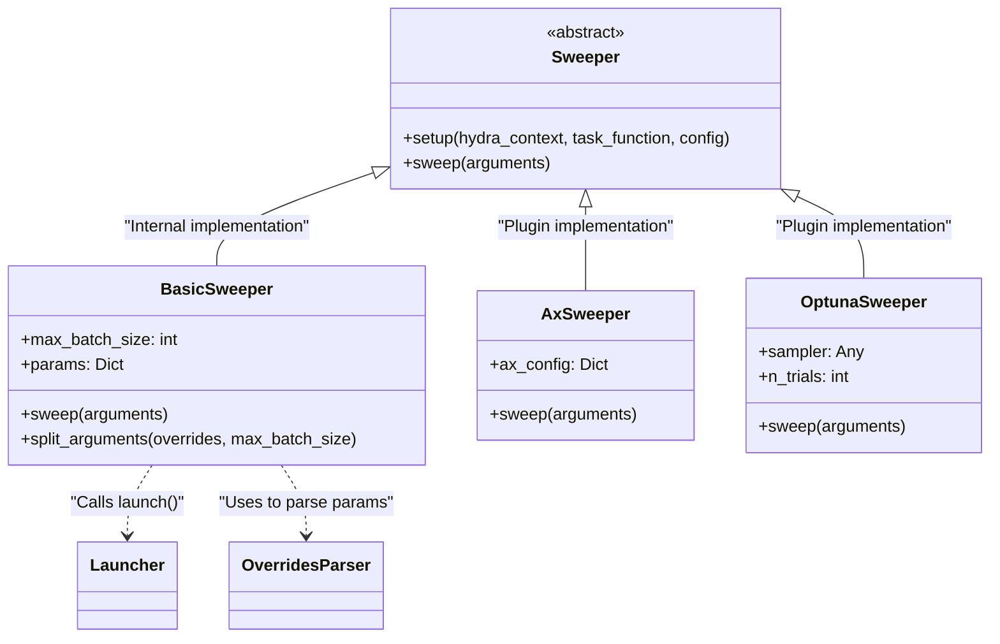
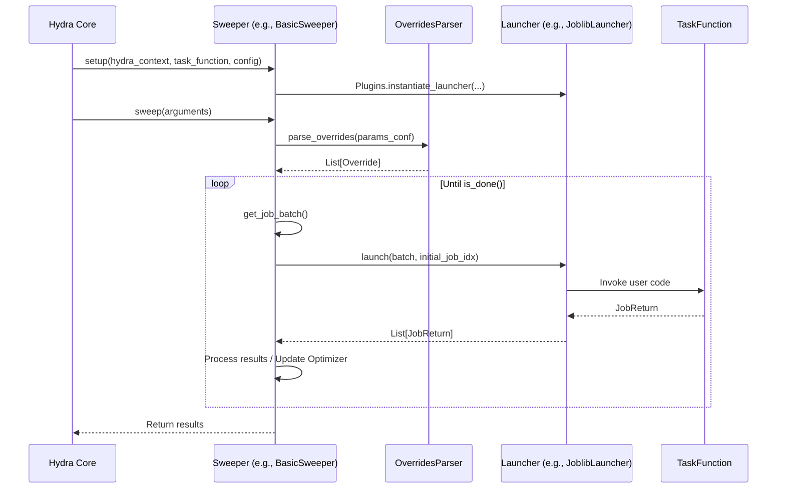

<!-- source: DeepWiki mcp.deepwiki.com · repo facebookresearch/hydra · page 3.1 Sweeper Plugins · fetched 2026-10-21 -->

# Sweeper Plugins

Relevant source files

The following files were used as context for generating this wiki page:

- [examples/plugins/example_configsource_plugin/setup.py](examples/plugins/example_configsource_plugin/setup.py)
- [examples/plugins/example_generic_plugin/setup.py](examples/plugins/example_generic_plugin/setup.py)
- [examples/plugins/example_launcher_plugin/setup.py](examples/plugins/example_launcher_plugin/setup.py)
- [examples/plugins/example_registered_plugin/setup.py](examples/plugins/example_registered_plugin/setup.py)
- [examples/plugins/example_searchpath_plugin/setup.py](examples/plugins/example_searchpath_plugin/setup.py)
- [examples/plugins/example_sweeper_plugin/setup.py](examples/plugins/example_sweeper_plugin/setup.py)
- [hydra/_internal/core_plugins/basic_launcher.py](hydra/_internal/core_plugins/basic_launcher.py)
- [hydra/_internal/core_plugins/basic_sweeper.py](hydra/_internal/core_plugins/basic_sweeper.py)
- [hydra/types.py](hydra/types.py)
- [plugins/hydra_ax_sweeper/setup.py](plugins/hydra_ax_sweeper/setup.py)
- [plugins/hydra_colorlog/README.md](plugins/hydra_colorlog/README.md)
- [plugins/hydra_colorlog/setup.py](plugins/hydra_colorlog/setup.py)
- [plugins/hydra_joblib_launcher/MANIFEST.in](plugins/hydra_joblib_launcher/MANIFEST.in)
- [plugins/hydra_joblib_launcher/README.md](plugins/hydra_joblib_launcher/README.md)
- [plugins/hydra_joblib_launcher/example/config.yaml](plugins/hydra_joblib_launcher/example/config.yaml)
- [plugins/hydra_joblib_launcher/example/my_app.py](plugins/hydra_joblib_launcher/example/my_app.py)
- [plugins/hydra_joblib_launcher/hydra_plugins/hydra_joblib_launcher/config.py](plugins/hydra_joblib_launcher/hydra_plugins/hydra_joblib_launcher/config.py)
- [plugins/hydra_joblib_launcher/hydra_plugins/hydra_joblib_launcher/joblib_launcher.py](plugins/hydra_joblib_launcher/hydra_plugins/hydra_joblib_launcher/joblib_launcher.py)
- [plugins/hydra_joblib_launcher/setup.py](plugins/hydra_joblib_launcher/setup.py)
- [plugins/hydra_nevergrad_sweeper/setup.py](plugins/hydra_nevergrad_sweeper/setup.py)
- [plugins/hydra_optuna_sweeper/setup.py](plugins/hydra_optuna_sweeper/setup.py)
- [plugins/hydra_rq_launcher/setup.py](plugins/hydra_rq_launcher/setup.py)
- [plugins/hydra_submitit_launcher/setup.py](plugins/hydra_submitit_launcher/setup.py)
- [website/README.md](website/README.md)
- [website/docs/plugins/colorlog.md](website/docs/plugins/colorlog.md)
- [website/docs/plugins/joblib_launcher.md](website/docs/plugins/joblib_launcher.md)

## Purpose and Overview

Sweeper plugins in Hydra provide a framework for hyperparameter optimization by systematically exploring parameter spaces. These plugins enable Hydra's multirun functionality (triggered by the `--multirun` or `-m` flag), allowing users to efficiently optimize hyperparameters for their applications. While the `BasicSweeper` provides simple grid search and Cartesian products, specialized plugins integrate with advanced optimization libraries.

For information about the syntax used to define sweeps on the command line, see [Override System](#2.3).

## Sweeper Plugin Architecture

Sweeper plugins implement the abstract `Sweeper` interface. The core responsibility of a Sweeper is to take a set of overrides, generate specific job configurations (batches), and coordinate with a `Launcher` to execute them.

### Code Entity Map
The following diagram maps high-level concepts to the specific classes and methods in the codebase.

Sources: [hydra/plugins/sweeper.py:1-35](), [hydra/_internal/core_plugins/basic_sweeper.py:54-186](), [plugins/hydra_ax_sweeper/hydra_plugins/hydra_ax_sweeper/ax_sweeper.py:11-32](), [plugins/hydra_optuna_sweeper/setup.py:8-34]()

## Sweeper Execution Flow

When a user initiates a multirun, the `Sweeper` takes control of the execution lifecycle. It parses the sweep arguments, interacts with an optimizer (like Ax or Optuna), and hands off batches of configurations to the configured `Launcher`.

### Component Interaction Diagram

Sources: [hydra/_internal/core_plugins/basic_sweeper.py:78-94](), [hydra/_internal/core_plugins/basic_sweeper.py:147-186](), [plugins/hydra_joblib_launcher/hydra_plugins/hydra_joblib_launcher/joblib_launcher.py:40-47]()

## Available Sweeper Plugins

Hydra supports several advanced sweepers via the plugin system. Each is packaged separately and requires specific dependencies.

| Sweeper Plugin | Backend Library | Primary Use Case |
|:---|:---|:---|
| **Basic Sweeper** | Built-in | Grid search and simple list iterations. [hydra/_internal/core_plugins/basic_sweeper.py:3-18]() |
| **Ax Sweeper** | `ax-platform` | Adaptive Bayesian optimization. For details, see [Ax Sweeper](#3.1.1). |
| **Nevergrad Sweeper** | `nevergrad` | Gradient-free optimization (evolutionary, etc.). For details, see [Nevergrad Sweeper](#3.1.2). |
| **Optuna Sweeper** | `optuna` | Versatile HPO with support for various samplers and databases. For details, see [Optuna Sweeper](#3.1.3). |

Sources: [plugins/hydra_ax_sweeper/setup.py:27-34](), [plugins/hydra_nevergrad_sweeper/setup.py:27-30](), [plugins/hydra_optuna_sweeper/setup.py:28-32]()

## Core Sweeper: BasicSweeper

The `BasicSweeper` is the default implementation included in `hydra-core`. It generates a Cartesian product of all provided sweep variables.

- **Configuration**: Stored under `hydra/sweeper=basic`. [hydra/_internal/core_plugins/basic_sweeper.py:46-48]()
- **Functionality**: It supports discrete sweeps (comma-separated lists) and `range()`. [hydra/_internal/core_plugins/basic_sweeper.py:114-117]()
- **Batching**: Can split a large sweep into smaller chunks using `max_batch_size`. [hydra/_internal/core_plugins/basic_sweeper.py:133-139]()

## Result Collection and Reporting

Sweepers collect results via the `JobReturn` object.
- `JobReturn` contains the `return_value` of the task function. [hydra/core/utils.py:32]() (referenced in [hydra/_internal/core_plugins/basic_sweeper.py:181]())
- The `Sweeper` monitors these returns to update its internal model (in the case of Ax/Optuna) or to report the best parameters found during the run.
- Before execution, the `Sweeper` saves the composed configuration to the sweep directory as `multirun.yaml`. [hydra/_internal/core_plugins/basic_sweeper.py:162-164]()

## Child Pages

- [Ax Sweeper](#3.1.1) — Detail the integration with Facebook's Ax platform for Bayesian optimization, including AxClient lifecycle, parameter mapping, and early stopping.
- [Nevergrad Sweeper](#3.1.2) — Explore the Nevergrad sweeper for derivative-free optimization, including supported optimizers and configuration.
- [Optuna Sweeper](#3.1.3) — Understand the Optuna integration for hyperparameter optimization, including multi-objective support and storage backends.

Sources: [hydra/types.py:45-48](), [hydra/_internal/core_plugins/basic_sweeper.py:39-44]()

---

