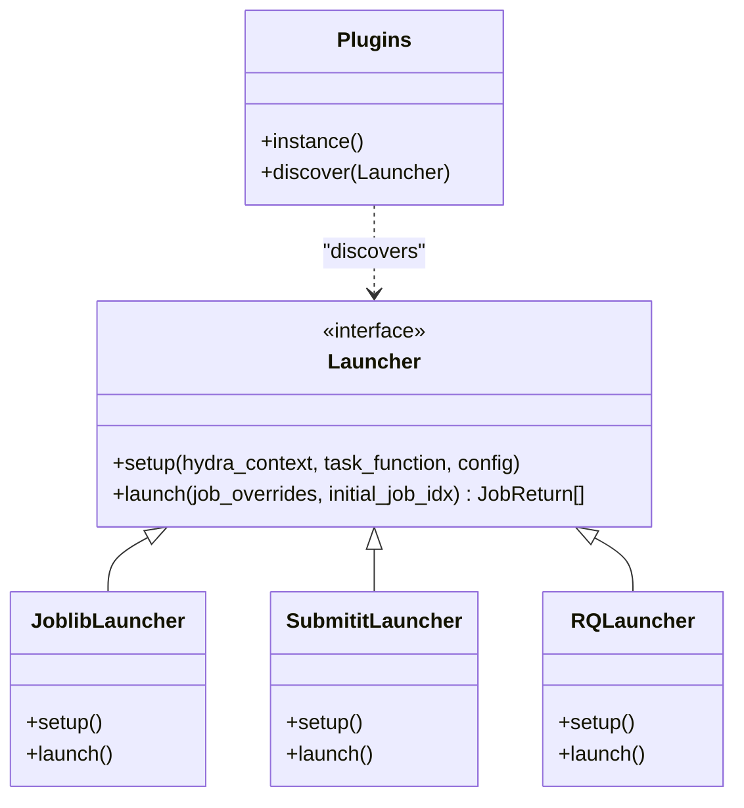
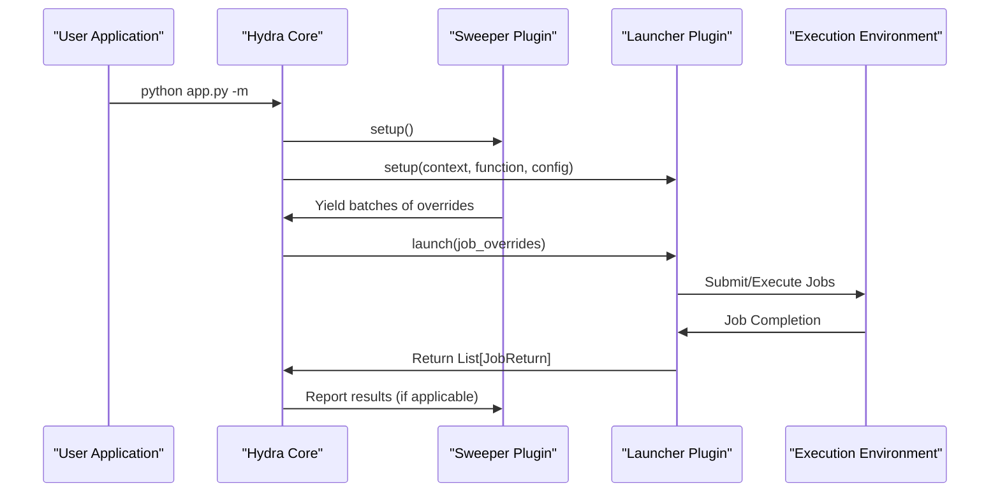

<!-- source: DeepWiki mcp.deepwiki.com · repo facebookresearch/hydra · page 3.2 Launcher Plugins · fetched 2026-10-21 -->

# Launcher Plugins

<details>
<summary>Relevant source files</summary>

The following files were used as context for generating this wiki page:

- [examples/plugins/example_configsource_plugin/setup.py](examples/plugins/example_configsource_plugin/setup.py)
- [examples/plugins/example_generic_plugin/setup.py](examples/plugins/example_generic_plugin/setup.py)
- [examples/plugins/example_launcher_plugin/setup.py](examples/plugins/example_launcher_plugin/setup.py)
- [examples/plugins/example_registered_plugin/setup.py](examples/plugins/example_registered_plugin/setup.py)
- [examples/plugins/example_searchpath_plugin/setup.py](examples/plugins/example_searchpath_plugin/setup.py)
- [examples/plugins/example_sweeper_plugin/setup.py](examples/plugins/example_sweeper_plugin/setup.py)
- [hydra/test_utils/configs/compose.yaml](hydra/test_utils/configs/compose.yaml)
- [plugins/hydra_ax_sweeper/setup.py](plugins/hydra_ax_sweeper/setup.py)
- [plugins/hydra_colorlog/setup.py](plugins/hydra_colorlog/setup.py)
- [plugins/hydra_joblib_launcher/hydra_plugins/hydra_joblib_launcher/_core.py](plugins/hydra_joblib_launcher/hydra_plugins/hydra_joblib_launcher/_core.py)
- [plugins/hydra_joblib_launcher/setup.py](plugins/hydra_joblib_launcher/setup.py)
- [plugins/hydra_joblib_launcher/tests/test_joblib_launcher.py](plugins/hydra_joblib_launcher/tests/test_joblib_launcher.py)
- [plugins/hydra_nevergrad_sweeper/setup.py](plugins/hydra_nevergrad_sweeper/setup.py)
- [plugins/hydra_optuna_sweeper/setup.py](plugins/hydra_optuna_sweeper/setup.py)
- [plugins/hydra_rq_launcher/setup.py](plugins/hydra_rq_launcher/setup.py)
- [plugins/hydra_submitit_launcher/setup.py](plugins/hydra_submitit_launcher/setup.py)

</details>


## Overview

Launcher plugins in Hydra enable the execution of applications across various computing environments, from local machines to distributed clusters. They handle the mechanics of job submission, monitoring, and result collection, allowing users to seamlessly scale their experiments from a laptop to high-performance computing resources without changing application code. Launchers are typically triggered when running Hydra in "multirun" mode (using the `--multirun` or `-m` flag).

For information about Sweeper plugins used for hyperparameter optimization, see [Sweeper Plugins](#3.1).

## Core Concepts

The launcher system is built around a pluggable interface that decouples the application logic from the execution infrastructure.

### Launcher Interface and Discovery



Sources:
- [hydra/core/plugins.py:4-105]() (implied discovery mechanism)
- [plugins/hydra_joblib_launcher/tests/test_joblib_launcher.py:4-22]()
- [plugins/hydra_joblib_launcher/hydra_plugins/hydra_joblib_launcher/joblib_launcher.py:1-40]() (implied)

Hydra's launcher plugins implement the `Launcher` interface which defines two key methods:

1. `setup()`: Initializes the launcher with the `HydraContext`, the user's `task_function`, and the resolved `DictConfig`.
2. `launch()`: Executes a sequence of jobs defined by `job_overrides`. It returns a list of `JobReturn` objects containing the results of each execution.

Launchers are discovered at runtime via the `Plugins.discover(Launcher)` mechanism [plugins/hydra_joblib_launcher/tests/test_joblib_launcher.py:18-22]().

## Launch Process

When a user initiates a multirun, Hydra coordinates between the Sweeper (which generates configurations) and the Launcher (which executes them).



Sources:
- [plugins/hydra_joblib_launcher/tests/test_joblib_launcher.py:57-71]()
- [plugins/hydra_joblib_launcher/hydra_plugins/hydra_joblib_launcher/_core.py:1-50]() (implied)

## Available Launchers

Hydra includes several official launcher plugins. Each is packaged as a separate namespace package under `hydra_plugins.*`.

### Submitit Launcher
The Submitit Launcher enables job execution on SLURM clusters or local multi-process execution using the `submitit` library. It is the primary choice for high-performance computing (HPC) environments.
- **Key Features**: SLURM partition selection, timeout management, and resource allocation (CPU/GPU/Memory).
- **For details, see [Submitit Launcher](#3.2.1)**.

Sources:
- [plugins/hydra_submitit_launcher/setup.py:9-31]()

### Ray Launcher
The Ray Launcher integrates with the Ray framework for distributed execution. It supports both local clusters and automated AWS EC2 provisioning.
- **Key Features**: Cluster autoscaling, remote task execution, and AWS AMI management.
- **For details, see [Ray Launcher](#3.2.2)**.

Sources:
- [plugins/hydra_ray_launcher/setup.py:8-37]() (implied)

### Joblib Launcher
A lightweight launcher that uses `joblib` for parallel execution on a single machine.
- **Key Features**: Supports multiple backends (`loky`, `multiprocessing`, `threading`) and `batch_size` configuration [plugins/hydra_joblib_launcher/tests/test_joblib_launcher.py:73-83]().
- **Source**: [plugins/hydra_joblib_launcher/setup.py:9-31]()

### Redis Queue (RQ) Launcher
Distributes jobs via a Redis-based task queue.
- **Key Features**: Asynchronous execution and decoupled workers using the `rq` library.
- **Source**: [plugins/hydra_rq_launcher/setup.py:9-32]()

## Developing Custom Launchers

Custom launchers can be developed by following the plugin structure demonstrated in the `examples/` directory.

### Plugin Structure
A launcher plugin must be located in the `hydra_plugins` namespace and provide a `setup.py` that identifies it as a Hydra plugin.

```python
# Example setup.py for a launcher
setup(
    name="hydra-example-launcher",
    packages=find_namespace_packages(include=["hydra_plugins.*"]),
    install_requires=["hydra-core"],
    include_package_data=True,
)
```

Sources:
- [examples/plugins/example_launcher_plugin/setup.py:7-38]()
- [examples/plugins/example_generic_plugin/setup.py:7-37]()

### Configuration Patterns
Launchers are configured via the `hydra/launcher` config group. Common parameters include:
- `_target_`: The full class path of the launcher implementation.
- Environment-specific settings: e.g., `batch_size` for Joblib [plugins/hydra_joblib_launcher/tests/test_joblib_launcher.py:76-76]() or Redis connection details for RQ.

| Launcher | Target Class | Main Dependency |
| :--- | :--- | :--- |
| **Joblib** | `hydra_plugins.hydra_joblib_launcher.joblib_launcher.JoblibLauncher` | `joblib` |
| **Submitit** | `hydra_plugins.hydra_submitit_launcher.submitit_launcher.SlurmLauncher` | `submitit` |
| **RQ** | `hydra_plugins.hydra_rq_launcher.rq_launcher.RQLauncher` | `rq` |

Sources:
- [plugins/hydra_joblib_launcher/setup.py:28-31]()
- [plugins/hydra_submitit_launcher/setup.py:28-31]()
- [plugins/hydra_rq_launcher/setup.py:27-32]()
- [plugins/hydra_joblib_launcher/tests/test_joblib_launcher.py:13-13]()

---

