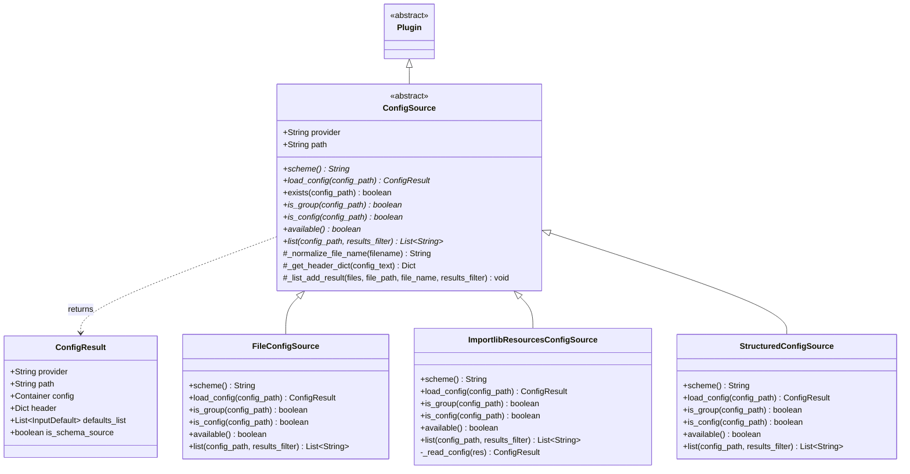
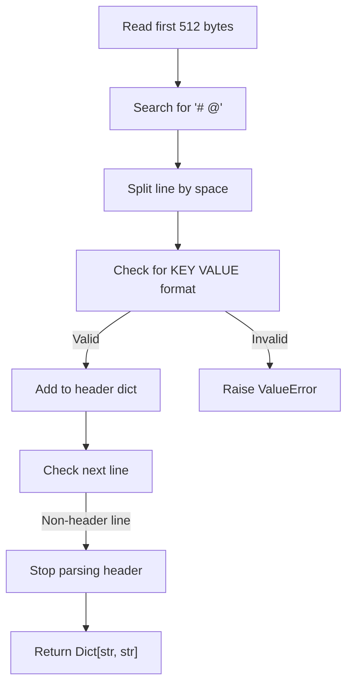
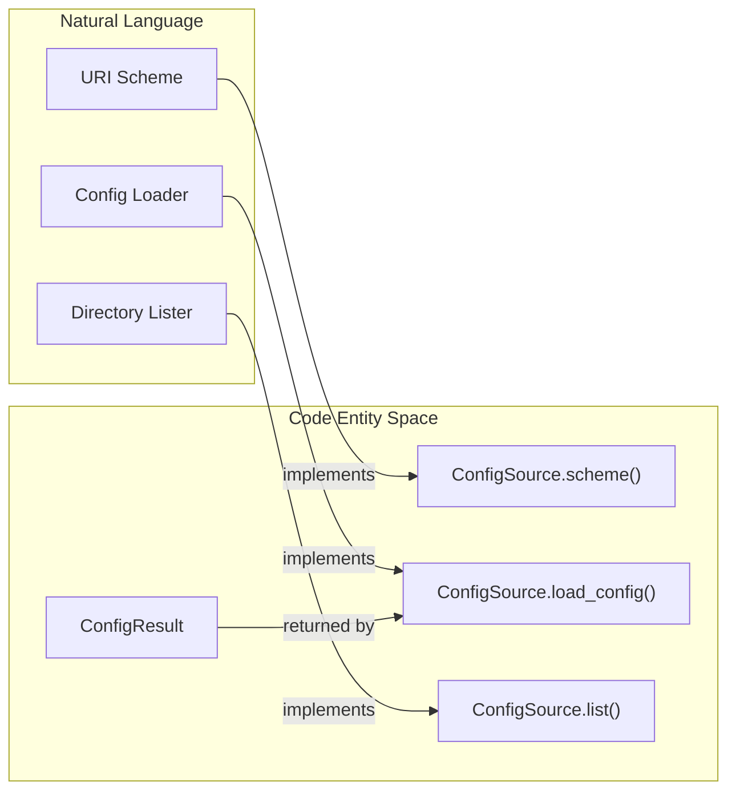

<!-- source: DeepWiki mcp.deepwiki.com · repo facebookresearch/hydra · page 3.3 Config Source Plugins · fetched 2026-10-21 -->

# Config Source Plugins

Relevant source files

The following files were used as context for generating this wiki page:

- [examples/configure_hydra/custom_help/conf/config.yaml](examples/configure_hydra/custom_help/conf/config.yaml)
- [examples/configure_hydra/logging/conf/config.yaml](examples/configure_hydra/logging/conf/config.yaml)
- [examples/plugins/example_configsource_plugin/hydra_plugins/example_configsource_plugin/example_configsource_plugin.py](examples/plugins/example_configsource_plugin/hydra_plugins/example_configsource_plugin/example_configsource_plugin.py)
- [examples/plugins/example_configsource_plugin/tests/test_example_config_source.py](examples/plugins/example_configsource_plugin/tests/test_example_config_source.py)
- [examples/plugins/example_launcher_plugin/example/conf/config.yaml](examples/plugins/example_launcher_plugin/example/conf/config.yaml)
- [examples/plugins/example_launcher_plugin/tests/test_example_launcher_plugin.py](examples/plugins/example_launcher_plugin/tests/test_example_launcher_plugin.py)
- [examples/plugins/example_sweeper_plugin/example/conf/config.yaml](examples/plugins/example_sweeper_plugin/example/conf/config.yaml)
- [examples/plugins/example_sweeper_plugin/tests/test_example_sweeper_plugin.py](examples/plugins/example_sweeper_plugin/tests/test_example_sweeper_plugin.py)
- [hydra/_internal/core_plugins/file_config_source.py](hydra/_internal/core_plugins/file_config_source.py)
- [hydra/_internal/core_plugins/importlib_resources_config_source.py](hydra/_internal/core_plugins/importlib_resources_config_source.py)
- [hydra/_internal/core_plugins/structured_config_source.py](hydra/_internal/core_plugins/structured_config_source.py)
- [hydra/core/config_store.py](hydra/core/config_store.py)
- [hydra/plugins/config_source.py](hydra/plugins/config_source.py)
- [hydra/test_utils/config_source_common_tests.py](hydra/test_utils/config_source_common_tests.py)
- [news/2928.bugfix](news/2928.bugfix)
- [plugins/hydra_rq_launcher/hydra_plugins/hydra_rq_launcher/_core.py](plugins/hydra_rq_launcher/hydra_plugins/hydra_rq_launcher/_core.py)
- [plugins/hydra_rq_launcher/hydra_plugins/hydra_rq_launcher/config.py](plugins/hydra_rq_launcher/hydra_plugins/hydra_rq_launcher/config.py)
- [plugins/hydra_rq_launcher/tests/conftest.py](plugins/hydra_rq_launcher/tests/conftest.py)
- [plugins/hydra_rq_launcher/tests/test_rq_launcher.py](plugins/hydra_rq_launcher/tests/test_rq_launcher.py)
- [tests/test_apps/app_with_cfg_groups/conf/dataset/imagenet.yaml](tests/test_apps/app_with_cfg_groups/conf/dataset/imagenet.yaml)
- [tests/test_apps/app_with_cfg_groups/conf/optimizer/adam.yaml](tests/test_apps/app_with_cfg_groups/conf/optimizer/adam.yaml)
- [tests/test_apps/app_with_cfg_groups/conf/optimizer/nesterov.yaml](tests/test_apps/app_with_cfg_groups/conf/optimizer/nesterov.yaml)
- [tests/test_apps/app_with_custom_launcher/config.yaml](tests/test_apps/app_with_custom_launcher/config.yaml)
- [tests/test_apps/config_source_test/structured.py](tests/test_apps/config_source_test/structured.py)
- [tests/test_config_repository.py](tests/test_config_repository.py)
- [website/docs/plugins/rq_launcher.md](website/docs/plugins/rq_launcher.md)

This page documents Hydra's Config Source Plugin system, which enables loading configurations from different sources. Config Source Plugins are a key extensibility point in Hydra's architecture, allowing the framework to access configuration data from file systems, Python packages, structured Python objects, and potentially other custom sources.

For information about other plugin types like Sweeper Plugins or Launcher Plugins, see [Plugin System](#3) and its child pages.

## The ConfigSource Interface

At the core of this system is the `ConfigSource` abstract base class, which defines the interface that all config source plugins must implement.

### Config Source Class Hierarchy

Sources: [hydra/plugins/config_source.py:18-112](), [hydra/_internal/core_plugins/file_config_source.py:11-19](), [hydra/_internal/core_plugins/importlib_resources_config_source.py:13-21](), [hydra/_internal/core_plugins/structured_config_source.py:11-27]()

The key methods each config source must implement are:

| Method | Description |
|--------|-------------|
| `scheme()` | Returns the URI scheme for this config source (e.g., "file", "pkg", "structured") [hydra/plugins/config_source.py:43-47]() |
| `load_config(config_path)` | Loads the config at the specified path and returns a `ConfigResult` [hydra/plugins/config_source.py:50-50]() |
| `exists(config_path)` | Checks if a config exists at the specified path (default implementation uses `is_group` or `is_config`) [hydra/plugins/config_source.py:53-54]() |
| `is_group(config_path)` | Checks if the path points to a config group (directory/package) [hydra/plugins/config_source.py:57-57]() |
| `is_config(config_path)` | Checks if the path points to a config file [hydra/plugins/config_source.py:60-60]() |
| `available()` | Checks if the config source is pointing to a valid location [hydra/plugins/config_source.py:63-67]() |
| `list(config_path, results_filter)` | Lists items under the specified config path, filtered by `ObjectType` [hydra/plugins/config_source.py:70-77]() |

## Built-in Config Source Plugins

Hydra provides three core Config Source Plugins:

### FileConfigSource
The `FileConfigSource` loads configurations from the local file system using the `file://` scheme. It uses `os.path` operations to verify existence and `OmegaConf.load` to parse YAML files [hydra/_internal/core_plugins/file_config_source.py:21-37]().

### ImportlibResourcesConfigSource
The `ImportlibResourcesConfigSource` loads configurations from Python packages using the `pkg://` scheme. It leverages `importlib.resources` to access files, supporting both standard filesystem packages and those contained within zip files [hydra/_internal/core_plugins/importlib_resources_config_source.py:48-54](). It automatically handles path normalization from slashes to dots [hydra/_internal/core_plugins/importlib_resources_config_source.py:17-17]().

### StructuredConfigSource
The `StructuredConfigSource` interacts with the `ConfigStore` singleton to provide configurations defined as Python dataclasses or objects using the `structured://` scheme [hydra/_internal/core_plugins/structured_config_source.py:29-39](). It imports the specified module during initialization to ensure configs are registered [hydra/_internal/core_plugins/structured_config_source.py:16-23]().

Sources: [hydra/_internal/core_plugins/file_config_source.py:11-64](), [hydra/_internal/core_plugins/importlib_resources_config_source.py:13-97](), [hydra/_internal/core_plugins/structured_config_source.py:11-65]()

## Data Flow and Configuration Headers

When a config is loaded, Hydra parses a "header" from the top of the file (for text-based sources). This header allows specifying the target package for the configuration using the `# @package` syntax [hydra/plugins/config_source.py:130-156]().

### Header Parsing Logic

Sources: [hydra/plugins/config_source.py:130-156](), [hydra/_internal/core_plugins/file_config_source.py:28-29]()

## Implementation Details: ConfigResult

The `ConfigResult` class is the data transfer object returned by all sources. It encapsulates the raw configuration along with metadata required for composition.

| Field | Type | Description |
|-------|------|-------------|
| `provider` | `str` | Name of the module/app providing the config [hydra/plugins/config_source.py:19-19]() |
| `path` | `str` | Full URI of the config source [hydra/plugins/config_source.py:20-20]() |
| `config` | `Container` | The loaded OmegaConf object [hydra/plugins/config_source.py:21-21]() |
| `header` | `Dict` | Parsed metadata (e.g., `package`) [hydra/plugins/config_source.py:22-22]() |
| `defaults_list` | `List[InputDefault]` | Optional list of defaults defined in the config [hydra/plugins/config_source.py:23-23]() |

Sources: [hydra/plugins/config_source.py:17-25]()

## Implementing a Custom Config Source

To implement a custom source, developers should inherit from `ConfigSource` and register it as a Hydra plugin.

### Code Entity Association

Sources: [hydra/plugins/config_source.py:31-77](), [examples/plugins/example_configsource_plugin/hydra_plugins/example_configsource_plugin/example_configsource_plugin.py:9-131]()

### Example: Mock Config Source
The `ConfigSourceExample` demonstrates a source that serves configs from internal dictionaries rather than a filesystem, which is useful for testing [examples/plugins/example_configsource_plugin/hydra_plugins/example_configsource_plugin/example_configsource_plugin.py:12-51]().

## Testing and Validation

Hydra provides a `ConfigSourceTestSuite` in `hydra.test_utils.config_source_common_tests` to ensure custom implementations adhere to the expected behavior for methods like `is_group`, `is_config`, and `list` [hydra/test_utils/config_source_common_tests.py:11-12]().

Key test areas include:
- **Availability**: Verifying `available()` returns false for invalid paths [hydra/test_utils/config_source_common_tests.py:25-31]().
- **Group/Config Distinction**: Ensuring directories are identified as groups and files as configs [hydra/test_utils/config_source_common_tests.py:51-79]().
- **Listing**: Validating that `list()` returns sorted, unique identifiers [hydra/test_utils/config_source_common_tests.py:123-135]().
- **Overlap Handling**: Testing behavior when a config name overlaps with a group name (e.g., `dataset.yaml` and a `dataset/` directory) [hydra/test_utils/config_source_common_tests.py:87-97]().

Sources: [hydra/test_utils/config_source_common_tests.py:11-162](), [tests/test_config_repository.py:31-52]()

---

