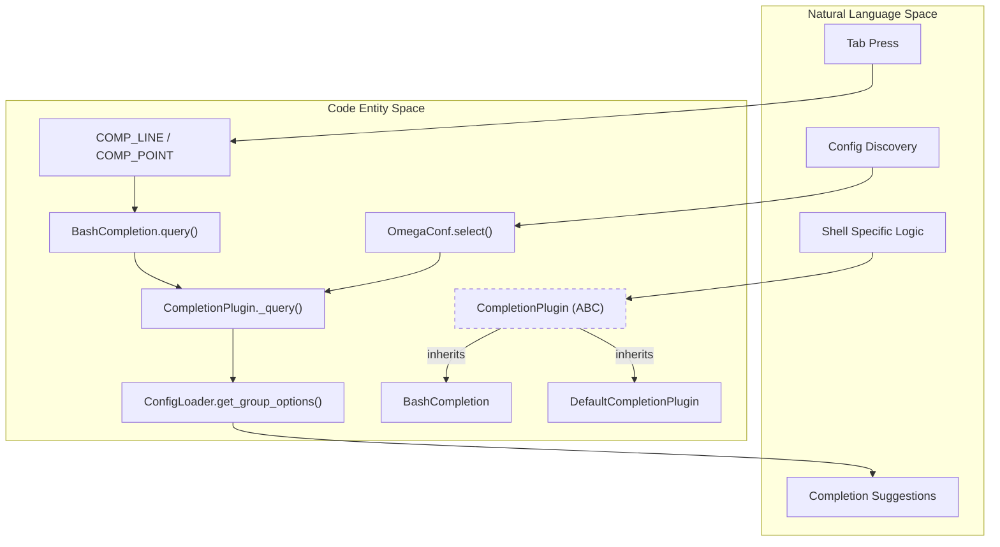
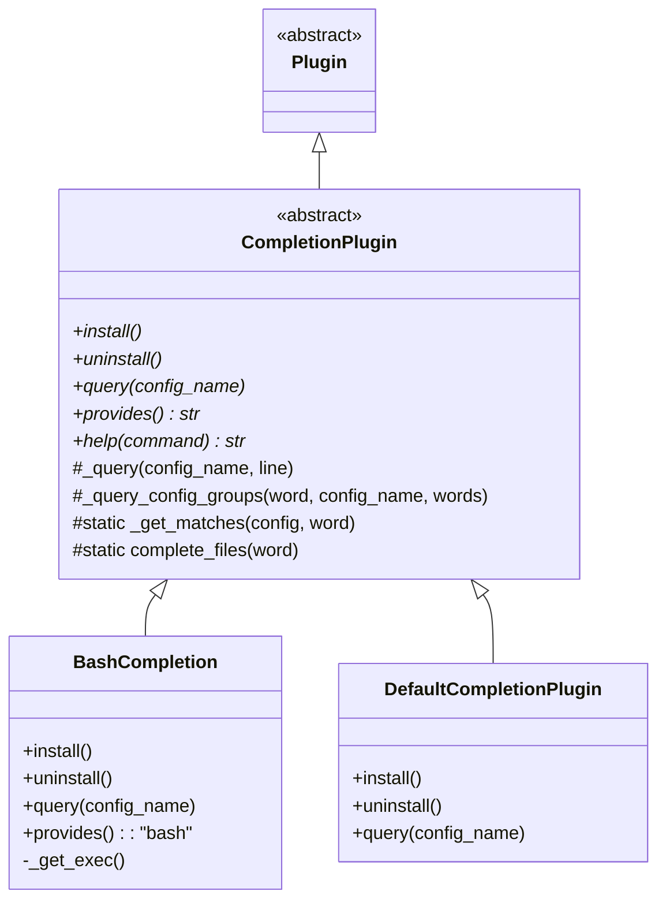
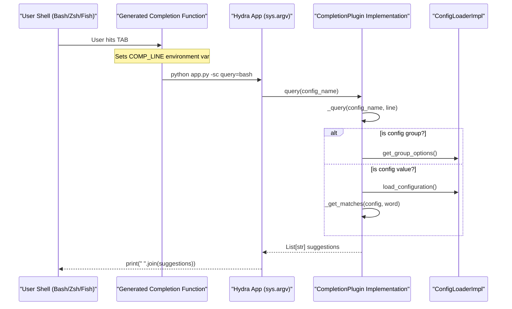

<!-- source: DeepWiki mcp.deepwiki.com · repo facebookresearch/hydra · page 3.4 Shell Completion · fetched 2026-10-21 -->

# Shell Completion

<details>
<summary>Relevant source files</summary>

The following files were used as context for generating this wiki page:

- [examples/tutorials/basic/running_your_hydra_app/3_working_directory/original_cwd.py](examples/tutorials/basic/running_your_hydra_app/3_working_directory/original_cwd.py)
- [hydra/_internal/core_plugins/bash_completion.py](hydra/_internal/core_plugins/bash_completion.py)
- [hydra/plugins/completion_plugin.py](hydra/plugins/completion_plugin.py)
- [hydra/test_utils/configs/schema_key_error.yaml](hydra/test_utils/configs/schema_key_error.yaml)
- [hydra/test_utils/configs/schema_validation_error.yaml](hydra/test_utils/configs/schema_validation_error.yaml)
- [tests/instantiate/import_error.py](tests/instantiate/import_error.py)
- [tests/test_apps/app_with_cfg_groups/conf/config_with_runtime_option.yaml](tests/test_apps/app_with_cfg_groups/conf/config_with_runtime_option.yaml)
- [tests/test_apps/app_with_cfg_groups/my_app_with_runtime_choices_print.py](tests/test_apps/app_with_cfg_groups/my_app_with_runtime_choices_print.py)
- [tests/test_completion.py](tests/test_completion.py)
- [website/docs/development/release.md](website/docs/development/release.md)
- [website/docs/tutorials/basic/running_your_app/4_logging.md](website/docs/tutorials/basic/running_your_app/4_logging.md)
- [website/docs/tutorials/basic/running_your_app/5_debugging.md](website/docs/tutorials/basic/running_your_app/5_debugging.md)
- [website/docs/tutorials/basic/running_your_app/6_tab_completion.md](website/docs/tutorials/basic/running_your_app/6_tab_completion.md)
- [website/versioned_docs/version-1.0/tutorials/basic/running_your_app/6_tab_completion.md](website/versioned_docs/version-1.0/tutorials/basic/running_your_app/6_tab_completion.md)
- [website/versioned_docs/version-1.1/tutorials/basic/running_your_app/4_logging.md](website/versioned_docs/version-1.1/tutorials/basic/running_your_app/4_logging.md)

</details>


Shell Completion in Hydra provides command-line tab completion for Hydra applications, significantly improving developer productivity. This feature enables users to easily discover available options, configuration values, and command-line overrides by pressing the tab key in their shell.

## Overview

Hydra's shell completion system automatically completes:
- Configuration group and option names
- Configuration node paths and values
- Command-line override syntax (append `+`, delete `~`)
- File system paths when prefixed with `/` or `./`

This allows users to explore the available configuration options interactively without needing to memorize the entire configuration schema.

Sources: [hydra/plugins/completion_plugin.py:28-158](), [website/docs/tutorials/basic/running_your_app/6_tab_completion.md:7-9]()

## Architecture

Hydra implements shell completion through a plugin architecture, allowing support for different shells while maintaining a consistent completion logic in the base class.

### Code Entity Mapping

The following diagram maps natural language shell concepts to the specific Python classes and methods in the Hydra codebase.


Sources: [hydra/plugins/completion_plugin.py:29-31](), [hydra/_internal/core_plugins/bash_completion.py:12-12](), [hydra/plugins/completion_plugin.py:217-217]()

### Class Hierarchy



Sources: [hydra/plugins/completion_plugin.py:29-58](), [hydra/_internal/core_plugins/bash_completion.py:12-12](), [tests/test_completion.py:207-207]()

### Completion Workflow

The workflow involves the shell executing the Hydra app in a special "query mode" using the `-sc` (shell completion) flag.



Sources: [hydra/_internal/core_plugins/bash_completion.py:45-45](), [hydra/plugins/completion_plugin.py:217-257](), [hydra/plugins/completion_plugin.py:179-184]()

## Supported Shells

Hydra supports Bash, Fish, and Zsh. Support is verified via version checks in the test suite.

| Shell | Minimum Version | Notes |
|-------|-----------------|-------|
| **Bash** | N/A | Primary implementation. [hydra/_internal/core_plugins/bash_completion.py:12]() |
| **Fish** | 3.1.2 | Version < 3.1.2 adds extra spaces after dots. [tests/test_completion.py:40-45]() |
| **Zsh** | 4.2 | Uses `bashcompinit` for compatibility. [tests/test_completion.py:62-65]() |

**Note on Tilde (`~`):** Zsh and Fish implement special behavior for tilde expansion, which can interfere with Hydra's "delete from defaults" completion (`~group`). [website/docs/tutorials/basic/running_your_app/6_tab_completion.md:26-39]()

## Installation and Usage

Users obtain installation commands via the `--hydra-help` flag. The underlying mechanism uses the `-sc` (shell completion) command-line argument.

### Bash Installation
```bash
# Command generated by BashCompletion.help()
eval "$(python your_app.py -sc install=bash)"
```
Sources: [hydra/_internal/core_plugins/bash_completion.py:87-89]()

The installation script registers a function `hydra_bash_completion` that captures the current command line (`$COMP_LINE`) and passes it to the Hydra executable with `query=bash`. [hydra/_internal/core_plugins/bash_completion.py:18-61]()

## Completion Logic Details

### Configuration Matching
The `_get_matches` method recursively traverses `DictConfig` and `ListConfig` objects to find keys or values matching the current partial word. 
- If the word ends in `.`, it explores the child node. [hydra/plugins/completion_plugin.py:108-113]()
- If the word is a primitive, it returns the value (e.g., `true`/`false` for booleans). [hydra/plugins/completion_plugin.py:121-123]()

### Group and Override Completion
The `_query_config_groups` method handles:
1. **Additions (`+`)**: Suggests config groups not currently in the defaults list. [hydra/plugins/completion_plugin.py:160-162]()
2. **Deletions (`~`)**: Suggests groups available for removal. [hydra/plugins/completion_plugin.py:161-162]()
3. **Nesting**: Handles slash-separated groups (e.g., `test_hydra/launcher=`). [hydra/plugins/completion_plugin.py:173-177]()

### File Path Completion
When a word contains `/` or `./`, Hydra switches to `complete_files`. It uses `os.listdir` and `os.path.isdir` to suggest local filesystem entries. [hydra/plugins/completion_plugin.py:78-94]()

## Testing and Debugging

### Testing Infrastructure
Hydra uses a comprehensive test suite in `tests/test_completion.py` that validates:
- **Basic Overrides**: `dict.key1=val1`. [tests/test_completion.py:113-115]()
- **Group Loading**: `group=dict`. [tests/test_completion.py:137-138]()
- **Multirun**: Completions work after the `--multirun` flag. [tests/test_completion.py:212-214]()
- **Shell Compatibility**: Specific tests for `bash`, `fish`, and `zsh` using the `expect` utility. [tests/test_completion.py:22-65]()

### Debugging Completions
Developers can enable debug output for the bash completion script by setting the environment variable `HYDRA_COMP_DEBUG=1`. This prints the executable being used, the full `COMP_LINE`, and the suggestions generated by the plugin. [hydra/_internal/core_plugins/bash_completion.py:37-55]()

Sources: [tests/test_completion.py:1-214](), [hydra/_internal/core_plugins/bash_completion.py:37-55]()

---

