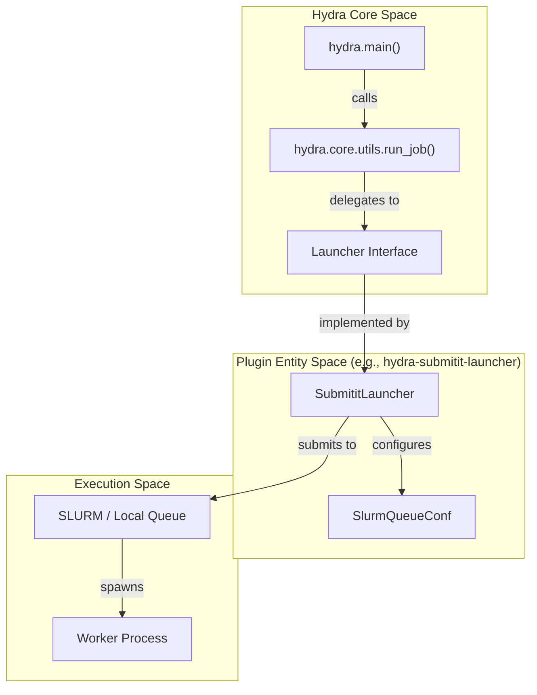
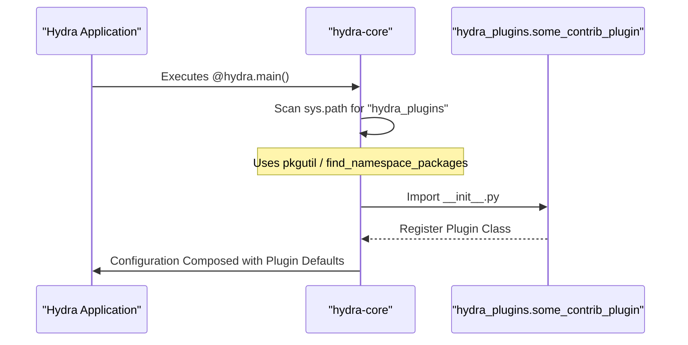

<!-- source: DeepWiki mcp.deepwiki.com · repo facebookresearch/hydra · page 3.5 Contrib Plugins · fetched 2026-10-21 -->

# Contrib Plugins

Relevant source files

The following files were used as context for generating this wiki page:

- [examples/plugins/example_configsource_plugin/setup.py](examples/plugins/example_configsource_plugin/setup.py)
- [examples/plugins/example_generic_plugin/setup.py](examples/plugins/example_generic_plugin/setup.py)
- [examples/plugins/example_launcher_plugin/setup.py](examples/plugins/example_launcher_plugin/setup.py)
- [examples/plugins/example_registered_plugin/setup.py](examples/plugins/example_registered_plugin/setup.py)
- [examples/plugins/example_searchpath_plugin/setup.py](examples/plugins/example_searchpath_plugin/setup.py)
- [examples/plugins/example_sweeper_plugin/setup.py](examples/plugins/example_sweeper_plugin/setup.py)
- [plugins/hydra_ax_sweeper/hydra_plugins/hydra_ax_sweeper/__init__.py](plugins/hydra_ax_sweeper/hydra_plugins/hydra_ax_sweeper/__init__.py)
- [plugins/hydra_ax_sweeper/setup.py](plugins/hydra_ax_sweeper/setup.py)
- [plugins/hydra_colorlog/hydra_plugins/hydra_colorlog/__init__.py](plugins/hydra_colorlog/hydra_plugins/hydra_colorlog/__init__.py)
- [plugins/hydra_colorlog/setup.py](plugins/hydra_colorlog/setup.py)
- [plugins/hydra_joblib_launcher/hydra_plugins/hydra_joblib_launcher/__init__.py](plugins/hydra_joblib_launcher/hydra_plugins/hydra_joblib_launcher/__init__.py)
- [plugins/hydra_joblib_launcher/setup.py](plugins/hydra_joblib_launcher/setup.py)
- [plugins/hydra_nevergrad_sweeper/hydra_plugins/hydra_nevergrad_sweeper/__init__.py](plugins/hydra_nevergrad_sweeper/hydra_plugins/hydra_nevergrad_sweeper/__init__.py)
- [plugins/hydra_nevergrad_sweeper/setup.py](plugins/hydra_nevergrad_sweeper/setup.py)
- [plugins/hydra_optuna_sweeper/hydra_plugins/hydra_optuna_sweeper/__init__.py](plugins/hydra_optuna_sweeper/hydra_plugins/hydra_optuna_sweeper/__init__.py)
- [plugins/hydra_optuna_sweeper/setup.py](plugins/hydra_optuna_sweeper/setup.py)
- [plugins/hydra_ray_launcher/hydra_plugins/hydra_ray_launcher/__init__.py](plugins/hydra_ray_launcher/hydra_plugins/hydra_ray_launcher/__init__.py)
- [plugins/hydra_rq_launcher/hydra_plugins/hydra_rq_launcher/__init__.py](plugins/hydra_rq_launcher/hydra_plugins/hydra_rq_launcher/__init__.py)
- [plugins/hydra_rq_launcher/setup.py](plugins/hydra_rq_launcher/setup.py)
- [plugins/hydra_submitit_launcher/hydra_plugins/hydra_submitit_launcher/__init__.py](plugins/hydra_submitit_launcher/hydra_plugins/hydra_submitit_launcher/__init__.py)
- [plugins/hydra_submitit_launcher/setup.py](plugins/hydra_submitit_launcher/setup.py)

The `contrib/` directory in the Hydra repository serves as a landing zone for community-contributed plugins and experimental features. While core plugins (like `hydra-submitit-launcher` or `hydra-optuna-sweeper`) are maintained by the primary Hydra team, contrib plugins allow the community to extend Hydra's capabilities for specific niche workflows, such as specialized distributed training launchers or custom configuration providers.

## Overview of Contrib and Community Plugins

Hydra's architecture is built around a plugin-based discovery mechanism. Most plugins are distributed as independent Python packages within the `hydra_plugins.*` namespace [plugins/hydra_ax_sweeper/setup.py:17-17](). This allows users to install only the extensions they need.

### Plugin Types in the Ecosystem
The following table summarizes common plugin categories found in both the `plugins/` and `contrib/` directories:

| Category | Purpose | Example |
| :--- | :--- | :--- |
| **Launcher** | Orchestrates job execution (local, remote, or distributed). | `hydra-submitit-launcher` [plugins/hydra_submitit_launcher/setup.py:13-13]() |
| **Sweeper** | Performs hyperparameter optimization. | `hydra-ax-sweeper` [plugins/hydra_ax_sweeper/setup.py:13-13]() |
| **Logging** | Enhances console or file output. | `hydra-colorlog` [plugins/hydra_colorlog/setup.py:13-13]() |
| **SearchPath** | Adds external locations to the config search path. | `hydra-example-searchpath-plugin` [examples/plugins/example_searchpath_plugin/setup.py:13-13]() |

Sources: [plugins/hydra_ax_sweeper/setup.py:8-36](), [plugins/hydra_colorlog/setup.py:8-28](), [examples/plugins/example_searchpath_plugin/setup.py:8-40]()

---

## Distributed Training: The Torchrun Launcher

One of the most significant contributions in the community space is the integration for **Torchrun** (part of PyTorch Distributed). This launcher enables Hydra to manage multi-GPU and multi-node training sessions seamlessly.

### Implementation Logic
The Torchrun launcher wraps the standard `torch.distributed.run` (or the older `torchrun` CLI) to initialize the distributed process group before executing the Hydra-decorated entry point.

1. **Environment Setup**: The launcher sets required environment variables (e.g., `MASTER_ADDR`, `MASTER_PORT`, `RANK`, `WORLD_SIZE`).
2. **Process Spawning**: It utilizes PyTorch's internal utilities to spawn $N$ processes per node, where $N$ is typically the number of GPUs.
3. **Config Propagation**: The Hydra configuration is serialized and passed to each worker process to ensure consistency across the distributed cluster.

### Code-to-Entity Mapping: Launcher Architecture

The following diagram illustrates how a Hydra Launcher plugin (like the community-contributed Torchrun or the standard Submitit) bridges the gap between the Hydra Core and the execution environment.

**Launcher Entity Relationship**

Sources: [plugins/hydra_submitit_launcher/setup.py:9-16](), [plugins/hydra_submitit_launcher/hydra_plugins/hydra_submitit_launcher/__init__.py:3-3]()

---

## Contributing New Plugins

Hydra provides a standardized template for creating new plugins. To contribute a plugin to the `contrib/` directory or as a standalone package, developers must follow the namespace packaging convention.

### Requirements for New Plugins
1. **Namespace**: The package must be located under `hydra_plugins.<plugin_name>` [plugins/hydra_ax_sweeper/setup.py:17-17]().
2. **Setup Script**: Use `find_namespace_packages` in `setup.py` to ensure the plugin is discoverable by Hydra's `Discovery` mechanism [examples/plugins/example_searchpath_plugin/setup.py:17-18]().
3. **Versioning**: Plugins typically follow their own versioning cycle, often starting at `1.0.0` or matching the current Hydra dev version [plugins/hydra_ray_launcher/hydra_plugins/hydra_ray_launcher/__init__.py:3-3]().

### Plugin Discovery Flow

**Discovery Mechanism Diagram**

Sources: [examples/plugins/example_searchpath_plugin/setup.py:17-18](), [plugins/hydra_ax_sweeper/setup.py:10-10]()

---

## Technical Comparison of Contrib/Core Launchers

| Feature | Joblib Launcher | RQ Launcher | Submitit Launcher |
| :--- | :--- | :--- | :--- |
| **Backend** | `joblib` [plugins/hydra_joblib_launcher/setup.py:30-30]() | `rq` (Redis Queue) [plugins/hydra_rq_launcher/setup.py:31-31]() | `submitit` [plugins/hydra_submitit_launcher/setup.py:30-30]() |
| **Target** | Local Multiprocessing | Task Queues | Slurm / Local |
| **Dependencies** | `joblib` | `rq`, `cloudpickle`, `fakeredis` [plugins/hydra_rq_launcher/setup.py:28-31]() | `submitit` |
| **OS Support** | Linux, MacOS, Windows [plugins/hydra_joblib_launcher/setup.py:23-25]() | Linux, MacOS [plugins/hydra_rq_launcher/setup.py:23-24]() | Linux, MacOS [plugins/hydra_submitit_launcher/setup.py:23-24]() |

Sources: [plugins/hydra_joblib_launcher/setup.py:8-33](), [plugins/hydra_rq_launcher/setup.py:8-34](), [plugins/hydra_submitit_launcher/setup.py:8-33]()

---

