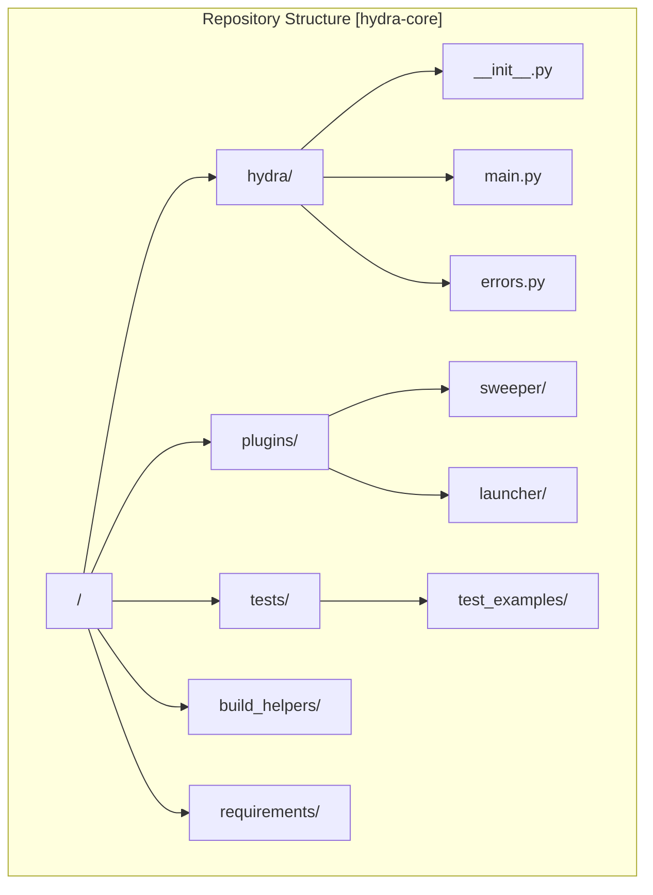
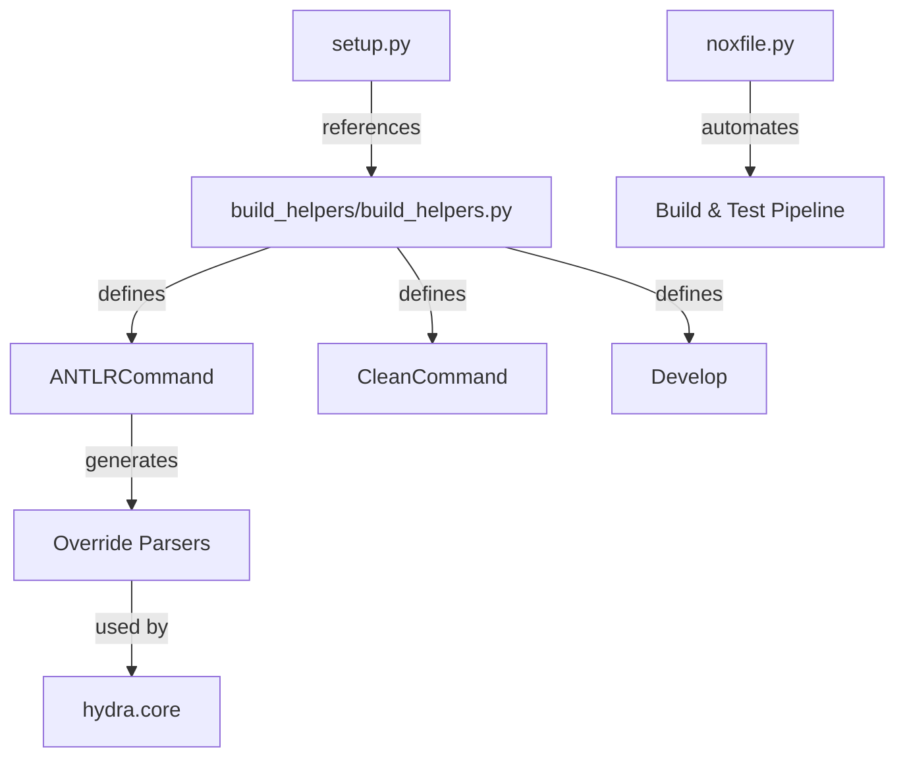
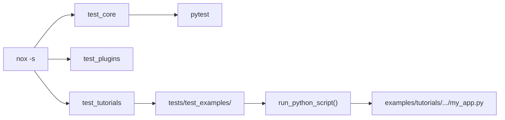

<!-- source: DeepWiki mcp.deepwiki.com · repo facebookresearch/hydra · page 4 Developer Guide · fetched 2026-10-21 -->

# Developer Guide

<details>
<summary>Relevant source files</summary>

The following files were used as context for generating this wiki page:

- [.github/PULL_REQUEST_TEMPLATE.md](.github/PULL_REQUEST_TEMPLATE.md)
- [.pre-commit-config.yaml](.pre-commit-config.yaml)
- [CONTRIBUTING.md](CONTRIBUTING.md)
- [README.md](README.md)
- [hydra/__init__.py](hydra/__init__.py)
- [hydra/errors.py](hydra/errors.py)
- [noxfile.py](noxfile.py)
- [requirements/dev.txt](requirements/dev.txt)
- [setup.py](setup.py)
- [tests/test_errors.py](tests/test_errors.py)
- [tests/test_examples/test_advanced_package_overrides.py](tests/test_examples/test_advanced_package_overrides.py)
- [tests/test_examples/test_configure_hydra.py](tests/test_examples/test_configure_hydra.py)
- [tests/test_examples/test_instantiate_examples.py](tests/test_examples/test_instantiate_examples.py)
- [tests/test_examples/test_patterns.py](tests/test_examples/test_patterns.py)
- [tests/test_examples/test_structured_configs_tutorial.py](tests/test_examples/test_structured_configs_tutorial.py)
- [tests/test_examples/test_tutorials_basic.py](tests/test_examples/test_tutorials_basic.py)
- [website/versioned_docs/version-0.11/advanced/hydra_compose.md](website/versioned_docs/version-0.11/advanced/hydra_compose.md)
- [website/versioned_docs/version-0.11/advanced/packaging.md](website/versioned_docs/version-0.11/advanced/packaging.md)
- [website/versioned_docs/version-0.11/advanced/plugins.md](website/versioned_docs/version-0.11/advanced/plugins.md)
- [website/versioned_docs/version-0.11/advanced/ray_example.md](website/versioned_docs/version-0.11/advanced/ray_example.md)
- [website/versioned_docs/version-0.11/advanced/search_path.md](website/versioned_docs/version-0.11/advanced/search_path.md)
- [website/versioned_docs/version-0.11/configure_hydra/Intro.md](website/versioned_docs/version-0.11/configure_hydra/Intro.md)
- [website/versioned_docs/version-0.11/configure_hydra/app_help.md](website/versioned_docs/version-0.11/configure_hydra/app_help.md)
- [website/versioned_docs/version-0.11/configure_hydra/logging.md](website/versioned_docs/version-0.11/configure_hydra/logging.md)
- [website/versioned_docs/version-0.11/development/contributing.md](website/versioned_docs/version-0.11/development/contributing.md)
- [website/versioned_docs/version-0.11/development/release.md](website/versioned_docs/version-0.11/development/release.md)
- [website/versioned_docs/version-0.11/plugins/colorlog.md](website/versioned_docs/version-0.11/plugins/colorlog.md)
- [website/versioned_docs/version-0.11/tutorial/1_simple_cli_app.md](website/versioned_docs/version-0.11/tutorial/1_simple_cli_app.md)
- [website/versioned_docs/version-0.11/tutorial/2_config_file.md](website/versioned_docs/version-0.11/tutorial/2_config_file.md)

</details>


This document provides essential information for developers who want to contribute to the Hydra framework. It covers the project structure, build system, testing approach, and documentation framework. For information about using Hydra in your applications, please refer to the [Core Concepts](#2) guide.

## Project Structure

Hydra's codebase is organized into several key directories that separate the core logic from extensibility points and quality assurance tools.

| Directory | Purpose |
|-----------|---------|
| `hydra/` | Core framework implementation, including the `main` entry point and configuration processing. |
| `plugins/` | Official plugins extending Hydra's functionality (Sweepers, Launchers, etc.). |
| `examples/` | Example apps and tutorials showing Hydra usage patterns. |
| `tests/` | Comprehensive test suite ensuring code quality and regression testing. |
| `build_helpers/` | specialized tools for building, packaging, and ANTLR grammar generation. |
| `requirements/` | Dependency specifications for runtime and development environments. |

The main package, `hydra-core`, defines the core functionality, while plugins are released as separate packages within the `plugins/` directory.



Sources: [setup.py:27-61](), [noxfile.py:187-216](), [hydra/__init__.py:1-24]()

For a detailed breakdown of the directory organization, see [Project Structure](#4.1).

## Development Environment Setup

### Requirements

To develop Hydra, you need:

- Python 3.9 or newer [setup.py:56-56]()
- Java Runtime Environment (required for ANTLR parser generation via `build_helpers`) [setup.py:8-15]()
- Git

### Setting Up a Development Environment

1. **Clone the repository**:
   ```bash
   git clone https://github.com/facebookresearch/hydra.git
   cd hydra
   ```

2. **Install development dependencies**:
   Hydra uses a `dev.txt` file to manage tools like `pytest`, `nox`, and `black`.
   ```bash
   pip install -r requirements/dev.txt
   ```

3. **Install Hydra in development mode**:
   Installing in editable mode allows changes to the `hydra/` directory to be reflected immediately.
   ```bash
   pip install -e .
   ```

Sources: [requirements/dev.txt:1-21](), [setup.py:59-61](), [noxfile.py:27-29]()

## Build System

Hydra uses `setuptools` augmented by custom commands defined in `build_helpers` to manage complex tasks like ANTLR grammar generation.



Sources: [setup.py:8-15](), [setup.py:27-33]()

### Key Build Components

1. **ANTLR Grammar Generation**: Hydra uses ANTLR to generate parsers for its configuration override DSL. This is handled by `ANTLRCommand` [setup.py:28-28]().
2. **Automation with Nox**: Hydra uses `nox` to manage isolated test environments across multiple Python versions (3.9 through 3.14) [noxfile.py:18-23]().
3. **Version Management**: The single source of truth for the version is `hydra/__init__.py` [hydra/__init__.py:4-4](), which is read by `setup.py` during the build process [setup.py:35-35]().

For details on grammar generation and release tooling, see [Build System](#4.2).

## Testing Approach

Hydra employs a rigorous testing strategy that includes unit tests, integration tests, and validation of documentation examples.



Sources: [noxfile.py:150-162](), [tests/test_examples/test_tutorials_basic.py:16-22]()

### Test Categories

- **Core Tests**: Validates logic in the `hydra/` package.
- **Plugin Tests**: Ensures individual plugins (e.g., `hydra-submitit-launcher`) function correctly [noxfile.py:107-113]().
- **Tutorial Validation**: Tests like `test_tutorial_simple_cli_app` execute actual example scripts to ensure documentation remains accurate [tests/test_examples/test_tutorials_basic.py:39-49]().

For more information on the testing strategy and the `pytest` plugin, see [Testing Approach](#4.3).

## Documentation System

Hydra's documentation is structured to support multiple versions and is generated using Docusaurus.

- **Tutorials as Tests**: Many tutorials are verified by the test suite in `tests/test_examples/` [tests/test_examples/test_structured_configs_tutorial.py:19-27]().
- **Docstrings**: Core APIs are documented inline to support IDE tooling and automated generation.
- **CI/CD**: Documentation is automatically deployed via a pipeline.

For details on the Docusaurus setup and versioning, see [Documentation System](#4.4).

## Code Quality and Linting

Hydra enforces strict code quality standards using a `lint` session in `nox`.

- **Formatting**: Handled by `black==24.3.0` [requirements/dev.txt:3-3]().
- **Import Sorting**: Handled by `isort==5.13.2` [requirements/dev.txt:8-8]().
- **Type Checking**: Enforced by `mypy==1.8.0` [requirements/dev.txt:9-9]().
- **Pre-commit**: A `.pre-commit-config.yaml` file ensures these checks run before every commit [.pre-commit-config.yaml:1-27]().

Sources: [requirements/dev.txt:1-21](), [.pre-commit-config.yaml:1-27]()

---

