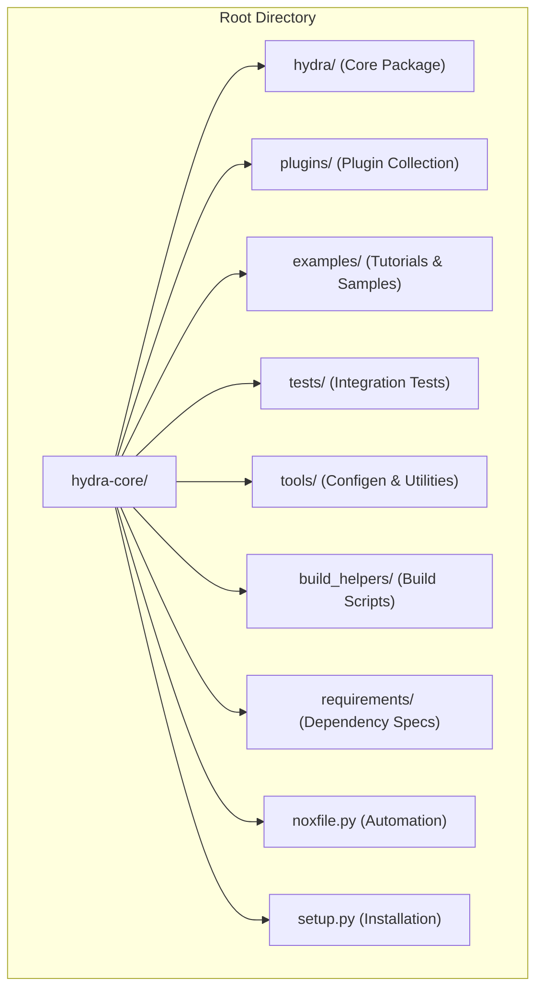
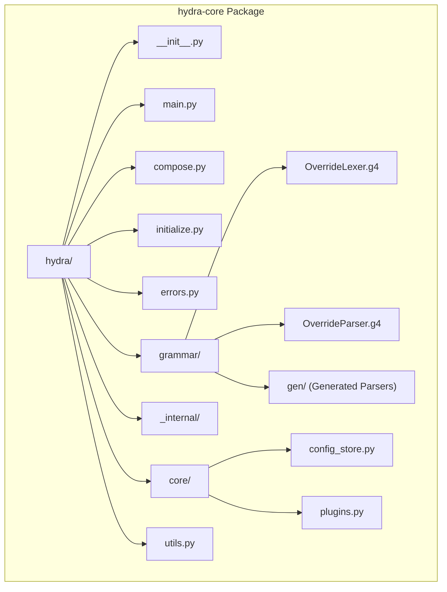
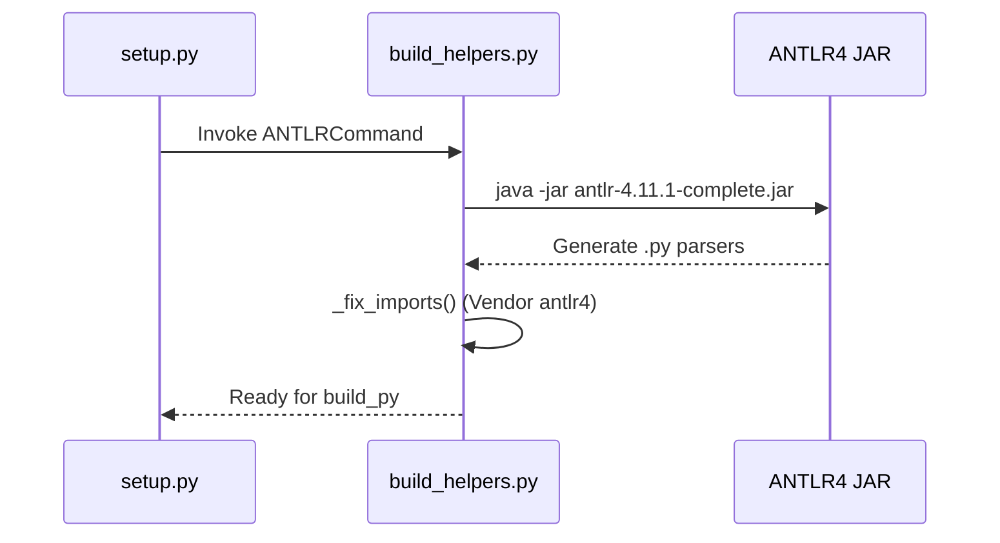

<!-- source: DeepWiki mcp.deepwiki.com · repo facebookresearch/hydra · page 4.1 Project Structure · fetched 2026-10-21 -->

# Project Structure

Relevant source files

The following files were used as context for generating this wiki page:

- [.flake8](.flake8)
- [.gitignore](.gitignore)
- [.isort.cfg](.isort.cfg)
- [.pre-commit-config.yaml](.pre-commit-config.yaml)
- [.yamllint](.yamllint)
- [README.md](README.md)
- [build_helpers/bin/antlr-4.11.1-complete.jar](build_helpers/bin/antlr-4.11.1-complete.jar)
- [build_helpers/bin/antlr4](build_helpers/bin/antlr4)
- [build_helpers/bin/grun](build_helpers/bin/grun)
- [build_helpers/build_helpers.py](build_helpers/build_helpers.py)
- [hydra/__init__.py](hydra/__init__.py)
- [hydra/errors.py](hydra/errors.py)
- [news/2699.maintenance](news/2699.maintenance)
- [noxfile.py](noxfile.py)
- [plugins/hydra_optuna_sweeper/MANIFEST.in](plugins/hydra_optuna_sweeper/MANIFEST.in)
- [plugins/hydra_optuna_sweeper/README.md](plugins/hydra_optuna_sweeper/README.md)
- [plugins/hydra_optuna_sweeper/tests/__init__.py](plugins/hydra_optuna_sweeper/tests/__init__.py)
- [pyproject.toml](pyproject.toml)
- [requirements/dev.txt](requirements/dev.txt)
- [setup.py](setup.py)
- [tests/test_errors.py](tests/test_errors.py)
- [tests/test_examples/test_advanced_package_overrides.py](tests/test_examples/test_advanced_package_overrides.py)
- [tests/test_examples/test_configure_hydra.py](tests/test_examples/test_configure_hydra.py)
- [tests/test_examples/test_instantiate_examples.py](tests/test_examples/test_instantiate_examples.py)
- [tests/test_examples/test_patterns.py](tests/test_examples/test_patterns.py)
- [tests/test_examples/test_structured_configs_tutorial.py](tests/test_examples/test_structured_configs_tutorial.py)
- [tests/test_examples/test_tutorials_basic.py](tests/test_examples/test_tutorials_basic.py)

This document outlines the organization of the Hydra codebase, including its directory structure, key files, and how different components relate to each other. It provides a roadmap for developers who want to understand or contribute to the Hydra framework.

## Overall Repository Structure

The Hydra repository is a monorepo containing the core framework, a collection of first-party plugins, and supporting tools for building and testing.

Sources: [setup.py:34-44](), [noxfile.py:16-36](), [pyproject.toml:46-69]()

## Core Package Structure (`hydra/`)

The `hydra/` directory contains the `hydra-core` source code. It is responsible for configuration composition, the defaults list, and the primary execution lifecycle.

### Key Components

| Path | Purpose |
|------|---------|
| `hydra/__init__.py` | Defines the framework version and exports public APIs like `main`, `compose`, and `initialize`. [hydra/__init__.py:4-23]() |
| `hydra/main.py` | Implements the `@hydra.main()` decorator used to entry-point applications. [hydra/__init__.py:7]() |
| `hydra/errors.py` | Defines the exception hierarchy, including `MissingConfigException` and `InstantiationException`. [hydra/errors.py:5-39]() |
| `hydra/grammar/` | Contains ANTLR4 grammar files for the Hydra Override DSL. [build_helpers/build_helpers.py:183-186]() |
| `hydra/core/` | Internal registry systems like the `ConfigStore` and `Plugins` discovery logic. [hydra/core/plugins.py:44-74]() |

Sources: [hydra/__init__.py:1-24](), [hydra/errors.py:1-40](), [build_helpers/build_helpers.py:173-211]()

## Plugins and Extensions (`plugins/`)

Hydra uses a plugin architecture to support various backends for launching jobs (Launchers) and performing parameter sweeps (Sweepers). Plugins are located in the `plugins/` directory and are developed as independent packages within the `hydra_plugins` namespace.

### Plugin Types
*   **Sweepers**: Implement hyperparameter optimization (e.g., `hydra-optuna-sweeper`).
*   **Launchers**: Manage job execution (e.g., `hydra-submitit-launcher`).
*   **Config Sources**: Provide alternative backends for loading YAMLs.

The `noxfile.py` contains logic to discover and test these plugins independently. [noxfile.py:187-216]()

Sources: [noxfile.py:31-33](), [noxfile.py:107-116](), [pyproject.toml:27-29]()

## Build and Automation System

Hydra uses `nox` for task automation and custom `setuptools` commands for code generation.

### Build Helpers (`build_helpers/`)
The `build_helpers/` directory contains logic to integrate ANTLR parser generation into the standard Python build lifecycle.

*   **`ANTLRCommand`**: Compiles `.g4` files into Python source in `hydra/grammar/gen/`. [build_helpers/build_helpers.py:173-205]()
*   **`_fix_imports`**: Post-processes generated files to use vendored `antlr4` inside `omegaconf`. [build_helpers/build_helpers.py:212-228]()

### Nox Sessions
The `noxfile.py` defines the CI/CD pipeline, supporting multiple Python versions (3.9 to 3.14). [noxfile.py:18]()

| Session | Action |
|---------|--------|
| `test_core` | Runs `pytest` on the `hydra/` package. [noxfile.py:36]() |
| `test_plugins` | Installs and tests selected plugins. [noxfile.py:107-113]() |
| `lint` | Runs `black`, `isort`, `flake8`, and `mypy`. [.pre-commit-config.yaml:1-27]() |

Sources: [setup.py:26-33](), [build_helpers/build_helpers.py:150-171](), [noxfile.py:18-29]()

## Supporting Directories

### `examples/`
Contains tutorials and sample applications used for both documentation and integration testing.
*   **Basic Tutorials**: Simple CLI apps, logging, and config groups. [tests/test_examples/test_tutorials_basic.py:39-225]()
*   **Structured Configs**: Examples demonstrating type-safe configurations using Python dataclasses. [tests/test_examples/test_structured_configs_tutorial.py:19-183]()

### `tests/`
Global integration tests that verify Hydra's behavior across different environments.
*   Uses `pytest` and custom runners like `run_python_script`. [tests/test_examples/test_tutorials_basic.py:48]()
*   Verifies tutorial code remains functional. [tests/test_examples/test_tutorials_basic.py:16-22]()

### `tools/`
Contains standalone utilities like `configen`, which generates structured configs from existing Python libraries. [pyproject.toml:58]()

Sources: [tests/test_examples/test_tutorials_basic.py:1-25](), [tests/test_examples/test_structured_configs_tutorial.py:1-16](), [pyproject.toml:46-69]()

---

