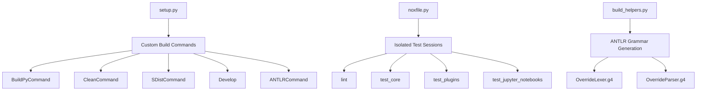
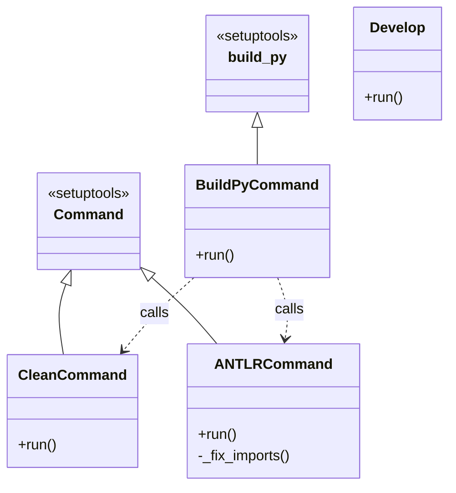
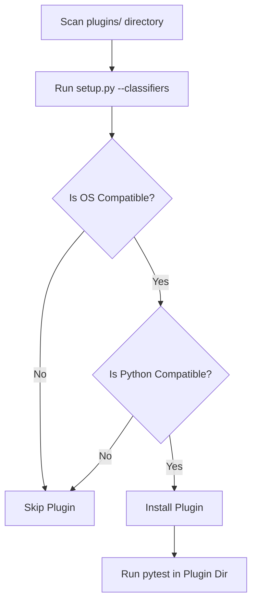

<!-- source: DeepWiki mcp.deepwiki.com · repo facebookresearch/hydra · page 4.2 Build System · fetched 2026-10-21 -->

# Build System

Relevant source files

The following files were used as context for generating this wiki page:

- [.gitignore](.gitignore)
- [.pre-commit-config.yaml](.pre-commit-config.yaml)
- [README.md](README.md)
- [build_helpers/bin/antlr-4.11.1-complete.jar](build_helpers/bin/antlr-4.11.1-complete.jar)
- [build_helpers/bin/antlr4](build_helpers/bin/antlr4)
- [build_helpers/bin/grun](build_helpers/bin/grun)
- [build_helpers/build_helpers.py](build_helpers/build_helpers.py)
- [hydra/__init__.py](hydra/__init__.py)
- [hydra/errors.py](hydra/errors.py)
- [news/2699.maintenance](news/2699.maintenance)
- [noxfile.py](noxfile.py)
- [requirements/dev.txt](requirements/dev.txt)
- [setup.py](setup.py)
- [tests/test_errors.py](tests/test_errors.py)
- [tests/test_examples/test_advanced_package_overrides.py](tests/test_examples/test_advanced_package_overrides.py)
- [tests/test_examples/test_configure_hydra.py](tests/test_examples/test_configure_hydra.py)
- [tests/test_examples/test_instantiate_examples.py](tests/test_examples/test_instantiate_examples.py)
- [tests/test_examples/test_patterns.py](tests/test_examples/test_patterns.py)
- [tests/test_examples/test_structured_configs_tutorial.py](tests/test_examples/test_structured_configs_tutorial.py)
- [tests/test_examples/test_tutorials_basic.py](tests/test_examples/test_tutorials_basic.py)
- [tools/release/README.md](tools/release/README.md)
- [tools/release/conf/config.yaml](tools/release/conf/config.yaml)
- [tools/release/conf/packages/configen.yaml](tools/release/conf/packages/configen.yaml)
- [tools/release/conf/packages/hydra.yaml](tools/release/conf/packages/hydra.yaml)
- [tools/release/conf/packages/hydra_ax_sweeper.yaml](tools/release/conf/packages/hydra_ax_sweeper.yaml)
- [tools/release/conf/packages/hydra_colorlog.yaml](tools/release/conf/packages/hydra_colorlog.yaml)
- [tools/release/conf/packages/hydra_joblib_launcher.yaml](tools/release/conf/packages/hydra_joblib_launcher.yaml)
- [tools/release/conf/packages/hydra_nevergrad_sweeper.yaml](tools/release/conf/packages/hydra_nevergrad_sweeper.yaml)
- [tools/release/conf/packages/hydra_optuna_sweeper.yaml](tools/release/conf/packages/hydra_optuna_sweeper.yaml)
- [tools/release/conf/packages/hydra_ray_launcher.yaml](tools/release/conf/packages/hydra_ray_launcher.yaml)
- [tools/release/conf/packages/hydra_rq_launcher.yaml](tools/release/conf/packages/hydra_rq_launcher.yaml)
- [tools/release/conf/packages/hydra_submitit_launcher.yaml](tools/release/conf/packages/hydra_submitit_launcher.yaml)
- [tools/release/release.py](tools/release/release.py)

## Purpose and Scope

This document describes the build system used by the Hydra framework. It covers the tools, processes, and configurations that manage how Hydra is built, packaged, tested, and distributed. This includes the automation suite, grammar generation for the override DSL, and the release tooling. For information about the project structure, see [Project Structure](#4.1). For the testing approach details, see [Testing Approach](#4.3).

## Overview

Hydra employs a custom build system that extends standard Python packaging tools with specialized components for grammar generation via ANTLR, multi-version testing via Nox, and complex plugin management. The build system is designed to support Hydra's needs as a highly extensible framework.

Sources: [setup.py:27-33](), [noxfile.py:326-673](), [build_helpers/build_helpers.py:150-171]()

## Core Build Components

### Package Configuration

Hydra uses `setuptools` for its basic package configuration. The package metadata, dependencies, and entry points are defined in `setup.py`.

Key configurations include:

| Configuration | Value |
|--------------|-------|
| Package Name | `hydra-core` [setup.py:34]() |
| Supported Python Versions | 3.9, 3.10, 3.11, 3.12, 3.13, 3.14 [noxfile.py:18]() |
| Minimum Python Req | >=3.9 [setup.py:56]() |
| Core Dependencies | Parsed from `requirements/requirements.txt` [setup.py:17-21]() |
| Entry Points | `pytest11` plugin for `hydra_pytest` [setup.py:58]() |

Sources: [setup.py:34-61](), [noxfile.py:18-23](), [requirements/requirements.txt:1-20]()

### Custom Build Commands

Hydra extends standard `setuptools` commands to ensure that generated components (like the ANTLR parser) are always present during installation or distribution.

The `BuildPyCommand`, `Develop`, and `SDistCommand` classes are wrapped to trigger `CleanCommand` and `run_antlr` before proceeding with standard operations [build_helpers/build_helpers.py:150-171]().

Sources: [build_helpers/build_helpers.py:93-237](), [setup.py:27-33]()

### Grammar Generation with ANTLR

Hydra uses ANTLR 4 to generate parsers for its configuration override syntax. The `ANTLRCommand` in `build_helpers/build_helpers.py` automates this process.

1.  **Execution**: It runs a specific version of the ANTLR jar (`antlr-4.11.1-complete.jar`) using `java` [build_helpers/build_helpers.py:188-197]().
2.  **Targets**: It processes `OverrideLexer.g4` and `OverrideParser.g4` [build_helpers/build_helpers.py:183-186]().
3.  **Post-processing**: The `_fix_imports` method modifies the generated Python files to redirect `antlr4` imports to a vendored version within `omegaconf.vendor` [build_helpers/build_helpers.py:212-237]().

Sources: [build_helpers/build_helpers.py:173-237](), [build_helpers/bin/antlr4:1-11]()

## Development Automation (Nox)

Hydra uses `nox` to manage development environments and tasks across multiple Python versions and operating systems.

### Configuration and Environment

The `noxfile.py` defines several environment variables to control the build:
- `PLUGINS`: Limits testing to specific plugins (default "ALL") [noxfile.py:33]().
- `SKIP_CORE_TESTS`: Skips the core `hydra-core` tests [noxfile.py:36]().
- `USE_OMEGACONF_DEV_VERSION`: Forces installation of pre-release OmegaConf [noxfile.py:37]().
- `INSTALL_EDITABLE_MODE`: Toggles between `pip install` and `pip install -e` [noxfile.py:25-29]().

### Key Nox Sessions

| Session | Function Name | Description |
|---------|---------------|-------------|
| `lint` | `lint(session)` | Runs `black`, `isort`, `flake8`, `mypy`, and `yamllint` [noxfile.py:326-368](). |
| `test_core` | `test_core(session)` | Installs `hydra-core` and runs `pytest` on `tests/` [noxfile.py:466-483](). |
| `test_plugins` | `test_plugins(session)` | Iterates through `plugins/` and `contrib/`, installing and testing compatible ones [noxfile.py:521-553](). |
| `test_jupyter_notebooks` | `test_jupyter_notebooks(session)` | Validates tutorial notebooks using `nbconvert` [noxfile.py:656-673](). |

Sources: [noxfile.py:18-40](), [noxfile.py:326-673]()

## Plugin Build and Test Logic

Hydra's build system treats plugins as first-class citizens. The `Plugin` dataclass tracks metadata like `abspath`, `module`, and `classifiers` [noxfile.py:45-54]().

### Plugin Selection Logic
The `list_plugins` function scans the `plugins/` and `contrib/` directories, using `setup.py --classifiers` to determine compatibility [noxfile.py:187-235](). A plugin is executed only if:
1.  It is not in the `blacklist` [noxfile.py:188]().
2.  Its Python version requirements match the current `session.python` [noxfile.py:270-273]().
3.  Its OS requirements match the current host OS [noxfile.py:275-278]().

Sources: [noxfile.py:45-54](), [noxfile.py:187-235](), [noxfile.py:246-290]()

## Release Tooling

The `tools/release/` directory contains utilities for managing the release lifecycle.

- **Release Script**: `tools/release/release.py` automates the coordination of releasing `hydra-core` alongside its numerous plugins.
- **Package Configuration**: The `tools/release/conf/packages/` directory contains YAML files (e.g., `hydra_ax_sweeper.yaml`, `hydra_submitit_launcher.yaml`) that define the release parameters for individual plugins.
- **Version Tracking**: Hydra's source of truth for versioning is `hydra/__init__.py` [hydra/__init__.py:4](), which is read by `find_version` in the build helpers [build_helpers/build_helpers.py:20-26]().

Sources: [tools/release/release.py:1-50](), [hydra/__init__.py:1-4](), [build_helpers/build_helpers.py:20-26]()

## Clean Command Implementation

The `CleanCommand` in `build_helpers/build_helpers.py` is more aggressive than the standard `setuptools` clean. It uses the `find` utility function to locate and remove:
- Generated grammar files in `hydra/grammar/gen/` [build_helpers/build_helpers.py:105]().
- `.egg-info` directories, `__pycache__`, and `.pytest_cache` [build_helpers/build_helpers.py:107-112]().
- Build artifacts and output/multirun directories from tests [build_helpers/build_helpers.py:110-112]().

Sources: [build_helpers/build_helpers.py:93-133]()

---

