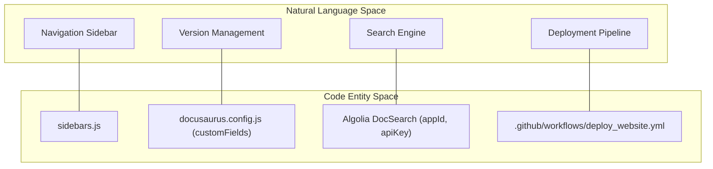
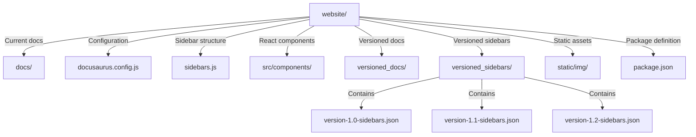
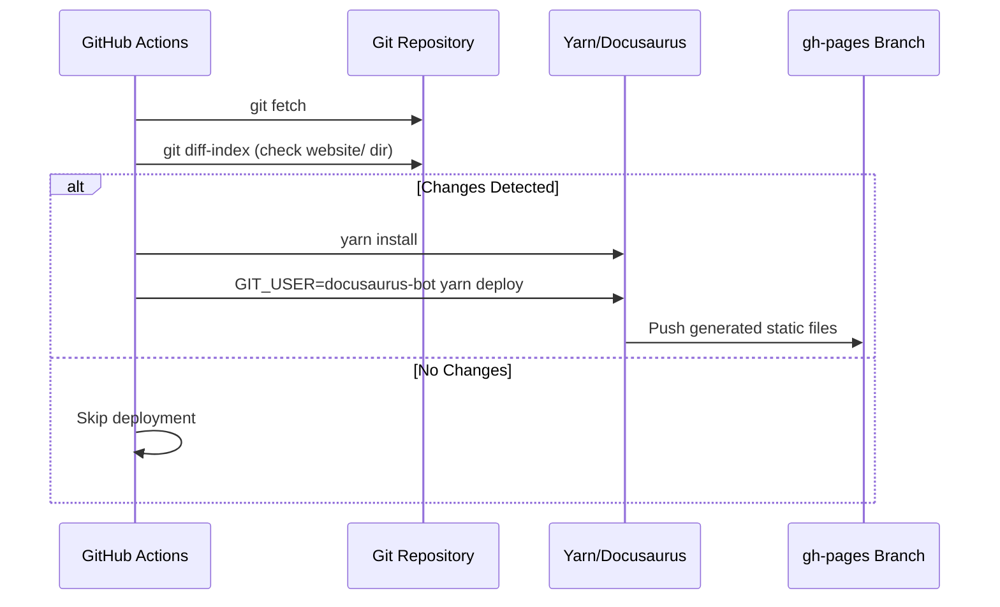

<!-- source: DeepWiki mcp.deepwiki.com · repo facebookresearch/hydra · page 4.4 Documentation System · fetched 2026-10-21 -->

# Documentation System

Relevant source files

The following files were used as context for generating this wiki page:

- [.github/actions/macos/action.yml](.github/actions/macos/action.yml)
- [.github/codeql.yml](.github/codeql.yml)
- [.github/workflows/codeql.yml](.github/workflows/codeql.yml)
- [.github/workflows/core_tests.yml](.github/workflows/core_tests.yml)
- [.github/workflows/deploy_website.yml](.github/workflows/deploy_website.yml)
- [website/docs/index.html](website/docs/index.html)
- [website/docusaurus.config.js](website/docusaurus.config.js)
- [website/package.json](website/package.json)
- [website/sidebars.js](website/sidebars.js)
- [website/src/components/GithubLink.jsx](website/src/components/GithubLink.jsx)
- [website/src/css/custom.css](website/src/css/custom.css)
- [website/src/pages/index.js](website/src/pages/index.js)
- [website/src/pages/styles.module.css](website/src/pages/styles.module.css)
- [website/static/img/Hydra-head.svg](website/static/img/Hydra-head.svg)
- [website/static/img/Hydra-plugins.svg](website/static/img/Hydra-plugins.svg)
- [website/static/img/Hydra-plugins2.svg](website/static/img/Hydra-plugins2.svg)
- [website/static/img/logo.svg](website/static/img/logo.svg)
- [website/static/img/undraw_product_teardown_hydra_plain.svg](website/static/img/undraw_product_teardown_hydra_plain.svg)
- [website/static/img/undraw_site_content_hydra_plain.svg](website/static/img/undraw_site_content_hydra_plain.svg)
- [website/versioned_sidebars/version-0.11-sidebars.json](website/versioned_sidebars/version-0.11-sidebars.json)
- [website/versioned_sidebars/version-1.0-sidebars.json](website/versioned_sidebars/version-1.0-sidebars.json)
- [website/versioned_sidebars/version-1.1-sidebars.json](website/versioned_sidebars/version-1.1-sidebars.json)
- [website/versioned_sidebars/version-1.2-sidebars.json](website/versioned_sidebars/version-1.2-sidebars.json)
- [website/versioned_sidebars/version-1.3-sidebars.json](website/versioned_sidebars/version-1.3-sidebars.json)
- [website/yarn.lock](website/yarn.lock)

## Purpose and Scope

The Hydra Documentation System is responsible for authoring, building, maintaining, and delivering Hydra's technical documentation to users and developers. This system is built on Docusaurus, a modern static website generator specialized for technical documentation. This page explains how the documentation infrastructure works, how versioning is managed, and how the CI/CD pipeline automates deployment.

## Documentation Architecture

The Hydra documentation uses Docusaurus 3 to generate a static website from Markdown content [website/package.json:13-14](). The system supports versioned documentation, search functionality via Algolia, syntax highlighting for languages like ANTLR4, and custom React components [website/docusaurus.config.js:41-54]().

### System Component Map
The following diagram maps high-level documentation features to the specific code entities and configurations that implement them.

Sources: [website/sidebars.js:1-195](), [website/docusaurus.config.js:21-46](), [.github/workflows/deploy_website.yml:1-40]()

## Directory Structure

The documentation source code is organized into a specific directory structure following Docusaurus conventions:

Sources: [website/package.json:1-56](), [website/docusaurus.config.js:1-152](), [website/sidebars.js:1-195]()

## Content Organization and Sidebar

The documentation is structured into logical categories defined in `sidebars.js`. The sidebar also includes a conditional function `AddFBInternalOnly` which injects Facebook-internal documentation routes if the `FB_INTERNAL` environment variable is set [website/sidebars.js:3-15]().

### Sidebar Hierarchy
The primary navigation structure is as follows:
*   **About**: Introduction and terminology [website/sidebars.js:19-21]().
*   **Tutorials**: Includes "Basic Tutorial" and "Structured Configs Tutorial" [website/sidebars.js:22-68]().
*   **Common Patterns**: Best practices for extending and specializing configs [website/sidebars.js:70-77]().
*   **Configuring Hydra**: Customizing job settings, logging, and working directories [website/sidebars.js:79-85]().
*   **Available Plugins**: Documentation for Launchers (Joblib, Ray, Submitit) and Sweepers (Ax, Nevergrad, Optuna) [website/sidebars.js:87-104]().
*   **Reference Manual**: Technical details on Override grammar, Defaults list, and the Compose API [website/sidebars.js:106-142]().
*   **Developer Guide**: Information for contributors regarding testing and release processes [website/sidebars.js:150-156]().

Sources: [website/sidebars.js:1-195]()

## Versioning System

Hydra documentation supports multiple versions simultaneously. The `docusaurus.config.js` file defines a mapping between documentation versions and their corresponding GitHub branches to facilitate deep-linking to source code [website/docusaurus.config.js:21-30]().

### Version-to-Branch Mapping
| Doc Version | GitHub Branch/URL |
| :--- | :--- |
| `current` / `1.4` | `https://github.com/facebookresearch/hydra/blob/main/` |
| `1.3` | `https://github.com/facebookresearch/hydra/blob/1.3_branch/` |
| `1.2` | `https://github.com/facebookresearch/hydra/blob/1.2_branch/` |
| `1.1` | `https://github.com/facebookresearch/hydra/blob/1.1_branch/` |
| `1.0` | `https://github.com/facebookresearch/hydra/blob/1.0_branch/` |

Sources: [website/docusaurus.config.js:22-30]()

The `GithubLink` component uses the `useActiveVersion` hook from `@docusaurus/plugin-content-docs/client` to resolve the correct base URL for the version the user is currently viewing [website/src/components/GithubLink.jsx:11-18]().

## Build and Deployment Pipeline

The documentation site is automatically deployed via GitHub Actions when changes are pushed to the `main` branch.

### Deployment Logic
The workflow `deploy_website.yml` performs the following steps:
1.  **Change Detection**: Checks if changes occurred within the `website/` subdirectory since the last successful deployment to the `gh-pages` branch [`.github/workflows/deploy_website.yml:25-29`]().
2.  **Environment Setup**: Configures `git` credentials for the `docusaurus-bot` user using a `WEBSITE_GITHUB_TOKEN` secret [`.github/workflows/deploy_website.yml:33-35`]().
3.  **Build and Publish**: Executes `yarn install` and `yarn deploy` [`.github/workflows/deploy_website.yml:36`](). The `yarn deploy` script triggers the `docusaurus deploy` command [website/package.json:10]().

Sources: [`.github/workflows/deploy_website.yml:1-40`](), [website/package.json:5-11]()

## Search Integration

Search is powered by Algolia DocSearch. The configuration is stored in `themeConfig` and includes the following identifiers:
*   **appId**: `KVTVP1D78C`
*   **apiKey**: `9585f41bc128c5a99dd9f22827e1e836`
*   **indexName**: `hydra`

Sources: [website/docusaurus.config.js:41-46]()

## Dependencies and Tooling

The documentation website relies on a modern JavaScript stack:
*   **Core**: `@docusaurus/core` (^3.0.1) and `@docusaurus/preset-classic` [website/package.json:13-14]().
*   **UI**: React (^18.2.0) and React-DOM [website/package.json:20-21]().
*   **Styling**: Custom CSS in `website/src/css/custom.css` utilizing Infima variables [website/src/css/custom.css:1-23]().
*   **Search**: Algolia dependencies including `@algolia/client-search` [website/yarn.lock:97-106]().

Sources: [website/package.json:12-22](), [website/yarn.lock:1-145]()

---

