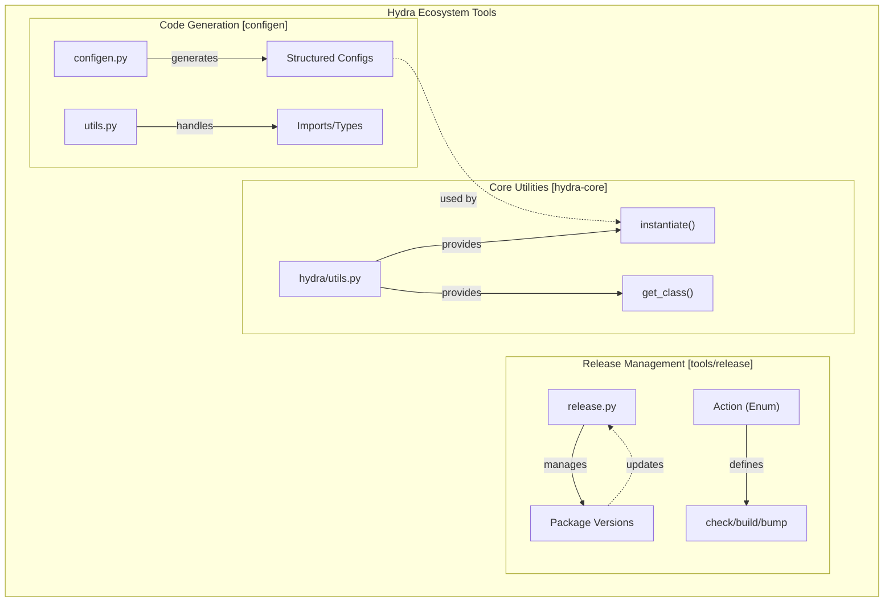
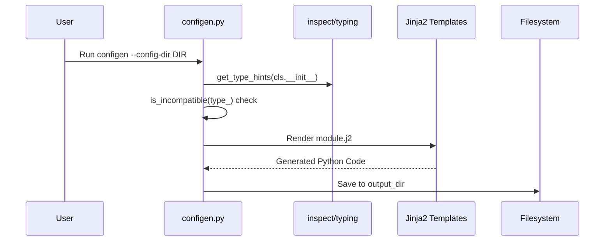

<!-- source: DeepWiki mcp.deepwiki.com · repo facebookresearch/hydra · page 5 Tools and Utilities · fetched 2026-10-21 -->

# Tools and Utilities

Relevant source files

The following files were used as context for generating this wiki page:

- [plugins/.isort.cfg](plugins/.isort.cfg)
- [tools/.isort.cfg](tools/.isort.cfg)
- [tools/configen/README.md](tools/configen/README.md)
- [tools/configen/conf/configen.yaml](tools/configen/conf/configen.yaml)
- [tools/configen/configen/config.py](tools/configen/configen/config.py)
- [tools/configen/configen/configen.py](tools/configen/configen/configen.py)
- [tools/configen/configen/samples/my_module.py](tools/configen/configen/samples/my_module.py)
- [tools/configen/configen/templates/module.j2](tools/configen/configen/templates/module.j2)
- [tools/configen/configen/templates/sample_config.yaml](tools/configen/configen/templates/sample_config.yaml)
- [tools/configen/configen/utils.py](tools/configen/configen/utils.py)
- [tools/configen/example/config.yaml](tools/configen/example/config.yaml)
- [tools/configen/example/config/configen/samples/my_module.py](tools/configen/example/config/configen/samples/my_module.py)
- [tools/configen/example/my_app.py](tools/configen/example/my_app.py)
- [tools/configen/setup.py](tools/configen/setup.py)
- [tools/configen/tests/gen-test-expected/configen.yaml](tools/configen/tests/gen-test-expected/configen.yaml)
- [tools/configen/tests/test_generate.py](tools/configen/tests/test_generate.py)
- [tools/configen/tests/test_modules/__init__.py](tools/configen/tests/test_modules/__init__.py)
- [tools/configen/tests/test_modules/default_flags/both.py](tools/configen/tests/test_modules/default_flags/both.py)
- [tools/configen/tests/test_modules/default_flags/convert.py](tools/configen/tests/test_modules/default_flags/convert.py)
- [tools/configen/tests/test_modules/default_flags/noflags.py](tools/configen/tests/test_modules/default_flags/noflags.py)
- [tools/configen/tests/test_modules/default_flags/recursive.py](tools/configen/tests/test_modules/default_flags/recursive.py)
- [tools/configen/tests/test_modules/generated.py](tools/configen/tests/test_modules/generated.py)
- [tools/release/README.md](tools/release/README.md)
- [tools/release/conf/config.yaml](tools/release/conf/config.yaml)
- [tools/release/conf/packages/configen.yaml](tools/release/conf/packages/configen.yaml)
- [tools/release/conf/packages/hydra.yaml](tools/release/conf/packages/hydra.yaml)
- [tools/release/conf/packages/hydra_ax_sweeper.yaml](tools/release/conf/packages/hydra_ax_sweeper.yaml)
- [tools/release/conf/packages/hydra_colorlog.yaml](tools/release/conf/packages/hydra_colorlog.yaml)
- [tools/release/conf/packages/hydra_joblib_launcher.yaml](tools/release/conf/packages/hydra_joblib_launcher.yaml)
- [tools/release/conf/packages/hydra_nevergrad_sweeper.yaml](tools/release/conf/packages/hydra_nevergrad_sweeper.yaml)
- [tools/release/conf/packages/hydra_optuna_sweeper.yaml](tools/release/conf/packages/hydra_optuna_sweeper.yaml)
- [tools/release/conf/packages/hydra_ray_launcher.yaml](tools/release/conf/packages/hydra_ray_launcher.yaml)
- [tools/release/conf/packages/hydra_rq_launcher.yaml](tools/release/conf/packages/hydra_rq_launcher.yaml)
- [tools/release/conf/packages/hydra_submitit_launcher.yaml](tools/release/conf/packages/hydra_submitit_launcher.yaml)
- [tools/release/release.py](tools/release/release.py)

This page describes the various tools and utilities provided by or for the Hydra framework. While Hydra's core functionality is focused on configuration management, it also includes several auxiliary tools that help developers work with the framework more effectively, manage releases, and generate structured configurations.

## Overview

Hydra provides both standalone tools and utility functions to assist with common tasks:

1.  **Standalone Tools**:
    *   **Configen**: A tool for automatically generating Structured Configs (dataclasses) from existing Python classes.
    *   **Release Tool**: A specialized script for managing versions and publishing packages within the Hydra ecosystem.

2.  **Utility Functions**:
    *   Path and directory utilities.
    *   Class and object locators.
    *   Configuration value helpers.

### System Mapping: Tools to Code Entities

The following diagram bridges the natural language concepts of Hydra tools to their specific implementations in the codebase.

Sources: [tools/configen/configen/configen.py:11-33](), [tools/release/release.py:22-49](), [tools/configen/setup.py:10-10]()

## Configen

Configen is a tool for automatically generating Structured Config classes that are compatible with Hydra's instantiation system. It analyzes Python classes and generates equivalent dataclass-based structured configs that can be used to instantiate those classes in a type-safe manner.

For details, see [Configen](#5.1).

### Purpose

The main benefits of Configen are:
1.  **Automation**: Automatically generates structured configs from existing classes [tools/configen/README.md:1-8]().
2.  **Type Safety**: Preserves type information from the original classes using `get_type_hints` [tools/configen/configen/configen.py:167-167]().
3.  **Compatibility**: Ensures generated configs work seamlessly with `hydra.utils.instantiate()` [tools/configen/README.md:3-3]().

### Configuration and Workflow

Configen requires a `ConfigenConf` object, typically loaded from a `configen.yaml` file [tools/configen/configen/config.py:24-34](). It uses Jinja2 templates to produce Python code [tools/configen/configen/configen.py:41-45]().

Sources: [tools/configen/configen/configen.py:91-129](), [tools/configen/configen/configen.py:156-172](), [tools/configen/configen/templates/module.j2:1-16]()

## Release Management Tool

Located in `tools/release/`, this utility manages the lifecycle of the various packages in the Hydra repository (core, plugins, and tools).

### Package Versioning
The tool uses a `Package` dataclass to track metadata, including the `version_file` (usually `__init__.py` or `setup.py`) [tools/release/release.py:34-40](). It can perform three primary actions:
*   **Check**: Compares local versions against the latest versions on PyPI [tools/release/release.py:186-200]().
*   **Build**: Generates sdists and wheels for unpublished packages [tools/release/release.py:201-207]().
*   **Bump**: Increments version numbers (dev, pre, post, or micro) in the source files [tools/release/release.py:124-145]().

### Version Bumping Logic
The `bump_version_in_file` function uses regex to locate `__version__` strings and replace them with the calculated next version [tools/release/release.py:148-163]().

Sources: [tools/release/release.py:22-26](), [tools/release/release.py:109-123](), [tools/release/release.py:148-163]()

## Utility Functions

Hydra provides various utility functions to help with common tasks when building applications.

| Function | Source | Description |
| :--- | :--- | :--- |
| `get_class` | [hydra/utils.py:22-45]() | Locates a class by its full import path. |
| `instantiate` | [hydra/utils.py:121-148]() | Creates an instance of a class based on a config. |
| `to_absolute_path` | [hydra/utils.py:88-105]() | Converts a path to an absolute path relative to the original working directory. |
| `get_original_cwd` | [hydra/utils.py:108-118]() | Returns the directory the application was started from. |

### Testing Utilities
Hydra includes a `pytest` plugin and helper functions like `run_python_script` and `chdir_hydra_root` to facilitate integration testing of Hydra-based CLI tools [tools/configen/tests/test_generate.py:12-15]().

Sources: [tools/configen/tests/test_generate.py:12-15](), [tools/release/release.py:15-15]()

---

