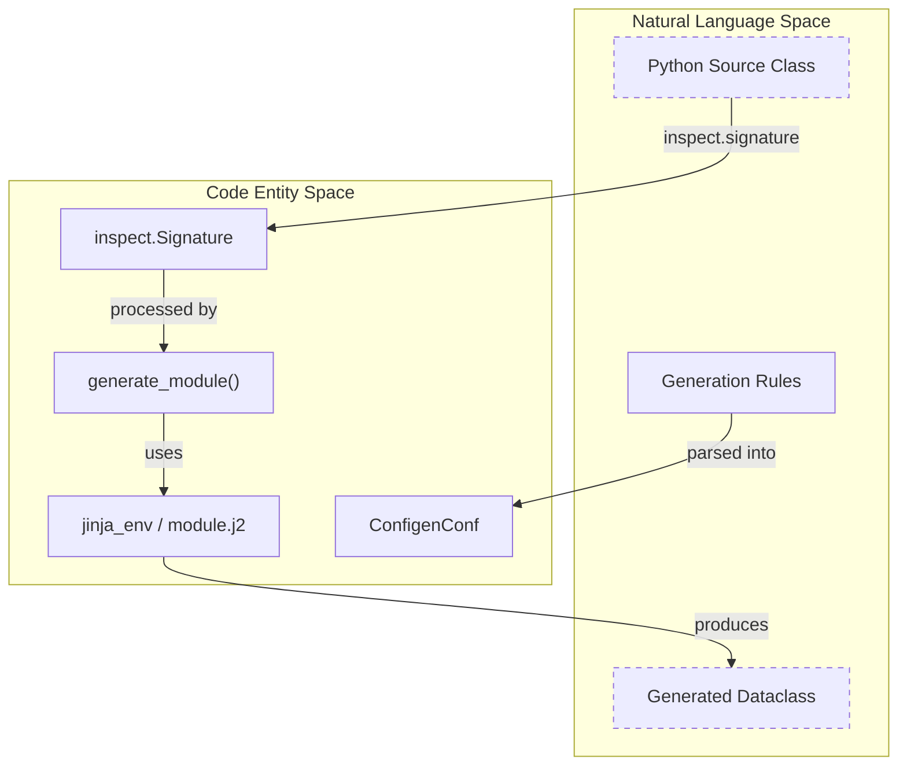
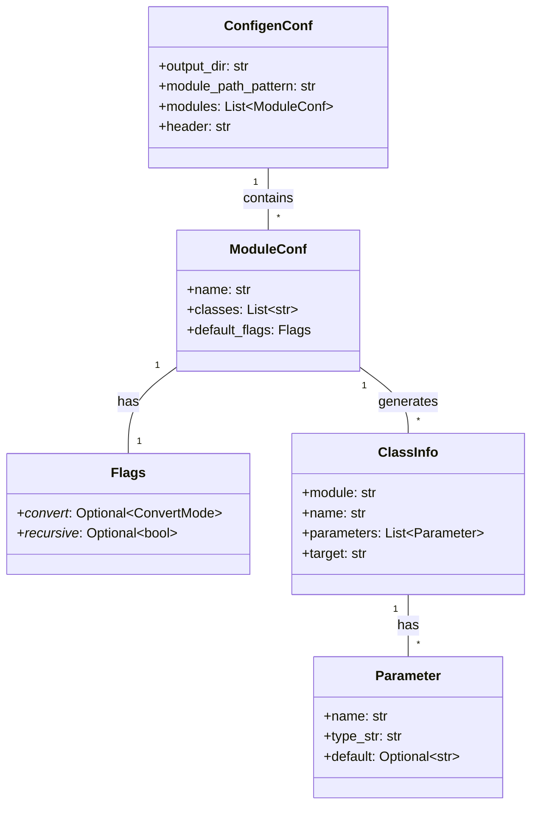
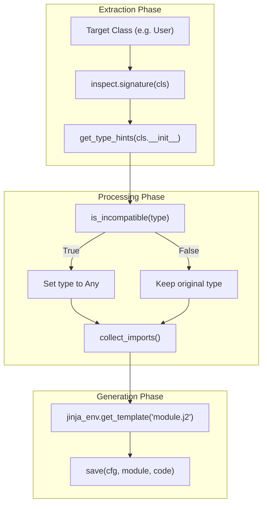

<!-- source: DeepWiki mcp.deepwiki.com · repo facebookresearch/hydra · page 5.1 Configen · fetched 2026-10-21 -->

# Configen

<details>
<summary>Relevant source files</summary>

The following files were used as context for generating this wiki page:

- [plugins/.isort.cfg](plugins/.isort.cfg)
- [tools/.isort.cfg](tools/.isort.cfg)
- [tools/configen/README.md](tools/configen/README.md)
- [tools/configen/conf/configen.yaml](tools/configen/conf/configen.yaml)
- [tools/configen/configen/config.py](tools/configen/configen/config.py)
- [tools/configen/configen/configen.py](tools/configen/configen/configen.py)
- [tools/configen/configen/samples/my_module.py](tools/configen/configen/samples/my_module.py)
- [tools/configen/configen/templates/module.j2](tools/configen/configen/templates/module.j2)
- [tools/configen/configen/templates/sample_config.yaml](tools/configen/configen/templates/sample_config.yaml)
- [tools/configen/configen/utils.py](tools/configen/configen/utils.py)
- [tools/configen/example/config.yaml](tools/configen/example/config.yaml)
- [tools/configen/example/config/configen/samples/my_module.py](tools/configen/example/config/configen/samples/my_module.py)
- [tools/configen/example/my_app.py](tools/configen/example/my_app.py)
- [tools/configen/setup.py](tools/configen/setup.py)
- [tools/configen/tests/gen-test-expected/configen.yaml](tools/configen/tests/gen-test-expected/configen.yaml)
- [tools/configen/tests/test_generate.py](tools/configen/tests/test_generate.py)
- [tools/configen/tests/test_modules/__init__.py](tools/configen/tests/test_modules/__init__.py)
- [tools/configen/tests/test_modules/default_flags/both.py](tools/configen/tests/test_modules/default_flags/both.py)
- [tools/configen/tests/test_modules/default_flags/convert.py](tools/configen/tests/test_modules/default_flags/convert.py)
- [tools/configen/tests/test_modules/default_flags/noflags.py](tools/configen/tests/test_modules/default_flags/noflags.py)
- [tools/configen/tests/test_modules/default_flags/recursive.py](tools/configen/tests/test_modules/default_flags/recursive.py)
- [tools/configen/tests/test_modules/generated.py](tools/configen/tests/test_modules/generated.py)

</details>


Configen is a code generation tool within the Hydra ecosystem that automatically generates structured configs (Python dataclasses) from existing Python module signatures. These structured configs can then be used with `hydra.utils.instantiate()` to create objects with proper type checking and validation.

## Purpose and Motivation

When using Hydra's instantiation system, it is helpful to have structured configs that define the expected configuration schema for a class. However, manually writing these configs for every class is tedious and error-prone. Configen automates this by:

1.  **Analyzing** the constructor parameters and type hints of target classes [tools/configen/configen/configen.py:163-183]().
2.  **Generating** appropriate structured config classes with matching parameters [tools/configen/configen/configen.py:216-222]().
3.  **Injecting** necessary metadata like the `_target_` field pointing to the original class [tools/configen/configen/templates/module.j2:12-12]().

This ensures that configs remain in sync with the underlying code and reduces boilerplate.

### Logic Flow: Natural Language to Code Entities
The following diagram maps the conceptual generation process to the specific Python functions and classes responsible for the transformation.


Sources: [tools/configen/configen/configen.py:41-45](), [tools/configen/configen/configen.py:156-167](), [tools/configen/configen/config.py:24-34]()

## Architecture and Components

Configen's internal structure is defined by dataclasses that mirror the YAML configuration schema.


Sources: [tools/configen/configen/config.py:11-34](), [tools/configen/configen/configen.py:76-88]()

### Component Details

*   **`ConfigenConf`**: The root configuration object. It defines the `output_dir` for generated files and the `module_path_pattern` template (e.g., `'config/{{module_path}}.py'`) [tools/configen/configen/config.py:24-30]().
*   **`ModuleConf`**: Specifies which classes from a specific Python module should be processed [tools/configen/configen/config.py:17-21]().
*   **`Flags`**: Allows setting Hydra-specific instantiation flags like `_convert_` and `_recursive_` globally for a module [tools/configen/configen/config.py:11-13]().
*   **`is_incompatible()`**: A critical utility function that determines if a Python type can be natively represented in an OmegaConf structured config. It checks for unsupported Unions, non-string/Enum dict keys, and complex types [tools/configen/configen/configen.py:91-129]().

## Workflow and Data Flow

Configen operates as a CLI tool that processes modules iteratively.

### Execution Steps
1.  **Initialization**: The `init_config()` function can create a template `configen.yaml` in a specified directory [tools/configen/configen/configen.py:49-62]().
2.  **Signature Extraction**: For each class in `ModuleConf`, Configen uses `inspect.signature` and `typing.get_type_hints` to resolve parameter types [tools/configen/configen/configen.py:165-167]().
3.  **Type Translation**:
    *   If a type is deemed incompatible by `is_incompatible()`, it is downgraded to `Any`, and the original type is added as a comment [tools/configen/configen/configen.py:181-187](), [tools/configen/configen/configen.py:208-212]().
    *   Imports are collected via `collect_imports()` and converted to strings via `convert_imports()` [tools/configen/configen/utils.py:20-63]().
4.  **Templating**: Data is passed to a Jinja2 environment (`jinja_env`) using the `module.j2` template [tools/configen/configen/configen.py:41-45](), [tools/configen/configen/templates/module.j2:1-17]().
5.  **Persistence**: The `save()` function renders the path and writes the generated code to disk [tools/configen/configen/configen.py:64-74]().

### Data Transformation Diagram
This diagram follows a single class through the generation pipeline.


Sources: [tools/configen/configen/configen.py:156-236](), [tools/configen/configen/configen.py:64-74](), [tools/configen/configen/utils.py:49-63]()

## Usage Examples

### Initial Setup
To bootstrap a project, use the `init_config_dir` parameter:
```bash
configen init_config_dir=conf
```
Sources: [tools/configen/README.md:12-23](), [tools/configen/configen/configen.py:49-62]()

### Configuration Example (`configen.yaml`)
```yaml
configen:
  output_dir: ${hydra:runtime.cwd}/gen
  module_path_pattern: 'config/{{module_path}}.py'
  modules:
    - name: my_module
      classes:
        - MyClass
      default_flags:
        _convert_: ALL
```
Sources: [tools/configen/conf/configen.yaml:5-31](), [tools/configen/configen/templates/sample_config.yaml:5-25]()

### Generated Output
For a class `User(age: int, name: str)`, Configen produces:
```python
@dataclass
class UserConf:
    _target_: str = "my_module.User"
    age: int = MISSING
    name: str = MISSING
```
Sources: [tools/configen/example/config/configen/samples/my_module.py:12-17](), [tools/configen/README.md:100-105]()

## Type and Default Value Handling

Configen applies specific rules to ensure the generated dataclasses are valid OmegaConf objects:

| Scenario | Handling Strategy | Code Reference |
| :--- | :--- | :--- |
| **List/Dict Defaults** | Converted to `field(default_factory=lambda: ...)` | [configen.py:192-195]() |
| **Incompatible Types** | Annotated as `Any` with a trailing comment | [configen.py:208-212]() |
| **Missing Values** | Assigned the `MISSING` sentinel from OmegaConf | [configen.py:213-214]() |
| **Optional Types** | Preserved via `_resolve_optional` | [configen.py:92-97]() |
| **Enums** | Supported as primitive types or dict keys | [configen.py:107-119]() |

Sources: [tools/configen/configen/configen.py:91-129](), [tools/configen/configen/configen.py:189-215](), [tools/configen/tests/test_modules/generated.py:70-87]()

---

