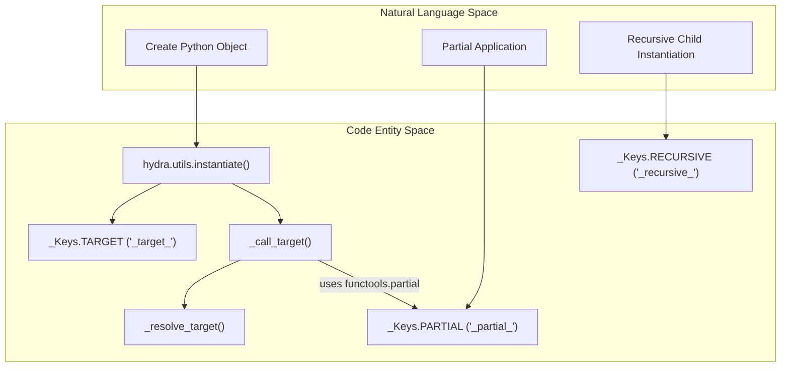
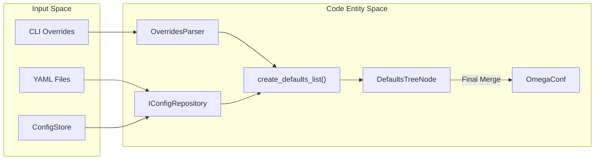

<!-- source: DeepWiki mcp.deepwiki.com · repo facebookresearch/hydra · page 6 Glossary · fetched 2026-10-21 -->

# Glossary

Relevant source files

The following files were used as context for generating this wiki page:

- [.pre-commit-config.yaml](.pre-commit-config.yaml)
- [README.md](README.md)
- [examples/tutorials/basic/your_first_hydra_app/3_using_config/my_app.py](examples/tutorials/basic/your_first_hydra_app/3_using_config/my_app.py)
- [hydra/__init__.py](hydra/__init__.py)
- [hydra/_internal/config_repository.py](hydra/_internal/config_repository.py)
- [hydra/_internal/defaults_list.py](hydra/_internal/defaults_list.py)
- [hydra/_internal/grammar/grammar_functions.py](hydra/_internal/grammar/grammar_functions.py)
- [hydra/_internal/instantiate/_instantiate2.py](hydra/_internal/instantiate/_instantiate2.py)
- [hydra/core/default_element.py](hydra/core/default_element.py)
- [hydra/core/override_parser/overrides_parser.py](hydra/core/override_parser/overrides_parser.py)
- [hydra/core/override_parser/overrides_visitor.py](hydra/core/override_parser/overrides_visitor.py)
- [hydra/core/override_parser/types.py](hydra/core/override_parser/types.py)
- [hydra/core/plugins.py](hydra/core/plugins.py)
- [hydra/errors.py](hydra/errors.py)
- [hydra/grammar/OverrideLexer.g4](hydra/grammar/OverrideLexer.g4)
- [hydra/grammar/OverrideParser.g4](hydra/grammar/OverrideParser.g4)
- [hydra/utils.py](hydra/utils.py)
- [news/1547.feature](news/1547.feature)
- [news/2570.bugfix](news/2570.bugfix)
- [news/3001.bugfix](news/3001.bugfix)
- [news/3074.api_change](news/3074.api_change)
- [noxfile.py](noxfile.py)
- [requirements/dev.txt](requirements/dev.txt)
- [setup.py](setup.py)
- [tests/__init__.py](tests/__init__.py)
- [tests/defaults_list/__init__.py](tests/defaults_list/__init__.py)
- [tests/defaults_list/test_defaults_list.py](tests/defaults_list/test_defaults_list.py)
- [tests/defaults_list/test_defaults_tree.py](tests/defaults_list/test_defaults_tree.py)
- [tests/instantiate/__init__.py](tests/instantiate/__init__.py)
- [tests/instantiate/test_helpers.py](tests/instantiate/test_helpers.py)
- [tests/instantiate/test_instantiate.py](tests/instantiate/test_instantiate.py)
- [tests/instantiate/test_positional.py](tests/instantiate/test_positional.py)
- [tests/test_apps/app_with_cfg_decorated/my_app.py](tests/test_apps/app_with_cfg_decorated/my_app.py)
- [tests/test_errors.py](tests/test_errors.py)
- [tests/test_examples/test_advanced_package_overrides.py](tests/test_examples/test_advanced_package_overrides.py)
- [tests/test_examples/test_configure_hydra.py](tests/test_examples/test_configure_hydra.py)
- [tests/test_examples/test_instantiate_examples.py](tests/test_examples/test_instantiate_examples.py)
- [tests/test_examples/test_patterns.py](tests/test_examples/test_patterns.py)
- [tests/test_examples/test_structured_configs_tutorial.py](tests/test_examples/test_structured_configs_tutorial.py)
- [tests/test_examples/test_tutorials_basic.py](tests/test_examples/test_tutorials_basic.py)
- [tests/test_hydra_cli_errors.py](tests/test_hydra_cli_errors.py)
- [tests/test_hydra_context_warnings.py](tests/test_hydra_context_warnings.py)
- [tests/test_internal_utils.py](tests/test_internal_utils.py)
- [tests/test_overrides_parser.py](tests/test_overrides_parser.py)
- [tests/test_utils.py](tests/test_utils.py)
- [website/docs/advanced/defaults_list.md](website/docs/advanced/defaults_list.md)
- [website/docs/advanced/instantiate_objects/overview.md](website/docs/advanced/instantiate_objects/overview.md)
- [website/docs/advanced/override_grammar/basic.md](website/docs/advanced/override_grammar/basic.md)
- [website/docs/advanced/override_grammar/extended.md](website/docs/advanced/override_grammar/extended.md)
- [website/docs/advanced/terminology.md](website/docs/advanced/terminology.md)
- [website/docs/tutorials/basic/running_your_app/2_multirun.md](website/docs/tutorials/basic/running_your_app/2_multirun.md)
- [website/docs/tutorials/basic/your_first_app/2_config_file.md](website/docs/tutorials/basic/your_first_app/2_config_file.md)
- [website/docs/tutorials/basic/your_first_app/3_using_config.md](website/docs/tutorials/basic/your_first_app/3_using_config.md)
- [website/docs/tutorials/basic/your_first_app/4_config_groups.md](website/docs/tutorials/basic/your_first_app/4_config_groups.md)
- [website/docs/tutorials/basic/your_first_app/5_defaults.md](website/docs/tutorials/basic/your_first_app/5_defaults.md)
- [website/docs/tutorials/basic/your_first_app/6_composition.md](website/docs/tutorials/basic/your_first_app/6_composition.md)
- [website/versioned_docs/version-0.11/tutorial/3_config_groups.md](website/versioned_docs/version-0.11/tutorial/3_config_groups.md)
- [website/versioned_docs/version-0.11/tutorial/4_defaults.md](website/versioned_docs/version-0.11/tutorial/4_defaults.md)
- [website/versioned_docs/version-0.11/tutorial/5_composition.md](website/versioned_docs/version-0.11/tutorial/5_composition.md)
- [website/versioned_docs/version-1.0/tutorials/basic/running_your_app/2_multirun.md](website/versioned_docs/version-1.0/tutorials/basic/running_your_app/2_multirun.md)
- [website/versioned_docs/version-1.1/tutorials/basic/running_your_app/2_multirun.md](website/versioned_docs/version-1.1/tutorials/basic/running_your_app/2_multirun.md)
- [website/versioned_docs/version-1.3/advanced/defaults_list.md](website/versioned_docs/version-1.3/advanced/defaults_list.md)
- [website/versioned_docs/version-1.3/advanced/instantiate_objects/overview.md](website/versioned_docs/version-1.3/advanced/instantiate_objects/overview.md)
- [website/versioned_docs/version-1.3/advanced/override_grammar/basic.md](website/versioned_docs/version-1.3/advanced/override_grammar/basic.md)
- [website/versioned_docs/version-1.3/advanced/override_grammar/extended.md](website/versioned_docs/version-1.3/advanced/override_grammar/extended.md)
- [website/versioned_docs/version-1.3/advanced/overriding_packages.md](website/versioned_docs/version-1.3/advanced/overriding_packages.md)
- [website/versioned_docs/version-1.3/advanced/terminology.md](website/versioned_docs/version-1.3/advanced/terminology.md)
- [website/versioned_docs/version-1.3/configure_hydra/job.md](website/versioned_docs/version-1.3/configure_hydra/job.md)
- [website/versioned_docs/version-1.3/experimental/callbacks.md](website/versioned_docs/version-1.3/experimental/callbacks.md)
- [website/versioned_docs/version-1.3/patterns/specializing_config.md](website/versioned_docs/version-1.3/patterns/specializing_config.md)

This glossary defines technical terms, jargon, and abbreviations specific to the Hydra codebase. It serves as a reference for onboarding engineers to understand the underlying implementation and data structures.

## Core Configuration Terms

### ConfigStore
A singleton registry used to store and retrieve structured configurations (dataclasses or dictionaries) by name. It allows users to register default configurations in Python code rather than just YAML files.
*   **Implementation**: `hydra.core.config_store.ConfigStore` [[hydra/_internal/defaults_list.py:14-14]()]
*   **Usage**: Used to provide "schema" or default values for config groups.

### Defaults List
A list of configuration files or groups that Hydra should load and compose. It is defined under the `defaults` key in a config file.
*   **Implementation**: Managed via `hydra._internal.defaults_list.create_defaults_list` [[tests/defaults_list/test_defaults_list.py:9-9]()]
*   **Key Logic**: Resolves the order of composition, handling special tokens like `_self_` [[tests/defaults_list/test_defaults_list.py:38-52]()].

### _self_
A special directive in a `defaults` list that determines the relative order of the current config's content vs. its inherited defaults.
*   **Behavior**: If `_self_` is at the top, the current config's values are applied before defaults (defaults override local). If at the bottom, local values override defaults [[tests/defaults_list/test_defaults_list.py:38-52]()].

### Config Composition
The process of merging multiple configuration sources (files, ConfigStore, command-line overrides) into a single `OmegaConf` object.
*   **Logic**: Handled by `hydra.compose` [[hydra/__init__.py:10-10]()] and internal repository logic [[hydra/_internal/config_repository.py:1-1]()].

## Instantiation System

### _target_
A reserved key in a configuration dictionary that specifies the fully qualified path to a Python class or function to be instantiated/called.
*   **Code Pointer**: `hydra._internal.instantiate._instantiate2._Keys.TARGET` [[hydra/_internal/instantiate/_instantiate2.py:67-67]()]
*   **Resolution**: Resolved using `_locate()` to find the actual Python entity [[hydra/_internal/instantiate/_instantiate2.py:194-194]()].

### _recursive_
A boolean flag in the config that determines if nested dictionaries with a `_target_` key should also be instantiated automatically.
*   **Default**: True [[tests/instantiate/test_instantiate.py:89-91]()].
*   **Code Pointer**: `hydra._internal.instantiate._instantiate2._Keys.RECURSIVE` [[hydra/_internal/instantiate/_instantiate2.py:69-69]()]

### _partial_
A flag that tells `hydra.utils.instantiate` to return a `functools.partial` object instead of calling the target immediately.
*   **Code Pointer**: `hydra._internal.instantiate._instantiate2._Keys.PARTIAL` [[hydra/_internal/instantiate/_instantiate2.py:71-71]()]
*   **Logic**: Wraps the target in `functools.partial` with provided arguments [[hydra/_internal/instantiate/_instantiate2.py:128-128]()].

### Conversion (ConvertMode)
Determines how `OmegaConf` containers are converted during instantiation (e.g., to primitive Python dicts/lists).
*   **Modes**: `none`, `partial`, `all`, `object` [[hydra/utils.py:19-19]()].

### Code to Entity Mapping: Instantiation
The following diagram bridges the "Natural Language" requirements for creating objects to the specific code entities in the `instantiate` module.

Sources: [[hydra/utils.py:17-18]()], [[hydra/_internal/instantiate/_instantiate2.py:64-72]()], [[hydra/_internal/instantiate/_instantiate2.py:97-145]()]

## Override and Grammar Jargon

### Override Parser
The component responsible for parsing command-line strings (e.g., `db=mysql`, `+model.lr=0.01`) into internal `Override` objects.
*   **Implementation**: `hydra.core.override_parser.overrides_parser.OverridesParser` [[hydra/core/override_parser/overrides_parser.py:1-1]()]
*   **Grammar**: Uses ANTLR4 files `OverrideLexer.g4` and `OverrideParser.g4` [[hydra/grammar/OverrideParser.g4:1-1]()].

### Sweep
A multi-run execution where a parameter takes multiple values (e.g., `lr=0.01,0.1`).
*   **Implementation**: Parsed as `ChoiceSweep` or `RangeSweep` [[tests/test_overrides_parser.py:22-33]()].

### Override Prefixes
Special characters at the start of an override string that modify its behavior:
*   `+`: Add a new key that doesn't exist.
*   `++`: Override or add (force add).
*   `~`: Delete a key.
*   **Implementation**: Handled in the `Overrides` class during defaults list creation [[hydra/_internal/defaults_list.py:79-92]()].

## Execution Lifecycle

### Task Function
The user-defined function decorated with `@hydra.main`. It receives the composed configuration.
*   **Type Alias**: `hydra.types.TaskFunction` [[hydra/__init__.py:8-8]()]

### Original Working Directory
The directory from which the Hydra application was initially launched. Since Hydra changes the `cwd` to the output directory, this is stored to allow users to reference local files.
*   **Access**: `hydra.utils.get_original_cwd()` [[hydra/utils.py:88-98]()]

### Hydra Config Mapping
This diagram maps the high-level concept of "Configuration Flow" to the internal classes that manage it.

Sources: [[hydra/_internal/defaults_list.py:13-22]()], [[hydra/core/override_parser/overrides_parser.py:1-1]()], [[tests/defaults_list/test_defaults_tree.py:9-14]()]

## Internal Tooling

### Nox
The automation tool used for running tests across multiple Python versions and operating systems.
*   **File**: `noxfile.py` [[noxfile.py:1-1]()]
*   **Key Logic**: Manages `pip` installations and `pytest` execution for core and plugins [[noxfile.py:93-116]()].

### Configen
A tool used to generate Structured Configs (Python dataclasses) from existing library code (like PyTorch).
*   **Location**: `tools/configen` [[README.md:57-57]()]

## Table of Terminology Summary

| Term | File Path Pointer | Role |
| :--- | :--- | :--- |
| `main` | [[hydra/main.py:1-1]()] | Entry point decorator for Hydra applications. |
| `compose` | [[hydra/compose.py:1-1]()] | API to generate config without a decorator. |
| `_locate` | [[hydra/_internal/utils.py:11-11]()] | Helper to import string dot-paths. |
| `DefaultsTreeNode` | [[hydra/core/default_element.py:1-1]()] | Internal tree representation of the defaults list. |
| `IConfigRepository` | [[hydra/_internal/config_repository.py:1-1]()] | Interface for fetching config data from various sources. |

Sources: [[hydra/utils.py:1-149]()], [[hydra/_internal/instantiate/_instantiate2.py:1-224]()], [[hydra/_internal/defaults_list.py:1-188]()], [[noxfile.py:1-216]()]