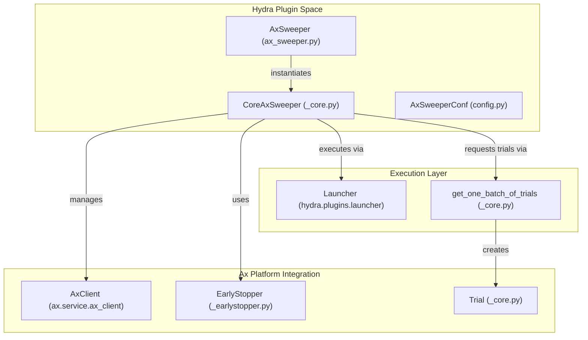
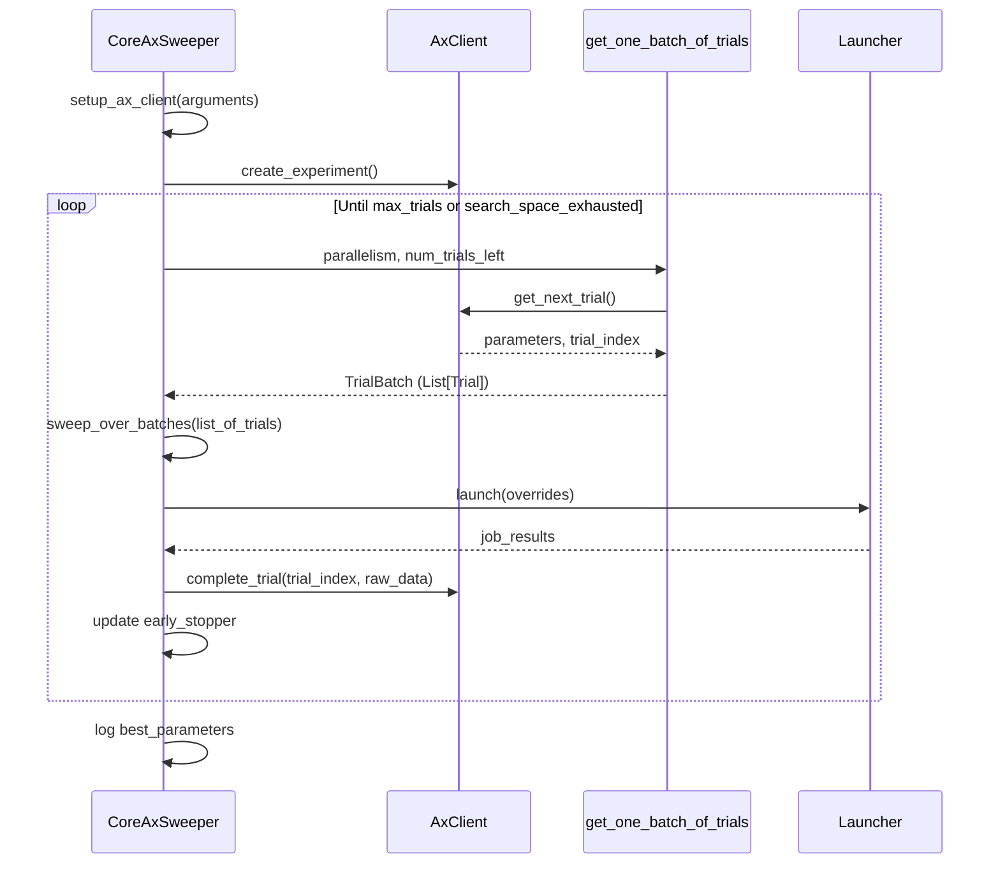
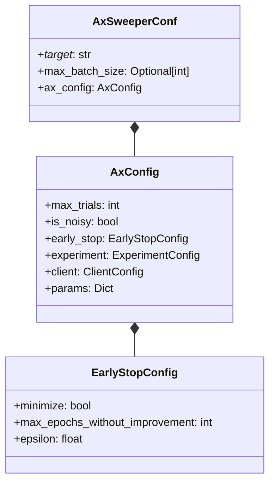

<!-- source: DeepWiki mcp.deepwiki.com · repo facebookresearch/hydra · extra page Ax Sweeper · fetched 2026-10-21 -->

# Ax Sweeper

Relevant source files

The following files were used as context for generating this wiki page:

- [examples/plugins/example_configsource_plugin/setup.py](examples/plugins/example_configsource_plugin/setup.py)
- [examples/plugins/example_generic_plugin/setup.py](examples/plugins/example_generic_plugin/setup.py)
- [examples/plugins/example_launcher_plugin/setup.py](examples/plugins/example_launcher_plugin/setup.py)
- [examples/plugins/example_registered_plugin/setup.py](examples/plugins/example_registered_plugin/setup.py)
- [examples/plugins/example_searchpath_plugin/setup.py](examples/plugins/example_searchpath_plugin/setup.py)
- [examples/plugins/example_sweeper_plugin/setup.py](examples/plugins/example_sweeper_plugin/setup.py)
- [plugins/hydra_ax_sweeper/README.md](plugins/hydra_ax_sweeper/README.md)
- [plugins/hydra_ax_sweeper/example/conf/config.yaml](plugins/hydra_ax_sweeper/example/conf/config.yaml)
- [plugins/hydra_ax_sweeper/hydra_plugins/hydra_ax_sweeper/_core.py](plugins/hydra_ax_sweeper/hydra_plugins/hydra_ax_sweeper/_core.py)
- [plugins/hydra_ax_sweeper/hydra_plugins/hydra_ax_sweeper/ax_sweeper.py](plugins/hydra_ax_sweeper/hydra_plugins/hydra_ax_sweeper/ax_sweeper.py)
- [plugins/hydra_ax_sweeper/hydra_plugins/hydra_ax_sweeper/config.py](plugins/hydra_ax_sweeper/hydra_plugins/hydra_ax_sweeper/config.py)
- [plugins/hydra_ax_sweeper/setup.py](plugins/hydra_ax_sweeper/setup.py)
- [plugins/hydra_ax_sweeper/tests/apps/polynomial.yaml](plugins/hydra_ax_sweeper/tests/apps/polynomial.yaml)
- [plugins/hydra_ax_sweeper/tests/config/config.yaml](plugins/hydra_ax_sweeper/tests/config/config.yaml)
- [plugins/hydra_ax_sweeper/tests/config/params/basic.yaml](plugins/hydra_ax_sweeper/tests/config/params/basic.yaml)
- [plugins/hydra_ax_sweeper/tests/config/quadratic/basic.yaml](plugins/hydra_ax_sweeper/tests/config/quadratic/basic.yaml)
- [plugins/hydra_ax_sweeper/tests/test_ax_sweeper_plugin.py](plugins/hydra_ax_sweeper/tests/test_ax_sweeper_plugin.py)
- [plugins/hydra_colorlog/setup.py](plugins/hydra_colorlog/setup.py)
- [plugins/hydra_joblib_launcher/setup.py](plugins/hydra_joblib_launcher/setup.py)
- [plugins/hydra_nevergrad_sweeper/setup.py](plugins/hydra_nevergrad_sweeper/setup.py)
- [plugins/hydra_optuna_sweeper/setup.py](plugins/hydra_optuna_sweeper/setup.py)
- [plugins/hydra_rq_launcher/setup.py](plugins/hydra_rq_launcher/setup.py)
- [plugins/hydra_submitit_launcher/setup.py](plugins/hydra_submitit_launcher/setup.py)
- [website/docs/plugins/ax_sweeper.md](website/docs/plugins/ax_sweeper.md)

## Purpose and Scope

The Ax Sweeper is a Hydra plugin that integrates with Facebook's Ax platform to provide Bayesian optimization capabilities for hyperparameter tuning. This document covers the Ax Sweeper architecture, configuration, and usage patterns, including the lifecycle of the `AxClient`, parameter mapping from Hydra overrides to Ax types, and the early stopping mechanism.

Sources:
- [plugins/hydra_ax_sweeper/setup.py:9-13]()
- [plugins/hydra_ax_sweeper/hydra_plugins/hydra_ax_sweeper/ax_sweeper.py:11-31]()
- [website/docs/plugins/ax_sweeper.md:15-16]()

## Architecture Overview

The Ax Sweeper fits into Hydra's plugin architecture as a specialized sweeper implementation. It bridges the gap between Hydra's configuration/launcher system and the Ax Platform's optimization loops.

### Natural Language to Code Entity Mapping: Core Components
The following diagram maps high-level system concepts to specific classes and functions within the codebase.

Sources:
- [plugins/hydra_ax_sweeper/hydra_plugins/hydra_ax_sweeper/ax_sweeper.py:11-31]()
- [plugins/hydra_ax_sweeper/hydra_plugins/hydra_ax_sweeper/_core.py:105-129]()
- [plugins/hydra_ax_sweeper/hydra_plugins/hydra_ax_sweeper/config.py:57-63]()

## Workflow and AxClient Lifecycle

The optimization process is managed by `CoreAxSweeper.sweep`. The lifecycle involves setting up an `AxClient`, defining the experiment search space, and iteratively launching batches of trials.

### Optimization Sequence

Sources:
- [plugins/hydra_ax_sweeper/hydra_plugins/hydra_ax_sweeper/_core.py:144-185]()
- [plugins/hydra_ax_sweeper/hydra_plugins/hydra_ax_sweeper/_core.py:63-102]()
- [plugins/hydra_ax_sweeper/hydra_plugins/hydra_ax_sweeper/_core.py:207-243]()

## Parameter Mapping

Hydra's override DSL (e.g., `interval`, `choice`, `range`) is mapped to Ax's internal parameter types. This conversion happens during `setup_ax_client` where the search space is constructed.

### Mapping Logic: DSL to Ax Types
The `CoreAxSweeper` parses overrides and maps them to Ax `Parameter` definitions.

| Hydra DSL / Config | Ax Parameter Type | Code Reference |
|:---|:---|:---|
| `interval(1, 5)` | `range` (float) | [_core.py:326-335]() |
| `int(interval(1, 5))` | `range` (int) | [_core.py:326-335]() |
| `choice(A, B, C)` | `choice` | [_core.py:311-324]() |
| `range(1, 5)` | `choice` | [_core.py:311-324]() |
| `tag(log, interval(1, 10))` | `range` (log_scale=True) | [_core.py:330-331]() |
| `param=5` | `fixed` | [_core.py:346-352]() |

Sources:
- [plugins/hydra_ax_sweeper/hydra_plugins/hydra_ax_sweeper/_core.py:309-355]()
- [website/docs/plugins/ax_sweeper.md:63-94]()

## Configuration

The sweeper is configured via the `AxSweeperConf` dataclass, which is registered in the Hydra `ConfigStore` under `hydra/sweeper=ax`.

Sources:
- [plugins/hydra_ax_sweeper/hydra_plugins/hydra_ax_sweeper/config.py:8-66]()

## Early Stopping Mechanism

The `EarlyStopper` class tracks optimization progress. An "epoch" in the Ax Sweeper context is defined as one batch of trials executed in parallel.

- **Trigger**: Improvement is checked after each batch completion in `sweep_over_batches`.
- **Criteria**: If the improvement in the best objective value is less than `epsilon` for `max_epochs_without_improvement` consecutive epochs, the sweep terminates.
- **Minimization/Maximization**: Controlled by the `minimize` flag in `EarlyStopConfig`.

Sources:
- [plugins/hydra_ax_sweeper/hydra_plugins/hydra_ax_sweeper/config.py:8-15]()
- [plugins/hydra_ax_sweeper/hydra_plugins/hydra_ax_sweeper/_core.py:115-119]()
- [plugins/hydra_ax_sweeper/hydra_plugins/hydra_ax_sweeper/_core.py:190-192]()
- [plugins/hydra_ax_sweeper/example/conf/config.yaml:23-27]()

## Implementation Details

### Batching and Parallelism
The sweeper calculates trial batches using `get_one_batch_of_trials`. It respects Ax's `get_max_parallelism()` recommendations. If `max_batch_size` is set in the Hydra config, it acts as a further constraint on how many trials are sent to the launcher at once via `CoreAxSweeper.chunks`.

Sources:
- [plugins/hydra_ax_sweeper/hydra_plugins/hydra_ax_sweeper/_core.py:63-102]()
- [plugins/hydra_ax_sweeper/hydra_plugins/hydra_ax_sweeper/_core.py:207-215]()
- [plugins/hydra_ax_sweeper/tests/test_ax_sweeper_plugin.py:46-52]()

### Noisy Measurements
By default, `is_noisy` is `True`.
- If `True`: Ax assumes measurements have unknown uncertainty.
- If `False`: Ax assumes measurements are exact.
- The task function can return a tuple `(value, uncertainty)` to provide explicit error estimates.

Sources:
- [plugins/hydra_ax_sweeper/hydra_plugins/hydra_ax_sweeper/config.py:51-53]()
- [website/docs/plugins/ax_sweeper.md:95-98]()

---

