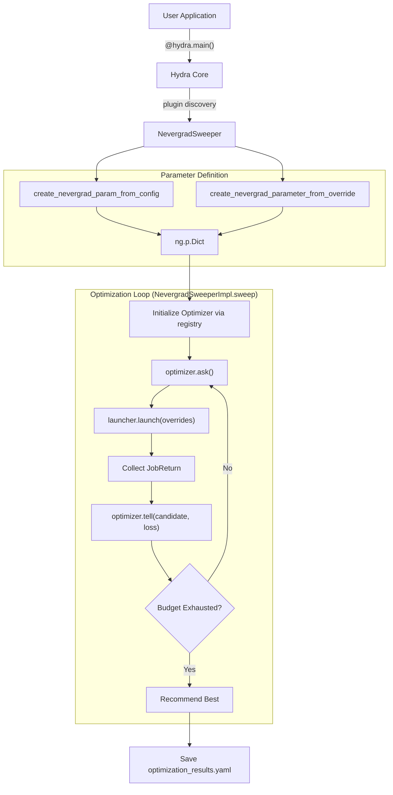

<!-- source: DeepWiki mcp.deepwiki.com · repo facebookresearch/hydra · extra page Nevergrad Sweeper · fetched 2026-10-21 -->

# Nevergrad Sweeper

<details>
<summary>Relevant source files</summary>

The following files were used as context for generating this wiki page:

- [examples/plugins/example_configsource_plugin/setup.py](examples/plugins/example_configsource_plugin/setup.py)
- [examples/plugins/example_generic_plugin/setup.py](examples/plugins/example_generic_plugin/setup.py)
- [examples/plugins/example_launcher_plugin/setup.py](examples/plugins/example_launcher_plugin/setup.py)
- [examples/plugins/example_registered_plugin/setup.py](examples/plugins/example_registered_plugin/setup.py)
- [examples/plugins/example_searchpath_plugin/setup.py](examples/plugins/example_searchpath_plugin/setup.py)
- [examples/plugins/example_sweeper_plugin/setup.py](examples/plugins/example_sweeper_plugin/setup.py)
- [plugins/hydra_ax_sweeper/setup.py](plugins/hydra_ax_sweeper/setup.py)
- [plugins/hydra_colorlog/setup.py](plugins/hydra_colorlog/setup.py)
- [plugins/hydra_joblib_launcher/setup.py](plugins/hydra_joblib_launcher/setup.py)
- [plugins/hydra_nevergrad_sweeper/example/config.yaml](plugins/hydra_nevergrad_sweeper/example/config.yaml)
- [plugins/hydra_nevergrad_sweeper/example/my_app.py](plugins/hydra_nevergrad_sweeper/example/my_app.py)
- [plugins/hydra_nevergrad_sweeper/hydra_plugins/hydra_nevergrad_sweeper/_impl.py](plugins/hydra_nevergrad_sweeper/hydra_plugins/hydra_nevergrad_sweeper/_impl.py)
- [plugins/hydra_nevergrad_sweeper/hydra_plugins/hydra_nevergrad_sweeper/config.py](plugins/hydra_nevergrad_sweeper/hydra_plugins/hydra_nevergrad_sweeper/config.py)
- [plugins/hydra_nevergrad_sweeper/hydra_plugins/hydra_nevergrad_sweeper/nevergrad_sweeper.py](plugins/hydra_nevergrad_sweeper/hydra_plugins/hydra_nevergrad_sweeper/nevergrad_sweeper.py)
- [plugins/hydra_nevergrad_sweeper/setup.py](plugins/hydra_nevergrad_sweeper/setup.py)
- [plugins/hydra_nevergrad_sweeper/tests/test_nevergrad_sweeper_plugin.py](plugins/hydra_nevergrad_sweeper/tests/test_nevergrad_sweeper_plugin.py)
- [plugins/hydra_optuna_sweeper/setup.py](plugins/hydra_optuna_sweeper/setup.py)
- [plugins/hydra_rq_launcher/setup.py](plugins/hydra_rq_launcher/setup.py)
- [plugins/hydra_submitit_launcher/setup.py](plugins/hydra_submitit_launcher/setup.py)
- [website/docs/plugins/nevergrad_sweeper.md](website/docs/plugins/nevergrad_sweeper.md)

</details>


## Purpose and Scope

This document describes the Nevergrad Sweeper plugin for Hydra, which integrates [Nevergrad](https://facebookresearch.github.io/nevergrad/) - a derivative-free optimization platform developed by Meta Research - with Hydra's sweeping capabilities. The Nevergrad Sweeper enables Hydra applications to perform sophisticated hyperparameter optimization using various state-of-the-art algorithms. This page covers the architecture, configuration, parameter specification, and implementation details of the plugin.

For information about other sweepers, see [Ax Sweeper](3.1.1) or [Optuna Sweeper](3.1.3).

## Architecture and Integration

### Nevergrad Sweeper in Hydra's Plugin Architecture

The Nevergrad Sweeper is implemented as a Hydra plugin that conforms to the `Sweeper` interface. The main class `NevergradSweeper` acts as a wrapper that instantiates `NevergradSweeperImpl` to handle the optimization logic and interaction with the `Launcher`.

```mermaid
classDiagram
    class Sweeper {
        <<interface>>
        +setup(hydra_context, task_function, config)
        +sweep(arguments)
    }
    
    class NevergradSweeper {
        -sweeper: NevergradSweeperImpl
        +setup(hydra_context, task_function, config)
        +sweep(arguments)
    }
    
    class NevergradSweeperImpl {
        -parametrization: Dict
        -opt_config: OptimConf
        -config: DictConfig
        -launcher: Launcher
        +setup(hydra_context, task_function, config)
        +sweep(arguments)
        -validate_batch_is_legal(overrides)
    }
    
    class OptimConf {
        +optimizer: str
        +budget: int
        +num_workers: int
        +noisy: bool
        +maximize: bool
        +seed: Optional[int]
        +max_failure_rate: float
    }
    
    class ScalarConfigSpec {
        +lower: Optional[float]
        +upper: Optional[float]
        +init: Optional[float]
        +step: Optional[float]
        +integer: bool
        +log: bool
    }
    
    class NevergradSweeperConf {
        +optim: OptimConf
        +parametrization: Dict[str, Any]
    }
    
    Sweeper <|-- NevergradSweeper
    NevergradSweeper o-- NevergradSweeperImpl
    NevergradSweeperImpl -- OptimConf
    NevergradSweeperImpl ..> "nevergrad.optimizers.registry"
    OptimConf <-- NevergradSweeperConf
    ScalarConfigSpec .. NevergradSweeperImpl : "used for parameter creation"
```

Sources: [plugins/hydra_nevergrad_sweeper/hydra_plugins/hydra_nevergrad_sweeper/nevergrad_sweeper.py:10-38](), [plugins/hydra_nevergrad_sweeper/hydra_plugins/hydra_nevergrad_sweeper/_impl.py:85-118](), [plugins/hydra_nevergrad_sweeper/hydra_plugins/hydra_nevergrad_sweeper/config.py:8-91]()

### Optimization Process Flow

The optimization loop is managed by `NevergradSweeperImpl.sweep`. It coordinates between the Nevergrad optimizer (which suggests parameters) and the Hydra `Launcher` (which executes the jobs).



Sources: [plugins/hydra_nevergrad_sweeper/hydra_plugins/hydra_nevergrad_sweeper/_impl.py:119-202](), [plugins/hydra_nevergrad_sweeper/hydra_plugins/hydra_nevergrad_sweeper/nevergrad_sweeper.py:34-38]()

## Configuration

The Nevergrad Sweeper is configured via the `NevergradSweeperConf` dataclass, which is registered in the `ConfigStore` under the `hydra/sweeper` group.

### Installation

```bash
pip install hydra-nevergrad-sweeper --upgrade
```

Sources: [plugins/hydra_nevergrad_sweeper/setup.py:9-30](), [website/docs/plugins/nevergrad_sweeper.md:16-19]()

### Default Configuration

The default settings use the `NGOpt` algorithm, which is an intelligent meta-optimizer that selects the best strategy based on the search space and budget.

| Key | Type | Default | Description |
|:---|:---|:---|:---|
| `optim.optimizer` | `str` | `"NGOpt"` | Nevergrad optimizer name (e.g., `"CMA"`, `"OnePlusOne"`, `"TwoPointsDE"`) |
| `optim.budget` | `int` | `80` | Total number of function evaluations |
| `optim.num_workers` | `int` | `10` | Number of parallel evaluations |
| `optim.noisy` | `bool` | `false` | Whether the objective function has noise |
| `optim.maximize` | `bool` | `false` | If true, maximize the return value instead of minimizing |
| `optim.seed` | `int?` | `null` | Random seed for reproducibility |
| `optim.max_failure_rate` | `float` | `0.0` | Allowed fraction of failed jobs per batch |

Sources: [plugins/hydra_nevergrad_sweeper/hydra_plugins/hydra_nevergrad_sweeper/config.py:37-68](), [plugins/hydra_nevergrad_sweeper/hydra_plugins/hydra_nevergrad_sweeper/config.py:70-91]()

## Parameter Definition

The plugin supports two methods for defining the search space: Structured Config and Command Line Overrides.

### Supported Nevergrad Types

The implementation maps Hydra types to `nevergrad.p` objects:

| Hydra Definition | Nevergrad Entity | Code Reference |
|:---|:---|:---|
| `List` or `choice()` | `ng.p.Choice` | [_impl.py:41](), [_impl.py:70]() |
| `tag(ordered, choice())` | `ng.p.TransitionChoice` | [_impl.py:68]() |
| `interval(low, high)` | `ng.p.Scalar` | [_impl.py:79]() |
| `tag(log, interval())` | `ng.p.Log` | [_impl.py:77]() |
| `int(interval())` | `scalar.set_integer_casting()` | [_impl.py:81]() |

Sources: [plugins/hydra_nevergrad_sweeper/hydra_plugins/hydra_nevergrad_sweeper/_impl.py:35-82](), [plugins/hydra_nevergrad_sweeper/tests/test_nevergrad_sweeper_plugin.py:32-118]()

### Defining Parameters in Config

Using the `parametrization` dictionary in your YAML:

```yaml
hydra:
  sweeper:
    parametrization:
      lr:
        lower: 0.01
        upper: 1.0
        log: true
      batch_size:
        lower: 4
        upper: 16
        integer: true
      db:
        - mnist
        - cifar
```

Sources: [plugins/hydra_nevergrad_sweeper/example/config.yaml:15-37](), [website/docs/plugins/nevergrad_sweeper.md:156-174]()

## Implementation Details

### Result Collection and Failures

The sweeper monitors the `JobStatus` of returned results. If a job fails (status is not `COMPLETED`), the sweeper:
1. Logs a warning and assigns `math.inf` as the loss for that candidate [plugins/hydra_nevergrad_sweeper/hydra_plugins/hydra_nevergrad_sweeper/_impl.py:171-176]().
2. Increments a failure counter.
3. If the failure rate of the current batch exceeds `max_failure_rate`, it raises a `RuntimeError` [plugins/hydra_nevergrad_sweeper/hydra_plugins/hydra_nevergrad_sweeper/_impl.py:181-185]().

### Best Result Persistence

After the budget is exhausted, the sweeper identifies the best parameters and saves them to `optimization_results.yaml` in the sweep directory.

```python
# From _impl.py:192-202
results_to_serialize = {
    "name": "nevergrad",
    "best_evaluated_result": best[0],
    "best_evaluated_params": best[1].value,
}
OmegaConf.save(
    OmegaConf.create(results_to_serialize),
    f"{self.config.hydra.sweep.dir}/optimization_results.yaml",
)
```

Sources: [plugins/hydra_nevergrad_sweeper/hydra_plugins/hydra_nevergrad_sweeper/_impl.py:192-202](), [website/docs/plugins/nevergrad_sweeper.md:116-126]()

### Example Usage

To run a multirun optimization using the Nevergrad sweeper from the command line:

```bash
python my_app.py -m \
    hydra/sweeper=nevergrad \
    hydra.sweeper.optim.budget=100 \
    db=mnist,cifar \
    'lr=tag(log, interval(0.001, 1))'
```

Sources: [website/docs/plugins/nevergrad_sweeper.md:79-82](), [plugins/hydra_nevergrad_sweeper/tests/test_nevergrad_sweeper_plugin.py:120-135]()

---

