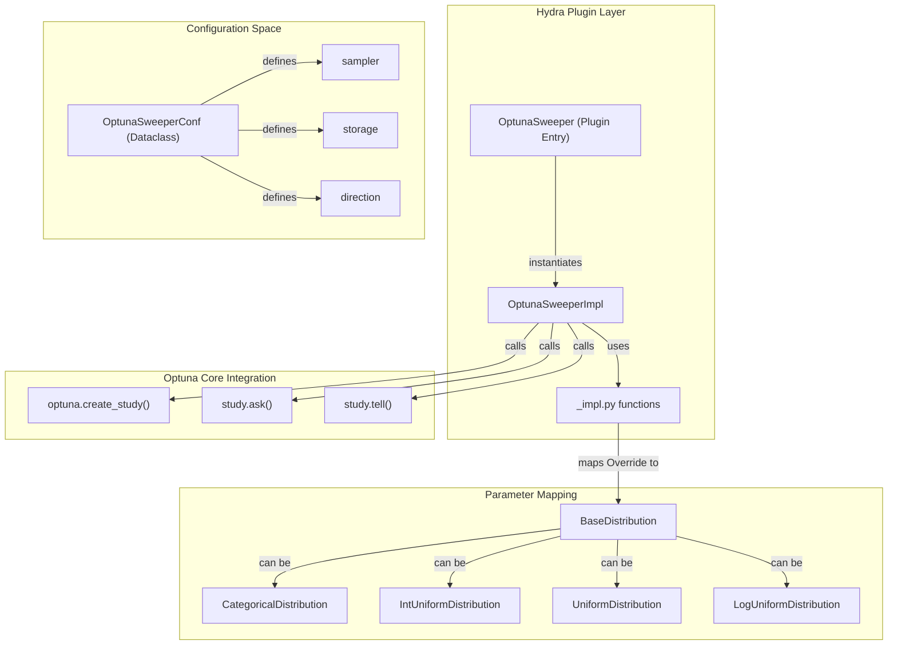
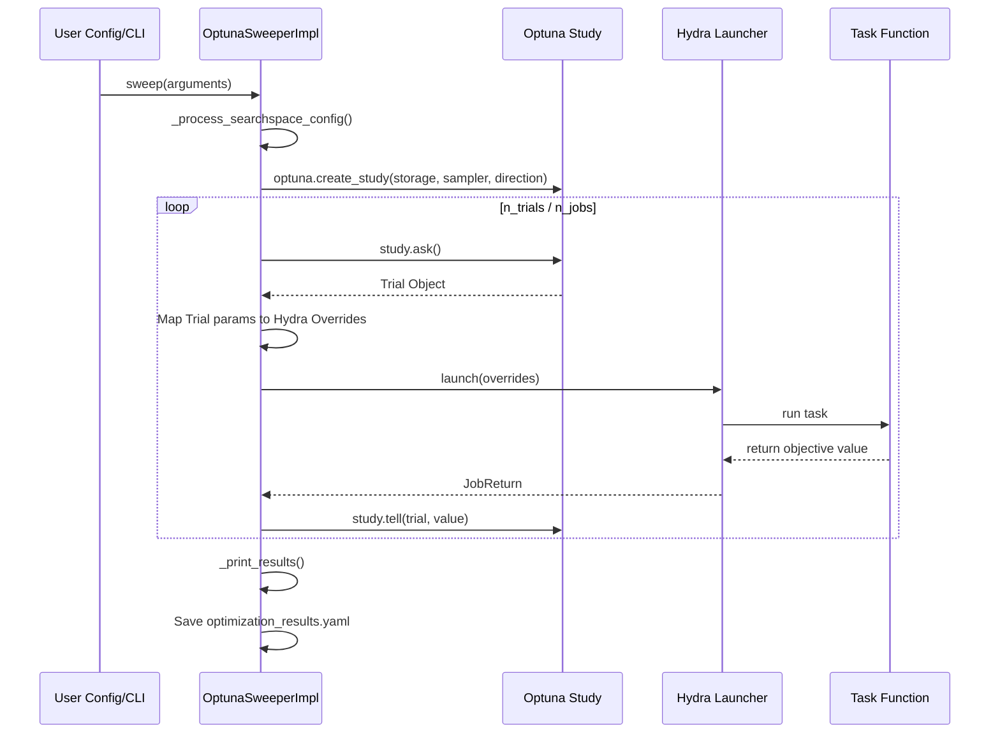

<!-- source: DeepWiki mcp.deepwiki.com · repo facebookresearch/hydra · extra page Optuna Sweeper · fetched 2026-10-21 -->

# Optuna Sweeper

<details>
<summary>Relevant source files</summary>

The following files were used as context for generating this wiki page:

- [examples/plugins/example_configsource_plugin/setup.py](examples/plugins/example_configsource_plugin/setup.py)
- [examples/plugins/example_generic_plugin/setup.py](examples/plugins/example_generic_plugin/setup.py)
- [examples/plugins/example_launcher_plugin/setup.py](examples/plugins/example_launcher_plugin/setup.py)
- [examples/plugins/example_registered_plugin/setup.py](examples/plugins/example_registered_plugin/setup.py)
- [examples/plugins/example_searchpath_plugin/setup.py](examples/plugins/example_searchpath_plugin/setup.py)
- [examples/plugins/example_sweeper_plugin/setup.py](examples/plugins/example_sweeper_plugin/setup.py)
- [plugins/hydra_ax_sweeper/setup.py](plugins/hydra_ax_sweeper/setup.py)
- [plugins/hydra_colorlog/setup.py](plugins/hydra_colorlog/setup.py)
- [plugins/hydra_joblib_launcher/setup.py](plugins/hydra_joblib_launcher/setup.py)
- [plugins/hydra_nevergrad_sweeper/setup.py](plugins/hydra_nevergrad_sweeper/setup.py)
- [plugins/hydra_optuna_sweeper/example/conf/config.yaml](plugins/hydra_optuna_sweeper/example/conf/config.yaml)
- [plugins/hydra_optuna_sweeper/example/multi-objective-conf/config.yaml](plugins/hydra_optuna_sweeper/example/multi-objective-conf/config.yaml)
- [plugins/hydra_optuna_sweeper/example/sphere.py](plugins/hydra_optuna_sweeper/example/sphere.py)
- [plugins/hydra_optuna_sweeper/hydra_plugins/hydra_optuna_sweeper/_impl.py](plugins/hydra_optuna_sweeper/hydra_plugins/hydra_optuna_sweeper/_impl.py)
- [plugins/hydra_optuna_sweeper/hydra_plugins/hydra_optuna_sweeper/config.py](plugins/hydra_optuna_sweeper/hydra_plugins/hydra_optuna_sweeper/config.py)
- [plugins/hydra_optuna_sweeper/hydra_plugins/hydra_optuna_sweeper/optuna_sweeper.py](plugins/hydra_optuna_sweeper/hydra_plugins/hydra_optuna_sweeper/optuna_sweeper.py)
- [plugins/hydra_optuna_sweeper/news/1513.feature](plugins/hydra_optuna_sweeper/news/1513.feature)
- [plugins/hydra_optuna_sweeper/setup.py](plugins/hydra_optuna_sweeper/setup.py)
- [plugins/hydra_optuna_sweeper/tests/conf/test_deprecated_search_space.yaml](plugins/hydra_optuna_sweeper/tests/conf/test_deprecated_search_space.yaml)
- [plugins/hydra_optuna_sweeper/tests/test_optuna_sweeper_plugin.py](plugins/hydra_optuna_sweeper/tests/test_optuna_sweeper_plugin.py)
- [plugins/hydra_rq_launcher/setup.py](plugins/hydra_rq_launcher/setup.py)
- [plugins/hydra_submitit_launcher/setup.py](plugins/hydra_submitit_launcher/setup.py)
- [website/docs/plugins/optuna_sweeper.md](website/docs/plugins/optuna_sweeper.md)
- [website/docs/upgrades/1.1_to_1.2/changes_to_sweeper_config.md](website/docs/upgrades/1.1_to_1.2/changes_to_sweeper_config.md)
- [website/versioned_docs/version-1.1/plugins/optuna_sweeper.md](website/versioned_docs/version-1.1/plugins/optuna_sweeper.md)

</details>


The Optuna Sweeper is a Hydra plugin that enables hyperparameter optimization using [Optuna](https://optuna.org/), an open-source hyperparameter optimization framework. This plugin allows Hydra applications to leverage Optuna's various sampling algorithms and search space configurations to efficiently optimize model parameters.

## Overview

Optuna Sweeper integrates Hydra's configuration system with Optuna's optimization capabilities, allowing users to:

1.  Define search spaces using Hydra's override syntax or structured configs.
2.  Select from multiple sampling algorithms (TPE, Random, CMA-ES, NSGA-II, etc.).
3.  Perform both single-objective and multi-objective optimization.
4.  Run optimizations in parallel using Hydra's launcher system.
5.  Persist optimization results using various storage backends (e.g., SQLite, PostgreSQL).
6.  Define custom search spaces programmatically via a `custom_search_space` callback.

### System Architecture

The following diagram maps the natural language concepts to the specific code entities within the plugin.



Sources: [plugins/hydra_optuna_sweeper/hydra_plugins/hydra_optuna_sweeper/optuna_sweeper.py:11-54](), [plugins/hydra_optuna_sweeper/hydra_plugins/hydra_optuna_sweeper/_impl.py:149-181](), [plugins/hydra_optuna_sweeper/hydra_plugins/hydra_optuna_sweeper/config.py:147-187]()

## Installation

The Optuna Sweeper can be installed via pip. It requires `hydra-core>=1.1.0`.

```bash
pip install hydra-optuna-sweeper --upgrade
```

The plugin depends on `optuna>=2.10.0,<3.0.0` and `sqlalchemy~=1.3.0`.

Sources: [plugins/hydra_optuna_sweeper/setup.py:28-32](), [website/docs/plugins/optuna_sweeper.md:17-29]()

## Configuration and Implementation

The plugin is primarily implemented in `OptunaSweeperImpl`, which inherits from the base `Sweeper` class.

### Key Classes and Functions

| Entity | Location | Role |
| :--- | :--- | :--- |
| `OptunaSweeper` | `optuna_sweeper.py` | The plugin wrapper that Hydra discovers and instantiates. |
| `OptunaSweeperImpl` | `_impl.py` | The core logic for managing the Optuna `Study` lifecycle and trial execution. |
| `create_optuna_distribution_from_override` | `_impl.py` | Converts Hydra's `Override` objects (from CLI or config) into Optuna `BaseDistribution` objects. |
| `OptunaSweeperConf` | `config.py` | Structured configuration (dataclass) defining the schema for `hydra/sweeper/optuna`. |

Sources: [plugins/hydra_optuna_sweeper/hydra_plugins/hydra_optuna_sweeper/optuna_sweeper.py:11-20](), [plugins/hydra_optuna_sweeper/hydra_plugins/hydra_optuna_sweeper/_impl.py:79-128](), [plugins/hydra_optuna_sweeper/hydra_plugins/hydra_optuna_sweeper/_impl.py:149-162](), [plugins/hydra_optuna_sweeper/hydra_plugins/hydra_optuna_sweeper/config.py:147-187]()

### Optimization Data Flow

The diagram below illustrates how data flows from the user's configuration through the Optuna library and back to Hydra's output.



Sources: [plugins/hydra_optuna_sweeper/hydra_plugins/hydra_optuna_sweeper/_impl.py:281-434](), [plugins/hydra_optuna_sweeper/hydra_plugins/hydra_optuna_sweeper/_impl.py:182-241]()

## Search Space Mapping

Optuna Sweeper maps Hydra's override grammar to Optuna distributions via `create_optuna_distribution_from_override` in `_impl.py`.

| Hydra Syntax | Optuna Distribution | Implementation Detail |
| :--- | :--- | :--- |
| `choice(1, 2)` | `CategoricalDistribution` | Supports `str`, `int`, `float`, `bool`, or `None`. |
| `range(1, 5)` | `IntUniformDistribution` | Step defaults to 1 if not provided. |
| `range(0.5, 5.5, step=0.5)` | `DiscreteUniformDistribution` | Triggered if start, stop, or step are floats. |
| `interval(1, 5)` | `UniformDistribution` | Standard continuous range. |
| `tag(log, interval(1, 5))` | `LogUniformDistribution` | Triggered by the `log` tag. |
| `int(interval(1, 5))` | `IntUniformDistribution` | Triggered by `int()` cast. |
| `tag(log, int(interval(1, 5)))` | `IntLogUniformDistribution` | Combined tag and cast. |

Sources: [plugins/hydra_optuna_sweeper/hydra_plugins/hydra_optuna_sweeper/_impl.py:79-128](), [website/docs/plugins/optuna_sweeper.md:113-182]()

## Supported Samplers

The plugin supports several Optuna samplers via structured configs in `config.py`. Each sampler is registered in the `ConfigStore` under the `hydra/sweeper/sampler` group.

*   **TPESampler**: Tree-structured Parzen Estimator (Default).
*   **RandomSampler**: Basic random search.
*   **CmaEsSampler**: Covariance Matrix Adaptation Evolution Strategy.
*   **NSGAIISampler**: Non-dominated Sorting Genetic Algorithm II (for multi-objective).
*   **MOTPESampler**: Multi-objective TPE.
*   **GridSampler**: Exhaustive search over a categorical/discrete space.

Sources: [plugins/hydra_optuna_sweeper/hydra_plugins/hydra_optuna_sweeper/config.py:27-118](), [plugins/hydra_optuna_sweeper/hydra_plugins/hydra_optuna_sweeper/config.py:196-236]()

## Multi-Objective Support

Optuna Sweeper supports multi-objective optimization by passing a list of directions to the `direction` parameter in `OptunaSweeperConf`.

```yaml
hydra:
  sweeper:
    direction: [minimize, maximize]
    sampler:
      _target_: optuna.samplers.NSGAIISampler
```

When multiple objectives are used, the task function decorated with `@hydra.main()` must return a sequence of values (e.g., a `List[float]` or `Tuple[float, ...]`). The final results are saved as a list of Pareto-optimal solutions in `optimization_results.yaml`.

Sources: [plugins/hydra_optuna_sweeper/hydra_plugins/hydra_optuna_sweeper/config.py:158](), [plugins/hydra_optuna_sweeper/hydra_plugins/hydra_optuna_sweeper/_impl.py:421-434](), [website/docs/plugins/optuna_sweeper.md:210-256]()

## Storage and Persistence

The `storage` field in `OptunaSweeperConf` allows users to provide a URL for Optuna's storage backend. This enables persistent studies that can be resumed or accessed by multiple parallel processes.

*   **Example**: `storage: "sqlite:///example.db"`
*   **Study Name**: Controlled via `study_name`. If not provided, Optuna generates a UUID.

Sources: [plugins/hydra_optuna_sweeper/hydra_plugins/hydra_optuna_sweeper/config.py:160-167](), [plugins/hydra_optuna_sweeper/hydra_plugins/hydra_optuna_sweeper/_impl.py:328-339]()

## Advanced Customization

### Custom Search Space Extender
Users can define a `custom_search_space` which is a dotpath to a Python function. This function is called for every trial to add parameters that might depend on other parameters or external state.

Signature: `Callable[[DictConfig, optuna.trial.Trial], None]`

Sources: [plugins/hydra_optuna_sweeper/hydra_plugins/hydra_optuna_sweeper/config.py:182-186](), [plugins/hydra_optuna_sweeper/hydra_plugins/hydra_optuna_sweeper/_impl.py:243-258]()

### Fault Tolerance
The `max_failure_rate` parameter (0.0 to 1.0) defines the fraction of trials allowed to fail before the entire sweep is aborted.

Sources: [plugins/hydra_optuna_sweeper/hydra_plugins/hydra_optuna_sweeper/config.py:175-176](), [plugins/hydra_optuna_sweeper/hydra_plugins/hydra_optuna_sweeper/_impl.py:398-406]()

---

