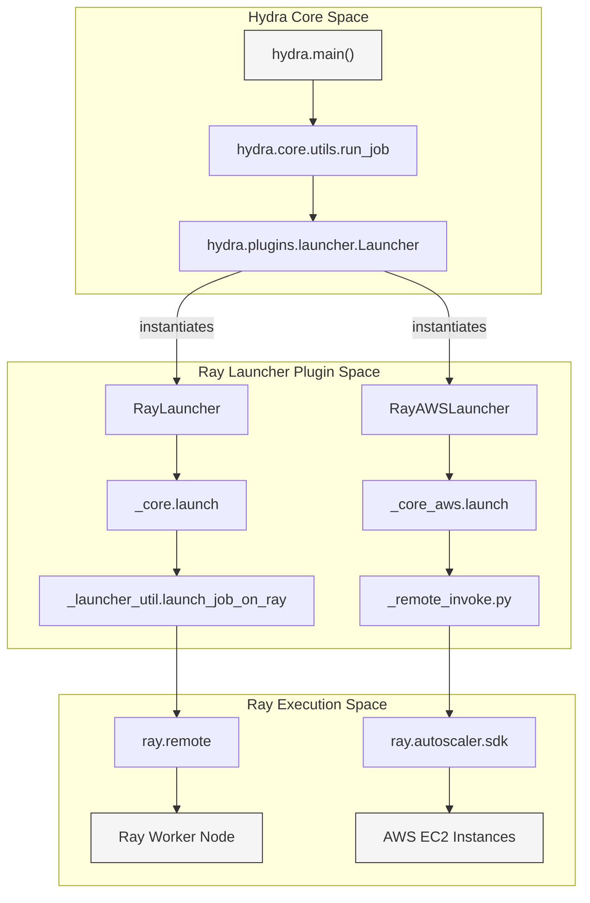
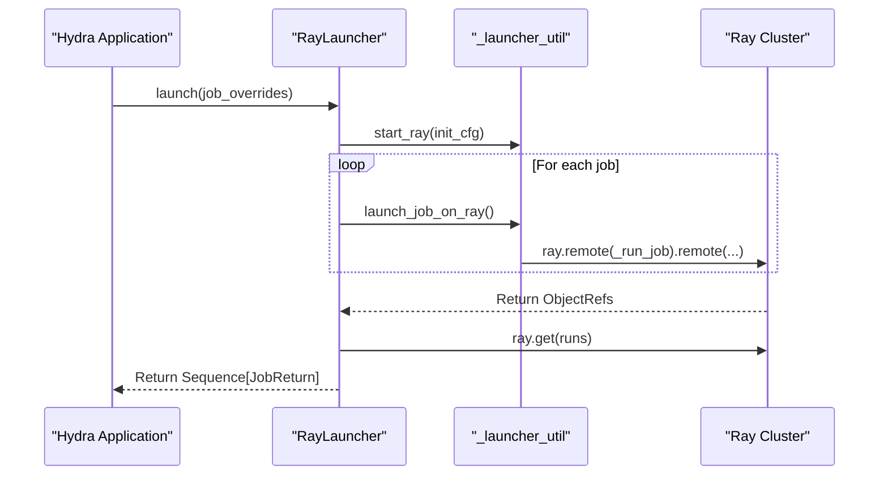
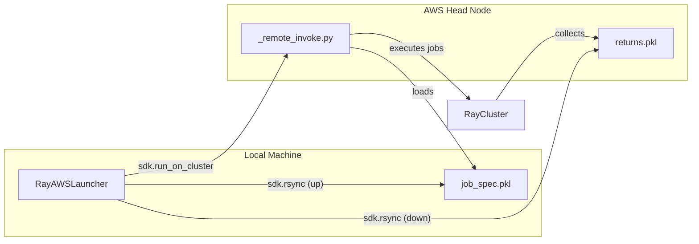
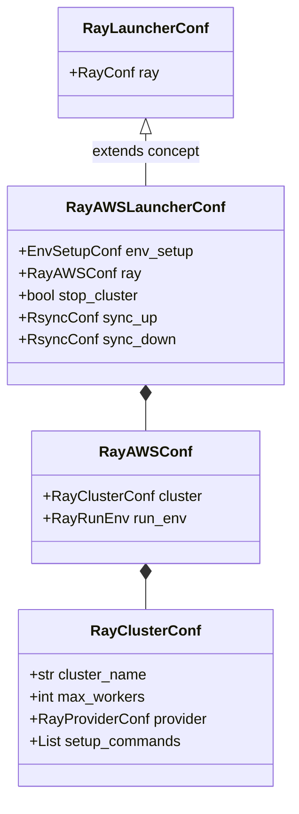

<!-- source: DeepWiki mcp.deepwiki.com · repo facebookresearch/hydra · extra page Ray Launcher · fetched 2026-10-21 -->

# Ray Launcher

Relevant source files

The following files were used as context for generating this wiki page:

- [.mypy.ini](.mypy.ini)
- [plugins/hydra_ray_launcher/examples/simple/config.yaml](plugins/hydra_ray_launcher/examples/simple/config.yaml)
- [plugins/hydra_ray_launcher/examples/simple/my_app.py](plugins/hydra_ray_launcher/examples/simple/my_app.py)
- [plugins/hydra_ray_launcher/examples/upload_download/conf/config.yaml](plugins/hydra_ray_launcher/examples/upload_download/conf/config.yaml)
- [plugins/hydra_ray_launcher/examples/upload_download/conf/hydra/launcher/custom_ray_aws.yaml](plugins/hydra_ray_launcher/examples/upload_download/conf/hydra/launcher/custom_ray_aws.yaml)
- [plugins/hydra_ray_launcher/examples/upload_download/model/my_model.py](plugins/hydra_ray_launcher/examples/upload_download/model/my_model.py)
- [plugins/hydra_ray_launcher/examples/upload_download/train.py](plugins/hydra_ray_launcher/examples/upload_download/train.py)
- [plugins/hydra_ray_launcher/hydra_plugins/hydra_ray_launcher/_config.py](plugins/hydra_ray_launcher/hydra_plugins/hydra_ray_launcher/_config.py)
- [plugins/hydra_ray_launcher/hydra_plugins/hydra_ray_launcher/_core.py](plugins/hydra_ray_launcher/hydra_plugins/hydra_ray_launcher/_core.py)
- [plugins/hydra_ray_launcher/hydra_plugins/hydra_ray_launcher/_core_aws.py](plugins/hydra_ray_launcher/hydra_plugins/hydra_ray_launcher/_core_aws.py)
- [plugins/hydra_ray_launcher/hydra_plugins/hydra_ray_launcher/_launcher_util.py](plugins/hydra_ray_launcher/hydra_plugins/hydra_ray_launcher/_launcher_util.py)
- [plugins/hydra_ray_launcher/hydra_plugins/hydra_ray_launcher/_remote_invoke.py](plugins/hydra_ray_launcher/hydra_plugins/hydra_ray_launcher/_remote_invoke.py)
- [plugins/hydra_ray_launcher/hydra_plugins/hydra_ray_launcher/ray_aws_launcher.py](plugins/hydra_ray_launcher/hydra_plugins/hydra_ray_launcher/ray_aws_launcher.py)
- [plugins/hydra_ray_launcher/hydra_plugins/hydra_ray_launcher/ray_launcher.py](plugins/hydra_ray_launcher/hydra_plugins/hydra_ray_launcher/ray_launcher.py)
- [plugins/hydra_ray_launcher/integration_test_tools/README.md](plugins/hydra_ray_launcher/integration_test_tools/README.md)
- [plugins/hydra_ray_launcher/integration_test_tools/create_integration_test_ami.py](plugins/hydra_ray_launcher/integration_test_tools/create_integration_test_ami.py)
- [plugins/hydra_ray_launcher/integration_test_tools/create_integration_test_ami_config.yaml](plugins/hydra_ray_launcher/integration_test_tools/create_integration_test_ami_config.yaml)
- [plugins/hydra_ray_launcher/integration_test_tools/setup_integration_test_ami.py](plugins/hydra_ray_launcher/integration_test_tools/setup_integration_test_ami.py)
- [plugins/hydra_ray_launcher/setup.py](plugins/hydra_ray_launcher/setup.py)
- [plugins/hydra_ray_launcher/tests/test_ray_aws_launcher.py](plugins/hydra_ray_launcher/tests/test_ray_aws_launcher.py)
- [plugins/hydra_ray_launcher/tests/test_ray_launcher.py](plugins/hydra_ray_launcher/tests/test_ray_launcher.py)
- [pytest.ini](pytest.ini)
- [website/docs/plugins/ray_launcher.md](website/docs/plugins/ray_launcher.md)
- [website/versioned_docs/version-1.0/plugins/ray_launcher.md](website/versioned_docs/version-1.0/plugins/ray_launcher.md)

The Ray Launcher is a Hydra plugin that enables distributed execution of tasks using [Ray](https://ray.io/), a distributed computing framework. It allows Hydra applications to scale from a single machine to large clusters with minimal configuration changes. This document covers the Ray Launcher's architecture, configuration options, and usage patterns. For information about the Submitit launcher for SLURM clusters, see [Submitit Launcher (3.2.1)](./3.2.1).

## Overview

Ray Launcher provides two main launchers:

1.  **`RayLauncher`**: For local execution or connecting to an existing Ray cluster [plugins/hydra_ray_launcher/hydra_plugins/hydra_ray_launcher/ray_launcher.py:12-16]().
2.  **`RayAWSLauncher`**: For launching and managing Ray clusters on AWS using the Ray Autoscaler SDK [plugins/hydra_ray_launcher/hydra_plugins/hydra_ray_launcher/ray_aws_launcher.py:21-25]().

These launchers distribute Hydra jobs across Ray workers, handle configuration management, and collect results.

## Ray Launcher Architecture

The following diagram illustrates how the Ray Launcher integrates with Hydra's core and the Ray ecosystem.

### System Entity Map

Sources:
- [plugins/hydra_ray_launcher/hydra_plugins/hydra_ray_launcher/ray_launcher.py:12-42]()
- [plugins/hydra_ray_launcher/hydra_plugins/hydra_ray_launcher/ray_aws_launcher.py:21-56]()
- [plugins/hydra_ray_launcher/hydra_plugins/hydra_ray_launcher/_core_aws.py:52-109]()
- [plugins/hydra_ray_launcher/hydra_plugins/hydra_ray_launcher/_launcher_util.py:59-79]()

## Local Ray Launcher

The local Ray Launcher (`RayLauncher`) is used to run Hydra jobs on a Ray cluster that's either running on your local machine or an existing remote cluster accessible via the Ray API.

### Local Ray Launcher Workflow

Sources:
- [plugins/hydra_ray_launcher/hydra_plugins/hydra_ray_launcher/ray_launcher.py:30-42]()
- [plugins/hydra_ray_launcher/hydra_plugins/hydra_ray_launcher/_launcher_util.py:30-39]()
- [plugins/hydra_ray_launcher/hydra_plugins/hydra_ray_launcher/_launcher_util.py:59-79]()

### Local Configuration
The `RayLauncher` uses `RayConf` for initialization and remote task parameters [plugins/hydra_ray_launcher/hydra_plugins/hydra_ray_launcher/_config.py:14-23]().

| Parameter | Type | Description |
| :--- | :--- | :--- |
| `ray.init` | `Dict` | Arguments passed to `ray.init()`, e.g., `address: "auto"` [plugins/hydra_ray_launcher/hydra_plugins/hydra_ray_launcher/_config.py:15](). |
| `ray.remote` | `Dict` | Decorator arguments for the Ray remote task (CPUs, GPUs, etc.) [plugins/hydra_ray_launcher/hydra_plugins/hydra_ray_launcher/_config.py:16](). |

## Ray AWS Launcher

The `RayAWSLauncher` manages the lifecycle of an ephemeral or persistent Ray cluster on AWS EC2. It uses `cloudpickle` to ship the task function and Hydra context to the remote head node [plugins/hydra_ray_launcher/hydra_plugins/hydra_ray_launcher/_core_aws.py:44-50]().

### Distributed Data Flow

Sources:
- [plugins/hydra_ray_launcher/hydra_plugins/hydra_ray_launcher/_core_aws.py:111-165]()
- [plugins/hydra_ray_launcher/hydra_plugins/hydra_ray_launcher/_remote_invoke.py:34-69]()

### AWS Launcher Implementation Details
- **Pickling**: The launcher uses `cloudpickle` to serialize the `hydra_context`, `sweep_configs`, `task_function`, and `singleton_state` into `job_spec.pkl` [plugins/hydra_ray_launcher/hydra_plugins/hydra_ray_launcher/_core_aws.py:99-105]().
- **Remote Invocation**: On the remote cluster, `_remote_invoke.py` is executed. it calls `_get_instance_id()` from the AWS metadata service to uniquely identify jobs [plugins/hydra_ray_launcher/hydra_plugins/hydra_ray_launcher/_remote_invoke.py:80-89]().
- **Synchronization**: 
    - `sync_up`: Uses `rsync` to upload local source code to the cluster [plugins/hydra_ray_launcher/hydra_plugins/hydra_ray_launcher/_core_aws.py:140-153]().
    - `sync_down`: Downloads outputs from the remote `sweep_dir` back to the local machine [plugins/hydra_ray_launcher/hydra_plugins/hydra_ray_launcher/_core_aws.py:169-194]().

## Configuration Hierarchy

The plugin uses structured configurations defined via dataclasses [plugins/hydra_ray_launcher/hydra_plugins/hydra_ray_launcher/_config.py:13-386]().

Sources:
- [plugins/hydra_ray_launcher/hydra_plugins/hydra_ray_launcher/_config.py:20-23]()
- [plugins/hydra_ray_launcher/hydra_plugins/hydra_ray_launcher/_config.py:332-386]()

### Key AWS Config Classes
- **`EnvSetupConf`**: Manages `pip_packages` and `commands` (e.g., creating conda environments) on the remote instances [plugins/hydra_ray_launcher/hydra_plugins/hydra_ray_launcher/_config.py:190-200]().
- **`RayProviderConf`**: AWS-specific settings like `region`, `availability_zone`, and `key_pair` [plugins/hydra_ray_launcher/hydra_plugins/hydra_ray_launcher/_config.py:144-152]().
- **`RsyncConf`**: Defines `include` and `exclude` filters for file transfers [plugins/hydra_ray_launcher/hydra_plugins/hydra_ray_launcher/_config.py:155-172]().

## Deployment and AMI Setup
For integration testing and production speed, dependencies are often pre-installed on an Amazon Machine Image (AMI).
- **`setup_integration_test_ami.py`**: A utility script that installs `boto3`, `ray[default]`, `aiohttp`, and `cloudpickle` into specific conda environments on a base AMI [plugins/hydra_ray_launcher/integration_test_tools/setup_integration_test_ami.py:6-14]().
- **`create_integration_test_ami.py`**: Automates the creation of these AMIs by running `ray up`, executing the setup script, and calling `ec2_client.create_image()` [plugins/hydra_ray_launcher/integration_test_tools/create_integration_test_ami.py:35-88]().

## Limitations and Requirements
- **OS**: Ray Launcher does not support Windows [plugins/hydra_ray_launcher/tests/test_ray_aws_launcher.py:48]().
- **Python**: Requires Python >= 3.9 [plugins/hydra_ray_launcher/setup.py:26]().
- **Dependencies**: Relies on `ray[default] < 3`, `boto3`, and `cloudpickle < 3` [plugins/hydra_ray_launcher/setup.py:27-33]().

---

