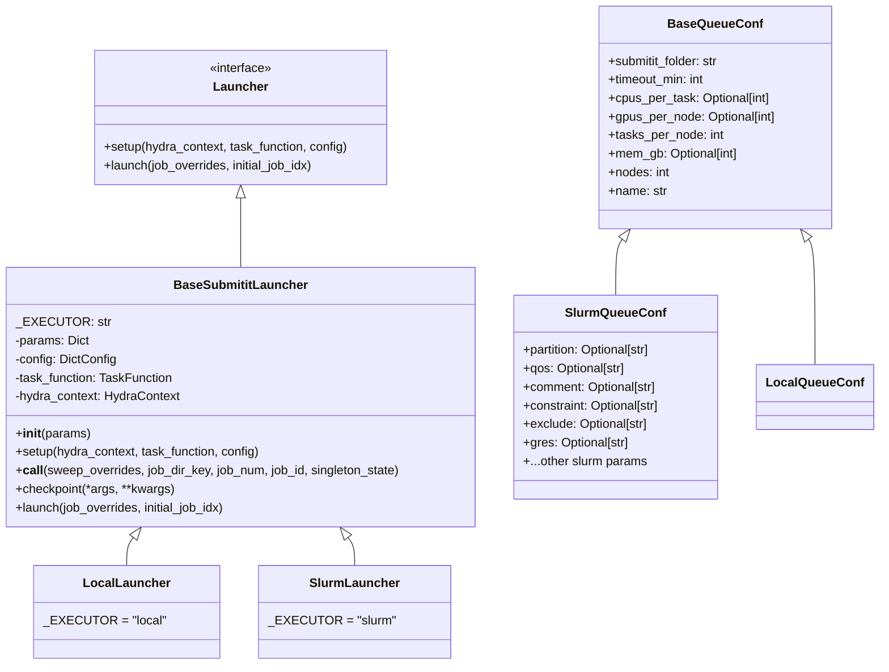
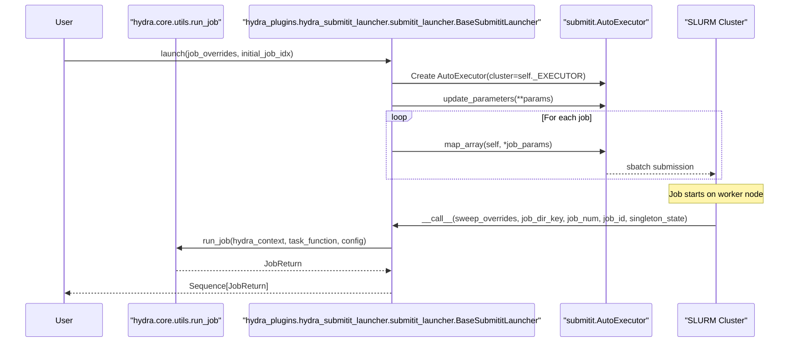

<!-- source: DeepWiki mcp.deepwiki.com · repo facebookresearch/hydra · extra page Submitit Launcher · fetched 2026-10-21 -->

# Submitit Launcher

<details>
<summary>Relevant source files</summary>

The following files were used as context for generating this wiki page:

- [examples/plugins/example_configsource_plugin/setup.py](examples/plugins/example_configsource_plugin/setup.py)
- [examples/plugins/example_generic_plugin/setup.py](examples/plugins/example_generic_plugin/setup.py)
- [examples/plugins/example_launcher_plugin/setup.py](examples/plugins/example_launcher_plugin/setup.py)
- [examples/plugins/example_registered_plugin/setup.py](examples/plugins/example_registered_plugin/setup.py)
- [examples/plugins/example_searchpath_plugin/setup.py](examples/plugins/example_searchpath_plugin/setup.py)
- [examples/plugins/example_sweeper_plugin/setup.py](examples/plugins/example_sweeper_plugin/setup.py)
- [plugins/hydra_ax_sweeper/setup.py](plugins/hydra_ax_sweeper/setup.py)
- [plugins/hydra_colorlog/setup.py](plugins/hydra_colorlog/setup.py)
- [plugins/hydra_joblib_launcher/setup.py](plugins/hydra_joblib_launcher/setup.py)
- [plugins/hydra_nevergrad_sweeper/setup.py](plugins/hydra_nevergrad_sweeper/setup.py)
- [plugins/hydra_optuna_sweeper/setup.py](plugins/hydra_optuna_sweeper/setup.py)
- [plugins/hydra_rq_launcher/setup.py](plugins/hydra_rq_launcher/setup.py)
- [plugins/hydra_submitit_launcher/MANIFEST.in](plugins/hydra_submitit_launcher/MANIFEST.in)
- [plugins/hydra_submitit_launcher/README.md](plugins/hydra_submitit_launcher/README.md)
- [plugins/hydra_submitit_launcher/example/config.yaml](plugins/hydra_submitit_launcher/example/config.yaml)
- [plugins/hydra_submitit_launcher/example/my_app.py](plugins/hydra_submitit_launcher/example/my_app.py)
- [plugins/hydra_submitit_launcher/hydra_plugins/hydra_submitit_launcher/config.py](plugins/hydra_submitit_launcher/hydra_plugins/hydra_submitit_launcher/config.py)
- [plugins/hydra_submitit_launcher/hydra_plugins/hydra_submitit_launcher/submitit_launcher.py](plugins/hydra_submitit_launcher/hydra_plugins/hydra_submitit_launcher/submitit_launcher.py)
- [plugins/hydra_submitit_launcher/setup.py](plugins/hydra_submitit_launcher/setup.py)
- [plugins/hydra_submitit_launcher/tests/__init__.py](plugins/hydra_submitit_launcher/tests/__init__.py)
- [plugins/hydra_submitit_launcher/tests/test_submitit_launcher.py](plugins/hydra_submitit_launcher/tests/test_submitit_launcher.py)
- [website/docs/plugins/submitit_launcher.md](website/docs/plugins/submitit_launcher.md)

</details>


## Overview

The Submitit Launcher is a Hydra plugin that enables launching jobs on SLURM clusters using [Submitit](https://github.com/facebookincubator/submitit), a lightweight Python framework for submitting jobs to SLURM. This plugin also provides a local execution option for testing purposes without requiring a SLURM cluster. It is part of Hydra's launcher plugin system, which is responsible for executing tasks in different environments during multirun operations.

## Architecture

The Submitit Launcher integrates with Hydra's plugin architecture as a `Launcher` plugin [plugins/hydra_submitit_launcher/hydra_plugins/hydra_submitit_launcher/submitit_launcher.py:9-18](). It provides two launcher implementations: a SLURM-based launcher for cluster environments and a local launcher for testing.

### Component Architecture

The following diagram illustrates the relationship between the Submitit Launcher classes and the core Hydra Launcher interface.


Sources: [plugins/hydra_submitit_launcher/hydra_plugins/hydra_submitit_launcher/submitit_launcher.py:18-153](), [plugins/hydra_submitit_launcher/hydra_plugins/hydra_submitit_launcher/config.py:8-84]()

### Job Submission Workflow

When a user executes a command with `--multirun`, Hydra initializes the configured launcher. The `SlurmLauncher` or `LocalLauncher` uses a `submitit.AutoExecutor` to dispatch jobs [plugins/hydra_submitit_launcher/hydra_plugins/hydra_submitit_launcher/submitit_launcher.py:108-144]().


Sources: [plugins/hydra_submitit_launcher/hydra_plugins/hydra_submitit_launcher/submitit_launcher.py:44-145](), [website/docs/plugins/submitit_launcher.md:100-109]()

## Installation and Setup

To use the Submitit Launcher, install the plugin package:

```bash
pip install hydra-submitit-launcher --upgrade
```

The plugin requires `hydra-core>=1.1.0.dev7` and `submitit>=1.3.3` [plugins/hydra_submitit_launcher/setup.py:28-31]().

## Configuration Options

The plugin registers two choices in the `ConfigStore` under the `hydra/launcher` group: `submitit_local` and `submitit_slurm` [plugins/hydra_submitit_launcher/hydra_plugins/hydra_submitit_launcher/config.py:87-101]().

### Common Configuration Parameters (`BaseQueueConf`)

| Parameter | Type | Default | Description |
|-----------|------|---------|-------------|
| `submitit_folder` | `str` | `${hydra.sweep.dir}/.submitit/%j` | Directory for Submitit logs and internal data [plugins/hydra_submitit_launcher/hydra_plugins/hydra_submitit_launcher/config.py:12]() |
| `timeout_min` | `int` | `60` | Maximum time for the job in minutes [plugins/hydra_submitit_launcher/hydra_plugins/hydra_submitit_launcher/config.py:15]() |
| `cpus_per_task` | `Optional[int]` | `None` | Number of CPUs per task [plugins/hydra_submitit_launcher/hydra_plugins/hydra_submitit_launcher/config.py:17]() |
| `gpus_per_node` | `Optional[int]` | `None` | Number of GPUs per node [plugins/hydra_submitit_launcher/hydra_plugins/hydra_submitit_launcher/config.py:19]() |
| `tasks_per_node` | `int` | `1` | Number of tasks to spawn on each node [plugins/hydra_submitit_launcher/hydra_plugins/hydra_submitit_launcher/config.py:21]() |
| `mem_gb` | `Optional[int]` | `None` | Memory to reserve per node in GB [plugins/hydra_submitit_launcher/hydra_plugins/hydra_submitit_launcher/config.py:23]() |
| `nodes` | `int` | `1` | Number of nodes to use for the job [plugins/hydra_submitit_launcher/hydra_plugins/hydra_submitit_launcher/config.py:25]() |

### SLURM-Specific Parameters (`SlurmQueueConf`)

The `SlurmLauncher` maps these parameters to `sbatch` options via Submitit [plugins/hydra_submitit_launcher/hydra_plugins/hydra_submitit_launcher/config.py:33-78]():

*   **Resources**: `partition`, `qos`, `constraint`, `exclude`, `gres`.
*   **Memory/CPU**: `cpus_per_gpu`, `gpus_per_task`, `mem_per_gpu`, `mem_per_cpu`.
*   **Submitit Features**: 
    *   `signal_delay_s`: USR1 signal delay before timeout (default: 120) [plugins/hydra_submitit_launcher/hydra_plugins/hydra_submitit_launcher/config.py:62]().
    *   `max_num_timeout`: Retries on timeout if the code supports checkpointing (default: 0) [plugins/hydra_submitit_launcher/hydra_plugins/hydra_submitit_launcher/config.py:68]().
    *   `array_parallelism`: Max concurrent jobs in a SLURM array (default: 256) [plugins/hydra_submitit_launcher/hydra_plugins/hydra_submitit_launcher/config.py:73]().

## Usage

### Command Line
To use the SLURM launcher from the command line:
```bash
python my_app.py --multirun hydra/launcher=submitit_slurm hydra.launcher.partition=dev
```

### Configuration File
Alternatively, override the launcher in your `config.yaml`:
```yaml
defaults:
  - override hydra/launcher: submitit_slurm
```
Sources: [website/docs/plugins/submitit_launcher.md:23-28](), [website/docs/plugins/submitit_launcher.md:89-95]()

## Implementation Details

### Key Methods

#### `launch`
The `launch` method [plugins/hydra_submitit_launcher/hydra_plugins/hydra_submitit_launcher/submitit_launcher.py:85-145]() is the core entry point. It:
1.  Resolves parameters from `DictConfig` to a standard Python dictionary [plugins/hydra_submitit_launcher/hydra_plugins/hydra_submitit_launcher/submitit_launcher.py:23-26]().
2.  Initializes a `submitit.AutoExecutor` with the specified `submitit_folder` [plugins/hydra_submitit_launcher/hydra_plugins/hydra_submitit_launcher/submitit_launcher.py:97-108]().
3.  Calls `executor.map_array(self, *zip(*job_params))` to submit the jobs as an array [plugins/hydra_submitit_launcher/hydra_plugins/hydra_submitit_launcher/submitit_launcher.py:144]().

#### `__call__`
When Submitit executes the task on a worker, it invokes the launcher instance as a callable [plugins/hydra_submitit_launcher/hydra_plugins/hydra_submitit_launcher/submitit_launcher.py:44-76](). This method:
1.  Restores the `Singleton` state (e.g., logging, config store) [plugins/hydra_submitit_launcher/hydra_plugins/hydra_submitit_launcher/submitit_launcher.py:59]().
2.  Loads the specific sweep configuration for that job index [plugins/hydra_submitit_launcher/hydra_plugins/hydra_submitit_launcher/submitit_launcher.py:61-63]().
3.  Injects the SLURM Job ID into `hydra.job.id` using `submitit.JobEnvironment().job_id` [plugins/hydra_submitit_launcher/hydra_plugins/hydra_submitit_launcher/submitit_launcher.py:67]().
4.  Executes the task via `hydra.core.utils.run_job` [plugins/hydra_submitit_launcher/hydra_plugins/hydra_submitit_launcher/submitit_launcher.py:70-76]().

#### Checkpointing
The launcher supports Submitit's checkpointing mechanism via the `checkpoint` method, which returns a `submitit.helpers.DelayedSubmission` [plugins/hydra_submitit_launcher/hydra_plugins/hydra_submitit_launcher/submitit_launcher.py:78-83](). This allows jobs to be resubmitted automatically upon timeout if `max_num_timeout > 0`.

Sources: [plugins/hydra_submitit_launcher/hydra_plugins/hydra_submitit_launcher/submitit_launcher.py:18-153]()

---

