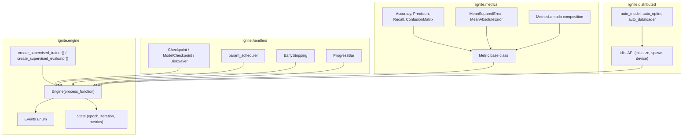

<!-- source: DeepWiki mcp.deepwiki.com · repo pytorch/ignite · page 1 Overview · fetched 2026-10-21 -->

# Overview

Relevant source files

The following files were used as context for generating this wiki page:

- [README.md](README.md)
- [assets/ignite_vs_bare_pytorch.png](assets/ignite_vs_bare_pytorch.png)
- [assets/tldr/teaser.ipynb](assets/tldr/teaser.ipynb)
- [assets/tldr/teaser.py](assets/tldr/teaser.py)
- [docker/README.md](docker/README.md)
- [ignite/__init__.py](ignite/__init__.py)

PyTorch Ignite is a high-level library built on top of PyTorch for training and evaluating neural networks flexibly and transparently [README.md:26](). The library uses an event-driven architecture centered around the `ignite.engine.Engine` class, which manages training and evaluation loops and fires events that trigger user-defined handlers [README.md:83-88]().

Unlike restrictive training frameworks, Ignite adopts a **library approach**: it does not enforce control inversion [README.md:45](). Users instantiate `Engine` objects, attach handlers and metrics, and invoke `engine.run()` explicitly, leaving standard PyTorch code modular, transparent, and fully under user control [README.md:45]().

For detailed instructions and deep dives into specific topics, consult the child pages:
- [Installation and Setup](#1.1) — Guide users through installing Ignite via pip, conda, or Docker, including environment setup and dependency management [README.md:62-64]()
- [Core Concepts](#1.2) — Explain fundamental concepts: `Engine` as orchestrator, `Events` as hooks, `Handlers` as callbacks, and the library vs. framework philosophy [README.md:83-88]()
- [Quick Start Guide](#1.3) — Provide a minimal working example showing `Engine` creation, metric attachment, and handler usage for immediate user onboarding [README.md:92-124]()

Sources:
- [README.md:26-45]()
- [README.md:83-88]()
- [ignite/__init__.py:9]()

## Core Ecosystem Architecture

The library is structured around core module groups that handle execution loops, evaluation metrics, training orchestration, and multi-device distributed training.

Title: PyTorch Ignite Ecosystem Architecture

Sources:
- [ignite/__init__.py:1-9]()
- [README.md:83-88]()

## Library Philosophy and Workflow

PyTorch Ignite aims to reduce boilerplate code while granting absolute control over every iteration and parameter update [README.md:26](). Users define a batch-level step function `process_function(engine, batch)` (or utilize built-in factories like `create_supervised_trainer`), wrap it in an `Engine`, and attach handlers for logging, metric collection, and checkpointing [README.md:104-124]().

For detailed code examples and step-by-step onboarding, see [Quick Start Guide](#1.3). For comprehensive information on installation options across pip, conda, and Docker containers, see [Installation and Setup](#1.1).

Sources:
- [README.md:26-45]()
- [README.md:92-124]()
- [docker/README.md:1-40]()

---

