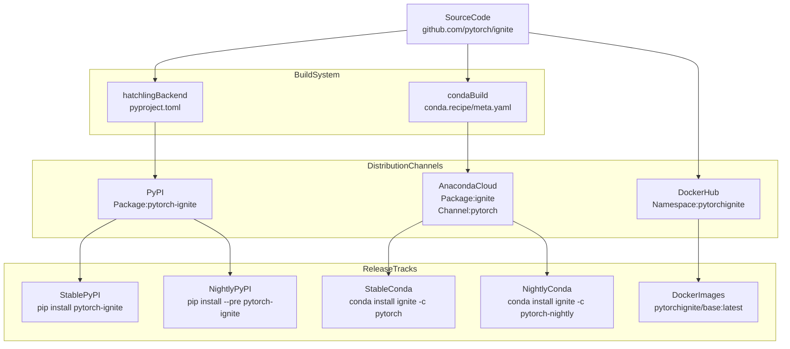
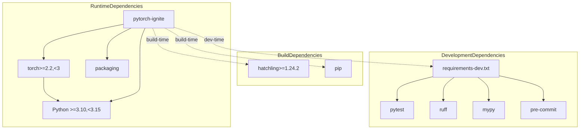
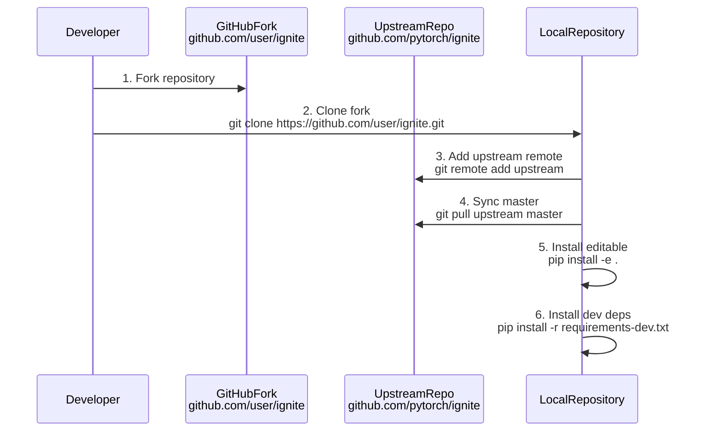

<!-- source: DeepWiki mcp.deepwiki.com · repo pytorch/ignite · page 1.1 Installation and Setup · fetched 2026-10-21 -->

# Installation and Setup

<details>
<summary>Relevant source files</summary>

The following files were used as context for generating this wiki page:

- [.devcontainer/devcontainer.json](.devcontainer/devcontainer.json)
- [.git-blame-ignore-revs](.git-blame-ignore-revs)
- [.github/workflows/build_docs.sh](.github/workflows/build_docs.sh)
- [.github/workflows/install_docs_deps.sh](.github/workflows/install_docs_deps.sh)
- [.pre-commit-config.yaml](.pre-commit-config.yaml)
- [CONTRIBUTING.md](CONTRIBUTING.md)
- [README.md](README.md)
- [assets/tldr/teaser.ipynb](assets/tldr/teaser.ipynb)
- [assets/tldr/teaser.py](assets/tldr/teaser.py)
- [conda.recipe/build_and_upload.sh](conda.recipe/build_and_upload.sh)
- [conda.recipe/meta.yaml](conda.recipe/meta.yaml)
- [docker/README.md](docker/README.md)
- [docker/build.sh](docker/build.sh)
- [docker/docker.cfg](docker/docker.cfg)
- [docker/hvd/Dockerfile.hvd-apex](docker/hvd/Dockerfile.hvd-apex)
- [docker/hvd/Dockerfile.hvd-base](docker/hvd/Dockerfile.hvd-base)
- [docker/main/Dockerfile.apex](docker/main/Dockerfile.apex)
- [docker/main/Dockerfile.base](docker/main/Dockerfile.base)
- [docker/msdp/Dockerfile.msdp-apex](docker/msdp/Dockerfile.msdp-apex)
- [docker/push_all.sh](docker/push_all.sh)
- [docker/test_image.py](docker/test_image.py)
- [pyproject.toml](pyproject.toml)

</details>


This page guides users through installing PyTorch Ignite via pip, conda, Docker, or from source. It covers stable and nightly releases, dependency requirements, environment setup, and installation verification. For detailed contribution workflows and development environment setup, see [Contributing Guidelines](#7.5). For Docker image build processes, see [Release and Distribution](#7.3).

---

## Installation Methods Overview

PyTorch Ignite is distributed through three primary channels, each offering stable and nightly release tracks.



**Sources:** [README.md:1-18](), [pyproject.toml:1-37](), [conda.recipe/meta.yaml:1-43]()

---

## Stable Release Installation

### pip Installation

The primary installation method uses the PyPI package `pytorch-ignite`:

```bash
pip install pytorch-ignite
```

This installs the latest stable release. The package is built using the `hatchling` backend specified in [pyproject.toml:1-3]() and includes the core `ignite` package with all submodules.

**Sources:** [README.md:17-17](), [pyproject.toml:1-22]()

### conda Installation

For conda users, Ignite is available in the `pytorch` channel under the package name `ignite`:

```bash
conda install ignite -c pytorch
```

The conda package is configured as `noarch: python` ([conda.recipe/meta.yaml:12]()), meaning it's platform-independent and works on any operating system.

**Sources:** [README.md:17-17](), [conda.recipe/meta.yaml:10-12]()

### From Source Installation

To install the latest development version directly from the GitHub repository:

```bash
pip install git+https://github.com/pytorch/ignite
```

This clones the master branch and installs it as a regular package. For development purposes where you need editable installation, see the Development Installation section below.

**Sources:** [README.md:1-19](), [CONTRIBUTING.md:81-110]()

---

## Nightly Release Installation

Nightly releases provide access to the latest features and bug fixes before they're included in stable releases.

### pip Nightly Installation

```bash
pip install --pre pytorch-ignite
```

The `--pre` flag instructs pip to include pre-release versions. Nightly PyPI packages are published daily.

**Sources:** [README.md:18-18]()

### conda Nightly Installation

```bash
conda install ignite -c pytorch-nightly
```

Nightly conda packages are available in the `pytorch-nightly` channel and are synchronized with the nightly PyPI releases.

**Sources:** [README.md:18-18]()

---

## Docker Images

Pre-built Docker images are available for various use cases, including GPU support, Horovod integration, and domain-specific dependencies.

### Using Pre-built Images

Pull and run a Docker image with GPU support:

```bash
docker run --gpus all -it -v $PWD:/workspace/project --network=host --shm-size 16G pytorchignite/base:latest /bin/bash
```

**Docker Image Variants**

| Category | Image Tag | Description |
|----------|-----------|-------------|
| Base | `pytorchignite/base:latest` | Core Ignite with PyTorch |
| | `pytorchignite/apex:latest` | Includes NVIDIA Apex for mixed-precision training |
| | `pytorchignite/hvd-base:latest` | Horovod distributed training support |
| | `pytorchignite/hvd-apex:latest` | Horovod + Apex combination |
| | `pytorchignite/msdp-apex:latest` | Multi-scale distributed processing with Apex |
| Vision | `pytorchignite/vision:latest` | torchvision and image processing libraries |
| NLP | `pytorchignite/nlp:latest` | NLP libraries (transformers, tokenizers) |

**Sources:** [README.md:17-17](), [docker/docker.cfg:1-4](), [docker/hvd/Dockerfile.hvd-base:1-65]()

---

## Requirements and Dependencies

The dependency structure for PyTorch Ignite consists of runtime requirements and optional development tools.



**Sources:** [pyproject.toml:1-21](), [conda.recipe/meta.yaml:16-27]()

### Python Version Support

Ignite requires **Python >=3.10,<3.15** as defined in [pyproject.toml:17](). (Conda recipe specifies Python >=3.9,<=3.13 in [conda.recipe/meta.yaml:20]()).

### PyTorch Version Support

Ignite supports **PyTorch >=2.2,<3** ([pyproject.toml:19]()), while the conda meta.yaml specifies `pytorch >=1.10,<3` ([conda.recipe/meta.yaml:21]()).

### Core Dependencies

The required runtime dependency beyond PyTorch is:
- **packaging** ([pyproject.toml:20]()): Used for version parsing.

**Sources:** [pyproject.toml:1-21](), [conda.recipe/meta.yaml:16-27]()

---

## Development Installation

For contributors and developers who need to modify Ignite code, an editable installation is required.

### Fork and Clone Workflow



**Sources:** [CONTRIBUTING.md:81-110]()

### Step-by-Step Instructions

1. **Fork the repository** on GitHub: Navigate to https://github.com/pytorch/ignite and click "Fork".
2. **Clone your fork** (replace `happy-ignite-developer` with your username):
```bash
git clone https://github.com/happy-ignite-developer/ignite.git
cd ignite
```
3. **Add upstream remote**:
```bash
git remote add upstream https://github.com/pytorch/ignite.git
git remote -v
```
4. **Sync with upstream and install**:
```bash
git pull upstream master
pip install -e .
pip install -r requirements-dev.txt
```

**Sources:** [CONTRIBUTING.md:81-110]()

---

## Installation Verification

### Basic Import Test

Open a Python interpreter and verify core imports:

```python
import ignite
print(ignite.__version__)

from ignite.engine import Engine, Events
from ignite.metrics import Accuracy
from ignite.handlers import Checkpoint
```

The version string is defined in `ignite/__init__.py` and extracted by `pyproject.toml` using hatchling ([pyproject.toml:28-29]()).

### Package Structure Verification

Verify that all main submodules are accessible:

```python
import ignite.engine      # Core execution engine
import ignite.handlers    # Event handlers and callbacks
import ignite.metrics     # Performance metrics
import ignite.contrib     # Extended functionality
import ignite.distributed # Multi-backend distributed support
```

**Sources:** [pyproject.toml:28-36](), [conda.recipe/meta.yaml:28-35]()

---

