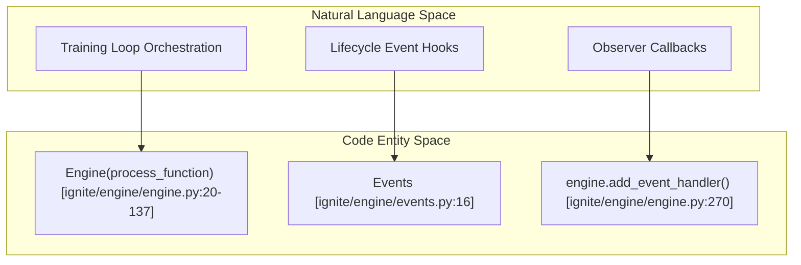
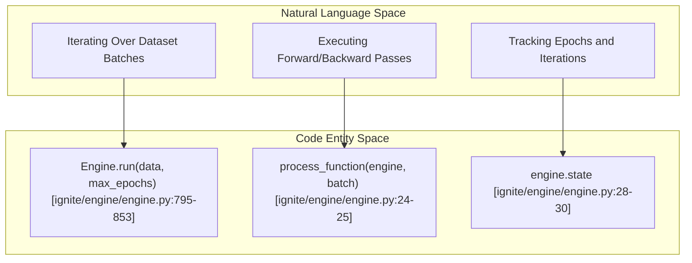
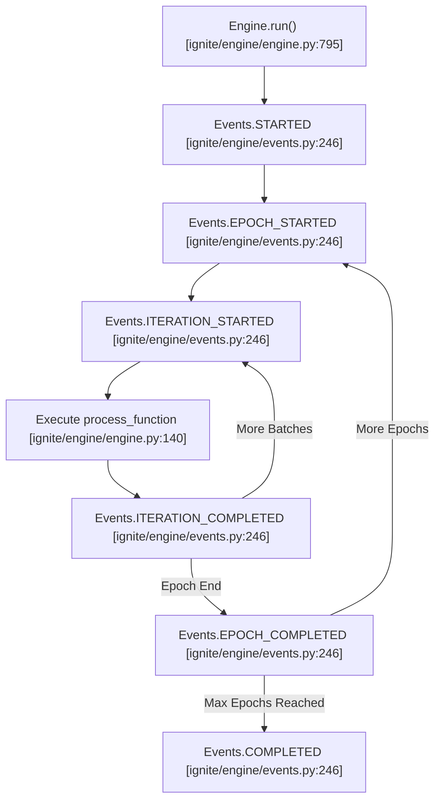
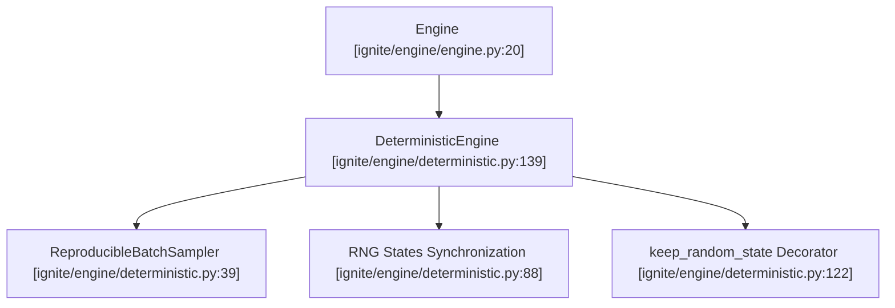

<!-- source: DeepWiki mcp.deepwiki.com · repo pytorch/ignite · page 1.2 Core Concepts · fetched 2026-10-21 -->

# Core Concepts

<details>
<summary>Relevant source files</summary>

The following files were used as context for generating this wiki page:

- [docs/source/_static/img/concepts/timeline_and_events.png](docs/source/_static/img/concepts/timeline_and_events.png)
- [ignite/_utils.py](ignite/_utils.py)
- [ignite/engine/deterministic.py](ignite/engine/deterministic.py)
- [ignite/engine/engine.py](ignite/engine/engine.py)
- [ignite/engine/events.py](ignite/engine/events.py)
- [ignite/engine/utils.py](ignite/engine/utils.py)
- [tests/ignite/engine/__init__.py](tests/ignite/engine/__init__.py)
- [tests/ignite/engine/test_custom_events.py](tests/ignite/engine/test_custom_events.py)
- [tests/ignite/engine/test_deterministic.py](tests/ignite/engine/test_deterministic.py)
- [tests/ignite/engine/test_engine.py](tests/ignite/engine/test_engine.py)
- [tests/ignite/engine/test_event_handlers.py](tests/ignite/engine/test_event_handlers.py)

</details>


## Purpose and Scope

This document explains the foundational concepts and architecture of PyTorch Ignite, focusing on its design as a lightweight, flexible training library rather than a rigid framework. It details how the `Engine` class [ignite/engine/engine.py:20-130]() acts as the core loop orchestrator, how `Events` [ignite/engine/events.py:16-16]() provide execution hooks, how `Handlers` function as callbacks to extend training capabilities, and how state is managed via the `State` object [ignite/engine/events.py:451-523]() and serialization APIs [ignite/engine/engine.py:663-747](). 

---

## Library vs. Framework Philosophy

PyTorch Ignite adopts a **library** philosophy rather than a **framework** philosophy:
- **Frameworks** (like high-level wrappers or monolithic trainers) dictate your training loop structure, hide boilerplate behind opaque abstractions, and make non-standard research modifications difficult.
- **Libraries** provide modular, composable building blocks that you assemble. PyTorch Ignite leaves the core PyTorch training loop explicit while abstracting away repetitive boilerplate (logging, checkpointing, metric aggregation, distributed synchronization). You retain total control over your `process_function` [ignite/engine/engine.py:24-25](), optimizer steps, and gradient computations.


Sources: [ignite/engine/engine.py:20-137](), [ignite/engine/events.py:16-16]().

---

## Engine as Orchestrator

The `Engine` class [ignite/engine/engine.py:20-130]() is the central component of PyTorch Ignite. It coordinates the execution of training and evaluation loops over a dataset via its `run()` method [ignite/engine/engine.py:795-853](). 

Rather than writing custom `for epoch in range(...)` and `for batch in dataloader:` loops with scattered logging and validation code, you define a single `process_function` [ignite/engine/engine.py:24-25]() that executes a single iteration (batch processing step), and pass it to the `Engine`.


Sources: [ignite/engine/engine.py:20-130](), [ignite/engine/engine.py:795-853]().

---

## State Management

The `State` object [ignite/engine/events.py:451-523]() manages internal and user-defined runtime variables. It is instantiated automatically upon `Engine` creation [ignite/engine/engine.py:149]() and reset at the beginning of every `run()` call.

| State Attribute | Code Symbol / Type | Description |
|-----------------|--------------------|-------------|
| `iteration` | `int` [ignite/engine/events.py:451-523]() | Cumulative 1-based iteration counter across all epochs |
| `epoch` | `int` [ignite/engine/events.py:451-523]() | Cumulative 1-based epoch counter |
| `epoch_length` | `int` [ignite/engine/events.py:451-523]() | Number of iterations per epoch |
| `max_epochs` | `int` [ignite/engine/events.py:451-523]() | Total epochs configured for the run |
| `output` | `Any` [ignite/engine/events.py:451-523]() | Return value of the `process_function` for the current batch |
| `batch` | `Any` [ignite/engine/events.py:451-523]() | The raw data batch fetched for the current iteration |
| `metrics` | `dict` [ignite/engine/events.py:451-523]() | Dictionary storing computed metric values |

Sources: [ignite/engine/engine.py:28-30](), [ignite/engine/events.py:451-523]().

---

## Events System

The events system allows users to hook into specific moments during the engine's lifecycle without altering the execution loop code.


Sources: [ignite/engine/engine.py:140](), [ignite/engine/engine.py:795-853](), [ignite/engine/events.py:246-398]().

### Event Filtering

Events can be filtered using built-in qualifiers like `every`, `once`, `before`, and `after` [ignite/engine/events.py:51-73]():
- `Events.ITERATION_COMPLETED(every=100)`: Fires only on iterations that are multiples of 100 [ignite/engine/events.py:130-137]().
- `Events.EPOCH_COMPLETED(once=5)`: Fires exclusively on epoch 5 [ignite/engine/events.py:141-149]().

Sources: [ignite/engine/events.py:51-177]().

---

## Handlers and Callbacks

Handlers are Python callables (functions, methods, or classes with `__call__`) registered to listen to specific events [tests/ignite/engine/test_event_handlers.py:64-116](). When an event is fired, the engine invokes all registered handlers for that event, passing the engine instance [ignite/engine/engine.py:270-337]() (and any optional bound arguments) to them.

Handlers can be registered using either method attachment or decorators:
```python
# Using decorator syntax
@trainer.on(Events.ITERATION_COMPLETED(every=50))
def log_loss(engine):
    print(f"Iteration {engine.state.iteration}, Loss: {engine.state.output}")
```
Sources: [ignite/engine/engine.py:385-413](), [tests/ignite/engine/test_event_handlers.py:64-116]().

---

## Deterministic Training

For reproducible research, PyTorch Ignite provides `DeterministicEngine` [ignite/engine/deterministic.py:139-194](), which extends `Engine` to ensure identical dataflows across runs and re-runs. It manages random number generator states (`torch`, `numpy`, and `random`) [ignite/engine/deterministic.py:88-97]() and wraps dataloaders with `ReproducibleBatchSampler` [ignite/engine/deterministic.py:39-86]().


Sources: [ignite/engine/deterministic.py:39-194]().

---

## Summary

PyTorch Ignite's core architecture centers around the `Engine` orchestrator [ignite/engine/engine.py:20-130](), the `State` container [ignite/engine/events.py:451-523](), and the event-driven hook system [ignite/engine/events.py:16-16](). This design separates the core training loop execution from peripheral concerns like logging, validation, and checkpointing, adhering strictly to a flexible library philosophy.

Sources: [ignite/engine/engine.py:20-130](), [ignite/engine/events.py:16-523]().

---

