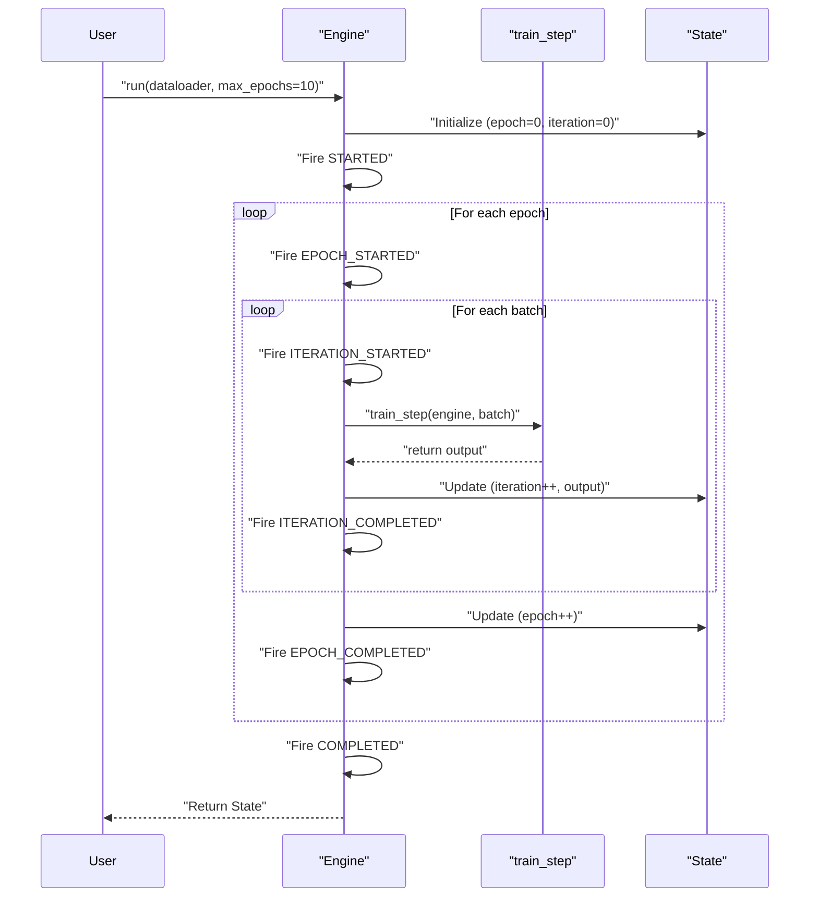
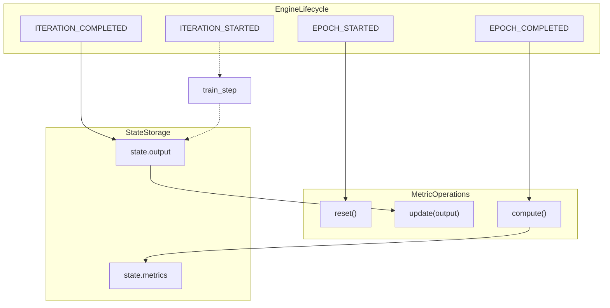
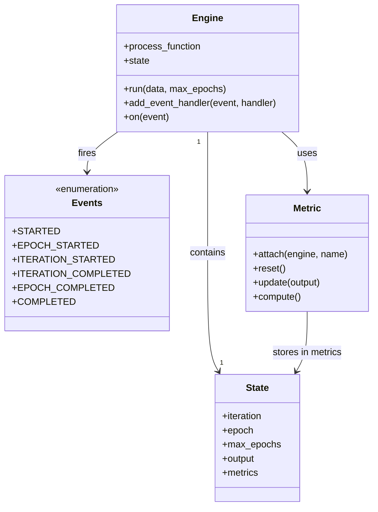

<!-- source: DeepWiki mcp.deepwiki.com · repo pytorch/ignite · page 1.3 Quick Start Guide · fetched 2026-10-21 -->

# Quick Start Guide

<details>
<summary>Relevant source files</summary>

The following files were used as context for generating this wiki page:

- [README.md](README.md)
- [assets/tldr/teaser.ipynb](assets/tldr/teaser.ipynb)
- [assets/tldr/teaser.py](assets/tldr/teaser.py)
- [docker/README.md](docker/README.md)
- [examples/mnist/mnist.py](examples/mnist/mnist.py)
- [examples/mnist/mnist_save_resume_engine.py](examples/mnist/mnist_save_resume_engine.py)
- [examples/mnist/mnist_with_tensorboard.py](examples/mnist/mnist_with_tensorboard.py)
- [examples/mnist/mnist_with_tensorboard_on_tpu.py](examples/mnist/mnist_with_tensorboard_on_tpu.py)
- [examples/mnist/mnist_with_visdom.py](examples/mnist/mnist_with_visdom.py)

</details>


**Purpose**: This guide provides minimal working examples to get started with PyTorch Ignite immediately. It demonstrates creating training and evaluation engines, attaching metrics, and using event handlers for common tasks.

**Scope**: Covers essential patterns for basic training loops. For detailed concepts, see [Core Concepts](#1.2). For installation instructions, see [Installation and Setup](#1.1). For advanced engine features, see [Engine System](#2).

---

## Basic Training Loop

The core pattern in Ignite is defining a `process_function` that processes a single batch, then wrapping it in an `Engine` to handle the training loop orchestration.

### Minimal Trainer

```python
from ignite.engine import Engine

def train_step(engine, batch):
    # Extract data
    inputs, targets = batch
    
    # Forward pass
    optimizer.zero_grad()
    outputs = model(inputs)
    loss = criterion(outputs, targets)
    
    # Backward pass
    loss.backward()
    optimizer.step()
    
    return loss.item()

# Create trainer engine
trainer = Engine(train_step)

# Run training
trainer.run(train_dataloader, max_epochs=10)
```

The `train_step` function receives two arguments:
- `engine`: The `Engine` instance (provides access to state)
- `batch`: Current batch from the dataloader

The function returns data that gets stored in `engine.state.output`.

**Key Points**:
- Engine automatically handles epoch and iteration loops
- No need to write `for epoch in range(max_epochs)` manually
- `engine.state` tracks progress (iteration, epoch counters)

Sources: [README.md:92-118]()

---

## Engine Execution Flow

### Diagram: Engine Execution Sequence


Sources: [README.md:92-124]()

---

## Adding Metrics

Metrics automatically accumulate values during training/evaluation and compute final results at epoch end.

### Attaching Metrics to Evaluator

```python
from ignite.engine import Engine
from ignite.metrics import Accuracy, Loss

def validation_step(engine, batch):
    model.eval()
    with torch.no_grad():
        x, y = batch
        y_pred = model(x)
        return y_pred, y

evaluator = Engine(validation_step)

# Attach metrics
Accuracy().attach(evaluator, "accuracy")
Loss(criterion).attach(evaluator, "loss")

# Run evaluation
state = evaluator.run(val_dataloader)
metrics = state.metrics
print(f"Accuracy: {metrics['accuracy']:.4f}, Loss: {metrics['loss']:.4f}")
```

**Metric Lifecycle**:
1. `reset()` - Called at epoch start
2. `update(output)` - Called after each iteration with `engine.state.output`
3. `compute()` - Called at epoch end to produce final value

The computed metrics are stored in `engine.state.metrics` dictionary.

Sources: [README.md:106-117](), [examples/mnist/mnist.py:63-64]()

---

## Metric Integration Pattern

### Diagram: Metric Binding Architecture


**How Metrics Work**:
- `Metric.attach(engine, name)` registers internal handlers on events
- Handler on `EPOCH_STARTED` calls `metric.reset()`
- Handler on `ITERATION_COMPLETED` calls `metric.update(engine.state.output)`
- Handler on `EPOCH_COMPLETED` calls `metric.compute()` and stores result in `state.metrics[name]`

Sources: [examples/mnist/mnist.py:63-65]()

---

## Using Event Handlers

Event handlers allow you to inject custom logic at specific points in the training loop.

### Logging Training Progress

```python
from ignite.engine import Events

@trainer.on(Events.ITERATION_COMPLETED(every=100))
def log_training_loss(engine):
    print(f"Epoch[{engine.state.epoch}] Iteration[{engine.state.iteration}] "
          f"Loss: {engine.state.output:.2f}")

@trainer.on(Events.EPOCH_COMPLETED)
def log_validation(engine):
    evaluator.run(val_dataloader)
    metrics = evaluator.state.metrics
    print(f"Validation - Accuracy: {metrics['accuracy']:.4f}")
```

**Event Filters**:
- `every=N` - Trigger every N iterations/epochs
- `once=N` - Trigger only at iteration/epoch N
- Custom filter function

### Alternative Handler Syntax

```python
# Using add_event_handler (equivalent to decorator)
def handler_function(engine):
    print("Handler called")

trainer.add_event_handler(Events.STARTED, handler_function)

# Handler without engine argument
@trainer.on(Events.COMPLETED)
def handler_no_args():
    print("Training completed")
```

Sources: [examples/mnist/mnist.py:69-93](), [README.md:120-123]()

---

## Common Event Types

| Event | When Fired | Use Case |
|-------|-----------|----------|
| `STARTED` | Beginning of `run()` | Initialize variables, setup |
| `EPOCH_STARTED` | Start of each epoch | Set learning rate, logging |
| `ITERATION_STARTED` | Before processing batch | Debugging, data inspection |
| `ITERATION_COMPLETED` | After processing batch | Log metrics, gradient clipping |
| `EPOCH_COMPLETED` | After all batches in epoch | Validation, checkpointing |
| `COMPLETED` | End of all epochs | Save final model, cleanup |

Sources: [examples/mnist/mnist.py:97-99]()

---

## Complete Training Example

This example combines all concepts: trainer, evaluator, metrics, and handlers, referencing standard setup from [examples/mnist/mnist.py]().

```python
import torch
from torch import nn
from torch.optim import SGD
from torch.utils.data import DataLoader
from ignite.engine import Engine, Events
from ignite.metrics import Accuracy, Loss

# Model setup
model = nn.Sequential(nn.Linear(10, 64), nn.ReLU(), nn.Linear(64, 2))
optimizer = SGD(model.parameters(), lr=0.01)
criterion = nn.CrossEntropyLoss()

# Define process functions
def train_step(engine, batch):
    model.train()
    optimizer.zero_grad()
    x, y = batch
    y_pred = model(x)
    loss = criterion(y_pred, y)
    loss.backward()
    optimizer.step()
    return loss.item()

def validation_step(engine, batch):
    model.eval()
    with torch.no_grad():
        x, y = batch
        y_pred = model(x)
        return y_pred, y

# Create engines
trainer = Engine(train_step)
evaluator = Engine(validation_step)

# Attach metrics to evaluator
Accuracy().attach(evaluator, "accuracy")
Loss(criterion).attach(evaluator, "loss")

# Add event handlers
@trainer.on(Events.EPOCH_COMPLETED)
def run_validation(engine):
    evaluator.run(val_loader)
    metrics = evaluator.state.metrics
    print(f"Epoch {engine.state.epoch}: "
          f"Accuracy: {metrics['accuracy']:.4f}, "
          f"Loss: {metrics['loss']:.4f}")

# Run training
trainer.run(train_loader, max_epochs=50)
```

Sources: [examples/mnist/mnist.py:36-101]()

---

## Key Classes and Methods Reference

### Diagram: Core Entity Relationships


**Core Methods**:
- `Engine.run(data, max_epochs)` - Execute training/evaluation loop
- `Engine.add_event_handler(event, handler, *args, **kwargs)` - Register handler
- `Engine.on(event)` - Decorator shortcut for `add_event_handler`
- `Metric.attach(engine, name)` - Register metric to compute automatically

Sources: [README.md:92-124](), [examples/mnist/mnist.py:63-65]()

---

## Next Steps

- **Custom Metrics**: See [Metrics System](#3) for creating custom metrics and metric composition
- **State Management**: See [State Management and Serialization](#2.3) for checkpointing and resuming training
- **Advanced Handlers**: See [Handlers and Callbacks](#4) for checkpoint saving, early stopping, and logging integrations
- **Distributed Training**: See [Distributed Training](#5) for multi-GPU and multi-node setups

Sources: [README.md:67-71]()

---

