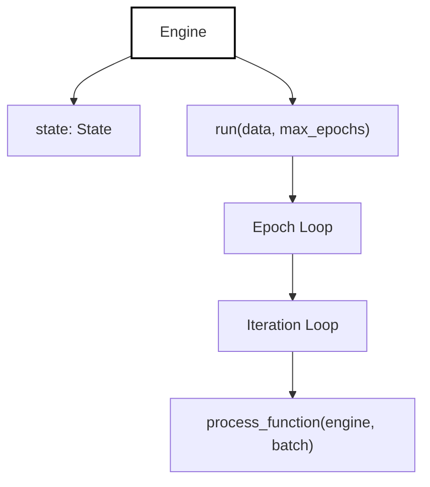
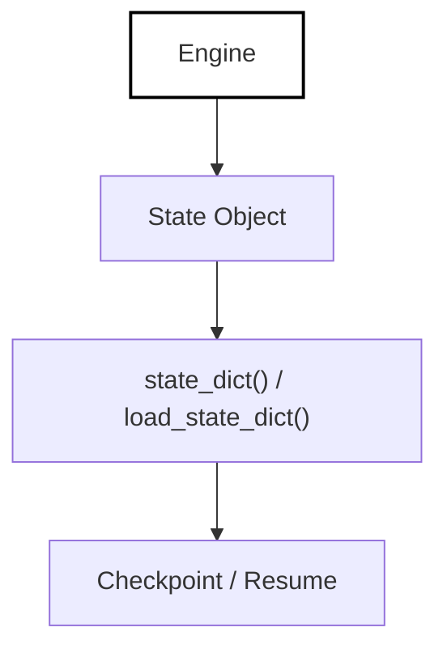
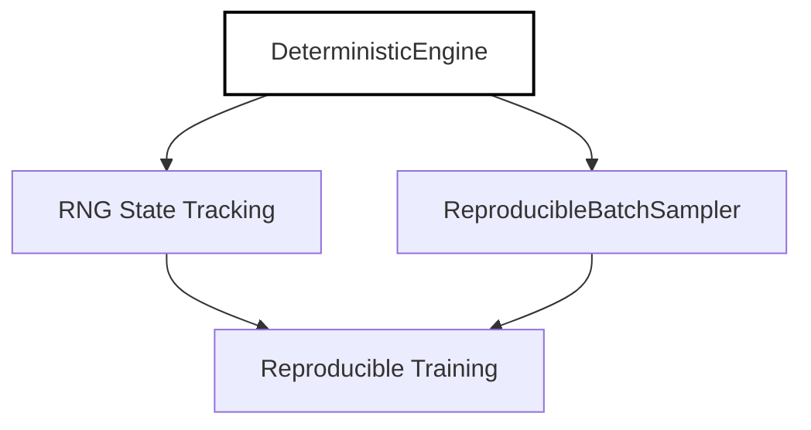
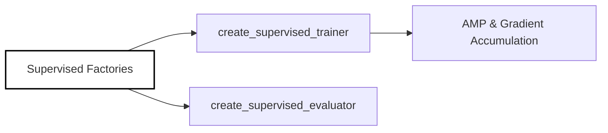

<!-- source: DeepWiki mcp.deepwiki.com · repo pytorch/ignite · page 2 Engine System · fetched 2026-10-21 -->

# Engine System

Relevant source files

The following files were used as context for generating this wiki page:

- [ignite/_utils.py](ignite/_utils.py)
- [ignite/engine/deterministic.py](ignite/engine/deterministic.py)
- [ignite/engine/engine.py](ignite/engine/engine.py)
- [ignite/engine/events.py](ignite/engine/events.py)
- [ignite/engine/utils.py](ignite/engine/utils.py)
- [tests/ignite/engine/__init__.py](tests/ignite/engine/__init__.py)
- [tests/ignite/engine/test_custom_events.py](tests/ignite/engine/test_custom_events.py)
- [tests/ignite/engine/test_deterministic.py](tests/ignite/engine/test_deterministic.py)
- [tests/ignite/engine/test_engine.py](tests/ignite/engine/test_engine.py)
- [tests/ignite/engine/test_event_handlers.py](tests/ignite/engine/test_event_handlers.py)

## Purpose and Scope

The Engine System is the core orchestration layer of PyTorch Ignite, responsible for executing training and evaluation loops, managing lifecycle hooks, and handling distributed coordination. An `Engine` runs a user-defined `process_function` across batches of data while emitting events that trigger attached handlers and metrics [ignite/engine/engine.py:20-136]().

This is a parent page providing a high-level architectural overview. The engine system spans several detailed sub-topics:
- [Engine Class and Lifecycle](#2.1) — Detail Engine construction, run() method, lifecycle stages, and state management
- [Events System](#2.2) — Explain Events enumeration, event filtering, EventsList composition, and custom events
- [State Management and Serialization](#2.3) — Document engine.state object, checkpointing, and resuming training
- [Deterministic Training](#2.4) — Explain DeterministicEngine, ReproducibleBatchSampler, and reproducible training runs
- [Supervised Training Helpers](#2.5) — Document trainer/evaluator factories, AMP support, and gradient accumulation

Sources: [ignite/engine/engine.py:20-136]()

---

## 2.1. Engine Class and Lifecycle

The `Engine` class ([ignite/engine/engine.py:20-136]()) serves as the central orchestrator of training and validation loops. When the `run()` method is invoked, it iterates over epochs and batches, executing the `process_function` per iteration while managing core execution flow, termination flags, and interrupts.

For complete details on engine construction, the execution loop, lifecycle stages, and state management, see [Engine Class and Lifecycle](#2.1).

Sources: [ignite/engine/engine.py:20-166](), [tests/ignite/engine/test_engine.py:40-112]()

---

## 2.2. Events System

The Events system allows handlers to hook into specific moments of the training lifecycle via the `Events` enumeration ([ignite/engine/events.py:247-404]()). Events support rich filtering features (`every`, `once`, `before`, `after`, or custom callables) via `CallableEventWithFilter` ([ignite/engine/events.py:19-127]()), and can be combined using `EventsList` ([ignite/engine/events.py:406-449]()). Custom event types can also be defined by subclassing `EventEnum` ([ignite/engine/events.py:206-244]()).

For deep dives into event filtering, custom event creation, and event list composition, see [Events System](#2.2).

Sources: [ignite/engine/events.py:19-244](), [ignite/engine/events.py:406-449]()

---

## 2.3. State Management and Serialization

The `State` object ([ignite/engine/events.py:452-524]()) tracks intermediate progress, counters (`iteration`, `epoch`), metrics, and user-defined variables during an engine run. Ignite provides built-in serialization support through `state_dict()` and `load_state_dict()` ([ignite/engine/engine.py:687-766]()), enabling seamless checkpointing and experiment resumption.

For detailed documentation on state attributes, checkpointing formats, and mid-run resumption, see [State Management and Serialization](#2.3).

Sources: [ignite/engine/engine.py:687-766](), [ignite/engine/events.py:452-524]()

---

## 2.4. Deterministic Training

To ensure reproducibility across runs—especially when resuming from checkpoints or using multi-worker data loaders—Ignite provides `DeterministicEngine` ([ignite/engine/deterministic.py:138-294]()). It automatically manages random number generator (RNG) states across PyTorch, NumPy, and Python's `random`, and wraps batch samplers using `ReproducibleBatchSampler` ([ignite/engine/deterministic.py:38-84]()).

For comprehensive instructions on achieving deterministic training, random seed management, and the `keep_random_state` decorator, see [Deterministic Training](#2.4).

Sources: [ignite/engine/deterministic.py:38-135](), [ignite/engine/deterministic.py:138-294]()

---

## 2.5. Supervised Training Helpers

Ignite offers high-level factory functions like `create_supervised_trainer` and `create_supervised_evaluator` to quickly instantiate engines for standard training loops. These helpers support Automatic Mixed Precision (AMP) via PyTorch native `torch.amp` or NVIDIA Apex, gradient accumulation, and custom device placement or data transforms.

For complete usage guides on trainer/evaluator factories, AMP setups, and gradient accumulation helpers, see [Supervised Training Helpers](#2.5).

Sources: [ignite/engine/engine.py:20-70](), [ignite/engine/deterministic.py:121-135]()

---

