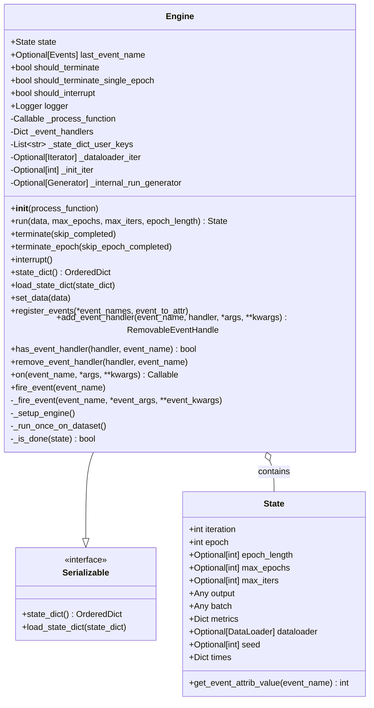
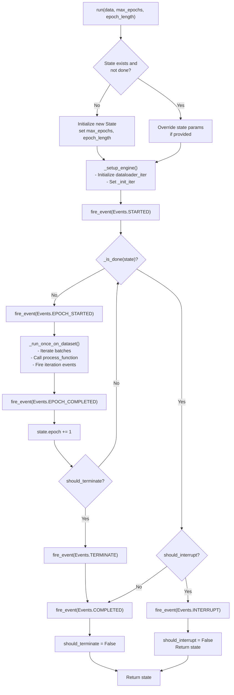
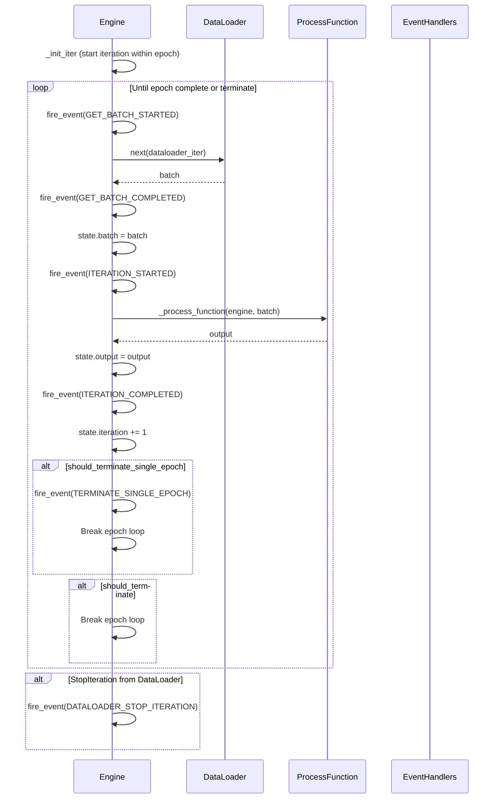
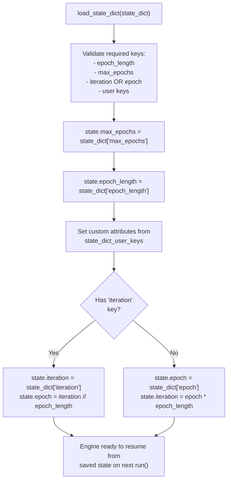
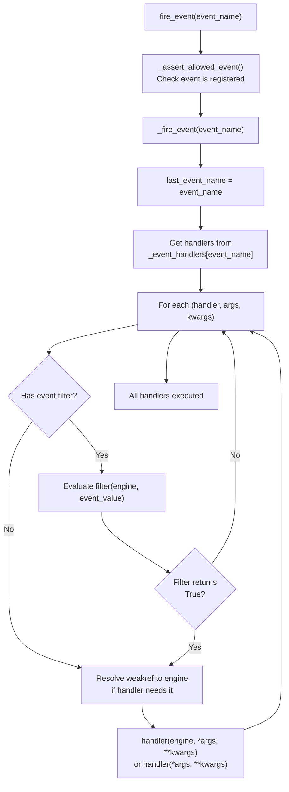
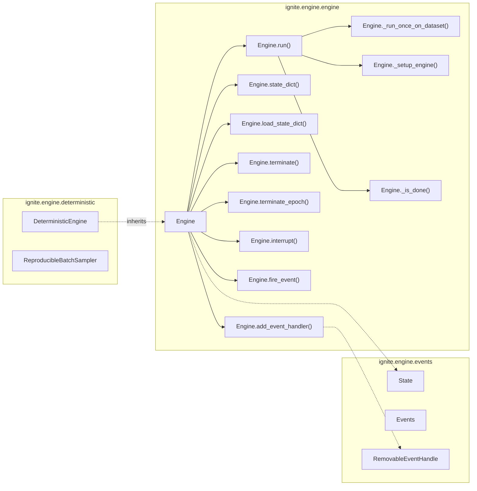

<!-- source: DeepWiki mcp.deepwiki.com · repo pytorch/ignite · page 2.1 Engine Class and Lifecycle · fetched 2026-10-21 -->

# Engine Class and Lifecycle

<details>
<summary>Relevant source files</summary>

The following files were used as context for generating this wiki page:

- [ignite/_utils.py](ignite/_utils.py)
- [ignite/engine/deterministic.py](ignite/engine/deterministic.py)
- [ignite/engine/engine.py](ignite/engine/engine.py)
- [ignite/engine/events.py](ignite/engine/events.py)
- [ignite/engine/utils.py](ignite/engine/utils.py)
- [tests/ignite/engine/__init__.py](tests/ignite/engine/__init__.py)
- [tests/ignite/engine/test_custom_events.py](tests/ignite/engine/test_custom_events.py)
- [tests/ignite/engine/test_deterministic.py](tests/ignite/engine/test_deterministic.py)
- [tests/ignite/engine/test_engine.py](tests/ignite/engine/test_engine.py)
- [tests/ignite/engine/test_event_handlers.py](tests/ignite/engine/test_event_handlers.py)

</details>


## Purpose and Scope

This document covers the `Engine` class, which is the core execution orchestrator in PyTorch Ignite. The Engine abstracts the training/evaluation loop by running a user-defined `process_function` over data while emitting events at key lifecycle points. This page focuses on the Engine's internal structure, state management, execution lifecycle, and serialization mechanisms.

For information about the Events system and event filtering, see [Events System](#2.2). For supervised training factory functions that create pre-configured Engines, see [Deterministic Training](#2.4). For deterministic/reproducible training, see [State Management and Serialization](#2.3).

Sources: [ignite/engine/engine.py:20-162]()

---

## Engine Class Overview

The `Engine` class is defined in [ignite/engine/engine.py:20-294](). It executes a `process_function` over batches from a data iterable, managing state and firing events throughout execution.

### Core Responsibilities

| Responsibility | Description |
|---|---|
| **Process Function Execution** | Calls user-defined function for each batch |
| **State Management** | Maintains iteration counters, epoch numbers, metrics, and user data |
| **Event Emission** | Fires events at lifecycle points (`STARTED`, `EPOCH_STARTED`, `ITERATION_COMPLETED`, etc.) |
| **Control Flow** | Supports termination (`terminate()`) and interruption (`interrupt()`) |
| **Serialization** | Provides `state_dict()` and `load_state_dict()` for checkpointing |

### Engine Constructor

```python
Engine(process_function: Callable[["Engine", Any], Any])
```

The `process_function` receives two arguments:
- `engine`: The Engine instance itself
- `batch`: Current batch from the data iterator

The function can return any data, which is stored in `engine.state.output`.

Sources: [ignite/engine/engine.py:20-162]()

---

## Engine Class Structure



**Diagram: Engine Class Structure with Key Methods and Attributes**

Sources: [ignite/engine/engine.py:20-294](), [ignite/engine/events.py:451-524]()

---

## Engine State Object

The `State` object is created by the Engine and shared with all event handlers. It contains execution metadata and user-defined data.

### State Attributes

```mermaid
graph TB
    State["State Object"]
    
    subgraph "Core Counters (reset on run)"
        Iteration["iteration: int<br/>1-based, cumulative"]
        Epoch["epoch: int<br/>1-based, current epoch"]
        EpochLength["epoch_length: Optional[int]<br/>Iterations per epoch"]
        MaxEpochs["max_epochs: Optional[int]<br/>Total epochs to run"]
        MaxIters["max_iters: Optional[int]<br/>Alternative stopping criterion"]
    end
    
    subgraph "Data Flow"
        Batch["batch: Any<br/>Current batch from dataloader"]
        Output["output: Any<br/>Return value of process_function"]
        Dataloader["dataloader: Optional[DataLoader]<br/>Data source"]
    end
    
    subgraph "Metrics & Timing"
        Metrics["metrics: Dict[str, Any]<br/>Computed metrics"]
        Times["times: Dict[str, Optional[float]]<br/>EPOCH_COMPLETED, COMPLETED"]
    end
    
    subgraph "Reproducibility"
        Seed["seed: Optional[int]<br/>Random seed for epoch"]
    end
    
    State --> Iteration
    State --> Epoch
    State --> EpochLength
    State --> MaxEpochs
    State --> MaxIters
    State --> Batch
    State --> Output
    State --> Dataloader
    State --> Metrics
    State --> Times
    State --> Seed
```



**Diagram: State Object Attribute Structure**

### State Lifecycle

State attributes are initialized at different points:

| Attribute | When Set | Reset on New Run? |
|---|---|---|
| `iteration` | `run()` start | Yes (if engine is "done") |
| `epoch` | `run()` start | Yes (if engine is "done") |
| `max_epochs` | `run()` call | Yes (if provided) |
| `epoch_length` | `run()` call or auto-detected | Yes (if provided) |
| `batch` | Each iteration | No |
| `output` | After `process_function` | No |
| `metrics` | Handler attachment | No |
| `times` | `Events.STARTED` handler | Partially |

Sources: [ignite/engine/events.py:451-524](), [ignite/engine/engine.py:814-1020]()

---

## Execution Lifecycle

The `run()` method is the primary entry point for Engine execution.

### run() Method Signature

```python
def run(
    self,
    data: Iterable | None = None,
    max_epochs: int | None = None,
    max_iters: int | None = None,
    epoch_length: int | None = None,
) -> State
```

### Run Logic Flow

The Engine's run behavior depends on its current state:

| Condition | Behavior |
|---|---|
| First run | Create new state with provided parameters |
| State exists, not done | Continue from current iteration |
| State exists, done | Reset and create new state |
| Resuming from loaded state | Continue from saved iteration/epoch |

Sources: [ignite/engine/engine.py:814-920]()

### Engine Execution Flow



**Diagram: Engine.run() Execution Flow**

Sources: [ignite/engine/engine.py:814-1020]()

### Internal Iteration Flow (_run_once_on_dataset)



**Diagram: Single Epoch Iteration Sequence**

Sources: [ignite/engine/engine.py:1037-1179]()

---

## State Management and Serialization

The Engine implements the `Serializable` interface to support checkpointing and resuming training.

### state_dict() Method

Returns an `OrderedDict` containing:

| Key | Source | Description |
|---|---|---|
| `iteration` | `engine.state.iteration` | Current iteration count (1-based) |
| `epoch_length` | `engine.state.epoch_length` | Iterations per epoch |
| `max_epochs` | `engine.state.max_epochs` | Total epochs to run |
| User keys | `engine.state_dict_user_keys` | Custom attributes registered by user |

**Example Usage:**

```python
# Register custom state attributes
engine.state_dict_user_keys.append("alpha")
engine.state_dict_user_keys.append("beta")

@engine.on(Events.STARTED)
def init_user_values(_):
    engine.state.alpha = 0.1
    engine.state.beta = "checkpoint_v1"

# Save state
state_dict = engine.state_dict()
torch.save(state_dict, "checkpoint.pt")
```

Sources: [ignite/engine/engine.py:682-716](), [tests/ignite/engine/test_engine.py:1-50]()

### load_state_dict() Method

Restores engine state from a dictionary. Required keys:
- `epoch_length` and `max_epochs` (always required)
- **One of**: `iteration` OR `epoch` (to specify resume point)
- Any keys in `engine.state_dict_user_keys`

**State Restoration Logic:**



**Diagram: load_state_dict() Flow**

**Resume Example:**

```python
# Resume from iteration 500
state_dict = {
    "iteration": 500, 
    "max_epochs": 100, 
    "epoch_length": 1000
}
engine.load_state_dict(state_dict)
engine.run(data)  # Continues from iteration 501

# Resume from epoch 5
state_dict = {
    "epoch": 5, 
    "max_epochs": 100, 
    "epoch_length": 1000
}
engine.load_state_dict(state_dict)
engine.run(data)  # Continues from epoch 6
```

Sources: [ignite/engine/engine.py:717-766](), [tests/ignite/engine/test_engine.py:50-100]()

---

## Termination and Interruption

The Engine provides three control mechanisms to stop execution.

### terminate()

Stops the run completely after the current iteration.

```python
def terminate(self, skip_completed: bool = False) -> None
```

**Event Sequence:**
1. Current event completes
2. `Events.TERMINATE` fires
3. `Events.COMPLETED` fires (unless `skip_completed=True`)

**Example:**

```python
@engine.on(Events.ITERATION_COMPLETED(once=100))
def early_stop():
    if should_stop():
        engine.terminate()
```

Sources: [ignite/engine/engine.py:564-651](), [tests/ignite/engine/test_engine.py:43-158]()

### terminate_epoch()

Stops the current epoch after the current iteration, but continues to the next epoch.

```python
def terminate_epoch(self, skip_epoch_completed: bool = False) -> None
```

**Event Sequence:**
1. Current event completes
2. `Events.TERMINATE_SINGLE_EPOCH` fires
3. `Events.EPOCH_COMPLETED` fires (unless `skip_epoch_completed=True`)
4. `Events.EPOCH_STARTED` fires for next epoch

**Example:**

```python
@engine.on(Events.ITERATION_COMPLETED)
def early_epoch_stop():
    if loss < threshold:
        engine.terminate_epoch()
```

Sources: [ignite/engine/engine.py:652-675](), [tests/ignite/engine/test_engine.py:115-180]()

### interrupt()

Pauses execution after the current iteration. The run can be resumed by calling `run()` again, which continues from the interrupted state.

```python
def interrupt(self) -> None
```

**Requirements:**
- `Engine.interrupt_resume_enabled = True` (default since v0.4.10)

**Event Sequence:**
1. Current iteration completes
2. `Events.INTERRUPT` fires
3. `run()` returns

**Resume Behavior:**
- Data iteration continues from the interrupted point
- State counters (iteration, epoch) are preserved

**Example:**

```python
@engine.on(Events.ITERATION_COMPLETED(every=100))
def checkpoint_and_pause():
    save_checkpoint()
    engine.interrupt()

# First call - runs 100 iterations then interrupts
engine.run(data, max_epochs=10)
print(f"Interrupted at iteration {engine.state.iteration}")

# Second call - resumes from iteration 101
engine.run(data, max_epochs=10)
```

Sources: [ignite/engine/engine.py:481-563](), [tests/ignite/engine/test_engine.py:100-200]()

### Termination Comparison Table

| Method | Scope | Fires TERMINATE* | Fires COMPLETED | Resumes? |
|---|---|---|---|---|
| `terminate()` | Entire run | TERMINATE | Yes (unless skip_completed) | No, starts fresh |
| `terminate_epoch()` | Current epoch | TERMINATE_SINGLE_EPOCH | Yes (unless skip_epoch_completed) | Continues to next epoch |
| `interrupt()` | Pauses run | INTERRUPT | No | Yes, from interrupt point |

Sources: [ignite/engine/engine.py:481-675]()

---

## Event Integration

The Engine is the event emitter that drives Ignite's event-driven architecture.

### Event Firing Mechanism



**Diagram: Event Firing and Handler Execution Flow**

Sources: [ignite/engine/engine.py:426-480]()

### Handler Registration Methods

The Engine provides three ways to register event handlers:

**1. add_event_handler()**

```python
handler_handle = engine.add_event_handler(
    Events.ITERATION_COMPLETED,
    handler_function,
    *args,
    **kwargs
)
```

Returns a `RemovableEventHandle` for later removal.

**2. @on() Decorator**

```python
@engine.on(Events.EPOCH_COMPLETED)
def log_epoch(engine):
    print(f"Epoch {engine.state.epoch} completed")
```

**3. Implicit for Metrics**

Metrics attach themselves to engines without needing the `engine` argument:

```python
accuracy = Accuracy()
accuracy.attach(engine, "accuracy")
```

Sources: [ignite/engine/engine.py:281-425]()

### Custom Event Registration

Users can define and register custom events:

```python
from ignite.engine import EventEnum

class CustomEvents(EventEnum):
    BACKWARD_STARTED = "backward_started"
    BACKWARD_COMPLETED = "backward_completed"

def process_function(engine, batch):
    loss = compute_loss(batch)
    engine.fire_event(CustomEvents.BACKWARD_STARTED)
    loss.backward()
    engine.fire_event(CustomEvents.BACKWARD_COMPLETED)
    return loss

engine = Engine(process_function)
engine.register_events(*CustomEvents)

@engine.on(CustomEvents.BACKWARD_COMPLETED)
def clip_gradients(engine):
    torch.nn.utils.clip_grad_norm_(model.parameters(), 1.0)
```

Sources: [ignite/engine/engine.py:166-250](), [tests/ignite/engine/test_custom_events.py:12-46]()

---

## Code Entity Reference Map

This section maps high-level concepts to specific code entities for easy code navigation.

### Primary Classes and Methods



**Diagram: Code Entity Relationship Map**

### File and Line Number Reference

| Concept | Implementation | Line Range |
|---|---|---|
| Engine class definition | ignite/engine/engine.py | [20-294]() |
| Engine.__init__() | ignite/engine/engine.py | [137-165]() |
| Engine.run() | ignite/engine/engine.py | [814-920]() |
| Engine._run_once_on_dataset() | ignite/engine/engine.py | [1037-1179]() |
| Engine.state_dict() | ignite/engine/engine.py | [686-716]() |
| Engine.load_state_dict() | ignite/engine/engine.py | [717-766]() |
| Engine.terminate() | ignite/engine/engine.py | [564-651]() |
| Engine.terminate_epoch() | ignite/engine/engine.py | [652-675]() |
| Engine.interrupt() | ignite/engine/engine.py | [481-563]() |
| Engine.fire_event() | ignite/engine/engine.py | [457-480]() |
| Engine._fire_event() | ignite/engine/engine.py | [426-456]() |
| Engine.add_event_handler() | ignite/engine/engine.py | [281-349]() |
| Engine.register_events() | ignite/engine/engine.py | [166-251]() |
| State class definition | ignite/engine/events.py | [451-524]() |
| DeterministicEngine | ignite/engine/deterministic.py | [138-294]() |

### Test File References

| Test Area | File |
|---|---|
| Core Engine behavior | tests/ignite/engine/test_engine.py |
| Event handlers | tests/ignite/engine/test_event_handlers.py |
| Custom events | tests/ignite/engine/test_custom_events.py |
| Deterministic engine | tests/ignite/engine/test_deterministic.py |

Sources: [ignite/engine/engine.py](), [ignite/engine/events.py](), [ignite/engine/deterministic.py](), [tests/ignite/engine/test_engine.py]()

---

