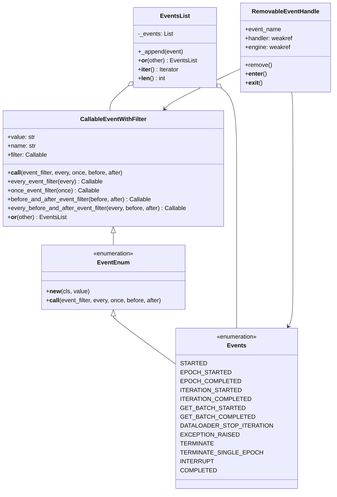
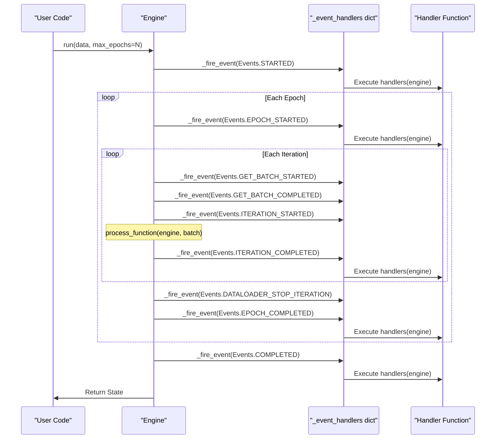
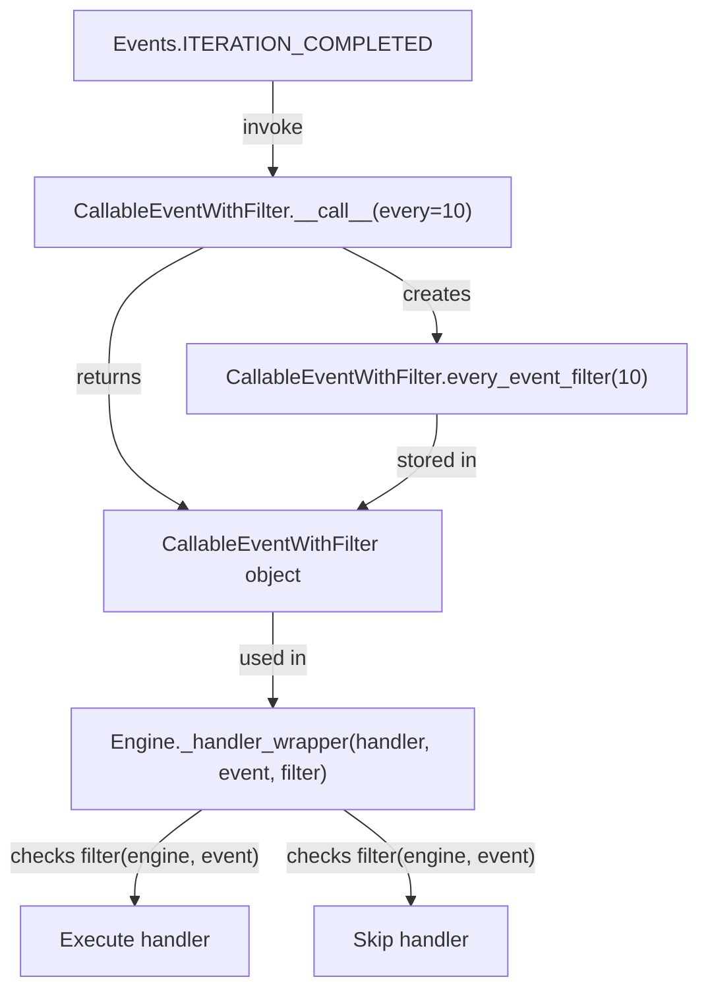

<!-- source: DeepWiki mcp.deepwiki.com · repo pytorch/ignite · page 2.2 Events System · fetched 2026-10-21 -->

# Events System

<details>
<summary>Relevant source files</summary>

The following files were used as context for generating this wiki page:

- [ignite/_utils.py](ignite/_utils.py)
- [ignite/engine/deterministic.py](ignite/engine/deterministic.py)
- [ignite/engine/engine.py](ignite/engine/engine.py)
- [ignite/engine/events.py](ignite/engine/events.py)
- [ignite/engine/utils.py](ignite/engine/utils.py)
- [tests/ignite/engine/__init__.py](tests/ignite/engine/__init__.py)
- [tests/ignite/engine/test_custom_events.py](tests/ignite/engine/test_custom_events.py)
- [tests/ignite/engine/test_deterministic.py](tests/ignite/engine/test_deterministic.py)
- [tests/ignite/engine/test_engine.py](tests/ignite/engine/test_engine.py)
- [tests/ignite/engine/test_event_handlers.py](tests/ignite/engine/test_event_handlers.py)

</details>


The Events System provides the event-driven architecture that allows users to hook into specific points during `Engine` execution. At its core are the `Events` enumeration (built-in lifecycle events), `CallableEventWithFilter` (events with filtering logic), `EventsList` (composable event collections), and `EventEnum` (base class for custom events).

For information about how the Engine uses these events, see page 2.1.

## Architecture Overview

**Class Hierarchy and Components**



Sources: [ignite/engine/events.py:19-50](), [ignite/engine/events.py:206-244](), [ignite/engine/events.py:247-404](), [ignite/engine/events.py:406-450](), [ignite/engine/events.py:527-590]()

## Events Enumeration

The `Events` class inherits from `EventEnum` and defines all built-in lifecycle events. Each event is a string value that can be used directly or with filtering [ignite/engine/events.py:247-401]().

**Built-in Events Reference**

| Event Constant | String Value | State Attribute | Typical Use Case |
|----------------|--------------|-----------------|------------------|
| `Events.STARTED` | `"started"` | `epoch` | Initialize training state |
| `Events.EPOCH_STARTED` | `"epoch_started"` | `epoch` | Reset metrics, set learning rate |
| `Events.GET_BATCH_STARTED` | `"get_batch_started"` | `iteration` | Pre-batch preprocessing |
| `Events.GET_BATCH_COMPLETED` | `"get_batch_completed"` | `iteration` | Batch augmentation |
| `Events.ITERATION_STARTED` | `"iteration_started"` | `iteration` | Dynamic batch modification |
| `Events.ITERATION_COMPLETED` | `"iteration_completed"` | `iteration` | Log metrics, update progress |
| `Events.DATALOADER_STOP_ITERATION` | `"dataloader_stop_iteration"` | `iteration` | Handle dataloader exhaustion |
| `Events.EPOCH_COMPLETED` | `"epoch_completed"` | `epoch` | Validation, checkpointing |
| `Events.COMPLETED` | `"completed"` | `epoch` | Final cleanup, save results |
| `Events.EXCEPTION_RAISED` | `"exception_raised"` | `epoch` | Custom error handling |
| `Events.TERMINATE` | `"terminate"` | varies | Clean termination actions |
| `Events.TERMINATE_SINGLE_EPOCH` | `"terminate_single_epoch"` | varies | Early epoch stopping |
| `Events.INTERRUPT` | `"interrupt"` | varies | Pause/resume handling |

The mapping of events to state attributes is defined in the `State.event_to_attr` dictionary [ignite/engine/events.py:475-484]().

Sources: [ignite/engine/events.py:247-401](), [ignite/engine/events.py:475-484]()

**Event Lifecycle Sequence**



Sources: [ignite/engine/engine.py:427-457](), [tests/ignite/engine/test_engine.py:628-663]()

## CallableEventWithFilter

`CallableEventWithFilter` is the core class that enables event filtering [ignite/engine/events.py:19-50](). Every event can be called with filter parameters to create a filtered version.

**Filter Creation Flow and Code Mapping**



Sources: [ignite/engine/events.py:51-128](), [ignite/engine/engine.py:264-276]()

### Filter Methods

The `CallableEventWithFilter` class provides static methods that generate filter functions [ignite/engine/events.py:130-178]():

| Method | Parameters | Returns | Filter Logic |
|--------|-----------|---------|--------------|
| `every_event_filter(every)` | `every: int` | `Callable` | `event % every == 0` [ignite/engine/events.py:130-138]() |
| `once_event_filter(once)` | `once: List[int]` | `Callable` | `event in once` [ignite/engine/events.py:140-149]() |
| `before_and_after_event_filter(before, after)` | `before: int`, `after: int` | `Callable` | `after < event < before` [ignite/engine/events.py:152-162]() |
| `every_before_and_after_event_filter(every, before, after)` | `every: int`, `before: int`, `after: int` | `Callable` | `after < event < before and (event - after - 1) % every == 0` [ignite/engine/events.py:165-178]() |

The `__call__` method validates input parameters and assigns the appropriate filter function [ignite/engine/events.py:75-127]().

Sources: [ignite/engine/events.py:51-128](), [ignite/engine/events.py:130-178]()

## Event Filtering Patterns

Event filtering controls when a handler executes based on current iteration or epoch counts.

### Every N Pattern
```python
@engine.on(Events.ITERATION_COMPLETED(every=10))
def log_training_loss(engine):
    pass
```
Sources: [ignite/engine/events.py:107-113](), [tests/ignite/engine/test_custom_events.py:342-381]()

### Once Pattern
```python
@engine.on(Events.ITERATION_COMPLETED(once=500))
def checkpoint_at_500(engine):
    pass
```
Sources: [ignite/engine/events.py:114-116](), [tests/ignite/engine/test_custom_events.py:483-517]()

### Before/After Pattern
```python
@engine.on(Events.ITERATION_COMPLETED(before=1000, after=100))
def mid_phase(engine):
    pass
```
Sources: [ignite/engine/events.py:117-122](), [tests/ignite/engine/test_custom_events.py:387-459]()

Sources: [ignite/engine/events.py:75-128]()

## Custom Events with EventEnum

User-defined events must inherit from `EventEnum` to gain filtering capabilities [ignite/engine/events.py:206-238]().

```python
from ignite.engine import EventEnum

class BackpropEvents(EventEnum):
    BACKWARD_STARTED = "backward_started"

trainer = Engine(update_fn)
trainer.register_events(*BackpropEvents)

@trainer.on(BackpropEvents.BACKWARD_STARTED)
def handle_backward(engine):
    pass
```

The `register_events` method registers custom events and optional `event_to_attr` mappings [ignite/engine/engine.py:167-252]().

Sources: [ignite/engine/events.py:206-238](), [ignite/engine/engine.py:167-252](), [tests/ignite/engine/test_custom_events.py:12-47]()

## EventsList Composition

`EventsList` allows combining multiple events using the `|` operator [ignite/engine/events.py:406-450]().

```python
events = Events.STARTED | Events.COMPLETED
@engine.on(events)
def multi_handler(engine):
    pass
```

When `add_event_handler` receives an `EventsList`, it iterates through each event and registers the handler individually [ignite/engine/engine.py:325-329](). `RemovableEventHandle` correctly unbinds the handler across all events in the list [ignite/engine/events.py:562-585]().

Sources: [ignite/engine/events.py:406-450](), [ignite/engine/engine.py:325-329](), [tests/ignite/engine/test_event_handlers.py:228-290]()

## State and Event Attribute Mapping

The `State.event_to_attr` dictionary links event types to state attributes (`iteration` or `epoch`) so that filters evaluate against the correct counter [ignite/engine/events.py:475-516]().

Sources: [ignite/engine/events.py:475-516](), [tests/ignite/engine/test_engine.py:573-599]()

## Internal Mechanics

Handlers are stored in `Engine._event_handlers` [ignite/engine/engine.py:138-139](). When `Engine._fire_event` runs, it iterates over registered handlers, evaluates filter wrappers if present, and invokes the callback [ignite/engine/engine.py:427-457]().

Sources: [ignite/engine/engine.py:138-139](), [ignite/engine/engine.py:264-276](), [ignite/engine/engine.py:427-457]()

---

