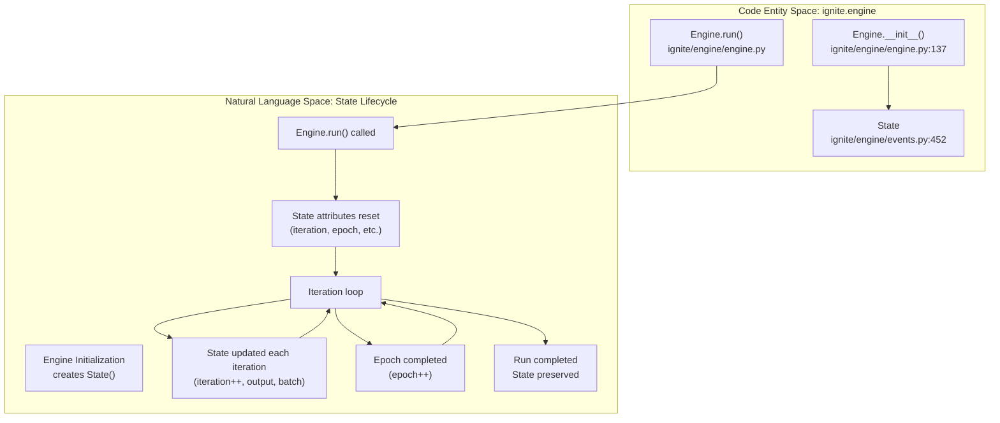
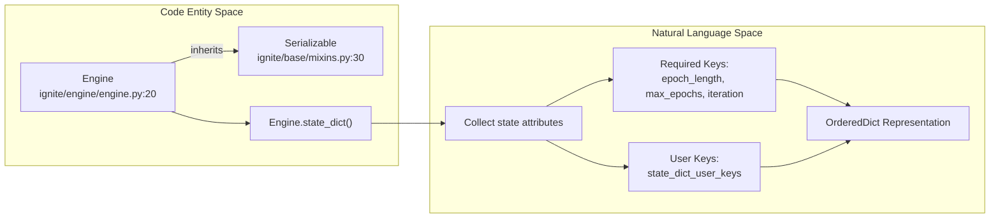
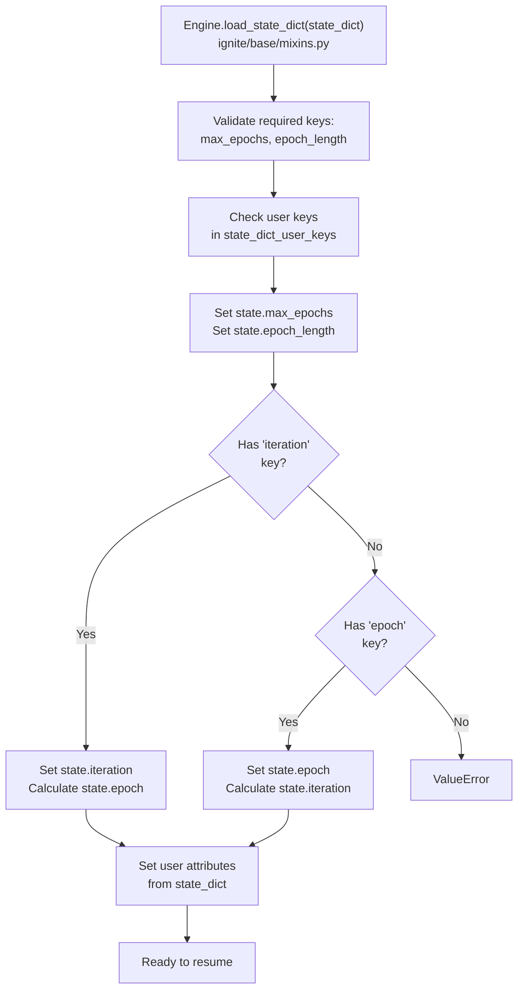
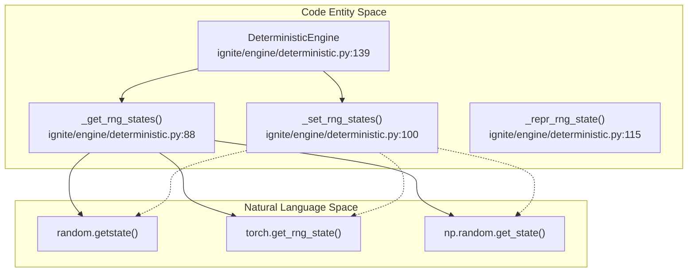

<!-- source: DeepWiki mcp.deepwiki.com · repo pytorch/ignite · page 2.3 State Management and Serialization · fetched 2026-10-21 -->

# State Management and Serialization

<details>
<summary>Relevant source files</summary>

The following files were used as context for generating this wiki page:

- [ignite/_utils.py](ignite/_utils.py)
- [ignite/base/__init__.py](ignite/base/__init__.py)
- [ignite/base/mixins.py](ignite/base/mixins.py)
- [ignite/engine/deterministic.py](ignite/engine/deterministic.py)
- [ignite/engine/engine.py](ignite/engine/engine.py)
- [ignite/engine/events.py](ignite/engine/events.py)
- [ignite/engine/utils.py](ignite/engine/utils.py)
- [tests/ignite/base/__init__.py](tests/ignite/base/__init__.py)
- [tests/ignite/base/test_mixins.py](tests/ignite/base/test_mixins.py)
- [tests/ignite/engine/__init__.py](tests/ignite/engine/__init__.py)
- [tests/ignite/engine/test_custom_events.py](tests/ignite/engine/test_custom_events.py)
- [tests/ignite/engine/test_deterministic.py](tests/ignite/engine/test_deterministic.py)
- [tests/ignite/engine/test_engine.py](tests/ignite/engine/test_engine.py)
- [tests/ignite/engine/test_engine_state_dict.py](tests/ignite/engine/test_engine_state_dict.py)
- [tests/ignite/engine/test_event_handlers.py](tests/ignite/engine/test_event_handlers.py)

</details>


## Purpose and Scope

This page documents the state management and serialization mechanisms in PyTorch Ignite's Engine system. It covers:

- The `ignite.engine.events.State` object and its attributes
- Serializing engine state with `state_dict()` for checkpointing
- Deserializing engine state with `load_state_dict()` for resuming training
- Integration with checkpoint handlers
- Extended state management in `ignite.engine.deterministic.DeterministicEngine` for reproducible training
- Custom state attributes via `state_dict_user_keys`

For information about the Engine lifecycle and event system, see [Engine Class and Lifecycle](#2.1). For checkpoint handler details, see [Checkpoint and Model Saving](#4.1). For deterministic training features, see [Deterministic Training](#2.4).

---

## The State Object

### State Class Definition

The `State` class [ignite/engine/events.py:452-532]() serves as a shared data structure that passes information between the engine and event handlers. Each `Engine` instance creates a `State` object during initialization [ignite/engine/engine.py:149]().

**Default State Attributes:**

| Attribute | Type | Description | Initial Value |
|-----------|------|-------------|---------------|
| `iteration` | int | 1-based iteration counter | 0 |
| `epoch` | int | 1-based epoch counter | 0 |
| `epoch_length` | Optional[int] | Number of iterations per epoch | None |
| `max_epochs` | Optional[int] | Maximum epochs to run | None |
| `max_iters` | Optional[int] | Maximum iterations to run | None |
| `output` | Any | Output from `process_function` | None |
| `batch` | Any | Current batch data | None |
| `metrics` | Dict[str, Any] | Computed metrics | {} |
| `dataloader` | Any | Data source | None |
| `seed` | Optional[int] | Random seed (if set) | None |
| `times` | Dict[str, float] | Timing information | {} |



**State Lifecycle with Events**

Sources: [ignite/engine/events.py:452-532](), [ignite/engine/engine.py:149]()

### Event-to-Attribute Mapping

The `State` class maintains an `event_to_attr` mapping [ignite/engine/events.py:475-484]() that associates events with the state attribute they modify:

```python
event_to_attr = {
    Events.GET_BATCH_STARTED: "iteration",
    Events.GET_BATCH_COMPLETED: "iteration",
    Events.ITERATION_STARTED: "iteration",
    Events.ITERATION_COMPLETED: "iteration",
    Events.EPOCH_STARTED: "epoch",
    Events.EPOCH_COMPLETED: "epoch",
    Events.STARTED: "epoch",
    Events.COMPLETED: "epoch",
}
```

This mapping is used by custom events to automatically associate event counters with state attributes [ignite/engine/events.py:514-518]().

Sources: [ignite/engine/events.py:475-484](), [ignite/engine/events.py:514-518]()

---

## State Serialization (state_dict)

### Engine.state_dict() Method

The `Engine.state_dict()` method returns an `OrderedDict` containing the engine's serializable state. This dictionary includes:

**Required Keys:**
- `epoch_length` - Number of iterations per epoch
- `max_epochs` - Maximum epochs configuration
- `iteration` - Current iteration counter

**User-Defined Keys:**
- Any keys specified in `engine.state_dict_user_keys` list



**Example Usage:**

```python
# Basic state_dict
engine = Engine(update_fn)
engine.run(data, max_epochs=10)
state_dict = engine.state_dict()
# Returns: {"epoch_length": 100, "max_epochs": 10, "iteration": 1000}
```

Sources: [ignite/base/mixins.py:30-36](), [ignite/engine/engine.py:20]()

### Custom State Attributes

Users can add custom attributes to the state dictionary using the `state_dict_user_keys` list:

```python
engine = Engine(update_fn)
engine.state_dict_user_keys.append("alpha")
engine.state_dict_user_keys.append("beta")

@engine.on(Events.STARTED)
def init_user_values(_):
    engine.state.alpha = 0.1
    engine.state.beta = 1.0

@engine.on(Events.COMPLETED)
def save_state(_):
    state_dict = engine.state_dict()
    torch.save(state_dict, "checkpoint.pt")
```

This pattern is tested in `tests/ignite/engine/test_engine_state_dict.py`.

Sources: [ignite/engine/engine.py:20](), [tests/ignite/engine/test_engine_state_dict.py:32-51]()

---

## State Deserialization (load_state_dict)

### Engine.load_state_dict() Method

The `Engine.load_state_dict()` method restores engine state from a mapping. The method validates required keys, sets configuration parameters, restores user-defined state attributes, and calculates missing progress markers (`iteration` or `epoch`).

**Required State Dict Keys:**
- `max_epochs` (or `max_iters`) - Must be present
- `epoch_length` - Must be present
- Either `iteration` OR `epoch` (not both)

**Validation Rules:**

| Condition | Behavior |
|-----------|----------|
| Missing required keys | Raises `ValueError` [ignite/base/mixins.py:41-45]() |
| Missing user keys | Raises `ValueError` |
| Both `iteration` and `epoch` | Raises `ValueError` |
| `epoch` without `epoch_length` | Raises `ValueError` |



**Example: Resume from Epoch**

```python
state_dict = {"epoch": 3, "max_epochs": 100, "epoch_length": len(data_loader)}
trainer = Engine(update_fn)
trainer.load_state_dict(state_dict)
trainer.run(data_loader)
```

Sources: [ignite/base/mixins.py:37-61](), [tests/ignite/engine/test_engine_state_dict.py:113-127]()

---

## DeterministicEngine and RNG State

### Extended State Management for Reproducibility

`DeterministicEngine` [ignite/engine/deterministic.py:139-224]() extends `Engine` to include random number generator (RNG) states in serialization, enabling fully reproducible training runs.



**RNG State Functions:**

The deterministic module provides helper functions [ignite/engine/deterministic.py:88-119]() to capture and restore states for Python's `random`, `torch`, and `numpy`.

Sources: [ignite/engine/deterministic.py:88-119](), [ignite/engine/deterministic.py:139-224]()

### DeterministicEngine.state_dict()

The `DeterministicEngine` overrides `state_dict()` [ignite/engine/deterministic.py:188-191]() to embed `rng_states`:

```python
def state_dict(self) -> OrderedDict:
    state_dict = super().state_dict()
    state_dict["rng_states"] = _get_rng_states()
    return state_dict
```

Sources: [ignite/engine/deterministic.py:188-191]()

---

## Summary

The state management system in PyTorch Ignite provides a robust framework for checkpointing and resuming training sessions:

- **`State` Object:** Shared container for runtime variables and metrics.
- **Serialization (`state_dict`)**: Flattens progress and user keys into an `OrderedDict`.
- **Deserialization (`load_state_dict`)**: Validates and restores progress indicators, supporting resume from both epochs and iterations.
- **`DeterministicEngine`**: Captures RNG states to guarantee deterministic replay across interruptions.

Sources: [ignite/engine/engine.py:20](), [ignite/engine/events.py:452](), [ignite/engine/deterministic.py:139]()

---

