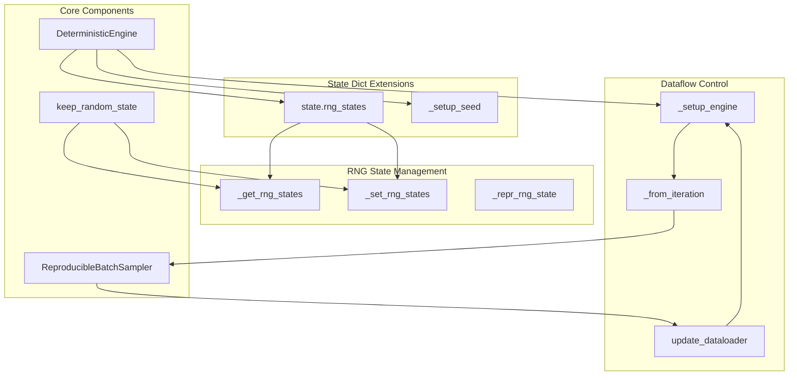
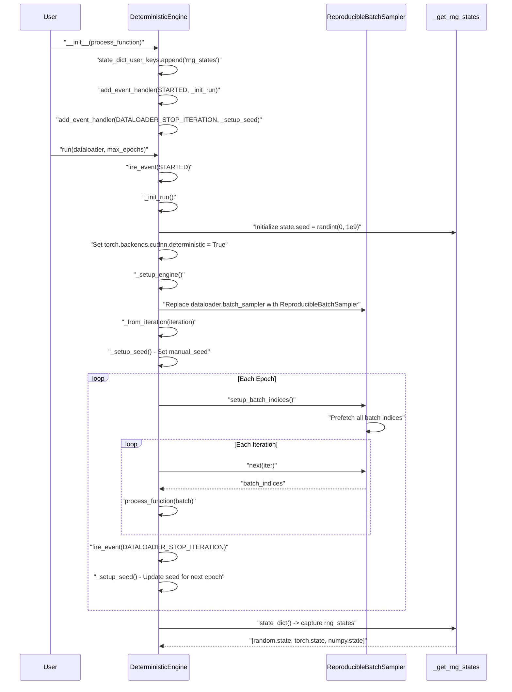
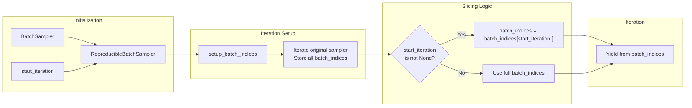
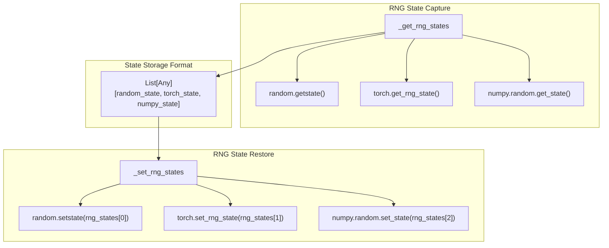
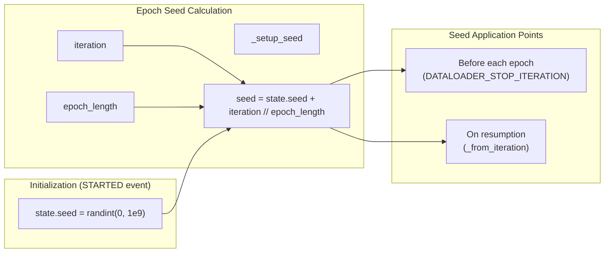
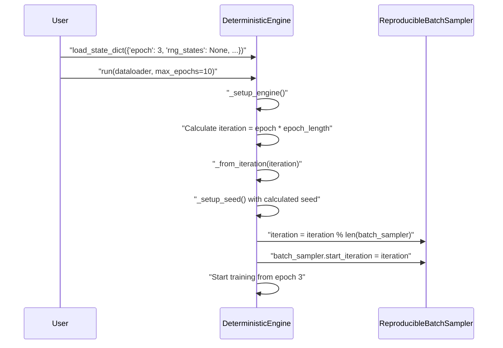
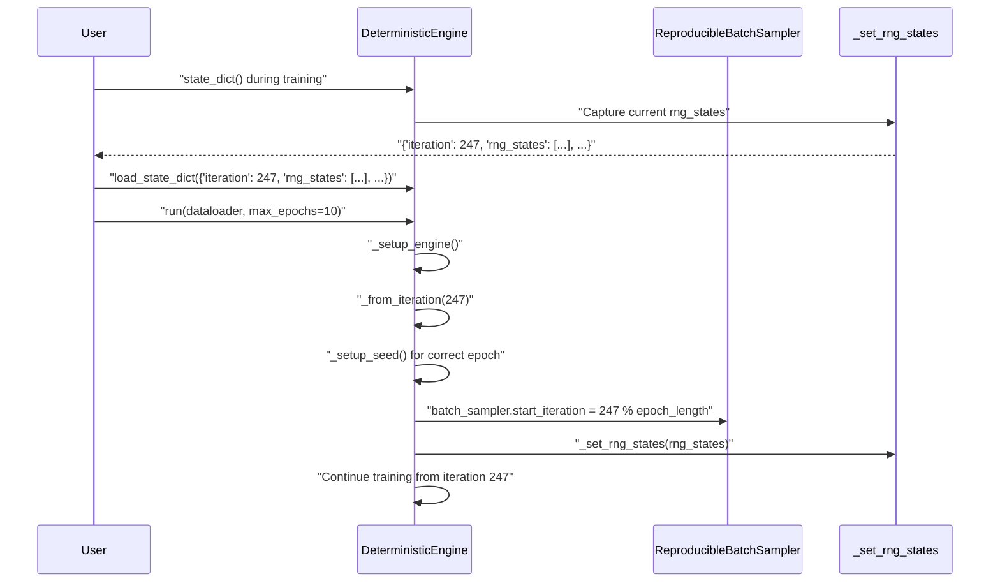

<!-- source: DeepWiki mcp.deepwiki.com · repo pytorch/ignite · page 2.4 Deterministic Training · fetched 2026-10-21 -->

# Deterministic Training

<details>
<summary>Relevant source files</summary>

The following files were used as context for generating this wiki page:

- [ignite/_utils.py](ignite/_utils.py)
- [ignite/engine/deterministic.py](ignite/engine/deterministic.py)
- [ignite/engine/engine.py](ignite/engine/engine.py)
- [ignite/engine/events.py](ignite/engine/events.py)
- [ignite/engine/utils.py](ignite/engine/utils.py)
- [tests/ignite/engine/__init__.py](tests/ignite/engine/__init__.py)
- [tests/ignite/engine/test_custom_events.py](tests/ignite/engine/test_custom_events.py)
- [tests/ignite/engine/test_deterministic.py](tests/ignite/engine/test_deterministic.py)
- [tests/ignite/engine/test_engine.py](tests/ignite/engine/test_engine.py)
- [tests/ignite/engine/test_event_handlers.py](tests/ignite/engine/test_event_handlers.py)

</details>


## Purpose and Scope

This page covers the deterministic training system in PyTorch Ignite, which ensures reproducible training runs that can be resumed from any epoch or iteration with identical results. This is critical for research reproducibility, debugging, and fault-tolerant training on pre-emptible infrastructure.

For general Engine concepts and event handling, see [Engine Class and Lifecycle](#2.1). For distributed training considerations, see [Distributed Training](#5).

Sources: `[ignite/engine/deterministic.py:1-295]()`

## Overview

Deterministic training addresses the challenge of resuming training from checkpoints while maintaining exact reproducibility of data batches and random operations. The system synchronizes three sources of randomness:
1. **Data sampling order** - Using `ReproducibleBatchSampler`
2. **RNG states** - Managing `random`, `torch`, and `numpy` random states
3. **Epoch seeding** - Deterministic seed progression across epochs

The core implementation is `DeterministicEngine`, which extends `Engine` with additional handlers and state management to ensure deterministic execution.

Sources: `[ignite/engine/deterministic.py:138-177]()`

## Architecture



Sources: `[ignite/engine/deterministic.py:1-295]()`

## DeterministicEngine

`DeterministicEngine` is the primary class for deterministic training. It extends `Engine` and overrides key methods to ensure reproducibility.

### Key Modifications from Engine

| Feature | Implementation | Purpose |
|---------|---------------|---------|
| RNG state tracking | `state.rng_states` attribute | Stores random states for checkpointing |
| Seed management | `_setup_seed()` called on `DATALOADER_STOP_ITERATION` | Resets seed at epoch boundaries |
| Batch sampler replacement | `ReproducibleBatchSampler` wrapping | Enables precise iteration resumption |
| CUDA determinism | `torch.use_deterministic_algorithms(True)` | Forces deterministic GPU operations |
| Initial seed | `state.seed = torch.randint(...)` | Base seed for epoch progression |

Sources: `[ignite/engine/deterministic.py:139-200]()`

### Lifecycle and Event Handlers



Sources: `[ignite/engine/deterministic.py:139-295]()`

### State Persistence

The `state_dict()` method is overridden to capture current RNG states:

```python
def state_dict(self) -> OrderedDict:
    state_dict = super(DeterministicEngine, self).state_dict()
    state_dict["rng_states"] = _get_rng_states()
    return state_dict
```

This ensures that when training is checkpointed, all sources of randomness are saved.

Sources: `[ignite/engine/deterministic.py:187-191]()`

## ReproducibleBatchSampler

`ReproducibleBatchSampler` wraps a `BatchSampler` and prefetches all batch indices before iteration begins. This allows the sampler to be "rewound" to any iteration by slicing the prefetched indices.

### Implementation Details



Sources: `[ignite/engine/deterministic.py:39-86]()`

### Key Methods

| Method | Purpose | Behavior |
|--------|---------|----------|
| `__init__(batch_sampler, start_iteration)` | Initialize with wrapped sampler | Stores reference to original `BatchSampler` |
| `setup_batch_indices()` | Prefetch all indices | Iterates through `batch_sampler` and stores all batches |
| `__iter__()` | Provide batches | Calls `setup_batch_indices()`, then yields from stored indices |
| `__len__()` | Report length | Delegates to wrapped `batch_sampler` |

Sources: `[ignite/engine/deterministic.py:60-86]()`

### Usage with DataLoader

The `update_dataloader()` helper function replaces a DataLoader's batch sampler:

```python
def update_dataloader(dataloader: DataLoader, new_batch_sampler: BatchSampler) -> DataLoader:
    params_keys = [k for k in dataloader.__dict__.keys() if not k.startswith("_")]
    for k in ["batch_size", "sampler", "drop_last", "batch_sampler", "dataset_kind"]:
        if k in params_keys:
            params_keys.remove(k)
    params = {k: getattr(dataloader, k) for k in params_keys}
    params["batch_sampler"] = new_batch_sampler
    return type(dataloader)(**params)
```

This preserves all DataLoader parameters (`num_workers`, `pin_memory`, etc.) while swapping in the reproducible sampler.

Sources: `[ignite/engine/deterministic.py:19-37]()`

## RNG State Management

The system manages three independent sources of randomness, each with their own state:



Sources: `[ignite/engine/deterministic.py:88-114]()`

### State Capture

```python
def _get_rng_states() -> list[Any]:
    output: list[Any] = [random.getstate(), torch.get_rng_state()]
    try:
        import numpy as np
        output.append(np.random.get_state())
    except ImportError:
        pass
    return output
```

The function gracefully handles missing numpy by only capturing its state if available.

Sources: `[ignite/engine/deterministic.py:88-97]()`

### State Restoration

```python
def _set_rng_states(rng_states: list[Any]) -> None:
    random.setstate(rng_states[0])
    
    if "cpu" not in rng_states[1].device.type:
        rng_states[1] = rng_states[1].cpu()
    
    torch.set_rng_state(rng_states[1])
    try:
        import numpy as np
        np.random.set_state(rng_states[2])
    except ImportError:
        pass
```

Note the special handling for torch state: if the state tensor is on GPU, it's moved to CPU before restoration (required by `torch.set_rng_state`).

Sources: `[ignite/engine/deterministic.py:100-114]()`

## keep_random_state Decorator

The `keep_random_state` decorator allows event handlers to perform random operations without affecting the main training loop's deterministic dataflow. This is crucial for operations like evaluation or logging that use randomness.

### Implementation

```python
def keep_random_state(func: Callable) -> Callable:
    @wraps(func)
    def wrapper(*args: Any, **kwargs: Any) -> None:
        rng_states = _get_rng_states()
        func(*args, **kwargs)
        _set_rng_states(rng_states)
    return wrapper
```

Sources: `[ignite/engine/deterministic.py:122-136]()`

### Usage Pattern

```python
@trainer.on(Events.ITERATION_COMPLETED(every=100))
@keep_random_state
def validation_handler(engine):
    with torch.no_grad():
        evaluator.run(val_dataloader)
```

This decorator is essential for maintaining determinism when handlers perform operations that involve randomness but shouldn't affect the training trajectory.

Sources: `[ignite/engine/deterministic.py:122-136]()`, `[tests/ignite/engine/test_deterministic.py:127-164]()`

## Seed Management Strategy

`DeterministicEngine` uses a deterministic seed progression strategy across epochs:



Sources: `[ignite/engine/deterministic.py:283-295]()`

### _setup_seed Method

```python
def _setup_seed(self, _: Any = None, iter_counter: int | None = None, 
                iteration: int | None = None) -> None:
    if iter_counter is None:
        le = self._dataloader_len if self._dataloader_len is not None else 1
    elif not iter_counter > 0:
        raise ValueError("iter_counter should be positive value")
    else:
        le = iter_counter
    if iteration is None:
        iteration = self.state.iteration
    manual_seed(self.state.seed + iteration // le)
```

This ensures that:
- Epoch 0 uses `state.seed + 0`
- Epoch 1 uses `state.seed + 1`
- Epoch N uses `state.seed + N`

When resuming from an iteration, the seed is calculated as `state.seed + (iteration // epoch_length)`, ensuring the exact same seed is used regardless of when training resumed.

Sources: `[ignite/engine/deterministic.py:283-295]()`

## Resumption from Checkpoints

`DeterministicEngine` supports resumption from either epoch or iteration boundaries with different behaviors:

### Resumption from Epoch



When resuming from an epoch boundary, `rng_states` can be `None` because the system reseeds at the start of each epoch anyway.

Sources: `[ignite/engine/deterministic.py:201-282]()`, `[tests/ignite/engine/test_deterministic.py:211-241]()`

### Resumption from Mid-Epoch Iteration



When resuming mid-epoch, the saved `rng_states` must be restored to ensure data augmentations and other random operations produce identical results.

Sources: `[ignite/engine/deterministic.py:201-282]()`, `[tests/ignite/engine/test_deterministic.py:175-210]()`

## DataLoader Patching

The engine automatically patches DataLoader instances to use `ReproducibleBatchSampler`:

```python
if isinstance(self.state.dataloader, DataLoader):
    can_patch_dataloader = True
    if hasattr(self.state.dataloader, "_dataset_kind"):
        from torch.utils.data.dataloader import _DatasetKind
        _dataloader_kind = self.state.dataloader._dataset_kind
        can_patch_dataloader = _dataloader_kind == _DatasetKind.Map
    
    if can_patch_dataloader:
        batch_sampler = self.state.dataloader.batch_sampler
        if not (batch_sampler is None or isinstance(batch_sampler, ReproducibleBatchSampler)):
            self.state.dataloader = update_dataloader(
                self.state.dataloader, 
                ReproducibleBatchSampler(batch_sampler)
            )
```

**Key behaviors:**
- Only patches map-style datasets (not `IterableDataset`)
- Checks if already using `ReproducibleBatchSampler` to avoid double-wrapping
- Preserves all other DataLoader parameters (`num_workers`, `pin_memory`, etc.)

Sources: `[ignite/engine/deterministic.py:201-231]()`

## CUDA Determinism

During initialization (`_init_run`), the engine configures PyTorch for deterministic GPU operations:

```python
if torch.cuda.is_available():
    if hasattr(torch, "use_deterministic_algorithms"):
        torch.use_deterministic_algorithms(True, warn_only=True)
    else:
        torch.backends.cudnn.deterministic = True
    torch.backends.cudnn.benchmark = False
```

This ensures:
- CUDA operations use deterministic algorithms when available
- cuDNN uses deterministic convolution algorithms
- cuDNN auto-tuner is disabled (`benchmark=False`)

Sources: `[ignite/engine/deterministic.py:192-199]()`

## Usage Examples

### Basic Deterministic Training

```python
from ignite.engine import DeterministicEngine
from ignite.utils import manual_seed

def train_step(engine, batch):
    model.train()
    optimizer.zero_grad()
    x, y = batch
    y_pred = model(x)
    loss = criterion(y_pred, y)
    loss.backward()
    optimizer.step()
    return loss.item()

manual_seed(42)
trainer = DeterministicEngine(train_step)
trainer.run(train_loader, max_epochs=10)
```

Sources: `[tests/ignite/engine/test_deterministic.py:175-645]()`

### Using keep_random_state

```python
trainer = DeterministicEngine(train_step)

@trainer.on(Events.EPOCH_COMPLETED)
@keep_random_state
def evaluate(engine):
    model.eval()
    with torch.no_grad():
        evaluator.run(val_loader)

trainer.run(train_loader, max_epochs=10)
```

Sources: `[tests/ignite/engine/test_deterministic.py:127-164]()`

## Limitations and Considerations

### IterableDataset Support

`ReproducibleBatchSampler` only works with map-style datasets. For `IterableDataset`:
- The engine falls back to manually iterating and discarding batches
- This is less efficient but maintains determinism

Sources: `[ignite/engine/deterministic.py:214-231]()`, `[ignite/engine/deterministic.py:248-282]()`

### Performance Impact

Deterministic training has performance implications:
- `torch.backends.cudnn.deterministic = True` disables some faster non-deterministic algorithms
- `torch.backends.cudnn.benchmark = False` disables auto-tuning
- `ReproducibleBatchSampler` must prefetch all indices before each epoch

Sources: `[ignite/engine/deterministic.py:192-199]()`

## Implementation Testing

The test suite verifies determinism across multiple scenarios:

| Test Scenario | Coverage |
|---------------|----------|
| Resume from epoch with various `epoch_length` values | `[tests/ignite/engine/test_deterministic.py:175-210]()` |
| Resume from iteration mid-epoch | `[tests/ignite/engine/test_deterministic.py:175-210]()` |
| DataLoader with shuffle=True and `ReproducibleBatchSampler` | `[tests/ignite/engine/test_deterministic.py:98-126]()` |
| `keep_random_state` decorator | `[tests/ignite/engine/test_deterministic.py:127-174]()` |

Sources: `[tests/ignite/engine/test_deterministic.py:1-700]()`

---

