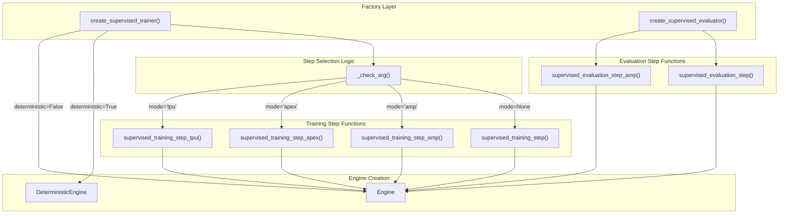
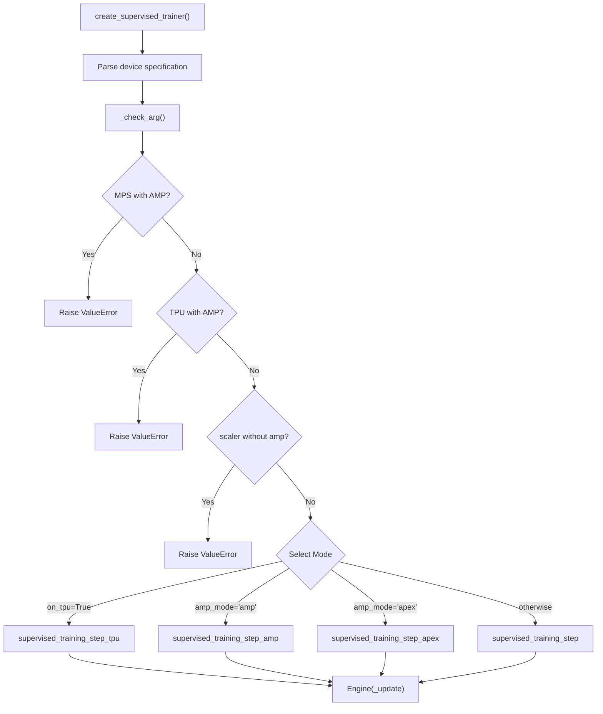
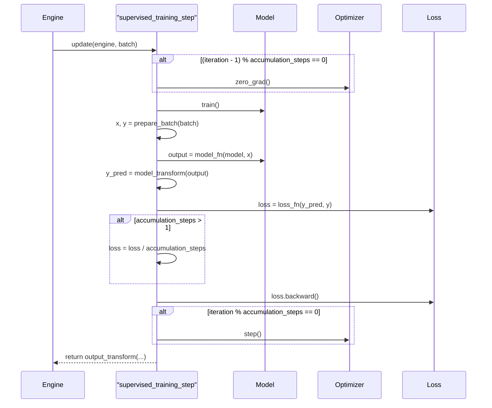
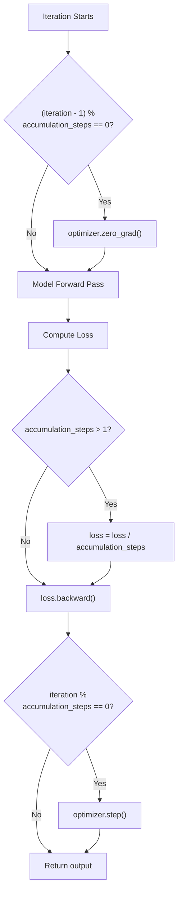
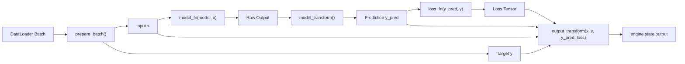

<!-- source: DeepWiki mcp.deepwiki.com · repo pytorch/ignite · page 2.5 Supervised Training Helpers · fetched 2026-10-21 -->

# Supervised Training Helpers

<details>
<summary>Relevant source files</summary>

The following files were used as context for generating this wiki page:

- [docs/source/engine.rst](docs/source/engine.rst)
- [ignite/contrib/engines/tbptt.py](ignite/contrib/engines/tbptt.py)
- [ignite/engine/__init__.py](ignite/engine/__init__.py)
- [ignite/metrics/regression/_base.py](ignite/metrics/regression/_base.py)
- [ignite/metrics/regression/canberra_metric.py](ignite/metrics/regression/canberra_metric.py)
- [ignite/metrics/regression/fractional_absolute_error.py](ignite/metrics/regression/fractional_absolute_error.py)
- [ignite/metrics/regression/fractional_bias.py](ignite/metrics/regression/fractional_bias.py)
- [ignite/metrics/regression/geometric_mean_absolute_error.py](ignite/metrics/regression/geometric_mean_absolute_error.py)
- [ignite/metrics/regression/geometric_mean_relative_absolute_error.py](ignite/metrics/regression/geometric_mean_relative_absolute_error.py)
- [ignite/metrics/regression/manhattan_distance.py](ignite/metrics/regression/manhattan_distance.py)
- [ignite/metrics/regression/maximum_absolute_error.py](ignite/metrics/regression/maximum_absolute_error.py)
- [ignite/metrics/regression/mean_absolute_relative_error.py](ignite/metrics/regression/mean_absolute_relative_error.py)
- [tests/ignite/engine/test_create_supervised.py](tests/ignite/engine/test_create_supervised.py)

</details>


This page documents the supervised training and evaluation helper functions in PyTorch Ignite. These factory functions (`create_supervised_trainer` and `create_supervised_evaluator`) simplify the creation of training and evaluation engines for supervised learning tasks. They handle common patterns like automatic mixed precision (`torch.amp`, NVIDIA Apex), gradient accumulation, TPU/XLA acceleration, device management, and offer multiple customization points through transform functions.

For information about the underlying `Engine` class and lifecycle, see [Engine Class and Lifecycle](#2.1). For deterministic training with reproducible batch sampling, see [Deterministic Training](#2.4).

## Overview

The supervised helpers provide two main factory functions defined in `ignite.engine`:

- **`create_supervised_trainer`**: Instantiates an `Engine` for model training with support for automatic mixed precision (`amp_mode="amp"`, `amp_mode="apex"`), gradient accumulation, and TPU execution.
- **`create_supervised_evaluator`**: Instantiates an `Engine` for model evaluation and metrics computation.

These functions generate pre-configured update and evaluation step callables (`supervised_training_step`, `supervised_evaluation_step`, etc.) that handle the forward pass, loss calculation, backward pass, and optimizer steps.

Sources: [ignite/engine/__init__.py:27-44]()

## Architecture

The factory functions follow a layered architecture where they inspect arguments, select the appropriate step implementation based on device type and precision mode, and wrap it inside an `Engine` or `DeterministicEngine`.



Sources: [ignite/engine/__init__.py:426-622](), [ignite/engine/__init__.py:745-824]()

## create_supervised_trainer

The `create_supervised_trainer` function constructs a trainer engine:

```python
def create_supervised_trainer(
    model: torch.nn.Module,
    optimizer: torch.optim.Optimizer,
    loss_fn: Callable[[Any, Any], torch.Tensor] | torch.nn.Module,
    device: str | torch.device | None = None,
    non_blocking: bool = False,
    prepare_batch: Callable = _prepare_batch,
    model_transform: Callable[[Any], Any] = lambda output: output,
    output_transform: Callable[[Any, Any, Any, torch.Tensor], Any] = lambda x, y, y_pred, loss: loss.item(),
    deterministic: bool = False,
    amp_mode: str | None = None,
    scaler: bool | GradScaler = False,
    gradient_accumulation_steps: int = 1,
    model_fn: Callable[[torch.nn.Module, Any], Any] = lambda model, x: model(x),
) -> Engine
```

### Key Parameters

| Parameter | Type | Description |
|-----------|------|-------------|
| `model` | `torch.nn.Module` | The neural network model to train. |
| `optimizer` | `torch.optim.Optimizer` | The optimization algorithm. |
| `loss_fn` | `Callable` or `torch.nn.Module` | Loss function receiving `(y_pred, y)`. |
| `device` | `str` or `torch.device` | Device for batch data (`model` is **not** moved automatically). |
| `amp_mode` | `str` | Mixed precision backend: `"amp"` for `torch.amp`, `"apex"` for NVIDIA Apex, or `None`. |
| `scaler` | `bool` or `GradScaler` | Gradient scaler instance or boolean flag for automatic creation under `amp_mode="amp"`. |
| `gradient_accumulation_steps` | `int` | Number of iterations over which to accumulate gradients (default: `1`). |
| `deterministic` | `bool` | If `True`, wraps update function in a `DeterministicEngine`. |

### Device Handling

The `device` parameter only transfers batch inputs (`x` and `y`) to the specified target device. The model and optimizer must be manually moved to the device prior to invoking `create_supervised_trainer`:

```python
model = model.to(device)
optimizer = torch.optim.SGD(model.parameters(), lr=0.01)
trainer = create_supervised_trainer(model, optimizer, loss_fn, device=device)
```

Sources: [ignite/engine/__init__.py:426-556]()

### Mode Selection Flow



Sources: [ignite/engine/__init__.py:395-424](), [ignite/engine/__init__.py:558-622]()

Sources for this section: [ignite/engine/__init__.py:426-622]()

## create_supervised_evaluator

The `create_supervised_evaluator` function creates an evaluation engine with optional metric attachment:

```python
def create_supervised_evaluator(
    model: torch.nn.Module,
    metrics: Mapping[str, Metric] | None = None,
    device: str | torch.device | None = None,
    non_blocking: bool = False,
    prepare_batch: Callable = _prepare_batch,
    model_transform: Callable[[Any], Any] = lambda output: output,
    output_transform: Callable[[Any, Any, Any], Any] = lambda x, y, y_pred: (y_pred, y),
    amp_mode: str | None = None,
    model_fn: Callable[[torch.nn.Module, Any], Any] = lambda model, x: model(x),
) -> Engine
```

### Key Differences from Trainer
1. **No Optimizer or Loss Function Required**: Evaluators focus purely on forward inference.
2. **Built-in Metric Integration**: Passing a `metrics` dictionary automatically attaches each metric to the evaluator engine.
3. **No Gradient Accumulation**: Evaluation executes in a single pass under `torch.no_grad()`.
4. **Default Output Format**: `output_transform` defaults to returning `(y_pred, y)` for metric updates.

Sources: [ignite/engine/__init__.py:745-824]()

Sources for this section: [ignite/engine/__init__.py:745-824]()

## Training Step Implementations

Training step functions act as the engine's `process_function`. Several specialized variants handle different execution backends.

### Basic Training Step
`supervised_training_step` performs standard forward propagation, loss calculation, gradient clearing, backward pass, and parameter optimization [ignite/engine/__init__.py:58-139]().



Sources: [ignite/engine/__init__.py:58-139]()

### AMP Training Step (`torch.amp`)
`supervised_training_step_amp` wraps the forward pass and loss evaluation inside `torch.amp.autocast` and leverages a `GradScaler` to prevent underflow with `torch.float16` types [ignite/engine/__init__.py:141-221]().

```python
with autocast(device_type, enabled=True):
    output = model_fn(model, x)
    y_pred = model_transform(output)
    loss = loss_fn(y_pred, y)

if scaler:
    scaler.scale(loss).backward()
    if engine.state.iteration % gradient_accumulation_steps == 0:
        scaler.step(optimizer)
        scaler.update()
```

Sources: [ignite/engine/__init__.py:141-221]()

### Apex Training Step
`supervised_training_step_apex` integrates with NVIDIA Apex (`amp.scale_loss`) for mixed precision training across older PyTorch distributions [ignite/engine/__init__.py:223-307]().

Sources: [ignite/engine/__init__.py:223-307]()

### TPU Training Step
`supervised_training_step_tpu` coordinates with `torch_xla` to execute `xm.optimizer_step(optimizer, barrier=True)` [ignite/engine/__init__.py:310-392]().

Sources: [ignite/engine/__init__.py:310-392]()

Sources for this section: [ignite/engine/__init__.py:58-392]()

## Gradient Accumulation

Gradient accumulation simulates large batch sizes by accumulating gradients over `gradient_accumulation_steps` before invoking `optimizer.step()` [ignite/engine/__init__.py:87]().



Sources: [ignite/engine/__init__.py:117-137]()

Sources for this section: [ignite/engine/__init__.py:117-137]()

## Customization Points

The helper factories expose four injection points via callable parameters:



Sources: [ignite/engine/__init__.py:47-69]()

1. **`prepare_batch`**: Handles tensor extraction and device migration from data loader items [ignite/engine/__init__.py:47-55]().
2. **`model_fn`**: Customizes model invocation (e.g., passing extra arguments or keyword parameters) [ignite/engine/__init__.py:68]().
3. **`model_transform`**: Post-processes raw model outputs into the format expected by the loss function [ignite/engine/__init__.py:65]().
4. **`output_transform`**: Formats what is written to `engine.state.output` on each iteration [ignite/engine/__init__.py:66]().

Sources for this section: [ignite/engine/__init__.py:47-69]()

## GradScaler State Management

When `scaler=True` or a custom `GradScaler` instance is passed under `amp_mode="amp"`, Ignite attaches the scaler to `trainer.state.scaler`. This ensures that checkpoint handlers can serialize and restore the scaler state alongside model and optimizer parameters [tests/ignite/engine/test_create_supervised.py:161-182]().

Sources: [tests/ignite/engine/test_create_supervised.py:161-182]()

---

