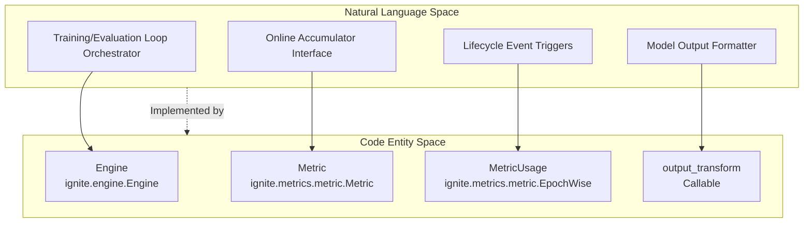
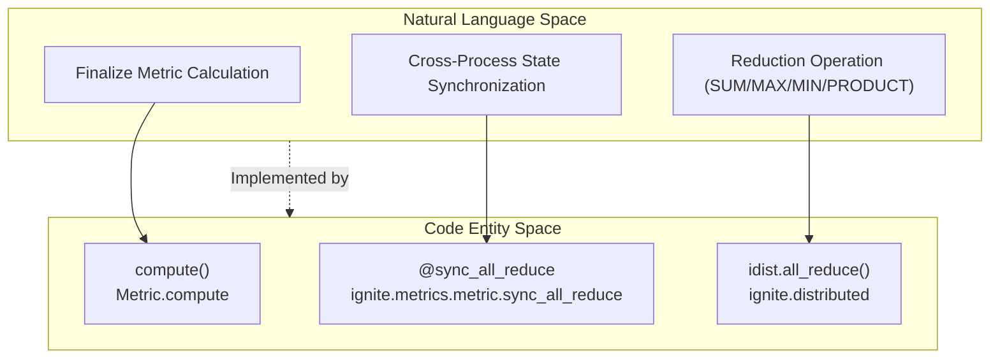

<!-- source: DeepWiki mcp.deepwiki.com · repo pytorch/ignite · page 3 Metrics System · fetched 2026-10-21 -->

# Metrics System

Relevant source files

The following files were used as context for generating this wiki page:

- [docs/source/metrics.rst](docs/source/metrics.rst)
- [ignite/metrics/__init__.py](ignite/metrics/__init__.py)
- [ignite/metrics/metric.py](ignite/metrics/metric.py)
- [requirements-dev.txt](requirements-dev.txt)
- [tests/ignite/metrics/test_metric.py](tests/ignite/metrics/test_metric.py)

## Purpose and Scope

The Metrics System provides a robust framework for computing model evaluation performance in an online fashion across classification, regression, and custom tasks. Metrics accumulate statistics incrementally across batches without requiring the storage of full model output histories, minimizing memory overhead during training and validation loops.

As this is a parent page, it provides a high-level overview of the metric framework, its lifecycle integration with the engine, and its architectural components. For deep technical details, implementation specifics, and advanced usage, please refer to the designated child pages:
- [Metric Base Class and Lifecycle](#3.1)
- [Classification and Regression Metrics](#3.2)
- [Metric Composition with MetricsLambda](#3.3)
- [Distributed Metrics Computation](#3.4)
- [Domain-Specific Metrics (Vision, NLP, GAN, Clustering, Fairness)](#3.5)

**Sources:** [docs/source/metrics.rst:1-20](), [ignite/metrics/metric.py:1-45]()

---

## Architectural Overview

The metrics framework bridges model outputs and engine state updates through structured lifecycles, attachment utilities, and distributed synchronization layers.

**Diagram: Natural Language to Code Entity Mapping for Metrics**

**Sources:** [docs/source/metrics.rst:7-36](), [ignite/metrics/metric.py:31-90]()

---

## 3.1 Metric Base Class and Lifecycle

All metrics inherit from the abstract base class `ignite.metrics.metric.Metric` [ignite/metrics/metric.py:223-351](). The core execution contract relies on three fundamental methods: `reset()`, `update()`, and `compute()` [docs/source/metrics.rst:12-19](). 

Metrics integrate directly with training or evaluation loops through the `attach()` method, which binds execution hooks to engine events using specific `MetricUsage` patterns such as `EpochWise` or `BatchWise` [ignite/metrics/metric.py:67-142](). Furthermore, `output_transform` functions map arbitrary engine process function returns into standard `(y_pred, y)` tuples [docs/source/metrics.rst:38-63]().

For detailed explanations of the interface, attachment mechanics, usage patterns, and transformation considerations, see [Metric Base Class and Lifecycle](#3.1).

**Sources:** [docs/source/metrics.rst:7-150](), [ignite/metrics/metric.py:31-221](), [ignite/metrics/metric.py:383-568]()

---

## 3.2 Classification and Regression Metrics

Ignite provides an extensive suite of built-in metrics for standard supervised tasks. Classification metrics include `Accuracy`, `Precision`, `Recall`, `Fbeta`, `ConfusionMatrix`, `ClassificationReport`, and top-k categorical measures [ignite/metrics/__init__.py:56-68](). Regression metrics cover `MeanAbsoluteError`, `MeanSquaredError`, `RootMeanSquaredError`, and related distance measures [ignite/metrics/__init__.py:61-64](). 

These metrics handle multi-class, multi-label, and binary scenarios seamlessly, providing configurable averaging strategies (micro, macro, weighted, or none).

For a complete catalog of built-in classification and regression metrics along with usage examples, see [Classification and Regression Metrics](#3.2).

**Sources:** [docs/source/metrics.rst:311-392](), [ignite/metrics/__init__.py:1-115]()

---

## 3.3 Metric Composition with MetricsLambda

Metrics can be composed algebraically to construct complex or composite performance indicators [docs/source/metrics.rst:152-158](). By overloading Python arithmetic operators (`+`, `-`, `*`, `/`, `**`, etc.) and supporting PyTorch tensor operations, users can combine individual metrics (such as unaveraged `Precision` and `Recall`) into derived evaluations like custom F-beta scores or specialized composite losses [docs/source/metrics.rst:163-172](). Indexing operations also allow extracting specific sub-components or class-wise metrics from matrix-based accumulators.

For details on operator overloading, custom lambda expressions, metric groups, and report generation, see [Metric Composition with MetricsLambda](#3.3).

**Sources:** [docs/source/metrics.rst:152-185](), [ignite/metrics/metric.py:717-795](), [tests/ignite/metrics/test_metric.py:135-280]()

---

## 3.4 Distributed Metrics Computation

**Diagram: Distributed Synchronization Architecture in Code Entities**

In distributed environments (multi-GPU, multi-node, or TPU settings), metrics automatically or via explicit decorators synchronize internal states across processes [docs/source/metrics.rst:87-90](). The `@sync_all_reduce` decorator coordinates attribute reduction (`SUM`, `MAX`, `MIN`, `PRODUCT`) across processes before executing `compute()`, ensuring globally accurate results when data samplers are partitioned [ignite/metrics/metric.py:803-859]().

For a detailed breakdown of distributed decorators, multi-process reduction workflows, and state dictionary serialization across ranks, see [Distributed Metrics Computation](#3.4).

**Sources:** [docs/source/metrics.rst:87-111](), [ignite/metrics/metric.py:803-879]()

---

## 3.5 Domain-Specific Metrics (Vision, NLP, GAN, Clustering, Fairness)

Beyond standard classification and regression, Ignite includes specialized metric families tailored to complex domains:
- **Computer Vision:** Structural Similarity (`SSIM`), Peak Signal-to-Noise Ratio (`PSNR`), Intersection over Union (`IoU`, `mIoU`), and object detection mean Average Precision (`ObjectDetectionAvgPrecisionRecall`) [ignite/metrics/__init__.py:40-53]()
- **Natural Language Processing:** `Bleu`, `Rouge`, `Perplexity`, and `CharacterErrorRate` [ignite/metrics/__init__.py:34-37]()
- **Generative Adversarial Networks:** Fréchet Inception Distance (`FID`) and Inception Score (`InceptionScore`) [ignite/metrics/__init__.py:16-17]()
- **Clustering and Recommender Systems:** Mutual information, silhouette scores, hit rate, and normalized discounted cumulative gain (`NDCG`) [ignite/metrics/__init__.py:33-43]()
- **Fairness:** Specialized evaluation tools for bias and fairness metrics [ignite/metrics/__init__.py:2]()

For complete documentation on domain-specific metric implementations, see [Domain-Specific Metrics (Vision, NLP, GAN, Clustering, Fairness)](#3.5).

**Sources:** [docs/source/metrics.rst:380-440](), [ignite/metrics/__init__.py:1-115]()

---

